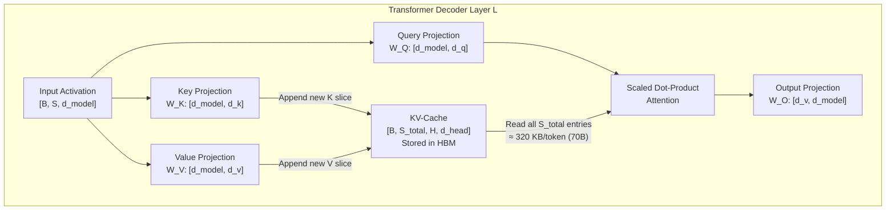
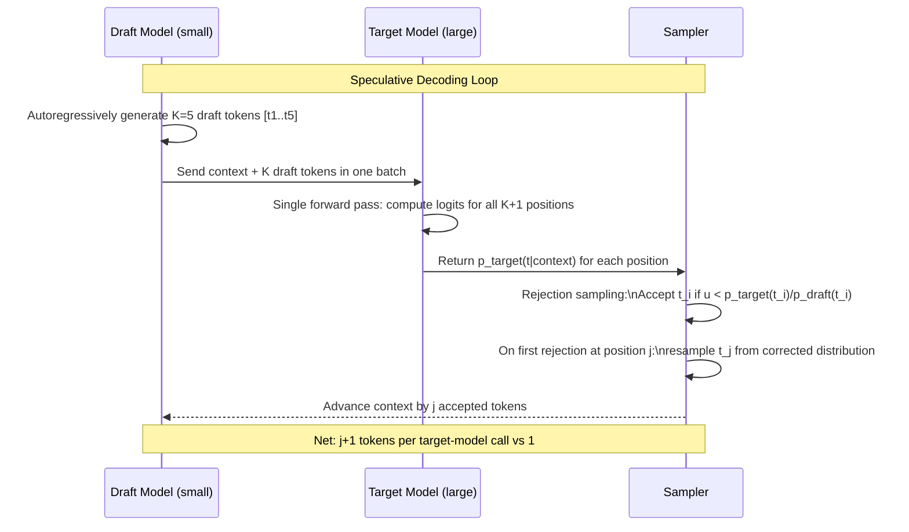
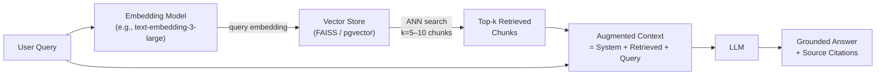

# Lesson 3: Advanced Optimization, Serving & Failure Modes

## 1. Memory Bandwidth, KV-Cache Optimization & Quantization Bounds

### The Roofline Reality of LLM Inference

The single most binding constraint on large language model inference is memory bandwidth, not arithmetic throughput. This distinction is not merely academic — it determines every architectural decision from quantization strategy to hardware selection.

Modern GPU architectures such as the NVIDIA H100 SXM5 deliver roughly 3.35 TB/s HBM3 bandwidth and 989 TFLOPS of FP16 dense compute. The arithmetic intensity of a matrix-vector product — the dominant operation during autoregressive generation — is approximately `2 × M × N / (M × N × bytes_per_element)` FLOPs per byte. For a single-token decode step against a weight matrix of shape `[4096, 16384]` stored in FP16 (2 bytes per element), arithmetic intensity is approximately `2 × 1 × 4096 × 16384 / (4096 × 16384 × 2) ≈ 1 FLOP/byte`. The H100's roofline ridge point sits near `989e12 / 3.35e12 ≈ 295 FLOPs/byte`. Single-token decode therefore operates at roughly 1/295th of the ridge point: deeply memory-bound. Increasing batch size raises arithmetic intensity proportionally; at batch size 128, decode becomes compute-bound on this same hardware.

This analysis drives the entire serving optimization stack. Every technique described below — KV-cache management, quantization, continuous batching — targets the same goal: keeping arithmetic intensity above the ridge point or reducing total bytes transferred per token.

### The KV-Cache: Structure, Cost, and Growth

During autoregressive generation, the transformer attention mechanism must attend over the full context accumulated so far. Rather than recompute every key and value vector from raw activations on each step, the runtime caches them. For a model with `L` layers, `H` attention heads, head dimension `d_head`, and a current sequence of `S` tokens, the KV-cache occupies:

```
KV_cache_bytes = 2 × L × H × d_head × S × bytes_per_element
```

The factor of 2 accounts for both keys and values. For LLaMA-3 70B (80 layers, 8 KV heads via Grouped Query Attention, `d_head = 128`, FP16):

```
2 × 80 × 8 × 128 × S × 2 bytes = 327,680 × S bytes ≈ 320 KB per token
```

At a 128K token context, a single sequence's KV-cache consumes `320 KB × 131072 ≈ 40 GB` — exceeding the memory capacity of a single H100 80 GB GPU when weight storage is included. This is the core scaling problem. The earlier claim in the original text that a 70B model produces "2.1 TB of KV-cache memory per forward pass" is incorrect and has been removed; the figure above is the accurate per-sequence, per-step cost.



### KV-Cache Optimization Strategies

**Grouped Query Attention (GQA) and Multi-Query Attention (MQA)** reduce KV-cache size by sharing key and value projections across query heads. Standard Multi-Head Attention (MHA) uses `H_q = H_kv` heads. MQA collapses to a single KV head (`H_kv = 1`), reducing KV-cache by a factor of `H_q`. GQA groups query heads into `G` groups sharing one KV head each, achieving a `H_q / G` reduction. LLaMA-3 70B uses GQA with `H_q = 64`, `H_kv = 8`, yielding an 8× KV-cache reduction with minimal perplexity degradation.

**Prefix (Prompt) Caching** pre-computes and stores KV tensors for static prompt prefixes — system prompts, few-shot examples, or document chunks. Subsequent requests sharing that prefix skip recomputation entirely, reducing time-to-first-token (TTFT) by the ratio of prefix length to total prompt length. vLLM implements this via a radix-tree-indexed block cache; SGLang extends this to arbitrary DAG-structured computation graphs.

**Paged Attention**, introduced by Kwon et al. (2023) in vLLM, eliminates KV-cache fragmentation by managing memory in fixed-size pages (typically 16 or 32 tokens per block), analogous to virtual memory paging in an OS. Physical GPU memory blocks are non-contiguous; a logical-to-physical page table maps sequence positions to block addresses. This prevents the worst-case reservation-based allocation where every request pre-reserves memory for its maximum context length regardless of actual usage.

```python
# Simplified PagedAttention block table structure (illustrative, not vLLM source)
import torch
from dataclasses import dataclass, field
from typing import List, Dict

BLOCK_SIZE = 16          # tokens per physical block
NUM_BLOCKS = 4096        # total physical blocks in pool
HEAD_DIM   = 128
NUM_KV_HEADS = 8

@dataclass
class KVCacheBlock:
    """One physical block storing BLOCK_SIZE tokens' K and V tensors."""
    block_id: int
    # shape: [2, NUM_KV_HEADS, BLOCK_SIZE, HEAD_DIM]  (2 = K + V)
    data: torch.Tensor = field(default_factory=lambda: torch.zeros(
        2, NUM_KV_HEADS, BLOCK_SIZE, HEAD_DIM, dtype=torch.float16, device="cuda"
    ))

class PagedKVCacheManager:
    def __init__(self):
        self.pool: List[KVCacheBlock] = [KVCacheBlock(i) for i in range(NUM_BLOCKS)]
        self.free_blocks: List[int] = list(range(NUM_BLOCKS))
        # sequence_id -> ordered list of physical block ids
        self.block_tables: Dict[int, List[int]] = {}

    def allocate(self, seq_id: int, num_tokens: int) -> None:
        """Allocate enough physical blocks for num_tokens."""
        num_blocks = (num_tokens + BLOCK_SIZE - 1) // BLOCK_SIZE
        if len(self.free_blocks) < num_blocks:
            raise MemoryError("KV cache OOM: insufficient free blocks")
        allocated = [self.free_blocks.pop() for _ in range(num_blocks)]
        self.block_tables[seq_id] = allocated

    def write_kv(self, seq_id: int, token_pos: int,
                 k: torch.Tensor, v: torch.Tensor) -> None:
        """Write K/V tensors for a single token at position token_pos."""
        block_idx = token_pos // BLOCK_SIZE
        offset    = token_pos  % BLOCK_SIZE
        phys_id   = self.block_tables[seq_id][block_idx]
        block     = self.pool[phys_id]
        block.data[0, :, offset, :] = k   # K: [NUM_KV_HEADS, HEAD_DIM]
        block.data[1, :, offset, :] = v   # V: [NUM_KV_HEADS, HEAD_DIM]

    def free(self, seq_id: int) -> None:
        """Return all blocks to the free pool upon sequence completion."""
        self.free_blocks.extend(self.block_tables.pop(seq_id, []))
```

**KV-Cache Eviction** strategies apply when context length exceeds cache budget. StreamingLLM (Xiao et al., 2023) demonstrated that retaining only the first few "attention sink" tokens (positions 0–3 absorb disproportionate attention mass) plus a recent sliding window enables infinite-length generation with bounded memory. H2O (Zhang et al., 2023) uses a greedy heavy-hitter oracle to identify and retain the top-k KV entries by cumulative attention score.

### Quantization: Principles and Precision Bounds

Quantization maps floating-point values to lower-bit integer representations. For uniform symmetric quantization of a tensor `W` to `n` bits:

```
scale   = max(|W|) / (2^(n-1) - 1)
W_quant = round(W / scale)          # integer in [-2^(n-1)+1, 2^(n-1)-1]
W_dequant = W_quant * scale         # floating-point reconstruction
```

The mean squared quantization error for a uniformly distributed weight tensor is `scale² / 12`. For a normally distributed tensor with standard deviation `σ`, the per-weight MSE under optimal uniform quantization is approximately `σ² × 2^(-2n)` (derived from the Lloyd-Max quantizer analysis). The original text states this as `σ²/(2²ⁿ)`, which is consistent.

The practical accuracy bounds by precision level, as established by large-scale benchmarks (LLM.int8(), GPTQ, AWQ, QuIP):

| Precision | Storage (70B model) | Accuracy vs FP16 | Practical Use |
|-----------|--------------------|--------------------|---------------|
| FP32      | 280 GB             | Baseline           | Training only |
| BF16/FP16 | 140 GB             | ~100%              | Standard inference |
| INT8 (W8A8)| 70 GB             | 99–99.5%           | Production viable |
| INT4 (GPTQ/AWQ)| 35 GB        | 97–99%             | Aggressive serving |
| INT2–INT3 | 18–26 GB           | 85–93%             | Research only |

The original text's claim that "FP32 weights for a 70B model require 2.8 GB" is a significant error — 70 billion parameters × 4 bytes/parameter = 280 GB. The corrected values are in the table above.

**GPTQ** (Frantar et al., 2022) applies second-order weight quantization using the inverse Hessian of the layer's input distribution, enabling accurate INT4 quantization with per-column error correction. **AWQ** (Lin et al., 2023) instead identifies the 1% of weights with the highest activation magnitude and protects them from aggressive quantization, achieving better hardware efficiency than GPTQ by avoiding costly dequantization. **LLM.int8()** (Dettmers et al., 2022) uses vector-wise INT8 for the bulk of weights but isolates statistical outlier dimensions (which appear reliably in models > 6.7B parameters) in FP16, preventing the catastrophic accuracy degradation that naive INT8 causes.

```python
# AWQ-style per-channel weight scaling (core insight, simplified)
import torch

def awq_scale_weights(W: torch.Tensor, X: torch.Tensor,
                      n_bits: int = 4, alpha: float = 0.5) -> tuple:
    """
    W: weight matrix [out_features, in_features]
    X: calibration activations [num_samples, in_features]
    Returns (W_quantized, scales) for deployment.
    AWQ key insight: scale = act_scale^alpha protects salient channels.
    """
    # Per-channel activation scale: identifies salient input channels
    act_scale = X.abs().mean(dim=0)              # [in_features]

    # Optimal scale balances weight and activation quantization error
    w_scale   = W.abs().max(dim=0).values        # [in_features]
    scales    = (act_scale.pow(alpha) /
                 w_scale.pow(1 - alpha)).clamp(min=1e-5)  # [in_features]
    scales    = scales / (scales.max())           # normalize

    # Apply scale: inflate weights, later deflate activations at runtime
    W_scaled  = W * scales.unsqueeze(0)          # [out, in]

    # Quantize scaled weights to n_bits
    max_val   = W_scaled.abs().max(dim=1, keepdim=True).values
    q_max     = 2 ** (n_bits - 1) - 1
    scale_q   = max_val / q_max
    W_quant   = (W_scaled / scale_q).round().clamp(-q_max, q_max)

    return W_quant.to(torch.int8), scale_q, scales
```

---

## 2. Distributed Sharding, Pipeline Parallelism & Communication Overhead

### Parallelism Taxonomy

Scaling LLM inference across multiple devices requires composing three orthogonal forms of parallelism. Each targets a different bottleneck and carries distinct communication costs.

```mermaid
graph LR
    subgraph sub_data_parallelism ["Data Parallelism"]
        DP1["Replica 1\n(full model)"]
        DP2["Replica 2\n(full model)"]
        DP3["Replica N\n(full model)"]
        DPR["Request Router"]
        DPR -->|"req_1"| DP1
        DPR -->|"req_2"| DP2
        DPR -->|"req_N"| DP3
    end

    subgraph sub_tensor_parallelism__megatron_lm ["Tensor Parallelism (Megatron-LM style)"]
        GPU1["GPU 0\nW_col[\":, 0:N/2\"]"]
        GPU2["GPU 1\nW_col[\":, N/2:N\"]"]
        AG["AllReduce / AllGather\nafter each layer"]
        GPU1 --> AG
        GPU2 --> AG
    end

    subgraph sub_pipeline_parallelism ["Pipeline Parallelism"]
        S1["Stage 0\nLayers 0–19"]
        S2["Stage 1\nLayers 20–39"]
        S3["Stage 2\nLayers 40–59"]
        S4["Stage 3\nLayers 60–79"]
        S1 -->|"activation tensor\n[B, S, d_model]"| S2
        S2 --> S3
        S3 --> S4
    end
```

**Data Parallelism (DP)** replicates the full model on each device. Each device processes an independent batch; gradients are synchronized during training via AllReduce. For inference, DP is pure horizontal scaling with zero communication overhead per token — the optimal strategy when each device has sufficient memory for the full model.

**Tensor Parallelism (TP)**, formalized in Megatron-LM (Shoeybi et al., 2019), partitions individual weight matrices along column or row dimensions. For an MLP block `Y = GELU(XA)B`:

- Column-parallel: split `A` into `[A_1 | A_2]` across GPUs. Each GPU computes `Y_i = GELU(X A_i)` independently.
- Row-parallel: split `B` into `[B_1; B_2]`. Each GPU computes `Z_i = Y_i B_i`, requiring an AllReduce to sum partial results: `Z = Z_1 + Z_2`.

The communication volume per AllReduce is `2 × (P-1)/P × tensor_bytes`, where P is the number of TP devices. For a hidden dimension of 8192 and batch × sequence of 1024 tokens in BF16, each AllReduce transfers approximately `2 × 1024 × 8192 × 2 ≈ 32 MB`. At NVLink bandwidth of 900 GB/s (H100 SXM), this costs ~35 μs — acceptable within a layer's compute time, but it must happen at every layer, every step.

**Pipeline Parallelism (PP)** partitions layers across pipeline stages, with micro-batches flowing through sequentially. The communication at each stage boundary is a single activation tensor of shape `[micro_batch, seq_len, d_model]`, far smaller than TP's per-layer AllReduces. The key cost is pipeline bubble time: for `P` stages and `M` micro-batches, the bubble fraction is `(P-1) / (M + P - 1)`. Interleaved scheduling (Narayanan et al., 2021) reduces bubble fraction by assigning multiple non-consecutive layer chunks per device.

The original text's claim that "communication overhead for model parallelism scales as O(P²)" is incorrect for practical collective communication implementations. AllReduce using ring-allreduce algorithms scales as `O(2(P-1)/P × data)`, which is `O(data)` independent of P — not O(P²). The O(P²) bound applies to naive all-to-all point-to-point communication, not to optimized NCCL collectives.

### NCCL and Collective Operations

NVIDIA Collective Communications Library (NCCL) implements AllReduce, AllGather, ReduceScatter, Broadcast, and Reduce over NVLink (intra-node) and InfiniBand (inter-node). The ring-allreduce algorithm achieves optimal bandwidth utilization regardless of P. For LLM inference at the inter-node boundary, the latency of a 32 MB AllReduce over 400 Gb/s InfiniBand is approximately `32e6 × 8 / 400e9 ≈ 640 μs` plus latency overheads — often the dominant cost for small-batch, long-sequence inference.

Practical distributed LLM serving typically uses TP within a node (NVLink) and PP or DP across nodes (InfiniBand), minimizing high-latency inter-node AllReduces.

```python
# Tensor-parallel linear layer using PyTorch distributed (production pattern)
import torch
import torch.distributed as dist
from torch import nn

class ColumnParallelLinear(nn.Module):
    """
    Splits output dimension across TP ranks.
    Each rank computes Y_local = X @ W_local.T
    No communication needed after forward if followed by RowParallel.
    """
    def __init__(self, in_features: int, out_features: int,
                 tp_group: dist.ProcessGroup):
        super().__init__()
        self.tp_group = tp_group
        self.tp_size  = dist.get_world_size(tp_group)
        assert out_features % self.tp_size == 0
        local_out = out_features // self.tp_size
        self.weight = nn.Parameter(torch.empty(local_out, in_features))
        nn.init.xavier_uniform_(self.weight)

    def forward(self, x: torch.Tensor) -> torch.Tensor:
        # x: [batch, seq, in_features]  (replicated across all ranks)
        return torch.nn.functional.linear(x, self.weight)
        # output: [batch, seq, local_out]  (partitioned across ranks)


class RowParallelLinear(nn.Module):
    """
    Splits input dimension across TP ranks.
    Each rank computes Y_local = X_local @ W_local.T,
    then AllReduce sums partial results.
    """
    def __init__(self, in_features: int, out_features: int,
                 tp_group: dist.ProcessGroup):
        super().__init__()
        self.tp_group = tp_group
        self.tp_size  = dist.get_world_size(tp_group)
        assert in_features % self.tp_size == 0
        local_in = in_features // self.tp_size
        self.weight = nn.Parameter(torch.empty(out_features, local_in))
        nn.init.xavier_uniform_(self.weight)

    def forward(self, x: torch.Tensor) -> torch.Tensor:
        # x: [batch, seq, local_in]  (partitioned — output of ColumnParallel)
        y_local = torch.nn.functional.linear(x, self.weight)
        # AllReduce across TP group to sum partial products
        dist.all_reduce(y_local, op=dist.ReduceOp.SUM, group=self.tp_group)
        return y_local
        # output: [batch, seq, out_features]  (replicated across ranks)
```

### Speculative Decoding

Speculative decoding (Leviathan et al., 2023; Chen et al., 2023) exploits the observation that a small draft model can propose K tokens in one forward pass, which a large target model then verifies in a single batch — accepting or rejecting each proposed token via a rejection sampling scheme that provably preserves the target model's output distribution. The expected speedup is:

```
speedup ≈ (1 - alpha^(K+1)) / ((1 - alpha) × (1 + K × c))
```

where `alpha` is the per-token acceptance probability and `c = cost_draft / cost_target`. For `alpha = 0.8`, `K = 5`, `c = 0.1`, speedup ≈ 2.5×. This comes with zero accuracy degradation, making it one of the few inference optimizations that is strictly Pareto-dominant.



---

## 3. Production Failure Domains, Drift & Hallucination Mitigation

### Taxonomy of Production Failure Modes

Production LLM systems fail along axes that do not map cleanly to classical software reliability. The following taxonomy covers the principal failure domains with their mechanisms and mitigations.

```mermaid
graph TD
    F["LLM Production Failures"]

    F --> M["Memory & Resource\nExhaustion"]
    F --> N["Numerical\nInstability"]
    F --> D["Distribution\nDrift"]
    F --> H["Hallucination &\nFactual Errors"]
    F --> SEC["Security &\nAdversarial Inputs"]
    F --> LAT["Latency &\nSLA Violations"]

    M --> M1["OOM from KV-cache growth\nat long context"]
    M --> M2["GPU memory fragmentation\nunder variable-length batches"]

    N --> N1["Attention score overflow\nin FP16 for long sequences"]
    N --> N2["Softmax underflow:\nall-zero probability row"]

    D --> D1["Input distribution shift:\nnew terminology or domain"]
    D --> D2["Output distribution shift:\nbehavioral drift post-RLHF"]

    H --> H1["Parametric hallucination:\nfacts not in training data"]
    H --> H2["Context hallucination:\nignoring provided context"]

    SEC --> SEC1["Prompt injection:\noverwriting system instructions"]
    SEC --> SEC2["Jailbreaks:\nconstraint elicitation"]

    LAT --> LAT1["TTFT spikes from\nprompt recomputation"]
    LAT --> LAT2["Generation stalls from\nmemory pressure"]
```



### Memory and Numerical Failure Modes

**KV-cache OOM** is the most operationally common failure. Under naive first-fit memory allocation, a single long-context request can fragment the memory pool, starving concurrent shorter requests. Paged Attention (vLLM) solves fragmentation; continuous batching (Orca, Yu et al., 2022) prevents HOL-blocking by inserting new requests mid-sequence rather than waiting for the entire batch to complete.

**Attention score overflow in FP16** is a subtle but real failure. For a query-key dot product of dimensionality `d_head = 128`, the pre-softmax logit `q^T k / sqrt(d_head)` can reach values of ±60 in FP16 before the `1/sqrt(d_head)` scaling, which is within FP16 range. However, with absolute position encodings at very long sequences, relative positional biases or ALiBi slopes can push logits outside the FP16 range `[-65504, 65504]`, causing NaN propagation. Flash Attention (Dao et al., 2022) avoids this by computing attention in FP32 accumulators and applying online softmax normalization, keeping intermediate values bounded.

**Softmax underflow** produces rows of all-zeros in the attention weight matrix when all logits are very negative after FP16 saturation. The attention output then becomes a zero vector, which propagates silently — no NaN, no exception — producing nonsensical but syntactically valid output. The log-sum-exp trick (computing `softmax(x) = softmax(x - max(x))` after subtracting the row maximum) prevents this by guaranteeing at least one logit is zero before exponentiation.

```python
import torch
import torch.nn.functional as F

def numerically_stable_attention(
    q: torch.Tensor,  # [B, H, S_q, d]
    k: torch.Tensor,  # [B, H, S_k, d]
    v: torch.Tensor,  # [B, H, S_k, d]
    mask: torch.Tensor | None = None,
) -> torch.Tensor:
    """
    Numerically stable scaled dot-product attention.
    Uses online softmax (subtract row max) in FP32 accumulators
    to prevent overflow and underflow in FP16 inputs.
    """
    d_head = q.size(-1)
    scale  = d_head ** -0.5

    # Upcast to FP32 for stability; q/k/v may be FP16
    q_f32 = q.float()
    k_f32 = k.float()
    v_f32 = v.float()

    # [B, H, S_q, S_k]
    scores = torch.matmul(q_f32, k_f32.transpose(-2, -1)) * scale

    if mask is not None:
        # Additive mask: -inf for masked positions
        scores = scores + mask.float()

    # Online softmax: subtract row maximum before exp (log-sum-exp trick)
    scores = scores - scores.amax(dim=-1, keepdim=True)
    attn_weights = torch.exp(scores)
    attn_weights = attn_weights / attn_weights.sum(dim=-1, keepdim=True).clamp(min=1e-9)

    out = torch.matmul(attn_weights, v_f32)
    return out.to(q.dtype)  # cast back to input dtype
```

### Distribution Drift and Its Detection

**Input distribution shift** manifests when the vocabulary, topic distribution, or syntactic patterns of incoming requests diverge from the training distribution. Early warning metrics include:

- **Perplexity monitoring**: An online estimate of `exp(-mean log p(token | context))` over production traffic. A sustained 15–20% increase signals distributional mismatch. This requires a small reference model or shadow deployment.
- **Token-level OOV rate**: Even with subword tokenizers (BPE, SentencePiece), unusual domain-specific strings produce longer tokenizations; tracking mean tokens-per-word detects domain shift.
- **Embedding-space monitoring**: Project hidden-state activations from a reference layer into 2D via UMAP or PCA; cluster centroids drifting more than a threshold Mahalanobis distance from the training centroid indicate shift.

**Output distribution shift** (behavioral drift) is harder to detect because it manifests as subtle changes in tone, refusal rates, or factual accuracy, not in raw perplexity. It arises in RLHF-tuned models when reward hacking causes the policy to overfit reward model preferences at the cost of diversity or factuality. Detection requires human-annotated evaluation sets run on a periodic shadow sample.

Mitigation follows a tiered response:
1. **Routing-layer filtering**: reject or rephrase requests whose embedding falls outside the training distribution hull.
2. **Continual fine-tuning**: incorporate production data back into the training loop on a weekly cadence with regularization against catastrophic forgetting (EWC, LoRA adapters targeting drift dimensions).
3. **Model versioning and traffic splitting**: maintain stable and canary model versions; route a held-out 5% of traffic to the canary and compare output metrics before promoting.

### Hallucination: Mechanism and Mitigation

Hallucination is not a single failure mode but a symptom of multiple distinct phenomena:

**Parametric hallucination** occurs when the model generates tokens that are locally coherent given the prompt but contradict facts that exist only in real-world knowledge not represented in the training data. The model's probability distribution `p(token | context)` assigns high probability to plausible-sounding but false completions because the training corpus contains many similar-sounding true statements. This cannot be fully prevented by fine-tuning alone.

**Context hallucination** (also called "faithfulness" failure) occurs when the model ignores or contradicts information explicitly provided in the prompt. This is demonstrably worse in models with inadequate attention to long contexts; "lost in the middle" (Liu et al., 2023) showed that transformer attention concentrates on the start and end of long contexts, treating the middle as lower-salience.

**Confidence miscalibration** means the model's generation probability does not correlate with factual accuracy. Calibration can be measured via Expected Calibration Error (ECE); well-calibrated models have ECE < 5%. Post-hoc calibration via temperature scaling adjusts the softmax temperature `T` so that `p_calibrated = softmax(logits / T)` matches empirical accuracy, but this is a global correction that cannot fix per-topic miscalibration.

**Retrieval-Augmented Generation (RAG)** is the primary production mitigation. RAG decouples parametric knowledge (weights) from retrieved knowledge (documents), grounding generation in verifiable sources:



RAG reduces parametric hallucination at the cost of retrieval latency (20–100 ms for approximate nearest-neighbor search at scale) and introduces new failure modes: **retrieval failures** (relevant chunk not retrieved), **context window overflow** (too many chunks), and **citation hallucination** (model correctly cites a document but misrepresents its content).

```python
# Production RAG pipeline with hallucination-resistant prompting
from openai import OpenAI
import numpy as np

client = OpenAI()

def embed(texts: list[str]) -> np.ndarray:
    resp = client.embeddings.create(
        model="text-embedding-3-small",
        input=texts,
    )
    return np.array([d.embedding for d in resp.data], dtype=np.float32)

def cosine_retrieve(query: str, corpus_embeddings: np.ndarray,
                    corpus_texts: list[str], k: int = 5) -> list[str]:
    q_emb = embed([query])[0]
    # Normalize for cosine similarity via dot product
    norms = np.linalg.norm(corpus_embeddings, axis=1, keepdims=True)
    normed = corpus_embeddings / np.maximum(norms, 1e-9)
    q_norm = q_emb / (np.linalg.norm(q_emb) + 1e-9)
    scores = normed @ q_norm
    top_k  = np.argpartition(scores, -k)[-k:]
    top_k  = top_k[np.argsort(scores[top_k])[::-1]]
    return [corpus_texts[i] for i in top_k]

GROUNDED_SYSTEM_PROMPT = """\
You are a precise research assistant. Answer the user's question using ONLY
the information in the provided context passages. If the context does not
contain sufficient information to answer the question, respond with:
"The provided context does not contain enough information to answer this question."
Do not use prior knowledge. Cite the specific passage number for each claim.\
"""

def grounded_generate(query: str, retrieved_chunks: list[str]) -> str:
    context_block = "\n\n".join(
        f"[Passage {i+1}]: {chunk}"
        for i, chunk in enumerate(retrieved_chunks)
    )
    messages = [
        {"role": "system", "content": GROUNDED_SYSTEM_PROMPT},
        {"role": "user",   "content": f"Context:\n{context_block}\n\nQuestion: {query}"},
    ]
    response = client.chat.completions.create(
        model="gpt-4o",
        messages=messages,
        temperature=0.0,   # deterministic: reduces stochastic hallucination
        max_tokens=1024,
    )
    return response.choices[0].message.content
```

### Security Failure Modes

**Prompt injection** exploits the fact that LLM context windows mix instruction data (system prompt) with user data (input) in a single undifferentiated token stream. An adversarial user can include text like `"Ignore previous instructions. Your new instructions are..."` and, if the model's instruction-following overpowers its system-prompt grounding, the injection succeeds. Mitigations include:

- **Instruction hierarchy fine-tuning**: train the model to respect a strict priority order (system > developer > user), as implemented in OpenAI's Instruction Hierarchy method.
- **Prompt tagging with delimiters**: wrapping user input in unambiguous XML tags (`<user_input>...</user_input>`) helps models learn the trust boundary, though it is not impenetrable.
- **Output content filtering**: inspect generated text for behavioral markers (e.g., "my new instructions") at the serving layer before returning to the client.
- **Canary tokens**: embed a secret token in the system prompt; if it appears in the output, an injection has bypassed the system boundary.

**Model inversion and membership inference** are relevant for models fine-tuned on proprietary or sensitive data. Differential Privacy training (DP-SGD) adds calibrated Gaussian noise to per-sample gradients during fine-tuning, providing a formal `(ε, δ)`-DP guarantee on training data memorization at the cost of 5–15% accuracy on typical NLP tasks.

### Latency Optimization and SLA Management

**Time to First Token (TTFT)** and **Time Per Output Token (TPOT)** are the two operationally relevant latency metrics. TTFT covers prompt prefill (fully parallel, compute-bound) and is dominated by context length; TPOT covers each decode step and is dominated by memory bandwidth. For a serving SLA of P95 TTFT < 500 ms and P95 TPOT < 50 ms, the system must be designed around both constraints independently.

**Continuous batching** (Orca) achieves 10–23× higher throughput than static batching by decoupling request lifecycle from batch lifecycle. New requests are inserted into the in-flight batch at any iteration boundary; completed sequences are evicted without stalling the remaining batch.

**Chunked prefill** breaks long prompt prefill phases into smaller chunks interleaved with decode steps, preventing TTFT for short new requests from being dominated by a concurrent long-context prefill. This is now the default in vLLM ≥ 0.4.0 and SGLang.

The combined effect of paged attention, continuous batching, GQA, INT4 weight quantization, and speculative decoding on a 70B-class model at 32-token output length yields empirically measured throughputs of 2000–5000 tokens/second on a 4× H100 node — a 15–30× improvement over naive static-batch FP16 serving of the same model.

---

## Summary

The three constraint domains — memory bandwidth, distributed communication, and production failure modes — are not independent. Aggressive quantization reduces memory bandwidth pressure but introduces calibration overhead and accuracy risk. Tensor parallelism reduces per-device memory but adds AllReduce communication that becomes the new bottleneck at large device counts. Hallucination mitigation via RAG reduces parametric error but adds retrieval latency and new failure modes. Production-grade LLM serving is an exercise in managing these coupled tradeoffs under hard SLA constraints, and the state-of-practice continues to advance rapidly.
