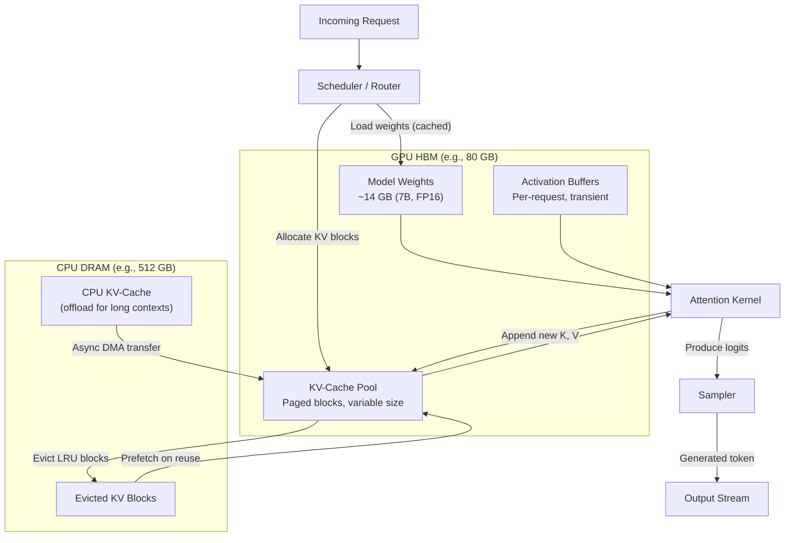
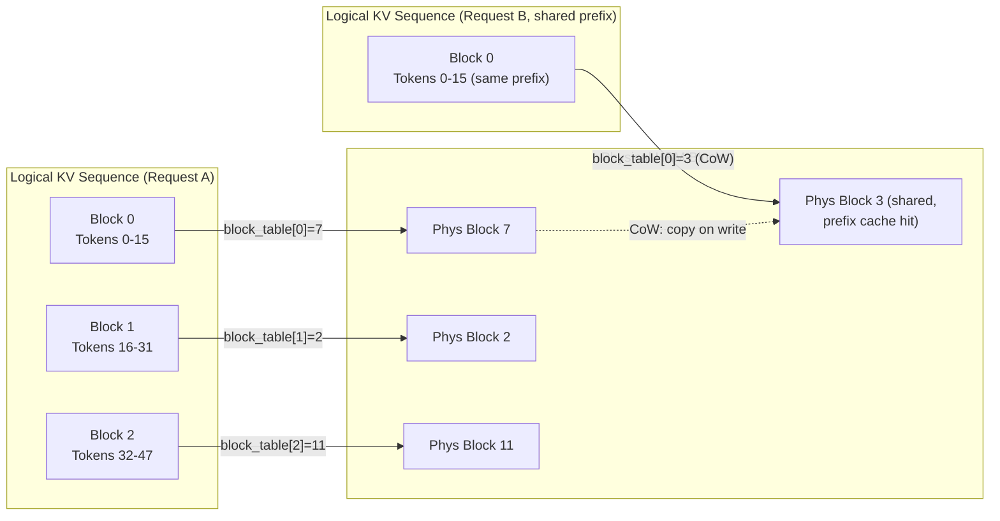
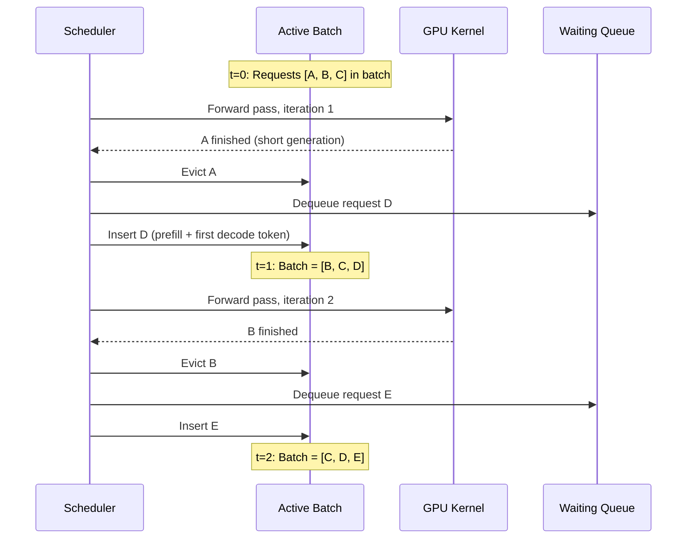
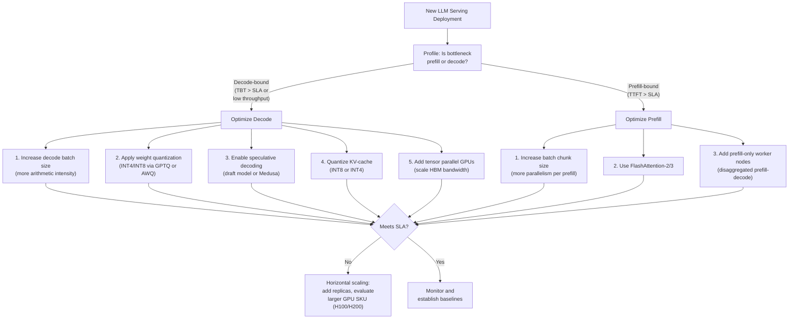
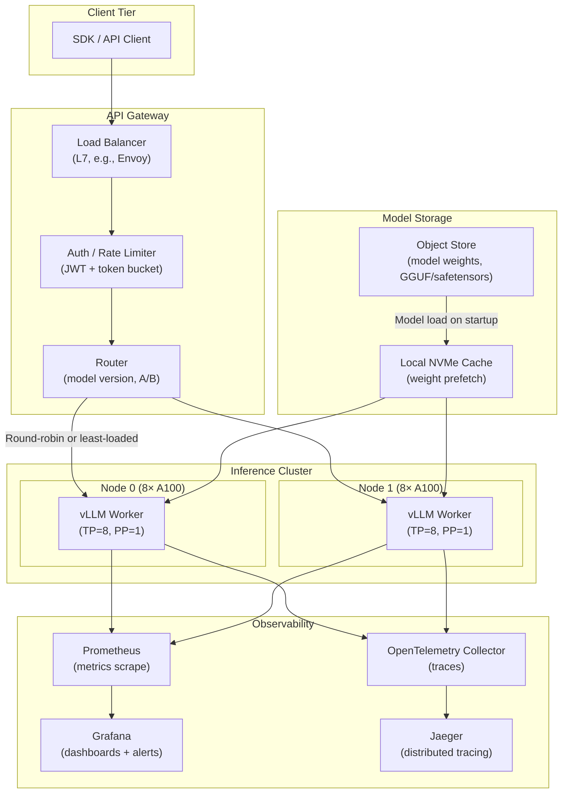

# Lesson 4: Performance Monitoring and Tuning for Large Language Models

## 1. First-Principles Intuition & Invariants

Optimizing a large language model (LLM) inference system is fundamentally a **memory-bandwidth problem**, not a compute problem. This distinction matters because it dictates where every optimization dollar is spent. A 70-billion-parameter model in FP16 occupies ~140 GB of weight memory. A single A100 (80 GB HBM2e) cannot even hold the model; a single forward pass through one Transformer block requires loading those weights from DRAM into on-chip SRAM registers, performing matrix multiplications, then evicting them. Modern GPUs can execute ~312 TFLOPS (A100, BF16) but sustain only ~2 TB/s of HBM bandwidth. The arithmetic intensity (FLOPs per byte of memory traffic) of a batched matrix-vector multiply during autoregressive decoding is so low that the GPU's math units sit idle waiting for data — this is the defining bottleneck of LLM serving.

Three physical invariants govern every performance decision:

**Memory Hierarchy Pressure.** The transformer attention mechanism has quadratic memory complexity O(n²) in sequence length. At every decoding step, the KV-cache (key and value tensors for all prior tokens, all layers, all attention heads) must reside in GPU HBM. For a 7B model with 32 layers, 32 KV heads, head dimension 128, FP16, and a 4096-token context, one sequence's KV-cache consumes 32 × 2 × 32 × 128 × 4096 × 2 bytes ≈ **2 GB**. Serving 50 concurrent sequences exhausts an 80 GB A100 for KV-cache alone. Every architectural choice — grouped-query attention (GQA), sliding-window attention, paged attention, speculative decoding — exists to reduce this pressure.

**Arithmetic Intensity and the Roofline Model.** For a matrix multiply of weight matrix W (shape [d_model, d_ffn]) against an activation vector x (shape [batch, d_model]), the FLOP count is 2 × batch × d_model × d_ffn and the bytes read are (batch × d_model + d_model × d_ffn) × dtype_bytes. At batch=1, arithmetic intensity collapses to ~2 FLOPs/byte — well below the A100's ridge point of ~156 FLOPs/byte. Only by batching sequences together (increasing the numerator) does the system become compute-bound rather than memory-bound.

**Temporal and Spatial Locality in the KV-Cache.** System prompts shared across many users (e.g., a constant tool-use preamble) exhibit near-perfect temporal locality: once their KV tensors are computed and cached, every subsequent request that shares the prefix can skip recomputing them. This is the basis for **prefix caching** (also called prompt caching or radix attention). Spatial locality manifests in tensor layout: row-major vs. column-major ordering of Q, K, V projections determines whether attention kernels achieve coalesced memory access on GPU warps.

---

## 2. Core Architecture & Mechanics

### 2.1 The KV-Cache: Structure and Lifetime

During autoregressive generation, the model generates one token per forward pass. Without a KV-cache, each new token would recompute attention over all prior tokens from scratch — O(n) full forward passes for an n-token sequence, each itself O(n) in attention, yielding O(n²) total work. The KV-cache eliminates redundancy by storing the key (K) and value (V) projections for every token at every layer as they are computed. Subsequent steps load these tensors and append the new token's K and V rather than recomputing everything.

The cache entry for a single layer, single head, single token is:
- K tensor: shape `[1, head_dim]`, dtype BF16/FP16 → `2 × head_dim` bytes
- V tensor: shape `[1, head_dim]`, dtype BF16/FP16 → `2 × head_dim` bytes

Summed across all layers and heads, then multiplied by sequence length, this grows linearly with generation length and is the primary HBM consumer at serving time.



### 2.2 Paged Attention

Before vLLM's paged attention (Kwon et al., 2023), serving frameworks pre-allocated a contiguous memory region for each request's maximum possible sequence length. A request with max_tokens=2048 reserved 2048 token slots even if it generated only 10 tokens — severe internal fragmentation. External fragmentation arose because contiguous blocks of varying sizes could not be reused across requests.

Paged attention borrows the OS virtual memory model: the KV-cache is divided into fixed-size **blocks** (e.g., 16 tokens per block). A per-request **block table** maps logical token positions to physical blocks, exactly as a page table maps virtual to physical pages. Physical blocks can be non-contiguous in HBM, allocated and freed at block granularity, and **copy-on-write shared** between a parent sequence and its beam-search children.



The attention kernel is modified to perform an indirect memory lookup through the block table, adding one pointer dereference per block boundary. The GPU kernel for this is implemented in CUDA using a custom gather operation over the non-contiguous physical blocks.

### 2.3 Continuous Batching

Classical static batching waits for a fixed number of requests to arrive, runs a forward pass on the entire batch, and returns all outputs simultaneously. This is pathological for LLM serving: requests finish at different generation lengths, leaving GPU compute idle while the slowest sequence continues. Continuous batching (Orca, Yu et al., 2022) treats the batching granularity as a single iteration rather than a full request. After every decode step, finished sequences are evicted from the batch and new sequences are inserted — a process called **iteration-level scheduling**. GPU utilization improves from ~40% under static batching to ~80–90% under continuous batching for realistic workloads.



The critical implementation detail is that prefill (processing the prompt in parallel, compute-bound) and decode (generating tokens one-by-one, memory-bound) have fundamentally different performance profiles. Chunked prefill (Agrawal et al., 2024) interleaves prefill and decode within the same batch by splitting long prompts into chunks, preventing prefill from monopolizing GPU time and causing decode latency spikes (a phenomenon called **prefill-decode interference**).

### 2.4 Attention Kernel: FlashAttention

Standard attention computes:
```
Attention(Q, K, V) = softmax(QKᵀ / √d_k) · V
```

A naive implementation materializes the full N×N attention score matrix in HBM — O(N²) memory — which is the primary bottleneck for long contexts. FlashAttention (Dao et al., 2022) restructures the computation to avoid this:

1. **Tiling**: Q, K, V are split into blocks that fit in SRAM (on-chip, ~192 KB for A100 SM).
2. **Online softmax**: The softmax normalization is computed incrementally block-by-block using a running maximum and running sum, so the full score matrix is never materialized.
3. **Fused kernel**: The entire attention computation (QKᵀ, softmax, ×V) is a single CUDA kernel, eliminating HBM round-trips for intermediate tensors.

The result: attention is I/O-bound, not memory-capacity-bound. Memory complexity drops from O(N²) to O(N) for the KV-cache (which is still needed), and wall-clock attention time for a 1024-token sequence on an A100 is ~3–7× faster than a PyTorch native implementation.

```python
# Simplified illustration of the online softmax tiling logic in FlashAttention.
# Production implementation is a fused CUDA kernel; this is pedagogical Python.

import torch

def flash_attention_reference(Q: torch.Tensor, K: torch.Tensor, V: torch.Tensor,
                               block_size: int = 64) -> torch.Tensor:
    """
    Q, K, V: [seq_len, head_dim] — single head, no batch dim for clarity.
    Returns: output [seq_len, head_dim]
    """
    seq_len, head_dim = Q.shape
    scale = head_dim ** -0.5

    # Output accumulator and softmax normalization state.
    O = torch.zeros_like(Q)             # [seq_len, head_dim]
    l = torch.zeros(seq_len)            # running sum of exp scores
    m = torch.full((seq_len,), -torch.inf)  # running max

    num_blocks = (seq_len + block_size - 1) // block_size

    for j in range(num_blocks):  # iterate over K, V blocks
        kv_start = j * block_size
        kv_end   = min(kv_start + block_size, seq_len)
        Kj = K[kv_start:kv_end]  # [block_size, head_dim]
        Vj = V[kv_start:kv_end]  # [block_size, head_dim]

        # Scores for all Q against this K block: [seq_len, block_size]
        Sij = (Q @ Kj.T) * scale

        # Online softmax: update running max and rescale previous accumulator.
        m_new = torch.maximum(m, Sij.max(dim=1).values)
        exp_Sij = torch.exp(Sij - m_new.unsqueeze(1))  # [seq_len, block_size]

        # Rescale the previous partial output by exp(m_old - m_new).
        rescale = torch.exp(m - m_new)
        O = O * rescale.unsqueeze(1) + exp_Sij @ Vj
        l  = l * rescale + exp_Sij.sum(dim=1)
        m  = m_new

    # Normalize by the softmax denominator.
    O = O / l.unsqueeze(1)
    return O
```

---

## 3. Quantization: Reducing Memory and Bandwidth Pressure

Quantization maps floating-point weights (and optionally activations) to lower-precision integers, reducing the bytes loaded per weight during the memory-bound decode phase. The latency improvement from quantization is nearly proportional to the bit-width reduction because decode is memory-bandwidth-bound: an INT4 model loads 4× fewer bytes than FP16, achieving close to 4× decode throughput on the same hardware.

### 3.1 Post-Training Quantization (PTQ) Methods

**GPTQ** (Frantar et al., 2022) applies second-order weight quantization per-layer. It minimizes the layer-wise reconstruction error:

```
min_{Ŵ} || WX - ŴX ||²_F
```

where W is the FP16 weight matrix and Ŵ is the quantized weight matrix, computed using the inverse Hessian of the loss with respect to W to determine which weights can tolerate more aggressive quantization. GPTQ runs in a few GPU-hours on a single A100 for a 70B model and achieves 3–4-bit quantization with <1% perplexity degradation on standard benchmarks (WikiText-2, C4).

**AWQ** (Lin et al., 2023) observes that ~1% of weight channels are **salient** — they correspond to large activation magnitudes. Rather than minimizing layer-wise reconstruction error over all weights equally, AWQ identifies salient channels by analyzing activation statistics and applies a per-channel scale factor before quantization, protecting those channels from large quantization error. AWQ is hardware-friendly because the scaling can be absorbed into adjacent LayerNorm operations.

**GGUF/llama.cpp k-quants** implement block-wise mixed-precision quantization: weights are divided into blocks of 32 or 256 elements, each block storing its own scale and minimum value. `Q4_K_M` quantizes most weights to 4-bit but uses 6-bit for attention Q/K projection matrices (which are more sensitive to quantization error). These run efficiently on CPU and Apple Silicon via BLAS backends.

### 3.2 KV-Cache Quantization

The KV-cache is a natural quantization target because:
1. It consumes HBM proportionally to sequence length.
2. KV tensors are written once and read many times — quantization error accumulates across attention steps.

Empirically, keys are more sensitive to quantization than values (because keys are compared against queries via dot product, amplifying small errors). `KVQuant` (Hooper et al., 2024) and `KIVI` apply INT4 or INT2 quantization per-channel with per-token scales for keys and per-channel scales for values, achieving 2–4× KV-cache compression with minimal quality degradation on tasks up to 128K context.

```python
# KV-cache INT8 quantization with per-token scale (simplified).
import torch

def quantize_kv_int8(kv: torch.Tensor) -> tuple[torch.Tensor, torch.Tensor]:
    """
    kv: [num_tokens, head_dim] in FP16/BF16
    Returns:
        kv_int8: [num_tokens, head_dim] in INT8
        scales:  [num_tokens, 1]        in FP32  (per-token absmax scale)
    """
    # Per-token absolute maximum for scale computation.
    scales = kv.abs().max(dim=-1, keepdim=True).values.float().clamp(min=1e-8)
    # Normalize to [-127, 127] range and round to nearest integer.
    kv_int8 = (kv.float() / scales * 127.0).round().clamp(-127, 127).to(torch.int8)
    return kv_int8, scales

def dequantize_kv_int8(kv_int8: torch.Tensor, scales: torch.Tensor) -> torch.Tensor:
    """Reconstruct FP16 tensor from INT8 + scale."""
    return (kv_int8.float() * scales / 127.0).to(torch.bfloat16)


# Example usage in an attention forward pass:
def attention_with_quantized_kv(
    q: torch.Tensor,
    k_int8: torch.Tensor, k_scales: torch.Tensor,
    v_int8: torch.Tensor, v_scales: torch.Tensor,
) -> torch.Tensor:
    k = dequantize_kv_int8(k_int8, k_scales)
    v = dequantize_kv_int8(v_int8, v_scales)
    scale = q.shape[-1] ** -0.5
    scores = torch.softmax((q @ k.T) * scale, dim=-1)
    return scores @ v
```

---

## 4. Speculative Decoding

Autoregressive generation is fundamentally serial: token t+1 cannot be computed until token t is sampled. Speculative decoding (Leviathan et al., 2023; Chen et al., 2023) breaks this serialization by using a small **draft model** to generate k candidate tokens cheaply, then using the large **target model** to verify all k tokens in a single parallel forward pass.

The correctness guarantee: the token distribution produced by speculative decoding is **exactly identical** to the distribution of the target model alone. The acceptance/rejection criterion uses a modified rejection sampling procedure:

```
For each draft token x_i with draft probability q(x_i) and target probability p(x_i):
  Accept with probability min(1, p(x_i) / q(x_i))
  On rejection: resample from the adjusted distribution (p - q)+ normalized.
```

This is not an approximation — it is a lossless speedup. If the draft model predicts correctly with probability α (the **acceptance rate**), the expected number of tokens produced per target model call is (1 - α^(k+1)) / (1 - α), which approaches k+1 as α → 1. For a 7B draft model and a 70B target model, α is typically 0.7–0.85 on conversational tasks, yielding 2–3× decode throughput improvement.

```mermaid
sequenceDiagram
    participant D as Draft Model (7B)
    participant T as Target Model (70B)
    participant V as Verifier

    Note over D,T: Input token sequence [t0, t1, ..., tn]
    D->>D: Autoregressive draft: generate [d1, d2, d3, d4] (k=4 steps)
    D->>T: Send original context + 4 draft tokens
    T->>T: Single parallel forward pass over n+4 tokens
    T->>V: Return logits for positions [n, n+1, n+2, n+3, n+4]
    V->>V: Rejection sampling: accept d1✓, d2✓, d3✗
    V-->>D: Accepted prefix: [d1, d2]; resample position n+3 from target
    Note over D,T: Net result: 2 accepted tokens from 1 target forward pass
    D->>D: Continue draft from accepted prefix
```

**Self-speculative decoding** (via Medusa heads or layer-skipping) eliminates the separate draft model by attaching multiple prediction heads to intermediate layers of the target model itself, reducing system complexity at the cost of slightly lower acceptance rates.

---

## 5. Distributed Inference: Tensor Parallelism and Pipeline Parallelism

Models exceeding a single GPU's HBM capacity require model parallelism. The two dominant strategies have different tradeoffs.

### 5.1 Tensor Parallelism (Megatron-LM style)

Tensor parallelism (TP) shards individual weight matrices across GPUs along a chosen dimension. For a linear layer Y = XW:

- **Column-parallel**: W is split into [W₁ | W₂] along the output dimension. Each GPU holds Wᵢ and computes Yᵢ = XWᵢ locally.
- **Row-parallel**: W is split into [W₁; W₂] along the input dimension. Each GPU holds a shard of X and Wᵢ, computes Yᵢ = XᵢWᵢ, then an AllReduce across GPUs sums the partial results.

For transformer blocks, the MLP is split as column-parallel GELU then row-parallel, requiring one AllReduce per MLP. The attention projection is split across attention heads, requiring one AllReduce per attention layer. With TP degree N, each GPU holds 1/N of each weight matrix. Communication volume per transformer layer is proportional to the hidden dimension, not the sequence length, so TP scales well on NVLink (600 GB/s bidirectional on NVLink 4.0) but poorly over Ethernet or InfiniBand due to latency.

```mermaid
graph TD
    subgraph GPU0 ["GPU 0 (TP rank 0)"]
        W0["W_col[\":, 0:d/2\"]\n W_row[\"0:d/2, :\"]"]
        C0["Partial output Y0"]
    end
    subgraph GPU1 ["GPU 1 (TP rank 1)"]
        W1["W_col[\":, d/2:d\"]\n W_row[\"d/2:d, :\"]"]
        C1["Partial output Y1"]
    end

    X["Input X\n(replicated on both GPUs)"] --> GPU0
    X --> GPU1
    C0 -->|"AllReduce (NVLink)"| SUM["Y = Y0 + Y1\n(replicated on both GPUs)"]
    C1 -->|"AllReduce (NVLink)"| SUM
```

### 5.2 Pipeline Parallelism

Pipeline parallelism (PP) assigns contiguous groups of transformer layers to each GPU. GPU 0 holds layers 0–7, GPU 1 holds layers 8–15, etc. Microbatches flow through the pipeline stage-by-stage, with GPUs communicating activations (not weights) across stage boundaries via point-to-point send/recv over NVLink or InfiniBand.

The critical cost is **pipeline bubble**: with P pipeline stages and M microbatches, the bubble fraction is (P-1)/(M+P-1). With few microbatches (common in low-latency serving), the bubble fraction is large (e.g., P=4, M=1 → 75% bubble). PipeDream-Flush and 1F1B scheduling reduce the bubble but do not eliminate it.

**Practical deployment**: Large production clusters (e.g., Llama 3 405B at Meta, GPT-4 at OpenAI) typically use TP within a node (8 GPUs connected via NVLink) and PP across nodes (connected via InfiniBand), because intra-node NVLink bandwidth is 10–50× higher than inter-node IB bandwidth and latency is proportionally lower.

---

## 6. Metrics, Profiling, and Observability

### 6.1 Key Metrics Hierarchy

Meaningful LLM serving observability requires distinguishing three layers:

**Service-level metrics** (business impact):
- **Time to First Token (TTFT)**: Latency from request arrival to first output token. Dominated by prefill compute. SLA target: <200 ms for interactive use.
- **Time Between Tokens (TBT)** / Inter-Token Latency (ITL): Latency per decode step. Dominated by KV-cache memory bandwidth. SLA target: <30 ms for real-time streaming.
- **Request throughput**: Requests completed per second. Limited by continuous batching efficiency.
- **Token throughput**: Output tokens generated per second across all requests.

**Resource utilization metrics** (capacity planning):
- GPU memory utilization (HBM consumed vs. total)
- KV-cache utilization (fraction of KV-cache blocks occupied)
- GPU compute utilization (SM active %)
- MFU (Model FLOP Utilization): actual TFLOPs achieved / peak theoretical TFLOPs

**Queue and scheduling metrics** (bottleneck diagnosis):
- Scheduler queue depth (waiting requests)
- Preemption rate (requests evicted from GPU due to memory pressure)
- Prefix cache hit rate

### 6.2 Profiling with PyTorch and CUDA Tools

```python
import torch
import torch.profiler
from transformers import AutoModelForCausalLM, AutoTokenizer

model_id = "meta-llama/Meta-Llama-3-8B-Instruct"
tokenizer = AutoTokenizer.from_pretrained(model_id)
model = AutoModelForCausalLM.from_pretrained(
    model_id, torch_dtype=torch.bfloat16, device_map="cuda"
)
model.eval()

prompt = "Explain the roofline model for GPU performance analysis."
inputs = tokenizer(prompt, return_tensors="pt").to("cuda")

# Warm up: JIT compilation, CUDA kernel launch overhead.
with torch.no_grad():
    for _ in range(3):
        _ = model.generate(**inputs, max_new_tokens=10)

# Profile with Chrome trace + FLOP counting.
with torch.profiler.profile(
    activities=[
        torch.profiler.ProfilerActivity.CPU,
        torch.profiler.ProfilerActivity.CUDA,
    ],
    record_shapes=True,
    profile_memory=True,
    with_flops=True,
    with_stack=False,
) as prof:
    with torch.no_grad():
        output = model.generate(**inputs, max_new_tokens=50)

# Export for chrome://tracing visualization.
prof.export_chrome_trace("llm_trace.json")

# Top CUDA kernels by self CUDA time.
print(prof.key_averages(group_by_input_shape=True).table(
    sort_by="self_cuda_time_total", row_limit=20
))

# Total FLOPs for the generation call.
total_flops = sum(e.flops for e in prof.events() if e.flops is not None)
print(f"Total FLOPs: {total_flops / 1e12:.3f} TFLOPs")
```

For kernel-level profiling, `nsys profile` (NVIDIA Nsight Systems) provides a system-wide timeline, and `ncu` (NVIDIA Nsight Compute) provides per-kernel hardware counter data (memory throughput, SM occupancy, warp stall reasons). The most common warp stall reason in LLM decode kernels is `stall_long_sb` (long scoreboard stall) indicating the kernel is waiting on HBM data — confirming the memory-bound diagnosis.

```bash
# Profile with Nsight Systems; produces a .nsys-rep file for the GUI.
nsys profile \
  --trace=cuda,nvtx,cudnn \
  --output=llm_inference_profile \
  --force-overwrite=true \
  python serve_request.py

# Per-kernel hardware counters with Nsight Compute (expensive; targets single kernel).
ncu --metrics \
  sm__throughput.avg.pct_of_peak_sustained_elapsed,\
  l1tex__t_bytes_pipe_lsu_mem_global_op_ld.sum,\
  dram__bytes_read.sum \
  --target-processes all \
  python serve_request.py
```

### 6.3 vLLM Metrics via Prometheus/OpenTelemetry

vLLM exposes a `/metrics` Prometheus endpoint. Key counters to monitor in production:

```
# TTFT histogram — alert if P99 > 500ms
vllm:time_to_first_token_seconds_bucket

# Token throughput — monitor for regression after deploys
vllm:generation_tokens_total

# KV-cache pressure — alert if > 90%; triggers preemption
vllm:gpu_cache_usage_perc

# Prefix cache efficiency
vllm:cpu_prefix_cache_hit_rate
vllm:gpu_prefix_cache_hit_rate

# Scheduler queue — alert if consistently > 10; indicates undersized fleet
vllm:num_requests_waiting
```

A Grafana dashboard querying these metrics with 1-minute resolution provides sufficient visibility for capacity planning. For latency SLA alerting, instrument at P50/P95/P99 quantiles using histogram_quantile over 5-minute windows.

---

## 7. High-Performance Optimization: A Decision Framework

Optimization decisions must be sequenced by leverage — the ratio of performance gain to engineering cost. The following framework applies in order:



### 7.1 Disaggregated Prefill-Decode

Production systems (Distserve, Splitwise, 2024) separate prefill and decode onto different GPU pools. Prefill is compute-intensive and benefits from high SM utilization; decode is memory-bandwidth-intensive and benefits from large HBM and high batch size. Running them on the same GPU forces a tradeoff between prefill chunk size (latency) and decode batch size (throughput). Disaggregation allows each pool to be tuned independently and scaled to its own demand curve.

### 7.2 Failure Modes and Mitigations

**KV-cache exhaustion (OOM).** When a request's sequence length exceeds available KV-cache blocks, the scheduler must preempt: it swaps the KV-cache of lower-priority requests to CPU DRAM, freeing GPU blocks. Swapping introduces ~5–50 ms latency per preemption event (PCIe bandwidth ~32 GB/s for a 16x PCIe 4.0 link vs. NVLink's 600 GB/s). Mitigation: set `max_model_len` conservatively, enable preemption mode (`swap` rather than `recompute` for latency-sensitive workloads), and monitor `vllm:num_requests_waiting`.

**GPU kernel errors under long context.** Flash attention kernels have configurable tile sizes (block_q, block_k) that must satisfy SRAM constraints. With head_dim=256 (Llama 3 models use head_dim=128; some newer models use 256), tile sizes must be halved, reducing SM occupancy. This is a known issue tracked in the FlashAttention GitHub and worked around by reducing the CUDA block size for affected models.

**Numerical instability in FP8 inference.** FP8 (E4M3 and E5M2 formats, available on H100 via NVIDIA's Transformer Engine) has a 3-bit mantissa, making it sensitive to outlier activations. Without per-tensor or per-token dynamic scaling (as implemented in Transformer Engine), FP8 can silently produce NaN or large quantization error on models with activation outliers (a known characteristic of LLaMA-family models). Always validate with a perplexity probe on a held-out corpus after switching dtypes.

**Stale prefix cache under prompt injection.** Prefix caching stores KV tensors keyed by the token hash of the prompt prefix. A cache poisoning attack can deliberately craft a prompt that shares a prefix hash with a legitimate cached entry, causing the model to use the attacker's cached KV state. Production systems must use cryptographically secure prefix hashing (SHA-256 of the token IDs, not CRC32) and enforce tenant isolation so cross-user prefix sharing is disabled by default.

---

## 8. Production-Grade Serving Stack: Reference Architecture



The serving stack described above is representative of a production deployment at mid-scale (1–10 nodes). Key design decisions:

- **Safetensors format** over PyTorch `.pt` files for model weights: safetensors is memory-mapped and supports parallel shard loading, reducing cold-start time from minutes to seconds for large models.
- **OpenAI-compatible REST API** (`/v1/chat/completions`, `/v1/completions`) for SDK compatibility with the broad ecosystem of tools, agents, and clients.
- **Structured output via logit processing** (e.g., outlines, guidance): constrain token sampling to valid JSON schema tokens using logit masks, enabling reliable structured output without post-processing retries.
- **Graceful drain on SIGTERM**: the serving process should complete in-flight requests before shutdown to avoid dropped connections during rolling deployments; vLLM supports this via its `--shutdown-timeout` flag.

---

## Summary

LLM inference performance is governed by memory bandwidth, not raw compute. The key architectural innovations — paged attention, continuous batching, FlashAttention, speculative decoding, and quantization — each address a specific facet of this constraint. Profiling must distinguish prefill-bound from decode-bound bottlenecks because they require fundamentally different interventions. Production deployments require observability at service, resource, and scheduling layers, with Prometheus metrics and distributed tracing as the minimum viable instrumentation. Optimization sequencing matters: apply quantization and batching improvements before adding hardware, as the former often delivers 2–4× gains at zero marginal cost.
