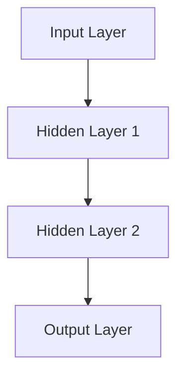
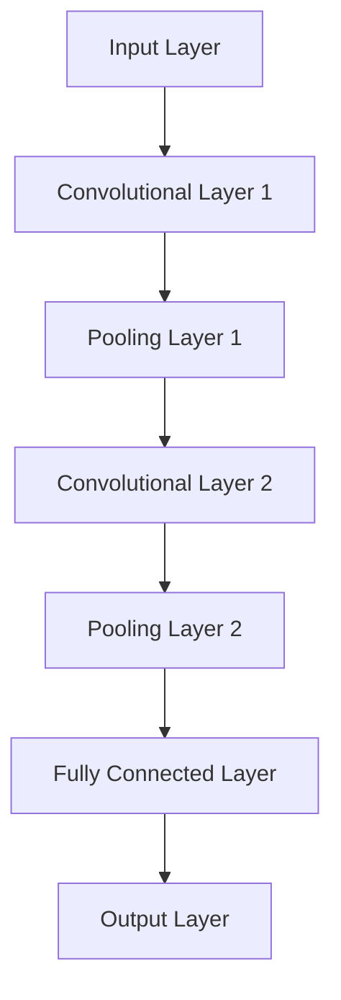
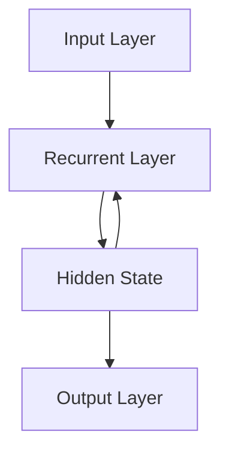

# Lesson 1: Neural Network Architectures

## 1. First-Principles Intuition & Invariants

Neural networks are a cornerstone of modern artificial intelligence, providing a powerful framework for modeling complex relationships within data. At their core, neural networks are inspired by the biological neural networks found in the human brain, where interconnected neurons process and transmit information through synapses. However, the artificial neural networks we implement in software are abstracted to a degree that allows us to harness their computational power for a wide array of tasks, from image recognition to natural language processing.

The fundamental invariant of neural networks is their ability to learn from data through a process of iterative optimization. This learning process is grounded in the mathematical principles of linear algebra and calculus, particularly in the context of function approximation and gradient descent. Each neuron in a neural network can be thought of as a simple linear function followed by a non-linear activation function, which introduces the necessary complexity to model intricate patterns in data. The combination of these neurons into layers forms the architecture of a neural network, and the choice of architecture is crucial to the network's ability to solve specific problems.

The problem space for neural networks is vast and varied, encompassing supervised and unsupervised learning, classification, regression, and generative tasks. Each of these tasks requires a different approach and architecture, but they all share the common goal of learning a mapping from input data to output predictions. The invariants that govern this learning process include the forward pass, where input data is propagated through the network to produce predictions, and the backward pass, where the error between predictions and actual outcomes is used to update the network's parameters through gradient descent.

Understanding these first-principles invariants is essential for designing and implementing effective neural network architectures. It requires a deep appreciation for the mathematical underpinnings of neural networks, as well as an understanding of the computational challenges involved in training and deploying them at scale.

## 2. Core Architecture & Mechanics

### Feedforward Neural Networks

The simplest and most fundamental architecture of neural networks is the feedforward neural network (FNN). In an FNN, data flows in a single direction—from the input layer, through one or more hidden layers, to the output layer. This unidirectional flow ensures that there are no cycles or loops in the network, making it straightforward to compute the forward pass and apply backpropagation for training.

The architecture of an FNN can be visualized as a series of interconnected layers, where each layer consists of a set of neurons. Each neuron in a layer is connected to every neuron in the previous layer, and these connections are weighted. During the forward pass, the input data is multiplied by the weights and passed through an activation function to produce the output of the neuron. This process is repeated for each layer, with the output of one layer serving as the input to the next.

The choice of activation function is critical to the performance of an FNN. Common activation functions include the sigmoid, hyperbolic tangent (tanh), and rectified linear unit (ReLU). Each of these functions introduces non-linearity into the network, allowing it to learn complex patterns in the data. The ReLU function, in particular, has become popular due to its simplicity and effectiveness in mitigating the vanishing gradient problem, which can hinder the training of deep networks.

### Convolutional Neural Networks

Convolutional neural networks (CNNs) are a specialized type of neural network designed for processing grid-like data, such as images. The key innovation of CNNs is the use of convolutional layers, which apply a set of learnable filters to the input data to extract local features. These filters are small, typically 3x3 or 5x5, and they slide over the input data to produce a feature map that captures the presence of specific patterns.

The architecture of a CNN consists of multiple convolutional layers, followed by pooling layers, and finally fully connected layers. The convolutional layers apply the filters to the input data, while the pooling layers downsample the feature maps to reduce their spatial dimensions and computational complexity. The fully connected layers then take the flattened feature maps as input and produce the final output predictions.

The use of convolutional layers in CNNs allows them to capture spatial hierarchies in the data, making them highly effective for tasks such as image classification and object detection. The filters in the convolutional layers are learned during training, and they can capture a wide range of features, from low-level edges and textures to high-level shapes and objects.

### Recurrent Neural Networks

Recurrent neural networks (RNNs) are designed for processing sequential data, such as time series or natural language. Unlike feedforward and convolutional networks, RNNs have connections that form directed cycles, allowing them to maintain a hidden state that captures information about previous inputs. This hidden state is updated at each time step, and it is used to inform the predictions for subsequent inputs.

The architecture of an RNN consists of a single recurrent layer, which processes the input data one time step at a time. At each time step, the input data is combined with the hidden state from the previous time step, and the result is passed through a non-linear activation function to produce the new hidden state. The hidden state is then used to produce the output prediction for the current time step.

The use of recurrent connections in RNNs allows them to capture temporal dependencies in the data, making them highly effective for tasks such as language modeling and speech recognition. However, the training of RNNs can be challenging due to issues such as vanishing and exploding gradients, which can hinder the learning of long-range dependencies. To address these challenges, variants of RNNs such as long short-term memory (LSTM) and gated recurrent units (GRU) have been developed. These variants use gating mechanisms to control the flow of information through the network, allowing them to learn long-range dependencies more effectively.

## 3. High-Performance Optimization & Failure Modes

### Concurrency and Resource Scaling

The training of neural networks is computationally intensive, and optimizing the performance of neural network architectures requires careful consideration of concurrency and resource scaling. Modern neural networks often consist of millions or even billions of parameters, and training them requires significant computational resources. To address this challenge, neural networks are typically trained on parallel computing architectures, such as GPUs and TPUs, which can perform large-scale matrix operations efficiently.

The use of parallel computing architectures requires careful management of concurrency and resource scaling. This involves partitioning the workload across multiple devices, coordinating the communication between devices, and optimizing the memory usage of the network. Techniques such as data parallelism, model parallelism, and pipeline parallelism can be used to distribute the workload and improve the performance of neural network training.

### Boundary Edge Cases and Failure Mitigations

The performance and robustness of neural network architectures can be affected by a variety of boundary edge cases and failure modes. One common issue is overfitting, where the network learns to memorize the training data rather than generalizing to new data. Overfitting can be mitigated through techniques such as regularization, dropout, and data augmentation, which introduce noise and variability into the training process.

Another common issue is underfitting, where the network is too simple to capture the underlying patterns in the data. Underfitting can be mitigated by increasing the complexity of the network, such as by adding more layers or neurons. However, this can also increase the risk of overfitting, so it is important to find a balance between complexity and generalization.

In addition to overfitting and underfitting, neural network architectures can also be affected by issues such as vanishing and exploding gradients, which can hinder the training of deep networks. These issues can be mitigated through the use of advanced architectures such as LSTMs and GRUs, as well as through techniques such as gradient clipping and learning rate scheduling.

In conclusion, neural network architectures are a powerful tool for modeling complex relationships within data, and understanding their fundamental principles is essential for designing and implementing effective neural network models. By grounding neural networks in the mathematical principles of linear algebra and calculus, and by considering the computational challenges involved in training and deploying them at scale, we can build neural network architectures that are robust, efficient, and effective.
