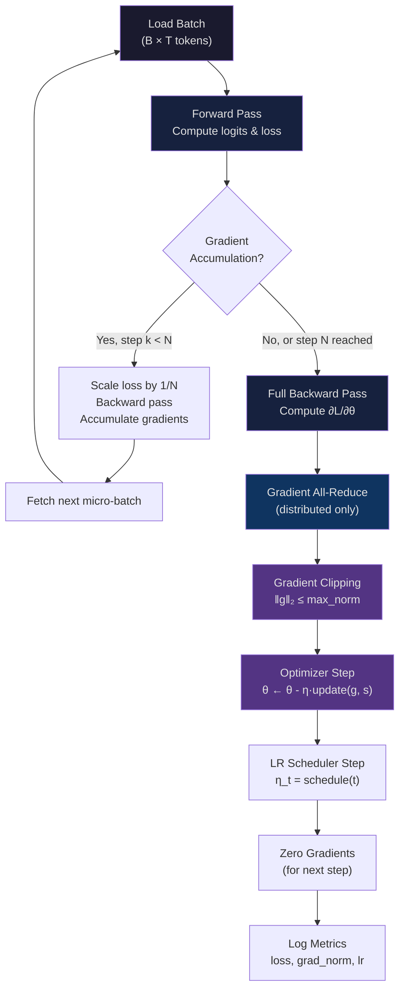
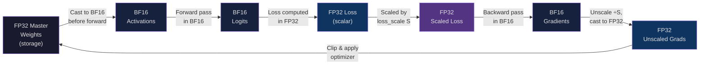
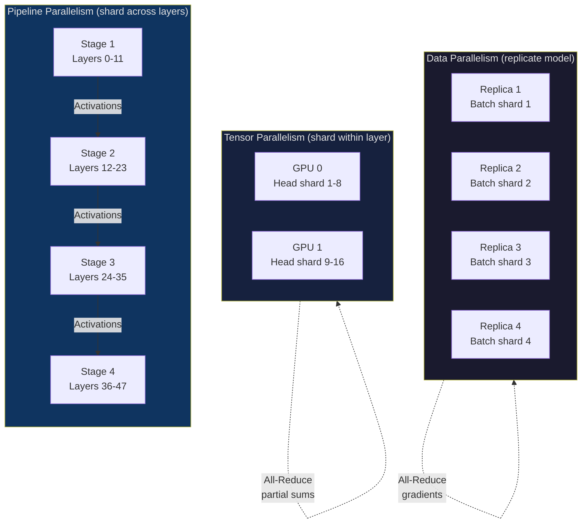
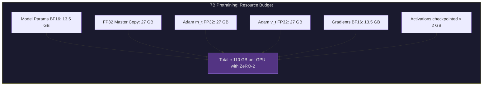

# Lesson 3: Optimization Techniques for Large Language Models

---

## 1. First-Principles Intuition & Invariants

### The Loss Landscape as a Geometric Object

Training a large language model (LLM) is fundamentally an exercise in navigating a loss landscape defined over a parameter space of dimension $d$, where $d$ can exceed $10^{11}$ for frontier models. The loss function $\mathcal{L}(\theta)$ maps this parameter vector $\theta \in \mathbb{R}^d$ to a scalar, and optimization seeks a $\theta^*$ satisfying:

$$\theta^* = \arg\min_{\theta} \mathbb{E}_{(x,y) \sim \mathcal{D}} \left[ \mathcal{L}(f_\theta(x), y) \right]$$

For cross-entropy loss over a vocabulary of size $V$, this becomes:

$$\mathcal{L}(\theta) = -\frac{1}{T} \sum_{t=1}^{T} \log P_\theta(x_t \mid x_{<t})$$

where $T$ is the sequence length. The critical insight is that this landscape is not a generic non-convex function—it has specific structural properties that optimization algorithms can and must exploit.

**The Hessian and condition number.** The local geometry at any point is characterized by the Hessian $H = \nabla^2_\theta \mathcal{L}$, a $d \times d$ matrix. Its eigenvalue spectrum determines how difficult optimization is locally. The condition number $\kappa(H) = \lambda_{\max} / \lambda_{\min}$ measures the anisotropy of the landscape: a high condition number means gradients point along directions of wildly different curvature, causing naive gradient descent to oscillate in high-curvature directions while making negligible progress in flat ones. For transformer models, the Hessian is never computed explicitly—it costs $O(d^2)$ storage—but its structure motivates every adaptive optimizer in use today.

**Saddle points dominate, not local minima.** A classical result from random matrix theory (Dauphin et al., 2014) demonstrates that in high-dimensional landscapes, critical points where $\nabla \mathcal{L} = 0$ are overwhelmingly saddle points rather than local minima. A local minimum requires *all* eigenvalues of the Hessian to be positive. With $d \sim 10^{11}$ independent curvature directions, the probability of all being positive simultaneously is negligible. This means the feared "trap" of local minima is largely a low-dimensional intuition that does not transfer to LLM training. The real hazard is saddle-point plateaus, where gradient magnitudes are small and progress stalls.

**Loss landscape sharpness and generalization.** Sharp minima—regions where the loss rises steeply in nearby directions—tend to generalize poorly, while flat minima generalize better. This is formalized by the PAC-Bayes bound:

$$\mathcal{L}_{\text{test}}(\theta) \leq \mathcal{L}_{\text{train}}(\theta) + \sqrt{\frac{\text{KL}(P_\theta \| P_0) + \ln(m/\delta)}{2m}}$$

where $m$ is dataset size and $P_0$ is a prior. Flatter minima have smaller KL divergence from the prior, hence tighter generalization bounds. This directly motivates techniques like SAM (Sharpness-Aware Minimization) and weight averaging (SWA), which explicitly seek flat regions.

### The Three Governing Invariants

**Invariant 1: Gradient estimation is a statistical process.** Stochastic gradient descent with batch size $B$ produces a gradient estimate $\hat{g} = \frac{1}{B}\sum_{i=1}^{B} \nabla_\theta \mathcal{L}_i(\theta)$ whose variance scales as $\text{Var}(\hat{g}) \propto \sigma^2 / B$. This is not a numerical artifact—it is the core statistical trade-off of large-scale training. Larger batches reduce gradient variance but exhibit a critical scaling failure above a threshold batch size (the "linear scaling rule" of Goyal et al., 2017): once the batch size exceeds roughly $B_{\text{crit}} \approx \sigma^2 / \|g\|^2$, adding more samples yields diminishing returns in terms of wall-clock convergence, since gradient quality saturates but each step becomes more expensive. This threshold is empirically observed around $B \approx 1\text{M}$ tokens for GPT-scale models.

**Invariant 2: Learning rate is a proxy for trust radius.** The learning rate $\eta$ does not merely control step size—it implicitly defines how much the optimizer trusts its local linear approximation of the loss. A second-order Taylor expansion shows that the optimal step for a quadratic loss is $\eta_{\text{opt}} = 1/\lambda_{\max}(H)$. Since $\lambda_{\max}(H)$ varies by orders of magnitude across layers and training phases, a single global learning rate is always a compromise. This is why adaptive methods that locally estimate curvature—Adam, Adafactor, LAMB—consistently outperform vanilla SGD for transformer training.

**Invariant 3: Numerical representation is not free.** Every parameter, gradient, and optimizer state exists as a floating-point number with finite precision. The choice of floating-point format determines the range and resolution of representable values, and this choice has direct algorithmic consequences. For BF16 (bfloat16), the 8-bit exponent preserves the dynamic range of FP32 but reduces mantissa precision from 23 bits to 7 bits. For FP16, the reduced 5-bit exponent creates a narrow dynamic range that causes underflow when gradient magnitudes fall below $\approx 6 \times 10^{-5}$. This numerical constraint is not a hardware quirk—it is an invariant that any mixed-precision optimizer must explicitly handle through loss scaling or gradient accumulation in higher precision.

---

## 2. Core Architecture & Mechanics

### The Optimizer State Machine

An optimizer is a stateful transformation applied at each training step. For a model with parameters $\theta \in \mathbb{R}^d$, the full training state at step $t$ consists of:

- The parameters $\theta_t$
- The optimizer's auxiliary state $s_t$ (moments, accumulators, etc.)
- The current loss scale (for mixed-precision)

The memory cost of this state is not trivial. For a model with $d$ parameters in FP32:

| Component | Size | Example (70B model) |
|---|---|---|
| Parameters (BF16) | $2d$ bytes | ~140 GB |
| Parameters (FP32 master copy) | $4d$ bytes | ~280 GB |
| Adam $m_t$ (FP32) | $4d$ bytes | ~280 GB |
| Adam $v_t$ (FP32) | $4d$ bytes | ~280 GB |
| Gradients (BF16) | $2d$ bytes | ~140 GB |
| **Total** | $\sim 16d$ bytes | **~1.12 TB** |

This calculation explains why a 70B parameter model cannot be trained on a single node with 8×80GB A100s (640 GB aggregate) using naive full-precision Adam—the optimizer states alone overflow available memory.

### Adam: Mechanistic Derivation

Adam (Kingma & Ba, 2014) is the standard optimizer for transformer pretraining. Its update rule is:

$$m_t = \beta_1 m_{t-1} + (1-\beta_1) g_t \quad \text{(first moment, EMA of gradients)}$$
$$v_t = \beta_2 v_{t-1} + (1-\beta_2) g_t^2 \quad \text{(second moment, EMA of squared gradients)}$$
$$\hat{m}_t = m_t / (1 - \beta_1^t) \quad \text{(bias correction)}$$
$$\hat{v}_t = v_t / (1 - \beta_2^t) \quad \text{(bias correction)}$$
$$\theta_{t+1} = \theta_t - \eta \cdot \hat{m}_t / (\sqrt{\hat{v}_t} + \epsilon)$$

The bias correction terms are critical at early training steps. At $t=1$ with $\beta_1 = 0.9$: $m_1 = 0.1 g_1$, so $\hat{m}_1 = m_1 / (1 - 0.9) = g_1$. Without bias correction, the first step is scaled down by $10\times$, dramatically slowing early convergence.

The $\epsilon$ term (typically $10^{-8}$) prevents division by zero but also defines a floor on the effective learning rate. When $\sqrt{\hat{v}_t} \ll \epsilon$, the update reduces to $\eta \cdot \hat{m}_t / \epsilon$, potentially causing large steps for rarely-updated parameters. For models with sparse gradients (e.g., embedding tables), this can cause instability.

The effective per-parameter learning rate is $\eta_{\text{eff}} = \eta / (\sqrt{\hat{v}_t} + \epsilon)$. The second moment $v_t$ is an exponential moving average of $g_t^2$, so $\sqrt{v_t}$ approximates the RMS of recent gradients. Adam thus normalizes updates by gradient scale—parameters with large, consistent gradients get smaller effective steps, while parameters with small or noisy gradients get relatively larger steps. This is the mechanism by which Adam adapts to curvature anisotropy without computing the Hessian.

```python
import torch
from typing import Optional, Iterable, Tuple

class AdamW(torch.optim.Optimizer):
    """
    AdamW: Adam with decoupled weight decay (Loshchilov & Hutter, 2019).
    
    Decoupling weight decay from the adaptive learning rate is critical:
    L2 regularization multiplied through Adam's adaptive scaling creates
    an effective weight decay that varies per-parameter. Decoupled WD
    applies a uniform decay regardless of gradient magnitude.
    """

    def __init__(
        self,
        params: Iterable,
        lr: float = 1e-3,
        betas: Tuple[float, float] = (0.9, 0.999),
        eps: float = 1e-8,
        weight_decay: float = 1e-2,
        amsgrad: bool = False,
    ):
        defaults = dict(
            lr=lr, betas=betas, eps=eps,
            weight_decay=weight_decay, amsgrad=amsgrad,
        )
        super().__init__(params, defaults)

    @torch.no_grad()
    def step(self, closure=None):
        loss = None
        if closure is not None:
            with torch.enable_grad():
                loss = closure()

        for group in self.param_groups:
            beta1, beta2 = group["betas"]

            for p in group["params"]:
                if p.grad is None:
                    continue

                grad = p.grad
                if grad.is_sparse:
                    raise RuntimeError("AdamW does not support sparse gradients")

                state = self.state[p]

                # Initialize state on first step
                if len(state) == 0:
                    state["step"] = torch.tensor(0.0)
                    state["exp_avg"] = torch.zeros_like(p)       # m_t
                    state["exp_avg_sq"] = torch.zeros_like(p)    # v_t
                    if group["amsgrad"]:
                        state["max_exp_avg_sq"] = torch.zeros_like(p)

                exp_avg, exp_avg_sq = state["exp_avg"], state["exp_avg_sq"]
                state["step"] += 1
                step = state["step"].item()

                # Decay the first and second moment running averages
                exp_avg.mul_(beta1).add_(grad, alpha=1.0 - beta1)
                exp_avg_sq.mul_(beta2).addcmul_(grad, grad, value=1.0 - beta2)

                # Bias correction
                bias_correction1 = 1.0 - beta1 ** step
                bias_correction2 = 1.0 - beta2 ** step

                if group["amsgrad"]:
                    max_exp_avg_sq = state["max_exp_avg_sq"]
                    torch.maximum(max_exp_avg_sq, exp_avg_sq, out=max_exp_avg_sq)
                    denom = (max_exp_avg_sq.sqrt() / (bias_correction2 ** 0.5)).add_(group["eps"])
                else:
                    denom = (exp_avg_sq.sqrt() / (bias_correction2 ** 0.5)).add_(group["eps"])

                step_size = group["lr"] / bias_correction1

                # Decoupled weight decay: applied to parameters, NOT scaled by adaptive rate
                if group["weight_decay"] != 0:
                    p.mul_(1.0 - group["lr"] * group["weight_decay"])

                # Parameter update
                p.addcdiv_(exp_avg, denom, value=-step_size)

        return loss
```

### The Training Step Pipeline

Each training step involves a precisely ordered sequence of operations with specific data dependencies. Understanding these dependencies is essential for pipelining and parallelism.



### Learning Rate Scheduling: The Warmup-Decay Paradigm

A fixed learning rate throughout training is empirically suboptimal for LLMs. The standard schedule in use since GPT-3 is:

1. **Linear warmup** over $T_w$ steps: $\eta_t = \eta_{\max} \cdot t / T_w$
2. **Cosine decay** over $T_{\max} - T_w$ steps: $\eta_t = \eta_{\min} + \frac{1}{2}(\eta_{\max} - \eta_{\min})(1 + \cos(\pi \cdot (t - T_w)/(T_{\max} - T_w)))$

The warmup phase is mechanistically justified: at initialization, gradients are large and noisy, Adam's second moment $v_t$ has not yet converged to a reliable estimate of gradient variance (it starts at 0), so the effective learning rate is unreliable. Beginning with a small $\eta$ and ramping up over $T_w \approx 1\%\text{–}2\%$ of total training steps allows $v_t$ to stabilize before large updates are applied.

```python
import math
from torch.optim.lr_scheduler import LambdaLR

def get_cosine_schedule_with_warmup(
    optimizer: torch.optim.Optimizer,
    num_warmup_steps: int,
    num_training_steps: int,
    min_lr_ratio: float = 0.1,  # η_min = min_lr_ratio * η_max
    num_cycles: float = 0.5,
) -> LambdaLR:
    """
    Linear warmup followed by cosine decay to min_lr_ratio * peak_lr.
    min_lr_ratio = 0.1 is standard for LLM pretraining (Chinchilla, LLaMA).
    """
    def lr_lambda(current_step: int) -> float:
        # Warmup phase
        if current_step < num_warmup_steps:
            return float(current_step) / float(max(1, num_warmup_steps))

        # Cosine decay phase
        progress = float(current_step - num_warmup_steps) / float(
            max(1, num_training_steps - num_warmup_steps)
        )
        cosine_decay = 0.5 * (1.0 + math.cos(math.pi * float(num_cycles) * 2.0 * progress))
        # Clamp to [min_lr_ratio, 1.0] relative scale
        return max(min_lr_ratio, min_lr_ratio + (1.0 - min_lr_ratio) * cosine_decay)

    return LambdaLR(optimizer, lr_lambda)


# --- Usage in a training loop ---
model = ...  # a transformer
optimizer = torch.optim.AdamW(
    model.parameters(),
    lr=3e-4,
    betas=(0.9, 0.95),   # β₂=0.95 is preferred over 0.999 for LLMs (Hoffmann et al., 2022)
    weight_decay=0.1,
    eps=1e-8,
)
scheduler = get_cosine_schedule_with_warmup(
    optimizer,
    num_warmup_steps=2000,
    num_training_steps=100_000,
    min_lr_ratio=0.1,
)

for step, batch in enumerate(dataloader):
    loss = model(**batch).loss
    loss.backward()
    torch.nn.utils.clip_grad_norm_(model.parameters(), max_norm=1.0)
    optimizer.step()
    scheduler.step()
    optimizer.zero_grad(set_to_none=True)  # Preferred over zero_grad(): avoids a memset
```

### Mixed-Precision Training: BF16/FP32 Mechanics

Mixed-precision training is now the universal standard for LLM pretraining. The critical architectural decision is which precision to use at which stage.



BF16 is preferred over FP16 for LLM training because:
- BF16 shares the 8-bit exponent of FP32, covering the range $[\approx 10^{-38}, \approx 3.4 \times 10^{38}]$. 
- FP16's 5-bit exponent caps at $65504$, causing overflow for loss values that spike during training.
- Gradient underflow in FP16 (values below $\approx 6 \times 10^{-5}$ flush to zero) requires loss scaling to shift gradients into representable range. BF16 reduces but does not eliminate this need.

**Loss scaling** multiplies the loss by a scale factor $S$ before the backward pass, shifting gradient magnitudes into a representable range, then divides by $S$ before the optimizer step. Dynamic loss scaling starts with $S = 2^{15}$ and halves $S$ when overflow is detected (NaN/Inf in gradients), doubles $S$ every $N$ consecutive overflow-free steps.

```python
from torch.cuda.amp import GradScaler, autocast

scaler = GradScaler(
    init_scale=2**15,
    growth_factor=2.0,
    backoff_factor=0.5,
    growth_interval=2000,
    enabled=True,  # Set False for BF16-only (less critical but still supported)
)

for batch in dataloader:
    optimizer.zero_grad(set_to_none=True)

    with autocast(dtype=torch.bfloat16):  # or torch.float16
        outputs = model(**batch)
        loss = outputs.loss

    # Scale loss to prevent FP16 gradient underflow
    scaler.scale(loss).backward()

    # Unscale before clipping so clip threshold is in true gradient space
    scaler.unscale_(optimizer)
    torch.nn.utils.clip_grad_norm_(model.parameters(), max_norm=1.0)

    # Optimizer step is skipped if gradients contain inf/nan (from overflow)
    scaler.step(optimizer)
    scaler.update()  # Adjusts scale for next iteration
    scheduler.step()
```

### Memory-Efficient Optimizers: Adafactor and LAMB

**Adafactor** (Shazeer & Stern, 2018) reduces optimizer state memory from $O(d)$ to $O(\sqrt{d})$ by factorizing the second moment matrix for 2D parameters. For a weight matrix $W \in \mathbb{R}^{m \times n}$, instead of storing $v \in \mathbb{R}^{m \times n}$, Adafactor stores row and column factors $r \in \mathbb{R}^m$, $c \in \mathbb{R}^n$ and reconstructs $v_{ij} \approx r_i c_j / \mathbf{1}^\top c$. For large embedding tables (e.g., $V \times d$ with $V = 128000$, $d = 4096$), this reduces second-moment storage from $\sim 2$ GB to $\sim 65$ MB.

The tradeoff: Adafactor has no first moment (or uses a minimal one), making it more sensitive to learning rate tuning and prone to instability on some training regimes. It is extensively used in T5 and PaLM training but less common for GPT-style models.

**LAMB** (You et al., 2019) addresses the problem of large-batch training by computing a layer-wise adaptive rate:

$$\theta_t^{(l)} = \theta_{t-1}^{(l)} - \eta \cdot \frac{\|\theta_{t-1}^{(l)}\|}{\|u_t^{(l)}\|} \cdot u_t^{(l)}$$

where $u_t^{(l)}$ is the Adam update for layer $l$. The ratio $\|\theta\| / \|u\|$ normalizes the update by the parameter norm, preventing layers with large weights from taking disproportionately large steps. LAMB enables batch sizes up to 32K+ without learning rate tuning, reducing BERT pretraining from 3 days to 76 minutes on a 1024-TPU pod.

---

## 3. High-Performance Optimization & Failure Modes

### Gradient Flow Pathologies

**Gradient explosion** occurs when the product of Jacobians during backpropagation causes gradients to grow exponentially with depth. For a network with $L$ layers, the gradient at layer $l$ satisfies:

$$\frac{\partial \mathcal{L}}{\partial \theta_l} = \frac{\partial \mathcal{L}}{\partial h_L} \cdot \prod_{k=l}^{L-1} \frac{\partial h_{k+1}}{\partial h_k}$$

If the spectral radius of each Jacobian $\partial h_{k+1}/\partial h_k$ exceeds 1, this product grows exponentially. In transformers, the residual connection $h_{k+1} = h_k + F_k(h_k)$ keeps the Jacobian close to the identity matrix for the residual path, mitigating explosion. However, in the attention sublayers, QK attention logits can reach large values before softmax, causing sharp attention distributions and concentrated gradients. This is why attention logit clipping (capping pre-softmax values at $\pm C$, with $C \approx 30$) is used in models like Gemma and PaLM-2.

**Gradient clipping** scales the entire gradient vector when its global L2 norm exceeds a threshold:

$$g_{\text{clipped}} = g \cdot \min\left(1, \frac{\text{max\_norm}}{\|g\|_2}\right)$$

This preserves the direction of the gradient while bounding its magnitude. The threshold is typically set at 1.0 for LLM pretraining. A critical implementation detail: clipping must be applied to the global gradient norm across all parameters, not per-parameter, to maintain the relative gradient structure.

```python
def clip_grad_norm_manual(
    parameters: Iterable[torch.nn.Parameter],
    max_norm: float,
    norm_type: float = 2.0,
) -> torch.Tensor:
    """
    Manual implementation to show the mechanics clearly.
    In production, use torch.nn.utils.clip_grad_norm_ which handles
    distributed training via all-reduce of partial norms.
    """
    params = [p for p in parameters if p.grad is not None]
    if not params:
        return torch.tensor(0.0)

    device = params[0].grad.device
    total_norm = torch.norm(
        torch.stack([torch.norm(p.grad.detach(), norm_type) for p in params]),
        norm_type
    )

    clip_coef = max_norm / (total_norm + 1e-6)
    if clip_coef < 1.0:
        for p in params:
            p.grad.detach().mul_(clip_coef.to(device))

    return total_norm  # Log this — spikes indicate training instability
```

**Vanishing gradients** in transformers manifest differently than in RNNs. The primary cause is not activation saturation (ReLU and GeLU avoid this) but depth-dependent signal attenuation in pre-norm vs. post-norm configurations. Post-norm transformers (original "Attention is All You Need" architecture) apply LayerNorm *after* the residual addition: $h \leftarrow \text{LayerNorm}(h + F(h))$. This can shrink gradient magnitude through very deep networks. Pre-norm transformers apply LayerNorm *before* the sublayer: $h \leftarrow h + F(\text{LayerNorm}(h))$, which gives the gradient a direct path through the residual connection and is universally preferred for deep LLMs.

**Loss spikes** are abrupt increases in training loss that partially or fully recover. They are a persistent challenge in LLM training and their root cause is an active research area. Empirically:
- They correlate with specific data batches containing anomalously long or complex sequences.
- They are more frequent at higher learning rates and with FP16 (vs. BF16).
- They can often be remedied by rolling back to a checkpoint 50–100 steps before the spike and resuming with the offending batch removed or with a temporarily reduced learning rate.
- The "μP" (maximal update parametrization, Yang et al., 2022) substantially reduces spike frequency by ensuring that activation and gradient scales remain stable as model width scales.

### Distributed Training Topologies

Training LLMs requires distributing computation across hundreds to thousands of accelerators. The three primary parallelism strategies compose into a 3D parallelism configuration:



**Data parallelism (DP)** replicates the full model on each worker and splits the batch. Gradients are synchronized via all-reduce after each backward pass. With $N$ replicas and batch size $B$ per replica, the effective batch size is $NB$. The all-reduce operation for gradient synchronization has communication volume $2(N-1)/N \cdot |\theta|$ per step—approximately $2|\theta|$ for large $N$. With ring-all-reduce (NCCL's default), this is bandwidth-optimal.

**Tensor parallelism (TP)** shards individual weight matrices across devices. For an MLP with $W_1 \in \mathbb{R}^{d \times 4d}$, $W_2 \in \mathbb{R}^{4d \times d}$: shard $W_1$ column-wise and $W_2$ row-wise across $N$ devices. Each device computes a partial output; a single all-reduce at the end of the layer aggregates results. TP is communication-intensive—two all-reduce operations per transformer layer—and is therefore restricted to devices connected via NVLink (intra-node), not slower inter-node interconnects.

**Pipeline parallelism (PP)** assigns different layers to different devices. Micro-batches are pipelined through stages. The key challenge is the "pipeline bubble"—idle time at the start and end of each batch where some stages have no work. For $p$ pipeline stages and $m$ micro-batches, the bubble fraction is $(p-1)/(m+p-1)$. With $m = 8p$ (a standard heuristic), the bubble is under 11% of step time. Gradient checkpointing is typically applied between pipeline stages to avoid storing all activations across stage boundaries.

**ZeRO (Zero Redundancy Optimizer)** is an orthogonal approach to data parallelism that shards optimizer state, gradients, and parameters across DP ranks rather than replicating them:

| ZeRO Stage | Sharded Across DP Ranks | Memory per GPU (70B model) |
|---|---|---|
| None (DDP) | Nothing | ~1.12 TB |
| Stage 1 | Optimizer states | ~700 GB |
| Stage 2 | Optimizer states + gradients | ~350 GB |
| Stage 3 | Optimizer states + gradients + parameters | ~175 GB |

ZeRO-3 achieves near-linear memory scaling with DP degree but introduces additional all-gather communication to retrieve sharded parameters during forward/backward passes.

### Gradient Accumulation: Simulating Large Batches

When per-GPU batch size is memory-constrained, gradient accumulation allows simulating a larger effective batch by accumulating gradients over $k$ micro-batches before applying a single optimizer step:

```python
accumulation_steps = 8  # Effective batch = per_gpu_batch * num_gpus * 8

optimizer.zero_grad(set_to_none=True)
for micro_step, batch in enumerate(dataloader):
    with autocast(dtype=torch.bfloat16):
        # In DDP, only sync gradients on the last accumulation step
        # This avoids a costly all-reduce after every micro-batch
        is_last = (micro_step + 1) % accumulation_steps == 0
        with model.no_sync() if not is_last else contextlib.nullcontext():
            loss = model(**batch).loss / accumulation_steps
            loss.backward()

    if is_last:
        torch.nn.utils.clip_grad_norm_(model.parameters(), 1.0)
        optimizer.step()
        scheduler.step()
        optimizer.zero_grad(set_to_none=True)
```

The `loss / accumulation_steps` scaling is mandatory—without it, the accumulated gradient would be $k\times$ larger than a single-step gradient, requiring a correspondingly $k\times$ smaller learning rate to maintain stability.

### Numerical Stability: Softmax and Log-Sum-Exp

A subtle but practically important numerical failure mode occurs in the softmax computation inside the attention mechanism. Naively computing $\text{softmax}(q_i^\top K / \sqrt{d_k})_j = e^{s_{ij}} / \sum_k e^{s_{ik}}$ overflows in FP16/BF16 when logits exceed 88. The numerically stable form subtracts the row maximum before exponentiation:

$$\text{softmax}(s)_j = e^{s_j - \max_k s_k} \bigg/ \sum_k e^{s_k - \max_k s_k}$$

This is the mathematical identity exploited by FlashAttention, which fuses the QK matmul, softmax, and AV matmul into a single kernel that never materializes the full $N \times N$ attention matrix in GPU HBM, instead computing it tile-by-tile in SRAM. For a sequence of length $N = 4096$ and batch $B = 8$, the naive attention materializes a $B \times H \times N \times N = 8 \times 32 \times 4096 \times 4096 \approx 17$ GB attention matrix in FP16; FlashAttention reduces this memory footprint to $O(N)$.

```python
# Numerically stable cross-entropy: combines log-softmax + NLL in one pass
# torch.nn.functional.cross_entropy does this correctly; never implement
# softmax + log + nll_loss separately in a training loop.

import torch.nn.functional as F

def stable_cross_entropy(logits: torch.Tensor, targets: torch.Tensor) -> torch.Tensor:
    """
    logits: (B, T, V) — raw unnormalized scores
    targets: (B, T)   — integer class indices
    
    F.cross_entropy computes: -log(exp(logits[target]) / sum(exp(logits)))
    = -(logits[target] - log_sum_exp(logits))
    via the log-sum-exp trick internally, preventing overflow.
    """
    B, T, V = logits.shape
    return F.cross_entropy(
        logits.reshape(B * T, V),
        targets.reshape(B * T),
        ignore_index=-100,     # Standard pad token index
        reduction="mean",
        label_smoothing=0.0,   # Set to 0.1 for instruction-tuning stability
    )
```

### Activation Checkpointing (Gradient Checkpointing)

During the backward pass, gradients of intermediate activations are needed to compute parameter gradients. Storing all activations for a full forward pass of a 70B model at batch size 1, sequence length 2048 requires approximately 60–80 GB of memory—often exceeding available HBM. Activation checkpointing trades compute for memory: activations are discarded after the forward pass and recomputed on-demand during backpropagation.

The recomputation cost is one additional forward pass per checkpoint segment, increasing total compute by approximately 33%. The memory reduction is from $O(L)$ (storing all layer activations) to $O(\sqrt{L})$ with optimal checkpoint placement, or $O(1)$ with per-layer checkpointing (every layer's activations are recomputed, only one layer's activations live in memory at a time).

```python
from torch.utils.checkpoint import checkpoint

class CheckpointedTransformerBlock(torch.nn.Module):
    def __init__(self, block: torch.nn.Module, use_checkpoint: bool = True):
        super().__init__()
        self.block = block
        self.use_checkpoint = use_checkpoint

    def forward(self, x: torch.Tensor, **kwargs) -> torch.Tensor:
        if self.use_checkpoint and self.training:
            # checkpoint saves no activations; recomputes block during backward
            # use_reentrant=False is required for compatibility with torch.compile
            return checkpoint(self.block, x, use_reentrant=False, **kwargs)
        return self.block(x, **kwargs)
```

### Production Failure Taxonomy

The following table organizes the principal failure modes encountered in LLM training, with their diagnostic signals and mitigations:

| Failure Mode | Diagnostic Signal | Root Cause | Mitigation |
|---|---|---|---|
| Gradient explosion | `grad_norm` > 100, loss spikes to NaN | Poor init, high LR, deep network, attention logit growth | Gradient clipping; attention logit clipping; μP initialization |
| Vanishing gradient | Near-zero `grad_norm`, loss plateau | Deep post-norm network, saturated activations | Switch to pre-norm; use GeLU/SwiGLU; residual scaling |
| Loss spike (recoverable) | Sudden 10–100× loss increase, partial recovery | Anomalous data batch; LR too high at that stage | Data filtering; LR cooldown; rollback + skip batch |
| Loss spike (catastrophic) | NaN/Inf loss, no recovery | FP16 overflow; learning rate too high; ZeRO-3 communication error | Checkpoint + restart; reduce LR; switch to BF16 |
| Underfitting plateau | High train loss, not decreasing | LR too low / excessive decay; insufficient model capacity; bad data quality | Tune LR schedule; check data pipeline for silent truncation |
| Overfitting | Train loss ↓, val loss ↑ | Insufficient regularization; dataset too small for model size | Increase weight decay; add dropout; scale dataset per Chinchilla |
| Communication bottleneck | GPU utilization < 50%, high `nccl` time | Gradient synchronization dominates step time | Gradient compression; overlap compute/communication; reduce DP degree |
| OOM (out of memory) | CUDA OOM at step 1 or after warm-up | Activation accumulation; optimizer state; sequence length growth | Activation checkpointing; ZeRO-2/3; reduce sequence length or batch |
| NaN in optimizer state | Loss becomes NaN after many stable steps | Inf/NaN in $v_t$ due to FP16 overflow accumulated in second moment | Switch to FP32 optimizer states; reduce loss scale; increase $\epsilon$ |

### Practical Training Configuration for a 7B Model

Pulling together the above principles, a production-grade configuration for a 7B parameter LLM pretraining run on 64×A100-80GB:

```python
# --- Model ---
# Llama-2-7B architecture: 32 layers, d=4096, 32 heads, GQA with 8 KV heads
# Total params: ~6.74B

# --- Parallelism ---
# TP=1 (fits on single GPU), PP=1, DP=64 with ZeRO-2
# Effective batch = 64 GPUs × 4 micro-batches × 2048 tokens = 524,288 tokens/step

# --- Optimizer ---
optimizer_config = {
    "type": "AdamW",
    "lr": 3e-4,              # Peak LR; well-established for 7B scale
    "betas": (0.9, 0.95),    # β₂=0.95 from Chinchilla/LLaMA; faster tracking of recent grads
    "eps": 1e-8,
    "weight_decay": 0.1,     # Strong WD standard for LLM pretraining
}

# --- LR Schedule ---
schedule_config = {
    "warmup_steps": 2000,       # ~1B tokens
    "total_steps": 500_000,     # ~260B tokens at 524K tokens/step
    "min_lr_ratio": 0.1,        # Decay to 3e-5 at end of training
}

# --- Precision ---
precision_config = {
    "dtype": "bfloat16",         # Parameters and activations
    "optimizer_dtype": "float32", # Optimizer states in FP32 (critical for stability)
    "loss_scale": "dynamic",     # Still recommended even with BF16
}

# --- Gradient ---
gradient_config = {
    "clip_max_norm": 1.0,
    "accumulation_steps": 4,
    "checkpointing": True,       # Per-transformer-block checkpointing
}
```



---

## 4. Advanced Topics: Beyond Standard Gradient Descent

### Sharpness-Aware Minimization (SAM)

SAM (Foret et al., 2021) modifies the optimization objective to explicitly seek flat minima:

$$\min_\theta \max_{\|\epsilon\|_2 \leq \rho} \mathcal{L}(\theta + \epsilon)$$

The inner maximization perturbs parameters in the direction that maximally increases loss within an $\rho$-ball; the outer minimization then finds parameters where this worst-case loss is minimized. The practical implementation requires two gradient computations per step:

1. Compute $\hat{\epsilon} = \rho \cdot \nabla_\theta \mathcal{L}(\theta) / \|\nabla_\theta \mathcal{L}(\theta)\|_2$ (ascent step to worst-case perturbation)
2. Compute $\nabla_\theta \mathcal{L}(\theta + \hat{\epsilon})$ (gradient at perturbed point)
3. Apply this gradient to update $\theta$

SAM doubles per-step cost but yields 1–2% accuracy improvement on fine-tuning tasks and significantly better robustness to distribution shift. Its adoption for LLM fine-tuning is growing, though it remains expensive for pretraining.

### μP: Maximal Update Parametrization

Standard initialization and learning rate scaling fail to transfer between model widths—a learning rate tuned on a small model is suboptimal for a large model of the same architecture. μP (Yang et al., 2022) derives a principled initialization and learning rate prescription such that the optimal hyperparameters are *width-invariant*: tune on a 100M model, transfer directly to 70B.

The core insight: in standard parametrization, as width $d \to \infty$, attention logits grow as $O(d)$ and feature updates vanish as $O(1/d)$. μP corrects this by:
- Scaling output projection weights by $1/d$ instead of $1/\sqrt{d}$
- Setting per-layer learning rates to $\eta / d$ for embedding-like layers and $\eta$ for others

The practical consequence is dramatic: training a proxy model at 10M parameters, sweeping hyperparameters, and transferring them to a 70B model is empirically reliable under μP. This reduces hyperparameter search cost by 100–1000×.

### Learning Rate Warm Restarts and Cyclic Schedules

For continual pretraining or fine-tuning scenarios, cosine annealing with warm restarts (SGDR, Loshchilov & Hutter, 2017) periodically resets the learning rate to its maximum:

$$\eta_t = \eta_{\min} + \frac{1}{2}(\eta_{\max} - \eta_{\min})\left(1 + \cos\left(\pi \frac{t \mod T_{\text{cycle}}}{T_{\text{cycle}}}\right)\right)$$

Each restart causes a local perturbation that escapes nearby sharp minima, with the decaying phase driving convergence into a broader flat basin. For LLM fine-tuning on domain-specific corpora, this produces better-calibrated models than a single-cycle decay.

---

## Summary

Optimization of large language models is an engineering discipline as much as a mathematical one. The key operational principles are:

The loss landscape of LLMs is dominated by saddle points and flat regions, not local minima traps—the right optimizer and schedule matter more than escaping local optima. AdamW with $\beta_2 = 0.95$, cosine decay to 10% of peak LR, and linear warmup over 1–2% of training steps is the current empirical consensus for transformer pretraining.

Memory budget is the first constraint to satisfy. For a 7B model with AdamW, full training state requires ~110 GB per GPU with ZeRO-2. Activation checkpointing, mixed BF16/FP32 precision, and optimizer state sharding are not optional—they are prerequisites for training at scale.

Numerical stability requires constant attention. BF16 for activations and gradients, FP32 for optimizer states, dynamic loss scaling, gradient clipping at norm 1.0, and finite-value monitoring with checkpoint/rollback capability constitute a production-grade stability stack.

Distributed training introduces communication as a first-class concern. The 3D parallelism configuration (DP × TP × PP) must be tuned to the network topology, with TP restricted to NVLink-connected devices and pipeline bubble fraction minimized through micro-batch scheduling.

The frontier of optimization research—μP, SAM, and factored optimizers like Adafactor—offers concrete paths to reducing compute cost and improving generalization. These are not theoretical curiosities; they are deployed in production training pipelines at scale.
