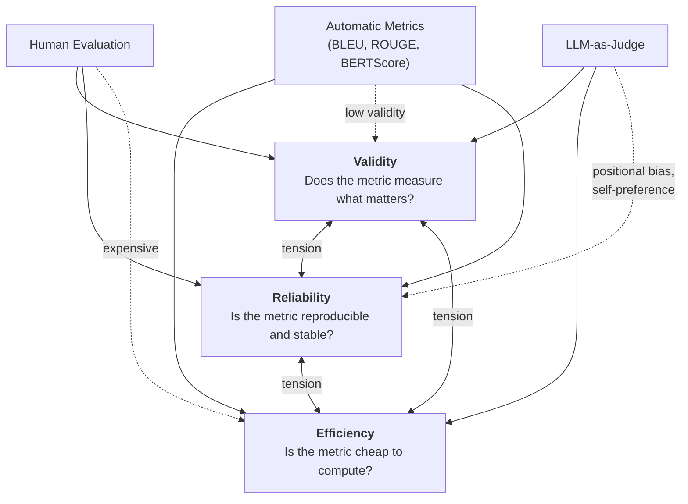
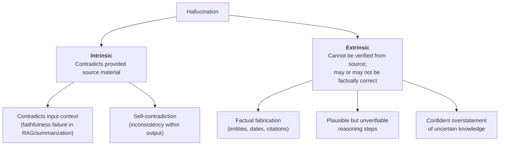
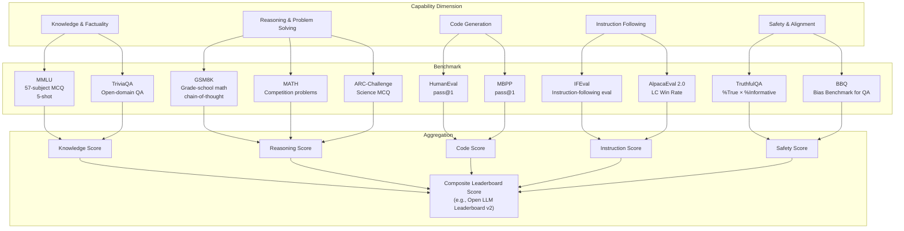
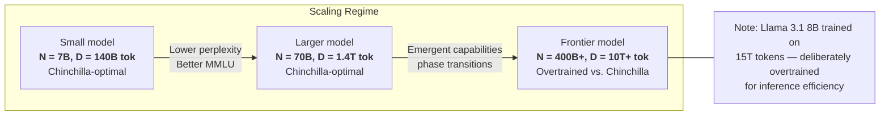
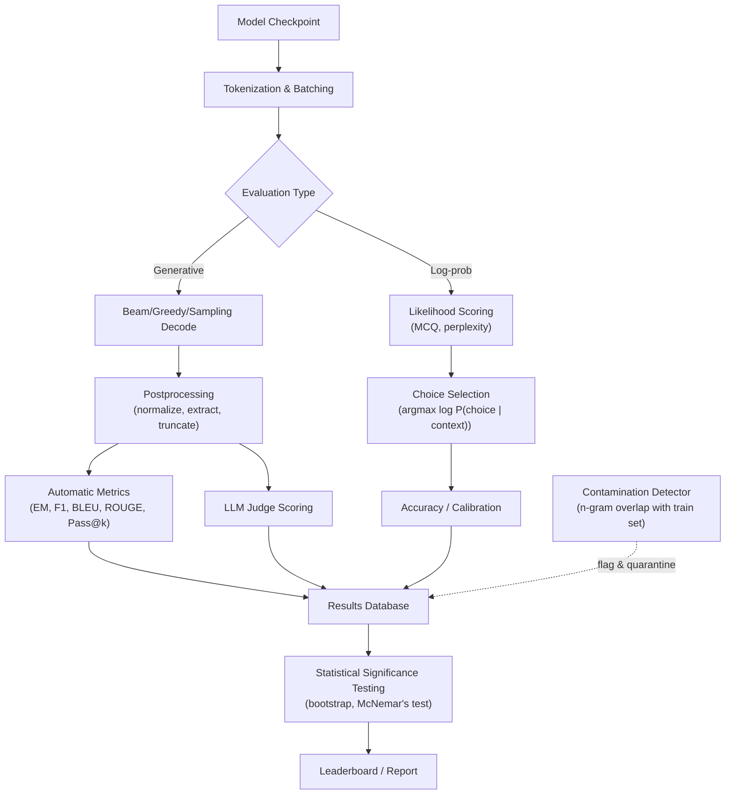
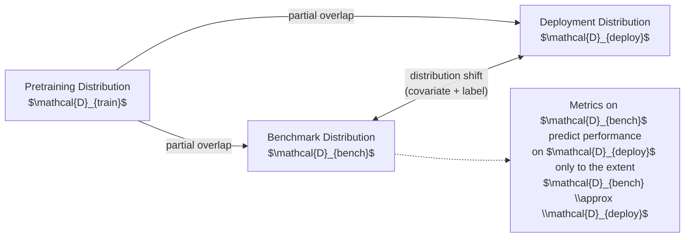

# Lesson 4: Evaluation Metrics for Large Language Models

---

## 1. First-Principles Intuition & Invariants

Evaluation is not an afterthought — it is the epistemological foundation of any claim you make about a model's capability. For Large Language Models (LLMs), this is especially treacherous: the output space is a discrete, combinatorially vast sequence of tokens, the "correct" answer is often subjective or context-dependent, and the mapping from a scalar metric to real-world utility is nonlinear and poorly understood. A metric that looks good in a benchmark can mask catastrophic failure in deployment.

### 1.1 The Probabilistic Core: What an LLM Actually Optimizes

An autoregressive LLM models the joint probability of a token sequence by decomposing it via the chain rule:

$$P(x_1, x_2, \ldots, x_T) = \prod_{t=1}^{T} P(x_t \mid x_1, \ldots, x_{t-1})$$

Training minimizes the negative log-likelihood (NLL) over a corpus $\mathcal{D}$ of $N$ tokens:

$$\mathcal{L}_{NLL} = -\frac{1}{N} \sum_{i=1}^{N} \log P_\theta(x_i \mid x_{<i})$$

This is precisely cross-entropy loss between the model's predicted distribution and the one-hot empirical distribution of the next token. The connection is direct: **perplexity** — the dominant intrinsic evaluation metric for LLMs — is simply the exponentiated average NLL:

$$\text{PPL} = \exp\left(-\frac{1}{N} \sum_{i=1}^{N} \log P_\theta(x_i \mid x_{<i})\right)$$

Perplexity has a clean information-theoretic interpretation: it is $2^H$ where $H$ is the cross-entropy in bits, representing the effective branching factor of the model's uncertainty. A perplexity of 10 means the model is, on average, as uncertain as if it were choosing uniformly among 10 equally likely next tokens. A perfect model that assigns probability 1 to the correct token everywhere has PPL = 1. A model with no information has PPL equal to the vocabulary size (typically 32,000–128,000 for modern models).

**Critical caveat**: PPL is computed over a fixed tokenization. Comparing perplexities across models with different tokenizers is methodologically invalid without normalization by bits-per-character (BPC) or bits-per-byte (BPB), which are tokenizer-agnostic:

$$\text{BPB} = \frac{\mathcal{L}_{NLL}}{\ln 2 \cdot \bar{b}}$$

where $\bar{b}$ is the average number of UTF-8 bytes per token. GPT-4 and LLaMA 3 use different tokenizers; their raw perplexities cannot be directly compared.

### 1.2 Bias–Variance Decomposition in Sequence Models

The classical bias–variance tradeoff generalizes to LLMs in a less obvious but important way. For a regression target $y$ with predictions $\hat{y}$, the expected squared loss decomposes as:

$$\mathbb{E}[(\hat{y} - y)^2] = \underbrace{(\mathbb{E}[\hat{y}] - y)^2}_{\text{Bias}^2} + \underbrace{\mathbb{E}[(\hat{y} - \mathbb{E}[\hat{y}])^2]}_{\text{Variance}} + \underbrace{\sigma^2_\epsilon}_{\text{Irreducible Noise}}$$

For LLMs, the analog manifests as:

- **Bias** corresponds to systematic, consistent errors — factual hallucinations, persistent reasoning failures, or genre confusions. A model that always produces confident but wrong medical dosages has high bias.
- **Variance** corresponds to inconsistency — a model that gives different answers to semantically identical questions rephrased slightly. High-variance models are sensitive to prompt phrasing, temperature, and sampling stochasticity.
- **Irreducible noise** in language is genuine: many questions have multiple valid answers, and the reference corpus contains contradictions and ambiguities that no model can resolve.

Regularization in LLMs takes the form of weight decay ($L_2$ penalty on parameters), dropout applied to attention weights, and critically, **RLHF / DPO alignment** which acts as a form of output-space regularization, penalizing high-variance or policy-violating outputs. Scaling model size does not straightforwardly reduce variance — larger models can memorize more of the training distribution, reducing in-distribution perplexity while simultaneously becoming more capable of confidently wrong extrapolation.

### 1.3 The Evaluation Trilemma

LLM evaluation faces a fundamental tension across three axes that cannot all be optimized simultaneously:



This trilemma motivates the layered evaluation frameworks used by frontier labs: cheap automatic metrics filter large model pools, then LLM-as-Judge re-ranks a smaller set, and human evaluation validates the top candidates on the specific capability of interest.

---

## 2. Core Metrics: Architecture, Mechanics, and Failure Modes

### 2.1 Perplexity: The Intrinsic Baseline

Perplexity is computed during inference by a sliding-window approach to handle sequences longer than the model's context window $L$. For a document of $T$ tokens with stride $s$:

```python
import torch
import numpy as np
from transformers import AutoTokenizer, AutoModelForCausalLM
from typing import Optional

def compute_perplexity_strided(
    text: str,
    model_name: str = "meta-llama/Llama-3.1-8B",
    stride: int = 512,
    max_length: Optional[int] = None,
    device: str = "cuda",
) -> float:
    """
    Compute perplexity with a strided sliding window to handle documents
    longer than the model's maximum context length.

    The stride avoids conditioning on a full context-length prefix for
    every token, which would be O(T * L) attention operations.
    With stride s, each token is scored exactly once except for the first
    (L - s) tokens of each window which are used only as context.

    Reference: Press et al., 2021 (ALiBi), Appendix B.
    """
    tokenizer = AutoTokenizer.from_pretrained(model_name)
    model = AutoModelForCausalLM.from_pretrained(
        model_name,
        torch_dtype=torch.bfloat16,
        device_map=device,
    )
    model.eval()

    max_length = max_length or model.config.max_position_embeddings
    encodings = tokenizer(text, return_tensors="pt")
    input_ids: torch.Tensor = encodings.input_ids.to(device)  # shape: (1, T)
    T = input_ids.size(1)

    nlls: list[torch.Tensor] = []
    prev_end = 0

    for begin in range(0, T, stride):
        end = min(begin + max_length, T)
        # The tokens we score are those not covered by the previous window
        target_len = end - prev_end
        # Input window: up to max_length tokens ending at `end`
        window_input = input_ids[:, begin:end]

        # Build target_ids: mask tokens in the context-only prefix with -100
        # so they don't contribute to the loss
        target_ids = window_input.clone()
        target_ids[:, :-target_len] = -100  # ignore context tokens

        with torch.no_grad():
            outputs = model(window_input, labels=target_ids)
            # outputs.loss is mean NLL over non-masked positions
            neg_log_likelihood = outputs.loss * target_len

        nlls.append(neg_log_likelihood)
        prev_end = end
        if end == T:
            break

    # Exponentiate the mean NLL across all tokens
    mean_nll = torch.stack(nlls).sum() / T
    ppl = torch.exp(mean_nll).item()
    return ppl


if __name__ == "__main__":
    sample = open("wikitext_sample.txt").read()
    ppl = compute_perplexity_strided(sample)
    print(f"Perplexity: {ppl:.2f}")
```

**Failure modes of perplexity:**
- It measures token-level average likelihood, not correctness of a specific fact or instruction-following ability.
- A model can have low perplexity by assigning high probability to plausible-sounding but factually wrong continuations — this is the statistical root of hallucination.
- Domain mismatch between pretraining data and the evaluation corpus produces artifactually high PPL (e.g., evaluating a model pretrained mainly on English on French text).
- Compression artifacts: very short, repetitive texts have near-zero perplexity because the model learns trivial patterns.

### 2.2 BLEU: N-gram Precision with Brevity Penalty

BLEU (Bilingual Evaluation Understudy, Papineni et al., 2002) was designed for machine translation and remains a de facto standard, despite well-documented limitations. It computes a modified precision for n-grams of orders 1–4 and applies a brevity penalty (BP) to discourage degenerate short outputs:

$$\text{BLEU} = \text{BP} \cdot \exp\left(\sum_{n=1}^{N} w_n \log p_n\right)$$

where $w_n = 1/N$ (uniform weights), and the modified n-gram precision is:

$$p_n = \frac{\sum_{\text{hyp}} \sum_{\text{gram}_n} \min(\text{Count}_{\text{hyp}}(\text{gram}_n),\, \max_{\text{ref}} \text{Count}_{\text{ref}}(\text{gram}_n))}{\sum_{\text{hyp}} \sum_{\text{gram}_n} \text{Count}_{\text{hyp}}(\text{gram}_n)}$$

The clipping by the maximum reference count prevents a hypothesis from "gaming" precision by repeating high-frequency unigrams. The brevity penalty:

$$\text{BP} = \begin{cases} 1 & \text{if } c > r \\ e^{1 - r/c} & \text{if } c \leq r \end{cases}$$

penalizes hypotheses shorter than the reference length $r$.

```python
from collections import Counter
import math
from typing import Sequence


def ngram_counts(tokens: list[str], n: int) -> Counter:
    return Counter(tuple(tokens[i:i+n]) for i in range(len(tokens) - n + 1))


def bleu_score(
    hypothesis: str,
    references: list[str],
    max_n: int = 4,
    weights: Sequence[float] | None = None,
) -> float:
    """
    Corpus-level BLEU score implementation following Papineni et al. (2002).
    For production use, prefer sacrebleu which implements tokenization standards.
    """
    if weights is None:
        weights = [1.0 / max_n] * max_n

    hyp_tokens = hypothesis.split()
    ref_tokens_list = [ref.split() for ref in references]

    c = len(hyp_tokens)  # hypothesis length
    # Reference length: closest reference length (SacreBLEU default)
    r = min((len(ref) for ref in ref_tokens_list),
            key=lambda l: (abs(l - c), l))

    if c == 0:
        return 0.0

    bp = 1.0 if c > r else math.exp(1.0 - r / c)

    log_avg_precision = 0.0
    for n in range(1, max_n + 1):
        hyp_ngrams = ngram_counts(hyp_tokens, n)
        # Clipped count: for each ngram in hypothesis, take min(hyp_count, max_ref_count)
        clipped = 0
        total = sum(hyp_ngrams.values())
        if total == 0:
            return 0.0
        for gram, count in hyp_ngrams.items():
            max_ref_count = max(
                ngram_counts(ref, n).get(gram, 0) for ref in ref_tokens_list
            )
            clipped += min(count, max_ref_count)

        if clipped == 0:
            # Any zero precision makes geometric mean zero
            return 0.0
        log_avg_precision += weights[n - 1] * math.log(clipped / total)

    return bp * math.exp(log_avg_precision)
```

**BLEU's well-documented failure modes in LLM evaluation:**
- **Surface form sensitivity**: "The cat sat on the mat" and "A feline rested upon the rug" receive near-zero BLEU overlap despite being semantically equivalent. This makes BLEU a poor metric for open-ended generation, summarization, or QA where paraphrase is acceptable.
- **No semantic understanding**: incorrect but lexically similar outputs score high.
- **Reference quality dependence**: a single high-quality reference penalizes valid alternative phrasings; corpus BLEU with multiple references alleviates this but references are expensive to collect.
- **Saturates at scale**: modern LLMs fine-tuned on instruction data achieve BLEU scores in translation that exceed human BLEU, rendering it unable to distinguish between good models.

### 2.3 ROUGE: Recall-Oriented Metrics for Summarization

ROUGE (Lin, 2004) is the dominant automatic metric for summarization. The family includes:

- **ROUGE-N**: n-gram recall between hypothesis and reference(s).
- **ROUGE-L**: longest common subsequence (LCS) F1, capturing in-order matches that do not need to be contiguous.
- **ROUGE-W**: weighted LCS that rewards contiguous matches more heavily.
- **ROUGE-S**: skip-bigram co-occurrence statistics.

$$\text{ROUGE-N} = \frac{\sum_{\text{ref}} \sum_{\text{gram}_n \in \text{ref}} \min(\text{Count}_\text{hyp}(\text{gram}_n), \text{Count}_\text{ref}(\text{gram}_n))}{\sum_{\text{ref}} \sum_{\text{gram}_n \in \text{ref}} \text{Count}_\text{ref}(\text{gram}_n)}$$

The key difference from BLEU: ROUGE-N is a **recall** measure (denominator is reference count), while BLEU's $p_n$ is a **precision** measure (denominator is hypothesis count). In summarization, recall matters more because a summary should cover the reference's key content.

ROUGE-L computes the LCS length $\text{LCS}(h, r)$ and forms an F1 score:

$$R_\text{LCS} = \frac{\text{LCS}(h,r)}{|r|}, \quad P_\text{LCS} = \frac{\text{LCS}(h,r)}{|h|}, \quad F_\text{ROUGE-L} = \frac{(1+\beta^2) R_\text{LCS} P_\text{LCS}}{R_\text{LCS} + \beta^2 P_\text{LCS}}$$

where $\beta$ is typically set large (e.g., $\beta = 1.2$) to weight recall slightly more than precision.

**ROUGE failure modes**: identical to BLEU in its surface-form sensitivity. Additionally, ROUGE-L does not penalize out-of-order key facts, so a summary can achieve a high ROUGE-L score by shuffling the order of reference sentences.

### 2.4 BERTScore: Embedding-Space Similarity

BERTScore (Zhang et al., 2020) replaces n-gram overlap with contextual embedding cosine similarity, using a pretrained encoder (typically DeBERTa-XLarge or RoBERTa-Large) to represent tokens:

$$R_\text{BERT} = \frac{1}{|r|} \sum_{r_j \in r} \max_{h_i \in h} \cos(\mathbf{e}_{r_j}, \mathbf{e}_{h_i})$$
$$P_\text{BERT} = \frac{1}{|h|} \sum_{h_i \in h} \max_{r_j \in r} \cos(\mathbf{e}_{h_i}, \mathbf{e}_{r_j})$$
$$F_\text{BERT} = 2 \cdot \frac{P_\text{BERT} \cdot R_\text{BERT}}{P_\text{BERT} + R_\text{BERT}}$$

Each token in the hypothesis is soft-matched to the most similar token in the reference, taking the maximum cosine similarity. IDF weighting is optional and reduces the contribution of common tokens.

BERTScore correlates substantially better with human judgments than BLEU/ROUGE on tasks like translation and summarization. However:
- It inherits the biases of the underlying encoder model — a model trained primarily on English will under-score valid cross-lingual or low-resource paraphrases.
- It is not calibrated across languages or domains without fine-tuning of the reference model.
- Soft matching can mask hard factual errors: a hallucinated number similar in embedding space to the correct number may still score highly.

### 2.5 Task-Specific Metrics: Exact Match, F1, and Pass@k

For extractive QA (SQuAD-style), two metrics dominate:

**Exact Match (EM)**: Binary. 1 if the prediction (after normalization: lowercase, strip punctuation, collapse whitespace) equals any answer in the reference set, else 0.

**Token-Level F1**: Treats the prediction and reference as bags of tokens and computes F1 overlap. This tolerates partial matches (a prediction that includes extra words can still score high F1).

```python
import re
import string
from collections import Counter


def normalize_answer(s: str) -> str:
    """Canonical normalization from the SQuAD evaluation script."""
    def remove_articles(text: str) -> str:
        return re.sub(r"\b(a|an|the)\b", " ", text)

    def white_space_fix(text: str) -> str:
        return " ".join(text.split())

    def remove_punc(text: str) -> str:
        exclude = set(string.punctuation)
        return "".join(ch for ch in text if ch not in exclude)

    return white_space_fix(remove_articles(remove_punc(s.lower())))


def f1_score_qa(prediction: str, ground_truths: list[str]) -> float:
    """Token-level F1 as used in SQuAD 1.1 evaluation."""
    def _f1(pred_tokens: list[str], gold_tokens: list[str]) -> float:
        common = Counter(pred_tokens) & Counter(gold_tokens)
        num_same = sum(common.values())
        if num_same == 0:
            return 0.0
        precision = num_same / len(pred_tokens)
        recall = num_same / len(gold_tokens)
        return 2 * precision * recall / (precision + recall)

    pred_norm = normalize_answer(prediction).split()
    return max(
        _f1(pred_norm, normalize_answer(gt).split())
        for gt in ground_truths
    )


def exact_match(prediction: str, ground_truths: list[str]) -> int:
    pred_norm = normalize_answer(prediction)
    return int(any(pred_norm == normalize_answer(gt) for gt in ground_truths))
```

For code generation, **Pass@k** (Chen et al., 2021, HumanEval) measures the probability that at least one of $k$ generated samples passes all unit tests. Computing it naively by sampling exactly $k$ solutions is high-variance; the unbiased estimator using $n \geq k$ samples is:

$$\text{pass@}k = 1 - \frac{\binom{n - c}{k}}{\binom{n}{k}}$$

where $c$ is the number of correct samples out of $n$ total. This estimator has lower variance than the naive approach because it averages over all $\binom{n}{k}$ possible subsets of size $k$.

```python
import math
from typing import Iterator


def pass_at_k(n: int, c: int, k: int) -> float:
    """
    Unbiased estimator for pass@k.
    
    Args:
        n: Total number of generated samples.
        c: Number of samples that pass all unit tests.
        k: Number of samples to report (k <= n).
    
    Returns:
        Estimated probability that at least one of k samples passes.
    
    Reference: Chen et al., 2021, "Evaluating Large Language Models
               Trained on Code", Equation 3.
    """
    if n - c < k:
        # All remaining draws must include at least one correct sample
        return 1.0
    # Use log-space arithmetic to avoid integer overflow for large n
    # comb(n - c, k) / comb(n, k) = prod_{i=0}^{k-1} (n-c-i)/(n-i)
    prob_all_wrong = math.prod(
        (n - c - i) / (n - i) for i in range(k)
    )
    return 1.0 - prob_all_wrong
```

### 2.6 LLM-as-Judge: Methodology and Bias Taxonomy

A powerful but methodologically fraught evaluation paradigm uses a stronger LLM (e.g., GPT-4o) to score outputs from a weaker model. The judge is prompted with a rubric and asked to assign a score or choose between outputs. This is the basis of MT-Bench (Zheng et al., 2023) and AlpacaEval.

The known biases that must be controlled for:

| Bias Type | Description | Mitigation |
|-----------|-------------|------------|
| **Positional bias** | Preference for the first or second response in pairwise comparison, independent of quality | Swap order and average scores; use concordance rate |
| **Verbosity bias** | Preference for longer responses regardless of correctness | Control for response length in prompts; use length-normalized scoring |
| **Self-preference bias** | A judge model prefers outputs from the same model family | Use judges from a different model family; use multiple independent judges |
| **Sycophancy** | The judge agrees with any confident assertion in the response | Inject deliberate factual errors into test responses; measure detection rate |
| **Rubric ambiguity** | Inconsistent interpretation of abstract quality criteria | Use fine-grained, operationalized rubrics; compute inter-rater agreement (Cohen's $\kappa$) across multiple judge calls |

```python
from openai import OpenAI
from dataclasses import dataclass
import json

JUDGE_SYSTEM_PROMPT = """
You are an impartial evaluator scoring an AI assistant's response to a user question.
Score the response on a scale of 1–10 along each dimension below. 
Return a JSON object with keys: factual_accuracy, instruction_following, 
coherence, and overall. Each value is an integer 1–10.
Do NOT consider response length. Base scores solely on the criteria.
"""

JUDGE_USER_TEMPLATE = """
[User Question]
{question}

[AI Response]
{response}

[Reference Answer]
{reference}

Output only valid JSON.
"""


@dataclass
class JudgeResult:
    factual_accuracy: int
    instruction_following: int
    coherence: int
    overall: int
    raw: str


def llm_judge(
    question: str,
    response: str,
    reference: str,
    model: str = "gpt-4o",
    n_calls: int = 3,
) -> JudgeResult:
    """
    Multi-call LLM judge with variance reduction via averaging.
    n_calls > 1 reduces single-call noise; use median for robustness.
    """
    client = OpenAI()
    scores: list[dict] = []

    for _ in range(n_calls):
        raw = client.chat.completions.create(
            model=model,
            temperature=0.0,  # deterministic scoring reduces run-to-run variance
            response_format={"type": "json_object"},
            messages=[
                {"role": "system", "content": JUDGE_SYSTEM_PROMPT},
                {
                    "role": "user",
                    "content": JUDGE_USER_TEMPLATE.format(
                        question=question,
                        response=response,
                        reference=reference,
                    ),
                },
            ],
        ).choices[0].message.content

        try:
            scores.append(json.loads(raw))
        except json.JSONDecodeError:
            continue

    if not scores:
        raise ValueError("All judge calls failed to produce valid JSON.")

    # Median across calls for robustness against outlier scores
    def _median_key(key: str) -> int:
        vals = sorted(s[key] for s in scores)
        mid = len(vals) // 2
        return vals[mid]

    return JudgeResult(
        factual_accuracy=_median_key("factual_accuracy"),
        instruction_following=_median_key("instruction_following"),
        coherence=_median_key("coherence"),
        overall=_median_key("overall"),
        raw=str(scores),
    )
```

---

## 3. Hallucination-Specific Evaluation

Hallucination — the generation of fluent, confident, but factually incorrect text — is the defining failure mode of LLMs and deserves its own evaluation taxonomy.

### 3.1 Hallucination Taxonomy



### 3.2 FactScore: Fine-Grained Atomic Fact Verification

FactScore (Min et al., 2023) decomposes generated text into atomic claims and verifies each claim against a knowledge source (Wikipedia or a retrieval corpus). The final score is the fraction of verifiable claims that are supported:

$$\text{FactScore} = \frac{1}{|C|} \sum_{c \in C} \mathbf{1}[\text{Supported}(c, \mathcal{K})]$$

where $C$ is the set of atomic claims extracted from the generation and $\mathcal{K}$ is the knowledge source. The claim extraction and verification steps are themselves LLM-driven, introducing a dependency on the judge model's accuracy.

### 3.3 RAG Faithfulness Metrics

For Retrieval-Augmented Generation (RAG), the **faithfulness** dimension measures whether claims in the generated answer are entailed by the retrieved context, independent of their real-world truth:

```python
from dataclasses import dataclass


FAITHFULNESS_PROMPT = """
Given the following context and a generated answer, determine whether 
each sentence in the answer is supported (fully entailed) by the context.
Return a JSON list of objects with keys: "sentence", "verdict" (true/false), 
"evidence" (quote from context or null).
---
Context:
{context}

Answer:
{answer}
"""


@dataclass
class FaithfulnessSentence:
    sentence: str
    verdict: bool
    evidence: str | None


def compute_rag_faithfulness(
    context: str,
    answer: str,
    judge_model: str = "gpt-4o",
) -> tuple[float, list[FaithfulnessSentence]]:
    """
    Compute RAG faithfulness as the fraction of answer sentences
    fully entailed by the retrieved context.
    Returns (score, per-sentence breakdown).
    """
    import json
    from openai import OpenAI

    client = OpenAI()
    response = client.chat.completions.create(
        model=judge_model,
        temperature=0.0,
        response_format={"type": "json_object"},
        messages=[
            {
                "role": "user",
                "content": FAITHFULNESS_PROMPT.format(
                    context=context, answer=answer
                ),
            }
        ],
    )

    data = json.loads(response.choices[0].message.content)
    sentences_data = data if isinstance(data, list) else data.get("sentences", [])

    sentences = [
        FaithfulnessSentence(
            sentence=s["sentence"],
            verdict=bool(s["verdict"]),
            evidence=s.get("evidence"),
        )
        for s in sentences_data
    ]

    if not sentences:
        return 0.0, []

    score = sum(1 for s in sentences if s.verdict) / len(sentences)
    return score, sentences
```

---

## 4. Benchmark Suites and Their Architectural Role

Production evaluation of LLMs does not rely on any single metric. The standard practice is a benchmark battery that tests distinct capability dimensions, each with its own measurement methodology.



**Key benchmarks and their measurement methodology:**

**MMLU** (Hendrycks et al., 2021): 14,000+ multiple-choice questions across 57 subjects from STEM to law and ethics. Evaluated in 5-shot setting; score is mean accuracy across subjects. Subject-level variance is high — a model's overall MMLU score can mask near-chance performance on specific domains.

**GSM8K** (Cobbe et al., 2021): 8,500 grade-school math problems requiring multi-step arithmetic reasoning. Chain-of-thought prompting is standard; without it, performance degrades significantly, demonstrating that prompting methodology is part of the measurement. Models are increasingly suspected to have memorized GSM8K solutions during pretraining, inflating scores.

**HumanEval** (Chen et al., 2021): 164 Python programming problems. Each problem provides a function signature and docstring; the model generates the body. Pass@1 is the primary reported metric using $n=200$ samples per problem. Known contamination concerns: exact problems appear in many pretraining corpora.

**TruthfulQA** (Lin et al., 2022): 817 questions designed to elicit false beliefs that humans commonly hold (e.g., "What happens if you swallow gum?"). The metric is $\%\text{True} \times \%\text{Informative}$, the product of two binary classifier scores, measuring both accuracy and the absence of unhelpfully evasive refusals.

**IFEval** (Zhou et al., 2023): evaluates strict instruction following (e.g., "respond in exactly 3 bullet points", "do not use the word X") with programmatic verification rather than LLM judgment, making it highly reproducible.

---

## 5. Scaling Laws and Their Implications for Evaluation

Chinchilla scaling laws (Hoffmann et al., 2022) describe how loss decreases as a power law in both model parameters $N$ and training tokens $D$:

$$\mathcal{L}(N, D) = E + \frac{A}{N^\alpha} + \frac{B}{D^\beta}$$

where $E \approx 1.69$ nats is the irreducible entropy of the training distribution (estimated from a fitted asymptote), $A, B, \alpha, \beta$ are empirically fit constants, and all quantities are in nats (natural log units, not bits).

The Chinchilla-optimal compute allocation — the allocation of a fixed FLOPs budget $C \approx 6ND$ between $N$ and $D$ that minimizes $\mathcal{L}$ — implies $N \propto D$, recommending roughly 20 training tokens per parameter. This directly determines how loss-based metrics (perplexity) should be expected to behave as models scale, and informs the diminishing returns observed on saturating benchmarks.



The evaluation implication of overtraining (training beyond Chinchilla-optimal $D$ for a given $N$) is that a smaller overtrained model can match or exceed the benchmark performance of a larger undertrained model at inference time, while being cheaper to serve. This decouples model size from quality in ways that make headline parameter counts misleading as quality proxies.

---

## 6. The Complete Evaluation Pipeline: Architecture and Implementation

A production evaluation pipeline must be reproducible, parallelizable, and resistant to benchmark contamination. The following architecture reflects practices at frontier labs.



### 6.1 Log-Probability Scoring for Multiple-Choice Benchmarks

For MCQ benchmarks like MMLU and ARC, models are typically not asked to generate a free-form answer. Instead, the log-probability of each answer choice is computed and the choice with the highest probability is selected. This is more stable than greedy generation and handles formatting variations:

```python
import torch
import numpy as np
from transformers import AutoTokenizer, AutoModelForCausalLM


def score_mcq(
    model: AutoModelForCausalLM,
    tokenizer: AutoTokenizer,
    context: str,
    choices: list[str],
    device: str = "cuda",
    normalize_by_length: bool = True,
) -> int:
    """
    Score a multiple-choice question by selecting the choice with the
    highest mean log-probability when appended to the context.

    Length normalization (dividing total log-prob by token count) prevents
    bias toward shorter answers, which tend to have higher raw log-prob.

    Args:
        context:  The question stem + any few-shot demonstrations.
        choices:  The answer strings (e.g., ["Paris", "London", "Berlin", "Madrid"]).
        normalize_by_length: Divide log-prob by token count of the choice.
    
    Returns:
        Index of the highest-scoring choice.
    """
    model.eval()
    scores: list[float] = []

    for choice in choices:
        full_text = context + choice
        input_ids = tokenizer.encode(full_text, return_tensors="pt").to(device)
        context_ids = tokenizer.encode(context, return_tensors="pt").to(device)

        n_context_tokens = context_ids.shape[1]
        n_choice_tokens = input_ids.shape[1] - n_context_tokens

        if n_choice_tokens == 0:
            scores.append(-float("inf"))
            continue

        with torch.no_grad():
            outputs = model(input_ids)
            # logits shape: (1, T, vocab_size)
            # We want log-prob for positions [n_context_tokens - 1 : T - 1]
            # (the positions that predict the choice tokens)
            logits = outputs.logits[0, n_context_tokens - 1 : -1, :]  # (n_choice, vocab)
            log_probs = torch.log_softmax(logits, dim=-1)

            # Gather log-probs of the actual choice tokens
            choice_token_ids = input_ids[0, n_context_tokens:]  # (n_choice,)
            token_log_probs = log_probs[
                torch.arange(n_choice_tokens, device=device),
                choice_token_ids,
            ]  # (n_choice,)

            total_log_prob = token_log_probs.sum().item()

        if normalize_by_length:
            total_log_prob /= n_choice_tokens

        scores.append(total_log_prob)

    return int(np.argmax(scores))
```

### 6.2 Statistical Significance Testing

Reporting a single number without confidence intervals is insufficient for rigorous comparison. Bootstrap resampling provides a non-parametric confidence interval for any aggregate metric:

```python
import numpy as np
from typing import Callable


def bootstrap_ci(
    scores: list[float],
    statistic: Callable[[np.ndarray], float] = np.mean,
    n_bootstrap: int = 10_000,
    alpha: float = 0.05,
    seed: int = 42,
) -> tuple[float, float, float]:
    """
    Non-parametric bootstrap confidence interval for a scalar statistic.

    Args:
        scores: Per-example metric values (e.g., per-question accuracy booleans).
        statistic: Aggregate function (default: mean).
        n_bootstrap: Number of bootstrap resamples.
        alpha: Significance level; returns (1 - alpha) CI.
        seed: Random seed for reproducibility.

    Returns:
        (point_estimate, lower_bound, upper_bound)
    """
    rng = np.random.default_rng(seed)
    arr = np.array(scores, dtype=float)
    point_estimate = statistic(arr)

    bootstrap_stats = np.empty(n_bootstrap)
    for i in range(n_bootstrap):
        sample = rng.choice(arr, size=len(arr), replace=True)
        bootstrap_stats[i] = statistic(sample)

    lower = float(np.percentile(bootstrap_stats, 100 * alpha / 2))
    upper = float(np.percentile(bootstrap_stats, 100 * (1 - alpha / 2)))
    return point_estimate, lower, upper


def mcnemar_test(
    model_a_correct: list[bool],
    model_b_correct: list[bool],
) -> tuple[float, float]:
    """
    McNemar's test for paired nominal data.
    Tests the null hypothesis that two models have equal error rates
    on the same test set.

    Returns (chi2_statistic, p_value).
    
    Use when: comparing two models on the same benchmark, same examples.
    Use bootstrap CI when: comparing aggregate metrics with no paired structure.
    """
    from scipy.stats import chi2

    assert len(model_a_correct) == len(model_b_correct)
    # b = A correct, B wrong; c = A wrong, B correct
    b = sum(1 for a, bv in zip(model_a_correct, model_b_correct) if a and not bv)
    c = sum(1 for a, bv in zip(model_a_correct, model_b_correct) if not a and bv)

    if b + c == 0:
        return 0.0, 1.0  # No discordant pairs; models are equivalent on this set

    # Edwards' continuity-corrected McNemar statistic
    chi2_stat = (abs(b - c) - 1) ** 2 / (b + c)
    p_value = 1.0 - chi2.cdf(chi2_stat, df=1)
    return chi2_stat, p_value
```

---

## 7. Calibration: When Confidence Should Match Accuracy

A perfectly calibrated model assigns probability $p$ to events that actually occur with frequency $p$. Miscalibrated models produce confidently wrong outputs, which is the probabilistic substrate of hallucination. Calibration is measured by the **Expected Calibration Error (ECE)**:

$$\text{ECE} = \sum_{m=1}^{M} \frac{|B_m|}{N} \left| \text{acc}(B_m) - \text{conf}(B_m) \right|$$

where $B_m$ are equal-width bins of confidence (e.g., [0.9, 1.0], [0.8, 0.9], ...), and $\text{acc}(B_m)$ and $\text{conf}(B_m)$ are the mean accuracy and mean confidence in each bin. A perfectly calibrated model has ECE = 0.

```python
import numpy as np
import matplotlib.pyplot as plt


def expected_calibration_error(
    confidences: np.ndarray,
    correctness: np.ndarray,
    n_bins: int = 15,
) -> tuple[float, dict]:
    """
    Compute ECE and return bin statistics for reliability diagram plotting.

    Args:
        confidences: Model confidence in predicted answer, shape (N,), values in [0, 1].
        correctness: Binary correctness indicator, shape (N,), values in {0, 1}.
        n_bins: Number of equal-width bins.

    Returns:
        (ece, bin_stats) where bin_stats is a dict with keys:
        'bin_confs', 'bin_accs', 'bin_counts', 'bin_edges'.
    """
    bin_edges = np.linspace(0.0, 1.0, n_bins + 1)
    bin_confs = np.zeros(n_bins)
    bin_accs = np.zeros(n_bins)
    bin_counts = np.zeros(n_bins, dtype=int)

    for m in range(n_bins):
        in_bin = (confidences > bin_edges[m]) & (confidences <= bin_edges[m + 1])
        count = int(in_bin.sum())
        bin_counts[m] = count
        if count > 0:
            bin_confs[m] = confidences[in_bin].mean()
            bin_accs[m] = correctness[in_bin].mean()

    n = len(confidences)
    ece = float(np.sum(bin_counts / n * np.abs(bin_accs - bin_confs)))

    return ece, {
        "bin_confs": bin_confs,
        "bin_accs": bin_accs,
        "bin_counts": bin_counts,
        "bin_edges": bin_edges,
    }


def plot_reliability_diagram(bin_stats: dict, ece: float, title: str = "") -> None:
    """Plot a calibration reliability diagram (confidence vs. accuracy)."""
    edges = bin_stats["bin_edges"]
    bin_width = edges[1] - edges[0]
    centers = (edges[:-1] + edges[1:]) / 2

    fig, ax = plt.subplots(figsize=(6, 6))
    ax.bar(
        centers,
        bin_stats["bin_accs"],
        width=bin_width * 0.8,
        alpha=0.7,
        label="Accuracy",
        color="steelblue",
    )
    ax.plot([0, 1], [0, 1], "k--", label="Perfect calibration")
    ax.set_xlabel("Confidence")
    ax.set_ylabel("Accuracy")
    ax.set_title(f"{title} Reliability Diagram\nECE = {ece:.4f}")
    ax.legend()
    ax.set_xlim(0, 1)
    ax.set_ylim(0, 1)
    plt.tight_layout()
    plt.savefig("reliability_diagram.png", dpi=150)
    plt.close()
```

RLHF-trained models are systematically overconfident compared to their base model counterparts — the alignment process reduces refusals and uncertainty expressions without necessarily improving factual accuracy, widening the gap between expressed confidence and actual calibration.

---

## 8. Evaluation Anti-Patterns and Contamination

### 8.1 Benchmark Contamination

Benchmark contamination occurs when evaluation examples (or paraphrased variants) appear in the pretraining corpus. Contamination inflates scores in ways that are difficult to detect post-hoc. Standard detection methods include:

- **N-gram overlap detection**: flag test examples with $k$-gram overlap above a threshold against the training corpus. Used by the Open LLM Leaderboard.
- **Canary string injection**: embed unique strings in evaluation sets before release; presence in a model's training data can be inferred from abnormally high perplexity on slight perturbations.
- **Membership inference attacks**: statistical tests that probe whether specific examples were in training data by analyzing log-probability distributions.

### 8.2 Evaluation Anti-Patterns

| Anti-Pattern | Description | Consequence |
|---|---|---|
| **Single metric reporting** | Reporting only accuracy on one benchmark | Hides capability gaps; models can be tuned to overfit specific benchmarks |
| **No significance testing** | Reporting raw score deltas without CIs or p-values | Small differences on small test sets are not statistically meaningful |
| **Greedy decoding only** | Evaluating at temperature=0 | Underestimates performance on tasks where sampling + majority vote (self-consistency) is state of the art |
| **Ignoring few-shot sensitivity** | Reporting one fixed shot count | Performance varies substantially with number of demonstrations; 0-shot ≠ 5-shot capability |
| **Leaderboard overfitting** | Iterating model design decisions based on public leaderboard scores | Models converge on artifacts of the public test set, not generalizable capability |
| **Aggregate score masking** | Reporting a single composite score | A model can score 90th percentile on 4 of 5 benchmarks and 10th percentile on safety, with a high composite |

### 8.3 The Distribution Shift Problem

No benchmark fully represents the deployment distribution. The evaluation–deployment gap is a first-order concern:



The practical implication: before deployment, run a sample of real user queries through the model and score them with a combination of automatic metrics and human review. This "deployment shadow evaluation" is the only reliable signal about production quality.

---

## 9. Summary: Metric Selection Framework

The choice of evaluation metric is itself a modeling decision — it encodes assumptions about what "good" means for the system under test. The following framework operationalizes this decision:

| Task Type | Primary Metric | Secondary Metrics | Avoid |
|---|---|---|---|
| Language modeling / pretraining | Perplexity (BPB for cross-model comparison) | Downstream benchmark average | PPL across different tokenizers |
| Translation | ChrF++ or COMET (neural) | BLEU (legacy compatibility) | BLEU as primary for new work |
| Summarization | ROUGE-L + BERTScore | Factuality (FactScore, NLI entailment) | ROUGE-1 alone |
| Open-domain QA | EM + Token F1 | FactScore, TriviaQA acc | BLEU |
| Code generation | Pass@1, Pass@10 | Code execution rate | BLEU on code |
| Instruction following | IFEval (programmatic) + AlpacaEval LC Win Rate | MT-Bench (LLM judge) | ROUGE |
| RAG / grounded generation | Faithfulness (entailment) + Relevance | EM, F1 | Perplexity |
| Safety & alignment | TruthfulQA, BBQ, refusal rate | Human red-team evaluation | No safety metrics |

The irreducible reality of LLM evaluation is that no automatic metric is a sufficient proxy for human judgment on the full distribution of real-world tasks. Metric selection should be driven by what failure mode is most costly in the deployment context — a hallucinating medical assistant and a hallucinating creative writing assistant have different risk profiles that demand different evaluation investments.
