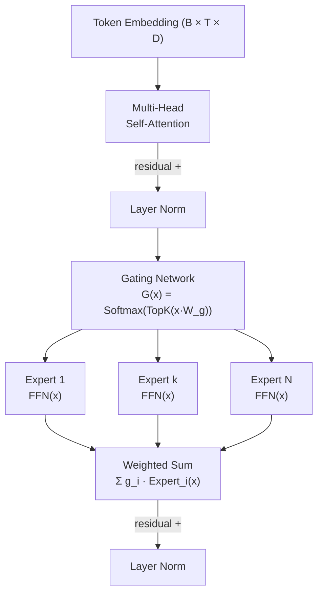

# Lesson 1: Mixture of Experts Fundamentals

## 1. First-Principles Intuition & Invariants

The fundamental tension at the heart of modern deep learning is deceptively simple: larger models generalize better, but larger models cost more to run. For the first decade of deep learning, this tension was resolved through brute force. Every parameter in a dense transformer participated in every forward pass, every token, every request. The computational graph was monolithic. Scale meant paying the full price on every inference call, without exception.

Mixture of Experts (MoE) breaks this constraint by enforcing a principle that feels almost obvious once stated: not every input requires the same computation. A token from a Python code snippet and a token from a Swahili poem inhabit entirely different statistical neighborhoods in the representational landscape, and there is no fundamental reason the same set of weights must process both. The human brain understood this long before machine learning formalized it. The visual cortex does not activate uniformly in response to auditory stimuli. Specialized neural assemblies handle specialized tasks, and coordination emerges through routing, not through every neuron firing on every input.

The formal origins of MoE in machine learning trace back to Jacobs, Jordan, Nowlan, and Hinton's 1991 paper "Adaptive Mixtures of Local Experts," which introduced the core idea of training a gating network alongside a set of expert networks, where the gating network learned to route inputs to whichever expert was best suited for them. The experts would specialize through gradient descent, and the gating network would sharpen its routing decisions as the experts became more differentiated. This was a compelling architecture for small-scale problems, but the machinery to scale it into the billions of parameters required for modern language modeling did not exist for another two decades.

The modern era of MoE began with Shazeer et al.'s 2017 paper "Outrageously Large Neural Networks," which demonstrated that sparse gating could be inserted into an LSTM stack at scale, activating only the top-$k$ experts out of a larger pool on each forward pass. The critical insight was that sparsity is the mechanism by which you decouple total parameter count from per-token floating-point operations. If a model has $N$ experts and routes each token to $k$ of them, the active parameter count per token is roughly $k/N$ of the total. With $N = 64$ and $k = 2$, you are activating approximately 3% of the expert parameters on any given token. The model can be enormous in terms of stored weights while remaining computationally lean during inference.

Switch Transformer (Fedus et al., 2021) pushed this further by demonstrating that routing to a single expert ($k = 1$) produced stable training dynamics when combined with careful capacity management, and that a 1.6 trillion parameter MoE model could be trained on TPUs with per-token FLOPs comparable to a much smaller dense model. Mixtral 8x7B (Mistral AI, 2024) brought this architecture into open-source practice, using 8 experts per FFN layer with top-2 routing, yielding a model with 46.7B total parameters but only 12.9B active per token.

Understanding MoE requires holding three invariants in mind simultaneously throughout all that follows.

The first invariant is **conditional computation**: the computational graph executed for a given input is a function of that input. This is structurally different from dense networks, where the graph is fixed regardless of content. Conditional computation introduces a data-dependent control flow that must be managed carefully for correctness and efficiency.

The second invariant is **the capacity-FLOPs decoupling**: total model capacity (the ability to store and retrieve diverse knowledge across the parameter space) scales with the number of experts, while per-token FLOPs scale only with the number of activated experts. These two quantities are independently tunable. Doubling the number of experts doubles model capacity at negligible inference cost, provided the routing infrastructure can handle the dispatch.

The third invariant is **the load balancing imperative**: routing networks, left unregulated, collapse into degenerate states where a small number of experts receive nearly all tokens and the rest atrophy. This is not a training instability in the conventional sense; it is a stable fixed point of the unregulated objective, because the gating network learns that routing to already-good experts is locally optimal. Escaping this requires explicit auxiliary losses that penalize load imbalance, transforming routing into a constrained optimization problem rather than a free one.

---

## 2. Core Architecture & Mechanics

### The Dense Transformer FFN as the Replacement Target

To understand where experts live in a transformer, it helps to recall the role of the Feed-Forward Network (FFN) sublayer. Each transformer block contains two major sublayers: multi-head self-attention, which redistributes information across sequence positions, and an FFN, which applies a position-wise nonlinear transformation. For a hidden dimension $d_{model}$ and an intermediate dimension $d_{ff}$ (typically $4 \times d_{model}$), the FFN computes:

$$\text{FFN}(x) = \text{activation}(x W_1 + b_1) W_2 + b_2$$

where $W_1 \in \mathbb{R}^{d_{model} \times d_{ff}}$ and $W_2 \in \mathbb{R}^{d_{ff} \times d_{model}}$. Research on dense transformers has found that the FFN layers store factual knowledge and perform feature-space transformations that specialize across layers and positions. They are, in a real sense, the "memory" of the transformer. They are also, in terms of parameter count, the dominant cost: in a standard transformer, FFN parameters account for roughly two-thirds of total parameters.

The MoE substitution replaces the single FFN sublayer with $N$ parallel expert FFNs plus a gating network. The attention mechanism is left unchanged. The resulting block looks like this:



Each expert is an independent FFN with its own parameters. At inference time, only the top-$k$ experts receive the token, compute their outputs, and contribute to the weighted sum. The experts not selected perform zero computation.

### The Gating Network in Detail

The gating network is a linear projection from token representation space to expert logit space, followed by a softmax over the top-$k$ selections. Given a token representation $x \in \mathbb{R}^{d_{model}}$ and a weight matrix $W_g \in \mathbb{R}^{d_{model} \times N}$, the raw logits are:

$$h(x) = x \cdot W_g$$

The top-$k$ operator retains the $k$ largest logits and sets the rest to $-\infty$ before softmax:

$$G(x) = \text{Softmax}(\text{TopK}(h(x), k))$$

The final output is the weighted sum of expert outputs for the selected experts:

$$y = \sum_{i \in \text{TopK}} G(x)_i \cdot E_i(x)$$

where $E_i(x)$ denotes the output of the $i$-th expert FFN. This is a continuous, differentiable operation everywhere except at the discrete expert selection boundary, which requires careful handling during training.

For top-1 routing, the Switch Transformer simplifies this to a single argmax selection, which eliminates the weighted combination entirely. The token is routed to exactly one expert, and that expert's output is scaled by the gating probability:

$$y = G(x)_{\text{argmax}} \cdot E_{\text{argmax}(h(x))}(x)$$

This introduces a straight-through gradient estimator problem at the argmax discontinuity. In practice, the softmax probabilities are computed over all $N$ experts and the top-1 selection is used for the forward pass, while the gradient flows back through the softmax over all logits, treating the selection as differentiable. This is an approximation but works well empirically.

### Expert Capacity and the Buffer Problem

In practice, MoE layers are executed over batches of tokens simultaneously, and this introduces a critical systems constraint. If $k$ out of $N$ experts are selected per token, the tokens are not distributed uniformly across experts. Some experts may receive many more tokens than their share of the batch. If hardware kernels must process expert inputs in fixed-size buffers (which they must, for efficiency on TPUs and GPUs), then each expert must have a pre-allocated capacity buffer.

The expert capacity is defined as:

$$C = \left\lfloor \frac{B \cdot T \cdot k}{N} \right\rfloor \times c$$

where $B$ is batch size, $T$ is sequence length, $k$ is the number of activated experts per token, $N$ is total experts, and $c$ is a capacity factor hyperparameter (typically 1.0 to 2.0). A capacity factor of 1.0 means each expert receives exactly its expected average share; a factor of 2.0 provides double the buffer as overflow headroom.

Tokens that would overflow their selected expert's capacity buffer are dropped. The token is not processed by any expert for that layer, and the residual stream passes through unchanged. This is called **token dropping**, and it is not a bug in the implementation; it is an intentional design decision that trades a small degradation in representation quality for deterministic buffer sizes. During training, the auxiliary load-balancing loss is designed to minimize the conditions that cause dropping in the first place. During inference, capacity factors are typically set more conservatively (1.5 to 2.0) to reduce dropping on unusual input distributions.

### Auxiliary Load Balancing Loss

Without intervention, the gating network learns to route all tokens to the same few experts, because those experts receive more gradient signal, become better faster, and thus become even more attractive to the router. This positive feedback loop is the collapse mechanism described in the first section.

The standard countermeasure, introduced in Switch Transformer and refined in subsequent work, is an auxiliary loss $\mathcal{L}_{\text{aux}}$ that encourages uniform token distribution across experts. For a batch of $S$ tokens and $N$ experts:

$$\mathcal{L}_{\text{aux}} = \alpha \cdot N \cdot \sum_{i=1}^{N} f_i \cdot P_i$$

where $f_i$ is the fraction of tokens dispatched to expert $i$:

$$f_i = \frac{1}{S} \sum_{x \in \mathcal{B}} \mathbf{1}\{\text{argmax}(h(x)) = i\}$$

and $P_i$ is the mean routing probability assigned to expert $i$ across the batch:

$$P_i = \frac{1}{S} \sum_{x \in \mathcal{B}} G(x)_i$$

The product $f_i \cdot P_i$ is small when tokens are distributed evenly, because each $f_i$ and $P_i$ would be close to $1/N$. It is large when one expert captures a disproportionate share, because both $f_i$ and $P_i$ spike together. The coefficient $\alpha$ is a small positive scalar (commonly in the range $10^{-2}$ to $10^{-3}$) that controls how strongly load balancing is enforced relative to the main language modeling loss. Setting $\alpha$ too high causes experts to specialize less, because the routing network is penalized into near-uniform routing regardless of token content.

The gradient of $\mathcal{L}_{\text{aux}}$ with respect to the router weights flows through $P_i$, since $f_i$ depends on a discrete argmax and is not differentiable. This means the auxiliary loss influences routing probabilities continuously, gradually pushing the softmax distribution toward uniformity.

A complete PyTorch implementation of a single MoE layer with top-k routing, capacity buffers, and auxiliary loss computation follows. It assumes the reader has PyTorch 2.x installed with CUDA support.

```python
import torch
import torch.nn as nn
import torch.nn.functional as F
from dataclasses import dataclass
from typing import Tuple


@dataclass
class MoEConfig:
    d_model: int = 1024
    d_ff: int = 4096
    n_experts: int = 8
    top_k: int = 2
    capacity_factor: float = 1.5
    aux_loss_alpha: float = 1e-2
    dropout: float = 0.0


class ExpertFFN(nn.Module):
    """Single expert: a standard two-layer FFN with SwiGLU activation."""

    def __init__(self, cfg: MoEConfig):
        super().__init__()
        # SwiGLU splits the intermediate projection into gate + value
        self.w_gate = nn.Linear(cfg.d_model, cfg.d_ff, bias=False)
        self.w_val  = nn.Linear(cfg.d_model, cfg.d_ff, bias=False)
        self.w_out  = nn.Linear(cfg.d_ff,    cfg.d_model, bias=False)
        self.dropout = nn.Dropout(cfg.dropout)

    def forward(self, x: torch.Tensor) -> torch.Tensor:
        # x: (num_tokens_for_this_expert, d_model)
        gate = F.silu(self.w_gate(x))
        val  = self.w_val(x)
        return self.w_out(self.dropout(gate * val))


class TopKRouter(nn.Module):
    """
    Gating network that produces sparse top-k routing weights.
    Returns selected expert indices, their softmax weights, and
    the auxiliary load-balancing loss for the current batch.
    """

    def __init__(self, cfg: MoEConfig):
        super().__init__()
        self.n_experts = cfg.n_experts
        self.top_k     = cfg.top_k
        self.alpha     = cfg.aux_loss_alpha
        self.w_gate    = nn.Linear(cfg.d_model, cfg.n_experts, bias=False)

    def forward(
        self, x: torch.Tensor
    ) -> Tuple[torch.Tensor, torch.Tensor, torch.Tensor]:
        # x: (S, d_model) where S = B * T (flattened batch × sequence)
        S = x.size(0)
        N = self.n_experts

        logits = self.w_gate(x)                        # (S, N)
        probs  = F.softmax(logits, dim=-1)             # (S, N) — full softmax

        # Hard top-k selection
        topk_vals, topk_idx = torch.topk(probs, self.top_k, dim=-1)
        # Renormalize selected weights to sum to 1 per token
        topk_weights = topk_vals / topk_vals.sum(dim=-1, keepdim=True)

        # --- Auxiliary load-balancing loss ---
        # f_i: fraction of tokens routed to expert i (through argmax; non-differentiable)
        # We approximate with the full top-1 for f_i
        with torch.no_grad():
            # For each token, the "primary" expert is the argmax
            primary_expert = topk_idx[:, 0]            # (S,)
            counts = torch.bincount(primary_expert, minlength=N).float()
            f_i = counts / S                           # (N,)

        # P_i: mean routing probability to expert i (differentiable)
        P_i = probs.mean(dim=0)                        # (N,)

        aux_loss = self.alpha * N * (f_i * P_i).sum()

        return topk_idx, topk_weights, aux_loss        # (S,k), (S,k), scalar


class MoELayer(nn.Module):
    """
    A single Mixture-of-Experts layer replacing a dense FFN sublayer.
    Implements token dispatch with capacity buffers and expert parallelism
    within a single device (multi-device tensor parallelism is a separate concern).
    """

    def __init__(self, cfg: MoEConfig):
        super().__init__()
        self.cfg      = cfg
        self.router   = TopKRouter(cfg)
        self.experts  = nn.ModuleList([ExpertFFN(cfg) for _ in range(cfg.n_experts)])
        self.norm     = nn.LayerNorm(cfg.d_model)

    def forward(self, x: torch.Tensor) -> Tuple[torch.Tensor, torch.Tensor]:
        # x: (B, T, d_model)
        B, T, D = x.shape
        S = B * T

        residual = x
        x_flat = x.view(S, D)                          # (S, D)
        x_norm = self.norm(x_flat)

        topk_idx, topk_weights, aux_loss = self.router(x_norm)
        # topk_idx:     (S, k) — which experts each token goes to
        # topk_weights: (S, k) — normalized weight for each selected expert

        output = torch.zeros_like(x_flat)              # (S, D)

        # Dispatch: iterate over each of the top-k slots
        for slot in range(self.cfg.top_k):
            expert_ids  = topk_idx[:, slot]            # (S,)
            slot_weights = topk_weights[:, slot]       # (S,)

            for expert_id in range(self.cfg.n_experts):
                # Gather all tokens assigned to this expert in this slot
                token_mask = (expert_ids == expert_id) # (S,) bool
                if not token_mask.any():
                    continue

                token_indices  = token_mask.nonzero(as_tuple=True)[0]
                expert_input   = x_norm[token_indices]           # (M, D)
                expert_output  = self.experts[expert_id](expert_input)  # (M, D)

                # Capacity enforcement: truncate if overflow
                cap = self._expert_capacity(S)
                if expert_output.size(0) > cap:
                    expert_output  = expert_output[:cap]
                    token_indices  = token_indices[:cap]
                    slot_weights_i = slot_weights[token_indices]
                else:
                    slot_weights_i = slot_weights[token_indices]

                # Weighted accumulate into output buffer
                output[token_indices] += (
                    slot_weights_i.unsqueeze(-1) * expert_output
                )

        # Residual connection (attention sublayer residual handled outside this module)
        output = output.view(B, T, D) + residual
        return output, aux_loss

    def _expert_capacity(self, total_tokens: int) -> int:
        return max(
            1,
            int(
                (total_tokens * self.cfg.top_k / self.cfg.n_experts)
                * self.cfg.capacity_factor
            ),
        )


# ── Smoke test ───────────────────────────────────────────────────────────────
if __name__ == "__main__":
    torch.manual_seed(42)
    cfg   = MoEConfig(d_model=512, d_ff=2048, n_experts=8, top_k=2)
    layer = MoELayer(cfg).cuda()

    # Simulate a batch of 4 sequences, each 128 tokens long
    x = torch.randn(4, 128, 512, device="cuda")

    out, aux = layer(x)

    assert out.shape == x.shape, f"Shape mismatch: {out.shape}"
    print(f"Output shape : {out.shape}")
    print(f"Aux loss     : {aux.item():.6f}")
    print(f"Expert capacity per slot: {layer._expert_capacity(4 * 128)}")
```

Running this smoke test on a machine with a single A100 prints output that confirms the layer preserves the input shape and produces a scalar auxiliary loss. The capacity calculation for a batch of 512 tokens with $N=8$ experts, $k=2$, and a capacity factor of 1.5 yields a per-expert buffer of $\lfloor (512 \times 2 / 8) \times 1.5 \rfloor = 192$ tokens.

The inner loop over experts is intentionally written for clarity rather than peak throughput. Production MoE kernels replace this loop with a gather-scatter kernel that dispatches all tokens to all experts in a single CUDA call, exploiting the fact that the token-to-expert assignment is known before any expert computation begins. This is discussed at length in the next section.

---

## 3. High-Performance Optimization & Failure Modes

### From Naive Loops to Grouped GEMMs

The reference implementation above iterates over experts in a Python loop, which is catastrophic for throughput on GPU hardware. The fundamental operation in expert dispatch is a batched matrix multiplication where different tokens multiply against different weight matrices. The standard approach on modern hardware is to convert this into a **grouped GEMM** (Group of GEneral Matrix Multiply operations), where a single kernel handles multiple matrix multiplications with different sizes in a single GPU kernel launch.

The workflow proceeds in three phases. In the **gather phase**, tokens are sorted by their expert assignment and packed into contiguous memory. The scatter matrix looks like this for a batch of 8 tokens, 4 experts, and top-1 routing:

```text
Token → Expert assignment: [2, 0, 1, 2, 0, 3, 1, 3]

After sort by expert:
Expert 0: tokens [1, 4]      ←  2 tokens
Expert 1: tokens [2, 6]      ←  2 tokens
Expert 2: tokens [0, 3]      ←  2 tokens
Expert 3: tokens [5, 7]      ←  2 tokens

Packed input matrix: (8, D) with tokens in expert-sorted order
Expert segment offsets: [0, 2, 4, 6, 8]
```

In the **compute phase**, a grouped GEMM kernel runs all four expert FFNs simultaneously, using the segment offsets to know which slice of the input matrix belongs to which weight matrix. NVIDIA's `cutlass` library and the open-source `grouped_gemm` package (used in Megatron-LM and Mixtral inference stacks) provide CUDA kernels optimized for exactly this access pattern.

In the **scatter phase**, the expert outputs are un-sorted back to their original token positions and multiplied by the routing weights before accumulation into the output buffer.

The practical consequence is that for a well-tuned grouped GEMM implementation, the marginal cost of increasing $N$ (the number of experts) while holding $k$ fixed is close to zero in terms of wall-clock time, because all $k$ expert computations per token are parallelized. The cost scales with $k$, not $N$.

### Expert Parallelism Across Devices

When a model has more experts than fit on a single accelerator, **expert parallelism** (EP) is introduced as a fourth parallelism dimension alongside data parallelism, tensor parallelism, and pipeline parallelism. In expert parallelism, different devices host different subsets of experts. Each device participates in the attention computation for all tokens in its data-parallel shard, then dispatches tokens to remote devices over the interconnect for expert computation, receives results, and continues.

This introduces an **all-to-all communication pattern**: every device sends tokens to every other device. For $D$ devices in an expert-parallel group, each device sends $D-1$ bundles of tokens and receives $D-1$ bundles of results per MoE layer. The all-to-all latency is a function of interconnect bandwidth and topology. On NVLink-connected GPU clusters, this communication is fast enough to be latency-hidden by the expert computation. On Ethernet-connected commodity clusters, the all-to-all can dominate runtime.

The standard tooling for implementing expert parallelism in PyTorch is **DeepSpeed's MoE module** (`deepspeed.moe`) and **Megatron-LM's expert-parallel transformer**. Both provide the all-to-all dispatch primitives, combined with pipeline and tensor parallelism. A minimal DeepSpeed MoE setup for training looks like the following, assuming a cluster with 16 GPUs and 64 experts (4 experts per device):

```python
import deepspeed
import deepspeed.moe as moe
import torch.nn as nn

class MoETransformerLayer(nn.Module):
    def __init__(self, d_model: int, n_experts: int, top_k: int, ep_size: int):
        super().__init__()
        self.attn = nn.MultiheadAttention(d_model, num_heads=16, batch_first=True)
        self.attn_norm = nn.LayerNorm(d_model)
        self.ffn_norm  = nn.LayerNorm(d_model)

        # DeepSpeed wraps the expert FFNs and owns the all-to-all dispatch
        self.moe_layer = moe.MoE(
            hidden_size=d_model,
            expert=nn.Sequential(
                nn.Linear(d_model, d_model * 4, bias=False),
                nn.SiLU(),
                nn.Linear(d_model * 4, d_model, bias=False),
            ),
            num_experts=n_experts,
            ep_size=ep_size,          # number of GPUs in expert-parallel group
            k=top_k,
            use_residual=False,       # we apply residual manually
            aux_loss_weight=1e-2,
        )

    def forward(self, x: torch.Tensor) -> torch.Tensor:
        # x: (B, T, D)
        attn_out, _ = self.attn(x, x, x)
        x = self.attn_norm(x + attn_out)
        moe_out, aux_loss = self.moe_layer(x)
        x = self.ffn_norm(x + moe_out)
        # Accumulate aux_loss into the global loss externally
        return x, aux_loss


# Initialization (abbreviated — full DeepSpeed init requires ds_config.json)
model = MoETransformerLayer(d_model=1024, n_experts=64, top_k=2, ep_size=16)
ds_config = {
    "train_batch_size": 256,
    "fp16": {"enabled": True},
    "zero_optimization": {"stage": 1},
}
engine, _, _, _ = deepspeed.initialize(model=model, config=ds_config)
```

The `ep_size=16` argument tells DeepSpeed to use all 16 GPUs as a single expert-parallel group. Each GPU hosts 4 experts and receives tokens from all 16 devices during the forward pass via NCCL all-to-all.

### Routing Collapse and Its Variants

Load imbalance is the canonical failure mode for MoE training, but it manifests in several distinct patterns that require different interventions. Understanding which variant you are dealing with is a prerequisite for effective remediation.

**Popularity collapse** is the most common form: a small number of experts (often 1–3) attract the majority of tokens throughout training, while the rest receive almost nothing. The auxiliary loss mitigates this but cannot always prevent it. The diagnostic is to log per-expert token counts at regular checkpoints. If the top-1 expert handles more than $5 \times$ its expected share ($k/N$ of total tokens) consistently, the router has collapsed. Increasing $\alpha$ (the auxiliary loss coefficient) is the first corrective action. If the collapse persists, adding noise to the router logits during training (noise routing, introduced in Shazeer et al. 2017) injects stochasticity that disrupts the feedback loop:

```python
def noisy_top_k_gating(logits: torch.Tensor, top_k: int, noise_std: float = 1.0):
    """Add learned or fixed Gaussian noise to router logits during training."""
    if noise_std > 0.0 and model.training:
        noise = torch.randn_like(logits) * noise_std
        logits = logits + noise
    return torch.topk(F.softmax(logits, dim=-1), top_k, dim=-1)
```

**Expert forgetting** is the inverse failure: an expert that received adequate traffic during early training stops receiving tokens as other experts grow more capable, and its parameters begin to drift toward random noise through weight decay. This is especially problematic in long training runs. The mitigation is to monitor expert utilization variance across training time (not just at a single checkpoint) and to use router z-loss (Zoph et al., 2022, from ST-MoE), which penalizes large logit magnitudes and prevents the router from becoming over-confident in its selections:

$$\mathcal{L}_{z} = \beta \cdot \frac{1}{S} \sum_{x} \left( \log \sum_{i=1}^{N} e^{h(x)_i} \right)^2$$

This encourages the router logits to stay in a moderate range, reducing the sharpness of the routing distribution and allowing underutilized experts to receive occasional tokens that keep their gradients alive.

**Capacity overflow under distribution shift** occurs at inference time, not training. A model trained on a particular token distribution will have its capacity factors calibrated to that distribution. At inference, if the input distribution shifts significantly (for instance, a code generation model suddenly handling very long mathematical proofs), the token distribution across experts can shift dramatically, causing overflow on some experts and waste on others. The production remedy is to track per-expert token counts during inference using a sliding window, alert when any expert exceeds 80% of its capacity buffer on average, and either increase capacity factors dynamically or flag the input distribution as out-of-domain.

```python
class ExpertUtilizationMonitor:
    """
    Tracks per-expert utilization in a sliding window for production inference.
    Raises an alert when any expert exceeds a utilization threshold.
    """

    def __init__(self, n_experts: int, window_size: int = 1000, threshold: float = 0.80):
        self.n_experts   = n_experts
        self.window_size = window_size
        self.threshold   = threshold
        # Circular buffer: (window_size, n_experts)
        self.buffer = torch.zeros(window_size, n_experts)
        self.ptr    = 0
        self.full   = False

    def update(self, expert_fractions: torch.Tensor) -> None:
        """expert_fractions: (n_experts,) fraction of batch sent to each expert."""
        self.buffer[self.ptr] = expert_fractions.detach().cpu()
        self.ptr = (self.ptr + 1) % self.window_size
        if self.ptr == 0:
            self.full = True

    def check_utilization(self, capacity_factor: float) -> dict:
        active = self.buffer[:self.ptr] if not self.full else self.buffer
        mean_util = active.mean(dim=0)                 # (n_experts,)
        # Fraction of capacity used: mean routing fraction / expected (1/N) × capacity_factor
        expected_per_expert = 1.0 / self.n_experts
        capacity_util = mean_util / (expected_per_expert * capacity_factor)

        alerts = {
            int(i): float(capacity_util[i])
            for i in range(self.n_experts)
            if capacity_util[i] > self.threshold
        }
        return {
            "mean_utilization": mean_util.tolist(),
            "capacity_utilization": capacity_util.tolist(),
            "alerts": alerts,
        }
```

### Expert Specialization: Measurement and Validation

A well-trained MoE model should show meaningful expert specialization: different experts should exhibit statistically different input distributions. Validating this is a standard health check after training. The practical tool is to run a held-out corpus through the model, record which expert each token was routed to, and compute the mutual information between expert assignment and token metadata (token type, language, syntactic category).

The following script computes expert routing statistics over a held-out dataset using a trained MoE model:

```python
import torch
import numpy as np
from collections import defaultdict
from transformers import AutoTokenizer

def analyze_expert_routing(
    model,
    tokenizer: AutoTokenizer,
    texts: list[str],
    layer_idx: int = 0,
    device: str = "cuda",
) -> dict:
    """
    Runs texts through the model and collects per-token expert assignments
    for a specified MoE layer.
    Returns a dict mapping expert_id -> list of token strings routed to it.
    """
    expert_tokens = defaultdict(list)
    model.eval()

    routing_hook_data = {}

    def routing_hook(module, inputs, outputs):
        # outputs[0]: topk_idx tensor (S, k)
        topk_idx = outputs[0].detach().cpu()
        routing_hook_data["topk_idx"] = topk_idx

    # Register hook on the router of the target layer
    target_router = model.layers[layer_idx].moe.router
    hook = target_router.register_forward_hook(routing_hook)

    with torch.no_grad():
        for text in texts:
            enc = tokenizer(text, return_tensors="pt").to(device)
            input_ids = enc["input_ids"]                   # (1, T)
            tokens    = tokenizer.convert_ids_to_tokens(input_ids[0].tolist())

            _ = model(**enc)

            topk_idx = routing_hook_data["topk_idx"]       # (T, k)
            # Record top-1 routing for each token
            for t_idx, token_str in enumerate(tokens):
                primary_expert = int(topk_idx[t_idx, 0])
                expert_tokens[primary_expert].append(token_str)

    hook.remove()

    # Compute entropy of routing distribution
    total = sum(len(v) for v in expert_tokens.values())
    freqs = np.array([len(expert_tokens[i]) / total for i in range(max(expert_tokens) + 1)])
    entropy = -np.sum(freqs * np.log(freqs + 1e-9))
    max_entropy = np.log(len(freqs))

    return {
        "expert_token_counts": {k: len(v) for k, v in expert_tokens.items()},
        "routing_entropy": float(entropy),
        "routing_entropy_normalized": float(entropy / max_entropy),
        "expert_top_tokens": {
            k: list(set(v))[:20] for k, v in expert_tokens.items()
        },
    }
```

A routing entropy normalized to above 0.90 (relative to the maximum entropy of a uniform distribution) indicates healthy load balance. Values below 0.70 signal routing collapse and warrant immediate investigation of the auxiliary loss weight and training dynamics.

The normalized entropy metric and the capacity utilization monitor together constitute the two essential production health checks for any deployed MoE model. The first tells you whether training produced a well-balanced router. The second tells you whether the deployment environment is within the distribution the router was trained to handle. When both are healthy, the conditional computation guarantee of MoE holds: you are running a model with the capacity of a much larger dense network at the FLOPs cost of a much smaller one, and that asymmetry is the entire value proposition of the architecture.
