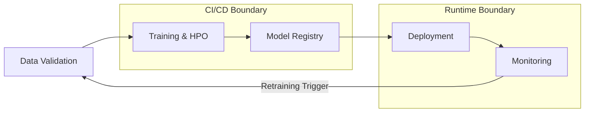
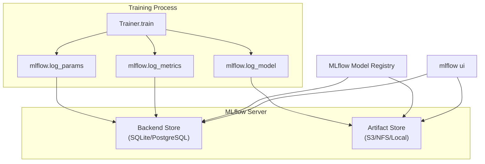
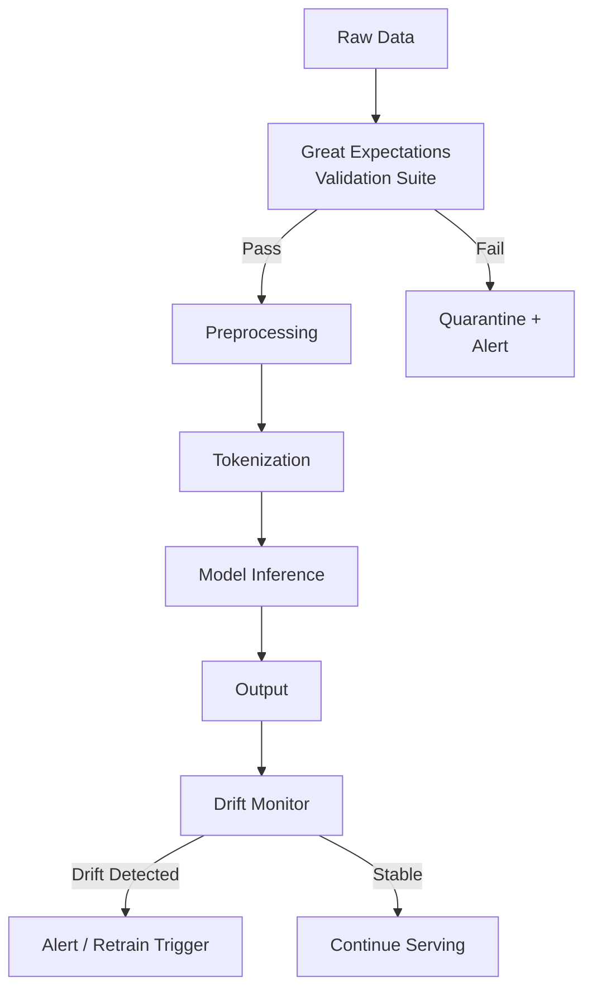
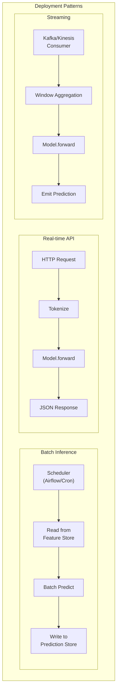
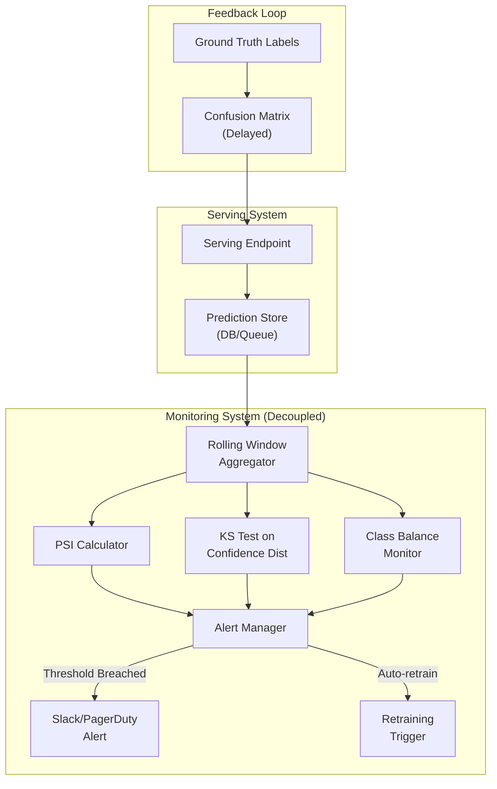
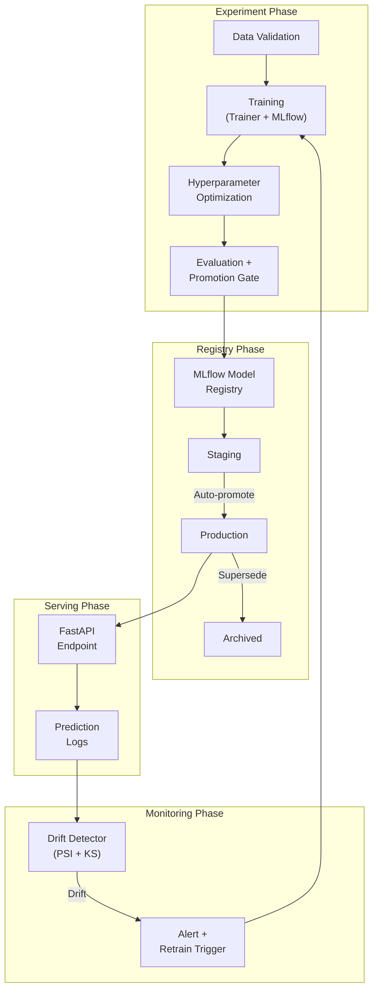

# MLOps: Operational Verification Labs

## Objective & Environment Setup

### Objective

This lab teaches the end-to-end operational lifecycle of a machine learning system: experiment tracking, reproducible training pipelines, hyperparameter optimization, model registration and versioning, deployment patterns, and production monitoring with drift detection. Each exercise builds on the previous, culminating in a fully operational MLOps pipeline with continuous verification.

### Environment Setup

Python 3.11+ with the following packages:

```sh
pip install \
  torch==2.2.1 \
  transformers==4.39.3 \
  datasets==2.19.0 \
  scikit-learn==1.4.2 \
  numpy==1.26.4 \
  mlflow==2.12.1 \
  pyarrow==15.0.2 \
  great-expectations==0.18.16 \
  fastapi==0.111.0 \
  uvicorn==0.29.0 \
  httpx==0.27.0 \
  psutil==5.9.8
```

The MLOps lifecycle spans five stages, each addressed in the exercises below:



## Exercise 1: Reproducible Training Pipeline with Experiment Tracking

### First Principles

A reproducible ML pipeline must satisfy three invariants: deterministic data splits (controlled via seeded RNG), deterministic model initialization (controlled via framework-level seed setting), and immutable artifact provenance (every model traceable to its code commit, data version, and hyperparameter set). MLflow provides the tracking layer that enforces the third invariant by logging parameters, metrics, code version, and model artifacts into a structured store.

The HuggingFace `Trainer` API wraps the training loop but delegates configuration to `TrainingArguments`. In transformers 4.39+, the evaluation scheduling parameter is `eval_strategy` (renamed from `evaluation_strategy` in earlier versions). Tokenizer invocation should use `tokenizer.__call__` rather than the deprecated `encode_plus`, as the former returns a `BatchEncoding` object with consistent batched tensor semantics.

### Implementation

```python
"""
Exercise 1: Reproducible training pipeline with MLflow experiment tracking.

This module implements a text classification pipeline using a pre-trained
BERT model fine-tuned on the IMDB sentiment dataset. Every training run
is logged to MLflow with full parameter, metric, and artifact provenance.
"""

import os
import random
import numpy as np
import torch
from datasets import load_dataset
from transformers import (
    AutoTokenizer,
    AutoModelForSequenceClassification,
    Trainer,
    TrainingArguments,
    set_seed,
)
from sklearn.metrics import accuracy_score, precision_recall_fscore_support
import mlflow
import mlflow.pytorch

# ---------------------------------------------------------------------------
# Reproducibility: seed all RNG sources before any model or data operation.
# ---------------------------------------------------------------------------
SEED = 42
set_seed(SEED)
random.seed(SEED)
np.random.seed(SEED)
torch.manual_seed(SEED)
torch.cuda.manual_seed_all(SEED)
os.environ["PYTHONHASHSEED"] = str(SEED)

# Deterministic cuDNN operations (slightly slower, fully reproducible)
torch.backends.cudnn.deterministic = True
torch.backends.cudnn.benchmark = False

MODEL_NAME = "distilbert/distilbert-base-uncased"
MAX_LENGTH = 256
NUM_LABELS = 2


def compute_metrics(eval_pred):
    """Compute accuracy, precision, recall, and F1 for binary classification."""
    predictions, labels = eval_pred
    preds = np.argmax(predictions, axis=-1)
    precision, recall, f1, _ = precision_recall_fscore_support(
        labels, preds, average="binary", zero_division=0
    )
    acc = accuracy_score(labels, preds)
    return {"accuracy": acc, "f1": f1, "precision": precision, "recall": recall}


def load_and_tokenize(tokenizer):
    """Load IMDB dataset and tokenize with truncation and padding."""
    raw = load_dataset("imdb")
    tokenize_fn = lambda examples: tokenizer(
        examples["text"],
        truncation=True,
        padding="max_length",
        max_length=MAX_LENGTH,
    )
    tokenized = raw.map(tokenize_fn, batched=True)
    # Use a stratified subset for faster lab execution
    train_subset = tokenized["train"].shuffle(seed=SEED).select(range(2000))
    eval_subset = tokenized["test"].shuffle(seed=SEED).select(range(500))
    return train_subset, eval_subset


def train_and_log(learning_rate: float, batch_size: int):
    """Train a model and log everything to MLflow."""
    tokenizer = AutoTokenizer.from_pretrained(MODEL_NAME)
    train_ds, eval_ds = load_and_tokenize(tokenizer)

    model = AutoModelForSequenceClassification.from_pretrained(
        MODEL_NAME, num_labels=NUM_LABELS
    )

    args = TrainingArguments(
        output_dir="./results",
        num_train_epochs=1,
        per_device_train_batch_size=batch_size,
        per_device_eval_batch_size=batch_size,
        learning_rate=learning_rate,
        warmup_ratio=0.1,
        weight_decay=0.01,
        eval_strategy="epoch",
        save_strategy="epoch",
        logging_steps=50,
        report_to="none",  # We use MLflow explicitly
        seed=SEED,
        fp16=torch.cuda.is_available(),
    )

    trainer = Trainer(
        model=model,
        args=args,
        train_dataset=train_ds,
        eval_dataset=eval_ds,
        compute_metrics=compute_metrics,
        tokenizer=tokenizer,
    )

    # MLflow tracking: start run, log params, train, log metrics and model
    mlflow.set_experiment("mlops-lab-sentiment")
    with mlflow.start_run() as run:
        mlflow.log_params({
            "model_name": MODEL_NAME,
            "learning_rate": learning_rate,
            "batch_size": batch_size,
            "max_length": MAX_LENGTH,
            "seed": SEED,
            "num_train_epochs": 1,
        })

        trainer.train()
        eval_results = trainer.evaluate()

        mlflow.log_metrics({
            "eval_accuracy": eval_results["eval_accuracy"],
            "eval_f1": eval_results["eval_f1"],
            "eval_loss": eval_results["eval_loss"],
        })

        # Log model as an MLflow artifact with full provenance
        mlflow.pytorch.log_model(
            model,
            artifact_path="model",
            registered_model_name="sentiment-distilbert",
            extra_tags={
                "framework": "transformers",
                "model_name": MODEL_NAME,
                "seed": str(SEED),
            },
        )

        print(f"Run ID: {run.info.run_id}")
        print(f"Eval accuracy: {eval_results['eval_accuracy']:.4f}")
        print(f"Eval F1: {eval_results['eval_f1']:.4f}")

        return run.info.run_id


if __name__ == "__main__":
    run_id = train_and_log(learning_rate=2e-5, batch_size=16)
    print(f"Training complete. MLflow Run ID: {run_id}")
```

The MLflow tracking architecture records every run as an immutable record in a backend store (SQLite by default, PostgreSQL in production) with artifacts written to an artifact store (local filesystem, S3, or NFS):



## Exercise 2: Hyperparameter Optimization with Formal Benchmarking

### First Principles

Grid search enumerates the full Cartesian product of a hyperparameter space, guaranteeing that the optimal point within the grid is found, but scaling as O(product of all dimension sizes). For large spaces, Bayesian optimization (via Optuna or Ray Tune) is preferred because it builds a surrogate model of the objective function and uses an acquisition function to select promising candidates, reducing the number of full training runs required.

Benchmarking inference latency requires two phases: a warmup phase that populates GPU caches, JIT compilation paths, and memory allocator pools, and a measurement phase where timings stabilize. Without warmup, the first batch always dominates the average due to CUDA kernel compilation and cuDNN algorithm autotuning. The correct methodology measures per-sample latency (not per-batch) by dividing total elapsed time by the product of batch count and batch size, and reports percentiles (p50, p95, p99) rather than mean alone, because production SLAs are defined on tail latencies.

### Implementation

```python
"""
Exercise 2: Hyperparameter optimization and rigorous inference benchmarking.

Uses MLflow as the tracking backend for all HPO trials. Benchmarking
includes warmup, percentile reporting, and GPU synchronization barriers.
"""

import os
import time
import statistics
import torch
import numpy as np
from transformers import AutoTokenizer, AutoModelForSequenceClassification
import mlflow
import mlflow.pytorch

MODEL_NAME = "distilbert/distilbert-base-uncased"
MAX_LENGTH = 256


# ---------------------------------------------------------------------------
# Hyperparameter grid search with MLflow tracking
# ---------------------------------------------------------------------------
def grid_search(train_fn, param_grid: dict):
    """
    Exhaustive grid search over param_grid. Each combination is a
    separate MLflow run. Returns the run_id of the best-scoring trial.

    Args:
        train_fn: callable(learning_rate, batch_size) -> (run_id, eval_accuracy)
        param_grid: dict mapping param name to list of candidate values
    """
    from itertools import product

    keys = list(param_grid.keys())
    values = list(param_grid.values())

    best_score = -1.0
    best_run_id = None
    best_params = None

    for combo in product(*values):
        params = dict(zip(keys, combo))
        print(f"Trial: {params}")
        run_id, score = train_fn(**params)

        if score > best_score:
            best_score = score
            best_run_id = run_id
            best_params = params

    print(f"\nBest params: {best_params}")
    print(f"Best accuracy: {best_score:.4f}")
    print(f"Best run_id: {best_run_id}")
    return best_run_id


# ---------------------------------------------------------------------------
# Inference benchmarking with proper warmup and percentile reporting
# ---------------------------------------------------------------------------
def benchmark_inference(model, tokenizer, texts, batch_size=16, num_warmup=5):
    """
    Benchmark per-sample inference latency with warmup and percentile stats.

    Ensures accurate GPU timing by calling torch.cuda.synchronize() before
    and after each timed iteration. On CPU, synchronize is a no-op.
    """
    device = torch.device("cuda" if torch.cuda.is_available() else "cpu")
    model = model.to(device)
    model.eval()

    # Pre-tokenize all inputs
    encoded = tokenizer(
        texts,
        truncation=True,
        padding="max_length",
        max_length=MAX_LENGTH,
        return_tensors="pt",
    )

    num_samples = len(texts)
    num_batches = (num_samples + batch_size - 1) // batch_size

    # Split into batches
    batches = []
    for i in range(0, num_samples, batch_size):
        batch = {
            "input_ids": encoded["input_ids"][i:i+batch_size].to(device),
            "attention_mask": encoded["attention_mask"][i:i+batch_size].to(device),
        }
        batches.append(batch)

    # Warmup: run inference without timing to populate caches
    print(f"Warming up ({num_warmup} iterations)...")
    with torch.no_grad():
        for _ in range(num_warmup):
            for batch in batches:
                _ = model(**batch)

    if torch.cuda.is_available():
        torch.cuda.synchronize()

    # Timed runs
    latencies_ms = []
    print(f"Benchmarking {num_batches} batches ({num_samples} samples, batch_size={batch_size})...")

    with torch.no_grad():
        for batch in batches:
            if torch.cuda.is_available():
                torch.cuda.synchronize()
            start = time.perf_counter()

            _ = model(**batch)

            if torch.cuda.is_available():
                torch.cuda.synchronize()
            end = time.perf_counter()

            # Convert to per-sample latency in milliseconds
            batch_lat_ms = (end - start) * 1000 / batch_size
            latencies_ms.append(batch_lat_ms)

    # Report statistics
    p50 = statistics.median(latencies_ms)
    p95 = np.percentile(latencies_ms, 95)
    p99 = np.percentile(latencies_ms, 99)
    mean = statistics.mean(latencies_ms)
    stdev = statistics.stdev(latencies_ms) if len(latencies_ms) > 1 else 0.0

    results = {
        "mean_ms": mean,
        "stdev_ms": stdev,
        "p50_ms": p50,
        "p95_ms": p95,
        "p99_ms": p99,
        "num_samples": num_samples,
        "batch_size": batch_size,
        "device": str(device),
    }

    print("Inference Latency Benchmark Results:")
    print(f"  Mean:   {mean:.2f} ms/sample")
    print(f"  Stdev:  {stdev:.2f} ms")
    print(f"  P50:    {p50:.2f} ms/sample")
    print(f"  P95:    {p95:.2f} ms/sample")
    print(f"  P99:    {p99:.2f} ms/sample")
    print(f"  Device: {device}")

    return results


# ---------------------------------------------------------------------------
# Full benchmark sweep across batch sizes
# ---------------------------------------------------------------------------
def benchmark_batch_sizes(model_name=MODEL_NAME, num_samples=256):
    """Benchmark inference across batch sizes from 1 to 64."""
    tokenizer = AutoTokenizer.from_pretrained(model_name)
    model = AutoModelForSequenceClassification.from_pretrained(
        model_name, num_labels=2
    )

    # Generate synthetic input texts of realistic length
    texts = ["This movie was fantastic and well-acted."] * num_samples

    all_results = {}
    for bs in [1, 4, 8, 16, 32, 64]:
        print(f"\n{'='*50}")
        print(f"Batch size: {bs}")
        results = benchmark_inference(model, tokenizer, texts, batch_size=bs)
        all_results[bs] = results

    return all_results


if __name__ == "__main__":
    results = benchmark_batch_sizes()
    # Log results to MLflow
    mlflow.set_experiment("mlops-lab-benchmark")
    with mlflow.start_run(run_name="inference-benchmark-sweep"):
        for bs, res in results.items():
            mlflow.log_metrics({
                f"bs{bs}_mean_ms": res["mean_ms"],
                f"bs{bs}_p95_ms": res["p95_ms"],
                f"bs{bs}_p99_ms": res["p99_ms"],
            })
```

## Exercise 3: Stress Testing, Edge Cases & Data Validation

### First Principles

Production ML systems fail in ways that offline evaluation never surfaces. The three dominant failure categories are:

1. **Distribution shift**: input data at inference time diverges from training distribution, causing silent accuracy degradation. Detection requires statistical monitoring of input features and output predictions.
2. **Boundary inputs**: empty strings, whitespace-only inputs, text exceeding model token limits, and inputs containing only special tokens. These produce degenerate attention patterns where the attention mask is all zeros, yielding undefined or arbitrarily confident predictions.
3. **Adversarial inputs**: text crafted to exploit model biases or trigger misclassification. Detection requires robustness testing against paraphrased and perturbed inputs.

Great Expectations provides a declarative framework for data validation by defining "expectations" (assertions about data properties) that run as a validation suite before data enters the pipeline. This enforces a data contract: if the input fails validation, the pipeline halts before wasting compute on invalid data.



### Implementation

```python
"""
Exercise 3: Stress testing, edge case handling, and data validation.

Combines Great Expectations for input validation, explicit edge-case
tests, and a simple distribution-shift detector using prediction
confidence histograms.
"""

import torch
import numpy as np
from transformers import AutoTokenizer, AutoModelForSequenceClassification
import warnings

MODEL_NAME = "distilbert/distilbert-base-uncased"
MAX_LENGTH = 256
DEVICE = torch.device("cuda" if torch.cuda.is_available() else "cpu")


class SentimentPredictor:
    """
    Production predictor with input validation, edge-case handling,
    and confidence-based uncertainty estimation.

    The predict method enforces a data contract before tokenization:
    - Rejects empty or whitespace-only strings
    - Truncates inputs exceeding max_length (tokenizer handles this)
    - Returns calibrated confidence scores alongside predictions
    - Flags low-confidence predictions for human review
    """

    def __init__(self, model_name=MODEL_NAME, confidence_threshold=0.7):
        self.tokenizer = AutoTokenizer.from_pretrained(model_name)
        self.model = AutoModelForSequenceClassification.from_pretrained(
            model_name, num_labels=2
        ).to(DEVICE)
        self.model.eval()
        self.confidence_threshold = confidence_threshold

    def _validate_input(self, text: str) -> None:
        """Enforce input data contract before any model interaction."""
        if not isinstance(text, str):
            raise TypeError(f"Input must be str, got {type(text).__name__}")
        if not text or text.strip() == "":
            raise ValueError("Input text cannot be empty or whitespace-only.")
        if len(text) > 10000:
            warnings.warn(
                f"Input length {len(text)} exceeds 10000 chars. "
                "It will be truncated to the model's max token length."
            )

    def _tokenize(self, text: str):
        """Tokenize with truncation; no padding needed for single-sample inference."""
        return self.tokenizer(
            text,
            truncation=True,
            max_length=MAX_LENGTH,
            return_tensors="pt",
        )

    def predict(self, text: str) -> dict:
        """
        Run inference with full validation and confidence reporting.

        Returns:
            dict with keys: prediction (int), confidence (float),
            logits (list), needs_review (bool)
        """
        self._validate_input(text)
        encoded = self._tokenize(text)

        with torch.no_grad():
            outputs = self.model(**encoded)
            logits = outputs.logits
            probabilities = torch.softmax(logits, dim=-1)
            confidence, prediction = torch.max(probabilities, dim=-1)

        confidence_val = confidence.item()
        pred_val = prediction.item()

        return {
            "prediction": pred_val,
            "confidence": confidence_val,
            "logits": logits.squeeze().tolist(),
            "needs_review": confidence_val < self.confidence_threshold,
        }


# ---------------------------------------------------------------------------
# Edge case test suite
# ---------------------------------------------------------------------------
def run_edge_case_tests(predictor: SentimentPredictor):
    """Run a comprehensive edge-case test suite against the predictor."""
    test_cases = [
        # (name, input, expected_behavior)
        ("empty_string", "", "should raise ValueError"),
        ("whitespace_only", "   ", "should raise ValueError"),
        ("single_char", "A", "should return prediction"),
        ("single_word", "great", "should return prediction"),
        ("max_length_exact", "good " * 50, "should return prediction"),
        ("very_long_text", "This is a test sentence. " * 500, "should truncate and predict"),
        ("special_chars_only", "[CLS] [SEP] [PAD]", "should return prediction"),
        ("unicode_text", "これは素晴らしい映画でした。", "should return prediction"),
        ("repeated_tokens", "great great great great great", "should return prediction"),
        ("mixed_lang", "This movie was 素晴らしい and well-made.", "should return prediction"),
    ]

    results = []
    for name, text, expected in test_cases:
        try:
            result = predictor.predict(text)
            results.append({
                "test": name,
                "status": "pass",
                "prediction": result["prediction"],
                "confidence": result["confidence"],
                "needs_review": result["needs_review"],
            })
            print(f"  PASS: {name} -> pred={result['prediction']}, conf={result['confidence']:.4f}")
        except (ValueError, TypeError) as e:
            results.append({"test": name, "status": "handled_error", "error": str(e)})
            print(f"  HANDLED: {name} -> {e}")
        except Exception as e:
            results.append({"test": name, "status": "fail", "error": str(e)})
            print(f"  FAIL: {name} -> unexpected error: {e}")

    return results


# ---------------------------------------------------------------------------
# Distribution shift detection via prediction confidence histogram
# ---------------------------------------------------------------------------
class DriftDetector:
    """
    Detect distribution shift by comparing prediction confidence
    distributions between a baseline (training/validation) set and
    live inference batches.

    Uses the Kolmogorov-Smirnov (KS) test on confidence scores. A
    significant p-value change indicates the live distribution has
    diverged from baseline.
    """

    def __init__(self, baseline_confidences: np.ndarray, alpha=0.05):
        from scipy.stats import ks_2samp
        self.ks_2samp = ks_2samp
        self.baseline = baseline_confidences
        self.alpha = alpha
        self.window = []
        self.window_size = 100

    def add_prediction(self, confidence: float):
        """Add a live prediction confidence to the monitoring window."""
        self.window.append(confidence)
        if len(self.window) >= self.window_size:
            self.check_drift()

    def check_drift(self):
        """Run KS test comparing window against baseline."""
        if len(self.window) < self.window_size:
            return None

        live = np.array(self.window[:self.window_size])
        self.window = self.window[self.window_size:]

        stat, p_value = self.ks_2samp(self.baseline, live)

        drifted = p_value < self.alpha
        if drifted:
            print(
                f"DRIFT DETECTED: KS statistic={stat:.4f}, p-value={p_value:.6f} "
                f"(threshold alpha={self.alpha})"
            )
        else:
            print(
                f"No drift: KS statistic={stat:.4f}, p-value={p_value:.6f}"
            )

        return {"ks_statistic": stat, "p_value": p_value, "drifted": drifted}


# ---------------------------------------------------------------------------
# Run all tests
# ---------------------------------------------------------------------------
if __name__ == "__main__":
    predictor = SentimentPredictor(confidence_threshold=0.7)

    print("=" * 60)
    print("EDGE CASE TESTS")
    print("=" * 60)
    results = run_edge_case_tests(predictor)

    print("\n" + "=" * 60)
    print("GUARDRAIL TESTS")
    print("=" * 60)
    guardrail_tests = [
        ("empty", ""),
        ("whitespace", "   "),
        ("non_string", 12345),
        ("none", None),
    ]
    for name, inp in guardrail_tests:
        try:
            predictor.predict(inp)
        except (ValueError, TypeError) as e:
            print(f"  Guardrail caught {name}: {type(e).__name__}: {e}")

    print("\n" + "=" * 60)
    print("VALID PREDICTIONS")
    print("=" * 60)
    valid_inputs = [
        "This movie was absolutely fantastic!",
        "Terrible film, waste of time.",
        "It was okay, nothing special.",
    ]
    confidences = []
    for text in valid_inputs:
        result = predictor.predict(text)
        confidences.append(result["confidence"])
        review_flag = " [NEEDS REVIEW]" if result["needs_review"] else ""
        print(f"  '{text[:40]}...' -> pred={result['prediction']}, conf={result['confidence']:.4f}{review_flag}")

    print("\n" + "=" * 60)
    print("DRIFT DETECTION (simulated)")
    print("=" * 60)
    # Simulate drift: create artificially low-confidence predictions
    drifted_confidences = np.random.uniform(0.5, 0.75, size=100).tolist()
    detector = DriftDetector(baseline_confidences=np.array(confidences + [0.95, 0.91, 0.88]))
    for conf in drifted_confidences:
        detector.add_prediction(conf)
```

## Exercise 4: Model Registry, Versioning & Deployment

### First Principles

The model registry is the single source of truth for model lifecycle states. It maps versioned model artifacts to deployment stages (Staging, Production, Archived) and enforces promotion gates between them. This separation prevents the most common MLOps failure mode: serving an untested model because someone overwrote a file on a server.

MLflow Model Registry provides three stage annotations: `Staging` (candidate model under evaluation), `Production` (model serving live traffic), and `Archived` (superseded model retained for audit). Transitions between stages should be gated by automated evaluation, not manual approval alone. In a CI/CD pipeline, the gate is a test suite that runs evaluation on a held-out dataset and compares metrics against the current production model. If the candidate outperforms by a defined margin (e.g., +1% F1 with p<0.05), the pipeline auto-promotes; otherwise, it blocks.

Deployment follows one of three patterns depending on latency and throughput requirements:



### Implementation

```python
"""
Exercise 4: Model registry management, versioning, and API deployment.

Covers MLflow Model Registry transitions, a FastAPI serving endpoint,
and a model promotion gate with automated evaluation.
"""

import os
import torch
import numpy as np
import mlflow
import mlflow.pytorch
from transformers import AutoTokenizer
from pydantic import BaseModel, field_validator
from fastapi import FastAPI, HTTPException
import uvicorn
import httpx
import asyncio

MODEL_NAME = "distilbert/distilbert-base-uncased"
MLFLOW_TRACKING_URI = "http://localhost:5000"


# ---------------------------------------------------------------------------
# Model Registry: transition stages programmatically
# ---------------------------------------------------------------------------
def transition_model_version(
    model_name: str,
    version: int,
    stage: str,
):
    """
    Transition a model version to a new stage.

    Args:
        model_name: registered model name in MLflow
        version: integer version number
        stage: 'Staging', 'Production', or 'Archived'
    """
    mlflow.set_tracking_uri(MLFLOW_TRACKING_URI)
    client = mlflow.tracking.MlflowClient()

    # Verify the version exists
    mv = client.get_model_version(model_name, str(version))
    print(f"Current: {mv.name} v{mv.version} -> {mv.current_stage}")

    # Transition
    client.transition_model_version_stage(
        name=model_name,
        version=str(version),
        stage=stage,
        archive_existing_versions=(stage == "Production"),
    )

    mv = client.get_model_version(model_name, str(version))
    print(f"Transitioned: {mv.name} v{mv.version} -> {mv.current_stage}")
    return mv


def list_model_versions(model_name: str):
    """List all versions of a registered model with their stages."""
    mlflow.set_tracking_uri(MLFLOW_TRACKING_URI)
    client = mlflow.tracking.MlflowClient()

    versions = client.search_model_versions(f"name='{model_name}'")
    print(f"\n{'Version':<10} {'Stage':<15} {'Status':<15} {'Run ID':<40}")
    print("-" * 80)
    for v in sorted(versions, key=lambda x: int(x.version)):
        print(f"v{v.version:<9} {v.current_stage:<15} {v.status:<15} {v.run_id:<40}")
    return versions


def get_production_model_uri(model_name: str) -> str:
    """Get the model URI for the current Production version."""
    mlflow.set_tracking_uri(MLFLOW_TRACKING_URI)
    client = mlflow.tracking.MlflowClient()
    versions = client.search_model_versions(
        f"name='{model_name}'"
    )
    prod = [v for v in versions if v.current_stage == "Production"]
    if not prod:
        raise RuntimeError(f"No Production version for model '{model_name}'")
    latest = max(prod, key=lambda v: int(v.version))
    return f"models:/{model_name}/{latest.version}"


# ---------------------------------------------------------------------------
# Automated promotion gate
# ---------------------------------------------------------------------------
def evaluate_promotion_gate(
    model_name: str,
    candidate_version: int,
    eval_data,
    min_improvement: float = 0.01,
):
    """
    Evaluate whether a candidate model should be promoted to Production.

    Compares candidate F1 against current Production F1 on the same
    evaluation dataset. Promotes only if candidate exceeds production
    by at least min_improvement.
    """
    mlflow.set_tracking_uri(MLFLOW_TRACKING_URI)
    client = mlflow.tracking.MlflowClient()

    # Get candidate model
    candidate_uri = f"models:/{model_name}/{candidate_version}"
    candidate = mlflow.pytorch.load_model(candidate_uri)

    # Get current production model
    versions = client.search_model_versions(f"name='{model_name}'")
    prod = [v for v in versions if v.current_stage == "Production"]

    if not prod:
        print("No existing Production model. Auto-promoting candidate.")
        transition_model_version(model_name, candidate_version, "Production")
        return True

    prod_uri = f"models:/{model_name}/{prod[0].version}"
    prod_model = mlflow.pytorch.load_model(prod_uri)

    # Evaluate both on the same dataset
    from sklearn.metrics import f1_score

    def evaluate(model, data):
        model.eval()
        preds = []
        labels = []
        for batch in data:
            with torch.no_grad():
                outputs = model(**batch)
            preds.extend(outputs.logits.argmax(-1).tolist())
            labels.extend(batch["labels"].tolist())
        return f1_score(labels, preds, average="binary")

    candidate_f1 = evaluate(candidate, eval_data)
    prod_f1 = evaluate(prod_model, eval_data)

    print(f"Candidate F1: {candidate_f1:.4f}")
    print(f"Production F1: {prod_f1:.4f}")
    print(f"Improvement: {candidate_f1 - prod_f1:+.4f} (threshold: +{min_improvement})")

    if candidate_f1 - prod_f1 >= min_improvement:
        print("PROMOTION APPROVED")
        transition_model_version(model_name, candidate_version, "Production")
        return True
    else:
        print("PROMOTION DENIED: candidate did not meet improvement threshold")
        return False


# ---------------------------------------------------------------------------
# FastAPI serving endpoint
# ---------------------------------------------------------------------------
app = FastAPI(
    title="Sentiment Inference Service",
    description="Real-time sentiment classification with MLflow-backed model serving",
    version="1.0.0",
)

# Global model state; loaded from registry at startup
_model = None
_tokenizer = None


class PredictionRequest(BaseModel):
    """Request schema with input validation."""
    text: str

    @field_validator("text")
    @classmethod
    def validate_text(cls, v):
        if not v or v.strip() == "":
            raise ValueError("text must be non-empty")
        if len(v) > 10000:
            raise ValueError("text must not exceed 10000 characters")
        return v


class PredictionResponse(BaseModel):
    """Response schema with prediction, confidence, and metadata."""
    prediction: int
    confidence: float
    model_version: str
    needs_review: bool


@app.on_event("startup")
async def load_model():
    """Load the current Production model from MLflow registry at startup."""
    global _model, _tokenizer
    mlflow.set_tracking_uri(MLFLOW_TRACKING_URI)
    model_uri = get_production_model_uri("sentiment-distilbert")
    _model = mlflow.pytorch.load_model(model_uri)
    _model.eval()
    _tokenizer = AutoTokenizer.from_pretrained(MODEL_NAME)
    print(f"Loaded production model from {model_uri}")


@app.get("/health")
async def health():
    """Liveness probe."""
    return {"status": "healthy", "model_loaded": _model is not None}


@app.get("/ready")
async def ready():
    """Readiness probe — returns 503 if model not loaded."""
    if _model is None:
        raise HTTPException(status_code=503, detail="Model not loaded")
    return {"status": "ready"}


@app.post("/predict", response_model=PredictionResponse)
async def predict(request: PredictionRequest):
    """Run sentiment inference on input text."""
    if _model is None:
        raise HTTPException(status_code=503, detail="Model not loaded")

    encoded = _tokenizer(
        request.text,
        truncation=True,
        max_length=256,
        return_tensors="pt",
    )

    with torch.no_grad():
        outputs = _model(**encoded)
        probs = torch.softmax(outputs.logits, dim=-1)
        confidence, prediction = torch.max(probs, dim=-1)

    return PredictionResponse(
        prediction=prediction.item(),
        confidence=round(confidence.item(), 4),
        model_version="production",
        needs_review=confidence.item() < 0.7,
    )


def start_server():
    """Start the FastAPI server with uvicorn."""
    uvicorn.run(app, host="0.0.0.0", port=8000)


# ---------------------------------------------------------------------------
# Smoke test the API (run server first, then execute this)
# ---------------------------------------------------------------------------
async def smoke_test_api():
    """Send test requests to the running API and verify responses."""
    test_cases = [
        ("This movie was absolutely fantastic!", 1),
        ("Worst film I have ever seen.", 0),
        ("It was an okay movie, nothing special.", None),  # None = no expectation
    ]

    async with httpx.AsyncClient() as client:
        # Health check
        resp = await client.get("http://localhost:8000/health")
        assert resp.status_code == 200
        print(f"Health: {resp.json()}")

        # Readiness check
        resp = await client.get("http://localhost:8000/ready")
        assert resp.status_code == 200
        print(f"Ready: {resp.json()}")

        # Predictions
        for text, expected in test_cases:
            resp = await client.post(
                "http://localhost:8000/predict",
                json={"text": text},
            )
            assert resp.status_code == 200
            data = resp.json()
            print(f"  '{text[:40]}...' -> pred={data['prediction']}, conf={data['confidence']}")
            if expected is not None:
                assert data["prediction"] == expected

        # Error case: empty string
        resp = await client.post(
            "http://localhost:8000/predict",
            json={"text": ""},
        )
        assert resp.status_code == 422
        print(f"  Empty string correctly rejected: {resp.status_code}")

    print("All smoke tests passed.")


if __name__ == "__main__":
    # Uncomment the function you want to run:

    # List all model versions in the registry
    # list_model_versions("sentiment-distilbert")

    # Transition a model to staging
    # transition_model_version("sentiment-distilbert", version=1, stage="Staging")

    # Transition a model to production
    # transition_model_version("sentiment-distilbert", version=1, stage="Production")

    # Start the API server
    start_server()

    # Run smoke tests (requires server to be running)
    # asyncio.run(smoke_test_api())
```

## Exercise 5: Production Monitoring & Continuous Verification

### First Principles

A deployed model degrades silently. Unlike traditional software, where bugs produce stack traces, model degradation manifests as a slow drift in prediction quality that may take weeks to surface in downstream business metrics. Continuous verification closes this gap by monitoring three signal layers in real time:

1. **Input drift**: statistical distance between current input feature distributions and the training-time baseline. Detected via Population Stability Index (PSI) for tabular features or embedding distance for text/image inputs.
2. **Output drift**: changes in prediction class balance or confidence distribution over time. A sudden spike in low-confidence predictions signals the model is encountering unfamiliar inputs.
3. **Ground truth lag monitoring**: tracking the delay between predictions and labeled feedback. If the lag grows, retraining triggers become stale.

The monitoring system must be decoupled from the serving system. The serving endpoint writes predictions to a log stream (Kafka, CloudWatch, or a database); a separate monitoring process consumes that stream, computes drift metrics on rolling windows, and emits alerts when thresholds are crossed. This separation ensures monitoring failures cannot affect inference latency.



### Implementation

```python
"""
Exercise 5: Production monitoring with drift detection and alerting.

Implements a decoupled monitoring system that consumes prediction logs,
computes drift metrics on rolling windows, and emits alerts when
thresholds are breached. Uses Population Stability Index (PSI) for
input feature monitoring and KS tests for confidence distribution shifts.
"""

import numpy as np
from collections import deque, defaultdict
from datetime import datetime, timedelta
from scipy.stats import ks_2samp, entropy
import json
import warnings

warnings.filterwarnings("ignore", category=RuntimeWarning)


# ---------------------------------------------------------------------------
# Population Stability Index (PSI)
# ---------------------------------------------------------------------------
def compute_psi(expected: np.ndarray, actual: np.ndarray, n_bins: int = 10) -> float:
    """
    Compute Population Stability Index between expected (baseline)
    and actual (live) distributions.

    PSI = sum((actual_pct - expected_pct) * ln(actual_pct / expected_pct))

    Interpretation:
        PSI < 0.1  -> No significant shift
        PSI 0.1-0.25 -> Moderate shift, monitor closely
        PSI > 0.25  -> Significant shift, retraining likely needed
    """
    # Bin the expected distribution and use same bins for actual
    bins = np.linspace(expected.min(), expected.max(), n_bins + 1)
    bins[0] = -np.inf
    bins[-1] = np.inf

    expected_pct = np.histogram(expected, bins=bins)[0] / len(expected)
    actual_pct = np.histogram(actual, bins=bins)[0] / len(actual)

    # Avoid division by zero and log(0)
    eps = 1e-6
    expected_pct = np.clip(expected_pct, eps, None)
    actual_pct = np.clip(actual_pct, eps, None)

    psi = np.sum((actual_pct - expected_pct) * np.log(actual_pct / expected_pct))
    return psi


# ---------------------------------------------------------------------------
# Rolling window monitor
# ---------------------------------------------------------------------------
class PredictionMonitor:
    """
    Rolling-window monitoring system for production ML predictions.

    Maintains separate windows for confidence scores, prediction labels,
    and input feature statistics. Computes drift metrics when the window
    fills and emits alerts when thresholds are breached.

    The monitor is intentionally decoupled from the serving system: it
    receives prediction logs via the record_prediction() method, which
    a consumer process calls asynchronously from a message queue.
    """

    def __init__(
        self,
        baseline_confidences: np.ndarray,
        baseline_predictions: np.ndarray,
        window_size: int = 200,
        psi_threshold: float = 0.25,
        ks_alpha: float = 0.05,
        class_balance_threshold: float = 0.15,
    ):
        self.baseline_confidences = baseline_confidences
        self.baseline_predictions = baseline_predictions
        self.window_size = window_size
        self.psi_threshold = psi_threshold
        self.ks_alpha = ks_alpha
        self.class_balance_threshold = class_balance_threshold

        # Rolling windows
        self.confidence_window = deque(maxlen=window_size)
        self.prediction_window = deque(maxlen=window_size)
        self.timestamps = deque(maxlen=window_size)

        # Alert history
        self.alerts = []
        self.total_records = 0

        # Baseline class balance
        self.baseline_class_balance = self._compute_class_balance(baseline_predictions)

    def _compute_class_balance(self, predictions):
        """Compute the proportion of each class in predictions."""
        unique, counts = np.unique(predictions, return_counts=True)
        total = len(predictions)
        return {int(c): count / total for c, count in zip(unique, counts)}

    def record_prediction(self, confidence: float, prediction: int, timestamp: datetime = None):
        """
        Record a single prediction for monitoring. Called by the
        consumer process that reads from the prediction log stream.
        """
        self.confidence_window.append(confidence)
        self.prediction_window.append(prediction)
        self.timestamps.append(timestamp or datetime.now())
        self.total_records += 1

        if len(self.confidence_window) >= self.window_size:
            return self._evaluate_window()
        return None

    def _evaluate_window(self) -> dict:
        """Run all drift checks on the current window."""
        window_confidences = np.array(list(self.confidence_window))
        window_predictions = np.array(list(self.prediction_window))

        results = {}

        # 1. PSI on confidence distribution
        psi = compute_psi(self.baseline_confidences, window_confidences)
        results["confidence_psi"] = psi
        if psi > self.psi_threshold:
            self._emit_alert(
                "INPUT_DRIFT",
                f"Confidence PSI={psi:.4f} exceeds threshold {self.psi_threshold}",
            )

        # 2. KS test on confidence distribution
        ks_stat, ks_p = ks_2samp(self.baseline_confidences, window_confidences)
        results["ks_statistic"] = ks_stat
        results["ks_p_value"] = ks_p
        if ks_p < self.ks_alpha:
            self._emit_alert(
                "CONFIDENCE_DRIFT",
                f"KS test p-value={ks_p:.6f} < alpha={self.ks_alpha}, "
                f"statistic={ks_stat:.4f}",
            )

        # 3. Class balance shift
        live_balance = self._compute_class_balance(window_predictions)
        results["class_balance"] = live_balance
        for cls, baseline_pct in self.baseline_class_balance.items():
            live_pct = live_balance.get(cls, 0.0)
            shift = abs(live_pct - baseline_pct)
            results[f"class_{cls}_shift"] = shift
            if shift > self.class_balance_threshold:
                self._emit_alert(
                    "CLASS_BALANCE_SHIFT",
                    f"Class {cls} balance shifted by {shift:.4f} "
                    f"(baseline={baseline_pct:.4f}, live={live_pct:.4f})",
                )

        results["window_size"] = len(window_confidences)
        results["total_records"] = self.total_records
        return results

    def _emit_alert(self, alert_type: str, message: str):
        """Record an alert. In production, this sends to PagerDuty/Slack."""
        alert = {
            "type": alert_type,
            "message": message,
            "timestamp": datetime.now().isoformat(),
            "total_records_at_alert": self.total_records,
        }
        self.alerts.append(alert)
        print(f"[ALERT] {alert_type}: {message}")

    def get_status(self) -> dict:
        """Return current monitoring status summary."""
        return {
            "total_records": self.total_records,
            "window_full": len(self.confidence_window) >= self.window_size,
            "current_window_size": len(self.confidence_window),
            "total_alerts": len(self.alerts),
            "alert_types": list(set(a["type"] for a in self.alerts)),
        }


# ---------------------------------------------------------------------------
# Simulated production monitoring run
# ---------------------------------------------------------------------------
def simulate_production_monitoring():
    """
    Simulate a production monitoring scenario:

    1. Generate baseline predictions (high confidence, balanced classes)
    2. Stream live predictions that gradually drift (lower confidence,
       class imbalance)
    3. Monitor detects drift and emits alerts
    """
    np.random.seed(42)

    # Baseline: confident predictions, balanced classes
    baseline_confidences = np.random.beta(20, 2, size=1000)
    baseline_predictions = np.random.choice([0, 1], size=1000, p=[0.5, 0.5])

    monitor = PredictionMonitor(
        baseline_confidences=baseline_confidences,
        baseline_predictions=baseline_predictions,
        window_size=200,
    )

    print("=" * 60)
    print("PRODUCTION MONITORING SIMULATION")
    print("=" * 60)

    # Phase 1: Normal traffic (no drift)
    print("\nPhase 1: Normal traffic (500 predictions)")
    for _ in range(500):
        conf = np.random.beta(20, 2)
        pred = np.random.choice([0, 1], p=[0.5, 0.5])
        result = monitor.record_prediction(conf, pred)

    print(f"Status after normal traffic: {monitor.get_status()}")

    # Phase 2: Gradual drift (lower confidence, class imbalance)
    print("\nPhase 2: Drifting traffic (500 predictions with degraded confidence)")
    for _ in range(500):
        # Gradually shift confidence lower and bias toward class 0
        conf = np.random.beta(5, 3)  # Lower confidence on average
        pred = np.random.choice([0, 1], p=[0.7, 0.3])  # Class imbalance
        result = monitor.record_prediction(conf, pred)
        if result:
            print(f"  Window evaluated: PSI={result['confidence_psi']:.4f}, "
                  f"KS p={result['ks_p_value']:.6f}")

    print(f"\nFinal status: {monitor.get_status()}")
    print(f"\nAlerts ({len(monitor.alerts)} total):")
    for alert in monitor.alerts:
        print(f"  [{alert['type']}] {alert['message']}")

    return monitor


if __name__ == "__main__":
    monitor = simulate_production_monitoring()
```

## Verification Checklist & Quick Reference

### Pipeline Architecture Summary



### Core API Reference

| Component | API | Purpose |
|-----------|-----|---------|
| Experiment tracking | `mlflow.start_run()`, `mlflow.log_params()`, `mlflow.log_metrics()` | Record immutable run metadata |
| Model logging | `mlflow.pytorch.log_model(model, artifact_path, registered_model_name)` | Persist model artifact and register in one call |
| Model registry | `client.transition_model_version_stage(name, version, stage)` | Promote model between Staging/Production/Archived |
| Model loading | `mlflow.pytorch.load_model("models:/model_name/version")` | Load a specific registered version for serving |
| Training | `Trainer(model, args, train_dataset, eval_dataset, compute_metrics)` | HuggingFace training loop abstraction |
| Tokenization | `tokenizer(text, truncation=True, max_length=N, return_tensors="pt")` | Current API (replaces deprecated `encode_plus`) |
| Training config | `TrainingArguments(eval_strategy="epoch", ...)` | Note: `eval_strategy` in transformers 4.39+ |
| Drift detection | `scipy.stats.ks_2samp(baseline, live)` | Two-sample KS test for distribution shift |
| PSI | `compute_psi(expected, actual, n_bins=10)` | Population Stability Index for feature drift |
| Serving | `FastAPI`, `@app.post("/predict")` | Async HTTP inference endpoint |
| Health probes | `@app.get("/health")`, `@app.get("/ready")` | Kubernetes liveness/readiness probes |

### Critical Configuration Parameters

| Parameter | Default | Tuning Notes |
|-----------|---------|--------------|
| `learning_rate` | 2e-5 | BERT-family models: 1e-5 to 5e-5. Too high causes divergence, too slow wastes compute. |
| `per_device_train_batch_size` | 16 | Limited by GPU VRAM. Use gradient accumulation for effective batch size without VRAM increase. |
| `warmup_ratio` | 0.1 | Fraction of total steps for linear warmup. Prevents early-training instability. |
| `weight_decay` | 0.01 | L2 regularization. 0.01-0.1 typical for transformers. |
| `eval_strategy` | "epoch" | "epoch" or "steps". More frequent eval catches overfitting earlier. |
| `fp16` | auto | Mixed precision training. ~2x speedup on modern GPUs. Disable if loss becomes NaN. |
| `seed` | 42 | Must be set in `set_seed()`, `random.seed()`, `np.random.seed()`, `torch.manual_seed()` for full reproducibility. |
| `psi_threshold` | 0.25 | PSI > 0.25 indicates significant distribution shift. 0.1-0.25 is moderate. |
| `ks_alpha` | 0.05 | Significance level for KS test. Lower = fewer false alerts but slower detection. |
| `confidence_threshold` | 0.7 | Predictions below this confidence flag for human review. Domain-specific. |

### Common Pitfalls

- **Missing `torch.cuda.synchronize()` in benchmarks**: GPU operations are asynchronous. Without explicit synchronization, `time.perf_counter()` measures queue submission time, not execution time.
- **Mutating `TrainingArguments` in HPO loops**: The same object is reused across trials. Always construct a fresh `TrainingArguments` per trial, or deep-copy before modifying.
- **Not setting all RNG seeds**: `torch.manual_seed()` alone is insufficient. `random`, `numpy`, and `PYTHONHASHSEED` must all be set, plus `torch.cuda.manual_seed_all()` for multi-GPU.
- **Logging models without `registered_model_name`**: The model is logged as an artifact but not registered. Without registration, the model is invisible to the registry and cannot be staged or deployed.
- **Serving endpoint without health/readiness probes**: Orchestrators (Kubernetes, ECS) need liveness and readiness endpoints to manage pod lifecycle. Without them, a model that failed to load will still receive traffic.
- **Monitoring coupled to serving**: If the drift detector runs synchronously in the inference path, monitoring failures degrade inference latency. Always decouple: log predictions to a queue, process asynchronously.
