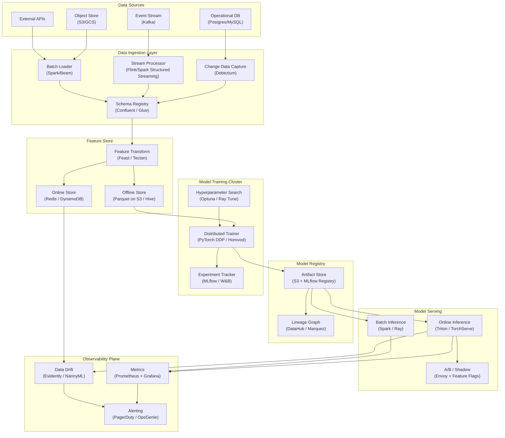
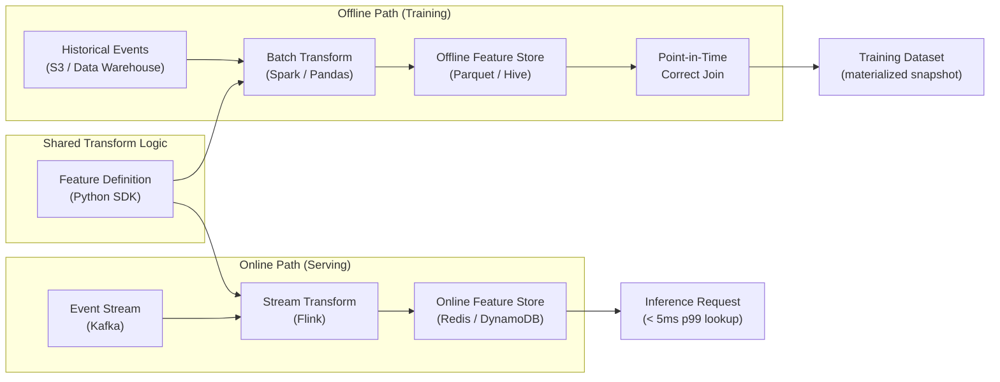
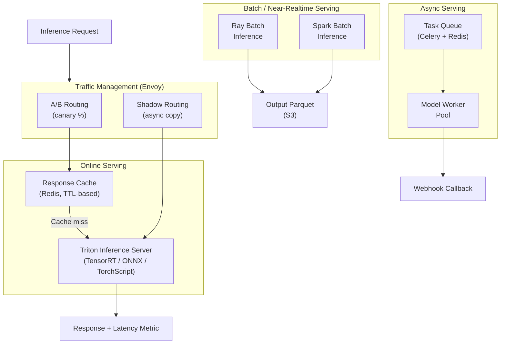
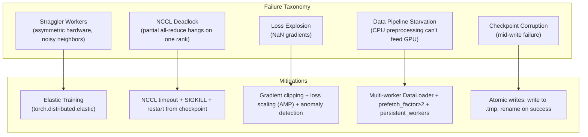
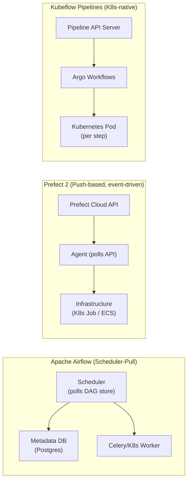
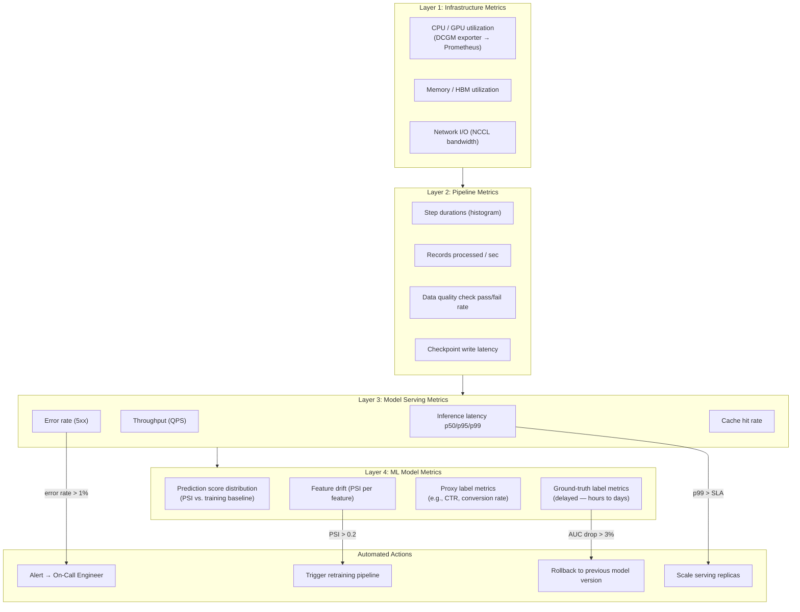

# Lesson 1: Designing Machine Learning Pipelines

---

## 1. First-Principles Intuition & Invariants

An ML pipeline is a **deterministic, versioned, composable function** over data. Formally, it is a directed acyclic graph (DAG) where each node is a transformation and each edge is a typed data contract. The pipeline maps raw observations $\mathcal{X}_{raw}$ through a sequence of transformations $f_1 \circ f_2 \circ \cdots \circ f_n$ to produce a deployable model artifact $\hat{M}$ and a set of predictions $\hat{y} = \hat{M}(x)$ for future inputs $x$.

Three invariants govern every well-designed pipeline regardless of domain (NLP, vision, tabular, time-series, recommender systems):

**Invariant 1 — Referential Transparency of Data.** Given the same input data snapshot and the same code version, every pipeline execution must produce a bit-for-bit reproducible artifact. This mandates content-addressable storage for datasets (e.g., DVC with SHA-256 hashing), pinned dependency versions, and seeded pseudorandom number generators for all stochastic operations (data shuffles, weight initialization, dropout masks). Without this, debugging a production regression is intractable.

**Invariant 2 — Schema-Contract Enforcement at Every Boundary.** Each stage publishes and consumes a schema. Schema drift — where upstream producers silently add, remove, or reinterpret fields — is the most common cause of silent model degradation in production. Tools such as Apache Avro, Protocol Buffers, and Great Expectations enforce contracts statically (compile-time schema evolution) and dynamically (runtime statistical validation). Violations must cause hard failures, not warnings.

**Invariant 3 — Separation of Code, Data, and Configuration.** A pipeline that conflates these three concerns cannot be safely retrained, audited, or rolled back. The Twelve-Factor App methodology applies directly: code lives in a versioned repository, data is referenced by immutable content hashes, and all hyperparameters, feature flags, and environment variables live in an external configuration store (e.g., MLflow experiment parameters, Hydra configs, or AWS Parameter Store).

The practical consequence of these invariants is that an ML pipeline is not a script — it is an **engineering artifact** subject to the same standards as a production service: CI/CD, integration tests, schema registries, SLOs, and runbooks.

---

## 2. Core Architecture & Mechanics



### 2.1 Data Ingestion

Ingestion is the boundary where operational correctness ends and ML correctness begins. The architectural decision that dominates here is **bounded vs. unbounded data**:

- **Bounded (batch):** A finite snapshot extracted at a point in time. Appropriate for monthly retraining cycles, large historical loads. Use Apache Spark, AWS Glue, or dbt for transformation. The key risk is **training-serving skew** introduced by transformations applied differently at extract time vs. serving time.
- **Unbounded (streaming):** A continuous, potentially infinite sequence of events. Required when feature freshness SLAs are sub-minute (fraud detection, real-time recommendation). Apache Flink and Spark Structured Streaming consume from Apache Kafka partitions. Each partition is an ordered, immutable log — the ML pipeline treats it as a reproducible replay source.

**Change Data Capture (CDC)** via Debezium deserves special attention. Rather than querying an OLTP database (which is expensive and misses deletes), Debezium tails the WAL (Write-Ahead Log) of Postgres, MySQL, or MongoDB and publishes row-level change events to Kafka topics. This gives the ML pipeline a complete, ordered history of every entity state transition — the foundation for point-in-time correct feature computation.

```python
# Production-grade Kafka consumer with schema validation using Confluent Schema Registry.
# Requires: confluent-kafka==2.3.0, fastavro==1.9.4

from confluent_kafka import Consumer, KafkaError
from confluent_kafka.schema_registry import SchemaRegistryClient
from confluent_kafka.schema_registry.avro import AvroDeserializer
from confluent_kafka.serialization import SerializationContext, MessageField
import logging
from dataclasses import dataclass
from typing import Iterator, Optional

logger = logging.getLogger(__name__)

@dataclass(frozen=True)
class IngestionRecord:
    entity_id: str
    event_type: str
    payload: dict
    event_timestamp_ms: int
    source_topic: str
    partition: int
    offset: int

def build_consumer(
    bootstrap_servers: str,
    schema_registry_url: str,
    group_id: str,
    topics: list[str],
) -> tuple[Consumer, AvroDeserializer]:
    sr_client = SchemaRegistryClient({"url": schema_registry_url})
    # AvroDeserializer fetches the schema by ID embedded in each message (magic byte + schema_id).
    deserializer = AvroDeserializer(sr_client)

    consumer = Consumer({
        "bootstrap.servers": bootstrap_servers,
        "group.id": group_id,
        "auto.offset.reset": "earliest",
        # Disable auto-commit: commit only after successful downstream write.
        "enable.auto.commit": False,
        "max.poll.interval.ms": 300_000,
        "session.timeout.ms": 45_000,
    })
    consumer.subscribe(topics)
    return consumer, deserializer

def consume_records(
    consumer: Consumer,
    deserializer: AvroDeserializer,
    batch_size: int = 500,
    poll_timeout_s: float = 1.0,
) -> Iterator[list[IngestionRecord]]:
    """Yields micro-batches of validated records. Commits only after batch is yielded."""
    batch: list[IngestionRecord] = []
    try:
        while True:
            msg = consumer.poll(timeout=poll_timeout_s)
            if msg is None:
                if batch:
                    yield batch
                    consumer.commit(asynchronous=False)
                    batch = []
                continue

            if msg.error():
                if msg.error().code() == KafkaError._PARTITION_EOF:
                    continue
                # Non-retriable errors (e.g., authorization) must surface immediately.
                raise RuntimeError(f"Kafka error: {msg.error()}")

            value = deserializer(
                msg.value(),
                SerializationContext(msg.topic(), MessageField.VALUE),
            )

            if value is None:
                logger.warning("Tombstone message on %s/%d@%d — skipping",
                               msg.topic(), msg.partition(), msg.offset())
                continue

            record = IngestionRecord(
                entity_id=value["entity_id"],
                event_type=value["event_type"],
                payload=value,
                event_timestamp_ms=value["event_timestamp_ms"],
                source_topic=msg.topic(),
                partition=msg.partition(),
                offset=msg.offset(),
            )
            batch.append(record)

            if len(batch) >= batch_size:
                yield batch
                consumer.commit(asynchronous=False)
                batch = []
    finally:
        consumer.close()
```

The critical correctness property here is **at-least-once delivery with idempotent downstream writes**. Committing offsets only after the batch is successfully written to the feature store ensures no event is lost. The downstream writer must deduplicate on `(source_topic, partition, offset)` to prevent double-counting.

### 2.2 Feature Engineering & the Feature Store

Feature computation is the most underengineered component in most ML systems, and **training-serving skew** — where features are computed differently at training time versus inference time — is the dominant source of unexplained production regressions.

The canonical solution is a **Feature Store** with a unified transformation definition that runs against both the offline (batch) store and the online (low-latency) store.



The **point-in-time correct join** is algorithmically non-trivial. When constructing a training dataset for event $e_i$ that occurred at $t_i$, you must join to the feature value that was available at $t_i$, not the feature value at the time of dataset construction. Failure to do this introduces **data leakage** — training on future information — which inflates offline metrics and causes catastrophic production degradation.

A point-in-time join in PySpark (conceptually an ASOF join) looks like:

```python
# Point-in-time correct feature join using PySpark.
# Prevents data leakage by ensuring feature values are only joined
# if their feature_timestamp <= event_timestamp.
# Requires: pyspark>=3.4.0

from pyspark.sql import DataFrame, SparkSession
from pyspark.sql import functions as F
from pyspark.sql.window import Window

def point_in_time_join(
    events: DataFrame,         # (entity_id, event_timestamp, label)
    features: DataFrame,       # (entity_id, feature_timestamp, feature_value)
    entity_col: str = "entity_id",
    event_ts_col: str = "event_timestamp",
    feature_ts_col: str = "feature_timestamp",
    ttl_seconds: Optional[int] = None,
) -> DataFrame:
    """
    For each event, join the most recent feature row where
    feature_timestamp <= event_timestamp (and within TTL if specified).

    Uses a range join rather than a cross join for scalability.
    """
    joined = events.alias("e").join(
        features.alias("f"),
        on=(
            F.col(f"e.{entity_col}") == F.col(f"f.{entity_col}")
        ) & (
            F.col(f"f.{feature_ts_col}") <= F.col(f"e.{event_ts_col}")
        ) & (
            # Optional TTL guard: ignore stale features
            (F.col(f"e.{event_ts_col}") - F.col(f"f.{feature_ts_col}"))
            <= (ttl_seconds or float("inf"))
            if ttl_seconds else F.lit(True)
        ),
        how="left",
    )

    # Keep only the most recent feature snapshot per event.
    w = Window.partitionBy(f"e.{entity_col}", f"e.{event_ts_col}") \
              .orderBy(F.col(f"f.{feature_ts_col}").desc())

    return (
        joined
        .withColumn("_rank", F.rank().over(w))
        .filter(F.col("_rank") == 1)
        .drop("_rank", f"f.{entity_col}", feature_ts_col)
    )
```

### 2.3 Model Training

Model training at scale requires three orthogonal design decisions: **parallelism strategy**, **experiment tracking**, and **resource isolation**.

**Parallelism strategies** are not interchangeable:

- **Data Parallelism (DDP — Distributed Data Parallel):** Each worker holds a full model replica and processes a shard of the mini-batch. After the backward pass, gradients are all-reduced across workers (typically using NCCL's ring-allreduce, $O(2(N-1)/N \cdot \text{msg\_size})$ communication cost). This is the default for models that fit in a single GPU's memory.
- **Model Parallelism / Pipeline Parallelism:** The model itself is partitioned across devices. Required when a single layer's activations exceed GPU memory (e.g., large language models with multi-billion parameters). GPipe and Megatron-LM implement micro-batch pipeline parallelism to keep all pipeline stages busy and minimize the "bubble" time.
- **Tensor Parallelism:** Individual weight matrices are sharded across GPUs (e.g., a linear layer's weight matrix $W \in \mathbb{R}^{m \times n}$ is split column-wise across $k$ GPUs). Megatron-LM combines tensor and pipeline parallelism for models at the trillion-parameter scale.

```python
# Production PyTorch DDP training loop with:
# - Gradient accumulation for effective large batch sizes
# - Mixed-precision (AMP) for throughput
# - Gradient clipping for training stability
# - Checkpoint saving on rank 0 only
# Requires: torch>=2.1.0

import os
import torch
import torch.distributed as dist
from torch import nn, optim
from torch.nn.parallel import DistributedDataParallel as DDP
from torch.cuda.amp import GradScaler, autocast
from torch.utils.data import DataLoader, DistributedSampler
from contextlib import contextmanager
from typing import Callable
import logging

logger = logging.getLogger(__name__)

def setup_distributed() -> tuple[int, int]:
    """Initialize process group from environment variables set by torchrun."""
    dist.init_process_group(backend="nccl")
    local_rank = int(os.environ["LOCAL_RANK"])
    world_size = dist.get_world_size()
    torch.cuda.set_device(local_rank)
    return local_rank, world_size

@contextmanager
def ddp_no_sync(model: DDP, condition: bool):
    """Context manager to skip gradient sync during accumulation steps."""
    if condition:
        with model.no_sync():
            yield
    else:
        yield

def train_epoch(
    model: DDP,
    loader: DataLoader,
    optimizer: optim.Optimizer,
    loss_fn: Callable,
    scaler: GradScaler,
    local_rank: int,
    accumulation_steps: int = 4,
    max_grad_norm: float = 1.0,
) -> float:
    model.train()
    total_loss = 0.0
    optimizer.zero_grad(set_to_none=True)  # set_to_none avoids zero-fill overhead

    for step, (inputs, targets) in enumerate(loader):
        inputs = inputs.to(local_rank, non_blocking=True)
        targets = targets.to(local_rank, non_blocking=True)

        is_last_accumulation_step = (step + 1) % accumulation_steps == 0

        # Skip all-reduce during intermediate accumulation steps.
        with ddp_no_sync(model, not is_last_accumulation_step):
            with autocast(dtype=torch.bfloat16):  # bfloat16 preferred over float16 for stability
                predictions = model(inputs)
                # Normalize loss by accumulation steps so effective LR is invariant.
                loss = loss_fn(predictions, targets) / accumulation_steps

            scaler.scale(loss).backward()

        total_loss += loss.item() * accumulation_steps

        if is_last_accumulation_step:
            # Unscale before clipping so clip threshold is in original gradient scale.
            scaler.unscale_(optimizer)
            nn.utils.clip_grad_norm_(model.parameters(), max_norm=max_grad_norm)
            scaler.step(optimizer)
            scaler.update()
            optimizer.zero_grad(set_to_none=True)

    return total_loss / len(loader)

def save_checkpoint(model: DDP, optimizer: optim.Optimizer, epoch: int, path: str, rank: int):
    """Write checkpoint only from rank 0 to avoid concurrent writes to the same path."""
    if rank != 0:
        return
    torch.save({
        "epoch": epoch,
        # Unwrap DDP to save the underlying module state dict.
        "model_state_dict": model.module.state_dict(),
        "optimizer_state_dict": optimizer.state_dict(),
    }, path)
    logger.info("Checkpoint saved to %s", path)
```

**Experiment tracking** must capture the full provenance triangle: (1) code commit hash, (2) dataset version/hash, (3) hyperparameter configuration. MLflow and Weights & Biases both provide this. Without it, reproducing the best model from last quarter is guesswork.

### 2.4 Model Evaluation: Beyond Accuracy

Aggregate metrics like accuracy, AUC-ROC, and F1 are necessary but not sufficient for production readiness. A complete evaluation suite must assess:

**Slice-Based Evaluation.** A model that achieves 95% overall accuracy may perform at 60% for a critical demographic or business-critical segment. TensorFlow Model Analysis (TFMA) and Fairlearn compute metrics disaggregated by feature slices. This is both an engineering best practice and a legal requirement in regulated industries (EU AI Act, ECOA in finance).

**Behavioral Testing (Beyond Accuracy).** Borrowed from NLP (Ribeiro et al., "Beyond Accuracy: Behavioral Testing of NLP Models with CheckList"), this involves:
- **Minimum functionality tests (MFTs):** Sanity checks that trivial inputs produce correct outputs.
- **Invariance tests (INVs):** Perturbations that should not change predictions (e.g., adding a neutral sentence to a sentiment input).
- **Directional expectation tests (DIRs):** Perturbations that should change predictions in a known direction (e.g., increasing income should not decrease credit approval probability).

**Calibration.** A well-calibrated model outputs probabilities that match empirical frequencies: a model that says "80% confident" should be correct 80% of the time. Miscalibration manifests in downstream decision systems (risk scoring, pricing). Measure with the Expected Calibration Error (ECE) and use Platt scaling or temperature scaling to correct it post-training.

```python
# Production model evaluation: slice metrics + calibration + behavioral tests.
# Requires: scikit-learn>=1.3.0, numpy>=1.26.0

import numpy as np
from sklearn.metrics import (
    roc_auc_score, precision_recall_curve, average_precision_score,
    confusion_matrix, f1_score,
)
from sklearn.calibration import calibration_curve
from dataclasses import dataclass, field
from typing import Optional
import logging

logger = logging.getLogger(__name__)

@dataclass
class SliceMetrics:
    slice_name: str
    n_samples: int
    auc_roc: float
    avg_precision: float
    f1: float
    ece: float  # Expected Calibration Error

@dataclass
class EvaluationReport:
    overall: SliceMetrics
    slices: list[SliceMetrics] = field(default_factory=list)
    calibration_slope: float = 1.0  # Deviation from 1.0 indicates miscalibration

def expected_calibration_error(
    y_true: np.ndarray,
    y_prob: np.ndarray,
    n_bins: int = 10,
) -> float:
    """
    ECE = Σ (|B_m| / n) * |acc(B_m) - conf(B_m)|
    where B_m are equally-spaced probability bins.
    """
    bin_boundaries = np.linspace(0, 1, n_bins + 1)
    ece = 0.0
    n = len(y_true)
    for lo, hi in zip(bin_boundaries[:-1], bin_boundaries[1:]):
        mask = (y_prob >= lo) & (y_prob < hi)
        if not mask.any():
            continue
        bin_acc = y_true[mask].mean()
        bin_conf = y_prob[mask].mean()
        ece += (mask.sum() / n) * abs(bin_acc - bin_conf)
    return float(ece)

def evaluate_slice(
    name: str,
    y_true: np.ndarray,
    y_prob: np.ndarray,
    threshold: float = 0.5,
) -> SliceMetrics:
    if len(y_true) < 30:
        logger.warning("Slice '%s' has only %d samples — metrics unreliable", name, len(y_true))

    y_pred = (y_prob >= threshold).astype(int)
    return SliceMetrics(
        slice_name=name,
        n_samples=int(len(y_true)),
        auc_roc=float(roc_auc_score(y_true, y_prob)),
        avg_precision=float(average_precision_score(y_true, y_prob)),
        f1=float(f1_score(y_true, y_pred, zero_division=0)),
        ece=expected_calibration_error(y_true, y_prob),
    )

def full_evaluation(
    y_true: np.ndarray,
    y_prob: np.ndarray,
    slice_masks: Optional[dict[str, np.ndarray]] = None,
) -> EvaluationReport:
    overall = evaluate_slice("overall", y_true, y_prob)

    # Calibration slope: fit a logistic regression on (logit(y_prob), y_true).
    # A slope of 1.0 means the model is perfectly calibrated.
    logit_prob = np.log(np.clip(y_prob, 1e-7, 1 - 1e-7) /
                        np.clip(1 - y_prob, 1e-7, 1 - 1e-7))
    # Simple linear regression of y_true on logit_prob as calibration slope proxy.
    slope = float(np.polyfit(logit_prob, y_true, 1)[0])

    report = EvaluationReport(overall=overall, calibration_slope=slope)

    if slice_masks:
        for slice_name, mask in slice_masks.items():
            if mask.sum() == 0:
                logger.warning("Slice '%s' is empty — skipping", slice_name)
                continue
            report.slices.append(
                evaluate_slice(slice_name, y_true[mask], y_prob[mask])
            )

    return report
```

### 2.5 Model Deployment Architecture

The serving architecture decision is determined by **latency SLA**, **throughput**, and **cost**, not by convention.



**Online serving with NVIDIA Triton** provides concurrent model execution, dynamic batching (accumulate requests within a configurable microsecond window and batch them into a single GPU kernel invocation), and model ensemble pipelines. The critical optimization is **TensorRT compilation**: converting a trained PyTorch or TensorFlow model to a TensorRT engine fuses operators, selects optimal CUDA kernels per hardware, and applies INT8/FP16 quantization, typically achieving 3–10x latency reduction at equivalent accuracy.

**Batch inference** is appropriate for use cases where predictions can be precomputed: nightly churn scoring, offline recommendation generation, document classification at ingest time. The economics are dramatically different from online serving — batch inference on CPUs or spot GPU instances is 10–100x cheaper per prediction.

**Shadow deployment** runs a new model candidate in parallel with the production model, writing its outputs to a separate sink, without affecting the user-facing response. This validates real-distribution behavior without production risk.

---

## 3. High-Performance Optimization & Failure Modes

### 3.1 Throughput Optimization: The Memory Wall

The dominant bottleneck in ML pipelines is not compute — it is **memory bandwidth**. On modern GPUs (e.g., NVIDIA H100 SXM: 3.35 TB/s HBM3 bandwidth, 989 TFLOPS BF16), the arithmetic intensity (FLOPs per byte accessed) of a given operation determines whether it is compute-bound or memory-bound. The **roofline model** quantifies this:

$$\text{Attainable performance} = \min\left(\text{Peak FLOPs}, \text{Bandwidth} \times \text{Arithmetic Intensity}\right)$$

For transformer attention with sequence length $n$, the naive implementation has $O(n^2)$ memory complexity. The KV cache for a 70B parameter model with 4096-token context at FP16 is approximately 128GB — exceeding a single GPU's HBM. This is why **FlashAttention** (Dao et al., 2022) is architecturally necessary, not optional: it tiles the attention computation to maximize SRAM reuse and avoids materializing the full $n \times n$ attention matrix, reducing memory from $O(n^2)$ to $O(n)$ while improving wall-clock time due to fewer HBM round-trips.

For CPU-bound preprocessing pipelines (Pandas transforms, tokenization), the equivalent principle is **cache locality**: organize data processing in column-major order for columnar stores (Parquet, Arrow), and use Apache Arrow's zero-copy IPC for transferring data between processes without serialization overhead.

### 3.2 Distributed Training Failure Modes



**Straggler mitigation in synchronous DDP.** Because all-reduce is a blocking collective operation, the entire training step waits for the slowest rank. In heterogeneous clusters or when GPU memory pressure causes one rank to swap, this can halve effective throughput. `torch.distributed.elastic` (torchelastic) allows workers to leave and rejoin without restarting the entire job, using a rendezvous mechanism backed by etcd or the C10d store.

**Loss explosion diagnosis.** NaN gradients in mixed-precision training are almost always caused by one of three things: (1) the loss scaling factor is too high, causing FP16 overflow in intermediate activations — `GradScaler` detects this and skips the update; (2) a dead ReLU or division by zero in a custom kernel; (3) a learning rate that is too high for the current phase. `torch.autograd.set_detect_anomaly(True)` instruments every backward operation to identify the exact operation that produced a NaN, at a 2–5x runtime cost suitable for debugging only.

**Data pipeline starvation** is diagnosed by measuring GPU utilization over time. If GPU utilization fluctuates between 95% and 10% with a sawtooth pattern, the data loader is the bottleneck. The fix is `num_workers > 0` (spawn separate OS processes for preprocessing), `prefetch_factor=2` (double-buffering), and `persistent_workers=True` (avoid Python interpreter startup cost per epoch). For tokenization-heavy NLP pipelines, pre-tokenize and cache to disk.

### 3.3 Data Quality Failure Modes

Data quality failures are categorically more dangerous than code bugs because they are **silent** — the pipeline produces outputs without raising exceptions. The critical failure modes are:

**Distribution Shift (Covariate Shift).** The joint distribution $P(\mathbf{x}, y)$ changes between training and serving. The covariate component $P(\mathbf{x})$ shifts while $P(y|\mathbf{x})$ remains constant (e.g., seasonal patterns, changing user demographics). Detect using population stability index (PSI) or Maximum Mean Discrepancy (MMD) on feature distributions. PSI > 0.2 is the conventional threshold for model retraining.

**Label Shift (Prior Probability Shift).** $P(y)$ changes while $P(\mathbf{x}|y)$ remains constant. Common in class-imbalanced settings where the rare event rate changes over time (e.g., fraud rate spikes during a targeted attack). Detect by monitoring the model's output score distribution — a shift in predicted positive rate signals label shift.

**Schema Drift.** A new categorical level appears in a feature that was one-hot encoded at training time. The serving code either raises a `KeyError` (best case) or silently maps it to an all-zeros vector, changing the model's input distribution (worst case). Great Expectations `expect_column_values_to_be_in_set` with `catch_exceptions=False` and integration into the CI pipeline prevents this from reaching production.

```python
# Data validation suite with Great Expectations (gx>=0.18).
# Run at the ingestion boundary and at the feature serving boundary.
# Requires: great-expectations>=0.18.0

import great_expectations as gx
from great_expectations.core import ExpectationSuite
from great_expectations.dataset import PandasDataset
import pandas as pd
import logging

logger = logging.getLogger(__name__)

KNOWN_CATEGORIES = {
    "device_type": {"mobile", "desktop", "tablet", "smart_tv"},
    "country_code": set(pd.read_csv("reference/iso_country_codes.csv")["alpha2"].tolist()),
}

def build_feature_expectation_suite(suite_name: str = "feature_ingestion_v1") -> ExpectationSuite:
    context = gx.get_context()
    suite = context.add_or_update_expectation_suite(expectation_suite_name=suite_name)
    return suite

def validate_feature_batch(df: pd.DataFrame, suite_name: str = "feature_ingestion_v1") -> bool:
    context = gx.get_context()
    # Wrap in a PandasDataset to access the fluent expectation API.
    dataset = gx.from_pandas(df)

    # Schema: required columns must exist and be non-null above threshold.
    dataset.expect_column_to_exist("entity_id")
    dataset.expect_column_values_to_not_be_null("entity_id")
    dataset.expect_column_values_to_be_unique("entity_id")

    dataset.expect_column_to_exist("event_timestamp_ms")
    dataset.expect_column_values_to_not_be_null("event_timestamp_ms")
    # Event timestamps should be within the last 7 days (stale data guard).
    import time
    seven_days_ago_ms = int((time.time() - 7 * 86400) * 1000)
    dataset.expect_column_values_to_be_between(
        "event_timestamp_ms",
        min_value=seven_days_ago_ms,
        max_value=int(time.time() * 1000),
    )

    # Categorical contract enforcement.
    for col, valid_set in KNOWN_CATEGORIES.items():
        if col in df.columns:
            dataset.expect_column_values_to_be_in_set(col, list(valid_set))

    # Numeric range guards (domain-specific).
    if "age" in df.columns:
        dataset.expect_column_values_to_be_between("age", min_value=0, max_value=150)
    if "transaction_amount_usd" in df.columns:
        dataset.expect_column_values_to_be_between(
            "transaction_amount_usd", min_value=0, max_value=1_000_000
        )

    results = dataset.validate()

    if not results.success:
        failed = [r for r in results.results if not r.success]
        for r in failed:
            logger.error(
                "Expectation failed: %s | Unexpected count: %s",
                r.expectation_config.expectation_type,
                r.result.get("unexpected_count", "N/A"),
            )

    return bool(results.success)
```

### 3.4 Model Serving Failure Modes

**Latency tail amplification.** In a microservice inference stack, if the p99 latency of a single model service call is 50ms, and the serving path makes 5 sequential model calls, the p99 of the composed path is not 250ms — it is substantially worse due to tail amplification. For independent calls, use scatter-gather with a deadline: issue all calls in parallel with `asyncio.wait` and a `timeout` parameter, and fall back to a default prediction (prior, cached result, or rule-based fallback) for any call that exceeds the deadline.

**Input distribution skew at serving time.** A common production failure is a preprocessing step that behaves differently when receiving a single record (online serving) vs. a batch (training). The canonical example is z-score normalization: at training time, the mean and variance are computed over the training set and stored as artifacts. At serving time, these **same** stored statistics must be loaded and applied — not recomputed over the serving batch. Use `sklearn.pipeline.Pipeline` or Feast's `FeatureView` transformation definitions to enforce this coupling.

**GPU memory fragmentation.** Long-running serving processes accumulate CUDA memory fragmentation as inference requests of varying input sizes cause the CUDA allocator to fragment the memory pool. This manifests as OOM errors despite low reported memory utilization. Mitigate by: (1) bucketing input sequence lengths into discrete bins to reduce allocation variety; (2) periodically calling `torch.cuda.empty_cache()` during low-traffic periods; (3) using `max_split_size_mb` in the PYTORCH_CUDA_ALLOC_CONF environment variable to control the allocator's behavior.

---

## 4. Pipeline Orchestration: DAG Execution Semantics

The choice of orchestrator determines the operational model of the pipeline. The three dominant options have fundamentally different execution semantics:



**Apache Airflow** schedules pipelines by polling a DAG store on a fixed interval (default: 1 minute). Every task runs in a worker process. The metadata database (Postgres) is the single source of truth for task states. Airflow's model is **schedule-driven**, not **event-driven** — triggering a pipeline on a Kafka event requires an external sensor that polls, introducing inherent latency. Airflow's major weakness is that dynamic DAGs (DAGs whose structure is determined at runtime by data) are awkward and require the `@task.dynamic` pattern introduced in Airflow 2.9.

**Kubeflow Pipelines (KFP)** compiles each pipeline step to a container image and each pipeline run to an Argo Workflows CRD (Custom Resource Definition). Every step is an isolated Kubernetes Pod with explicit resource requests. This provides perfect reproducibility (the container image is immutable) and native GPU scheduling, but adds cold-start latency (Kubernetes pod scheduling + container pull: 10–60 seconds per step). KFP is the right choice for ML training pipelines where step isolation, auditability, and GPU scheduling are paramount.

A production KFP component with proper type annotations and artifact tracking:

```python
# Kubeflow Pipelines v2 component definition.
# KFP v2 uses Python type hints and kfp.dsl.Output/Input[Artifact]
# to define data contracts between pipeline steps.
# Requires: kfp>=2.5.0, google-cloud-aiplatform (if using Vertex AI backend)

from kfp import dsl
from kfp.dsl import Dataset, Model, Metrics, Input, Output
import logging

logger = logging.getLogger(__name__)

@dsl.component(
    base_image="python:3.11-slim",
    packages_to_install=[
        "scikit-learn==1.4.2",
        "pandas==2.2.2",
        "pyarrow==16.0.0",
        "great-expectations==0.18.19",
    ],
)
def preprocess_and_validate(
    raw_dataset: Input[Dataset],
    processed_dataset: Output[Dataset],
    validation_metrics: Output[Metrics],
    target_column: str = "label",
    test_split_fraction: float = 0.2,
    random_seed: int = 42,
) -> None:
    """
    Validates schema, imputes missing values, encodes categoricals,
    and splits into train/test partitions.
    Outputs are written as Parquet to the KFP artifact store.
    """
    import pandas as pd
    from sklearn.model_selection import train_test_split
    from sklearn.preprocessing import OrdinalEncoder
    from sklearn.impute import SimpleImputer
    import json, os

    df = pd.read_parquet(raw_dataset.path)

    # --- Schema validation ---
    required_cols = {"entity_id", "event_timestamp_ms", target_column}
    missing = required_cols - set(df.columns)
    if missing:
        raise ValueError(f"Required columns missing from raw dataset: {missing}")

    # --- Imputation ---
    numeric_cols = df.select_dtypes(include="number").columns.tolist()
    categorical_cols = df.select_dtypes(include="object").columns.tolist()

    num_imputer = SimpleImputer(strategy="median")
    df[numeric_cols] = num_imputer.fit_transform(df[numeric_cols])

    cat_imputer = SimpleImputer(strategy="most_frequent")
    df[categorical_cols] = cat_imputer.fit_transform(df[categorical_cols])

    # --- Categorical encoding ---
    encoder = OrdinalEncoder(handle_unknown="use_encoded_value", unknown_value=-1)
    df[categorical_cols] = encoder.fit_transform(df[categorical_cols])

    # --- Train/test split ---
    train_df, test_df = train_test_split(
        df, test_size=test_split_fraction, random_state=random_seed, stratify=df[target_column]
    )

    # Write output: KFP artifact path is a directory; use a subdirectory convention.
    os.makedirs(processed_dataset.path, exist_ok=True)
    train_df.to_parquet(os.path.join(processed_dataset.path, "train.parquet"), index=False)
    test_df.to_parquet(os.path.join(processed_dataset.path, "test.parquet"), index=False)

    # Log metrics to the KFP UI.
    validation_metrics.log_metric("n_train_samples", len(train_df))
    validation_metrics.log_metric("n_test_samples", len(test_df))
    validation_metrics.log_metric("n_features", len(df.columns) - 1)
    validation_metrics.log_metric(
        "positive_class_fraction_train",
        float(train_df[target_column].mean()),
    )
    logger.info("Preprocessing complete. Train: %d, Test: %d", len(train_df), len(test_df))


@dsl.pipeline(name="ml-training-pipeline-v1")
def training_pipeline(
    raw_data_uri: str,
    n_estimators: int = 300,
    max_depth: int = 6,
) -> None:
    raw = dsl.importer(
        artifact_uri=raw_data_uri,
        artifact_class=Dataset,
        reimport=False,
    )

    preprocess_task = preprocess_and_validate(
        raw_dataset=raw.output,
    )
    # Allocate 4 CPUs and 16GB RAM for preprocessing.
    preprocess_task.set_cpu_limit("4").set_memory_limit("16G")
```

---

## 5. Observability & the Feedback Loop

A pipeline without observability is not a production system — it is a batch script. Production ML observability has three layers that mirror classical software observability (metrics, logs, traces) but adds an ML-specific fourth layer: **model performance monitoring**.



**Population Stability Index (PSI)** is the canonical scalar metric for feature distribution shift. For a feature with distribution $P$ (training) and $Q$ (production):

$$\text{PSI} = \sum_{i=1}^{B} (Q_i - P_i) \cdot \ln\left(\frac{Q_i}{P_i}\right)$$

where $B$ is the number of bins. PSI < 0.1 is stable; 0.1–0.2 warrants investigation; > 0.2 triggers retraining. PSI is a symmetric KL divergence variant and is interpretable in the same information-theoretic terms.

**Ground-truth delay** is the fundamental challenge in ML monitoring. For a fraud model, the ground truth (whether a transaction was actually fraudulent) may arrive days or weeks after the prediction. During this window, only **proxy metrics** (prediction score distributions, feature drift) are available. The monitoring system must model this delay explicitly, using delayed feedback correction techniques (e.g., the EM algorithm for Poisson-delayed labels, as described in Chapelle, 2014) to avoid underestimating model degradation.

---

## 6. The Retraining Decision Framework

Retraining is not free. A retraining run consumes compute budget, occupies GPU cluster time, and introduces the risk of a worse model. The decision to retrain must be governed by explicit criteria, not human intuition or fixed schedules.

The three canonical triggers are:

**Time-based (cron):** Simple, predictable, but wasteful when data distribution is stable and harmful when triggered too infrequently during rapid distribution shift. Appropriate baseline for low-stakes models.

**Performance-based (threshold):** Retrain when a monitored metric (AUC, PSI, proxy CTR) crosses a threshold. Requires reliable ground-truth feedback and a monitoring pipeline that is itself validated. Avoids unnecessary retraining when the model is stable.

**Data-volume-based:** Retrain when a fixed number of new labeled examples have been collected. Appropriate when labeling is the bottleneck and each label carries high signal value. Can be combined with importance sampling (oversampling recent examples) to weight the new distribution more heavily without discarding historical data.

In practice, production systems use a **hierarchical trigger**: time-based as a backstop (retrain at most once per week), performance-based as the primary trigger (retrain when PSI > 0.2 or AUC drops > 3%), and data-volume-based for cold-start situations. The retraining pipeline itself must be tested end-to-end in a staging environment before promoting to production — a model retrained on corrupted data is worse than the stale model it replaces.
