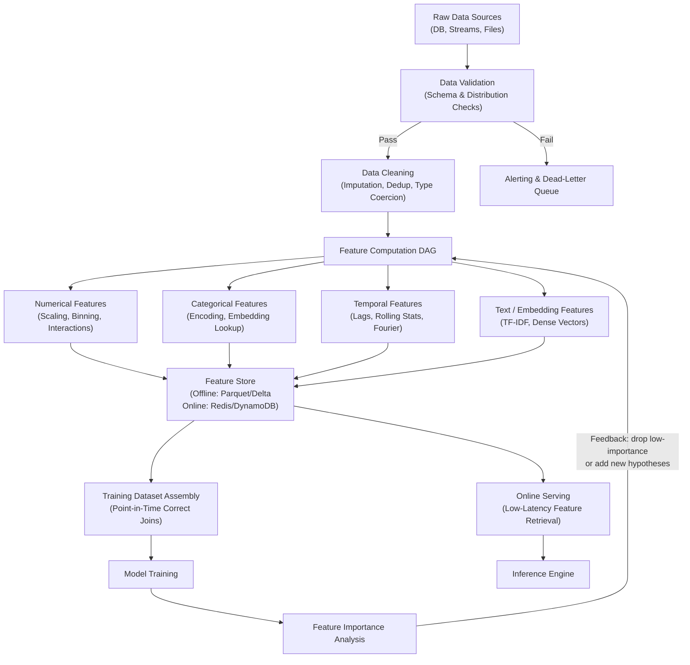
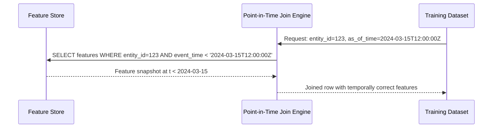
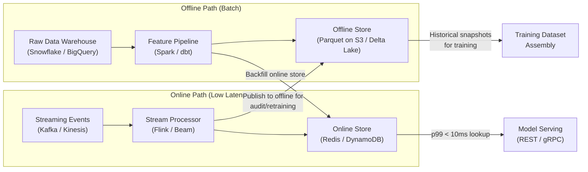
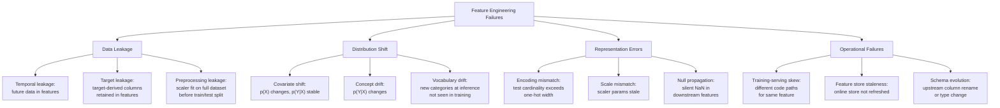
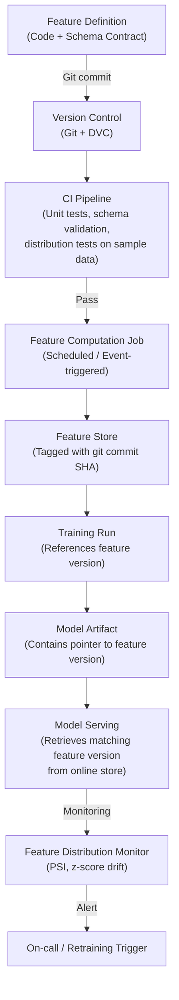

# Lesson 2: Feature Engineering Techniques for MLOps

## 1. First-Principles Intuition & Invariants

### What Feature Engineering Actually Does

A learning algorithm is a function approximator. Given input vectors **x** ∈ ℝⁿ, it searches a hypothesis class ℋ for a mapping f: ℝⁿ → 𝒴 that minimizes expected loss. The raw feature space ℝⁿ is almost never the space in which the true decision boundary is simple. Feature engineering is the act of constructing a transformation φ: ℝⁿ → ℝᵐ such that the composition f ∘ φ⁻¹ becomes learnable by the chosen hypothesis class.

This is not an aesthetic choice — it is an algebraic necessity. A linear SVM cannot learn XOR in the original two-dimensional input space; a polynomial kernel implicitly maps to a higher-dimensional space where the XOR boundary becomes linearly separable. Deep neural networks learn φ end-to-end via backpropagation, but even they benefit from hand-crafted features that encode domain invariants the architecture cannot infer from data alone (e.g., log-transforming right-skewed revenue data, or computing time-since-last-event for temporal models).

### Information-Theoretic Foundation

The relevance of a feature X to a target Y is captured by mutual information:

```text
I(X; Y) = Σ_{x,y} p(x,y) log [ p(x,y) / (p(x)·p(y)) ]
```

A feature with I(X; Y) = 0 is statistically independent of the target — retaining it adds zero predictive signal and increases the VC dimension of the hypothesis class, which tightens the generalization bound. The redundancy between two features X₁ and X₂ is I(X₁; X₂). An ideal feature set maximises I(Xᵢ; Y) while minimising I(Xᵢ; Xⱼ) for all i ≠ j.

The minimum description length (MDL) principle formalizes this: the best model is the one that most compresses the data, meaning the feature representation that allows the shortest combined description of the model and the data encoded under that model. Aggressive redundancy removal is not just an efficiency trick — it is epistemically correct under MDL.

### The Curse of Dimensionality: A Precise Statement

In a d-dimensional unit hypercube, the fraction of volume within distance ε of the boundary is 1 − (1 − 2ε)^d. For d = 10 and ε = 0.01, this is ≈ 18%. For d = 100, it is ≈ 87%. Almost all high-dimensional data lives near the surface of its bounding volume, not in its interior. Distance metrics degenerate: the ratio of the maximum to minimum pairwise distance approaches 1 as d → ∞ under mild conditions (Beyer et al., 1999). This means k-NN, kernel methods, and any distance-based algorithm loses discrimination power as dimensionality grows without a corresponding growth in training set size.

Feature engineering combats this by identifying the intrinsic dimensionality of the data manifold, which is typically far lower than the ambient dimension.

### System Invariants

Three invariants must hold throughout any production feature engineering system:

**Train-serve symmetry.** Every transformation φ applied at training time must be applied identically at inference time. This means the transformation logic and its fitted parameters (e.g., mean and variance for z-score normalization, vocabulary mapping for one-hot encoding) must be versioned and stored as artifacts alongside the model. Any divergence is a form of training-serving skew — one of the most common and destructive bugs in production ML systems.

**No future information.** Features computed for time-step t must depend only on data available at time t. Violations are called temporal data leakage. A model trained with leakage will appear to outperform because it has access to information that is unavailable at the time of prediction. This is not overfitting — it is measurement error on model quality.

**Referential integrity under joins.** When features are assembled from multiple data sources via join operations, every join key must be validated. Silent null-producing outer joins or fan-out-producing many-to-many joins produce incorrect feature vectors without raising exceptions, corrupting the training set invisibly.

---

## 2. Core Architecture & Mechanics

### The Feature Engineering Pipeline

A production feature engineering system is not a linear script. It is a directed acyclic graph (DAG) of transformations with explicit data contracts at each edge. The following diagram captures the full architecture, including the feedback loops that most simplified diagrams omit:



### Data Validation: The Gate Before Everything

No feature engineering logic should run against data whose schema or statistical properties have not been verified. Apache Beam's TensorFlow Data Validation (TFDV) and Great Expectations are the standard tooling. The key checks are:

- **Schema conformance:** Column types and presence are as declared.
- **Domain bounds:** Numerical values fall within observed training ranges; categorical values match the known vocabulary.
- **Distribution shift detection:** The Jensen-Shannon divergence or the Population Stability Index (PSI) between the current batch and the reference training distribution exceeds a threshold, triggering an alert.

PSI is defined as:

```text
PSI = Σᵢ (Actual%ᵢ − Expected%ᵢ) × ln(Actual%ᵢ / Expected%ᵢ)
```

A PSI < 0.1 indicates negligible shift; 0.1–0.2 warrants investigation; > 0.2 signals a potentially broken data pipeline or a genuine concept drift.

### Data Cleaning

#### Missing Value Imputation

The choice of imputation strategy is a modeling decision, not a data janitor task. The three mechanisms of missingness define what strategies are valid:

- **MCAR (Missing Completely At Random):** Missingness is independent of both observed and unobserved data. Mean/median imputation is unbiased but underestimates variance. Any imputation strategy is valid.
- **MAR (Missing At Random):** Missingness depends on observed variables but not on the missing value itself. Regression imputation or multiple imputation (MICE — Multiple Imputation by Chained Equations) is appropriate.
- **MNAR (Missing Not At Random):** Missingness depends on the value that is missing (e.g., high-income individuals declining to report income). Imputation alone is insufficient; a separate binary indicator feature `is_missing_X` must be added, and the imputation model must account for the selection mechanism.

```python
import numpy as np
import pandas as pd
from sklearn.experimental import enable_iterative_imputer  # noqa: F401
from sklearn.impute import IterativeImputer, SimpleImputer
from sklearn.linear_model import BayesianRidge

def build_imputer(strategy: str = "iterative") -> object:
    """
    Returns a fitted-compatible imputer.
    'iterative' uses MICE via BayesianRidge — appropriate for MAR data.
    'simple' uses median — appropriate for MCAR data.
    """
    if strategy == "iterative":
        return IterativeImputer(
            estimator=BayesianRidge(),
            max_iter=10,
            random_state=42,
            imputation_order="ascending",  # impute most observed first
        )
    return SimpleImputer(strategy="median")


def add_missingness_indicators(df: pd.DataFrame, columns: list[str]) -> pd.DataFrame:
    """
    For MNAR columns, add a binary indicator before imputation.
    The indicator must be computed BEFORE imputation overwrites the NaNs.
    """
    for col in columns:
        df[f"{col}__is_missing"] = df[col].isna().astype(np.int8)
    return df
```

### Feature Selection

#### Filter Methods

Filter methods rank features using a criterion computed directly from the data, without involving a downstream model. The correct criterion depends on the measurement scale of the feature and the target:

| Feature Type | Target Type | Recommended Criterion |
|---|---|---|
| Continuous | Continuous | Pearson r or Spearman ρ |
| Continuous | Binary | Point-biserial correlation or AUROC per feature |
| Categorical | Continuous | ANOVA F-statistic (η²) |
| Categorical | Categorical | Cramér's V (normalized χ²) |
| Any | Any | Mutual Information (non-parametric, via k-NN estimator) |

Mutual information estimation via the Kraskov-Stögbauer-Grassberger (KSG) estimator is parameter-free and handles non-linear dependencies that correlation misses entirely. Scikit-learn's `mutual_info_classif` and `mutual_info_regression` implement this.

#### Wrapper Methods

Recursive Feature Elimination (RFE) is the canonical wrapper method. It trains a model, discards the feature with the lowest importance score, and repeats. The critical implementation detail is that importance scores must be computed on a held-out validation fold, not the training fold — otherwise the elimination criterion is a training-set artifact.

```python
from sklearn.feature_selection import RFECV
from sklearn.ensemble import GradientBoostingClassifier
from sklearn.model_selection import StratifiedKFold

def rfe_select(X: pd.DataFrame, y: pd.Series, min_features: int = 5) -> list[str]:
    """
    Cross-validated RFE. RFECV selects the number of features automatically
    by maximising cross-validated score, avoiding the need to pre-specify k.
    """
    estimator = GradientBoostingClassifier(n_estimators=100, random_state=42)
    selector = RFECV(
        estimator=estimator,
        step=1,
        cv=StratifiedKFold(n_splits=5, shuffle=True, random_state=42),
        scoring="roc_auc",
        min_features_to_select=min_features,
        n_jobs=-1,
    )
    selector.fit(X, y)
    return list(X.columns[selector.support_])
```

#### Embedded Methods: Lasso Path

L1 regularization (Lasso) performs feature selection by driving the coefficients of irrelevant features exactly to zero. This is a consequence of the L1 ball's geometry: its corners lie on the coordinate axes, and the optimal solution tends to land at a corner when the regularization is strong enough. The entire regularization path can be computed efficiently via the LARS algorithm in O(n·p²) time, where n is samples and p is features.

For non-linear models, SHAP (SHapley Additive exPlanations) values provide a theoretically grounded importance measure rooted in cooperative game theory. The SHAP value for feature i is its average marginal contribution across all possible subsets of features. Unlike "impurity-based" importance in tree ensembles (which is biased toward high-cardinality features), SHAP values are unbiased and consistent.

### Feature Extraction

#### Principal Component Analysis: The Mechanics

PCA finds the orthonormal basis {v₁, v₂, ..., vₖ} that maximizes the variance of the projected data. The vectors vᵢ are the eigenvectors of the sample covariance matrix Σ = (1/n) XᵀX (assuming zero-mean X), sorted by their corresponding eigenvalues λ₁ ≥ λ₂ ≥ ... ≥ λₚ.

The explained variance ratio for component i is λᵢ / Σⱼ λⱼ. The number of components k is chosen such that the cumulative explained variance exceeds a threshold (commonly 95%). In practice, PCA should be computed on the training set only; the learned projection matrix V ∈ ℝᵖˣᵏ and the training-set mean μ are stored as artifacts and applied to all subsequent datasets.

**Numerical stability note:** Never compute PCA via explicit covariance matrix construction on high-dimensional data. The condition number of XᵀX is the square of the condition number of X, amplifying floating-point error. Use the truncated SVD of X directly — this is what `sklearn.decomposition.PCA` does internally via LAPACK's `_gesdd` routine.

#### Autoencoders for Non-Linear Feature Extraction

A standard autoencoder with a bottleneck layer of dimension k learns a non-linear encoder φ: ℝⁿ → ℝᵏ and decoder ψ: ℝᵏ → ℝⁿ minimizing reconstruction loss ‖x − ψ(φ(x))‖². The encoder φ produces a compressed representation. Unlike PCA, this representation can capture non-linear manifold structure.

For tabular data, the **Variational Autoencoder (VAE)** is preferred over a plain autoencoder because it regularizes the latent space to be approximately Gaussian — preventing the encoder from simply memorizing training examples by encoding them as isolated points in a vast latent space.

```python
import torch
import torch.nn as nn
import torch.nn.functional as F


class TabularVAE(nn.Module):
    """
    Variational Autoencoder for tabular feature extraction.
    The reparameterization trick allows gradients to flow through
    the stochastic sampling operation.
    """

    def __init__(self, input_dim: int, hidden_dim: int, latent_dim: int):
        super().__init__()
        # Encoder
        self.enc_fc1 = nn.Linear(input_dim, hidden_dim)
        self.enc_bn1 = nn.BatchNorm1d(hidden_dim)
        self.enc_mu = nn.Linear(hidden_dim, latent_dim)
        self.enc_logvar = nn.Linear(hidden_dim, latent_dim)
        # Decoder
        self.dec_fc1 = nn.Linear(latent_dim, hidden_dim)
        self.dec_bn1 = nn.BatchNorm1d(hidden_dim)
        self.dec_out = nn.Linear(hidden_dim, input_dim)

    def encode(self, x: torch.Tensor) -> tuple[torch.Tensor, torch.Tensor]:
        h = F.relu(self.enc_bn1(self.enc_fc1(x)))
        return self.enc_mu(h), self.enc_logvar(h)

    def reparameterize(self, mu: torch.Tensor, logvar: torch.Tensor) -> torch.Tensor:
        # During inference, use the mean directly (no sampling noise).
        if not self.training:
            return mu
        std = torch.exp(0.5 * logvar)
        eps = torch.randn_like(std)
        return mu + eps * std

    def decode(self, z: torch.Tensor) -> torch.Tensor:
        h = F.relu(self.dec_bn1(self.dec_fc1(z)))
        return self.dec_out(h)

    def forward(self, x: torch.Tensor) -> tuple[torch.Tensor, torch.Tensor, torch.Tensor]:
        mu, logvar = self.encode(x)
        z = self.reparameterize(mu, logvar)
        x_recon = self.decode(z)
        return x_recon, mu, logvar


def vae_loss(
    x_recon: torch.Tensor,
    x: torch.Tensor,
    mu: torch.Tensor,
    logvar: torch.Tensor,
    beta: float = 1.0,
) -> torch.Tensor:
    """
    ELBO loss = Reconstruction loss + beta * KL divergence.
    beta > 1 encourages a more disentangled latent space (beta-VAE).
    KL term: -0.5 * sum(1 + log(sigma^2) - mu^2 - sigma^2)
    """
    recon_loss = F.mse_loss(x_recon, x, reduction="sum")
    kl_div = -0.5 * torch.sum(1 + logvar - mu.pow(2) - logvar.exp())
    return recon_loss + beta * kl_div
```

### Feature Transformation

#### Numerical Transformations

**Z-score normalization** (`(x − μ) / σ`) assumes the feature is approximately Gaussian. It is the correct choice for algorithms sensitive to the scale of input magnitudes: gradient descent (affects learning rate dynamics), SVMs (the kernel function is distance-based), and PCA (covariance matrix is scale-dependent).

**Min-max scaling** (`(x − xₘᵢₙ) / (xₘₐₓ − xₘᵢₙ)`) maps to [0, 1] but is sensitive to outliers — a single extreme value compresses all other values into a narrow range. Use robust scaling (`(x − median) / IQR`) when outliers are present and expected at inference time.

**Log transformation** is appropriate when the feature has a right-skewed distribution with a long tail (e.g., income, transaction amounts, counts). The transformation `log(1 + x)` (using +1 to handle zeros) reduces skewness, stabilizes variance across the range, and often makes the feature more linearly separable from the target. It is not a numerical trick — it reflects the genuine multiplicative structure of many economic and natural phenomena.

**Quantile transformation** maps the empirical distribution to a uniform or Gaussian distribution by computing the rank of each value. This is a fully non-parametric transformation that makes the distribution shape-agnostic but destroys order relationships between quantiles — do not apply it when the specific numeric magnitude carries meaning.

#### Encoding Categorical Features

**One-hot encoding** is the standard for nominal categories with low cardinality (< ~50 levels). It creates a binary vector of length equal to the number of categories. The reference level (one dropped column) must be chosen carefully in linear models to avoid multicollinearity.

**Target encoding** (also called mean encoding) replaces a category with the mean target value for that category, estimated from the training set. It compresses any-cardinality categories into a single continuous feature. The critical implementation requirement is that the mean must be estimated with leave-one-out or cross-fold smoothing to prevent target leakage:

```python
import pandas as pd
import numpy as np
from sklearn.base import BaseEstimator, TransformerMixin
from sklearn.model_selection import KFold


class CrossFoldTargetEncoder(BaseEstimator, TransformerMixin):
    """
    Target encoder using out-of-fold estimates to prevent leakage.
    At inference time, uses the global smoothed estimates computed during fit().

    Smoothing formula: λ * category_mean + (1 - λ) * global_mean
    where λ = n_category / (n_category + smoothing_factor)
    This shrinks low-count categories toward the global mean.
    """

    def __init__(self, cols: list[str], n_splits: int = 5, smoothing: float = 10.0):
        self.cols = cols
        self.n_splits = n_splits
        self.smoothing = smoothing
        self.global_mean_: float = 0.0
        self.encoding_map_: dict[str, dict] = {}

    def fit(self, X: pd.DataFrame, y: pd.Series) -> "CrossFoldTargetEncoder":
        self.global_mean_ = y.mean()
        for col in self.cols:
            stats = pd.concat([X[col], y], axis=1)
            stats.columns = ["cat", "target"]
            agg = stats.groupby("cat")["target"].agg(["mean", "count"])
            lam = agg["count"] / (agg["count"] + self.smoothing)
            self.encoding_map_[col] = (lam * agg["mean"] + (1 - lam) * self.global_mean_).to_dict()
        return self

    def transform(self, X: pd.DataFrame) -> pd.DataFrame:
        X = X.copy()
        for col in self.cols:
            X[col] = X[col].map(self.encoding_map_[col]).fillna(self.global_mean_)
        return X

    def fit_transform_train(self, X: pd.DataFrame, y: pd.Series) -> pd.DataFrame:
        """
        Generate out-of-fold target encodings for the training set.
        Must be called instead of fit_transform() on training data.
        """
        X = X.copy()
        X_encoded = X.copy()
        kf = KFold(n_splits=self.n_splits, shuffle=True, random_state=42)
        for col in self.cols:
            X_encoded[col] = np.nan
            for train_idx, val_idx in kf.split(X):
                X_tr, y_tr = X.iloc[train_idx], y.iloc[train_idx]
                agg = pd.concat([X_tr[col], y_tr], axis=1)
                agg.columns = ["cat", "target"]
                stats = agg.groupby("cat")["target"].agg(["mean", "count"])
                lam = stats["count"] / (stats["count"] + self.smoothing)
                fold_map = (lam * stats["mean"] + (1 - lam) * y_tr.mean()).to_dict()
                X_encoded.loc[X.index[val_idx], col] = X.iloc[val_idx][col].map(fold_map).fillna(y_tr.mean())
        self.fit(X, y)  # fit global map for inference
        return X_encoded
```

**Embedding layers** are the correct approach for high-cardinality categories in neural architectures (user IDs, product SKUs with millions of distinct values). An embedding maps each category to a dense vector in ℝᵈ, where d is typically chosen as min(600, round(1.6 × n_categories^0.56)) (a heuristic from the fast.ai library, empirically derived from competition results). The embedding weights are learned end-to-end with the model.

---

## 3. Temporal Features and Point-in-Time Correctness

Time-series and event-log data require special treatment. The most common and damaging error is computing aggregate features (rolling averages, cumulative counts) using data that postdates the prediction time. A correct implementation uses a **point-in-time join**: for each training example at time t, only events with timestamp < t are included in the feature computation.



**Lag features** encode the value of a variable at t − k for each lag k. For a univariate series with seasonal period s, lags {1, 2, s, s+1, s+2} are typically the most informative.

**Rolling statistics** (mean, standard deviation, min, max over a window W) provide a smoothed view of local behavior. When computing rolling statistics in a streaming environment (online inference), use exponentially weighted moving averages (EWMAs) rather than fixed windows — they require O(1) state per entity:

```text
EWMAₜ = α · xₜ + (1 − α) · EWMAₜ₋₁
```

where α = 2 / (W + 1) for an equivalent window size of W.

**Fourier features** are the correct tool for encoding cyclical temporal patterns (hour of day, day of week, month of year). Encoding hour h as a single integer causes the model to treat hour 23 and hour 0 as maximally distant, when they are adjacent. The correct encoding is:

```text
sin_hour = sin(2π · h / 24)
cos_hour = cos(2π · h / 24)
```

This preserves the circular topology of the cycle. The sin/cos pair is required because sin alone is not injective over a full period — both hour 2 and hour 10 have the same sin value.

---

## 4. The Feature Store: Architecture and Operational Contract

A feature store is the production infrastructure that operationalizes feature engineering. It decouples feature computation from model training and serving, enforcing train-serve symmetry by design.



The dual-store architecture separates concerns that have fundamentally different SLAs: offline pipelines optimize for throughput and correctness over hours; online stores optimize for single-digit millisecond latency at high concurrency. Backfill pipelines synchronize the two stores so that the feature values seen during training are reproducible.

**Production feature stores** in wide use: Feast (open-source), Tecton (managed), Hopsworks, Vertex AI Feature Store (GCP), and Amazon SageMaker Feature Store. Each implements the point-in-time join abstraction, feature versioning, and a metadata registry that maps feature names to their computation lineage.

---

## 5. High-Performance Optimization & Failure Modes

### Scaling Feature Pipelines

Production feature pipelines over terabyte-scale datasets require distributed execution. Apache Spark with the DataFrame API is the standard. The key performance invariants are:

**Avoid UDFs when native Spark SQL functions exist.** Python UDFs serialize each row to Python, execute the function, and deserialize the result — bypassing the Tungsten execution engine. A Python UDF incurs roughly 10–100× overhead compared to an equivalent Catalyst-optimized SQL expression. Use Pandas UDFs (vectorized, operating on Arrow-backed batches) when a custom function is unavoidable.

**Partition strategy determines shuffle cost.** A repartition before a large join or groupby aggregation is not optional — it eliminates data skew, which causes a small number of tasks to run 100× longer than others and stalls the entire stage. Partition on the join key with a cardinality that yields partition sizes of 128–512 MB.

```python
from pyspark.sql import SparkSession, DataFrame
from pyspark.sql import functions as F
from pyspark.sql.window import Window


def compute_entity_rolling_features(
    df: DataFrame,
    entity_col: str,
    timestamp_col: str,
    value_col: str,
    window_days: int = 30,
) -> DataFrame:
    """
    Compute rolling sum and count for entity over the past `window_days` days.
    Uses a range-based window to handle irregular time intervals correctly.
    
    Critical: rangeBetween operates on the value of the ORDER BY column,
    not on row offsets. The timestamp must be cast to a numeric type (unix epoch).
    """
    df = df.withColumn(
        "_ts_epoch",
        F.unix_timestamp(F.col(timestamp_col)).cast("long"),
    )

    seconds_in_window = window_days * 86_400

    w = (
        Window.partitionBy(entity_col)
        .orderBy("_ts_epoch")
        .rangeBetween(-seconds_in_window, -1)  # exclusive of current row (avoid leakage)
    )

    return (
        df.withColumn(f"{value_col}_rolling_{window_days}d_sum", F.sum(value_col).over(w))
        .withColumn(f"{value_col}_rolling_{window_days}d_count", F.count(value_col).over(w))
        .withColumn(
            f"{value_col}_rolling_{window_days}d_mean",
            F.col(f"{value_col}_rolling_{window_days}d_sum")
            / F.col(f"{value_col}_rolling_{window_days}d_count"),
        )
        .drop("_ts_epoch")
    )
```

### Failure Mode Taxonomy



**Temporal leakage** is the most dangerous failure because it inflates held-out metrics, leading to deployment of a model that performs significantly worse in production. Detection: if feature importance analysis identifies a feature that could not plausibly be known at prediction time, audit its construction immediately.

**Training-serving skew** is often invisible in offline evaluation and only surfaces as a production regression. The mitigation is to share a single feature computation library used by both the training pipeline and the serving system — not to replicate the logic in two codebases. Tecton and Feast enforce this by having the feature definition be the executable specification for both paths.

**Vocabulary drift** occurs when a categorical feature at inference time contains a value not seen during training. The correct fallback is a dedicated `<UNKNOWN>` token, never a silent NaN or a silent 0 — both of which alias the unknown category with a real one or with a numerical zero.

### Detecting and Measuring Leakage

A quantitative leakage detection procedure:

1. Train your model on the full training set.
2. Compute feature importances (SHAP values preferred).
3. For every feature in the top-k by importance, perform a causal plausibility audit: "Could this value be known to a production system at the moment a prediction is made?"
4. Shuffle the feature values across all training examples and recompute performance. If shuffling a feature dramatically improves performance, the feature is encoded target information (this sounds counterintuitive but indicates an inverted sign somewhere in the importance computation — e.g., a negatively correlated feature with leakage).

A complementary statistical test: compute the Pearson correlation between each feature and the target label. Features with |r| > 0.95 for a non-trivial prediction task warrant manual inspection. Legitimate features rarely achieve near-perfect correlation.

---

## 6. Feature Engineering in MLOps: Versioning, Lineage, and Governance

Feature engineering is not a one-time notebook exercise — it is a continuously evolving production artifact that must be managed with the same rigor as application code.



Every trained model artifact must carry a pointer to the exact version of the feature pipeline that produced its training data. Without this, it is impossible to:

- Reproduce a training run to debug a production regression.
- Determine whether a performance degradation is caused by model staleness or feature drift.
- Roll back to a previous feature version when a newly deployed feature introduces a bug.

The practical implementation uses **DVC (Data Version Control)** for data and feature artifact versioning alongside Git for code, with the feature store's metadata registry recording the git commit SHA of the feature definition corresponding to each materialized feature snapshot.

Feature governance in regulated industries (finance, healthcare) additionally requires an audit trail of:
- Who approved each feature for use in a production model.
- Whether the feature incorporates protected attributes (race, gender, age) or proxies thereof.
- The statistical relationship between each feature and protected attributes (measured via correlation and conditional mutual information) to support fairness audits.

---

## Summary

Feature engineering is the discipline of constructing a function φ: ℝⁿ → ℝᵐ that maps the ambient data space into a representation where the learning algorithm's hypothesis class contains a good approximation of the true target function. Its correctness depends on three hard invariants — train-serve symmetry, temporal integrity, and referential integrity — any one of which, if violated, produces a model that is systematically wrong in a way that offline metrics will not reveal. At scale, feature engineering is operationalized through a feature store with separate offline and online paths, versioned feature definitions, and continuous distribution monitoring. The engineering of features is inseparable from their deployment, versioning, and governance.
