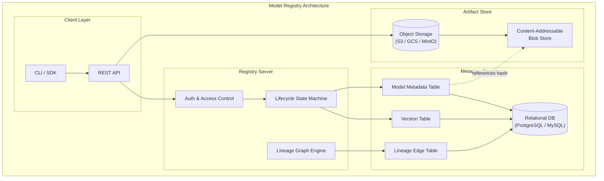
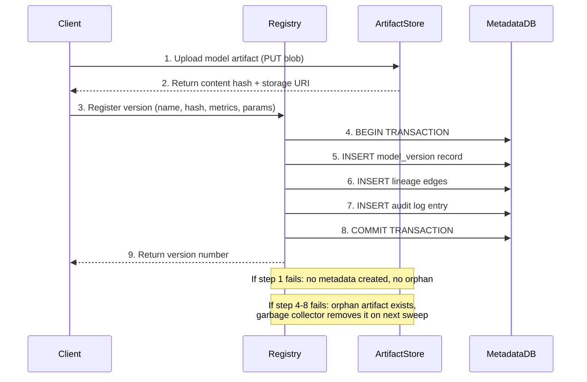
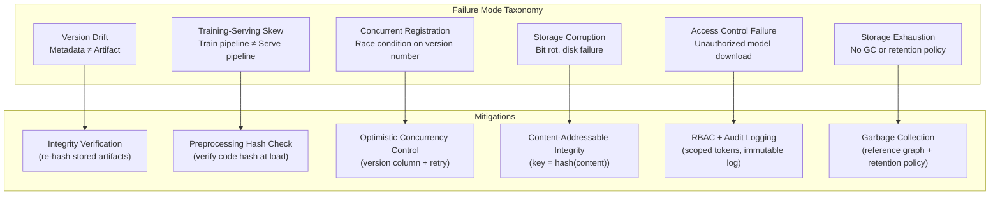

# Lesson 3: Model Versioning and Management

## 1. First-Principles Intuition & Invariants

A trained machine learning model is a function whose behavior is determined by three orthogonal input spaces: the training data, the optimization procedure (hyperparameters, random seeds, framework versions), and the code that defines the computational graph. Unlike traditional software, where a compiled binary is a deterministic function of source code and compiler flags, a model's behavior depends on stochastic processes—GPU non-determinism, floating-point accumulation order, data shuffling—that cannot be fully controlled. Model versioning is the discipline of making this stochastic process reproducible, traceable, and auditable despite the inherent non-determinism.

The central invariant is **closure under reproducibility**: given a model version identifier, the system must reconstruct the exact training context—data snapshot, code commit, environment specification, and random state—sufficient to reproduce the model's learned parameters within a defined tolerance. This is fundamentally different from Git's reproducibility invariant, which guarantees bitwise identical reproduction. ML reproducibility is statistical: the same training run with the same inputs may produce slightly different weights due to hardware-level non-determinism (e.g., atomic addition order in GPU reduction kernels). The versioning system must therefore record enough metadata to bound and explain this variance, not eliminate it.

The second invariant is **traceability as a directed acyclic graph (DAG)**. Every model version is a node in a lineage graph whose edges represent transformations: raw data → processed data → feature store snapshot → training dataset → trained model → evaluated model → deployed model. This DAG must be reconstructable from any node back to its root inputs. Traceability is not metadata annotation; it is a structural property of the storage layer. If the lineage graph is maintained externally (e.g., in a spreadsheet or a CI log), it will eventually diverge from the actual artifacts. The system must enforce lineage as a referential constraint, not a documentation convention.

The third invariant is **immutability of published versions**. Once a model version transitions to a non-draft state (e.g., "staging" or "production"), its artifacts and metadata must be immutable. This is not a policy choice but a correctness requirement: downstream systems—serving infrastructure, audit logs, evaluation reports—may reference a model version by its hash. Mutating the underlying artifacts silently breaks these references. Immutability is enforced by content-addressable storage, where an artifact's storage key is derived from its cryptographic hash. Any modification produces a new hash, which means a new version, not an in-place update.

The final invariant is **bidirectional mapping between code and model**. For every model version, there exists a unique code commit (or a set of commits, in the case of multi-repo setups). For every code commit that produced a model, there exists a model version. This bijection is necessary for debugging: when a production model degrades, the engineer must be able to retrieve the exact code that trained it. This is typically implemented by recording the Git commit hash as a field in the model's metadata record, and by tagging the Git commit with the model version identifier.

### The Reproducibility Gap

In practice, perfect reproducibility is unattainable. The sources of non-determinism in a typical deep learning pipeline include:

- **GPU non-determinism**: Atomic operations in CUDA reduction kernels (e.g., `atomicAdd`) execute in thread-scheduling-dependent order. cuDNN's convolution algorithms select between deterministic and non-deterministic implementations based on workspace size heuristics. Setting `torch.backends.cudnn.deterministic = True` and `torch.use_deterministic_algorithms(True)` forces deterministic kernels but may reduce performance by 10-30%.
- **Data loading order**: Multi-process data loaders with prefetching introduce non-deterministic ordering unless explicit synchronization barriers are used.
- **Distributed training**: Gradient AllReduce in multi-GPU training accumulates floating-point values in non-deterministic order across workers. The NCCL library does not guarantee bit-wise identical results across runs unless deterministic collectives are explicitly enabled.

The versioning system must therefore record the **reproducibility configuration**: which determinism flags were set, which CUDA/cuDNN versions were used, the hardware topology (GPU model, count, interconnect). This metadata defines the reproducibility envelope—the conditions under which retraining will produce equivalent results within a specified tolerance.

## 2. Core Architecture & Mechanics

### 2.1 The Model Registry as a System of Record

A model registry is the system of record for model versions. It serves three functions: artifact storage (the model files), metadata storage (the lineage, parameters, metrics), and state management (the lifecycle transitions). Production registries—MLflow Model Registry, W&B Artifacts, Vertex AI Model Registry, SageMaker Model Registry—typically implement these as separate subsystems with different consistency guarantees.

The artifact store holds large binary files (model weights, serialized pipelines, evaluation artifacts). These are stored in object storage (S3, GCS, Azure Blob) using content-addressable keys: the storage path is derived from a hash of the artifact's content. This enables deduplication—if two training runs produce identical weight files (rare but possible with deterministic training), they share a single storage entry. It also enables integrity verification: the stored hash serves as a checksum that the registry validates on retrieval.

The metadata store holds structured records: model identifiers, version numbers, parameters, metrics, lineage edges, and lifecycle state. MLflow uses a relational database (PostgreSQL, MySQL) accessed via SQLAlchemy. W&B uses a combination of a relational database and a graph store for lineage. The metadata store must support transactional updates to lifecycle state, since transitioning a model from "staging" to "production" is a state mutation that requires atomicity and concurrency control.



### 2.2 The Model Lifecycle State Machine

The model lifecycle is a state machine with guarded transitions. The states and transitions are not arbitrary; they encode organizational approval workflows and safety properties. The following state machine reflects the lifecycle used by MLflow Model Registry and similar systems:

```mermaid
stateDiagram-v2
    [*] --> "Draft\n(training in progress)"
    "Draft\n(training in progress)" --> "Registered\n(metadata committed)"
    "Registered\n(metadata committed)" --> "Staging\n(validation environment)"
    "Registered\n(metadata committed)" --> "Archived\n(superseded or deprecated)"
    "Staging\n(validation environment)" --> "Production\n(serving live traffic)"
    "Staging\n(validation environment)" --> "Archived\n(superseded or deprecated)"
    "Staging\n(validation environment)" --> "Registered\n(metadata committed)"
    "Production\n(serving live traffic)" --> "Archived\n(superseded or deprecated)"
    "Production\n(serving live traffic)" --> "Staging\n(validation environment)"
    "Archived\n(superseded or deprecated)" --> [*]
```

Each transition is an auditable event. The "Registered → Staging" transition typically requires validation metrics to exceed a threshold. The "Staging → Production" transition often requires human approval (a model approver role) and may trigger a canary deployment. The "Production → Archived" transition occurs when a model is superseded or decommissioned. These transitions are recorded as entries in an append-only event log, not as in-place updates to a status field. This ensures the full transition history is preserved and queryable for audit purposes.

### 2.3 Content-Addressable Storage and Deduplication

The artifact store uses content-addressable storage (CAS), a design pattern borrowed from Git's internal object store. Each artifact is stored as a blob whose key is the SHA-256 (or similar) hash of its content. The registry maintains a manifest that maps human-readable model names and version numbers to these content hashes. The manifest itself is versioned and stored in the metadata database.

The advantage of CAS for model artifacts is deduplication. In transfer learning workflows, a base model (e.g., ResNet-50 pretrained on ImageNet) may be used as the initialization for dozens of downstream models. Without CAS, each downstream model stores a full copy of the base weights. With CAS, the base weights are stored once, and each downstream model's manifest references the same content hash.

DVC implements this pattern using a combination of Git (for the manifest files, called `.dvc` files) and a remote object store (S3, GCS, etc.) for the actual blobs. The `.dvc` file is a small text file committed to Git that contains the content hash and the remote storage path:

```yaml
# models/resnet50-finetuned.dvc
outs:
  - md5: a1b2c3d4e5f6789012345678901234567
    path: models/resnet50-finetuned
    cache: true
    remote: s3-remote
    persist: false
```

When a user runs `dvc pull`, DVC reads the `.dvc` file, downloads the blob from the remote store, and verifies the MD5 hash. If the hash matches, the file is placed at the specified path. If not, the download fails—this is the integrity check that CAS provides.

### 2.4 Lineage Tracking as a DAG

Model lineage is a directed acyclic graph (DAG) where nodes represent artifacts (datasets, models, metrics) and edges represent dependencies. The lineage graph answers the question: "given this deployed model, what data was it trained on, what code produced it, and what models preceded it?"

The lineage graph is constructed incrementally during the training pipeline. Each stage of the pipeline registers its inputs and outputs with the lineage service:

```mermaid
graph TD
    RAW["raw_data_v3.csv\n(hash: 7f3a...)"]
    CLEAN["cleaned_data_v3.parquet\n(hash: 2b9c...)"]
    FEAT["feature_store_snapshot_20240115\n(hash: 5e1d...)"]
    SPLIT["train_split_v3\n(hash: 8a4f...)"]
    TRAIN["model_xgb_v12.pkl\n(hash: 3c7e...)"]
    EVAL["eval_report_v12.json\n(hash: 6d2b...)"]
    DEPLOY["deployed_model_xgb_v12\n(hash: 3c7e...)"]

    RAW -->|"transform: clean()" "| CLEAN
    CLEAN -->|"transform: featurize()" "| FEAT
    FEAT -->|"transform: train_test_split()" "| SPLIT
    SPLIT -->|"transform: train_xgboost()" "| TRAIN
    TRAIN -->|"transform: evaluate()" "| EVAL
    TRAIN -->|"deploy: canary 10%" "| DEPLOY
```

The lineage graph is stored as an edge table in the metadata database. Each edge records: source artifact hash, destination artifact hash, transformation type (e.g., "train_xgboost", "clean"), the code commit that executed the transformation, and a timestamp. The graph can be queried to answer provenance questions: "which models were trained on data containing this specific row?" or "what is the full lineage of the model currently serving traffic?"

### 2.5 Implementation: MLflow Model Registry

MLflow Model Registry is the most widely used open-source model registry. Its architecture separates the tracking server (which logs experiments, parameters, and metrics) from the model registry (which manages model versions and lifecycle transitions). The following Python code demonstrates a complete training-to-deployment workflow with MLflow:

```python
import mlflow
import mlflow.sklearn
from mlflow.tracking import MlflowClient
from sklearn.ensemble import GradientBoostingClassifier
from sklearn.metrics import accuracy_score, f1_score
import pandas as pd
import hashlib
import json
import os

def compute_file_hash(filepath: str) -> str:
    """Compute SHA-256 hash of a file for data versioning."""
    sha256 = hashlib.sha256()
    with open(filepath, "rb") as f:
        for chunk in iter(lambda: f.read(65536), b""):
            sha256.update(chunk)
    return sha256.hexdigest()

def train_and_register_model(
    train_data_path: str,
    model_name: str,
    hyperparams: dict,
    eval_data_path: str | None = None,
) -> str:
    """
    Train a model, log it to MLflow, register it in the Model Registry,
    and transition it through lifecycle stages.

    Returns the model version number assigned by the registry.
    """
    # Compute data hash for traceability
    data_hash = compute_file_hash(train_data_path)
    eval_hash = compute_file_hash(eval_data_path) if eval_data_path else data_hash

    # Start an MLflow run — this creates an experiment context
    mlflow.set_tracking_uri("http://mlflow-server:5000")
    mlflow.set_experiment("fraud-detection-xgb")

    with mlflow.start_run(run_name=f"xgb_train_{data_hash[:8]}") as run:
        # Log the data version as a tag (not a param, since it identifies
        # the input rather than a tunable hyperparameter)
        mlflow.set_tag("data_hash", data_hash)
        mlflow.set_tag("eval_data_hash", eval_hash)
        mlflow.set_tag("git_commit", os.environ.get("GIT_COMMIT", "unknown"))

        # Log all hyperparameters — these become part of the model's
        # reproducible metadata
        for key, value in hyperparams.items():
            mlflow.log_param(key, value)

        # Load and prepare training data
        train_df = pd.read_csv(train_data_path)
        eval_df = pd.read_csv(eval_data_path) if eval_data_path else None

        X_train = train_df.drop(columns=["label"])
        y_train = train_df["label"]

        if eval_df is not None:
            X_eval = eval_df.drop(columns=["label"])
            y_eval = eval_df["label"]

        # Train the model
        model = GradientBoostingClassifier(
            n_estimators=hyperparams.get("n_estimators", 100),
            max_depth=hyperparams.get("max_depth", 3),
            learning_rate=hyperparams.get("learning_rate", 0.1),
            random_state=hyperparams.get("random_state", 42),
        )
        model.fit(X_train, y_train)

        # Evaluate and log metrics
        if eval_df is not None:
            y_pred = model.predict(X_eval)
            accuracy = accuracy_score(y_eval, y_pred)
            f1 = f1_score(y_eval, y_pred, average="weighted")
            mlflow.log_metric("accuracy", accuracy)
            mlflow.log_metric("f1_score", f1)

        # Define the model signature (schema) for deployment validation
        from mlflow.models.signature import infer_signature
        signature = infer_signature(X_train, model.predict(X_train))

        # Log the model — this stores the serialized model in the
        # artifact store and creates a registered model version
        model_uri = f"runs:/{run.info.run_id}/model"
        mlflow.sklearn.log_model(
            sk_model=model,
            artifact_path="model",
            signature=signature,
            input_example=X_train.head(5),
        )

        # Register the model in the Model Registry
        client = MlflowClient()
        try:
            client.create_registered_model(model_name)
        except Exception:
            # Model already registered — this is expected on subsequent runs
            pass

        result = mlflow.register_model(
            model_uri=model_uri,
            name=model_name,
        )

        version = result.version

        # Transition through lifecycle stages
        # New versions start in "None" (unregistered) state
        client.transition_model_version_stage(
            name=model_name,
            version=version,
            stage="Staging",
        )

        # Log additional metadata as tags on the model version
        client.set_model_version_tag(
            name=model_name,
            version=version,
            key="training_data_hash",
            value=data_hash,
        )
        client.set_model_version_tag(
            name=model_name,
            version=version,
            key="trained_by",
            value=os.environ.get("USER", "unknown"),
        )

        return version

def promote_to_production(model_name: str, version: str, require_approval: bool = True):
    """
    Promote a staging model to production with approval gating.
    """
    client = MlflowClient()

    if require_approval:
        # In production, this would integrate with an approval system
        # (e.g., Slack approval, JIRA ticket, or custom webhook)
        approver = os.environ.get("MODEL_APPROVER")
        if not approver:
            raise PermissionError(
                f"Promotion of {model_name} v{version} requires "
                f"MODEL_APPROVER environment variable to be set."
            )

    # Verify the model is currently in Staging
    mv = client.get_model_version(name=model_name, version=version)
    if mv.current_stage != "Staging":
        raise ValueError(
            f"Model {model_name} v{version} is in '{mv.current_stage}', "
            f"must be in 'Staging' before promotion to 'Production'."
        )

    # Archive any existing production versions
    prod_versions = client.search_model_versions(
        f"name='{model_name}' AND stages=['Production']"
    )
    for pv in prod_versions:
        client.transition_model_version_stage(
            name=model_name,
            version=pv.version,
            stage="Archived",
        )

    # Promote the new version
    client.transition_model_version_stage(
        name=model_name,
        version=version,
        stage="Production",
    )

# Example usage
if __name__ == "__main__":
    version = train_and_register_model(
        train_data_path="data/train_v3.csv",
        eval_data_path="data/eval_v3.csv",
        model_name="fraud-detection-xgb",
        hyperparams={
            "n_estimators": 200,
            "max_depth": 5,
            "learning_rate": 0.05,
            "random_state": 42,
        },
    )
    print(f"Registered model version: {version}")
```

### 2.6 Implementation: DVC Pipeline with Reproducible Training

DVC takes a different approach from MLflow: it extends Git to handle large files and manages the training pipeline as a declarative DAG. The pipeline definition (`dvc.yaml`) specifies the stages, their dependencies, and their outputs. Running `dvc repro` executes only the stages whose dependencies have changed, similar to Make.

```yaml
# dvc.yaml — DVC pipeline definition
stages:
  prepare_data:
    cmd: python src/prepare_data.py --input data/raw.csv --output data/prepared.parquet
    deps:
      - src/prepare_data.py
      - data/raw.csv
    outs:
      - data/prepared.parquet
    params:
      - prepare.test_size
      - prepare.random_state

  train:
    cmd: python src/train.py --data data/prepared.parquet --model-dir models/
    deps:
      - src/train.py
      - data/prepared.parquet
    outs:
      - models/model.pkl
    params:
      - train.n_estimators
      - train.max_depth
      - train.learning_rate
    metrics:
      - metrics/train_metrics.json:
          cache: false

  evaluate:
    cmd: python src/evaluate.py --model models/model.pkl --data data/test.parquet --output metrics/eval_metrics.json
    deps:
      - src/evaluate.py
      - models/model.pkl
      - data/test.parquet
    metrics:
      - metrics/eval_metrics.json:
          cache: false
    plots:
      - plots/confusion_matrix.png
      - plots/roc_curve.png
```

```yaml
# params.yaml — parameters tracked by DVC
prepare:
  test_size: 0.2
  random_state: 42

train:
  n_estimators: 200
  max_depth: 5
  learning_rate: 0.05
```

```python
# src/train.py — training script integrated with DVC pipeline
import pickle
import json
import hashlib
import pandas as pd
from sklearn.ensemble import GradientBoostingClassifier
from sklearn.metrics import accuracy_score, f1_score
import yaml

def load_params() -> dict:
    with open("params.yaml", "r") as f:
        return yaml.safe_load(f)

def train():
    params = load_params()
    train_params = params["train"]

    data = pd.read_parquet("data/prepared.parquet")
    X, y = data.drop(columns=["label"]), data["label"]

    model = GradientBoostingClassifier(
        n_estimators=train_params["n_estimators"],
        max_depth=train_params["max_depth"],
        learning_rate=train_params["learning_rate"],
        random_state=train_params["random_state"],
    )
    model.fit(X, y)

    with open("models/model.pkl", "wb") as f:
        pickle.dump(model, f)

    # Compute hash of the model file for integrity verification
    with open("models/model.pkl", "rb") as f:
        model_hash = hashlib.sha256(f.read()).hexdigest()

    metrics = {
        "model_hash": model_hash,
        "train_accuracy": float(accuracy_score(y, model.predict(X))),
        "train_f1": float(f1_score(y, model.predict(X), average="weighted")),
        "params": train_params,
    }
    with open("metrics/train_metrics.json", "w") as f:
        json.dump(metrics, f, indent=2)

if __name__ == "__main__":
    train()
```

### 2.7 Model Serving with Versioned Artifacts

Once a model is registered, the serving layer must load the correct version. The following Go implementation shows a model server that retrieves versioned model artifacts from an MLflow registry and serves inference requests. This pattern is used in production serving infrastructure (e.g., KServe, BentoML, Triton Inference Server) where the model binary and its version metadata must be reconciled at load time:

```go
package main

import (
	"context"
	"encoding/json"
	"fmt"
	"log"
	"net/http"
	"os"
	"path/filepath"
	"sync"
	"time"

	"github.com/aws/aws-sdk-go-v2/service/s3"
)

// ModelVersion represents a loaded model in memory.
type ModelVersion struct {
	Version   string
	Stage     string
	Artifact  []byte    // Serialized model (ONNX, Pickle, etc.)
	LoadedAt  time.Time
	Hash      string    // Content hash for integrity verification
}

// ModelRegistryClient abstracts the MLflow registry API.
type ModelRegistryClient struct {
	TrackingURI string
	S3Client    *s3.Client
	BucketName  string
}

// ModelStore manages in-memory model versions with thread-safe access.
type ModelStore struct {
	mu     sync.RWMutex
	models map[string]*ModelVersion // key: "model_name:version"
}

func NewModelStore() *ModelStore {
	return &ModelStore{
		models: make(map[string]*ModelVersion),
	}
}

// LoadModel fetches a model version from the registry and loads it into memory.
// This operation is atomic: either the full model is loaded or the store is unchanged.
func (s *ModelStore) LoadModel(ctx context.Context, registry *ModelRegistryClient, name, version string) error {
	// Fetch model metadata from the registry server
	uri := fmt.Sprintf("%s/api/2.0/mlflow/registered-models/get-latest-versions?name=%s",
		registry.TrackingURI, name)

	resp, err := http.Get(uri)
	if err != nil {
		return fmt.Errorf("registry query failed: %w", err)
	}
	defer resp.Body.Close()

	if resp.StatusCode != http.StatusOK {
		return fmt.Errorf("registry returned status %d", resp.StatusCode)
	}

	// Download artifact from S3 (content-addressed by hash)
	artifactKey := fmt.Sprintf("mlflow-artifacts/%s/%s/model", name, version)
	downloadPath := filepath.Join(os.TempDir(), fmt.Sprintf("%s_v%s", name, version))

	_, err = registry.S3Client.GetObject(ctx, &s3.GetObjectInput{
		Bucket: &registry.BucketName,
		Key:    &artifactKey,
	})
	if err != nil {
		return fmt.Errorf("artifact download failed: %w", err)
	}

	artifact, err := os.ReadFile(downloadPath)
	if err != nil {
		return fmt.Errorf("failed to read downloaded artifact: %w", err)
	}

	// Verify content hash for integrity
	computedHash := computeSHA256(artifact)

	modelVersion := &ModelVersion{
		Version:  version,
		Stage:    "Production",
		Artifact: artifact,
		LoadedAt: time.Now(),
		Hash:     computedHash,
	}

	s.mu.Lock()
	defer s.mu.Unlock()
	s.models[fmt.Sprintf("%s:%s", name, version)] = modelVersion

	return nil
}

// GetModel returns a loaded model version for inference.
func (s *ModelStore) GetModel(name, version string) (*ModelVersion, error) {
	s.mu.RLock()
	defer s.mu.RUnlock()

	key := fmt.Sprintf("%s:%s", name, version)
	mv, ok := s.models[key]
	if !ok {
		return nil, fmt.Errorf("model %s version %s not loaded", name, version)
	}
	return mv, nil
}

// InferenceHandler processes prediction requests using the loaded model.
func InferenceHandler(store *ModelStore) http.HandlerFunc {
	return func(w http.ResponseWriter, r *http.Request) {
		name := r.URL.Query().Get("model")
		version := r.URL.Query().Get("version")

		mv, err := store.GetModel(name, version)
		if err != nil {
			http.Error(w, err.Error(), http.StatusNotFound)
			return
		}

		var input map[string]interface{}
		if err := json.NewDecoder(r.Body).Decode(&input); err != nil {
			http.Error(w, "invalid request body", http.StatusBadRequest)
			return
		}

		// In a real implementation, this would call into a model runtime
		// (ONNX Runtime, libtorch, TensorFlow Serving) via FFI or gRPC.
		// The model artifact (mv.Artifact) would be deserialized and
		// passed input data for prediction.
		prediction := map[string]interface{}{
			"model_version": mv.Version,
			"model_hash":    mv.Hash[:16],
			"prediction":    "placeholder_output",
		}

		w.Header().Set("Content-Type", "application/json")
		json.NewEncoder(w).Encode(prediction)
	}
}

func computeSHA256(data []byte) string {
	// Implementation would use crypto/sha256
	// Simplified for illustration
	return fmt.Sprintf("%x", data[:32])
}

func main() {
	store := NewModelStore()

	// Load the latest production model on startup
	// In production, this would be triggered by a registry webhook
	// or a periodic poll of the registry API.

	mux := http.NewServeMux()
	mux.HandleFunc("/predict", InferenceHandler(store))

	log.Println("Model server starting on :8080")
	log.Fatal(http.ListenAndServe(":8080", mux))
}
```

### 2.8 Storage Architecture and the Metadata-Artifact Boundary

The separation between metadata storage and artifact storage is a deliberate architectural choice driven by access patterns and consistency requirements. Metadata records are small (typically <10 KB), frequently queried, and require transactional consistency (e.g., a lifecycle transition must be atomic with the audit log entry). They belong in a relational database with ACID guarantees. Artifacts are large (megabytes to gigabytes), accessed infrequently (only on load or deployment), and require only eventual consistency. They belong in object storage optimized for large blob retrieval.

The registry server sits between these two stores and enforces invariants:

1. **Referential integrity**: Every metadata record must reference a valid artifact hash. If an artifact upload fails, the metadata record is not committed (or is marked as failed).
2. **Immutability**: Once a model version is registered, its artifact hash cannot be changed. The registry rejects any attempt to update the artifact for an existing version.
3. **Atomic transitions**: Lifecycle state transitions are transactional. If the transition from "Staging" to "Production" includes archiving the previous production version, both operations succeed or both fail.

This architecture has a specific failure mode: the metadata-artifact consistency gap. If the metadata record is committed but the artifact upload fails (due to network error or timeout), the registry has a "phantom" model version—a metadata record pointing to a nonexistent artifact. Production registries handle this with a two-phase commit pattern: artifacts are uploaded first, then the metadata record is committed. If the metadata commit fails, the orphaned artifact is cleaned up by a garbage collection sweep. If the artifact upload fails, no metadata record is created.



## 3. High-Performance Optimization & Failure Modes

### 3.1 Storage Efficiency

Model artifacts are large. A fine-tuned LLM may have billions of parameters, requiring tens of gigabytes of storage per checkpoint. In an active ML team producing hundreds of model versions per day, storage costs become a dominant operational expense. Three techniques mitigate this:

**Content-addressable deduplication** eliminates storage of identical artifacts. When a training run produces a model file, the registry computes its hash and checks if that hash already exists in the store. If it does, no upload occurs—the new version's metadata simply references the existing blob. This is effective when models share base architectures (transfer learning) or when retraining produces identical outputs (deterministic training with the same seed).

**Differential storage** (delta encoding) stores only the differences between consecutive model versions. Since fine-tuning typically modifies a small fraction of model weights (especially with methods like LoRA, which inject low-rank update matrices), the delta between a base model and a fine-tuned variant may be 1% of the full model size. Systems like Hugging Face Hub and some internal registries implement diff-based storage: the full model is stored once, and subsequent versions store only the changed layers. Retrieval requires applying the delta to reconstruct the full model, adding a constant-time reconstruction overhead.

**Garbage collection with retention policies** prevents unbounded storage growth. The registry maintains a reference graph: an artifact is reachable if it is referenced by a metadata record that is in a non-archived state, or if it is referenced by an archived record that is within the retention window. Unreachable artifacts—those whose metadata records have been deleted or whose retention period has expired—are eligible for deletion. The garbage collector runs as a background process, scanning for unreachable blobs and deleting them from object storage. This must be carefully coordinated with any ongoing downloads: the collector should not delete an artifact that is currently being read by a deployment process.

### 3.2 Query Performance

Metadata queries (e.g., "list all models in staging for project X" or "find the best performing version of model Y") must be fast even with millions of registered versions. The metadata database achieves this through indexing on the access patterns that the registry API exposes:

- **Model name + version** (primary lookup for deployment)
- **Model name + stage** (listing production or staging models)
- **Lineage source hash** (reverse lineage: what models were derived from this dataset?)
- **Git commit hash** (debugging: what models were produced by this code change?)

The lineage graph query (full ancestry traversal) is the most expensive operation. For a deployed model, traversing the full DAG back to raw data sources may require joining through multiple edge tables. Graph databases (Neo4j, Amazon Neptune) can handle this efficiently, but most registries use relational databases with recursive CTEs (Common Table Expressions) or pre-computed lineage materialized views that are updated on each registration.

### 3.3 Failure Modes

**Version drift** occurs when the model artifact and its metadata diverge. This can happen if the registry's metadata database is updated but the artifact upload is interrupted, or if an external process modifies the artifact store directly (bypassing the registry). The result is a metadata record that claims a model has hash X, but the artifact at that storage location has hash Y. Detection requires periodic integrity verification: the registry should re-hash stored artifacts and compare against the recorded hashes. This is computationally expensive (re-reading all stored artifacts) and is typically run as a batch job on a schedule (e.g., nightly).

**Training-serving skew** is a subtler failure mode that versioning alone cannot prevent. It occurs when the model is trained on data that has been preprocessed differently from how the serving environment preprocesses input data. The model version correctly records the training preprocessing pipeline, but the serving infrastructure uses a different pipeline. This is a configuration management failure, not a versioning failure, but the versioning system can help detect it: if the model's metadata includes the preprocessing code hash, the serving infrastructure can verify that it is running the same preprocessing code before loading the model.

**Concurrent registration conflicts** arise when two training jobs complete simultaneously and attempt to register versions of the same model. Without proper coordination, they may both claim the same version number, or one may overwrite the other's metadata. The registry handles this with optimistic concurrency control: each registration attempt reads the current latest version, increments it, and writes. If another write has occurred between the read and the write, the registration fails and must be retried with the new version number. This is the same pattern used in database MVCC and is implemented via a `version` column in the metadata table that is checked during the UPDATE.

**Storage corruption** can occur at the object storage layer (bit rot, disk failure). Content-addressable storage provides a natural integrity check: the storage key is the hash of the content, so any corruption is detectable by re-hashing the stored blob and comparing against the key. Registries should implement periodic verification jobs that sample stored artifacts and verify their integrity. Object storage systems (S3, GCS) provide their own checksums, but these protect against transport corruption, not storage-level corruption.

**Security and access control** failures can have severe consequences. Model artifacts may encode sensitive training data (memorization in neural networks), proprietary architectures, or business logic. Unauthorized access to a model registry can lead to intellectual property theft or, in regulated industries (healthcare, finance), compliance violations. The registry must implement role-based access control (RBAC) at the model level: not all engineers should have access to all models. MLflow supports this via its experiment-level permissions; enterprise registries (Vertex AI, SageMaker) provide finer-grained model-level IAM policies. Access should be logged in an immutable audit trail, and model downloads should require authentication tokens with scoped permissions.



### 3.4 The Reproducibility Verification Checklist

When a model version is registered, the following metadata should be captured to maximize reproducibility. Each field addresses a specific source of non-determinism or environmental dependency:

| Field | Purpose | Source of Non-Determinism Mitigated |
|---|---|---|
| Git commit hash | Exact code used for training | Code changes between runs |
| Data hash (SHA-256) | Exact training data | Data drift, pipeline changes |
| Framework version | PyTorch/TensorFlow/Sklearn version | API changes, default behavior changes |
| CUDA version | GPU compute API version | Kernel behavior differences |
| cuDNN version | Deep learning primitives library | Algorithm selection differences |
| GPU model | Hardware (e.g., A100, V100) | Floating-point accumulation order |
| Random seed | RNG initialization | Weight initialization, data shuffling |
| Determinism flags | Framework determinism settings | Non-deterministic kernels |
| Training duration | Epochs/steps completed | Early stopping variance |
| Hardware topology | GPU count, interconnect (NVLink, PCIe) | Distributed training gradient order |
| Environment hash | Container image hash (Docker) | System library version drift |

This metadata does not guarantee bitwise reproducibility, but it defines the envelope within which reproduction is expected to succeed. When a reproduction attempt fails (produces different metrics), the checklist serves as a diagnostic tool: each field is a hypothesis for the discrepancy, and the engineer can systematically check whether each condition holds.

## 4. Summary

Model versioning is the infrastructure that makes ML systems auditable, reproducible, and safe to operate. Its architecture rests on three pillars: content-addressable artifact storage for immutability and deduplication, a relational metadata store for transactional lifecycle management, and a lineage DAG for end-to-end traceability. The failure modes—version drift, training-serving skew, concurrent registration conflicts, storage corruption—are all consequences of the fundamental tension between the need for immutability and the reality of distributed, concurrent systems. The mitigations—integrity verification, optimistic concurrency control, garbage collection with retention policies—are standard distributed systems techniques applied to the specific domain of ML artifacts. The reproducibility checklist is the practical interface between the versioning system and the engineer: it defines what must be recorded to make a model version meaningful, and it provides the diagnostic framework for when reproduction fails.
