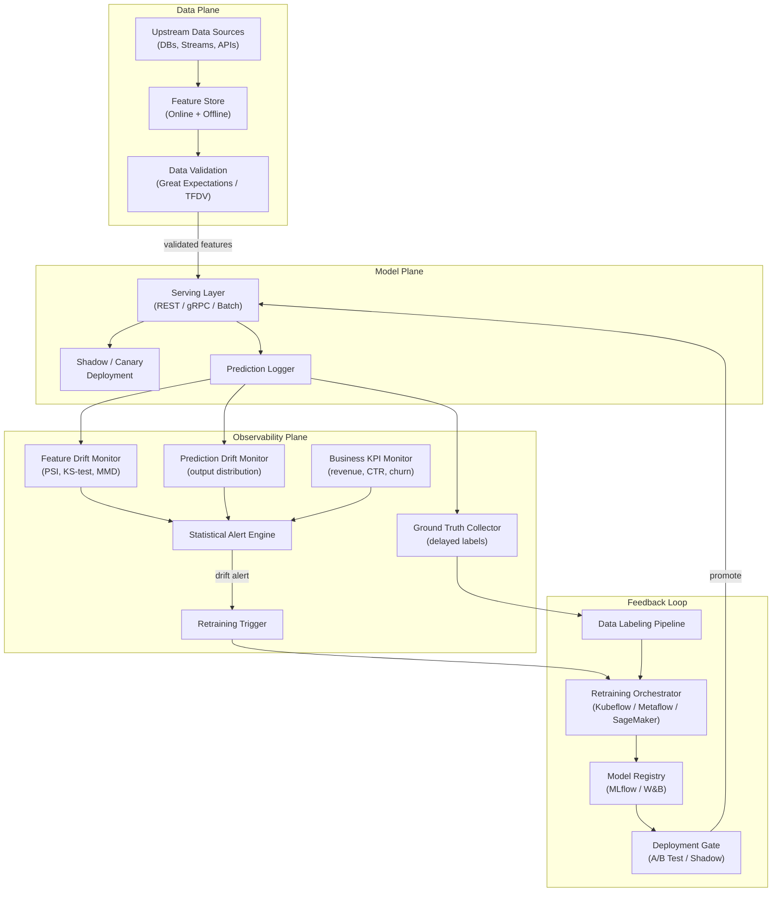
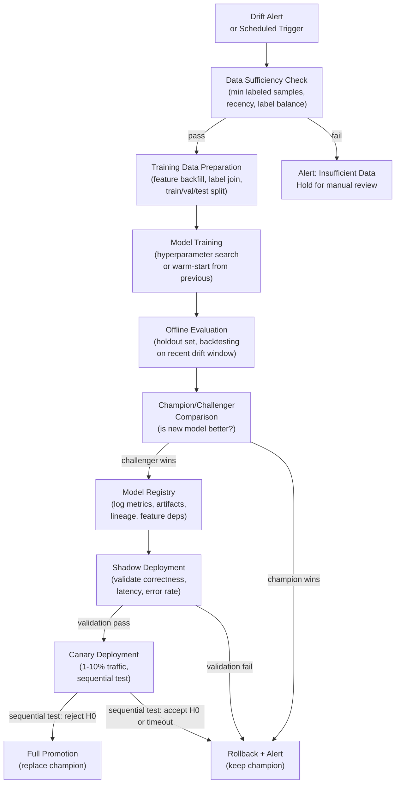
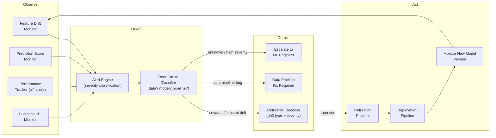

# Lesson 4: Monitoring and Maintaining ML Models in Production

---

## 1. First-Principles Intuition & Invariants

### The Fundamental Instability of Deployed Models

An ML model is a compressed, parametric representation of a joint probability distribution estimated from historical data. At training time, the model learns a function `f: X → Y` that minimizes some empirical loss over the training distribution `P_train(X, Y)`. The critical assumption embedded in every deployment decision is that the production distribution `P_prod(X, Y)` is stationary and sufficiently similar to `P_train(X, Y)`. This assumption is almost always violated over time.

This violation is not a failure of engineering — it is a mathematical certainty in any system where the real world evolves. The stock market changes regimes. User behavior shifts. Sensor hardware degrades. Upstream ETL pipelines silently change schema. The formal study of this phenomenon is **distributional shift**, and it is the central problem of ML model maintenance.

### Taxonomy of Distributional Shift

Understanding *what* shifts is prerequisite to instrumenting a system to detect it. The literature identifies several distinct failure modes:

**Covariate Shift** (`P(X)` changes, `P(Y|X)` stable): The marginal distribution of input features changes, but the true labeling function is unchanged. Example: a fraud detection model trained on desktop transactions is suddenly receiving 60% mobile transactions with structurally different feature distributions. The model's learned boundaries are still valid in principle, but the input space it encounters has moved out of the region it was trained on.

**Label Shift / Prior Probability Shift** (`P(Y)` changes, `P(X|Y)` stable): The class priors change. Example: a medical diagnostic model trained on a 1:9 disease/healthy ratio is deployed during an outbreak where prevalence is 1:3. Bayesian optimal decision thresholds shift, but the model's posteriors are calibrated against the original prior.

**Concept Drift** (`P(Y|X)` changes): The true relationship between inputs and outputs changes. This is the most damaging form because no amount of additional data from the old regime is helpful — the ground truth has changed. Example: sentiment analysis models built before a major cultural shift in language use. Word meanings, irony conventions, and community norms evolve.

**Data Quality Drift**: Schema changes, upstream pipeline bugs, sensor calibration errors, or feature engineering code changes that alter the statistical properties of features without any real-world causal change. This is operationally the most common failure mode and is frequently misdiagnosed as concept drift.

### The Formal Invariant

Let `D_train` be the training data distribution and `D_t` be the production data distribution at time `t`. Model performance at time `t` is bounded by:

```text
Error(t) ≥ Error_Bayes + d_H(D_train, D_t)
```

where `d_H` is the H-divergence between domains (from Ben-David et al., 2010 domain adaptation theory) and `Error_Bayes` is the irreducible Bayes error. This formalizes the intuition that **distributional distance is a lower bound on the performance gap you cannot close by retraining alone** — you must also understand and address the source of the shift.

The practical implication: a monitoring system that only tracks model output metrics (accuracy, AUC) is measuring a *lagging indicator* of drift. By the time accuracy degrades, the shift has already propagated through thousands of predictions. A production-grade system must track *leading indicators*: input feature distributions, prediction score distributions, and data pipeline health — before ground-truth labels are even available.

---

## 2. Core Architecture & Mechanics

### The Full Observability Stack

Production ML monitoring requires three distinct observability planes that mirror the three-tier structure of the ML system itself:



### Statistical Tests for Drift Detection

The selection of a drift detection test is not arbitrary — different tests have different assumptions, power characteristics, and computational costs.

**Population Stability Index (PSI)** is a symmetric divergence metric originating in credit risk and widely used in production because it is fast and interpretable:

```text
PSI = Σ (P_actual_i - P_expected_i) × ln(P_actual_i / P_expected_i)
```

Convention: PSI < 0.1 = no significant shift; 0.1–0.2 = moderate shift, investigate; > 0.2 = major shift, act. PSI is computed over binned marginal distributions, so it scales to high-dimensional feature sets by computing per-feature PSI and aggregating. Its weakness is that it treats each feature independently and misses multivariate covariance structure changes.

**Kolmogorov-Smirnov (KS) Test** measures the maximum absolute difference between two empirical CDFs. It is non-parametric, distribution-free, and powerful for detecting location and scale shifts. The KS statistic is:

```text
D = sup_x |F_ref(x) - F_prod(x)|
```

For high-cardinality categorical features, the chi-squared test on frequency distributions is more appropriate. For multivariate drift, **Maximum Mean Discrepancy (MMD)** operates in a Reproducing Kernel Hilbert Space and can detect arbitrary distributional differences including higher-order moments and multivariate interactions, at the cost of O(n²) kernel computation — mitigated in practice with random Fourier feature approximations.

**CUSUM (Cumulative Sum Control Chart)** and **ADWIN (Adaptive Windowing)** are sequential drift detection algorithms suited for streaming data. ADWIN maintains a sliding window and uses a Hoeffding bound to detect when two halves of the window have statistically different means:

```text
|μ_W0 - μ_W1| ≥ ε_cut = √((1/(2m)) × ln(4n/δ))
```

where `m` is the harmonic mean of the two sub-window sizes, `n` is the total window size, and `δ` is the false positive rate. ADWIN is implemented in the `river` Python library and is well-suited for concept drift detection on streaming prediction errors.

### Ground Truth Collection and the Label Delay Problem

One of the most underappreciated architectural challenges in production ML is that **ground truth labels arrive with delay or not at all**. A fraud detection model scores a transaction in 50ms, but the confirmed fraud signal arrives days to weeks later (chargebacks). A churn prediction model scores customers today, but whether they churned is known only 30–90 days later.

This creates a fundamental tension: you need labels to compute model performance metrics, but those labels are delayed. The architectural solution is a **label joining pipeline** that:

1. Logs every prediction with a unique `prediction_id`, input features, model version, timestamp, and score.
2. Maintains a prediction store (typically a time-series or key-value store) keyed on a business entity ID and prediction timestamp.
3. When ground truth arrives (a churn event, a confirmed fraud, a click), the label pipeline performs a temporal join against the prediction store using the entity ID and a time window, associates the label with the prediction, and writes the joined record to a training data store.
4. Triggers downstream performance computation and, if configured, retraining workflows.

The gap between prediction time and label time must be explicit in your monitoring design. During the gap, you rely on **proxy metrics** — leading indicators that correlate with eventual performance: prediction score distributions, feature drift statistics, upstream data quality checks, and business metrics.

### A Production-Grade Drift Detection Implementation

```python
"""
production_drift_monitor.py

A statistically rigorous, production-grade feature drift monitor.
Uses PSI for fast per-feature screening and KS-test for detailed analysis.
Designed to run as a scheduled job against a feature store or prediction log.
"""

import numpy as np
import pandas as pd
from dataclasses import dataclass, field
from typing import Dict, List, Optional, Tuple
from scipy import stats
from scipy.special import rel_entr
import logging
import json
from datetime import datetime, timedelta

logger = logging.getLogger(__name__)


@dataclass
class DriftReport:
    feature_name: str
    test_used: str
    statistic: float
    p_value: Optional[float]
    psi_score: Optional[float]
    drift_detected: bool
    severity: str  # "none", "moderate", "severe"
    timestamp: datetime = field(default_factory=datetime.utcnow)

    def to_dict(self) -> dict:
        return {
            "feature_name": self.feature_name,
            "test_used": self.test_used,
            "statistic": self.statistic,
            "p_value": self.p_value,
            "psi_score": self.psi_score,
            "drift_detected": self.drift_detected,
            "severity": self.severity,
            "timestamp": self.timestamp.isoformat(),
        }


def compute_psi(
    reference: np.ndarray,
    production: np.ndarray,
    n_bins: int = 10,
    epsilon: float = 1e-6,
) -> float:
    """
    Compute Population Stability Index between reference and production distributions.

    Uses equal-frequency (quantile) binning on the reference distribution to avoid
    empty bins, which cause PSI to blow up logarithmically. Epsilon smoothing
    prevents log(0) for bins with zero production count.

    Args:
        reference: 1-D array from reference (training) window.
        production: 1-D array from production window.
        n_bins: Number of bins. 10 is standard; use fewer for small samples.
        epsilon: Laplace smoothing constant added to all bin frequencies.

    Returns:
        PSI scalar. Higher = more shift.
    """
    # Build quantile bin edges from reference distribution
    quantiles = np.linspace(0, 100, n_bins + 1)
    bin_edges = np.percentile(reference, quantiles)
    # Deduplicate edges that collapse (e.g., many zeros in sparse features)
    bin_edges = np.unique(bin_edges)
    if len(bin_edges) < 2:
        return 0.0  # Degenerate distribution, cannot compute PSI

    ref_counts, _ = np.histogram(reference, bins=bin_edges)
    prod_counts, _ = np.histogram(production, bins=bin_edges)

    # Convert to proportions with epsilon smoothing
    ref_pct = (ref_counts + epsilon) / (reference.shape[0] + epsilon * n_bins)
    prod_pct = (prod_counts + epsilon) / (production.shape[0] + epsilon * n_bins)

    psi = np.sum((prod_pct - ref_pct) * np.log(prod_pct / ref_pct))
    return float(psi)


def detect_drift_numeric(
    feature_name: str,
    reference: np.ndarray,
    production: np.ndarray,
    ks_alpha: float = 0.01,
    psi_moderate: float = 0.1,
    psi_severe: float = 0.2,
) -> DriftReport:
    """
    Run PSI + two-sample KS test on a numeric feature.

    PSI gives a stable, interpretable scalar for dashboards.
    KS test gives a p-value for formal hypothesis testing.
    Both are reported; alert logic uses PSI thresholds as primary signal
    to avoid sample-size sensitivity of KS p-values.
    """
    psi = compute_psi(reference, production)
    ks_stat, p_value = stats.ks_2samp(reference, production)

    if psi >= psi_severe:
        severity = "severe"
        drift_detected = True
    elif psi >= psi_moderate:
        severity = "moderate"
        drift_detected = True
    else:
        severity = "none"
        drift_detected = False

    return DriftReport(
        feature_name=feature_name,
        test_used="PSI + KS",
        statistic=ks_stat,
        p_value=p_value,
        psi_score=psi,
        drift_detected=drift_detected,
        severity=severity,
    )


def detect_drift_categorical(
    feature_name: str,
    reference: np.ndarray,
    production: np.ndarray,
    chi2_alpha: float = 0.01,
    psi_moderate: float = 0.1,
    psi_severe: float = 0.2,
) -> DriftReport:
    """
    Run PSI + chi-squared test for categorical features.

    Aligns category sets across reference and production, adding zero counts
    for categories present in one window but not the other.
    """
    ref_series = pd.Series(reference)
    prod_series = pd.Series(production)

    all_categories = set(ref_series.unique()) | set(prod_series.unique())

    ref_counts = ref_series.value_counts().reindex(all_categories, fill_value=0)
    prod_counts = prod_series.value_counts().reindex(all_categories, fill_value=0)

    # chi2_contingency requires 2D array: rows=categories, cols=ref/prod
    contingency = np.array([ref_counts.values, prod_counts.values]).T
    # Avoid chi2 with cells that are all zero
    nonzero_mask = contingency.sum(axis=1) > 0
    contingency = contingency[nonzero_mask]

    if contingency.shape[0] < 2:
        return DriftReport(
            feature_name=feature_name,
            test_used="Chi2",
            statistic=0.0,
            p_value=1.0,
            psi_score=0.0,
            drift_detected=False,
            severity="none",
        )

    chi2_stat, p_value, _, _ = stats.chi2_contingency(contingency)

    # PSI on categorical: treat frequency bins as histogram bins
    epsilon = 1e-6
    ref_pct = (ref_counts.values + epsilon) / (len(reference) + epsilon * len(all_categories))
    prod_pct = (prod_counts.values + epsilon) / (len(production) + epsilon * len(all_categories))
    psi = float(np.sum((prod_pct - ref_pct) * np.log(prod_pct / ref_pct)))

    drift_detected = psi >= psi_moderate
    severity = "severe" if psi >= psi_severe else ("moderate" if psi >= psi_moderate else "none")

    return DriftReport(
        feature_name=feature_name,
        test_used="PSI + Chi2",
        statistic=chi2_stat,
        p_value=p_value,
        psi_score=psi,
        drift_detected=drift_detected,
        severity=severity,
    )


class FeatureDriftMonitor:
    """
    Monitors a set of features for distributional drift between a reference
    window (e.g., last 30 days of training data) and a production window
    (e.g., last 24 hours of scored requests).

    Usage:
        monitor = FeatureDriftMonitor(reference_df, feature_schema)
        reports = monitor.run(production_df)
        monitor.emit_metrics(reports)  # Push to Prometheus/CloudWatch/Datadog
    """

    def __init__(
        self,
        reference_df: pd.DataFrame,
        feature_schema: Dict[str, str],  # {"feature_name": "numeric" | "categorical"}
        min_production_samples: int = 100,
    ):
        self.reference_df = reference_df
        self.feature_schema = feature_schema
        self.min_production_samples = min_production_samples

    def run(self, production_df: pd.DataFrame) -> List[DriftReport]:
        reports = []

        if len(production_df) < self.min_production_samples:
            logger.warning(
                f"Production window has only {len(production_df)} samples "
                f"(min={self.min_production_samples}). Drift results may be unreliable."
            )

        for feature, dtype in self.feature_schema.items():
            if feature not in self.reference_df.columns:
                logger.error(f"Feature '{feature}' missing from reference data. Schema mismatch.")
                continue
            if feature not in production_df.columns:
                logger.error(
                    f"Feature '{feature}' missing from production data. "
                    "This is a critical data quality issue — upstream schema change detected."
                )
                # Emit a synthetic severe drift report for a missing feature
                reports.append(
                    DriftReport(
                        feature_name=feature,
                        test_used="schema_check",
                        statistic=float("inf"),
                        p_value=None,
                        psi_score=float("inf"),
                        drift_detected=True,
                        severity="severe",
                    )
                )
                continue

            ref_values = self.reference_df[feature].dropna().values
            prod_values = production_df[feature].dropna().values

            if dtype == "numeric":
                report = detect_drift_numeric(feature, ref_values, prod_values)
            elif dtype == "categorical":
                report = detect_drift_categorical(feature, ref_values, prod_values)
            else:
                logger.warning(f"Unknown dtype '{dtype}' for feature '{feature}'. Skipping.")
                continue

            reports.append(report)

            if report.drift_detected:
                logger.warning(
                    f"DRIFT DETECTED | feature={feature} | severity={report.severity} "
                    f"| PSI={report.psi_score:.4f} | KS/Chi2 p={report.p_value}"
                )

        return reports

    def emit_metrics(self, reports: List[DriftReport], sink: str = "stdout") -> None:
        """
        Emit structured drift metrics to a configured sink.
        In production, replace 'stdout' with Prometheus push gateway,
        Datadog StatsD, or CloudWatch PutMetricData calls.
        """
        for report in reports:
            metric = report.to_dict()
            if sink == "stdout":
                print(json.dumps(metric))
            # elif sink == "prometheus": push_to_gateway(...)
            # elif sink == "datadog": statsd.gauge(...)
```

### Model Performance Tracking with Rolling Windows

```python
"""
performance_tracker.py

Tracks model performance against delayed ground-truth labels using
a rolling window join. Computes calibration error in addition to
standard classification metrics, since calibration degradation
precedes accuracy degradation and is a leading indicator of drift.
"""

import numpy as np
from dataclasses import dataclass
from typing import List, Tuple, Optional
from sklearn.metrics import (
    roc_auc_score,
    average_precision_score,
    brier_score_loss,
    log_loss,
)
from sklearn.calibration import calibration_curve


@dataclass
class PerformanceSnapshot:
    model_version: str
    window_start: str
    window_end: str
    n_samples: int
    auc_roc: float
    auc_pr: float
    brier_score: float
    log_loss_val: float
    expected_calibration_error: float
    positive_rate: float


def expected_calibration_error(
    y_true: np.ndarray,
    y_prob: np.ndarray,
    n_bins: int = 10,
) -> float:
    """
    Compute Expected Calibration Error (ECE).

    ECE measures the weighted average discrepancy between predicted
    probabilities and observed frequencies, partitioned into equal-width
    probability bins. A perfectly calibrated model has ECE = 0.

    ECE = Σ_b (|B_b| / n) × |acc(B_b) - conf(B_b)|

    where B_b is the set of predictions in bin b, acc(B_b) is the fraction
    of positive labels in that bin, and conf(B_b) is the mean predicted
    probability in that bin.
    """
    bin_edges = np.linspace(0.0, 1.0, n_bins + 1)
    ece = 0.0
    n = len(y_true)

    for i in range(n_bins):
        mask = (y_prob >= bin_edges[i]) & (y_prob < bin_edges[i + 1])
        if mask.sum() == 0:
            continue
        bin_confidence = y_prob[mask].mean()
        bin_accuracy = y_true[mask].mean()
        bin_weight = mask.sum() / n
        ece += bin_weight * abs(bin_accuracy - bin_confidence)

    return float(ece)


def compute_performance_snapshot(
    model_version: str,
    window_start: str,
    window_end: str,
    y_true: np.ndarray,
    y_prob: np.ndarray,
) -> Optional[PerformanceSnapshot]:
    """
    Compute a full performance snapshot for a prediction window
    once ground-truth labels are available.

    Returns None if the window has insufficient samples or degenerate labels
    (all positive or all negative), which would make AUC undefined.
    """
    if len(y_true) < 30:
        return None
    if len(np.unique(y_true)) < 2:
        return None

    return PerformanceSnapshot(
        model_version=model_version,
        window_start=window_start,
        window_end=window_end,
        n_samples=len(y_true),
        auc_roc=roc_auc_score(y_true, y_prob),
        auc_pr=average_precision_score(y_true, y_prob),
        brier_score=brier_score_loss(y_true, y_prob),
        log_loss_val=log_loss(y_true, y_prob),
        expected_calibration_error=expected_calibration_error(y_true, y_prob),
        positive_rate=float(y_true.mean()),
    )
```

---

## 3. Deployment Strategies and Canary Analysis

### Why Deployment Strategy Is a Monitoring Problem

The standard framing separates deployment (ops) from monitoring (observability). This is incorrect in ML systems. The deployment strategy determines *how much real traffic is exposed to a new model* and therefore *how quickly you accumulate the sample size needed to detect performance regression*. Deployment strategy and statistical power are inseparable.

The three primary deployment patterns form a risk/speed tradeoff:

```mermaid
graph TD
    subgraph sub_shadow_deployment ["Shadow Deployment"]
        SD_PROD["Production Model\n(serves users)"]
        SD_SHADOW["Candidate Model\n(shadow, no user impact)"]
        SD_TRAFFIC["Incoming Request"]
        SD_LOG["Prediction Logger\n(both models)"]
        SD_COMPARE["Offline Comparison\n(divergence, latency, errors)"]
        SD_TRAFFIC -->|"100%"| SD_PROD
        SD_TRAFFIC -.->|"mirrored"| SD_SHADOW
        SD_PROD --> SD_LOG
        SD_SHADOW --> SD_LOG
        SD_LOG --> SD_COMPARE
    end

    subgraph sub_canary_deployment ["Canary Deployment"]
        CD_TRAFFIC["Incoming Request"]
        CD_PROD["Production Model\n(90–99% traffic)"]
        CD_CANARY["Canary Model\n(1–10% traffic)"]
        CD_METRICS["Metrics Comparison\n(statistical significance test)"]
        CD_GATE["Promotion Gate\n(automated or manual)"]
        CD_TRAFFIC -->|"p% traffic"| CD_CANARY
        CD_TRAFFIC -->|"(1-p)% traffic"| CD_PROD
        CD_PROD --> CD_METRICS
        CD_CANARY --> CD_METRICS
        CD_METRICS --> CD_GATE
    end

    subgraph sub_blue_green_deployment ["Blue/Green Deployment"]
        BG_LB["Load Balancer"]
        BG_BLUE["Blue Environment\n(current production)"]
        BG_GREEN["Green Environment\n(new model, full stack)"]
        BG_SWITCH["Instant Traffic Switch\nor Rollback"]
        BG_LB -->|"100% → Blue\nthen 100% → Green"| BG_BLUE
        BG_LB --> BG_GREEN
        BG_BLUE --> BG_SWITCH
        BG_GREEN --> BG_SWITCH
    end
```



**Shadow deployment** carries zero user risk but cannot measure real user behavior — if the shadow model would change user actions (a recommendation model's output changes what users click), shadow comparisons measure a counterfactual that cannot be realized. It is best suited for validating correctness, latency, and error rates before any user exposure.

**Canary deployment** exposes a controlled fraction of real traffic to the new model. The key design question is: **what is the minimum detectable effect size you care about, and what sample size does that require?** For a one-sided test of AUC with α=0.05, β=0.20 (80% power), and an MDE of 0.01 AUC on a baseline of 0.80, you typically need thousands of labeled examples per arm — which, with a 5% canary and label delay of 7 days, may require weeks to accumulate.

**Blue/green deployment** minimizes rollout complexity and maximizes rollback speed (seconds, not hours), but it means 100% of traffic shifts instantly. For ML models, this is acceptable only when extensive offline evaluation, shadow comparisons, and champion/challenger backtests have already been completed.

### Sequential Testing for Canary Analysis

A common mistake in canary analysis is using a fixed-horizon test: "run the canary for N days, then compute a t-test." This ignores the problem of **optional stopping** — analysts naturally peek at results and stop early when they see a significant result, inflating the Type I error rate. In production, automated canary systems often make this mistake programmatically.

The correct approach is **sequential hypothesis testing**, specifically the **Sequential Probability Ratio Test (SPRT)** or **always-valid confidence intervals** (via e-values). SPRT allows you to stop as soon as you have enough evidence for or against the null hypothesis, with controlled error rates at any stopping time:

```text
Λ_n = Π_{i=1}^{n} [p_1(x_i) / p_0(x_i)]

Stop and reject H_0 if Λ_n ≥ B = (1-β)/α
Stop and accept H_0 if Λ_n ≤ A = β/(1-α)
Continue if A < Λ_n < B
```

For the specific case of comparing two Bernoulli proportions (e.g., click-through rates or binary error rates), this reduces to a tractable update rule that can be computed incrementally with each new observation.

---

## 4. The Retraining Decision: Scheduled vs. Triggered

### Why Scheduled Retraining Is Insufficient

A common pattern is to retrain models on a fixed schedule — weekly, monthly, quarterly. This is an engineering convenience masquerading as a strategy. The fundamental problem is that the optimal retraining cadence is a function of the drift rate, which is non-stationary: drift accelerates during regime changes (economic crises, product launches, pandemics) and slows during stable periods. A fixed schedule both over-retrains during stable periods (wasting compute and introducing variance) and under-retrains during rapid drift periods (missing the moment of maximum performance degradation).

The correct architecture is **drift-triggered retraining** with configurable thresholds, backed by a retraining pipeline that is reliable and fast enough to respond within hours, not days.

### Retraining Pipeline Architecture



### Training Data Window Selection

An underappreciated detail in retraining is **how much historical data to include**. This is not obvious:

- Including too much historical data dilutes the signal from recent distribution by averaging it with outdated patterns, producing a model biased toward historical behavior.
- Including too little data produces a model with high variance that overfits to recent noise.

The empirically robust approach is **recency-weighted training**: assign sample weights that decay exponentially with age, with the half-life tuned as a hyperparameter. Alternatively, use a **sliding window** strategy where the window size is treated as a hyperparameter optimized during validation on a held-out recent window.

```python
def compute_sample_weights_temporal_decay(
    timestamps: np.ndarray,  # Unix epoch seconds
    half_life_days: float = 30.0,
) -> np.ndarray:
    """
    Assign exponentially decaying weights to training samples based on age.

    Samples from `half_life_days` ago receive weight 0.5 relative to
    the most recent samples. This allows the model to learn from historical
    patterns while emphasizing recent distribution.

    Args:
        timestamps: Array of Unix timestamps for each training sample.
        half_life_days: Age in days at which weight decays to 0.5.

    Returns:
        Normalized weight array of same shape as timestamps.
    """
    max_ts = timestamps.max()
    age_days = (max_ts - timestamps) / 86400.0  # Convert seconds to days
    decay_rate = np.log(2) / half_life_days      # λ = ln(2) / t_{1/2}
    weights = np.exp(-decay_rate * age_days)
    # Normalize so weights sum to n_samples (keeps loss scaling consistent)
    weights = weights * (len(weights) / weights.sum())
    return weights
```

---

## 5. High-Performance Optimization & Operational Failure Modes

### Failure Mode Taxonomy

Production ML systems fail in predictable patterns. Understanding these patterns is a prerequisite for designing monitoring that catches them.

**Silent Failures** are the most dangerous. A model continues to serve predictions without raising errors, but prediction quality has silently degraded. The system is operationally healthy by all infrastructure metrics (latency, error rate, throughput) while delivering business harm. This is the failure mode that drift monitoring directly targets.

**Data Pipeline Failures** manifest as null values, constant features, schema changes, or truncated distributions. These are detected by feature drift monitoring (a feature suddenly becoming all-zero has infinite PSI) and by data validation rules (Great Expectations, TFDV). A production data validation layer should run assertions before data reaches the model.

**Training/Serving Skew** occurs when the feature engineering code used at serving time differs from the code used at training time. This is not a drift issue — it is a software bug. It is reliably prevented only by using a **shared feature computation layer** (a feature store) that is invoked at both training and serving time, eliminating the possibility of divergence. Teams that maintain separate training and serving pipelines will, at some point, introduce skew.

**Feedback Loops** arise when model predictions influence the data used to train future models. A content recommendation model that is trained on user clicks will progressively amplify content already preferred by the model, creating a feedback loop that narrows diversity and eventually causes the model to collapse onto a small subset of items. This is detected by monitoring the entropy of the prediction distribution over time — a narrowing distribution is a signal of feedback loop formation.

**Concept Drift in Sparse Features** is disproportionately dangerous. High-cardinality sparse features (user IDs, product IDs, search queries) are common in recommendation and search systems. When new entities appear that the model has never seen, the model falls back to population-level embeddings with high uncertainty. The PSI of sparse features will often look fine in aggregate while the tail of unseen entities creates silent quality degradation. Monitor the **coverage rate** (fraction of prediction requests where the primary sparse feature is in the training vocabulary) as a dedicated metric.

### Concurrency and Throughput in Online Monitoring

A monitoring system that becomes a latency bottleneck in the serving path will be disabled by the team under production pressure. Online monitoring must be **asynchronous and non-blocking**. The correct architecture is:

1. The serving layer logs prediction requests to a **local ring buffer** or **async queue** (e.g., a Kafka producer with `acks=0` for minimum latency impact).
2. A separate monitoring process consumes from the queue asynchronously, computes statistics, and emits metrics to the observability stack.
3. Statistical tests are computed on **micro-batches** (e.g., every 1000 predictions), not on individual predictions, to amortize the computational cost.
4. The serving layer itself only pays the cost of a non-blocking log write — typically under 100 microseconds.

The Go implementation below illustrates a lock-free ring buffer for prediction logging designed for high-throughput serving:

```go
// prediction_logger.go
// Lock-free ring buffer for async prediction logging.
// Uses atomic operations to avoid mutex contention in the hot serving path.
// Designed for multi-producer, single-consumer pattern typical in
// ML serving where many goroutines serve predictions but one
// background goroutine drains the buffer to Kafka.

package monitoring

import (
	"encoding/json"
	"sync/atomic"
	"time"
	"unsafe"
)

const ringBufferSize = 1 << 16 // 65536 slots, must be power of 2

type PredictionRecord struct {
	PredictionID  string            `json:"prediction_id"`
	ModelVersion  string            `json:"model_version"`
	Features      map[string]float64 `json:"features"`
	Score         float64           `json:"score"`
	TimestampNano int64             `json:"timestamp_ns"`
}

type RingBuffer struct {
	slots    [ringBufferSize]unsafe.Pointer // *PredictionRecord
	writePos uint64
	readPos  uint64
	_        [56]byte // cache line padding to avoid false sharing
}

func NewRingBuffer() *RingBuffer {
	return &RingBuffer{}
}

// TryWrite attempts a non-blocking write.
// Returns false if the buffer is full (backpressure signal — drop or block upstream).
func (rb *RingBuffer) TryWrite(record *PredictionRecord) bool {
	writePos := atomic.LoadUint64(&rb.writePos)
	readPos := atomic.LoadUint64(&rb.readPos)

	// Buffer is full if write has lapped read by ringBufferSize
	if writePos-readPos >= ringBufferSize {
		return false // Drop the log record — monitoring must not block inference
	}

	slot := writePos & (ringBufferSize - 1)
	atomic.StorePointer(&rb.slots[slot], unsafe.Pointer(record))
	atomic.AddUint64(&rb.writePos, 1)
	return true
}

// Read drains up to maxBatch records from the buffer.
// Called by the background monitoring goroutine.
func (rb *RingBuffer) Read(maxBatch int) []*PredictionRecord {
	records := make([]*PredictionRecord, 0, maxBatch)
	for i := 0; i < maxBatch; i++ {
		readPos := atomic.LoadUint64(&rb.readPos)
		writePos := atomic.LoadUint64(&rb.writePos)
		if readPos >= writePos {
			break
		}
		slot := readPos & (ringBufferSize - 1)
		ptr := atomic.SwapPointer(&rb.slots[slot], nil)
		if ptr == nil {
			break
		}
		records = append(records, (*PredictionRecord)(ptr))
		atomic.AddUint64(&rb.readPos, 1)
	}
	return records
}

// MonitoringDaemon runs in a background goroutine.
// Drains the ring buffer and emits batched metrics.
func MonitoringDaemon(rb *RingBuffer, emitter MetricEmitter, interval time.Duration) {
	ticker := time.NewTicker(interval)
	defer ticker.Stop()
	for range ticker.C {
		records := rb.Read(10000)
		if len(records) > 0 {
			emitter.EmitBatch(records)
		}
	}
}
```

### Infrastructure: What to Actually Instrument

The following table maps failure modes to the specific metrics and tools that detect them. This is the minimum viable instrumentation for a production ML system:

| Failure Mode | Detection Metric | Recommended Tool | Alert Threshold |
|---|---|---|---|
| Input feature drift | PSI per feature | Custom + Evidently AI | PSI > 0.2 |
| Output score drift | KS-test on score distribution | Whylogs / Nannyml | p < 0.01 |
| Data pipeline breakage | Null rate, constant feature detector | Great Expectations / TFDV | Null rate increase > 5% |
| Training/serving skew | Feature mean/stddev comparison (train vs. serve) | Feature store audit log | Stddev ratio > 1.5 |
| Model calibration degradation | Expected Calibration Error (ECE) | Custom (see §2) | ECE > 0.05 |
| Prediction feedback loop | Entropy of prediction distribution | Custom | Entropy decrease > 20% |
| Sparse feature coverage | Fraction of OOV (out-of-vocabulary) keys | Custom | OOV rate > 10% |
| Latency regression | P99 inference latency | Prometheus + Grafana | P99 > 2× baseline |
| Business metric regression | Revenue, CTR, churn rate tied to model cohort | Business BI pipeline | > 2σ from rolling mean |

---

## 6. The MLOps Feedback Loop: Closing the System

The monitoring and maintenance system only achieves its purpose when it forms a **closed feedback loop** — drift detection triggers retraining, retraining produces a new model, deployment evaluation gates promotion, and the resulting model's behavior feeds back into monitoring. The system is open-loop if any of these transitions require manual intervention and that manual step has no defined SLA. Open-loop systems drift silently until someone notices.



The key design principle here is **automated triage before human escalation**. Most drift alerts are caused by upstream data issues (pipeline bugs, schema changes, sensor degradation) that require an infrastructure fix, not model retraining. A monitoring system that fires a retraining pipeline every time it detects drift will frequently retrain a model on bad data, producing a model that has learned the bug. Automated root cause classification — checking data pipeline health, schema validation, and feature store lineage before triggering retraining — is the difference between a mature MLOps system and an expensive mistake amplifier.

---

## 7. Summary: Key Invariants to Internalize

The following principles should guide every architectural decision in an ML monitoring and maintenance system:

**Metric lag hierarchy**: Business KPIs lag model performance metrics, which lag distributional shift metrics. Instrument all three tiers. Rely on the leading indicators (feature distributions) for early warning; use the lagging indicators (business KPIs) for ground-truth validation of model impact.

**Monitoring must be asynchronous**: Any monitoring logic in the synchronous serving path will be disabled under load. Use async logging, ring buffers, and background consumers.

**Feature stores eliminate training/serving skew**: The only reliable prevention for skew is a single, versioned feature computation layer invoked at both training and serving time. Everything else is a mitigation.

**Retraining is not always the answer**: Data pipeline bugs require pipeline fixes. Schema changes require schema migration. Feedback loops require diversity injection or objective function changes. Blindly retraining on drifted data with an undiagnosed root cause makes the problem worse.

**Sequential tests for canary analysis**: Fixed-horizon tests with optional stopping inflate Type I error. Use SPRT or always-valid confidence intervals for online experiments.

**Calibration before accuracy**: ECE degradation precedes accuracy degradation. A model that remains accurate but becomes miscalibrated is dangerous in any system that uses predicted probabilities for decision-making (threshold-based alerting, expected value computations, risk scoring).
