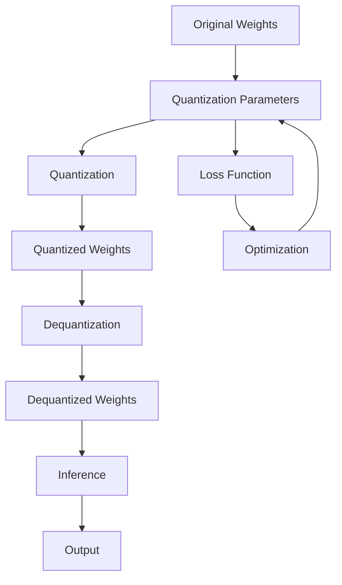

# Lesson 1: AWQ Overview and Mechanisms

## 1. First-Principles Intuition & Invariants

In the realm of artificial intelligence and machine learning, the deployment of large-scale neural networks often faces a critical challenge: the trade-off between model accuracy and computational efficiency. As models grow in size and complexity, the demand for computational resources—such as memory bandwidth, processing power, and energy consumption—escalates exponentially. This dichotomy is particularly pronounced in the context of deploying models on edge devices, where resource constraints are stringent. To address this challenge, researchers have developed various quantization techniques that aim to reduce the precision of neural network weights while minimizing the impact on model accuracy. Among these techniques, Adaptive Weight Quantization (AWQ) stands out for its ability to dynamically adjust the quantization parameters based on the distribution of weights, thereby achieving a more efficient and accurate representation.

At its core, AWQ is grounded in the principle of quantization, which involves mapping the continuous range of real-valued weights to a discrete set of values. This process is inherently lossy, as it introduces quantization error. However, the goal of AWQ is to minimize this error by adapting the quantization parameters to the specific characteristics of the weight distribution. The key insight behind AWQ is that different parts of a neural network may have distinct weight distributions, and a one-size-fits-all quantization scheme may not be optimal. By allowing the quantization parameters to vary adaptively, AWQ can achieve a more nuanced and accurate representation of the weights, leading to improved model performance.

To understand the invariants and theoretical foundations of AWQ, it is essential to delve into the mathematical and system-level principles that govern its operation. At the heart of AWQ is the concept of per-channel quantization, where the quantization parameters (such as the scale and zero-point) are determined independently for each channel of the weight matrix. This approach is motivated by the observation that the weights within a single channel tend to have a similar distribution, and thus, a channel-specific quantization scheme can be more effective than a global one. The per-channel quantization parameters are typically learned through an optimization process that minimizes the quantization error while maintaining the model's accuracy.

Another critical invariant in AWQ is the use of a fixed-point representation for the quantized weights. Fixed-point arithmetic is chosen over floating-point arithmetic due to its lower computational and memory overhead, which is crucial for deploying models on resource-constrained devices. The fixed-point representation involves scaling the weights by a factor of \(2^b\), where \(b\) is the number of bits used for quantization, and then rounding to the nearest integer. The scale factor is determined by the quantization parameters, which are adapted to the weight distribution as described earlier.

The process of adapting the quantization parameters in AWQ is guided by a loss function that balances the trade-off between quantization error and model accuracy. This loss function is typically a combination of the mean squared error (MSE) between the original and quantized weights and a regularization term that encourages the quantization parameters to be smooth and consistent across channels. The optimization process is performed using gradient descent or other optimization algorithms, which iteratively adjust the quantization parameters to minimize the loss function.

In summary, the first-principles intuition behind AWQ is to adaptively quantize the weights of a neural network by determining the quantization parameters independently for each channel. This approach leverages the per-channel weight distribution to achieve a more accurate and efficient representation, thereby minimizing the quantization error while maintaining the model's accuracy. The theoretical invariants of AWQ include the use of per-channel quantization, fixed-point representation, and a loss function that balances quantization error and model accuracy.

## 2. Core Architecture & Mechanics

To gain a deeper understanding of the core architecture and mechanics of AWQ, it is essential to dissect the internal data structures, algorithms, and execution models that underpin its operation. At a high level, the AWQ process can be divided into two main stages: the quantization stage and the inference stage. The quantization stage involves determining the quantization parameters for each channel of the weight matrix, while the inference stage involves using these parameters to quantize the weights and perform inference with the quantized model.

### Quantization Stage

The quantization stage begins with the initialization of the quantization parameters. These parameters are typically initialized to default values, such as a scale factor of 1 and a zero-point of 0. The quantization parameters are then optimized using a loss function that balances the trade-off between quantization error and model accuracy. The optimization process involves iteratively adjusting the quantization parameters to minimize the loss function, which is typically a combination of the mean squared error (MSE) between the original and quantized weights and a regularization term that encourages the quantization parameters to be smooth and consistent across channels.

The optimization process is performed using gradient descent or other optimization algorithms. During each iteration, the quantization parameters are updated based on the gradient of the loss function with respect to the parameters. The gradient is computed using backpropagation, which involves propagating the error from the output layer back through the network to the input layer. The backpropagation process is similar to that used in standard neural network training, with the key difference being that the quantization parameters are updated instead of the weights.

Once the quantization parameters have been optimized, the weights are quantized using the fixed-point representation. The fixed-point representation involves scaling the weights by a factor of \(2^b\), where \(b\) is the number of bits used for quantization, and then rounding to the nearest integer. The scale factor is determined by the quantization parameters, which are adapted to the weight distribution as described earlier. The quantized weights are then stored in a compact format, such as a binary file or a tensor, which can be used for inference.

### Inference Stage

The inference stage involves using the quantized weights to perform inference with the quantized model. During inference, the quantized weights are first dequantized to their original floating-point representation. The dequantization process involves scaling the quantized weights by the inverse of the scale factor and adding the zero-point. The dequantized weights are then used to perform inference with the model, which involves propagating the input data through the network to produce the output.

The inference stage is typically optimized for performance and resource efficiency. To achieve this, various techniques can be employed, such as vectorization, parallelization, and hardware acceleration. Vectorization involves using SIMD (Single Instruction, Multiple Data) instructions to perform operations on multiple data elements simultaneously. Parallelization involves using multiple processing units, such as CPU cores or GPU threads, to perform operations in parallel. Hardware acceleration involves using specialized hardware, such as FPGAs or TPUs, to perform operations more efficiently.

To illustrate the core architecture and mechanics of AWQ, we can use a Mermaid diagram to visualize the quantization and inference stages. The diagram below shows the flow of data and parameters through the AWQ process:

In this diagram, the original weights are first passed to the quantization parameters, which are then used to quantize the weights. The quantized weights are then stored and used for inference. During inference, the quantized weights are dequantized to their original floating-point representation, and the dequantized weights are used to perform inference with the model. The quantization parameters are optimized using a loss function that balances the trade-off between quantization error and model accuracy.

## 3. High-Performance Optimization & Failure Modes

To achieve high performance and resource efficiency, the AWQ process must be optimized for various factors, such as computational complexity, memory usage, and energy consumption. These optimizations are critical for deploying models on resource-constrained devices, where resource constraints are stringent. In this section, we will explore some of the key optimizations and failure modes in the AWQ process.

### Concurrency and Resource Scaling

One of the key optimizations in the AWQ process is the use of concurrency and resource scaling. Concurrency involves using multiple processing units, such as CPU cores or GPU threads, to perform operations in parallel. Resource scaling involves using specialized hardware, such as FPGAs or TPUs, to perform operations more efficiently. These optimizations can significantly reduce the computational complexity and memory usage of the AWQ process, leading to improved performance and resource efficiency.

To achieve concurrency and resource scaling, the AWQ process can be parallelized at various levels. For example, the quantization and dequantization stages can be parallelized by using multiple processing units to perform operations on different channels of the weight matrix. Similarly, the inference stage can be parallelized by using multiple processing units to perform operations on different parts of the input data. These parallelizations can be achieved using various techniques, such as vectorization, parallelization, and hardware acceleration.

### Boundary Edge Cases and Failure Mitigations

Despite the optimizations and improvements in the AWQ process, there are still boundary edge cases and failure modes that must be addressed. One of the key boundary edge cases is the presence of outliers in the weight distribution. Outliers can significantly affect the quantization parameters and lead to suboptimal quantization. To mitigate this issue, various techniques can be employed, such as clipping the weights to a certain range or using robust statistics to determine the quantization parameters.

Another key failure mode in the AWQ process is the presence of quantization error. Quantization error can lead to a loss of accuracy and degrade the performance of the model. To mitigate this issue, various techniques can be employed, such as using higher precision for critical parts of the model or using error correction codes to detect and correct quantization errors.

In addition to these boundary edge cases and failure modes, the AWQ process must also be robust to various types of noise and perturbations. For example, the quantization parameters can be affected by noise in the weight distribution, and the quantized weights can be affected by noise in the input data. To mitigate these issues, various techniques can be employed, such as using noise reduction techniques or using robust optimization algorithms.

In summary, the AWQ process can be optimized for high performance and resource efficiency through the use of concurrency and resource scaling. These optimizations can significantly reduce the computational complexity and memory usage of the AWQ process, leading to improved performance and resource efficiency. However, the AWQ process must also be robust to boundary edge cases and failure modes, such as the presence of outliers and quantization error. To address these issues, various techniques can be employed, such as clipping the weights, using robust statistics, and using error correction codes.
