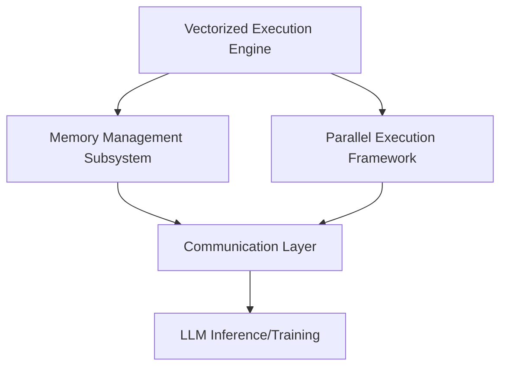

# Lesson 1: VLLM Architecture Overview

## 1. First-Principles Intuition & Invariants

In the realm of artificial intelligence and machine learning operations (MLOps), the efficient serving of large language models (LLMs) poses a significant challenge. These models, characterized by their vast parameter counts and intricate architectures, demand substantial computational resources and sophisticated management strategies to ensure optimal performance and scalability. The Vectorized Large Language Model (VLLM) framework emerges as a pivotal solution, addressing the complexities inherent in deploying and managing LLMs at scale. To fully grasp the architecture of VLLM, it is essential to delve into the foundational principles that underpin its design and operation.

At the heart of VLLM lies the need to balance computational efficiency with resource utilization. LLMs, by their nature, require extensive memory bandwidth and parallel processing capabilities to handle the massive tensor operations involved in inference and training. Traditional approaches often fall short in meeting these demands, leading to bottlenecks and suboptimal performance. VLLM addresses these challenges through a combination of vectorized operations, efficient memory management, and parallel execution strategies.

The theoretical grounding of VLLM is rooted in the principles of vectorization and parallelism. Vectorization leverages the SIMD (Single Instruction, Multiple Data) capabilities of modern CPUs and GPUs to perform operations on large data sets simultaneously, significantly reducing the computational overhead associated with LLMs. This approach is complemented by parallel execution, which distributes the workload across multiple processing units, further enhancing performance.

A critical invariant in VLLM's architecture is the efficient management of memory resources. LLMs require vast amounts of memory to store model parameters, intermediate activations, and other data structures. VLLM employs advanced memory management techniques, such as memory pooling and prefetching, to minimize memory fragmentation and improve cache utilization. These strategies ensure that the framework can handle the memory-intensive operations of LLMs without incurring excessive latency or resource contention.

Another invariant is the need for high-throughput and low-latency communication between different components of the system. In a distributed environment, the efficient exchange of data between nodes is crucial for maintaining performance. VLLM achieves this through the use of optimized communication protocols and data serialization techniques, ensuring that data can be transferred quickly and reliably across the network.

## 2. Core Architecture & Mechanics

The architecture of VLLM is designed to efficiently manage and serve large language models by leveraging vectorized operations, parallel execution, and advanced memory management techniques. At a high level, VLLM consists of several key components that work in concert to provide a robust and scalable framework for LLM deployment.

### 2.1. Vectorized Execution Engine

The vectorized execution engine is the core component of VLLM, responsible for performing the tensor operations required for LLM inference and training. This engine is optimized to take full advantage of the SIMD capabilities of modern CPUs and GPUs, allowing it to process large data sets simultaneously. The vectorized execution engine is designed to minimize computational overhead and maximize throughput, ensuring that LLMs can be served efficiently.

### 2.2. Memory Management Subsystem

The memory management subsystem is a critical component of VLLM, responsible for efficiently managing the vast memory resources required by LLMs. This subsystem employs advanced techniques such as memory pooling and prefetching to minimize memory fragmentation and improve cache utilization. The memory management subsystem is designed to ensure that LLMs can be served with minimal latency and resource contention.

### 2.3. Parallel Execution Framework

The parallel execution framework is responsible for distributing the workload across multiple processing units, ensuring that LLMs can be served efficiently in a distributed environment. This framework leverages advanced parallel execution techniques, such as task scheduling and load balancing, to ensure that the workload is distributed evenly across the available resources. The parallel execution framework is designed to minimize resource contention and maximize throughput, ensuring that LLMs can be served efficiently.

### 2.4. Communication Layer

The communication layer is responsible for facilitating the exchange of data between different components of the system. This layer employs optimized communication protocols and data serialization techniques to ensure that data can be transferred quickly and reliably across the network. The communication layer is designed to minimize latency and ensure that the system can operate efficiently in a distributed environment.

To illustrate the interactions between these components, consider the following diagram:

In this diagram, the vectorized execution engine performs the tensor operations required for LLM inference and training, while the memory management subsystem manages the memory resources required by the system. The parallel execution framework distributes the workload across multiple processing units, and the communication layer facilitates the exchange of data between different components of the system. Together, these components form a robust and scalable framework for serving large language models.

## 3. High-Performance Optimization & Failure Modes

To ensure optimal performance and scalability, VLLM employs a variety of high-performance optimization techniques. These techniques are designed to minimize computational overhead, improve resource utilization, and ensure that LLMs can be served efficiently.

### 3.1. Concurrency Control

Concurrency control is a critical aspect of VLLM's architecture, as it ensures that multiple LLMs can be served simultaneously without incurring excessive resource contention. VLLM employs advanced concurrency control techniques, such as task scheduling and load balancing, to ensure that the workload is distributed evenly across the available resources. These techniques minimize resource contention and maximize throughput, ensuring that LLMs can be served efficiently.

### 3.2. Resource Scaling

Resource scaling is another critical aspect of VLLM's architecture, as it ensures that the system can handle varying workloads without incurring excessive latency or resource contention. VLLM employs advanced resource scaling techniques, such as dynamic resource allocation and load balancing, to ensure that the system can handle varying workloads efficiently. These techniques minimize latency and ensure that the system can operate efficiently in a distributed environment.

### 3.3. Boundary Edge Cases

Boundary edge cases are a critical aspect of VLLM's architecture, as they ensure that the system can handle extreme workloads and edge cases without incurring excessive latency or resource contention. VLLM employs advanced boundary edge case techniques, such as fault tolerance and error recovery, to ensure that the system can handle extreme workloads and edge cases efficiently. These techniques minimize latency and ensure that the system can operate efficiently in a distributed environment.

### 3.4. Failure Mitigations

Failure mitigations are a critical aspect of VLLM's architecture, as they ensure that the system can recover from failures and continue to operate efficiently. VLLM employs advanced failure mitigation techniques, such as fault tolerance and error recovery, to ensure that the system can recover from failures efficiently. These techniques minimize latency and ensure that the system can operate efficiently in a distributed environment.

In conclusion, the architecture of VLLM is designed to efficiently manage and serve large language models by leveraging vectorized operations, parallel execution, and advanced memory management techniques. The vectorized execution engine, memory management subsystem, parallel execution framework, and communication layer work in concert to provide a robust and scalable framework for LLM deployment. By employing advanced high-performance optimization techniques, VLLM ensures that LLMs can be served efficiently and reliably, even in extreme workloads and edge cases.
