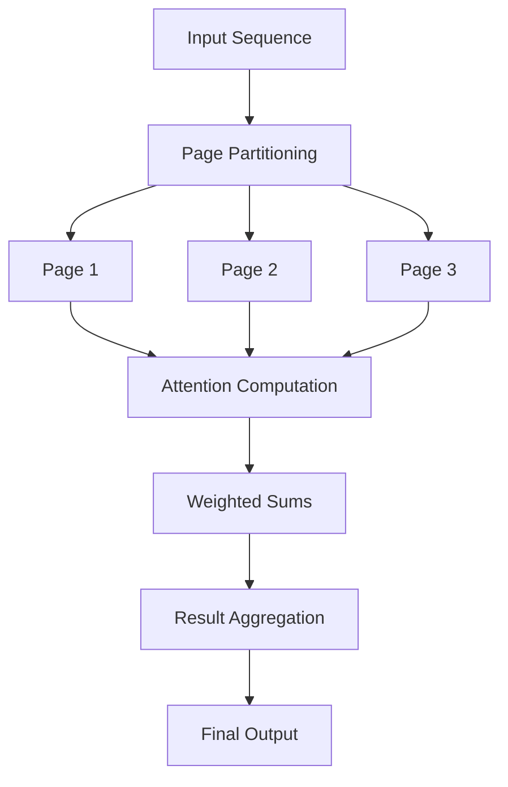

# Lesson 2: Paged Attention Mechanism

## 1. First-Principles Intuition & Invariants

In the realm of large-scale artificial intelligence and machine learning (AI/ML) systems, the attention mechanism has emerged as a cornerstone of transformer architectures, enabling models to weigh the importance of different parts of the input data when making predictions. However, as these models grow in size and complexity, the computational and memory demands of the attention mechanism become increasingly prohibitive. The paged attention mechanism addresses these challenges by introducing a novel approach to memory management and computational efficiency, grounded in the principles of paging from operating systems.

To understand the paged attention mechanism, we must first delve into the traditional attention mechanism and its inherent limitations. The standard attention mechanism computes a weighted sum of the input values, where the weights are determined by the relevance of each input to the current position. This process involves a series of matrix multiplications and softmax operations, which can be computationally expensive, especially for large sequences. The memory footprint is also significant, as the attention scores and intermediate results must be stored in memory.

The paged attention mechanism mitigates these issues by dividing the input sequence into smaller, manageable pages. Each page is processed independently, reducing the memory requirements and computational overhead. This approach is analogous to the paging mechanism used in operating systems, where large virtual memory spaces are divided into smaller pages that can be loaded into physical memory as needed. By leveraging this principle, the paged attention mechanism can handle much larger input sequences without overwhelming the system's resources.

The theoretical foundation of the paged attention mechanism is rooted in the principles of locality and cache efficiency. By processing smaller pages of data, the mechanism can take advantage of the CPU cache, reducing the number of memory accesses and improving performance. Additionally, the paged approach allows for parallel processing of different pages, further enhancing computational efficiency. The invariants of the paged attention mechanism include the preservation of the attention mechanism's ability to capture long-range dependencies while minimizing memory usage and computational overhead.

## 2. Core Architecture & Mechanics

The core architecture of the paged attention mechanism involves several key components: the page partitioning module, the attention computation module, and the result aggregation module. These components work in concert to process the input sequence efficiently.

### Page Partitioning Module

The page partitioning module is responsible for dividing the input sequence into smaller pages. This process involves determining the optimal page size based on the available memory and computational resources. The page size is a critical parameter that affects the trade-off between memory usage and computational efficiency. A larger page size reduces the overhead of page management but increases memory usage, while a smaller page size improves memory efficiency but increases the computational overhead.

Once the page size is determined, the input sequence is divided into contiguous pages. Each page is assigned a unique identifier, which is used to manage and process the page throughout the attention mechanism. The page partitioning module also handles the padding of the input sequence to ensure that each page is of equal size. This padding is necessary to maintain the alignment of the data and simplify the attention computation.

### Attention Computation Module

The attention computation module is responsible for computing the attention scores and weighted sums for each page. This process involves several steps, including the computation of the query, key, and value matrices, the attention scores, and the weighted sums.

The query, key, and value matrices are computed using linear transformations of the input data. These transformations are parameterized by learnable weights, which are optimized during the training process. The attention scores are computed using the dot product of the query and key matrices, followed by a softmax operation to normalize the scores. The weighted sums are computed by multiplying the attention scores with the value matrices and summing the results.

In the paged attention mechanism, the attention computation is performed independently for each page. This allows for parallel processing of different pages, further enhancing computational efficiency. The attention computation module also handles the caching of intermediate results, such as the attention scores and weighted sums, to reduce the number of computations and improve performance.

### Result Aggregation Module

The result aggregation module is responsible for aggregating the results from different pages to produce the final output. This process involves several steps, including the concatenation of the weighted sums from different pages and the computation of the final output.

The concatenation of the weighted sums from different pages is performed using a simple concatenation operation. This operation combines the weighted sums from different pages into a single matrix, which is used as the input to the final output computation. The final output is computed using a linear transformation of the concatenated matrix, followed by a non-linear activation function, such as ReLU or softmax.

In the paged attention mechanism, the result aggregation module also handles the handling of boundary pages, which are pages that overlap with the previous or next page. These boundary pages require special handling to ensure that the attention scores and weighted sums are computed correctly. The result aggregation module handles this by using a sliding window approach, where the attention scores and weighted sums are computed for overlapping regions between pages.

### Diagrammatic Representation

To illustrate the core architecture and mechanics of the paged attention mechanism, we can use a Mermaid diagram to visualize the flow of data through the mechanism.

In this diagram, the input sequence is divided into three pages by the page partitioning module. Each page is then processed independently by the attention computation module, which computes the attention scores and weighted sums. The weighted sums from different pages are then concatenated and aggregated by the result aggregation module to produce the final output.

## 3. High-Performance Optimization & Failure Modes

The paged attention mechanism offers several high-performance optimizations that enhance its computational efficiency and memory usage. These optimizations include parallel processing, caching, and memory alignment.

### Parallel Processing

One of the key optimizations of the paged attention mechanism is the ability to process different pages in parallel. This allows for significant speedup in the attention computation, as multiple pages can be processed simultaneously. The parallel processing is achieved through the use of multi-threading or GPU acceleration, depending on the available hardware resources.

To ensure efficient parallel processing, the paged attention mechanism uses a workload distribution strategy that assigns pages to different threads or GPUs based on their computational load. This strategy ensures that the workload is evenly distributed across the available resources, minimizing idle time and maximizing throughput.

### Caching

Another key optimization of the paged attention mechanism is the use of caching to reduce the number of computations. The caching is achieved through the storage of intermediate results, such as the attention scores and weighted sums, in a cache. The cache is accessed during the attention computation to retrieve the intermediate results, reducing the number of computations and improving performance.

To ensure efficient caching, the paged attention mechanism uses a cache replacement strategy that evicts the least recently used intermediate results from the cache. This strategy ensures that the cache remains efficient, even when the input sequence is large and the number of intermediate results is high.

### Memory Alignment

The paged attention mechanism also uses memory alignment to improve memory access efficiency. Memory alignment involves aligning the data in memory to specific boundaries, such as cache line boundaries, to reduce the number of memory accesses. The memory alignment is achieved through the use of padding, where the input sequence is padded to ensure that each page is of equal size and aligned to the cache line boundary.

To ensure efficient memory alignment, the paged attention mechanism uses a padding strategy that pads the input sequence to the nearest multiple of the cache line size. This strategy ensures that the data is aligned to the cache line boundary, reducing the number of memory accesses and improving performance.

### Failure Modes

Despite its many optimizations, the paged attention mechanism is not immune to failure modes. Some of the common failure modes include memory fragmentation, cache thrashing, and workload imbalance.

Memory fragmentation occurs when the input sequence is divided into pages of different sizes, leading to inefficient use of memory. To mitigate memory fragmentation, the paged attention mechanism uses a page size that is a multiple of the cache line size, ensuring that each page is of equal size and aligned to the cache line boundary.

Cache thrashing occurs when the cache is frequently evicted and replaced with new intermediate results, leading to inefficient use of the cache. To mitigate cache thrashing, the paged attention mechanism uses a cache replacement strategy that evicts the least recently used intermediate results from the cache, ensuring that the cache remains efficient.

Workload imbalance occurs when the workload is unevenly distributed across the available resources, leading to idle time and reduced throughput. To mitigate workload imbalance, the paged attention mechanism uses a workload distribution strategy that assigns pages to different threads or GPUs based on their computational load, ensuring that the workload is evenly distributed across the available resources.

In conclusion, the paged attention mechanism offers a novel approach to memory management and computational efficiency in large-scale models. By dividing the input sequence into smaller pages and processing each page independently, the paged attention mechanism can handle much larger input sequences without overwhelming the system's resources. The core architecture and mechanics of the paged attention mechanism involve the page partitioning module, the attention computation module, and the result aggregation module, which work in concert to process the input sequence efficiently. The high-performance optimizations of the paged attention mechanism include parallel processing, caching, and memory alignment, which enhance its computational efficiency and memory usage. Despite its many optimizations, the paged attention mechanism is not immune to failure modes, which must be mitigated to ensure efficient and reliable performance.
