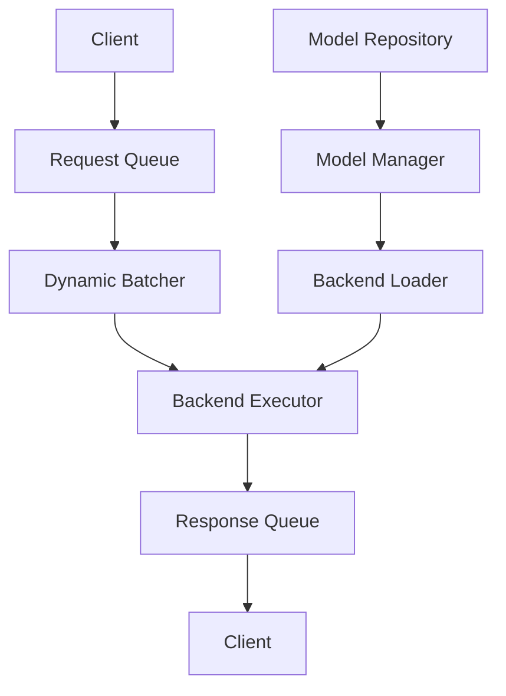

# Lesson 1: Triton Inference Server Overview

## 1. First-Principles Intuition & Invariants

In the realm of artificial intelligence and machine learning (ML), the deployment and serving of models are critical components that bridge the gap between research and production. The challenge lies in efficiently managing the lifecycle of ML models, ensuring they are scalable, performant, and reliable. Triton Inference Server, developed by NVIDIA, emerges as a robust solution to this problem. It provides a high-performance, scalable, and flexible inference serving platform that supports a wide range of ML frameworks and model formats.

At its core, Triton Inference Server addresses the need for a unified and efficient mechanism to deploy and manage ML models across diverse hardware architectures, including CPUs, GPUs, and TPUs. The server is designed to handle the complexities of model serving, such as dynamic batching, model versioning, and concurrency control, allowing developers to focus on building and optimizing their models rather than the intricacies of deployment.

The theoretical grounding of Triton Inference Server is rooted in the principles of distributed systems and high-performance computing. It leverages the capabilities of modern hardware accelerators to achieve low-latency and high-throughput inference, while also providing mechanisms to ensure scalability and reliability. The server is built on a modular architecture that allows it to support a variety of ML frameworks, including TensorFlow, PyTorch, ONNX, and TensorRT, among others. This modularity ensures that Triton can adapt to the evolving landscape of ML frameworks and model formats.

One of the key invariants of Triton Inference Server is its ability to handle dynamic batching. This feature allows the server to group multiple inference requests into a single batch, reducing the overhead of request processing and improving throughput. The server employs sophisticated algorithms to determine the optimal batch size and composition, taking into account factors such as model latency, resource utilization, and request arrival patterns. By minimizing the number of inference operations, Triton can significantly reduce the latency of model serving, making it suitable for real-time applications.

Another critical invariant is the support for model versioning and management. In the ML lifecycle, models are frequently updated and retrained to improve accuracy and performance. Triton provides a robust mechanism for managing model versions, allowing developers to deploy new models without disrupting existing services. The server supports automatic version selection based on request metadata, ensuring that the most appropriate model version is used for each inference request. This feature is essential for maintaining the reliability and consistency of model serving, even as models evolve over time.

## 2. Core Architecture & Mechanics

The architecture of Triton Inference Server is designed to provide a high-performance and scalable inference serving platform. At a high level, the server consists of several key components that work together to handle inference requests efficiently. These components include the Model Repository, the Model Manager, the Backend Loader, and the Inference Pipeline.

The Model Repository is a centralized location where all models are stored. It supports a hierarchical directory structure that allows models to be organized by name and version. The Model Manager is responsible for loading and managing models from the repository. It maintains a cache of loaded models and handles requests for model version selection and lifecycle management. The Backend Loader is responsible for loading and managing the inference backends that support different ML frameworks. It provides a unified interface for interacting with backends, allowing the server to support a wide range of model formats.

The Inference Pipeline is the core component of Triton Inference Server that handles inference requests. It consists of several stages that work together to process requests efficiently. The first stage is the Request Queue, which buffers incoming requests and manages request prioritization. The second stage is the Dynamic Batcher, which groups multiple requests into a single batch to reduce the overhead of request processing. The third stage is the Backend Executor, which invokes the appropriate inference backend to perform the inference operation. The final stage is the Response Queue, which buffers the inference results and manages response delivery.

To illustrate the architecture of Triton Inference Server, we can use a Mermaid diagram:

In this diagram, the client sends inference requests to the Request Queue, which buffers the requests and manages prioritization. The Dynamic Batcher groups multiple requests into a single batch and sends the batch to the Backend Executor. The Backend Executor invokes the appropriate inference backend to perform the inference operation and sends the results to the Response Queue, which buffers the results and manages response delivery. The Model Repository stores all models, and the Model Manager and Backend Loader work together to load and manage models and backends, respectively.

## 3. High-Performance Optimization & Failure Modes

Triton Inference Server is designed to provide high-performance and scalable inference serving. To achieve this, the server employs several optimization techniques that improve the efficiency of request processing and resource utilization. One of the key optimizations is dynamic batching, which groups multiple requests into a single batch to reduce the overhead of request processing. The server employs sophisticated algorithms to determine the optimal batch size and composition, taking into account factors such as model latency, resource utilization, and request arrival patterns.

Another optimization is the use of model caching. The Model Manager maintains a cache of loaded models, allowing the server to quickly respond to inference requests without the need to reload models from the repository. This optimization significantly reduces the latency of model serving, especially for models that are frequently accessed.

Triton Inference Server also supports concurrency control to improve the scalability of model serving. The server uses a multi-threaded architecture that allows it to handle multiple inference requests simultaneously. The Request Queue and Response Queue are designed to manage request and response buffering efficiently, allowing the server to handle a large number of concurrent requests without introducing significant latency.

Despite its robust architecture and optimization techniques, Triton Inference Server is not immune to failure modes. One potential failure mode is resource contention, which can occur when multiple inference requests compete for limited resources such as GPU memory. To mitigate this issue, the server employs resource management techniques such as dynamic batching and model caching, which help to reduce the overhead of request processing and improve resource utilization.

Another potential failure mode is model versioning conflicts, which can occur when multiple model versions are deployed simultaneously. To mitigate this issue, the server supports automatic version selection based on request metadata, ensuring that the most appropriate model version is used for each inference request. This feature helps to maintain the reliability and consistency of model serving, even as models evolve over time.

In conclusion, Triton Inference Server is a powerful and flexible inference serving platform that provides high-performance and scalable model serving. Its architecture is designed to handle the complexities of model serving, including dynamic batching, model versioning, and concurrency control. By leveraging the capabilities of modern hardware accelerators, Triton can achieve low-latency and high-throughput inference, making it suitable for real-time applications. Through its robust optimization techniques and failure mitigations, Triton Inference Server provides a reliable and efficient solution for deploying and managing ML models in production.
