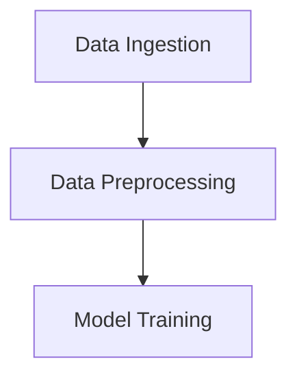

# Lesson 1: Pipeline Orchestration Overview

## 1. First-Principles Intuition & Invariants

Pipeline orchestration is a foundational concept in the realm of AI/MLops and serving, serving as the backbone for automating and managing the complex workflows that underpin modern machine learning and data processing systems. At its core, pipeline orchestration involves the systematic arrangement and execution of tasks, each representing a distinct phase in the data lifecycle, from data ingestion and preprocessing to model training, evaluation, and deployment. The importance of pipeline orchestration cannot be overstated, as it enables organizations to achieve repeatability, scalability, and reliability in their data and AI workflows.

To fully appreciate the significance of pipeline orchestration, we must delve into the theoretical underpinnings and the problem space it addresses. In the context of AI/MLops, data pipelines are inherently complex, involving multiple stages that must be executed in a specific order. These stages often depend on the successful completion of previous stages, creating a web of dependencies that must be meticulously managed. The challenge lies in ensuring that these dependencies are respected while maximizing efficiency and minimizing resource consumption.

From a first-principles perspective, pipeline orchestration can be viewed as a declarative state machine that continuously reconciles the desired state of the pipeline with its actual state. This reconciliation process is driven by a continuous level-triggered mechanism that monitors the status of each task and triggers the execution of subsequent tasks once their dependencies are satisfied. The key invariant in this system is the consistency of the pipeline state, ensuring that tasks are executed in the correct order and that any deviations from the desired state are promptly addressed.

The mathematical and system invariants that govern pipeline orchestration are rooted in the principles of scheduling theory and dependency resolution. Scheduling algorithms play a crucial role in determining the order in which tasks are executed, taking into account factors such as resource availability, task priority, and dependencies. Dependency resolution, on the other hand, involves identifying and managing the relationships between tasks, ensuring that each task is executed only after its dependencies have been satisfied. These principles form the bedrock of pipeline orchestration, providing a robust framework for managing complex workflows.

## 2. Core Architecture & Mechanics

To gain a deeper understanding of pipeline orchestration, we must dissect the internal data structures, algorithms, and execution models that underpin these systems. At the heart of pipeline orchestration is the concept of a directed acyclic graph (DAG), which represents the tasks and their dependencies in a visual and hierarchical manner. In a DAG, each node represents a task, and each edge represents a dependency between tasks. The absence of cycles in the graph ensures that tasks are executed in a well-defined order, with no circular dependencies that could lead to deadlock or infinite loops.

Let us illustrate this concept with a simple example. Consider a data pipeline that involves three stages: data ingestion, data preprocessing, and model training. In a DAG representation, the data ingestion task would be represented as a node, with an edge pointing to the data preprocessing task, indicating that the preprocessing task depends on the successful completion of the ingestion task. Similarly, the data preprocessing task would have an edge pointing to the model training task, indicating that the training task depends on the successful completion of the preprocessing task.

In this example, the DAG clearly illustrates the dependencies between tasks, providing a visual representation of the pipeline's execution order. The orchestration system would monitor the status of each task, triggering the execution of subsequent tasks once their dependencies are satisfied.

The execution of tasks in a pipeline is governed by a scheduling algorithm that determines the order in which tasks are executed. One common scheduling algorithm used in pipeline orchestration is the topological sort, which orders tasks based on their dependencies. In a topological sort, tasks with no dependencies are executed first, followed by tasks with satisfied dependencies, and so on. This ensures that tasks are executed in the correct order, with no violations of dependencies.

Another important aspect of pipeline orchestration is the management of task state. Each task in the pipeline can be in one of several states, including pending, running, completed, or failed. The orchestration system must continuously monitor the state of each task, triggering the execution of subsequent tasks once their dependencies are satisfied and handling any failures that occur during task execution. This state management is critical for ensuring the consistency and reliability of the pipeline.

## 3. High-Performance Optimization & Failure Modes

To achieve high performance and reliability in pipeline orchestration, it is essential to optimize the scheduling and execution of tasks, as well as to handle failure modes gracefully. One key optimization technique is parallelism, which involves executing multiple tasks concurrently to maximize resource utilization and reduce execution time. Parallelism can be achieved through various mechanisms, including multi-threading, multi-processing, and distributed computing.

In a parallel execution model, tasks are divided into smaller sub-tasks that can be executed concurrently. The orchestration system must manage the execution of these sub-tasks, ensuring that they are executed in the correct order and that dependencies are respected. One common technique for managing parallel execution is the use of task queues, which allow tasks to be distributed across multiple workers for concurrent execution. Task queues can be implemented using various technologies, including message brokers such as RabbitMQ, Apache Kafka, and Redis.

Another important aspect of high-performance optimization is resource scaling. As the complexity of data pipelines grows, it becomes increasingly important to scale resources to meet the demands of the pipeline. This can be achieved through various mechanisms, including horizontal scaling, which involves adding more workers to the pipeline, and vertical scaling, which involves increasing the resources available to existing workers. The orchestration system must be able to dynamically scale resources based on the workload, ensuring that the pipeline can handle varying levels of demand.

In addition to optimization, it is also essential to handle failure modes gracefully to ensure the reliability of the pipeline. Failure modes can occur at various stages of the pipeline, including task execution, resource allocation, and dependency resolution. To handle failures, the orchestration system must be able to detect and recover from errors, ensuring that the pipeline can continue to execute tasks even in the presence of failures.

One common technique for handling failures is the use of retries, which involves re-executing failed tasks a specified number of times before giving up. Retries can be implemented using various mechanisms, including exponential backoff, which involves increasing the delay between retries to avoid overwhelming the system with repeated failures. Another technique for handling failures is the use of error handling policies, which define the actions to be taken in the event of a failure. Error handling policies can be implemented using various mechanisms, including conditional logic, exception handling, and logging.

In conclusion, pipeline orchestration is a critical component of AI/MLops and serving, providing a robust framework for managing complex workflows in data and AI systems. By understanding the theoretical underpinnings, core architecture, and high-performance optimization techniques of pipeline orchestration, senior software engineers, systems programmers, and domain architects can build reliable and efficient data pipelines that meet the demands of modern organizations.
