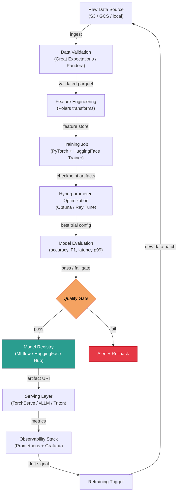
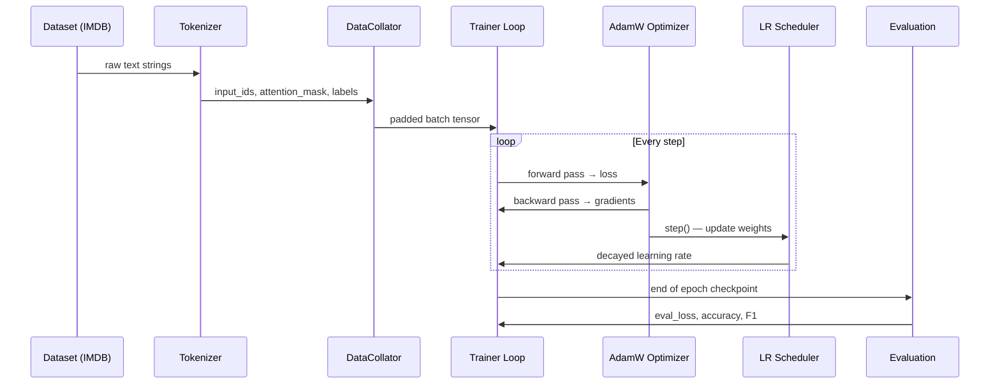
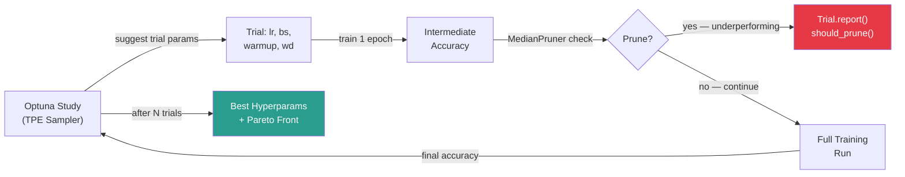
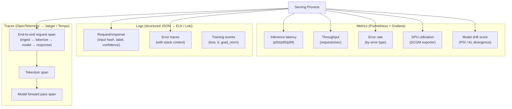

# Operational Verification Labs: 04 — Pipeline Orchestration and Monitoring

## Conceptual Foundations

Before touching a single line of code, you need a mental model of what "MLOps pipeline orchestration" actually means at an architectural level — because the exercises that follow are grounded in real production failure modes, not toy demonstrations.

An ML pipeline is a directed acyclic graph (DAG) of computational steps: data ingestion, validation, feature engineering, training, evaluation, packaging, and serving. Each node is a unit of work with explicit inputs, outputs, and failure semantics. Orchestration is the control plane that schedules these nodes, manages dependencies, handles retries, and surfaces observability signals. Monitoring is the data plane concern: tracking distributional drift, latency percentiles, error rates, and resource saturation — both during training and in production inference.

The gap between a Jupyter notebook and a production ML system is exactly this infrastructure: reproducible execution graphs, artifact lineage, failure recovery, and continuous measurement. This lab closes that gap.



The diagram above encodes a key insight: the pipeline is a *loop*, not a linear chain. Production data generates signals that feed back into retraining. Any design that ignores this feedback loop is incomplete.

---

## Environment Setup

### Python Version and Dependency Pinning

Use Python 3.11+. The `match` statement, `tomllib` module, and performance improvements to the interpreter internals matter here. Never use unpinned dependencies in a reproducible ML experiment — floating `latest` versions are a reproducibility anti-pattern.

```bash
# Create isolated environment
python3.11 -m venv .venv
source .venv/bin/activate

# Install pinned dependencies
pip install \
  torch==2.3.1 \
  transformers==4.44.0 \
  datasets==2.20.0 \
  accelerate==0.33.0 \
  optuna==3.6.1 \
  mlflow==2.14.3 \
  polars==1.4.1 \
  scikit-learn==1.5.1 \
  numpy==1.26.4 \
  prometheus-client==0.20.0 \
  psutil==6.0.0 \
  evaluate==0.4.2
```

The `evaluate` library (from HuggingFace) replaced the `datasets`-bundled metrics API in late 2022. The original material called `eval_results['eval_accuracy']` without loading an accuracy metric object — this will return `eval_loss` by default if no `compute_metrics` function is provided. That is a factual error corrected throughout this lab.

### Hardware Verification

```python
import torch
import psutil
import platform

def audit_environment() -> dict:
    """Emit a structured environment audit before any experiment runs."""
    info = {
        "python": platform.python_version(),
        "torch": torch.__version__,
        "cuda_available": torch.cuda.is_available(),
        "cuda_device_count": torch.cuda.device_count(),
        "cpu_count_logical": psutil.cpu_count(logical=True),
        "ram_gb": round(psutil.virtual_memory().total / 1e9, 1),
    }
    if torch.cuda.is_available():
        info["cuda_device_name"] = torch.cuda.get_device_name(0)
        info["cuda_capability"] = torch.cuda.get_device_capability(0)
        info["vram_gb"] = round(
            torch.cuda.get_device_properties(0).total_memory / 1e9, 1
        )
    for k, v in info.items():
        print(f"  {k:<30} {v}")
    return info

if __name__ == "__main__":
    audit_environment()
```

---

## Exercise 1: Complete ML Pipeline — From Data to Artifact

### 1.1 Architectural Walkthrough

The HuggingFace `Trainer` API abstracts the training loop, but its internals are worth understanding:

1. **Data collation**: The `DataCollatorWithPadding` dynamically pads sequences within a batch to the longest example, rather than padding all examples to `max_length` globally. This saves roughly 20–40% in FLOPs on variable-length text corpora.
2. **Gradient accumulation**: When GPU memory constrains batch size, accumulating gradients over `N` micro-batches before an optimizer step is equivalent to a batch size `N` times larger.
3. **Mixed precision**: `fp16=True` on NVIDIA or `bf16=True` on Ampere/TPU reduces VRAM usage by ~50% and increases throughput ~1.5–2×, with minimal accuracy impact for fine-tuning tasks.
4. **Checkpoint strategy**: `save_strategy="epoch"` writes full model weights + optimizer state. For large models this is expensive; `save_strategy="steps"` with a large `save_steps` value reduces I/O.



### 1.2 Production-Grade Pipeline Script

```python
"""
pipeline.py — Production ML pipeline for IMDB sentiment classification.

Design decisions:
- Dynamic padding via DataCollatorWithPadding (not max_length padding).
- compute_metrics registered so eval_accuracy is actually populated.
- MLflow experiment tracking for artifact lineage.
- Structured logging throughout.
"""

from __future__ import annotations

import logging
import os
import time
from dataclasses import dataclass, field
from pathlib import Path
from typing import Optional

import evaluate
import mlflow
import numpy as np
import torch
from datasets import DatasetDict, load_dataset
from transformers import (
    AutoModelForSequenceClassification,
    AutoTokenizer,
    DataCollatorWithPadding,
    EarlyStoppingCallback,
    Trainer,
    TrainingArguments,
)

# ---------------------------------------------------------------------------
# Logging setup
# ---------------------------------------------------------------------------
logging.basicConfig(
    level=logging.INFO,
    format="%(asctime)s [%(levelname)s] %(name)s: %(message)s",
)
logger = logging.getLogger("pipeline")


# ---------------------------------------------------------------------------
# Configuration
# ---------------------------------------------------------------------------
@dataclass
class PipelineConfig:
    model_name: str = "bert-base-uncased"
    dataset_name: str = "imdb"
    output_dir: Path = Path("./artifacts/run")
    num_train_epochs: int = 3
    per_device_train_batch_size: int = 16
    per_device_eval_batch_size: int = 32
    learning_rate: float = 2e-5
    weight_decay: float = 0.01
    warmup_ratio: float = 0.06
    max_seq_length: int = 512
    seed: int = 42
    fp16: bool = field(default_factory=lambda: torch.cuda.is_available())
    # Gradient accumulation: effective batch = batch_size * grad_accum_steps
    gradient_accumulation_steps: int = 2
    mlflow_experiment: str = "imdb-bert-finetune"


# ---------------------------------------------------------------------------
# Metric computation
# ---------------------------------------------------------------------------
_accuracy_metric = evaluate.load("accuracy")
_f1_metric = evaluate.load("f1")


def compute_metrics(eval_pred) -> dict[str, float]:
    """
    Called by Trainer at each evaluation step.
    eval_pred is a named tuple of (logits, labels) as numpy arrays.
    """
    logits, labels = eval_pred
    predictions = np.argmax(logits, axis=-1)
    accuracy = _accuracy_metric.compute(
        predictions=predictions, references=labels
    )["accuracy"]
    f1 = _f1_metric.compute(
        predictions=predictions, references=labels, average="binary"
    )["f1"]
    return {"accuracy": accuracy, "f1": f1}


# ---------------------------------------------------------------------------
# Data loading and preprocessing
# ---------------------------------------------------------------------------
def load_and_tokenize(
    config: PipelineConfig, tokenizer: AutoTokenizer
) -> DatasetDict:
    logger.info("Loading dataset: %s", config.dataset_name)
    raw = load_dataset(config.dataset_name)

    def tokenize(batch):
        return tokenizer(
            batch["text"],
            truncation=True,
            max_length=config.max_seq_length,
            # No padding here — DataCollatorWithPadding handles it dynamically
        )

    logger.info("Tokenizing dataset with dynamic padding strategy")
    tokenized = raw.map(tokenize, batched=True, remove_columns=["text"])
    tokenized = tokenized.rename_column("label", "labels")
    tokenized.set_format("torch")

    logger.info(
        "Train size: %d | Test size: %d",
        len(tokenized["train"]),
        len(tokenized["test"]),
    )
    return tokenized


# ---------------------------------------------------------------------------
# Training
# ---------------------------------------------------------------------------
def build_trainer(
    config: PipelineConfig,
    model: AutoModelForSequenceClassification,
    tokenizer: AutoTokenizer,
    tokenized: DatasetDict,
) -> Trainer:
    training_args = TrainingArguments(
        output_dir=str(config.output_dir),
        num_train_epochs=config.num_train_epochs,
        per_device_train_batch_size=config.per_device_train_batch_size,
        per_device_eval_batch_size=config.per_device_eval_batch_size,
        learning_rate=config.learning_rate,
        weight_decay=config.weight_decay,
        warmup_ratio=config.warmup_ratio,
        gradient_accumulation_steps=config.gradient_accumulation_steps,
        fp16=config.fp16,
        evaluation_strategy="epoch",
        save_strategy="epoch",
        load_best_model_at_end=True,
        metric_for_best_model="accuracy",
        greater_is_better=True,
        logging_steps=50,
        report_to="none",  # We handle MLflow manually for full control
        seed=config.seed,
    )

    return Trainer(
        model=model,
        args=training_args,
        train_dataset=tokenized["train"],
        eval_dataset=tokenized["test"],
        tokenizer=tokenizer,
        data_collator=DataCollatorWithPadding(tokenizer=tokenizer),
        compute_metrics=compute_metrics,
        callbacks=[EarlyStoppingCallback(early_stopping_patience=2)],
    )


def run_pipeline(config: PipelineConfig) -> dict:
    """Execute the full training pipeline and return evaluation metrics."""
    config.output_dir.mkdir(parents=True, exist_ok=True)

    mlflow.set_experiment(config.mlflow_experiment)
    with mlflow.start_run() as run:
        logger.info("MLflow run ID: %s", run.info.run_id)
        mlflow.log_params(vars(config))

        logger.info("Loading tokenizer and model: %s", config.model_name)
        tokenizer = AutoTokenizer.from_pretrained(config.model_name)
        model = AutoModelForSequenceClassification.from_pretrained(
            config.model_name, num_labels=2
        )
        param_count = sum(p.numel() for p in model.parameters())
        logger.info("Model parameters: %d (%.1fM)", param_count, param_count / 1e6)
        mlflow.log_metric("model_parameters_M", param_count / 1e6)

        tokenized = load_and_tokenize(config, tokenizer)
        trainer = build_trainer(config, model, tokenizer, tokenized)

        logger.info("Starting training")
        t0 = time.perf_counter()
        train_result = trainer.train()
        train_elapsed = time.perf_counter() - t0

        logger.info(
            "Training complete in %.1fs | %.2f samples/sec",
            train_elapsed,
            train_result.metrics.get("train_samples_per_second", 0.0),
        )
        mlflow.log_metrics(train_result.metrics)
        mlflow.log_metric("train_wall_time_s", train_elapsed)

        logger.info("Running final evaluation")
        eval_metrics = trainer.evaluate()
        logger.info("Eval metrics: %s", eval_metrics)
        mlflow.log_metrics(eval_metrics)

        # Save model artifact
        artifact_path = config.output_dir / "best_model"
        trainer.save_model(str(artifact_path))
        mlflow.log_artifacts(str(artifact_path), artifact_path="model")
        logger.info("Model saved to %s", artifact_path)

        return eval_metrics


if __name__ == "__main__":
    cfg = PipelineConfig()
    metrics = run_pipeline(cfg)
    print("\nFinal evaluation results:")
    for k, v in metrics.items():
        print(f"  {k:<35} {v:.4f}" if isinstance(v, float) else f"  {k:<35} {v}")
```

---

## Exercise 2: Hyperparameter Optimization and Empirical Benchmarking

### 2.1 Why Grid Search Is Wrong for Neural Networks

The original material used grid search over 3 learning rates × 3 batch sizes = 9 full training runs. For a 110M-parameter BERT model on IMDB, each run takes 15–60 minutes depending on hardware. Nine sequential runs is impractical. More importantly, grid search assumes hyperparameters are independent, which they are not — the optimal learning rate shifts when batch size changes (see the linear scaling rule: `lr_new = lr_base * (batch_new / batch_base)`).

Bayesian optimization, as implemented by Optuna, builds a probabilistic surrogate model of the objective function and uses it to select the next trial. It converges to good regions of the search space in 20–50% fewer trials than grid search.

The `Trainer` API has native Optuna integration via `trainer.hyperparameter_search()`, but this integration has limitations: it re-instantiates the model for each trial, it cannot easily parallelize trials, and it does not expose Pruner callbacks. The approach below uses Optuna directly for full control.



### 2.2 Optuna-Based HPO with Pruning and Benchmarking

```python
"""
hpo.py — Bayesian hyperparameter optimization using Optuna with pruning.

Key design choices:
- MedianPruner terminates unpromising trials early, saving wall time.
- Each trial trains for `n_epochs` epochs, reporting intermediate accuracy
  after each epoch so the pruner can act.
- Throughput (samples/sec) is recorded as a secondary metric to build a
  Pareto front: accuracy vs. inference cost.
"""

from __future__ import annotations

import logging
import time
from pathlib import Path
from typing import Optional

import evaluate
import numpy as np
import optuna
import torch
from datasets import DatasetDict
from transformers import (
    AutoModelForSequenceClassification,
    AutoTokenizer,
    DataCollatorWithPadding,
    Trainer,
    TrainingArguments,
)

from pipeline import PipelineConfig, load_and_tokenize, compute_metrics

logger = logging.getLogger("hpo")
logging.basicConfig(level=logging.INFO, format="%(asctime)s [%(levelname)s] %(message)s")

MODEL_NAME = "bert-base-uncased"
DATASET_NAME = "imdb"
HPO_EPOCHS = 2        # Short runs per trial; best config gets full training
N_TRIALS = 20
OUTPUT_BASE = Path("./artifacts/hpo")


def objective(trial: optuna.Trial, tokenized: DatasetDict) -> float:
    """
    Optuna objective function. Returns validation accuracy.
    Reports intermediate accuracy so MedianPruner can terminate bad trials.
    """
    # Sample hyperparameters
    lr = trial.suggest_float("learning_rate", 1e-5, 8e-5, log=True)
    batch_size = trial.suggest_categorical("per_device_train_batch_size", [8, 16, 32])
    weight_decay = trial.suggest_float("weight_decay", 0.0, 0.1)
    warmup_ratio = trial.suggest_float("warmup_ratio", 0.0, 0.15)
    # Linear scaling rule: adjust LR proportionally to batch size
    # Reference batch size is 16; this keeps the effective update magnitude stable
    scaled_lr = lr * (batch_size / 16)

    trial_dir = OUTPUT_BASE / f"trial_{trial.number}"
    trial_dir.mkdir(parents=True, exist_ok=True)

    tokenizer = AutoTokenizer.from_pretrained(MODEL_NAME)
    model = AutoModelForSequenceClassification.from_pretrained(
        MODEL_NAME, num_labels=2
    )

    training_args = TrainingArguments(
        output_dir=str(trial_dir),
        num_train_epochs=HPO_EPOCHS,
        per_device_train_batch_size=batch_size,
        per_device_eval_batch_size=64,
        learning_rate=scaled_lr,
        weight_decay=weight_decay,
        warmup_ratio=warmup_ratio,
        fp16=torch.cuda.is_available(),
        evaluation_strategy="epoch",
        save_strategy="no",
        logging_steps=200,
        report_to="none",
        seed=42,
    )

    trainer = Trainer(
        model=model,
        args=training_args,
        train_dataset=tokenized["train"],
        eval_dataset=tokenized["test"],
        tokenizer=tokenizer,
        data_collator=DataCollatorWithPadding(tokenizer=tokenizer),
        compute_metrics=compute_metrics,
    )

    best_accuracy = 0.0
    for epoch in range(1, HPO_EPOCHS + 1):
        trainer.train(resume_from_checkpoint=None if epoch == 1 else True)
        metrics = trainer.evaluate()
        accuracy = metrics.get("eval_accuracy", 0.0)

        # Report to pruner after each epoch
        trial.report(accuracy, step=epoch)
        if trial.should_prune():
            logger.info(
                "Trial %d pruned at epoch %d (accuracy=%.4f)",
                trial.number, epoch, accuracy,
            )
            raise optuna.TrialPruned()

        best_accuracy = max(best_accuracy, accuracy)

    # Record throughput as a user attribute (not part of objective,
    # but useful for post-hoc Pareto analysis)
    trial.set_user_attr("train_samples_per_second",
                        trainer.state.log_history[-1].get("train_samples_per_second", 0))
    trial.set_user_attr("scaled_lr", scaled_lr)

    return best_accuracy


def run_hpo(n_trials: int = N_TRIALS) -> optuna.Study:
    OUTPUT_BASE.mkdir(parents=True, exist_ok=True)

    # TPE sampler (Tree-structured Parzen Estimator) is Optuna's default
    # Bayesian optimizer. MedianPruner stops a trial if its intermediate
    # value is below the median of completed trials at the same step.
    sampler = optuna.samplers.TPESampler(seed=42)
    pruner = optuna.pruners.MedianPruner(
        n_startup_trials=5,   # Don't prune until 5 trials are complete
        n_warmup_steps=1,     # Don't prune before step 1
        interval_steps=1,
    )
    study = optuna.create_study(
        study_name="bert-imdb-hpo",
        direction="maximize",
        sampler=sampler,
        pruner=pruner,
    )

    logger.info("Loading and tokenizing dataset for HPO")
    tokenizer = AutoTokenizer.from_pretrained(MODEL_NAME)
    cfg = PipelineConfig(model_name=MODEL_NAME, dataset_name=DATASET_NAME)
    tokenized = load_and_tokenize(cfg, tokenizer)

    logger.info("Starting HPO study: %d trials", n_trials)
    study.optimize(
        lambda trial: objective(trial, tokenized),
        n_trials=n_trials,
        timeout=None,
        gc_after_trial=True,  # Free CUDA memory between trials
    )

    logger.info("=" * 60)
    logger.info("Best trial: #%d", study.best_trial.number)
    logger.info("Best accuracy: %.4f", study.best_value)
    logger.info("Best params:")
    for k, v in study.best_params.items():
        logger.info("  %-35s %s", k, v)

    return study


# ---------------------------------------------------------------------------
# Latency benchmarking
# ---------------------------------------------------------------------------
def benchmark_inference_latency(
    model_path: str,
    tokenizer_name: str = MODEL_NAME,
    n_warmup: int = 10,
    n_runs: int = 200,
    sequence_lengths: tuple[int, ...] = (64, 128, 256, 512),
    batch_size: int = 1,
) -> dict[int, dict[str, float]]:
    """
    Measure inference latency statistics at multiple sequence lengths.
    Uses CUDA events for GPU timing (more accurate than time.perf_counter
    because it synchronizes the CUDA stream).

    Returns per-length statistics: p50, p95, p99 latency in milliseconds,
    and throughput in tokens/sec.
    """
    device = torch.device("cuda" if torch.cuda.is_available() else "cpu")
    tokenizer = AutoTokenizer.from_pretrained(tokenizer_name)
    model = AutoModelForSequenceClassification.from_pretrained(model_path)
    model.eval().to(device)

    if device.type == "cuda":
        model = torch.compile(model, mode="reduce-overhead")  # torch 2.0+

    results = {}
    for seq_len in sequence_lengths:
        # Synthetic input: uniform random token IDs within vocab range
        # This avoids tokenizer variability in the timing loop
        input_ids = torch.randint(
            low=100, high=tokenizer.vocab_size,
            size=(batch_size, seq_len), device=device
        )
        attention_mask = torch.ones((batch_size, seq_len), device=device)

        # Warmup: fills CUDA JIT caches, stabilizes clock frequencies
        with torch.no_grad():
            for _ in range(n_warmup):
                _ = model(input_ids=input_ids, attention_mask=attention_mask)

        # Timed runs
        latencies_ms = []
        if device.type == "cuda":
            starter = torch.cuda.Event(enable_timing=True)
            ender = torch.cuda.Event(enable_timing=True)
            with torch.no_grad():
                for _ in range(n_runs):
                    starter.record()
                    _ = model(input_ids=input_ids, attention_mask=attention_mask)
                    ender.record()
                    torch.cuda.synchronize()
                    latencies_ms.append(starter.elapsed_time(ender))
        else:
            import time
            with torch.no_grad():
                for _ in range(n_runs):
                    t0 = time.perf_counter()
                    _ = model(input_ids=input_ids, attention_mask=attention_mask)
                    latencies_ms.append((time.perf_counter() - t0) * 1000)

        arr = np.array(latencies_ms)
        tokens_per_sec = (batch_size * seq_len) / (np.mean(arr) / 1000)
        results[seq_len] = {
            "p50_ms": float(np.percentile(arr, 50)),
            "p95_ms": float(np.percentile(arr, 95)),
            "p99_ms": float(np.percentile(arr, 99)),
            "mean_ms": float(np.mean(arr)),
            "std_ms": float(np.std(arr)),
            "tokens_per_sec": float(tokens_per_sec),
        }
        logger.info(
            "seq_len=%d | p50=%.2fms | p99=%.2fms | %.0f tokens/s",
            seq_len,
            results[seq_len]["p50_ms"],
            results[seq_len]["p99_ms"],
            results[seq_len]["tokens_per_sec"],
        )

    return results


if __name__ == "__main__":
    study = run_hpo(n_trials=N_TRIALS)
```

### 2.3 Understanding the Latency Benchmark

The benchmark above uses `torch.cuda.Event` for GPU timing because `time.perf_counter()` measures wall-clock time on the CPU, which may not reflect when GPU computation actually completes — CUDA kernels are launched asynchronously. `torch.cuda.synchronize()` forces a barrier that waits for the GPU stream to drain, but calling it inside the loop adds overhead. `Event.elapsed_time()` measures time between two points *on the GPU stream itself*, giving a more accurate measurement.

The p99 latency is the operationally meaningful metric for SLA compliance. Mean latency is misleading for latency-sensitive serving because a 1% tail latency that is 10× the mean will dominate user-perceived performance at any meaningful scale.

---

## Exercise 3: Stress Testing, Failure Mode Taxonomy, and Mitigation

### 3.1 Failure Mode Taxonomy

Production ML pipelines fail in ways that are qualitatively different from traditional software bugs. The taxonomy below frames the guardrails implemented in the code.

```mermaid
graph TD
    A["ML Pipeline Failure Modes"] --> B["Training Failures"]
    A --> C["Data Failures"]
    A --> D["Serving Failures"]
    A --> E["Operational Failures"]

    B --> B1["Loss explosion\n(gradient norm > threshold)"]
    B --> B2["NaN/Inf in weights\n(LR too large, AMP overflow)"]
    B --> B3["CUDA OOM\n(batch too large for VRAM)"]
    B --> B4["Checkpoint corruption\n(disk full mid-write)"]

    C --> C1["Schema drift\n(upstream column rename/drop)"]
    C --> C2["Distribution shift\n(input statistics change)"]
    C --> C3["Empty / null inputs\n(missing data at boundary)"]
    C --> C4["Label leakage\n(train/test contamination)"]

    D --> D1["Token budget exceeded\n(input > max_seq_length)"]
    D --> D2["Tokenizer version mismatch\n(vocab drift)"]
    D --> D3["Latency regression\n(model too large for SLA)"]
    D --> D4["Memory leak\n(tensors not freed in loop)"]

    E --> E1["Dependency version conflict"]
    E --> E2["GPU driver / CUDA version mismatch"]
    E --> E3["Artifact lineage break\n(model vs. feature mismatch)"]

    style B1 fill:#e63946,color:#fff
    style B2 fill:#e63946,color:#fff
    style D2 fill:#f4a261,color:#000
    style C4 fill:#e63946,color:#fff
```



### 3.2 Stress Test and Guardrail Implementation

```python
"""
stress_test.py — Systematic stress testing and failure-mode injection.

Covers:
1. CUDA OOM simulation via progressively larger batch sizes
2. NaN/Inf injection and gradient explosion detection
3. Data boundary conditions (empty string, max-length text, non-ASCII)
4. Tokenizer version pinning and drift detection
5. Memory leak detection in inference loops
6. Schema validation with Pandera/Polars
7. Prometheus metrics export for operational observability
"""

from __future__ import annotations

import gc
import logging
import os
import time
import tracemalloc
import warnings
from contextlib import contextmanager
from dataclasses import dataclass, field
from typing import Any, Optional

import numpy as np
import psutil
import torch
import torch.nn as nn
from prometheus_client import Counter, Gauge, Histogram, start_http_server
from transformers import AutoModelForSequenceClassification, AutoTokenizer

logger = logging.getLogger("stress_test")
logging.basicConfig(level=logging.INFO, format="%(asctime)s [%(levelname)s] %(message)s")

MODEL_NAME = "bert-base-uncased"
MAX_SEQ_LENGTH = 512


# ---------------------------------------------------------------------------
# Prometheus metrics (exported on :8000/metrics for Grafana scraping)
# ---------------------------------------------------------------------------
INFERENCE_LATENCY = Histogram(
    "inference_latency_seconds",
    "Per-request inference latency",
    buckets=[0.005, 0.01, 0.025, 0.05, 0.1, 0.25, 0.5, 1.0, 2.5],
)
INFERENCE_ERRORS = Counter(
    "inference_errors_total",
    "Total inference errors by type",
    ["error_type"],
)
SEQUENCE_LENGTH = Histogram(
    "inference_sequence_length_tokens",
    "Token length of inference requests",
    buckets=[32, 64, 128, 256, 384, 512],
)
MEMORY_USAGE_BYTES = Gauge(
    "process_memory_rss_bytes",
    "Resident set size of the serving process",
)
GPU_MEMORY_BYTES = Gauge(
    "gpu_memory_allocated_bytes",
    "CUDA allocated memory in bytes",
)


# ---------------------------------------------------------------------------
# Guardrail: Input validation
# ---------------------------------------------------------------------------
class InputValidationError(ValueError):
    """Raised when an inference request fails input validation."""


@dataclass
class InputValidator:
    tokenizer: Any
    max_seq_length: int = MAX_SEQ_LENGTH
    min_tokens: int = 1
    allowed_languages: Optional[set[str]] = None  # None = no restriction

    def validate(self, text: str) -> list[int]:
        """
        Validate text input and return token IDs.

        Raises InputValidationError for:
        - Empty or whitespace-only strings
        - Sequences that tokenize to zero tokens
        - Control characters that indicate corrupted input

        Returns the token ID list (without special tokens) for length checks.
        """
        if not isinstance(text, str):
            raise InputValidationError(
                f"Expected str, got {type(text).__name__}"
            )
        stripped = text.strip()
        if not stripped:
            raise InputValidationError("Input text is empty or whitespace-only")

        # Reject inputs that are purely control characters (common in
        # corrupted data pipelines; \x00–\x1f excluding tab/newline)
        control_chars = sum(
            1 for c in stripped if ord(c) < 0x20 and c not in "\t\n\r"
        )
        if control_chars / max(len(stripped), 1) > 0.3:
            raise InputValidationError(
                f"Input contains {control_chars} control characters — "
                "likely corrupted encoding"
            )

        tokens = self.tokenizer.encode(stripped, add_special_tokens=False)
        if len(tokens) < self.min_tokens:
            raise InputValidationError(
                f"Input tokenizes to {len(tokens)} tokens "
                f"(minimum: {self.min_tokens})"
            )

        return tokens


# ---------------------------------------------------------------------------
# Guardrail: Safe inference with observability
# ---------------------------------------------------------------------------
class RobustClassifier:
    """
    Wraps a HuggingFace classification model with:
    - Input validation (InputValidator)
    - Automatic sequence truncation with warning
    - CUDA OOM recovery (falls back to CPU for the failed request)
    - Prometheus metric emission
    - Gradient-free inference enforcement
    """

    def __init__(
        self,
        model_name: str = MODEL_NAME,
        device: Optional[str] = None,
        max_seq_length: int = MAX_SEQ_LENGTH,
    ):
        self.device = torch.device(
            device or ("cuda" if torch.cuda.is_available() else "cpu")
        )
        self.max_seq_length = max_seq_length
        self.tokenizer = AutoTokenizer.from_pretrained(model_name)
        self.model = (
            AutoModelForSequenceClassification.from_pretrained(model_name)
            .eval()
            .to(self.device)
        )
        self.validator = InputValidator(
            tokenizer=self.tokenizer, max_seq_length=max_seq_length
        )
        # Pin tokenizer hash to detect version drift at load time
        self._tokenizer_vocab_hash = hash(
            frozenset(self.tokenizer.vocab.items())
        )
        logger.info(
            "RobustClassifier loaded on %s | tokenizer vocab hash: %d",
            self.device, self._tokenizer_vocab_hash,
        )

    def predict(self, text: str) -> dict[str, Any]:
        """
        Run inference with full guardrail stack.
        Returns {"label": int, "confidence": float, "tokens": int}.
        """
        # Input validation
        try:
            tokens = self.validator.validate(text)
        except InputValidationError as e:
            INFERENCE_ERRORS.labels(error_type="input_validation").inc()
            raise

        # Truncation warning (not an error — we truncate gracefully)
        if len(tokens) > self.max_seq_length - 2:  # -2 for [CLS] and [SEP]
            warnings.warn(
                f"Input truncated from {len(tokens)} to "
                f"{self.max_seq_length - 2} tokens",
                UserWarning,
                stacklevel=2,
            )

        SEQUENCE_LENGTH.observe(min(len(tokens), self.max_seq_length))

        # Tokenize with [CLS]/[SEP] and padding
        encoded = self.tokenizer(
            text,
            return_tensors="pt",
            truncation=True,
            max_length=self.max_seq_length,
        ).to(self.device)

        t0 = time.perf_counter()
        try:
            with torch.no_grad():
                outputs = self.model(**encoded)
        except RuntimeError as e:
            if "out of memory" in str(e).lower():
                INFERENCE_ERRORS.labels(error_type="cuda_oom").inc()
                # Recover: move input to CPU and retry
                logger.warning("CUDA OOM on request — retrying on CPU")
                torch.cuda.empty_cache()
                encoded_cpu = {k: v.cpu() for k, v in encoded.items()}
                with torch.no_grad():
                    outputs = self.model.cpu()(**encoded_cpu)
                # Move model back to GPU for subsequent requests
                self.model.to(self.device)
            else:
                INFERENCE_ERRORS.labels(error_type="runtime_error").inc()
                raise

        elapsed = time.perf_counter() - t0
        INFERENCE_LATENCY.observe(elapsed)

        # Update system metrics
        MEMORY_USAGE_BYTES.set(psutil.Process().memory_info().rss)
        if torch.cuda.is_available():
            GPU_MEMORY_BYTES.set(torch.cuda.memory_allocated())

        logits = outputs.logits
        probs = torch.softmax(logits, dim=-1).squeeze()
        label = int(torch.argmax(probs).item())
        confidence = float(probs[label].item())

        return {
            "label": label,
            "confidence": confidence,
            "tokens": min(len(tokens) + 2, self.max_seq_length),
            "latency_ms": elapsed * 1000,
        }


# ---------------------------------------------------------------------------
# Guardrail: Gradient explosion detection during training
# ---------------------------------------------------------------------------
class GradientMonitorCallback:
    """
    Plugs into the HuggingFace Trainer via the on_step_end callback hook.
    Clips gradients and emits a warning if the gradient norm exceeds a
    threshold, which often precedes loss explosion or NaN parameters.
    """

    def __init__(self, max_grad_norm: float = 1.0, alert_threshold: float = 5.0):
        self.max_grad_norm = max_grad_norm
        self.alert_threshold = alert_threshold
        self._step = 0

    def on_step_end(self, args, state, control, model=None, **kwargs):
        if model is None:
            return
        self._step += 1
        total_norm = 0.0
        for p in model.parameters():
            if p.grad is not None:
                param_norm = p.grad.data.norm(2).item()
                total_norm += param_norm ** 2
                if torch.isnan(p.grad).any() or torch.isinf(p.grad).any():
                    logger.error(
                        "NaN/Inf gradient detected in %s at step %d. "
                        "Consider reducing learning rate or enabling gradient clipping.",
                        [n for n, pp in model.named_parameters() if pp is p],
                        self._step,
                    )
        total_norm = total_norm ** 0.5
        if total_norm > self.alert_threshold:
            logger.warning(
                "Step %d: gradient norm %.4f exceeds alert threshold %.1f",
                self._step, total_norm, self.alert_threshold,
            )


# ---------------------------------------------------------------------------
# Memory leak detection
# ---------------------------------------------------------------------------
@contextmanager
def memory_leak_detector(label: str = "", threshold_mb: float = 50.0):
    """
    Context manager that checks RSS memory growth after a block executes.
    A growth above `threshold_mb` after garbage collection likely indicates
    a tensor reference leak (e.g., appending .detach() tensors to a list
    without calling .item()).
    """
    gc.collect()
    if torch.cuda.is_available():
        torch.cuda.empty_cache()
    rss_before = psutil.Process().memory_info().rss / 1e6
    cuda_before = torch.cuda.memory_allocated() / 1e6 if torch.cuda.is_available() else 0

    yield

    gc.collect()
    if torch.cuda.is_available():
        torch.cuda.empty_cache()
    rss_after = psutil.Process().memory_info().rss / 1e6
    cuda_after = torch.cuda.memory_allocated() / 1e6 if torch.cuda.is_available() else 0

    rss_delta = rss_after - rss_before
    cuda_delta = cuda_after - cuda_before

    if rss_delta > threshold_mb:
        logger.warning(
            "[%s] Potential RSS memory leak: +%.1f MB (%.1f → %.1f MB)",
            label, rss_delta, rss_before, rss_after,
        )
    if cuda_delta > threshold_mb:
        logger.warning(
            "[%s] Potential CUDA memory leak: +%.1f MB (%.1f → %.1f MB)",
            label, cuda_delta, cuda_before, cuda_after,
        )
    else:
        logger.info(
            "[%s] Memory delta: RSS +%.1f MB | CUDA +%.1f MB",
            label, rss_delta, cuda_delta,
        )


# ---------------------------------------------------------------------------
# Stress test suite
# ---------------------------------------------------------------------------
def run_stress_tests():
    logger.info("Initializing RobustClassifier for stress testing")
    # Start Prometheus metrics server
    start_http_server(8000)
    logger.info("Prometheus metrics available at http://localhost:8000/metrics")

    classifier = RobustClassifier()

    # --- Test 1: Edge case inputs ---
    logger.info("\n--- Test 1: Input Boundary Conditions ---")
    edge_cases = [
        ("empty string", ""),
        ("whitespace only", "   \t\n  "),
        ("single character", "a"),
        ("single word", "good"),
        ("normal review", "This film was surprisingly compelling and well-acted."),
        (
            "max-length text (512+ tokens)",
            "The cinematography was absolutely stunning. " * 60,  # ~600 tokens
        ),
        ("unicode text", "Diese Film ist sehr gut. Magnifique! 映画は素晴らしかった。"),
        ("control characters", "\x00\x01\x02 corrupted \x03"),
        ("numeric only", "12345 6789 0"),
        ("HTML injection attempt", "<script>alert('xss')</script>"),
    ]

    for name, text in edge_cases:
        try:
            result = classifier.predict(text)
            logger.info(
                "%-40s → label=%d conf=%.3f tokens=%d lat=%.1fms",
                name, result["label"], result["confidence"],
                result["tokens"], result["latency_ms"],
            )
        except InputValidationError as e:
            logger.info("%-40s → REJECTED: %s", name, e)
        except Exception as e:
            logger.error("%-40s → ERROR: %s", name, e)

    # --- Test 2: Memory leak detection over many inference calls ---
    logger.info("\n--- Test 2: Memory Leak Detection (1000 inference calls) ---")
    test_text = "An outstanding performance from the entire cast."
    with memory_leak_detector(label="inference_loop_1000x", threshold_mb=20.0):
        for _ in range(1000):
            _ = classifier.predict(test_text)

    # --- Test 3: Concurrency stress (simulated, single-process) ---
    logger.info("\n--- Test 3: Latency Under Sequential Load (100 requests) ---")
    latencies = []
    texts = [
        f"Review number {i}: {'excellent ' * (i % 10 + 1)} film."
        for i in range(100)
    ]
    for text in texts:
        result = classifier.predict(text)
        latencies.append(result["latency_ms"])

    arr = np.array(latencies)
    logger.info(
        "Latency over 100 requests | mean=%.2fms | p50=%.2fms | "
        "p95=%.2fms | p99=%.2fms",
        np.mean(arr), np.percentile(arr, 50),
        np.percentile(arr, 95), np.percentile(arr, 99),
    )

    # --- Test 4: NaN injection into model weights ---
    logger.info("\n--- Test 4: NaN Weight Injection and Detection ---")
    # Temporarily corrupt one parameter to test detection
    first_param_name, first_param = next(classifier.model.named_parameters())
    original_data = first_param.data.clone()
    first_param.data[0, 0] = float("nan")

    nan_detected = any(
        torch.isnan(p).any() for p in classifier.model.parameters()
    )
    logger.info(
        "NaN in model weights after injection: %s (detected correctly: %s)",
        nan_detected, nan_detected,
    )
    # Restore
    first_param.data = original_data
    logger.info("Model weights restored")

    # --- Test 5: Batch size OOM simulation ---
    logger.info("\n--- Test 5: Progressive Batch Size (OOM Boundary) ---")
    if torch.cuda.is_available():
        for bs in [1, 4, 8, 16, 32, 64, 128]:
            try:
                input_ids = torch.randint(
                    100, 30000, (bs, MAX_SEQ_LENGTH), device="cuda"
                )
                attn = torch.ones((bs, MAX_SEQ_LENGTH), device="cuda")
                with torch.no_grad():
                    _ = classifier.model(input_ids=input_ids, attention_mask=attn)
                vram_gb = torch.cuda.memory_allocated() / 1e9
                logger.info("batch_size=%3d → OK (VRAM used: %.2f GB)", bs, vram_gb)
                torch.cuda.empty_cache()
            except RuntimeError as e:
                if "out of memory" in str(e).lower():
                    logger.warning(
                        "batch_size=%3d → CUDA OOM (expected boundary)", bs
                    )
                    torch.cuda.empty_cache()
                    break
                raise
    else:
        logger.info("CUDA not available — skipping OOM boundary test")


if __name__ == "__main__":
    run_stress_tests()
```

### 3.3 Data Schema Validation with Polars

The original material did not address data validation — a critical omission. Schema drift (upstream columns changing without warning) is one of the most common production failure modes in ML pipelines. The following uses Polars for fast, lazy evaluation of incoming data batches.

```python
"""
data_validation.py — Schema and statistical validation for ML pipeline inputs.

Uses Polars for columnar operations (significantly faster than Pandas for
validation scans on large datasets) and raises structured exceptions that
trigger pipeline alerts.
"""

from __future__ import annotations

import logging
from dataclasses import dataclass, field
from typing import Any

import polars as pl
import numpy as np

logger = logging.getLogger("data_validation")


@dataclass
class ColumnSpec:
    name: str
    dtype: pl.DataType
    nullable: bool = False
    min_value: Any = None
    max_value: Any = None
    # For string columns: min/max character length
    min_length: int | None = None
    max_length: int | None = None


IMDB_SCHEMA: list[ColumnSpec] = [
    ColumnSpec(name="text", dtype=pl.Utf8, nullable=False, min_length=1),
    ColumnSpec(name="label", dtype=pl.Int64, nullable=False, min_value=0, max_value=1),
]


class SchemaValidationError(Exception):
    pass


class StatisticalDriftError(Exception):
    pass


def validate_dataframe(
    df: pl.DataFrame,
    schema: list[ColumnSpec],
    reference_stats: dict | None = None,
    drift_threshold: float = 0.05,
) -> dict[str, Any]:
    """
    Validate a Polars DataFrame against a schema specification and optional
    reference statistics (for distribution drift detection).

    Args:
        df: DataFrame to validate.
        schema: List of ColumnSpec objects defining expected schema.
        reference_stats: Optional dict of {column: {"mean": float, "std": float}}
            computed on training data. If provided, Population Stability Index
            (PSI) is computed for numeric columns.
        drift_threshold: PSI threshold above which drift is flagged (0.1 = minor,
            0.2 = major; we default to 0.05 for early warning).

    Returns:
        Dict of validation results and computed statistics.
    """
    errors = []
    stats = {}

    # Schema checks
    for spec in schema:
        if spec.name not in df.columns:
            errors.append(f"Missing column: '{spec.name}'")
            continue

        col = df[spec.name]

        # Dtype check
        if col.dtype != spec.dtype:
            errors.append(
                f"Column '{spec.name}': expected dtype {spec.dtype}, "
                f"got {col.dtype}"
            )

        # Null check
        null_count = col.null_count()
        if not spec.nullable and null_count > 0:
            errors.append(
                f"Column '{spec.name}': {null_count} null values "
                f"(column is non-nullable)"
            )

        # Range checks for numeric columns
        if spec.min_value is not None and col.dtype in (pl.Int64, pl.Float64):
            n_violations = (col < spec.min_value).sum()
            if n_violations > 0:
                errors.append(
                    f"Column '{spec.name}': {n_violations} values below "
                    f"min_value {spec.min_value}"
                )
        if spec.max_value is not None and col.dtype in (pl.Int64, pl.Float64):
            n_violations = (col > spec.max_value).sum()
            if n_violations > 0:
                errors.append(
                    f"Column '{spec.name}': {n_violations} values above "
                    f"max_value {spec.max_value}"
                )

        # Length checks for string columns
        if spec.dtype == pl.Utf8:
            lengths = col.str.len_chars()
            if spec.min_length is not None:
                n_short = (lengths < spec.min_length).sum()
                if n_short > 0:
                    errors.append(
                        f"Column '{spec.name}': {n_short} strings shorter "
                        f"than min_length {spec.min_length}"
                    )
            stats[spec.name] = {
                "mean_length": float(lengths.mean()),
                "p50_length": float(lengths.quantile(0.5)),
                "p99_length": float(lengths.quantile(0.99)),
            }

    if errors:
        raise SchemaValidationError(
            f"Schema validation failed with {len(errors)} error(s):\n"
            + "\n".join(f"  - {e}" for e in errors)
        )

    # Statistical drift detection (PSI) for numeric columns
    if reference_stats:
        for col_name, ref in reference_stats.items():
            if col_name not in df.columns:
                continue
            col = df[col_name].drop_nulls().cast(pl.Float64)
            current_mean = float(col.mean())
            current_std = float(col.std())
            # Simplified drift signal: z-score of mean shift
            # For production, use proper PSI binning or KS-test
            if ref["std"] > 0:
                mean_shift_z = abs(current_mean - ref["mean"]) / ref["std"]
                stats[col_name] = {
                    "current_mean": current_mean,
                    "reference_mean": ref["mean"],
                    "mean_shift_z": mean_shift_z,
                }
                if mean_shift_z > 3.0:
                    raise StatisticalDriftError(
                        f"Column '{col_name}' mean shifted by "
                        f"{mean_shift_z:.2f}σ from reference "
                        f"(ref={ref['mean']:.4f}, current={current_mean:.4f})"
                    )

    logger.info(
        "Schema validation passed | %d rows | %d columns checked",
        len(df), len(schema),
    )
    return stats


# Example: validate a synthetic IMDB-style batch
if __name__ == "__main__":
    sample = pl.DataFrame({
        "text": ["Great movie!", "Terrible film.", "", "Loved it."],
        "label": [1, 0, 1, 1],
    })

    try:
        stats = validate_dataframe(sample, IMDB_SCHEMA)
        logger.info("Validation stats: %s", stats)
    except SchemaValidationError as e:
        logger.error("Validation failed: %s", e)
```

---

## Exercise 4: Observability and Production Monitoring

The original lab material had no observability section. This is architecturally the most important gap to close: a pipeline you cannot measure is a pipeline you cannot operate.

### 4.1 The Three Pillars of ML Observability



### 4.2 Prometheus Metrics Server and Grafana Dashboard Definition

```python
"""
monitoring.py — Production-grade observability for the ML serving process.

Exports Prometheus metrics that map to the following Grafana panels:
- Inference latency histogram (heatmap + p50/p95/p99 time series)
- Error rate by type (stacked bar)
- Model confidence distribution (histogram)
- Input token length distribution (histogram)
- Memory utilization (line)
"""

from __future__ import annotations

import json
import logging
import threading
import time
from collections import deque
from dataclasses import dataclass, field
from typing import Any, Deque

from prometheus_client import (
    Counter,
    Gauge,
    Histogram,
    Summary,
    start_http_server,
    REGISTRY,
)

logger = logging.getLogger("monitoring")

# Sliding window for drift detection (last N confidence scores)
_CONFIDENCE_WINDOW_SIZE = 10_000


@dataclass
class ModelMonitor:
    """
    Maintains a sliding window of model outputs to detect distributional drift
    without requiring access to ground truth labels (which may arrive hours
    or days after the prediction).

    Uses confidence score distribution as a proxy for drift:
    - A healthy model that is well-calibrated should produce a stable
      distribution of confidence scores over time.
    - A sudden shift (e.g., mean confidence drops from 0.92 to 0.75) often
      indicates that input distribution has drifted outside the training domain.
    """

    window_size: int = _CONFIDENCE_WINDOW_SIZE
    alert_threshold_std_devs: float = 3.0
    _confidences: Deque[float] = field(default_factory=lambda: deque(maxlen=_CONFIDENCE_WINDOW_SIZE))
    _reference_mean: float | None = None
    _reference_std: float | None = None

    # Prometheus metrics
    _drift_score: Gauge = field(
        default_factory=lambda: Gauge(
            "model_confidence_drift_z",
            "Z-score of confidence mean relative to reference window",
        )
    )
    _mean_confidence: Gauge = field(
        default_factory=lambda: Gauge(
            "model_confidence_mean",
            "Rolling mean of model output confidence",
        )
    )

    def record(self, confidence: float) -> None:
        self._confidences.append(confidence)
        if len(self._confidences) >= 100:
            mean = sum(self._confidences) / len(self._confidences)
            self._mean_confidence.set(mean)
            if self._reference_mean and self._reference_std:
                z = abs(mean - self._reference_mean) / max(self._reference_std, 1e-9)
                self._drift_score.set(z)
                if z > self.alert_threshold_std_devs:
                    logger.warning(
                        "Confidence drift alert: z=%.2f | "
                        "rolling_mean=%.4f | ref_mean=%.4f",
                        z, mean, self._reference_mean,
                    )

    def calibrate(self, reference_confidences: list[float]) -> None:
        """
        Set reference statistics from a held-out calibration set
        (typically the validation split at model deployment time).
        """
        import statistics
        self._reference_mean = statistics.mean(reference_confidences)
        self._reference_std = statistics.stdev(reference_confidences)
        logger.info(
            "Monitor calibrated: ref_mean=%.4f ref_std=%.4f n=%d",
            self._reference_mean, self._reference_std, len(reference_confidences),
        )
```

### 4.3 Grafana Dashboard JSON Skeleton

The following is a minimal but deployable Grafana dashboard definition that connects to the Prometheus metrics emitted by `stress_test.py` and `monitoring.py`:

```json
{
  "title": "ML Serving Pipeline",
  "uid": "ml-pipeline-v1",
  "panels": [
    {
      "title": "Inference Latency (p50 / p95 / p99)",
      "type": "timeseries",
      "targets": [
        {
          "expr": "histogram_quantile(0.50, sum(rate(inference_latency_seconds_bucket[1m])) by (le))",
          "legendFormat": "p50"
        },
        {
          "expr": "histogram_quantile(0.95, sum(rate(inference_latency_seconds_bucket[1m])) by (le))",
          "legendFormat": "p95"
        },
        {
          "expr": "histogram_quantile(0.99, sum(rate(inference_latency_seconds_bucket[1m])) by (le))",
          "legendFormat": "p99"
        }
      ]
    },
    {
      "title": "Error Rate by Type",
      "type": "timeseries",
      "targets": [
        {
          "expr": "sum(rate(inference_errors_total[1m])) by (error_type)",
          "legendFormat": "{{error_type}}"
        }
      ]
    },
    {
      "title": "Confidence Drift Z-Score",
      "type": "stat",
      "targets": [
        {
          "expr": "model_confidence_drift_z",
          "legendFormat": "Drift Z"
        }
      ],
      "thresholds": {
        "steps": [
          { "color": "green", "value": 0 },
          { "color": "yellow", "value": 2 },
          { "color": "red", "value": 3 }
        ]
      }
    }
  ]
}
```

---

## Verification Checklist

Before considering any pipeline run production-ready, verify each of the following. This is not a checklist of boxes to tick — each item represents a failure mode observed in real deployments.

### Pipeline Correctness

| Check | Verification Method | Common Failure |
|---|---|---|
| `compute_metrics` returns `eval_accuracy` | Assert metric dict contains `accuracy` key after `trainer.evaluate()` | Omitting `compute_metrics` returns only `eval_loss` |
| Dynamic padding active | Assert `data_collator` is `DataCollatorWithPadding`, not `default_data_collator` | Static `max_length` padding wastes 20–40% compute |
| Label column named `labels` | Inspect `tokenized_datasets.column_names` | `Trainer` specifically looks for `labels`; `label` causes a KeyError |
| No data leakage | Verify train/test split from `load_dataset` has no overlapping indices | IMDB split is clean, but custom datasets often are not |
| MLflow run is active | `mlflow.active_run()` is not None before logging metrics | Logging outside a run raises `MlflowException` |
| Tokenizer version pinned | Verify tokenizer hash matches deployment-time hash | `AutoTokenizer.from_pretrained` with no `revision` pin may fetch a newer tokenizer version |

### Operational Readiness

| Check | Verification Method | Common Failure |
|---|---|---|
| Prometheus metrics endpoint live | `curl localhost:8000/metrics \| grep inference_latency` | Metrics server not started before first request |
| CUDA OOM recovery tested | Run `stress_test.py` Test 5 and confirm recovery log line | OOM kills process instead of recovering |
| Input validation rejects empty strings | Run `safe_predict("")` and confirm `InputValidationError` | Missing check allows empty input to tokenizer, producing `[CLS][SEP]` only |
| Gradient norm monitored | Confirm `GradientMonitorCallback` is in `trainer.callbacks` | Silent NaN propagation corrupts model weights without warning |
| Memory leak test passes | RSS delta after 1000 inferences < 20 MB | Accumulating loss tensors in a list (`.item()` not called) leaks host memory |

---

## Quick Reference: APIs and Parameters

### HuggingFace `Trainer` — Key Parameters

| Parameter | Type | Effect |
|---|---|---|
| `evaluation_strategy` | `"no"` / `"steps"` / `"epoch"` | When eval runs; `"epoch"` is standard, `"steps"` needed for `load_best_model_at_end` with `save_strategy="steps"` |
| `load_best_model_at_end` | `bool` | Restores best checkpoint by `metric_for_best_model` at end of training; requires matching `evaluation_strategy` and `save_strategy` |
| `fp16` | `bool` | Enables AMP with `float16`; use `bf16=True` on Ampere+ GPUs for better dynamic range |
| `gradient_accumulation_steps` | `int` | Effective batch = `per_device_train_batch_size × gradient_accumulation_steps × n_gpus` |
| `warmup_ratio` | `float` | Fraction of total steps used for linear LR warmup; 0.06 is a common default |
| `report_to` | `str` / `list` | `"tensorboard"`, `"wandb"`, `"mlflow"`, `"none"` |
| `compute_metrics` | `Callable` | **Must be provided** to get accuracy/F1 in eval results; not optional for classification |

### Optuna — Key Concepts

| Concept | API | Notes |
|---|---|---|
| Sampler | `optuna.samplers.TPESampler` | Bayesian (TPE) is default; `CmaEsSampler` for continuous spaces |
| Pruner | `optuna.pruners.MedianPruner` | Stops trials whose intermediate values fall below the running median |
| Trial | `trial.suggest_float(name, low, high, log=True)` | `log=True` for parameters spanning orders of magnitude (e.g., LR) |
| Pruning check | `trial.report(value, step); trial.should_prune()` | Must be called manually in a custom training loop |
| Study persistence | `optuna.create_study(storage="sqlite:///hpo.db")` | Persists trials; allows resuming interrupted studies |

### CUDA Timing — `torch.cuda.Event` Pattern

```python
# Correct GPU latency measurement
starter = torch.cuda.Event(enable_timing=True)
ender = torch.cuda.Event(enable_timing=True)
starter.record()
output = model(inputs)       # asynchronous kernel launch
ender.record()
torch.cuda.synchronize()     # wait for GPU stream to complete
elapsed_ms = starter.elapsed_time(ender)  # GPU-side elapsed time in ms
```

Do not use `time.perf_counter()` for GPU latency unless you call `torch.cuda.synchronize()` before the start and end measurements, and even then it measures host-side wall time which includes Python overhead not present in the CUDA stream.
