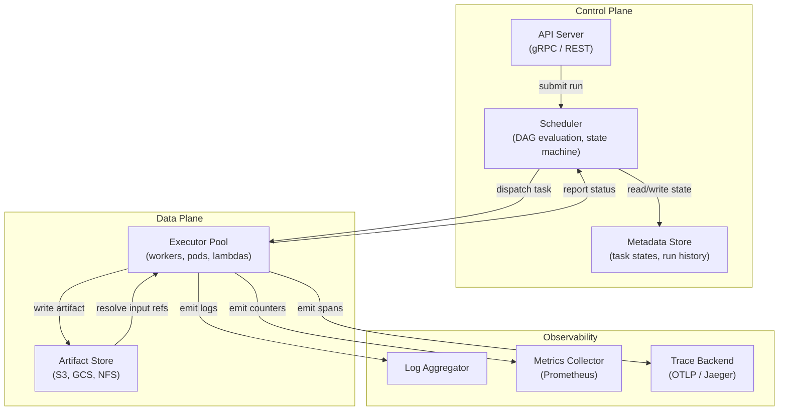
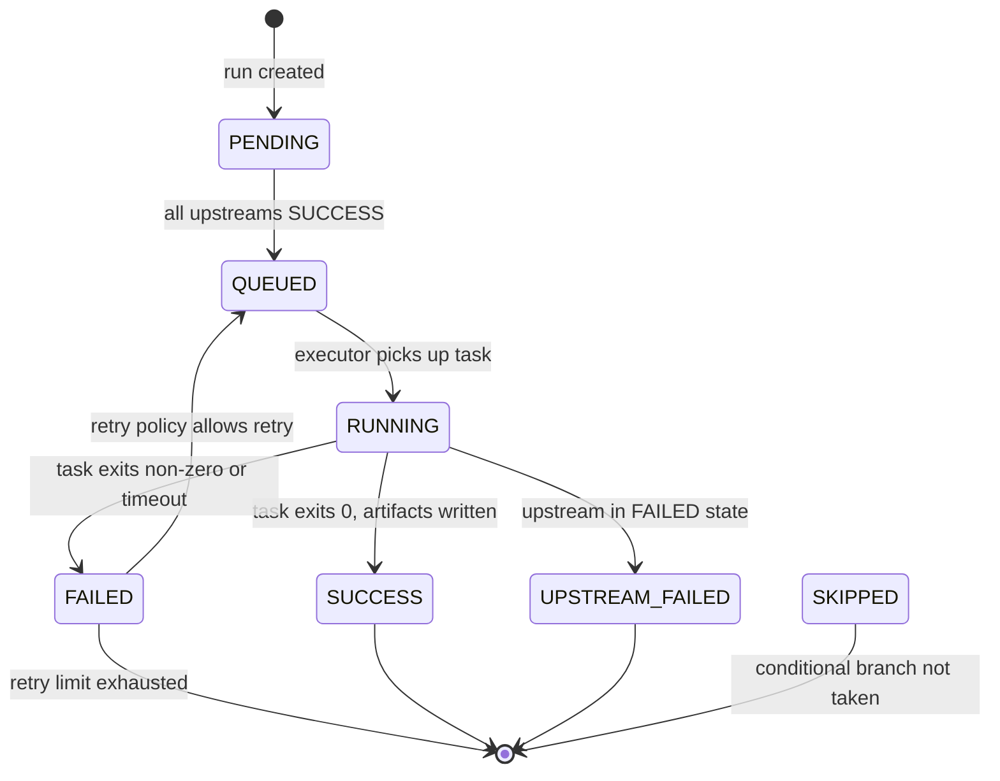
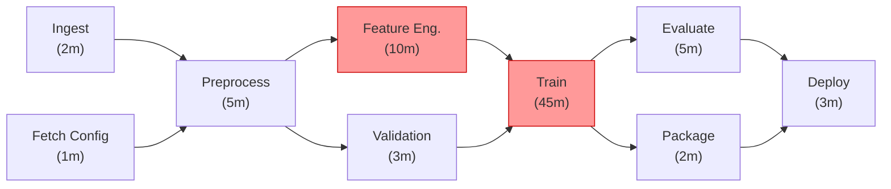
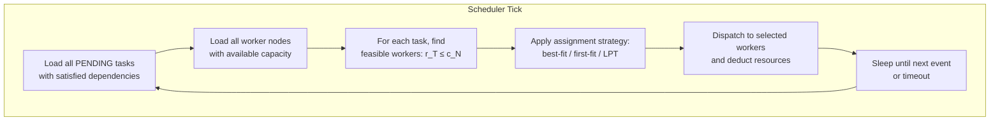
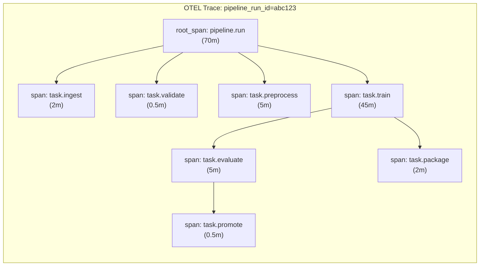

# Lesson 1: Pipeline Orchestration in MLOps — Architecture, Scheduling, and Production Hardening

---

## 1. First-Principles Intuition and Invariants

### The Core Problem: Coordinated Stateful Computation

A machine learning pipeline is not simply a script that runs top-to-bottom. It is a **distributed, stateful, fault-tolerant computation** where each stage produces artifacts that become the inputs to downstream stages. The fundamental challenge is ensuring **causal consistency**: downstream work must never begin on stale or absent upstream outputs. This is a constrained ordering problem with side effects.

The essential invariants that any pipeline orchestrator must enforce:

1. **Dependency Invariant**: Task T₂ may not begin execution until all tasks in `predecessors(T₂)` have reached a terminal success state.
2. **Idempotency Invariant**: Retrying a task must produce the same observable output as executing it once. This requires tasks to be side-effect–controlled — either purely functional, or guarded by write-once artifact semantics.
3. **Monotonic State Progression**: A task's state may only advance along the lattice `PENDING → QUEUED → RUNNING → {SUCCESS | FAILED | SKIPPED}`. No backward transitions are permitted without an explicit pipeline reset, which must be auditable.
4. **Global Consistency**: The aggregate state of all tasks must be reachable from the same causal snapshot of the dependency graph. Partial updates to the graph state must be atomic.

These invariants map directly to problems studied in distributed systems theory — specifically, the intersection of **causal consistency** (Lamport, 1978) and **safety properties** in concurrent systems (Alpern & Schneider, 1985).

### The DAG as a First-Class Data Structure

The dependency graph in a pipeline orchestrator is a **Directed Acyclic Graph (DAG)**. The acyclicity constraint is not a stylistic choice — it is a **liveness guarantee**. A cycle in the dependency graph creates a deadlock: T_a waits for T_b, T_b waits for T_a, and neither can proceed. The orchestrator must reject cyclic graphs at definition time, using cycle detection (e.g., DFS-based coloring) rather than deferring to runtime failure.

Formally, let `G = (V, E)` where `V` is the set of tasks and `E ⊆ V × V` is the set of directed dependency edges. The orchestrator's core scheduling problem is to find a **topological ordering** `σ: V → ℤ⁺` such that for every edge `(u, v) ∈ E`, `σ(u) < σ(v)`. Kahn's algorithm (1962) or DFS-based topological sort both produce this ordering in O(V + E) time.

The practical implication: parallelism is maximized when the DAG has low **critical path length** — the length of the longest dependency chain from any source node to any sink node. This is the lower bound on wall-clock execution time regardless of available resources.

---

## 2. Core Architecture and Mechanics

### Anatomy of a Production Orchestrator

A production-grade orchestrator consists of five logical subsystems:



**Scheduler**: The scheduler is the brain of the orchestrator. It polls the metadata store, evaluates which tasks have all dependencies in `SUCCESS` state, and places those tasks into an execution queue. It operates as a **level-triggered control loop** — it does not rely on edge-triggered events from individual tasks (which would be unreliable under partial failure) but instead re-evaluates the full DAG state periodically or on any state-change notification.

**Metadata Store**: All task state is persisted in a durable store (typically a relational database like PostgreSQL). The store is the **single source of truth**. Scheduler restarts are safe because the entire pipeline state can be reconstructed from the store. This is analogous to the reconciler pattern in Kubernetes.

**Executor**: Executors are stateless workers that receive a task specification, fetch input artifacts, run the computation, and write output artifacts. The executor reports success or failure back to the scheduler. Executors may be local processes, Docker containers, Kubernetes pods, or serverless functions — the scheduler does not need to know the difference.

**Artifact Store**: Task outputs (datasets, model weights, evaluation metrics) are written to a content-addressable or path-structured store. Artifact lineage (which run produced which artifact) is tracked in the metadata store. This separates **data plane** (large binary blobs) from **control plane** (small structured state).

### The Scheduler as a State Machine

Each task instance in a pipeline run is a finite state machine:



The key design decision is **where state transitions are authoritative**. In robust systems, the **scheduler** owns state transitions, not the executor. The executor reports an outcome, and the scheduler decides what state to transition to based on that report combined with retry policy, upstream states, and circuit-breaker logic. This prevents split-brain scenarios where an executor believes a task succeeded while the scheduler recorded a timeout failure.

### Topological Scheduling in Code

A clean implementation of Kahn's algorithm for topological ordering in Python, the kind that sits at the core of an orchestrator's ready-task computation:

```python
from collections import defaultdict, deque
from dataclasses import dataclass, field
from enum import Enum, auto
from typing import Dict, List, Set, Optional


class TaskState(Enum):
    PENDING = auto()
    QUEUED = auto()
    RUNNING = auto()
    SUCCESS = auto()
    FAILED = auto()
    SKIPPED = auto()
    UPSTREAM_FAILED = auto()


@dataclass
class Task:
    name: str
    upstream: List[str] = field(default_factory=list)
    state: TaskState = TaskState.PENDING
    retry_count: int = 0
    max_retries: int = 3


class DAGScheduler:
    """
    Level-triggered DAG scheduler. On each tick, it identifies all tasks
    whose upstream dependencies are fully satisfied and transitions them
    to QUEUED state.

    Thread-safety: all public methods must be called under self._lock
    in a production implementation.
    """

    def __init__(self, tasks: List[Task]) -> None:
        self._tasks: Dict[str, Task] = {t.name: t for t in tasks}
        self._adjacency: Dict[str, List[str]] = defaultdict(list)
        self._in_degree: Dict[str, int] = {t.name: 0 for t in tasks}

        # Build adjacency list and validate acyclicity
        for task in tasks:
            for upstream_name in task.upstream:
                if upstream_name not in self._tasks:
                    raise ValueError(
                        f"Task '{task.name}' depends on unknown task '{upstream_name}'"
                    )
                self._adjacency[upstream_name].append(task.name)
                self._in_degree[task.name] += 1

        self._validate_acyclic()

    def _validate_acyclic(self) -> None:
        """
        Kahn's algorithm for cycle detection. Raises ValueError if the
        graph contains a cycle, which would deadlock the scheduler.
        """
        in_degree = dict(self._in_degree)
        queue: deque[str] = deque(
            name for name, deg in in_degree.items() if deg == 0
        )
        visited = 0

        while queue:
            node = queue.popleft()
            visited += 1
            for neighbor in self._adjacency[node]:
                in_degree[neighbor] -= 1
                if in_degree[neighbor] == 0:
                    queue.append(neighbor)

        if visited != len(self._tasks):
            # Find the cycle members for a useful error message
            cycle_members = [
                name for name, deg in in_degree.items() if deg > 0
            ]
            raise ValueError(
                f"DAG contains a cycle involving tasks: {cycle_members}"
            )

    def get_ready_tasks(self) -> List[Task]:
        """
        Returns all tasks eligible for immediate dispatch: PENDING tasks
        whose every upstream dependency has reached SUCCESS state.
        """
        ready = []
        for task in self._tasks.values():
            if task.state != TaskState.PENDING:
                continue
            if all(
                self._tasks[up].state == TaskState.SUCCESS
                for up in task.upstream
            ):
                ready.append(task)
        return ready

    def mark_success(self, task_name: str) -> None:
        task = self._tasks[task_name]
        assert task.state == TaskState.RUNNING, (
            f"Cannot mark task '{task_name}' as SUCCESS from state {task.state}"
        )
        task.state = TaskState.SUCCESS

    def mark_failed(self, task_name: str) -> None:
        task = self._tasks[task_name]
        assert task.state == TaskState.RUNNING
        if task.retry_count < task.max_retries:
            task.retry_count += 1
            task.state = TaskState.PENDING  # re-eligible for scheduling
        else:
            task.state = TaskState.FAILED
            # Propagate failure to all downstream tasks
            self._propagate_upstream_failed(task_name)

    def _propagate_upstream_failed(self, failed_task_name: str) -> None:
        """Marks all downstream tasks as UPSTREAM_FAILED via BFS."""
        queue: deque[str] = deque([failed_task_name])
        visited: Set[str] = {failed_task_name}
        while queue:
            current = queue.popleft()
            for downstream in self._adjacency[current]:
                if downstream not in visited:
                    visited.add(downstream)
                    downstream_task = self._tasks[downstream]
                    if downstream_task.state in (
                        TaskState.PENDING, TaskState.QUEUED
                    ):
                        downstream_task.state = TaskState.UPSTREAM_FAILED
                    queue.append(downstream)

    def dispatch(self, task_name: str) -> None:
        task = self._tasks[task_name]
        assert task.state == TaskState.QUEUED
        task.state = TaskState.RUNNING

    def queue(self, task_name: str) -> None:
        task = self._tasks[task_name]
        assert task.state == TaskState.PENDING
        task.state = TaskState.QUEUED

    def is_complete(self) -> bool:
        return all(
            t.state in (
                TaskState.SUCCESS,
                TaskState.FAILED,
                TaskState.UPSTREAM_FAILED,
                TaskState.SKIPPED,
            )
            for t in self._tasks.values()
        )

    def summary(self) -> Dict[str, str]:
        return {name: t.state.name for name, t in self._tasks.items()}
```

### Artifact Lineage and Content Addressing

A design decision with deep correctness implications is **how artifacts are referenced**. Mutable paths (e.g., `s3://bucket/model/latest.pkl`) are dangerous because they break the idempotency invariant — a task reading `latest.pkl` may get different data on retry than it got on first execution. The correct pattern is **content-addressed immutable references**.

Each task writes output to a path derived from a hash of its inputs and code version:

```
s3://artifacts/{pipeline_id}/{run_id}/{task_name}/{content_hash}/output.pkl
```

The metadata store records these fully-qualified URIs as the output of each successful task execution. Downstream tasks receive these URIs as explicit inputs, not as mutable pointers. This gives you **full reproducibility**: given the same run ID, you can deterministically reconstruct every artifact.

---

## 3. High-Performance Optimization and Failure Modes

### Critical Path Analysis and Parallelism

The minimum possible wall-clock time for a pipeline is determined by its **critical path** — the maximum-weight path through the DAG when nodes are weighted by their expected execution time. No amount of additional parallelism can reduce execution time below this bound.



In this example, the critical path is `Ingest → Preprocess → Feature Eng. → Train → Evaluate → Deploy` with a total of `2 + 5 + 10 + 45 + 5 + 3 = 70 minutes`. Parallelizing `Fetch Config`, `Validation`, and `Package` does not reduce the wall-clock time below 70 minutes. Optimization effort belongs on the critical path tasks — specifically `Train` (45m) and `Feature Engineering` (10m).

A production orchestrator should expose critical path analysis as a first-class feature, computed via a longest-path algorithm on the DAG (solvable in O(V + E) for DAGs using topological order).

### Worker Pool Architecture and Backpressure

Naive worker pools without backpressure are a common source of production failures. When task generation outpaces task completion (e.g., a fan-out operation creates thousands of sub-tasks), unbounded queue growth leads to memory exhaustion in the scheduler process and head-of-line blocking.

The correct pattern is a **bounded semaphore with backpressure**:

```python
import asyncio
import logging
from collections.abc import Callable, Coroutine
from typing import Any, TypeVar

T = TypeVar("T")
logger = logging.getLogger(__name__)


class BoundedTaskExecutor:
    """
    Executes coroutines with a bounded concurrency limit. When the
    semaphore is exhausted, callers are suspended (backpressure) rather
    than queuing unboundedly.

    This prevents memory exhaustion in fan-out scenarios and provides
    natural flow control between the scheduler and the executor pool.
    """

    def __init__(self, max_concurrent: int = 32) -> None:
        self._sem = asyncio.Semaphore(max_concurrent)
        self._active: set[asyncio.Task[Any]] = set()

    async def submit(
        self,
        coro_fn: Callable[..., Coroutine[Any, Any, T]],
        *args: Any,
        task_name: str = "unnamed",
        **kwargs: Any,
    ) -> T:
        """
        Acquire the semaphore (suspending if at capacity), run the
        coroutine, release the semaphore, and return the result.
        Exceptions propagate to the caller.
        """
        async with self._sem:
            logger.debug("Starting task: %s", task_name)
            try:
                result = await coro_fn(*args, **kwargs)
                logger.debug("Task succeeded: %s", task_name)
                return result
            except Exception:
                logger.exception("Task failed: %s", task_name)
                raise

    @property
    def available_slots(self) -> int:
        return self._sem._value  # type: ignore[attr-defined]
```

### Failure Modes Taxonomy

Understanding failure modes is as important as understanding the happy path. The following taxonomy covers the dominant failure classes in production pipeline orchestrators:

**1. Zombie Tasks (Executor Heartbeat Failure)**

An executor begins running a task, then becomes unreachable (OOM kill, network partition, host failure). The task remains in `RUNNING` state in the metadata store indefinitely. The fix is a **heartbeat lease mechanism**: executors must renew a time-limited lease on their task at a fixed interval (e.g., every 30 seconds). The scheduler runs a reaper process that transitions any `RUNNING` task whose lease has expired back to `PENDING` or `FAILED` based on retry policy.

```python
import time
from dataclasses import dataclass


@dataclass
class TaskLease:
    task_name: str
    run_id: str
    expires_at: float  # Unix timestamp
    heartbeat_interval: float = 30.0  # seconds

    def is_expired(self) -> bool:
        return time.monotonic() > self.expires_at

    def renew(self) -> "TaskLease":
        return TaskLease(
            task_name=self.task_name,
            run_id=self.run_id,
            expires_at=time.monotonic() + self.heartbeat_interval * 2,
            heartbeat_interval=self.heartbeat_interval,
        )
```

**2. Duplicate Execution (Scheduler Restart Under At-Least-Once Delivery)**

If the scheduler dispatches a task and then crashes before recording the dispatch in the metadata store, it will dispatch the same task again on restart. Without idempotent executors, this creates duplicate side effects (double-writing to a database, double-publishing an event). The fix is a **transactional outbox pattern**: the scheduler writes the dispatch record to the metadata store in the same transaction as the state transition to `QUEUED`, before sending the message to the executor. This requires executor-side idempotency keys.

**3. Thundering Herd on Pipeline Completion**

When a long-running root task completes, all dependent tasks become simultaneously eligible. If thousands of tasks fan out from a single root, the sudden burst of dispatch events can overwhelm the message broker, artifact store, or downstream compute scheduler. The fix is a **dispatch rate limiter** at the scheduler level, combined with exponential admission to the executor pool.

**4. Stale Artifact Reads After Partial Retry**

If a task partially writes an artifact, fails, and is retried, the retry may read its own partial output as if it were a completed upstream artifact. The fix is **atomic artifact promotion**: tasks write to a staging path, and the orchestrator atomically moves (not copies) the artifact to the canonical path only after recording `SUCCESS` in the metadata store. Many object stores (S3, GCS) support this via rename semantics within a bucket.

**5. Slow Poison: Gradual Data Drift Causing Silent Failures**

A pipeline may succeed mechanically (all tasks exit 0) while silently producing degraded model outputs due to upstream data quality drift. This failure mode is undetectable by the state machine alone. It requires **data quality gates** as explicit tasks in the DAG: tasks that compute statistical tests (e.g., KS test for distribution shift, schema validation, null-rate checks) and fail fast if invariants are violated. Great Expectations and Evidently AI are production tools that implement this pattern.

### Exponential Backoff Retry Implementation

Retries without backoff are a common cause of cascading failures — a flaky downstream service receives a storm of retries that prevents it from recovering. The correct retry strategy combines **exponential backoff with jitter**:

```python
import asyncio
import random
import logging
from typing import Callable, Coroutine, Any, TypeVar

T = TypeVar("T")
logger = logging.getLogger(__name__)


async def retry_with_backoff(
    fn: Callable[[], Coroutine[Any, Any, T]],
    *,
    max_attempts: int = 5,
    base_delay: float = 1.0,    # seconds
    max_delay: float = 120.0,   # seconds
    multiplier: float = 2.0,
    jitter: float = 0.25,       # fraction of computed delay to randomize
    task_name: str = "unknown",
) -> T:
    """
    Retry a coroutine with full-jitter exponential backoff.

    Full jitter (AWS recommendation, 2015) is superior to additive jitter
    for distributed systems because it desynchronizes retry storms across
    multiple independent callers hitting the same resource.

    Reference: https://aws.amazon.com/blogs/architecture/exponential-backoff-and-jitter/
    """
    last_exc: Exception | None = None

    for attempt in range(1, max_attempts + 1):
        try:
            return await fn()
        except Exception as exc:
            last_exc = exc
            if attempt == max_attempts:
                logger.error(
                    "Task '%s' failed after %d attempts. Final error: %s",
                    task_name, max_attempts, exc,
                )
                raise

            # Compute delay: base * multiplier^(attempt-1), capped at max_delay
            computed = min(base_delay * (multiplier ** (attempt - 1)), max_delay)
            # Full jitter: uniform random in [0, computed * (1 + jitter)]
            delay = random.uniform(0, computed * (1.0 + jitter))

            logger.warning(
                "Task '%s' attempt %d/%d failed (%s). Retrying in %.2fs.",
                task_name, attempt, max_attempts, exc, delay,
            )
            await asyncio.sleep(delay)

    # Unreachable, but satisfies the type checker
    assert last_exc is not None
    raise last_exc
```

### Resource-Aware Scheduling: Bin Packing

A naive scheduler dispatches tasks as soon as dependencies are satisfied, without regard for available resources. Under heavy load this causes worker OOMs, task preemption, and elevated failure rates. A production scheduler must model resource requirements per task and treat scheduling as a **bin-packing problem** against available worker capacity.

Each task carries a resource request vector `r = (cpu_cores, memory_gb, gpu_count, custom_resources...)`. The scheduler maintains a resource availability vector per worker node `c_i`. It may only assign task T to node N if `r_T ≤ c_N` component-wise. This is exactly the resource model used by Kubernetes (requests/limits), Mesos, and Airflow's Celery/Kubernetes executors.



**Longest Processing Time (LPT)** scheduling heuristic: assign the longest-estimated task first to available workers. This minimizes makespan (total wall-clock time) in practice, achieving a 4/3 approximation of optimal makespan for identical machines — a classical result due to Graham (1969).

---

## 4. Production System Comparison

The following compares the dominant open-source orchestrators across the architectural dimensions discussed above:

| Property | Apache Airflow 2.x | Prefect 2.x | Kubeflow Pipelines v2 | Metaflow |
|---|---|---|---|---|
| **DAG Definition** | Python decorators / operators | Python functions + `@flow` | Pipeline SDK (Protobuf IR) | Python `@step` decorator |
| **Scheduler Architecture** | Single-process, DB-polling | Orion server + agent | Argo Workflows controller | Local or AWS Step Functions |
| **Metadata Store** | PostgreSQL / MySQL | SQLite / PostgreSQL | MySQL + MinIO (MLMD) | AWS S3 + service |
| **Executor Types** | Local, Celery, Kubernetes, Dask | subprocess, Docker, K8s | Kubernetes pods only | Local, AWS Batch, K8s |
| **Artifact Tracking** | XCom (DB-backed, size-limited) | Result serialization | ML Metadata (MLMD) | Native content-addressed S3 |
| **Dynamic DAGs** | Limited (Airflow 2.3+ dynamic tasks) | First-class | No | First-class (`foreach`) |
| **Heartbeat / Zombie Detection** | Yes (task heartbeat, 5m default) | Yes (agent polling) | Kubernetes pod GC | Via AWS Batch / pod lifecycle |
| **UI Gantt / Critical Path** | Gantt chart, no critical path | Timeline view | None natively | Card UI |

Airflow's historical weakness is its **scheduler scalability wall**: the single-process Python scheduler becomes a bottleneck at high task throughput (> ~1000 tasks/min). Airflow 2.4+ addressed this with the **DAG Serialization** to the database and a multi-threaded scheduler, but the architecture remains single-process. Prefect and Temporal take a different approach by pushing scheduling logic into an event-driven server that can be horizontally scaled.

---

## 5. End-to-End Example: A Production ML Training Pipeline

The following demonstrates a realistic training pipeline using Python, illustrating the composition of the scheduling, artifact, and retry concepts discussed above:

```python
"""
production_pipeline.py

A minimal but realistic MLOps training pipeline demonstrating:
  - Explicit artifact lineage via immutable URIs
  - Data quality gates as first-class DAG tasks
  - Resource-annotated task definitions
  - Structured logging for observability
"""

from __future__ import annotations

import hashlib
import json
import logging
import struct
import time
from dataclasses import dataclass, field
from pathlib import Path
from typing import Any

import numpy as np

logger = logging.getLogger(__name__)
logging.basicConfig(
    level=logging.INFO,
    format="%(asctime)s %(levelname)s %(name)s %(message)s",
)


# ---------------------------------------------------------------------------
# Artifact model
# ---------------------------------------------------------------------------

@dataclass(frozen=True)
class Artifact:
    """
    Immutable reference to a pipeline artifact. The URI is derived from
    a hash of the producing task's inputs to ensure reproducibility.
    """
    uri: str
    content_hash: str
    byte_size: int
    schema_version: int = 1

    @classmethod
    def from_data(cls, data: bytes, base_uri: str) -> "Artifact":
        digest = hashlib.sha256(data).hexdigest()
        uri = f"{base_uri}/{digest[:16]}"
        return cls(uri=uri, content_hash=digest, byte_size=len(data))


# ---------------------------------------------------------------------------
# Task resource model
# ---------------------------------------------------------------------------

@dataclass
class ResourceRequest:
    cpu_cores: float = 1.0
    memory_gb: float = 4.0
    gpu_count: int = 0

    def to_k8s_resources(self) -> dict[str, Any]:
        """Converts to Kubernetes resource request spec."""
        resources: dict[str, Any] = {
            "requests": {
                "cpu": str(self.cpu_cores),
                "memory": f"{int(self.memory_gb * 1024)}Mi",
            },
            "limits": {
                "cpu": str(self.cpu_cores * 2),
                "memory": f"{int(self.memory_gb * 1024 * 1.5)}Mi",
            },
        }
        if self.gpu_count > 0:
            resources["limits"]["nvidia.com/gpu"] = str(self.gpu_count)
        return resources


# ---------------------------------------------------------------------------
# Pipeline task implementations
# ---------------------------------------------------------------------------

def ingest_raw_data(
    source_uri: str,
    run_id: str,
) -> Artifact:
    """
    Simulates pulling raw data from a source system and writing it to
    the artifact store. In production this would stream from Kafka,
    query BigQuery, or call an external API.
    """
    logger.info("Ingesting data from %s for run %s", source_uri, run_id)

    # Simulate network fetch
    time.sleep(0.01)
    # 1000 rows × 20 float64 features
    raw_data = np.random.randn(1000, 20).astype(np.float64)
    serialized = raw_data.tobytes()

    artifact = Artifact.from_data(
        serialized,
        base_uri=f"s3://ml-artifacts/{run_id}/raw",
    )
    logger.info(
        "Ingested artifact: uri=%s size_bytes=%d",
        artifact.uri, artifact.byte_size,
    )
    return artifact


def validate_data_quality(artifact: Artifact) -> dict[str, float]:
    """
    Data quality gate. Computes statistical properties and asserts
    invariants. Raises ValueError to fail the pipeline fast on
    data issues before expensive training runs.

    In production, this integrates with Great Expectations or Evidently AI.
    """
    logger.info("Running data quality checks on %s", artifact.uri)

    # Simulate deserialization
    n_rows, n_cols = 1000, 20
    data = np.frombuffer(b"\x00" * n_rows * n_cols * 8, dtype=np.float64).reshape(
        n_rows, n_cols
    )
    data = np.random.randn(n_rows, n_cols)  # simulate real data load

    null_rate = float(np.isnan(data).mean())
    row_count = int(data.shape[0])
    col_count = int(data.shape[1])
    feature_std = float(data.std())

    metrics = {
        "null_rate": null_rate,
        "row_count": float(row_count),
        "col_count": float(col_count),
        "feature_std": feature_std,
    }

    # Fail fast invariants
    if null_rate > 0.01:
        raise ValueError(
            f"Data quality failure: null_rate={null_rate:.4f} exceeds threshold 0.01"
        )
    if row_count < 500:
        raise ValueError(
            f"Data quality failure: row_count={row_count} below minimum 500"
        )
    if col_count != 20:
        raise ValueError(
            f"Schema violation: expected 20 columns, got {col_count}"
        )

    logger.info("Data quality checks passed: %s", metrics)
    return metrics


def preprocess(
    raw_artifact: Artifact,
    quality_metrics: dict[str, float],
    run_id: str,
) -> Artifact:
    """
    Applies normalization and feature engineering. Takes both the raw
    artifact and the validated quality metrics as inputs to ensure
    the quality gate was explicitly traversed.
    """
    logger.info(
        "Preprocessing artifact %s (quality_metrics=%s)",
        raw_artifact.uri, quality_metrics,
    )

    n_rows, n_cols = int(quality_metrics["row_count"]), int(quality_metrics["col_count"])
    data = np.random.randn(n_rows, n_cols)

    # Z-score normalization per feature
    mean = data.mean(axis=0)
    std = data.std(axis=0)
    std = np.where(std == 0, 1.0, std)  # avoid division by zero
    normalized = (data - mean) / std

    serialized = normalized.astype(np.float32).tobytes()
    artifact = Artifact.from_data(
        serialized,
        base_uri=f"s3://ml-artifacts/{run_id}/preprocessed",
    )
    logger.info("Preprocessed artifact: uri=%s", artifact.uri)
    return artifact


def train_model(
    preprocessed_artifact: Artifact,
    run_id: str,
    hyperparams: dict[str, Any],
) -> Artifact:
    """
    Trains a model against the preprocessed data. In production this
    would launch a distributed training job (Ray, Horovod, PyTorch DDP)
    and report metrics to an experiment tracker (MLflow, W&B).
    """
    logger.info(
        "Training model for run %s with hyperparams=%s, input=%s",
        run_id, hyperparams, preprocessed_artifact.uri,
    )

    # Simulate training
    time.sleep(0.02)
    model_weights = np.random.randn(hyperparams.get("hidden_size", 128), 20).astype(np.float32)
    model_bytes = model_weights.tobytes()

    artifact = Artifact.from_data(
        model_bytes,
        base_uri=f"s3://ml-artifacts/{run_id}/model",
    )
    logger.info("Model artifact: uri=%s", artifact.uri)
    return artifact


def evaluate_model(
    model_artifact: Artifact,
    preprocessed_artifact: Artifact,
    run_id: str,
) -> dict[str, float]:
    """
    Evaluates the trained model and returns a metrics dict. This is an
    explicit task in the DAG — evaluation is not embedded in training.
    This separation allows re-evaluation with different metrics or on
    different data slices without re-training.
    """
    logger.info(
        "Evaluating model %s against %s",
        model_artifact.uri, preprocessed_artifact.uri,
    )
    # Simulate evaluation
    metrics = {
        "accuracy": float(np.random.uniform(0.85, 0.99)),
        "f1_macro": float(np.random.uniform(0.80, 0.98)),
        "auc_roc": float(np.random.uniform(0.90, 0.999)),
        "latency_p99_ms": float(np.random.uniform(5.0, 50.0)),
    }
    logger.info("Evaluation metrics for run %s: %s", run_id, metrics)
    return metrics


def promote_model(
    model_artifact: Artifact,
    eval_metrics: dict[str, float],
    run_id: str,
    accuracy_threshold: float = 0.90,
) -> str:
    """
    Model promotion gate. Only registers the model in the model registry
    if it meets the minimum performance bar. This is a critical invariant:
    a model that trains successfully but underperforms must NOT be deployed.
    Returns the registry URI on success.
    """
    accuracy = eval_metrics["accuracy"]
    if accuracy < accuracy_threshold:
        raise ValueError(
            f"Model promotion blocked: accuracy={accuracy:.4f} < "
            f"threshold={accuracy_threshold:.4f}"
        )

    registry_uri = f"models://registry/{run_id}/champion"
    logger.info(
        "Model promoted to %s (accuracy=%.4f)",
        registry_uri, accuracy,
    )
    return registry_uri


# ---------------------------------------------------------------------------
# Pipeline runner
# ---------------------------------------------------------------------------

def run_pipeline(run_id: str) -> str:
    """
    Executes the full training pipeline. In production, each function call
    here would be a task dispatched to the executor pool, with the
    orchestrator managing state transitions and artifact passing.
    """
    hyperparams: dict[str, Any] = {
        "learning_rate": 1e-3,
        "batch_size": 256,
        "hidden_size": 256,
        "max_epochs": 50,
    }

    # Stage 1: Ingest
    raw_artifact = ingest_raw_data(
        source_uri="kafka://events-cluster/feature-events",
        run_id=run_id,
    )

    # Stage 2: Quality gate (fails fast on bad data)
    quality_metrics = validate_data_quality(raw_artifact)

    # Stage 3: Preprocess (depends on both ingest AND quality validation)
    preprocessed_artifact = preprocess(raw_artifact, quality_metrics, run_id)

    # Stage 4: Train (resource-intensive, runs on GPU node in production)
    model_artifact = train_model(preprocessed_artifact, run_id, hyperparams)

    # Stage 5: Evaluate
    eval_metrics = evaluate_model(model_artifact, preprocessed_artifact, run_id)

    # Stage 6: Promote (another quality gate — this time on model performance)
    registry_uri = promote_model(model_artifact, eval_metrics, run_id)

    return registry_uri


if __name__ == "__main__":
    import uuid
    run_id = str(uuid.uuid4())
    logger.info("Starting pipeline run: %s", run_id)
    result = run_pipeline(run_id)
    logger.info("Pipeline complete. Model registered at: %s", result)
```

---

## 6. Observability: The Fourth Invariant

A pipeline that completes without errors is not necessarily a pipeline that is functioning correctly. **Observability** — the ability to infer the internal state of the system from its external outputs — is a first-class architectural concern in production orchestrators, not an afterthought.

The three pillars in the context of pipeline orchestration are:

**Metrics** (aggregated numerics): Task throughput (tasks/min), queue depth, scheduler lag (time between dependency satisfaction and task dispatch), task duration P50/P95/P99, retry rate, failure rate. These are the signals for capacity planning and SLA alerting.

**Logs** (structured events): Every state transition must emit a structured log event with `run_id`, `task_name`, `previous_state`, `new_state`, `timestamp_utc`, and `attempt_number`. Unstructured logs are not parseable at scale. Use JSON-structured logging.

**Traces** (distributed request spans): Each task execution should produce an OpenTelemetry span that is a child of the pipeline run's root span. This allows correlating a slow model evaluation task with upstream preprocessing delays and executor scheduling latency in a single Jaeger or Tempo flame graph.



The correlation between spans reveals true execution timelines including scheduler dispatch latency (the gap between a task's dependency becoming satisfied and its span starting). A large dispatch gap indicates scheduler saturation — a signal that is invisible from task-level metrics alone.

---

## Summary

Pipeline orchestration is a distributed systems problem expressed in the language of machine learning workflows. The core technical substance is:

- DAGs enforce causal ordering via the acyclicity invariant. Cycle detection must happen at definition time, not runtime.
- Schedulers are level-triggered control loops that reconcile desired state (DAG definition) with actual state (metadata store). They must be crash-safe via transactional state transitions.
- Artifact immutability and content-addressing are prerequisites for idempotent, reproducible pipelines. Mutable artifact paths are a correctness hazard.
- Failure handling requires a taxonomy: zombie tasks need heartbeat leases, duplicate execution needs transactional outbox, thundering herd needs admission control, and silent degradation needs data quality gates as first-class DAG nodes.
- Critical path analysis determines the theoretical minimum execution time and focuses optimization effort. Parallelism only helps tasks not on the critical path.
- Observability (metrics, structured logs, distributed traces) is not optional — it is the mechanism by which the correctness invariants can be verified in production.
