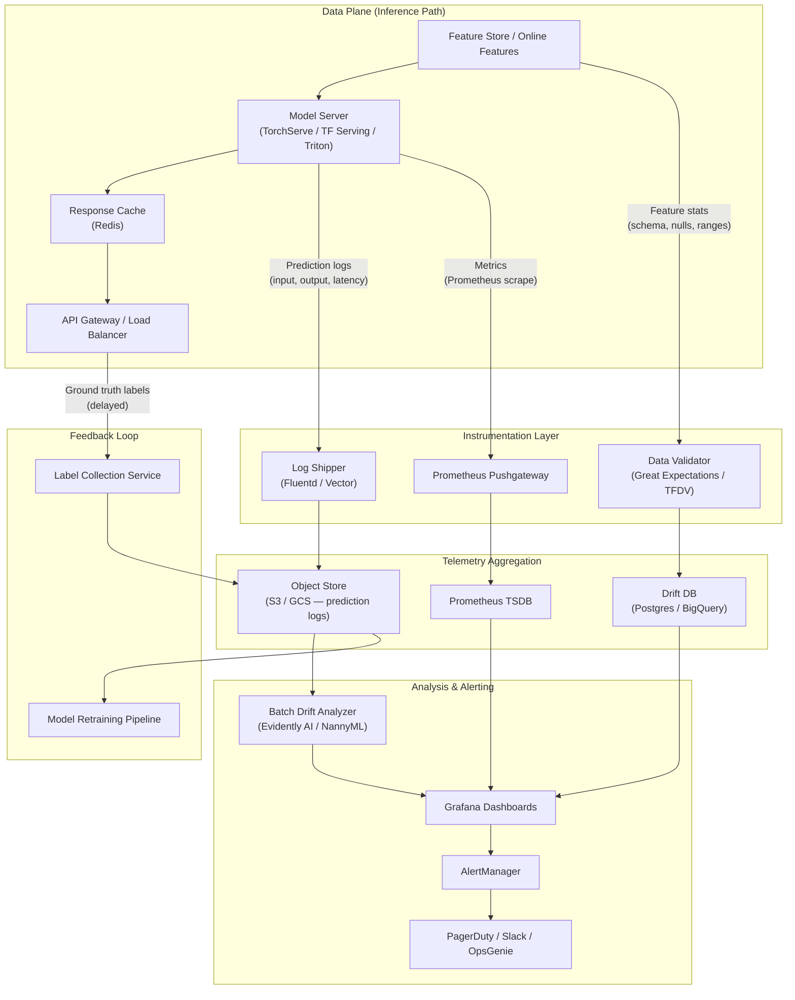
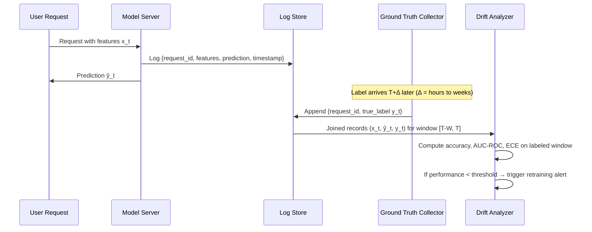
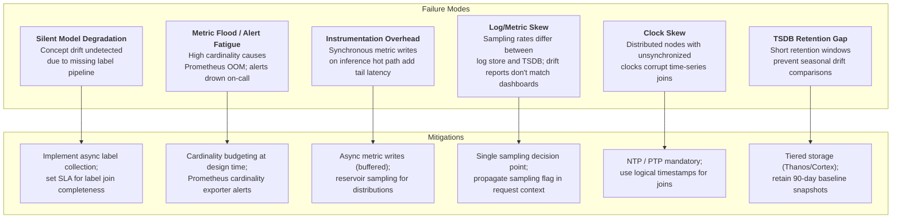
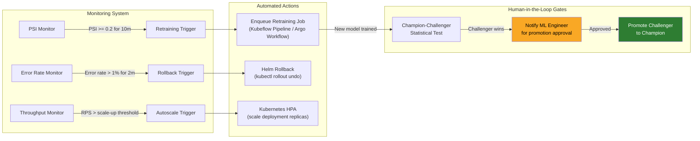

# Lesson 2: Monitoring Strategies for MLOps Pipelines

## 1. First-Principles Intuition & Invariants

Monitoring a production ML system is fundamentally different from monitoring a conventional web service. A web service is deterministic: given the same inputs, it produces the same outputs, and correctness is a binary property you can verify at deploy time. An ML model is *stochastic and temporally unstable*: its statistical properties shift as the world changes, and a model can be "healthy" by every infrastructure metric while silently degrading in predictive quality. This distinction is not cosmetic—it demands an entirely separate monitoring discipline layered on top of classical systems observability.

### The Four Failure Axes

Production ML failures decompose into four independent axes, each requiring distinct detection machinery:

**Infrastructure failures** are the classical domain: OOM kills, GPU ECC errors, network partitions, disk exhaustion, service crashes. These are well-understood and addressed by standard SRE tooling (Prometheus, PagerDuty, etc.).

**Data failures** occur when upstream data pipelines produce inputs that violate the statistical assumptions encoded in the trained model. The model itself continues to run; it simply applies a learned function to inputs that are outside its training distribution. Schema drift, missing features, bimodal distributional shifts, and silent upstream ETL bugs all fall here.

**Model quality failures** occur when the relationship between inputs and the optimal output has changed in the real world—concept drift. The model's learned mapping `f(x) → y` is now a stale approximation of the true generative process `P(y|x)`. Feature drift is a leading indicator; concept drift is the lagging consequence.

**Operational failures** cover the serving infrastructure itself: tail latency spikes, throughput degradation, model loading bottlenecks, and cache inefficiencies that degrade the user experience without crashing the service.

### Formal Invariants

An effective MLOps monitoring system must satisfy the following invariants:

1. **Completeness**: Every metric that can causally affect model behavior or user experience must be instrumented. No inference path is unobserved.
2. **Timeliness**: Alert-triggering metrics must be available within a latency budget proportional to the business impact of the failure. Concept drift detection can tolerate minutes to hours; serving latency anomalies require sub-minute detection.
3. **Actionability**: Every alert must map to a runbook entry. Alerts without clear remediation paths are noise that trains on-call engineers to ignore pages.
4. **Statistical validity**: Drift detection requires distributional tests (KL divergence, PSI, KS test), not just threshold comparisons on point statistics. Alerting on mean shift alone misses variance explosions and multimodal splits.
5. **Cardinality control**: High-cardinality label sets (e.g., one label per user ID) destroy time-series databases. Every metric must have a bounded label cardinality at design time.

---

## 2. Core Architecture & Mechanics

### 2.1 The Full Observability Stack

A production MLOps monitoring architecture has three distinct planes:



### 2.2 Metric Taxonomy

Prometheus formalizes four metric types that map cleanly onto MLOps concerns:

| Type | Semantics | MLOps Example |
|------|-----------|---------------|
| `Counter` | Monotonically increasing, reset on restart | `predictions_total`, `input_validation_errors_total` |
| `Gauge` | Arbitrary up/down value | `model_version`, `feature_drift_psi`, `gpu_utilization` |
| `Histogram` | Samples distributed into configurable buckets | `inference_latency_seconds`, `input_feature_value` |
| `Summary` | Client-side quantile calculations | Pre-aggregated p50/p99 latency (avoid in distributed systems—summaries cannot be aggregated across replicas) |

The critical architectural lesson on summaries: **never use Prometheus `Summary` for latency in a horizontally scaled serving fleet**. Because quantiles are computed client-side, you cannot aggregate p99 from ten pods into a fleet-wide p99. Use `Histogram` with carefully chosen buckets and compute quantiles server-side with `histogram_quantile()`.

### 2.3 Instrumentation: What to Measure

#### Serving Infrastructure Metrics

```python
# production_grade_metrics.py
# Prometheus instrumentation for a FastAPI model server

from prometheus_client import Counter, Histogram, Gauge, start_http_server
import time
import numpy as np
from typing import Any

# --- Counters ---
PREDICTIONS_TOTAL = Counter(
    name="mlserver_predictions_total",
    documentation="Total number of prediction requests handled.",
    labelnames=["model_name", "model_version", "status"],  # status: success | error
)

INPUT_VALIDATION_ERRORS = Counter(
    name="mlserver_input_validation_errors_total",
    documentation="Number of requests rejected due to schema or range violations.",
    labelnames=["model_name", "violation_type"],  # violation_type: null_feature | out_of_range | schema_mismatch
)

# --- Histograms ---
INFERENCE_LATENCY = Histogram(
    name="mlserver_inference_latency_seconds",
    documentation="End-to-end inference latency in seconds.",
    labelnames=["model_name", "model_version"],
    # Buckets tuned for a 50ms SLA; resolution matters—too few buckets blind you to bimodal distributions
    buckets=(0.001, 0.005, 0.010, 0.025, 0.050, 0.075, 0.100, 0.200, 0.500, 1.0, float("inf")),
)

FEATURE_VALUE_DISTRIBUTION = Histogram(
    name="mlserver_feature_value",
    documentation="Sampled feature value distribution for online drift detection.",
    labelnames=["model_name", "feature_name"],
    # Wide buckets; this is for distributional shape, not SLA tracking
    buckets=(-3.0, -2.0, -1.0, -0.5, 0.0, 0.5, 1.0, 2.0, 3.0, float("inf")),
)

# --- Gauges ---
DRIFT_SCORE_PSI = Gauge(
    name="mlserver_feature_drift_psi",
    documentation="Population Stability Index (PSI) for a feature vs. training baseline.",
    labelnames=["model_name", "feature_name"],
)

MODEL_VERSION_INFO = Gauge(
    name="mlserver_model_version_info",
    documentation="Metadata about the currently loaded model (always 1, use labels for info).",
    labelnames=["model_name", "version", "training_date", "champion_challenger"],
)


class InstrumentedModelServer:
    """
    Wraps a model callable with comprehensive Prometheus instrumentation.
    Implements the RED method (Rate, Errors, Duration) plus ML-specific drift signals.
    """

    def __init__(self, model, model_name: str, model_version: str, feature_names: list[str]):
        self.model = model
        self.model_name = model_name
        self.model_version = model_version
        self.feature_names = feature_names
        # Register model metadata as a constant gauge (value=1, info in labels)
        MODEL_VERSION_INFO.labels(
            model_name=model_name,
            version=model_version,
            training_date="2024-01-15",
            champion_challenger="champion",
        ).set(1)

    def predict(self, features: dict[str, Any]) -> dict:
        """
        Runs inference with full instrumentation.
        Latency is measured with a context manager to ensure recording even on exceptions.
        """
        start = time.perf_counter()
        status = "success"
        try:
            # --- Input validation and feature distribution tracking ---
            validated = self._validate_and_track(features)

            # --- Core inference ---
            prediction = self.model.predict(validated)

            PREDICTIONS_TOTAL.labels(
                model_name=self.model_name,
                model_version=self.model_version,
                status="success",
            ).inc()

            return {"prediction": prediction}

        except (ValueError, KeyError) as e:
            status = "error"
            PREDICTIONS_TOTAL.labels(
                model_name=self.model_name,
                model_version=self.model_version,
                status="error",
            ).inc()
            raise

        finally:
            # Always record latency, regardless of success or failure
            elapsed = time.perf_counter() - start
            INFERENCE_LATENCY.labels(
                model_name=self.model_name,
                model_version=self.model_version,
            ).observe(elapsed)

    def _validate_and_track(self, features: dict[str, Any]) -> dict:
        """
        Validates input schema and records feature value distributions
        for online drift monitoring.
        """
        validated = {}
        for name in self.feature_names:
            if name not in features:
                INPUT_VALIDATION_ERRORS.labels(
                    model_name=self.model_name,
                    violation_type="null_feature",
                ).inc()
                raise KeyError(f"Required feature '{name}' is missing from request.")

            value = features[name]
            if not isinstance(value, (int, float)):
                INPUT_VALIDATION_ERRORS.labels(
                    model_name=self.model_name,
                    violation_type="schema_mismatch",
                ).inc()
                raise ValueError(f"Feature '{name}' must be numeric, got {type(value)}.")

            # Sample 10% of traffic for distributional tracking to control cardinality/overhead
            # In practice, use a reservoir sampler for statistical correctness
            if np.random.random() < 0.10:
                FEATURE_VALUE_DISTRIBUTION.labels(
                    model_name=self.model_name,
                    feature_name=name,
                ).observe(float(value))

            validated[name] = value
        return validated
```

### 2.4 Data Drift Detection: The Statistical Layer

Schema validation (null checks, type checks, range checks) catches *data quality* failures. It does not detect *distributional* failures—the more insidious class of model degradation. For distributional monitoring, three statistical measures are foundational:

**Population Stability Index (PSI)**

PSI quantifies how much a distribution has shifted relative to a baseline (typically the training set distribution). It is computed as:

```
PSI = Σ (Actual% - Expected%) × ln(Actual% / Expected%)
```

Interpretation thresholds (industry convention):
- PSI < 0.1: No significant shift
- 0.1 ≤ PSI < 0.2: Moderate shift; monitor closely
- PSI ≥ 0.2: Significant shift; investigate and potentially retrain

**Kolmogorov–Smirnov (KS) Test**

The two-sample KS test measures the maximum absolute difference between two empirical CDFs. Unlike PSI, it makes no assumptions about bin boundaries and is well-suited to continuous features. The null hypothesis is that both samples are drawn from the same distribution.

**Jensen–Shannon Divergence**

A symmetric, bounded (0 to 1) variant of KL divergence. Unlike raw KL divergence, JS divergence is defined even when distributions have non-overlapping support, which frequently occurs in practice with categorical features.

```python
# drift_detection.py
# Production drift computation with Evidently AI and raw statistical implementations

import numpy as np
from scipy import stats
from scipy.special import rel_entr  # for KL divergence


def compute_psi(baseline: np.ndarray, current: np.ndarray, n_bins: int = 10) -> float:
    """
    Compute Population Stability Index between a baseline and current distribution.
    Uses quantile-based binning derived from the baseline to ensure meaningful buckets.
    
    Args:
        baseline: 1D array of reference (training) values.
        current:  1D array of production values to compare.
        n_bins:   Number of quantile bins. 10 is standard; use 20 for large datasets.
    
    Returns:
        PSI score. Values >= 0.2 indicate significant distributional shift.
    """
    # Derive bin edges from baseline quantiles—do NOT use current data for edges
    quantiles = np.linspace(0, 100, n_bins + 1)
    bin_edges = np.percentile(baseline, quantiles)
    # Ensure bin edges are unique (pathological case: near-constant feature)
    bin_edges = np.unique(bin_edges)
    if len(bin_edges) < 2:
        return 0.0  # Constant feature; no meaningful drift signal

    # Compute normalized histograms
    baseline_counts, _ = np.histogram(baseline, bins=bin_edges)
    current_counts, _  = np.histogram(current,  bins=bin_edges)

    # Convert to proportions; add epsilon to avoid log(0) / division by zero
    eps = 1e-6
    baseline_pct = (baseline_counts / len(baseline)) + eps
    current_pct  = (current_counts  / len(current))  + eps

    # PSI = Σ (actual - expected) * ln(actual / expected)
    psi = np.sum((current_pct - baseline_pct) * np.log(current_pct / baseline_pct))
    return float(psi)


def compute_ks(baseline: np.ndarray, current: np.ndarray) -> tuple[float, float]:
    """
    Two-sample Kolmogorov-Smirnov test.
    
    Returns:
        (statistic, p_value). p_value < 0.05 rejects the null hypothesis
        that both samples come from the same distribution.
    """
    result = stats.ks_2samp(baseline, current)
    return float(result.statistic), float(result.pvalue)


def compute_js_divergence(baseline: np.ndarray, current: np.ndarray, n_bins: int = 50) -> float:
    """
    Jensen-Shannon divergence between two continuous distributions.
    Bounded in [0, 1] when using log base 2 (or [0, ln(2)] with natural log).
    
    Returns:
        JS divergence in [0, 1]. Values > 0.1 indicate meaningful shift.
    """
    # Bin edges derived from combined distribution for fair comparison
    combined = np.concatenate([baseline, current])
    bin_edges = np.linspace(combined.min(), combined.max(), n_bins + 1)

    p, _ = np.histogram(baseline, bins=bin_edges, density=True)
    q, _ = np.histogram(current,  bins=bin_edges, density=True)

    # Normalize to proper probability distributions
    eps = 1e-10
    p = (p + eps) / (p + eps).sum()
    q = (q + eps) / (q + eps).sum()

    # M is the mixture distribution
    m = 0.5 * (p + q)

    # JS = 0.5 * KL(P||M) + 0.5 * KL(Q||M)
    js = 0.5 * np.sum(rel_entr(p, m)) + 0.5 * np.sum(rel_entr(q, m))
    # Normalize to [0, 1] range (rel_entr uses natural log; divide by ln(2))
    return float(js / np.log(2))


class FeatureDriftMonitor:
    """
    Maintains a rolling window of production feature values and computes
    drift metrics against a training baseline on a configurable schedule.
    Designed to run as a background thread alongside the serving process.
    """

    def __init__(
        self,
        feature_name: str,
        baseline_values: np.ndarray,
        window_size: int = 10_000,
        psi_alert_threshold: float = 0.2,
    ):
        self.feature_name = feature_name
        self.baseline = baseline_values
        self.window_size = window_size
        self.psi_threshold = psi_alert_threshold
        self._buffer: list[float] = []

    def record(self, value: float) -> None:
        """Thread-safe append with bounded buffer (circular via slicing)."""
        self._buffer.append(value)
        if len(self._buffer) > self.window_size:
            self._buffer = self._buffer[-self.window_size:]

    def compute_drift_report(self) -> dict:
        """
        Compute all drift metrics against the training baseline.
        Call this periodically (e.g., every 5 minutes) from a scheduler.
        """
        if len(self._buffer) < 100:
            return {"status": "insufficient_data", "n_samples": len(self._buffer)}

        current = np.array(self._buffer)
        psi = compute_psi(self.baseline, current)
        ks_stat, ks_pval = compute_ks(self.baseline, current)
        js_div = compute_js_divergence(self.baseline, current)

        # Update Prometheus gauge for Grafana visualization
        DRIFT_SCORE_PSI.labels(
            model_name="fraud_detector_v2",
            feature_name=self.feature_name,
        ).set(psi)

        return {
            "feature": self.feature_name,
            "n_samples": len(current),
            "psi": round(psi, 4),
            "ks_statistic": round(ks_stat, 4),
            "ks_p_value": round(ks_pval, 6),
            "js_divergence": round(js_div, 4),
            "drift_detected": psi >= self.psi_threshold,
        }
```

### 2.5 Concept Drift vs. Feature Drift: A Critical Distinction

Feature drift is *observable in real time* because you have access to both the training distribution and the incoming request features. Concept drift—a change in `P(y|x)`—is only observable *after labels arrive*, which may be hours, days, or weeks post-inference depending on the domain.



The implication: **you cannot rely solely on model performance metrics for real-time alerting**. Feature drift metrics (PSI, KS, JS) serve as *leading indicators*—a detectable precursor that arrives before labels do. This is why the two-tier monitoring architecture (real-time input monitoring + delayed label-based evaluation) is mandatory in production.

---

## 3. High-Performance Optimization & Failure Modes

### 3.1 Cardinality: The Silent TSDB Killer

Every unique combination of label values in a Prometheus metric creates a distinct *time series*. With `n` label dimensions of cardinalities `c₁, c₂, ..., cₙ`, the worst-case time series count is `c₁ × c₂ × ... × cₙ`. This combinatorial explosion is the leading cause of Prometheus OOM failures in production ML deployments.

Specific anti-patterns to avoid:

- **Never use user IDs, session IDs, or request IDs as label values.** These create unbounded cardinality.
- **Never use raw prediction outputs as labels.** A regression model's floating-point output has infinite cardinality.
- **Never use error message strings as labels.** Bucket errors into typed categories (`schema_mismatch`, `null_feature`, `timeout`) defined at instrument-creation time.

A concrete cardinality audit checklist:

```python
# cardinality_audit.py
# Offline tool to estimate time-series count before deploying new instrumentation

from itertools import product
from typing import dict as Dict, list as List


def estimate_time_series_count(metrics: list[dict]) -> int:
    """
    Estimate total Prometheus time series count from metric definitions.
    
    Args:
        metrics: List of dicts with keys: name, type, label_cardinalities (dict[label_name, int])
    
    Returns:
        Total estimated time series. Alert if > 100,000 for a single service instance.
    """
    total = 0
    for metric in metrics:
        cardinalities = metric.get("label_cardinalities", {})
        if not cardinalities:
            total += 1
            continue
        # Cartesian product of all label value spaces
        series_count = 1
        for label, card in cardinalities.items():
            series_count *= card
        # Histograms have N+2 series per label combo (one per bucket + _sum + _count)
        if metric.get("type") == "histogram":
            n_buckets = metric.get("n_buckets", 10)
            series_count *= (n_buckets + 2)
        total += series_count
        print(f"  {metric['name']}: {series_count:,} series")
    return total


if __name__ == "__main__":
    metrics_plan = [
        {
            "name": "mlserver_predictions_total",
            "type": "counter",
            "label_cardinalities": {
                "model_name": 5,       # 5 distinct models
                "model_version": 10,   # 10 versions max per model
                "status": 2,           # success | error
            },
        },
        {
            "name": "mlserver_inference_latency_seconds",
            "type": "histogram",
            "n_buckets": 11,
            "label_cardinalities": {
                "model_name": 5,
                "model_version": 10,
            },
        },
        {
            "name": "mlserver_feature_drift_psi",
            "type": "gauge",
            "label_cardinalities": {
                "model_name": 5,
                "feature_name": 50,  # 50 features per model
            },
        },
    ]
    total = estimate_time_series_count(metrics_plan)
    print(f"\nTotal estimated time series: {total:,}")
    if total > 100_000:
        print("WARNING: Exceeds safe threshold. Reduce label cardinality.")
```

### 3.2 Sampling Strategies for High-Throughput Serving

At high QPS (thousands of requests per second), recording every feature value for distributional analysis is prohibitively expensive. Three sampling approaches are standard:

**Uniform random sampling**: Record each request with probability `p`. Simple but wastes budget on redundant samples from the high-density region of the distribution. Use `p = 0.01` to `0.10` depending on QPS.

**Reservoir sampling (Algorithm R)**: Maintains a fixed-size sample of exactly `k` items from a stream of unknown length `n`, where every item has equal probability `k/n` of being in the reservoir. Statistically optimal for distributional estimation.

```c
// reservoir_sampler.c
// Thread-safe reservoir sampler for high-throughput feature value collection
// Uses atomic operations to avoid mutex contention on the hot path

#include <stdint.h>
#include <stdlib.h>
#include <string.h>
#include <stdatomic.h>

#define RESERVOIR_SIZE 10000

typedef struct {
    double values[RESERVOIR_SIZE];
    atomic_uint_fast64_t n_seen;   // Total items seen (monotonically increasing)
    uint32_t seed;                 // Per-instance RNG seed for thread locality
} ReservoirSampler;

ReservoirSampler* reservoir_create(uint32_t seed) {
    ReservoirSampler* rs = calloc(1, sizeof(ReservoirSampler));
    if (!rs) return NULL;
    atomic_init(&rs->n_seen, 0);
    rs->seed = seed;
    return rs;
}

// xorshift64 — fast, non-cryptographic PRNG; suitable for sampling decisions
static inline uint64_t xorshift64(uint64_t* state) {
    uint64_t x = *state;
    x ^= x << 13;
    x ^= x >> 7;
    x ^= x << 17;
    *state = x;
    return x;
}

// Returns a double in [0, 1)
static inline double rand_double(uint64_t* state) {
    return (double)(xorshift64(state) >> 11) * (1.0 / (double)(UINT64_C(1) << 53));
}

void reservoir_sample(ReservoirSampler* rs, double value) {
    // Fetch-and-increment is the only atomic operation on the hot path
    uint64_t n = atomic_fetch_add_explicit(&rs->n_seen, 1, memory_order_relaxed) + 1;

    if (n <= RESERVOIR_SIZE) {
        // Fill phase: accept all items unconditionally
        rs->values[n - 1] = value;
    } else {
        // Replacement phase: replace a random existing item with probability k/n
        uint64_t rng_state = (uint64_t)n ^ (uint64_t)(uintptr_t)rs;
        double threshold = (double)RESERVOIR_SIZE / (double)n;
        if (rand_double(&rng_state) < threshold) {
            // Replace a uniformly random position in the reservoir
            uint64_t idx = xorshift64(&rng_state) % RESERVOIR_SIZE;
            rs->values[idx] = value;
        }
    }
}

void reservoir_destroy(ReservoirSampler* rs) {
    free(rs);
}
```

**Stratified sampling**: Partition the input space into strata (e.g., by predicted score decile) and sample a fixed quota from each. This preserves distributional shape better than uniform sampling when the distribution is highly skewed, which is common in fraud detection and recommendation systems.

### 3.3 Failure Mode Taxonomy



### 3.4 The Monitoring Data Flow: End-to-End Latency Budget

The end-to-end pipeline from inference event to actionable alert has multiple latency contributions. Budgeting each leg is necessary to satisfy SLAs:

```mermaid
gantt
    title Alert Latency Budget for Serving Infrastructure Failures
    dateFormat  s
    axisFormat %Ss

    section Instrumentation
    Metric emission (async buffer flush)       :a1, 0, 1s
    Prometheus scrape interval                 :a2, after a1, 15s

    section Aggregation
    PromQL evaluation interval                 :a3, after a2, 15s

    section Alerting
    AlertManager group_wait                    :a4, after a3, 30s
    AlertManager group_interval (repeat)       :a5, after a4, 5s
    PagerDuty delivery                         :a6, after a5, 5s
```



For a standard Prometheus setup with 15-second scrape and evaluation intervals, the minimum time-to-alert is approximately 60–90 seconds. For p99 latency SLO violations, this is acceptable. For safety-critical systems (e.g., fraud detection), a streaming telemetry path (gRPC + Kafka + Flink) can reduce this to under 5 seconds at the cost of infrastructure complexity.

### 3.5 Production Alerting Configuration

Well-structured Prometheus alerting rules distinguish between *symptom-based* alerts (what the user experiences) and *cause-based* alerts (what the system is doing). Symptom-based alerts fire first; cause-based alerts aid diagnosis.

```yaml
# prometheus/alerts/mlops_alerts.yaml
groups:
  - name: mlops.serving
    # Evaluation interval should match or divide evenly into scrape interval
    interval: 15s
    rules:

      # --- Symptom: High error rate (user-facing) ---
      - alert: ModelServerHighErrorRate
        expr: |
          (
            rate(mlserver_predictions_total{status="error"}[5m])
            /
            rate(mlserver_predictions_total[5m])
          ) > 0.01
        for: 2m   # Sustain threshold for 2 minutes to suppress transient spikes
        labels:
          severity: critical
          team: ml-platform
        annotations:
          summary: "Model {{ $labels.model_name }} v{{ $labels.model_version }} error rate exceeds 1%"
          description: >
            Current error rate is {{ $value | humanizePercentage }}.
            This may indicate schema drift in upstream features or a corrupt model artifact.
          runbook_url: "https://wiki.example.com/runbooks/mlops/high-error-rate"

      # --- Symptom: p99 latency SLO breach ---
      - alert: InferenceLatencyP99SLOBreach
        expr: |
          histogram_quantile(
            0.99,
            sum by (model_name, model_version, le) (
              rate(mlserver_inference_latency_seconds_bucket[5m])
            )
          ) > 0.100
        for: 3m
        labels:
          severity: warning
          team: ml-platform
        annotations:
          summary: "p99 latency for {{ $labels.model_name }} exceeds 100ms SLO"
          description: >
            Current p99 is {{ $value | humanizeDuration }}.
            Check GPU utilization, batch queue depth, and feature store latency.
          runbook_url: "https://wiki.example.com/runbooks/mlops/latency-slo"

      # --- Cause: Feature distribution drift ---
      - alert: FeatureDistributionDrift
        expr: mlserver_feature_drift_psi > 0.2
        for: 10m  # PSI is noisy with small windows; require sustained elevation
        labels:
          severity: warning
          team: ml-platform
        annotations:
          summary: "Significant drift detected in feature {{ $labels.feature_name }}"
          description: >
            PSI={{ $value | humanize }} for model {{ $labels.model_name }},
            feature {{ $labels.feature_name }}. PSI >= 0.2 indicates significant
            distributional shift that may degrade model performance.
          runbook_url: "https://wiki.example.com/runbooks/mlops/feature-drift"

      # --- Cause: No predictions received (model server silent failure) ---
      - alert: ModelServerSilentFailure
        expr: |
          rate(mlserver_predictions_total[5m]) == 0
          and on(model_name)
          mlserver_model_version_info > 0
        for: 5m
        labels:
          severity: critical
          team: ml-platform
        annotations:
          summary: "Model {{ $labels.model_name }} receiving zero traffic"
          description: >
            The model is registered as active but has received no prediction
            requests in the last 5 minutes. This may indicate a load balancer
            misconfiguration, a failed readiness probe, or an upstream service outage.
          runbook_url: "https://wiki.example.com/runbooks/mlops/silent-failure"
```

### 3.6 Champion-Challenger Monitoring

Production ML systems frequently run multiple model versions simultaneously—a *champion* (the current production model) and one or more *challengers* (candidate models receiving a traffic slice). Monitoring must resolve per-version performance to enable statistically valid comparisons.

```python
# champion_challenger.py
# Statistical comparison of champion vs. challenger model performance

import numpy as np
from scipy import stats
from dataclasses import dataclass


@dataclass
class ModelPerformanceWindow:
    model_name: str
    version: str
    predictions: list[float]       # Prediction probabilities or scores
    labels: list[int]              # Ground truth (0/1 for binary classification)
    latencies_ms: list[float]      # Per-request inference latency


def compare_models(
    champion: ModelPerformanceWindow,
    challenger: ModelPerformanceWindow,
    significance_level: float = 0.05,
) -> dict:
    """
    Performs a statistical comparison between champion and challenger models.
    Uses two-sided t-test for latency and bootstrap confidence intervals for AUC.
    
    Returns a report dict suitable for logging to a monitoring dashboard.
    """
    from sklearn.metrics import roc_auc_score

    result = {
        "champion": {"version": champion.version},
        "challenger": {"version": challenger.version},
        "recommendation": None,
    }

    # --- AUC comparison with bootstrap confidence intervals ---
    def bootstrap_auc(preds, labels, n_bootstrap=1000):
        aucs = []
        n = len(labels)
        for _ in range(n_bootstrap):
            idx = np.random.randint(0, n, n)
            if len(np.unique(np.array(labels)[idx])) < 2:
                continue  # Skip degenerate bootstrap sample
            aucs.append(roc_auc_score(np.array(labels)[idx], np.array(preds)[idx]))
        return np.mean(aucs), np.percentile(aucs, [2.5, 97.5])

    champ_auc, champ_ci = bootstrap_auc(champion.predictions, champion.labels)
    chal_auc,  chal_ci  = bootstrap_auc(challenger.predictions, challenger.labels)

    result["champion"]["auc"] = round(champ_auc, 4)
    result["champion"]["auc_95ci"] = [round(v, 4) for v in champ_ci]
    result["challenger"]["auc"] = round(chal_auc, 4)
    result["challenger"]["auc_95ci"] = [round(v, 4) for v in chal_ci]

    # Confidence intervals that don't overlap → statistically significant difference
    auc_improvement_significant = chal_ci[0] > champ_ci[1]

    # --- Latency comparison (Welch's t-test; does not assume equal variance) ---
    t_stat, p_value = stats.ttest_ind(
        champion.latencies_ms,
        challenger.latencies_ms,
        equal_var=False,
    )
    latency_regression_significant = (
        p_value < significance_level
        and np.mean(challenger.latencies_ms) > np.mean(champion.latencies_ms)
    )

    result["champion"]["p99_latency_ms"] = round(np.percentile(champion.latencies_ms, 99), 2)
    result["challenger"]["p99_latency_ms"] = round(np.percentile(challenger.latencies_ms, 99), 2)
    result["latency_t_test_p_value"] = round(p_value, 6)

    # Promotion logic: challenger must improve AUC without latency regression
    if auc_improvement_significant and not latency_regression_significant:
        result["recommendation"] = "PROMOTE_CHALLENGER"
    elif latency_regression_significant and not auc_improvement_significant:
        result["recommendation"] = "REJECT_CHALLENGER_LATENCY_REGRESSION"
    else:
        result["recommendation"] = "INCONCLUSIVE_CONTINUE_EXPERIMENT"

    return result
```

---

## 4. The Closed-Loop: Monitoring as a Trigger for Automated Remediation

Monitoring is not merely observational—in a mature MLOps platform, it closes the loop into automated remediation. The canonical patterns are:

**Auto-rollback on error rate spike**: If the champion error rate exceeds a threshold within N minutes of a new deployment, the deployment controller rolls back to the previous version automatically, without human intervention.

**Drift-triggered retraining**: When PSI for a critical feature exceeds 0.2 and remains elevated for a configurable window, a retraining job is automatically enqueued. The retrained model enters the challenger slot and undergoes the champion-challenger evaluation above before promotion.

**Autoscaling on throughput**: Kubernetes HPA (Horizontal Pod Autoscaler) can be driven by custom Prometheus metrics via the `prometheus-adapter`, allowing the serving fleet to scale on prediction throughput rather than CPU utilization—a more accurate signal for model serving workloads.



The human-in-the-loop gate on model promotion is deliberate. Full automation of the promote step is appropriate only in domains with extremely low stakes and very high label velocity (e.g., click-through rate models with sub-hour feedback). For high-stakes domains (credit scoring, medical diagnosis, fraud detection), human approval before promotion is a regulatory and ethical requirement.

---

## 5. Grafana Dashboard Design Principles

A monitoring dashboard that requires interpretation is a monitoring dashboard that fails at 3 AM. The following principles apply directly to MLOps dashboards:

**Single-pane-of-glass health view**: The top row of every model dashboard shows three traffic-light indicators: (1) error rate vs. SLO, (2) p99 latency vs. SLO, (3) max PSI across all features. Any red indicator justifies a page.

**Avoid aggregating across model versions**: A dashboard showing aggregate latency across v1 and v2 of a model is useless for diagnosing a v2 regression. Always template dashboards with `model_version` as a variable and default to showing all versions on separate series.

**Show the baseline, not just the current value**: PSI is meaningless without context. Every drift panel should overlay the training distribution histogram against the current production histogram, not just display the scalar PSI value.

**Correlate infrastructure and model metrics on the same timeline**: A latency spike that coincides with a Kubernetes node eviction is an infrastructure event. The same spike without a correlated infrastructure event is a model behavior anomaly. Placing both on the same timeline is the fastest path to root cause.
