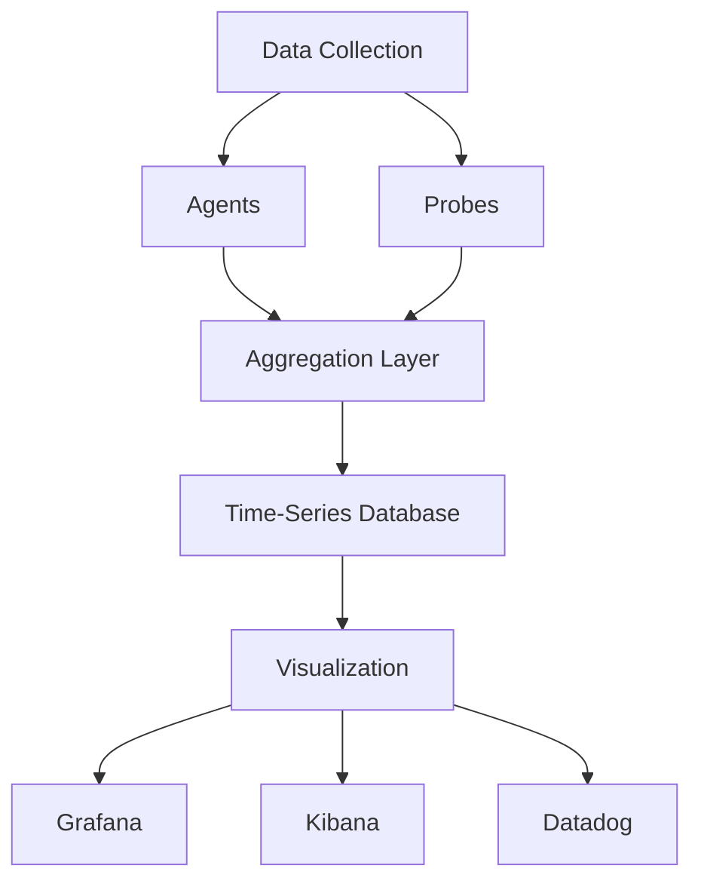

# Lesson 2: Monitoring Strategies

## 1. First-Principles Intuition & Invariants

In the realm of AI/MLops and serving, the health and performance of the pipeline are paramount. A pipeline is a series of automated processes that transform raw data into valuable insights, models, and services. Monitoring strategies are essential for ensuring that these processes run smoothly, efficiently, and reliably. At its core, monitoring is about observing the state of a system over time to detect anomalies, understand performance characteristics, and make informed decisions to optimize and maintain the system.

The problem space of monitoring in AI/MLops pipelines is multifaceted. It involves tracking the flow of data through various stages, from data ingestion to model deployment, and ensuring that each component functions as intended. Monitoring strategies must account for the dynamic nature of these pipelines, where data volumes, model complexity, and user demand can vary significantly over time. Additionally, monitoring must be robust enough to handle the failure modes inherent in distributed systems, such as network partitions, node failures, and resource contention.

To establish a theoretical grounding, we must consider the invariants that underpin effective monitoring. First, monitoring must be comprehensive, capturing all relevant metrics across the entire pipeline. This includes metrics related to data processing, model training, evaluation, and serving, as well as system-level metrics such as CPU usage, memory consumption, and network latency. Second, monitoring must be real-time, providing timely insights into the current state of the pipeline. Third, monitoring must be actionable, enabling engineers to diagnose issues, identify root causes, and implement corrective measures. Finally, monitoring must be scalable, capable of handling the increasing complexity and volume of data in modern AI/MLops pipelines.

## 2. Core Architecture & Mechanics

The architecture of a monitoring system for AI/MLops pipelines is built on a foundation of data collection, aggregation, storage, and visualization. At the heart of this architecture is the concept of a metric, which is a quantitative measure of some aspect of the system. Metrics can be categorized into two main types: counters and gauges. Counters are used to track the number of events that occur over a period of time, such as the number of data records processed or the number of model predictions made. Gauges, on the other hand, provide a snapshot of the current state of a system, such as the current CPU usage or the number of active model instances.

To collect metrics, a monitoring system typically uses a combination of agents and probes. Agents are software components that run on each node in the pipeline and collect metrics from the local environment. Probes, on the other hand, are external tools that can be used to collect metrics from remote systems or services. Once collected, metrics are sent to a central aggregation layer, where they are processed and stored for later analysis.

The aggregation layer is responsible for normalizing and transforming raw metrics into a consistent format. This involves tasks such as filtering out noise, aggregating data from multiple sources, and applying transformations to derive higher-level metrics. The aggregated metrics are then stored in a time-series database, which is optimized for fast read and write operations. Popular time-series databases for monitoring include Prometheus, InfluxDB, and TimescaleDB.

Visualization is a critical component of any monitoring system, as it enables engineers to interpret and understand the data. Visualization tools provide a graphical representation of metrics, allowing engineers to identify trends, patterns, and anomalies. Popular visualization tools include Grafana, Kibana, and Datadog. These tools provide a wide range of chart types, such as line graphs, bar charts, and heatmaps, and support advanced features such as drill-downs, filtering, and alerting.

To illustrate the architecture of a monitoring system for AI/MLops pipelines, we can use a Mermaid diagram:

In this diagram, data collection is performed by agents and probes, which send metrics to the aggregation layer. The aggregation layer processes and stores the metrics in a time-series database, which is then visualized using tools such as Grafana, Kibana, and Datadog.

## 3. High-Performance Optimization & Failure Modes

To ensure that a monitoring system for AI/MLops pipelines performs efficiently and reliably, several optimization strategies and failure modes must be considered. One key optimization strategy is to minimize the overhead of data collection and aggregation. This can be achieved by using lightweight agents and probes, as well as by optimizing the data collection and aggregation processes. For example, data can be batched and compressed before being sent to the aggregation layer, reducing the amount of network traffic and processing overhead.

Another optimization strategy is to use efficient data storage and retrieval techniques. Time-series databases are optimized for fast read and write operations, but they can still become a bottleneck if not used properly. To optimize data storage and retrieval, it is important to carefully design the schema and indexing strategy. For example, metrics can be partitioned by time and tagged with relevant metadata, allowing for efficient querying and filtering.

Failure modes in monitoring systems can arise from a variety of sources, including data collection, aggregation, storage, and visualization. One common failure mode is data loss, which can occur if metrics are not collected or stored properly. To mitigate this risk, it is important to use reliable data collection and storage mechanisms, such as redundant agents and probes, and to implement data validation and error handling.

Another failure mode is data skew, which can occur if metrics are not evenly distributed across the system. Data skew can lead to performance bottlenecks and inaccurate insights. To mitigate this risk, it is important to use efficient data partitioning and indexing strategies, as well as to implement load balancing and resource scaling.

In addition to these technical challenges, monitoring systems must also be designed to handle the dynamic nature of AI/MLops pipelines. Pipelines can experience significant variability in data volumes, model complexity, and user demand, which can impact the performance and reliability of the monitoring system. To handle this variability, it is important to use scalable and flexible monitoring architectures, such as distributed data collection and aggregation, and to implement adaptive resource scaling and load balancing.

In conclusion, monitoring strategies are essential for ensuring the health and performance of AI/MLops pipelines. A comprehensive monitoring system must capture all relevant metrics, provide real-time insights, and enable actionable decision-making. The architecture of a monitoring system is built on a foundation of data collection, aggregation, storage, and visualization, and must be optimized for performance and reliability. By understanding the first-principles intuition and invariants of monitoring, and by considering the core architecture and mechanics, as well as high-performance optimization and failure modes, engineers can design and implement effective monitoring strategies for AI/MLops pipelines.
