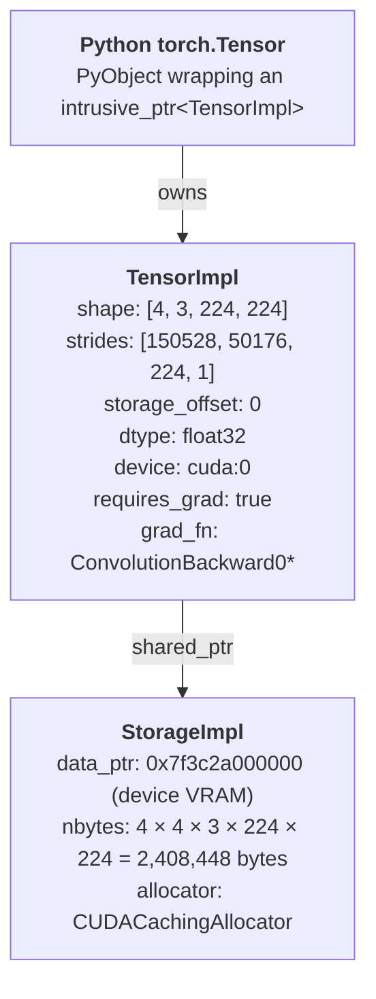

# Lesson 1: Tensor Abstraction, Storage, and Computational Semantics

## 1. First-Principles Intuition & Invariants

Every numerical computation in PyTorch begins and ends with a tensor. Not a matrix, not an array — a tensor, in the specific sense PyTorch intends: a multi-dimensional, typed, device-resident buffer of numbers together with a set of mathematical operations that compose coherently under hardware acceleration. Before writing a single line of training code, the serious ML engineer must understand what a tensor actually *is* at the storage level, because every performance failure, every shape mismatch, every subtle gradient bug traces back to a misunderstood invariant in this foundational abstraction.

The word "tensor" originates in differential geometry and physics, where it denotes a multilinear map that transforms covariantly with changes of basis. In that formal sense, a rank-2 tensor is not a matrix — it is an object whose components change predictably when the coordinate system rotates. PyTorch inherits the word but narrows its meaning: a `torch.Tensor` is a view onto a contiguous (or strided) block of typed memory, annotated with shape, stride, offset, dtype, and device metadata. The geometric invariance properties are not enforced by the library; instead, they are the responsibility of the mathematician constructing the model. This distinction matters because it means PyTorch tensors can represent things that are not tensors in the strict geometric sense — batched images, ragged token sequences padded to a uniform length, intermediate activations — and the library will happily operate on them without complaint.

The foundational invariant governing every tensor is the **stride-shape relationship**. A tensor's shape is an ordered tuple of integers $(d_0, d_1, \ldots, d_{n-1})$ giving the size of each dimension. Its stride is a parallel tuple $(s_0, s_1, \ldots, s_{n-1})$ where $s_i$ is the number of scalar elements in the underlying storage buffer that must be skipped to advance one step along dimension $i$. The element at logical index $(i_0, i_1, \ldots, i_{n-1})$ lives at physical offset:

$$\text{offset} = \text{storage\_offset} + \sum_{k=0}^{n-1} i_k \cdot s_k$$

This formula is not bookkeeping trivia. It is the entire contract between the tensor's logical view and its physical memory. A contiguous row-major (C-style) tensor of shape $(M, N)$ has strides $(N, 1)$, meaning advancing along the last dimension costs one element, while advancing along the first costs $N$ elements. A column-major (Fortran-style) layout would yield strides $(1, M)$. When you call `tensor.T` on a 2D tensor, PyTorch does not copy memory — it returns a new tensor header with shape $(N, M)$ and strides $(1, N)$, pointing at the same storage. This zero-copy transpose is elegant and fast, but it produces a non-contiguous tensor, and many operations — `view`, certain in-place kernels, `torch.cat` along arbitrary dimensions — require contiguous memory and will raise or silently copy if handed a non-contiguous input. The difference between `reshape` (which may or may not copy) and `view` (which never copies but asserts contiguity) is precisely this contract.

The `dtype` field encodes the numeric representation of each element. PyTorch supports a spectrum ranging from `torch.float64` (IEEE 754 double precision, 64 bits) down to `torch.float8_e4m3fn` (8-bit floating point using 4 exponent bits and 3 mantissa bits, introduced for transformer inference). Between those extremes live `torch.float32` (the default training dtype), `torch.bfloat16` (Brain Float 16, using the same 8-bit exponent as float32 with a 7-bit truncated mantissa, designed for training stability on TPUs and modern GPUs), `torch.float16` (IEEE half precision, with a 5-bit exponent, more dynamic range-sensitive), and integer types from `torch.int8` through `torch.int64`. The choice of dtype is not merely a memory footprint decision — it determines the numerical range, the precision of gradient accumulation, and whether a given CUDA kernel is available. NVIDIA Tensor Cores, for instance, perform matrix multiplications natively in FP16 or BF16 and accumulate into FP32, which is why mixed-precision training with `torch.autograd.GradScaler` and `torch.cuda.amp.autocast` can reach 2–3× throughput over full FP32 training without sacrificing convergence.

The `device` field specifies the memory domain in which the storage buffer lives. `torch.device('cpu')` allocates in process heap memory managed by PyTorch's C++ allocator, backed ultimately by `malloc` or `mmap`. `torch.device('cuda:0')` allocates in the VRAM of CUDA device 0, managed by `cudaMalloc` through PyTorch's caching allocator (more on that in Lesson 6). Operations that cross device boundaries require explicit host-to-device or device-to-host transfers via `.to(device)` or `.cuda()` / `.cpu()` — there is no implicit migration, and attempting an arithmetic operation between a CPU tensor and a CUDA tensor raises a hard error. This strictness is intentional: implicit data movement is one of the most common sources of hidden latency in production inference pipelines, and PyTorch forces you to be explicit about it.

Autograd — the automatic differentiation engine — is the third invisible dimension of every tensor. The boolean `requires_grad` flag marks a tensor as a leaf variable whose gradient should be accumulated during the backward pass. When `requires_grad=True` on any input to an operation, PyTorch's autograd engine constructs a `Function` node in the dynamic computational graph (the DAG of `grad_fn` pointers visible on the resulting tensor) that knows how to compute the vector-Jacobian product for the backward pass. This DAG is built eagerly, operation by operation, as the forward pass executes — a design called define-by-run, which contrasts with TensorFlow 1.x's define-and-run static graph model and gives PyTorch its characteristic debugging ergonomics. The gradient of a scalar loss with respect to every leaf is then computed by `loss.backward()`, which walks the DAG in reverse topological order and accumulates gradients into `.grad` buffers. Understanding that this graph exists and that every intermediate tensor with `requires_grad=True` holds a reference to it is the prerequisite for understanding both gradient checkpointing (Section 3) and the common bug of forgetting `.detach()` before feeding activations into a loss metric, which leaks the entire forward graph into memory.

## 2. Core Architecture & Mechanics

The relationship between a `torch.Tensor` Python object and the physical bytes that back it involves three distinct layers: the Python wrapper, the C++ `TensorImpl`, and the `StorageImpl`.



The critical insight this diagram conveys is that multiple `TensorImpl` objects can share a single `StorageImpl` through reference counting — that is precisely how slicing, transposing, `expand`, and `as_strided` produce views rather than copies. When you write `x = tensor[2:5]`, a new `TensorImpl` is allocated with an updated `storage_offset` and shape, but the `StorageImpl` reference count increments rather than any bytes being copied. The storage is freed only when every view pointing to it is destroyed — which means a small slice of a large tensor keeps the entire original allocation alive, a fact that bites engineers who cache output slices without first calling `.clone()`.

Understanding strides concretely requires running the code and verifying the invariants directly:

```python
import torch

# Create a contiguous float32 tensor on CUDA
x = torch.randn(4, 3, 224, 224, dtype=torch.float32, device='cuda:0')

print(x.shape)           # torch.Size([4, 3, 224, 224])
print(x.stride())        # (150528, 50176, 224, 1)
print(x.is_contiguous()) # True
print(x.storage_offset()) # 0

# Transpose the last two spatial dimensions: zero-copy metadata flip
x_t = x.transpose(2, 3)
print(x_t.shape)           # torch.Size([4, 3, 224, 224])
print(x_t.stride())        # (150528, 50176, 1, 224)  <-- strides swapped
print(x_t.is_contiguous()) # False

# view() will raise because x_t is non-contiguous
try:
    x_t.view(-1)
except RuntimeError as e:
    print(e)
# RuntimeError: view size is not compatible with input tensor's size and stride

# contiguous() materializes a new storage in C-order, then view() works
x_tc = x_t.contiguous()
print(x_tc.stride())        # (150528, 50176, 224, 1)  -- back to C-order
flat = x_tc.view(-1)
print(flat.shape)           # torch.Size([602112])
```

The dtype promotion and device invariants are enforced through PyTorch's type promotion rules, which follow a strict lattice. When two tensors of different dtypes meet in an arithmetic operation, PyTorch promotes to the type that can represent both without loss, following the hierarchy `bool < int8 < int16 < int32 < int64 < float16 < bfloat16 < float32 < float64 < complex64 < complex128`. Mixing `float32` and `float64` yields `float64`; mixing `int32` and `float32` yields `float32`. The practical danger is unintended upcasting: if one tensor in a large computation is accidentally `float64`, every downstream operation upcasts to `float64`, immediately halving memory throughput on CUDA and disabling Tensor Core acceleration.

```python
import torch

a = torch.ones(3, dtype=torch.float32, device='cuda')
b = torch.ones(3, dtype=torch.float64, device='cuda')
c = a + b
print(c.dtype)  # torch.float64 -- silent promotion

# Diagnose dtype of all parameters in a model
model = torch.nn.Linear(512, 256)
for name, p in model.named_parameters():
    print(f"{name}: {p.dtype}, {p.device}")
# weight: torch.float32, cpu
# bias:   torch.float32, cpu
```

Broadcasting deserves careful mechanical exposition because it is both powerful and a frequent source of shape bugs. PyTorch implements NumPy-compatible broadcasting, which proceeds as follows: the shapes of two operands are right-aligned, and each dimension is compared. Two dimension sizes are compatible if they are equal or if one of them is exactly 1. A size-1 dimension is virtually replicated along that axis to match the other operand's size without allocating memory — it is implemented by setting the stride of that dimension to 0 in the `TensorImpl`, so the same slice of storage is read repeatedly. The mental model is that `torch.broadcast_to(x, target_shape)` returns a view with zero-strides on the expanded dimensions.

```python
import torch

# Shape semantics of broadcasting
weights = torch.randn(1, 512)   # shape [1, 512]
biases  = torch.randn(32, 1)    # shape [32, 1]

# Right-align:  [1, 512]
#               [32,  1]
# Broadcast to: [32, 512]
result = weights + biases
print(result.shape)  # torch.Size([32, 512])

# Inspect the zero-stride trick explicitly
expanded = weights.expand(32, 512)
print(expanded.stride())   # (0, 1) -- stride 0 on dim 0: no copy, just re-reads
print(expanded.is_contiguous())  # False

# A subtle broadcasting pitfall: shape [512] vs [512, 1]
v = torch.randn(512)
m = torch.randn(512, 1)
# This broadcasts to [512, 512], not [512] -- almost always unintended
out = v + m
print(out.shape)  # torch.Size([512, 512])
```

The autograd graph mechanics become visible through the `grad_fn` attribute and the `torch.autograd.graph.get_dot` tooling or `torchviz`. Every differentiable operation creates a `Function` subclass instance stored as `tensor.grad_fn`. Calling `backward()` traverses these nodes in reverse topological order using the chain rule, multiplying incoming gradients by the local Jacobian (or, more precisely, the vector-Jacobian product, since PyTorch only computes full Jacobians implicitly unless `torch.autograd.functional.jacobian` is called explicitly). The key invariant: intermediate tensors whose `grad_fn` is not `None` are non-leaf tensors. Only leaf tensors (those created directly by user code with `requires_grad=True`) accumulate `.grad`. Calling `.grad` on a non-leaf raises a warning and returns `None` by default; to inspect intermediate gradients, call `tensor.retain_grad()` before the forward pass.

```python
import torch

x = torch.tensor([2.0, 3.0], requires_grad=True)   # leaf
y = x ** 2                                          # non-leaf, grad_fn=PowBackward0
z = y.sum()                                         # non-leaf, grad_fn=SumBackward0

print(x.is_leaf)      # True
print(y.is_leaf)      # False
print(y.grad_fn)      # <PowBackward0 object at 0x...>

y.retain_grad()       # opt-in to storing gradient on non-leaf
z.backward()

print(x.grad)         # tensor([4., 6.])  -- dz/dx = 2x
print(y.grad)         # tensor([1., 1.])  -- dz/dy = 1 (from sum)
```

## 3. High-Performance Optimization & Failure Modes

The gap between a tensor operation that runs at hardware memory bandwidth and one that runs at a tenth of that bandwidth is usually a question of memory layout. CUDA kernels are designed to perform *coalesced* global memory accesses, meaning that adjacent threads in a warp (a group of 32 SIMD lanes) should read adjacent addresses in VRAM. A contiguous, row-major tensor in a matrix multiplication achieves this: the inner dimension is packed linearly in memory, so each warp reads a 128-byte cache line (32 elements of float32) in a single transaction. A transposed tensor that has not been made contiguous forces strided, non-coalesced accesses where each thread jumps `stride` elements forward — turning one memory transaction into 32 separate ones and collapsing effective bandwidth by roughly 10–32×. `cuBLAS` and PyTorch's internal `aten` kernels handle the common case of transposed matrix multiply without an explicit copy (they dispatch to `cublasSgemm` with `CUBLAS_OP_T`), but the moment you stray from the core linear algebra operations into custom `torch.autograd.Function` or `torch.utils.cpp_extension` kernels, non-contiguous inputs become your problem.

The `torch.Tensor.contiguous()` call is the blunt instrument: it allocates a new buffer and writes a C-order copy. The surgical instrument is `torch.Tensor.as_strided()`, which lets you construct arbitrary views, and understanding when you need a copy vs. a view is the difference between an efficient pipeline and one that doubles memory consumption mid-forward-pass. A practical diagnostic before entering a performance-critical kernel is:

```python
def assert_contiguous(t: torch.Tensor, name: str = "tensor") -> torch.Tensor:
    if not t.is_contiguous():
        import warnings
        warnings.warn(f"{name} is non-contiguous (strides={t.stride()}), materializing copy.")
        return t.contiguous()
    return t
```

Memory fragmentation in the CUDA caching allocator is a failure mode that manifests as `torch.cuda.OutOfMemoryError` on models that should fit within the device's VRAM budget. PyTorch's allocator maintains a pool of freed blocks and attempts to satisfy new allocations by reusing blocks of matching or larger size. When the allocation pattern is variable-sized — common in NLP workloads with variable sequence lengths — the allocator can reach a state where total reserved memory is well below the GPU's capacity, but no individual free block is large enough for the requested allocation. The fix is a combination of calling `torch.cuda.empty_cache()` to return freed blocks to the OS (at the cost of re-triggering `cudaMalloc` on the next allocation), using `torch.cuda.memory.set_per_process_memory_fraction()` to cap allocation before fragmentation becomes critical, or switching to `max_split_size_mb` via the `PYTORCH_CUDA_ALLOC_CONF` environment variable to control the maximum size of a block that the allocator will split.

```bash
# Tune the CUDA caching allocator to reduce fragmentation
# max_split_size_mb: blocks larger than this are not split, reducing fragmentation
# garbage_collection_threshold: fraction of reserved memory that triggers GC
export PYTORCH_CUDA_ALLOC_CONF=max_split_size_mb:512,garbage_collection_threshold:0.8

python train.py
```

Mixed-precision training with `torch.autocast` is now standard practice for transformer and CNN workloads, but its interaction with dtype semantics requires precise understanding to avoid silent accuracy degradation. `torch.autocast(device_type='cuda', dtype=torch.bfloat16)` wraps a code region and instructs the ATen dispatch layer to run eligible operations (matrix multiplies, convolutions, attention) in BF16 while keeping numerically sensitive operations (batch norm running statistics, softmax, loss computation) in FP32. The autocast context does not cast the model's weight tensors — those remain FP32 in memory and are cast on-the-fly inside the kernel. The GradScaler is unnecessary with BF16 (its dynamic range matches FP32) but essential with FP16, where the reduced exponent range causes gradients to underflow to zero before the optimizer step.

```python
import torch
import torch.nn as nn
from torch.cuda.amp import autocast, GradScaler

model = nn.TransformerEncoder(
    nn.TransformerEncoderLayer(d_model=512, nhead=8, batch_first=True),
    num_layers=6
).cuda()

optimizer = torch.optim.AdamW(model.parameters(), lr=1e-4)
scaler = GradScaler()  # only needed for float16, not bfloat16

src = torch.randn(16, 128, 512, device='cuda')  # [batch, seq, d_model]

with autocast(device_type='cuda', dtype=torch.bfloat16):
    out = model(src)
    loss = out.mean()

# With bfloat16, GradScaler is a no-op but kept for compatibility
scaler.scale(loss).backward()
scaler.step(optimizer)
scaler.update()

# Verify no unintended float64 promotion
for name, p in model.named_parameters():
    assert p.dtype == torch.float32, f"Unexpected dtype on {name}: {p.dtype}"
```

Gradient checkpointing addresses the memory cost of storing all intermediate activations for the backward pass. In a standard forward pass through an $L$-layer network, every activation must be retained until the backward pass reaches the corresponding `Function` node — meaning memory consumption grows $O(L)$ with depth. `torch.utils.checkpoint.checkpoint` breaks this by recomputing activations during the backward pass rather than storing them, trading compute for memory at roughly $O(\sqrt{L})$ peak memory with $O(\log L)$ recomputation overhead if applied at regular intervals. The trap is that checkpointed functions must be deterministic: any operation using `torch.nn.Dropout` or random sampling inside a checkpointed block will produce different values on recomputation unless `use_reentrant=False` is set and the RNG state is properly managed.

```python
import torch
import torch.nn as nn
from torch.utils.checkpoint import checkpoint

class CheckpointedBlock(nn.Module):
    def __init__(self, d_model: int):
        super().__init__()
        self.ff = nn.Sequential(
            nn.Linear(d_model, 4 * d_model),
            nn.GELU(),
            nn.Linear(4 * d_model, d_model),
        )
        self.norm = nn.LayerNorm(d_model)

    def _forward(self, x: torch.Tensor) -> torch.Tensor:
        return self.norm(x + self.ff(x))

    def forward(self, x: torch.Tensor) -> torch.Tensor:
        # use_reentrant=False is required for compatibility with torch.compile
        return checkpoint(self._forward, x, use_reentrant=False)


model = nn.Sequential(*[CheckpointedBlock(512) for _ in range(24)]).cuda()
x = torch.randn(8, 1024, 512, requires_grad=True, device='cuda')

before = torch.cuda.memory_allocated()
out = model(x)
after = torch.cuda.memory_allocated()
print(f"Peak activation memory: {(after - before) / 1e6:.1f} MB")
out.sum().backward()
```

The final failure mode to internalize is the **in-place operation and autograd correctness conflict**. PyTorch's autograd engine tracks tensor versions through an integer counter (`_version`) that increments on every in-place modification. If a tensor that was saved for the backward pass is modified in-place before `backward()` runs, the engine detects the version mismatch and raises `RuntimeError: one of the variables needed for gradient computation has been modified by an inplace operation`. The solution is to avoid in-place operations on tensors that require gradients, or to confine in-place operations to leaf tensors after `optimizer.zero_grad()` clears the graph — which is exactly what `optimizer.step()` does when updating weights. The operators `+=`, `-=`, `*=`, `tensor.fill_()`, `tensor.zero_()`, and any method ending in `_` are in-place. Using `tensor = tensor + value` instead creates a new tensor and a new `grad_fn`, leaving the saved reference untouched.

```python
import torch

x = torch.randn(4, requires_grad=True)
y = x * 2  # y saved for backward; y._version == 0

# In-place modification of y invalidates the saved reference
y += 1     # y._version == 1

try:
    y.sum().backward()
except RuntimeError as e:
    print(e)
# RuntimeError: one of the variables needed for gradient computation
# has been modified by an inplace operation: ...

# Correct pattern: out-of-place
x = torch.randn(4, requires_grad=True)
y = x * 2
z = y + 1   # new tensor, y._version unchanged
z.sum().backward()
print(x.grad)  # tensor([2., 2., 2., 2.])
```

The tensor abstraction is deceptively simple on the surface — a shaped array with operations — but its correctness and performance properties are entirely determined by the interaction of its stride layout, dtype, device placement, and autograd graph membership. Every lesson in this curriculum builds on these invariants. When a gradient explodes, when a training run exhausts VRAM, when a model fails to accelerate under `torch.compile`, the root cause nearly always traces back to one of the mechanical properties covered here: a non-contiguous layout passed to a kernel that expected C-order, an unintended dtype promotion that disabled Tensor Cores, an in-place operation that corrupted the autograd version counter, or a view holding a reference to a storage that should have been freed. Mastery of PyTorch begins at this level, and it does not exist below it.
