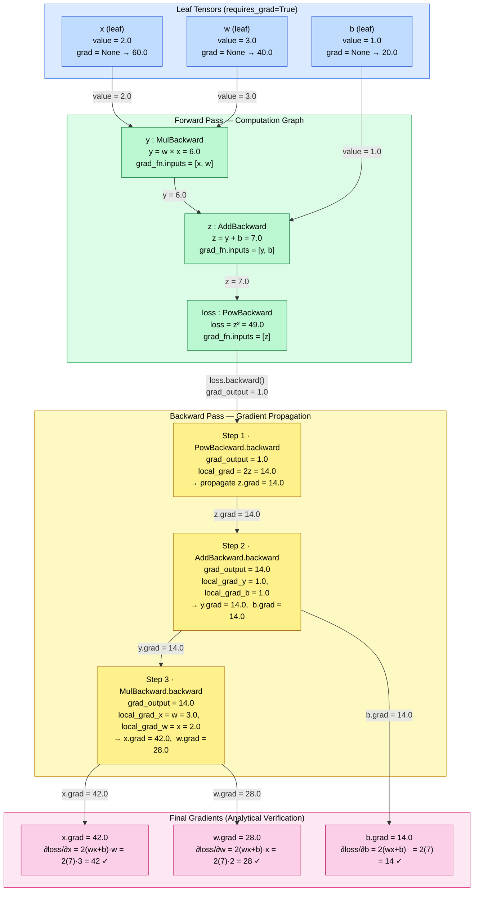

# Lesson 2: Automatic Differentiation, Computation Graphs, and Gradient Flow

## 1. First-Principles Intuition & Invariants

Modern deep learning rests on a deceptively simple mathematical foundation: the ability to compute gradients of scalar loss functions with respect to millions of parameters efficiently and correctly. PyTorch's automatic differentiation system, commonly called autograd, transforms imperative Python code into a dynamic computation graph that tracks every tensor operation, building a complete record of the forward pass that enables mechanically correct reverse-mode differentiation during backpropagation. Understanding autograd requires viewing neural network training not as a monolithic black box but as a precisely orchestrated dance between forward computation, graph construction, and gradient accumulation through the chain rule applied recursively across composite functions.

At its essence, automatic differentiation solves a computational problem that predates modern machine learning by decades. Given a function $f: \mathbb{R}^n \to \mathbb{R}^m$ composed of elementary operations whose derivatives we know analytically, we wish to compute the Jacobian matrix $\mathbf{J} \in \mathbb{R}^{m \times n}$ without resorting to finite-difference approximations that suffer from numerical instability and catastrophic cancellation errors. Symbolic differentiation, the approach taken by early computer algebra systems, produces exact closed-form derivatives but suffers from expression swell: the derivative of a product of $n$ terms explodes into $n$ products of $n-1$ terms each, creating exponentially large expressions that overwhelm memory and compilation time. Numerical differentiation via finite differences $\frac{f(x+h) - f(x)}{h}$ remains simple to implement but introduces truncation error proportional to $h$ and round-off error proportional to $\frac{\epsilon}{h}$ where $\epsilon$ represents machine precision, forcing an uncomfortable tradeoff with no satisfying resolution.

Automatic differentiation transcends both approaches by recognizing that every program, no matter how complex, decomposes into a finite sequence of elementary operations—additions, multiplications, exponentials, logarithms, trigonometric functions—each with known, simple derivatives. By applying the multivariate chain rule systematically to this sequence, we obtain exact derivatives at the cost of a small constant factor over the original computation. The two modes of automatic differentiation, forward and reverse, differ fundamentally in their computational complexity and memory tradeoffs. Forward-mode AD propagates derivatives in the same direction as the original computation, accumulating how each input variable affects each intermediate value through the Jacobian-vector product $\frac{\partial \mathbf{y}}{\partial \mathbf{x}} \mathbf{v}$. This mode proves efficient when the output dimension greatly exceeds the input dimension, requiring only $O(n)$ passes to compute the full Jacobian for $n$ inputs.

Reverse-mode automatic differentiation, the technique PyTorch implements, inverts this logic entirely. After completing the forward pass and recording the computation graph, we traverse the graph backward from outputs to inputs, computing vector-Jacobian products $\mathbf{v}^T \frac{\partial \mathbf{y}}{\partial \mathbf{x}}$ that accumulate how the output scalar loss propagates sensitivity backward to each parameter. For neural network training where we have millions of parameters but a single scalar loss, reverse-mode AD delivers the entire gradient vector in a single backward pass with computational cost proportional to the forward pass itself—typically within a factor of three to five due to additional bookkeeping overhead. This asymptotic efficiency explains why modern deep learning became computationally tractable; training a network with ten million parameters requires computing ten million partial derivatives, a task that would require ten million forward passes under forward-mode AD but only one backward pass under reverse-mode.

PyTorch embeds automatic differentiation directly into its tensor abstraction through a elegant contract: every tensor carries an optional boolean flag `requires_grad` that signals whether this tensor participates in gradient computation. When operations combine tensors with `requires_grad=True`, PyTorch constructs computation graph nodes that record the operation type, input tensor references, and sufficient metadata to compute local gradients during the backward pass. This design philosophy embraces dynamic graph construction, meaning the computation graph is built and destroyed on every forward pass, allowing Python control flow—conditionals, loops, dynamic branching—to determine the network architecture at runtime. Dynamic graphs contrast sharply with the static graph paradigm pioneered by TensorFlow 1.x, where the entire computation graph required explicit construction and compilation before execution, precluding data-dependent control flow and complicating debugging.

The fundamental invariant governing PyTorch's autograd system states that gradient computation remains valid if and only if the computation graph forms a directed acyclic graph from inputs to the scalar loss. Cycles in the computation graph create ambiguity about how many times each gradient contribution should accumulate, violating the mathematical foundations of the chain rule. PyTorch enforces acyclicity not through static analysis but through the temporal ordering of operations: each tensor operation creates a new tensor node, and earlier nodes can only reference previously created nodes, naturally preventing cycles. This temporal causality aligns with the imperative programming model, making PyTorch's dynamic graphs feel natural to Python programmers while maintaining mathematical correctness.

Gradient flow through the computation graph obeys a precise accumulation discipline. When a tensor participates in multiple downstream operations—a common occurrence when one hidden layer feeds into multiple subsequent layers—the backward pass must accumulate gradients from all consumer operations before the gradient becomes complete. PyTorch implements this accumulation by traversing the graph in reverse topological order, ensuring that when we compute the gradient for a tensor operation, all downstream gradients have already been computed and accumulated. This topological ordering guarantees that each tensor receives its complete gradient exactly once, with contributions from all paths through the computation graph combined through summation as prescribed by the multivariate chain rule.

The memory semantics of autograd introduce subtle but critical constraints. PyTorch must retain intermediate tensor values from the forward pass because computing gradients during the backward pass requires these values. Consider the derivative of $y = x^2$: computing $\frac{dy}{dx} = 2x$ requires knowing the value of $x$ at the point of differentiation. For deep networks with hundreds of layers and gigabyte-scale activation tensors, this memory requirement dominates training costs, often exceeding parameter memory by an order of magnitude. Gradient checkpointing addresses this tension by discarding selected intermediate activations during the forward pass and recomputing them on-demand during the backward pass, trading computation for memory at a ratio determined by the checkpointing interval. A network with $n$ layers can reduce memory from $O(n)$ to $O(\sqrt{n})$ by checkpointing every $\sqrt{n}$ layers, requiring only $O(\sqrt{n})$ recomputation overhead.

## 2. Core Architecture & Mechanics

PyTorch structures its automatic differentiation engine around three interconnected abstractions: the `Tensor` object that represents multidimensional arrays with optional gradient tracking, the `Function` class that encapsulates forward and backward operations, and the `Variable` wrapper that historically separated gradient tracking from raw tensor storage but has since been unified into the tensor itself in PyTorch versions 0.4 and later. Understanding these components and their interactions illuminates how Python operations on tensors translate into computation graph construction and subsequent gradient computation.

Every PyTorch tensor carries several attributes relevant to automatic differentiation beyond its raw data buffer. The `requires_grad` boolean flag determines whether operations on this tensor should construct computation graph nodes. The `grad` attribute, initially `None`, accumulates gradients after calling `backward()` on a downstream loss. The `grad_fn` attribute holds a reference to the `Function` object that created this tensor during the forward pass, forming the backward edge in the computation graph. Leaf tensors—those created directly by user code rather than as outputs of operations—have `grad_fn=None` but may have `requires_grad=True`, marking them as independent variables of the optimization problem. Only leaf tensors accumulate gradients in their `.grad` attribute; intermediate tensors receive gradients during the backward pass but do not retain them unless explicitly requested via `retain_grad()`.

The computation graph in PyTorch represents a heterogeneous data structure where nodes correspond to `Function` objects and directed edges encode data dependencies between tensors. Each `Function` subclass implements two critical methods: `forward(*inputs)` which computes the operation's output given input tensors, and `backward(grad_output)` which computes gradients of inputs given the gradient of the output. When you execute a tensor operation like `z = x * y`, PyTorch instantiates a `MulBackward` function object, calls its `forward` method to compute the result, stores references to input tensors `x` and `y` within the function object, and assigns this function as `z.grad_fn`. The backward pass traverses these `grad_fn` references in reverse, calling each function's `backward` method and propagating gradients to predecessor tensors.



The actual implementation leverages C++ for performance-critical graph traversal and gradient computation. PyTorch's `torch/csrc/autograd/` directory contains the autograd engine implemented in C++, exposing Python bindings through pybind11. The `Engine::execute()` method drives the backward pass using a worklist algorithm that maintains a priority queue of ready-to-execute `Function` nodes, processing them in reverse topological order. Each function's `backward()` implementation computes local gradients using saved tensor values and propagates them to predecessor nodes, decrementing reference counts to determine when predecessors become ready for execution.

Reference counting and memory management present intricate challenges in the autograd system. During the forward pass, each `Function` object must retain references to input tensors or derived quantities needed for gradient computation, preventing garbage collection of these tensors until the backward pass completes. PyTorch employs smart pointers (`std::shared_ptr`) in C++ to manage these references automatically. After the backward pass completes, the computation graph itself becomes eligible for garbage collection unless explicitly retained via `retain_graph=True` in the `backward()` call. Retaining graphs allows multiple backward passes over the same computation, useful in meta-learning or certain reinforcement learning algorithms, but at the cost of persistent memory consumption until explicit graph destruction.

In-place operations introduce a fundamental tension with automatic differentiation because they destroy information needed for correct gradient computation. Consider the in-place operation `x += 1` applied to a tensor that participates in multiple subsequent operations. If the autograd system records only the final modified value of `x`, computing gradients for operations that used the original value of `x` becomes impossible or incorrect. PyTorch addresses this through a versioning mechanism: each tensor maintains a monotonically increasing version counter incremented on every in-place modification. When constructing computation graph nodes, PyTorch records both the tensor reference and its current version. During the backward pass, if a tensor's version has incremented since graph construction, PyTorch raises a runtime error indicating that in-place modification invalidated the computation graph.

```python
import torch

# Demonstrate in-place operation hazard
x = torch.tensor([1.0, 2.0, 3.0], requires_grad=True)
y = x * 2  # y depends on original x

# In-place modification increments x's version counter
x.add_(1.0)  # x now contains [2.0, 3.0, 4.0]

z = x * 3  # z depends on modified x

loss = y.sum() + z.sum()

try:
    loss.backward()  # RuntimeError: in-place operation invalidated gradient
except RuntimeError as e:
    print(f"Error: {e}")

# Correct approach: use out-of-place operations
x = torch.tensor([1.0, 2.0, 3.0], requires_grad=True)
y = x * 2
x_modified = x + 1.0  # Creates new tensor, preserves x
z = x_modified * 3
loss = y.sum() + z.sum()
loss.backward()  # Succeeds: x.grad = 2.0, accumulated correctly
```

The `backward()` method accepts several parameters that control gradient computation behavior. The `gradient` argument specifies the initial gradient tensor, defaulting to a tensor of ones with the same shape as the output, which corresponds to computing $\frac{\partial \text{loss}}{\partial \text{params}}$ when the loss is a scalar. For non-scalar outputs, you must provide explicit gradients matching the output shape, representing the vector in the vector-Jacobian product. The `retain_graph` parameter determines whether the computation graph persists after the backward pass; by default, PyTorch destroys the graph to free memory, but certain algorithms require multiple backward passes through the same graph. The `create_graph` parameter enables higher-order derivatives by making the backward pass itself differentiable, constructing a computation graph of gradient computations that allows computing Hessian-vector products and higher-order optimization algorithms.

Gradient accumulation patterns frequently arise in production training pipelines constrained by GPU memory. When batch sizes required for statistical efficiency exceed available memory, practitioners split logical batches into smaller microbatches, accumulating gradients across multiple forward-backward passes before applying optimizer updates. PyTorch gradients accumulate additively by default: calling `backward()` multiple times without zeroing gradients sums contributions into the `.grad` attribute. This behavior matches the mathematical definition of gradients over batches as the mean gradient across examples, allowing natural implementation of gradient accumulation loops.

```python
import torch
import torch.nn as nn

# Gradient accumulation for effective large batch training
model = nn.Sequential(
    nn.Linear(1024, 512),
    nn.ReLU(),
    nn.Linear(512, 256),
    nn.ReLU(),
    nn.Linear(256, 10)
)

optimizer = torch.optim.SGD(model.parameters(), lr=0.01)
accumulation_steps = 4  # Simulate 4x larger batch

# Training loop with gradient accumulation
for epoch in range(10):
    optimizer.zero_grad()  # Zero gradients once per accumulation cycle
    
    for step in range(accumulation_steps):
        # Simulate loading microbatch
        inputs = torch.randn(32, 1024)
        targets = torch.randint(0, 10, (32,))
        
        # Forward pass
        outputs = model(inputs)
        loss = nn.functional.cross_entropy(outputs, targets)
        
        # Scale loss by accumulation steps to maintain gradient magnitude
        loss = loss / accumulation_steps
        
        # Backward pass accumulates gradients
        loss.backward()
    
    # Single optimizer step after accumulating gradients
    optimizer.step()
```

Non-differentiable operations and gradient masking require careful handling in the autograd system. Operations like indexing, slicing, masking, and gathering create sparse gradient patterns where only a subset of input elements contribute to the output. PyTorch's autograd correctly handles these cases by implementing backward functions that place gradients at the appropriate indices while zeroing unused positions. Detaching tensors from the computation graph via `.detach()` creates a view with `requires_grad=False` and `grad_fn=None`, effectively treating the tensor as a constant in subsequent operations. This technique proves essential when implementing certain algorithms like actor-critic reinforcement learning, where you need to compute gradients with respect to some parameters while treating others as fixed target values.

The distinction between leaf and non-leaf tensors determines where gradients accumulate. Leaf tensors represent the independent variables of the optimization problem—typically model parameters and input features marked with `requires_grad=True`. Non-leaf tensors represent intermediate activations created by operations on other tensors. PyTorch accumulates gradients only in leaf tensors by default because retaining gradients for every intermediate activation would exhaust memory in deep networks. When debugging gradient flow or implementing specialized algorithms, you can call `retain_grad()` on non-leaf tensors to preserve their gradients after the backward pass completes.

```python
import torch

x = torch.tensor([2.0], requires_grad=True)  # Leaf tensor
y = x ** 2  # Non-leaf tensor
z = y * 3   # Non-leaf tensor

# Retain gradient for non-leaf tensor y
y.retain_grad()

loss = z.sum()
loss.backward()

print(f"x.grad (leaf): {x.grad}")        # 12.0
print(f"y.grad (retained): {y.grad}")    # 3.0
print(f"z.grad (non-leaf): {z.grad}")    # None (not retained)
```

Higher-order derivatives extend the autograd system to compute gradients of gradients, essential for meta-learning, neural architecture search, and optimization algorithms that leverage curvature information. Enabling `create_graph=True` during the backward pass instructs PyTorch to track operations performed during gradient computation, constructing a secondary computation graph that represents the gradient function itself. Subsequent backward passes through this meta-graph yield second-order derivatives. This recursive application of automatic differentiation theoretically extends to arbitrary order, though practical utility diminishes beyond second order due to computational cost and numerical stability concerns.

```python
import torch

# Compute second-order derivative (curvature)
x = torch.tensor([2.0], requires_grad=True)
y = x ** 3

# First-order gradient with graph creation
grad_y = torch.autograd.grad(
    outputs=y,
    inputs=x,
    create_graph=True  # Build graph for gradient computation
)[0]

# Second-order gradient (Hessian for scalar output)
grad2_y = torch.autograd.grad(
    outputs=grad_y,
    inputs=x
)[0]

print(f"f(x) = x^3 at x=2: {y.item()}")          # 8.0
print(f"f'(x) = 3x^2 at x=2: {grad_y.item()}")   # 12.0
print(f"f''(x) = 6x at x=2: {grad2_y.item()}")   # 12.0
```

## 3. High-Performance Optimization & Failure Modes

Optimizing automatic differentiation performance in production PyTorch systems requires understanding the computational and memory costs of gradient tracking and strategically minimizing unnecessary graph construction. The most impactful optimization involves selective gradient computation: operations executed within `torch.no_grad()` context managers bypass graph construction entirely, avoiding memory allocation for function objects and tensor metadata while accelerating forward pass execution by factors of two to three. Inference pipelines should universally employ `torch.no_grad()` or `torch.inference_mode()`, the latter providing stronger guarantees and additional optimizations by asserting that autograd will never be needed for enclosed computations.

```python
import torch
import torch.nn as nn
import time

model = nn.Sequential(
    nn.Linear(4096, 4096),
    nn.ReLU(),
    nn.Linear(4096, 4096),
    nn.ReLU(),
    nn.Linear(4096, 1000)
)

batch = torch.randn(128, 4096)

# Inference with gradient tracking (inefficient)
start = time.perf_counter()
for _ in range(100):
    output = model(batch)
time_with_grad = time.perf_counter() - start

# Inference without gradient tracking (optimized)
start = time.perf_counter()
with torch.no_grad():
    for _ in range(100):
        output = model(batch)
time_no_grad = time.perf_counter() - start

print(f"With gradients: {time_with_grad:.3f}s")
print(f"No gradients: {time_no_grad:.3f}s")
print(f"Speedup: {time_with_grad/time_no_grad:.2f}x")
```

Memory consumption during training originates primarily from intermediate activations retained for gradient computation rather than model parameters or gradients themselves. A residual network with fifty layers and batch size sixty-four can consume tens of gigabytes in activation memory while parameters occupy only hundreds of megabytes. Gradient checkpointing trades computation for memory by discarding selected intermediate activations during the forward pass and recomputing them on-demand during the backward pass. PyTorch provides `torch.utils.checkpoint.checkpoint()` which wraps a model segment, recomputing its forward pass during the backward pass to reconstruct needed activations without storing them persistently.

```python
import torch
import torch.nn as nn
from torch.utils.checkpoint import checkpoint

class CheckpointedResidualBlock(nn.Module):
    def __init__(self, channels):
        super().__init__()
        self.conv1 = nn.Conv2d(channels, channels, 3, padding=1)
        self.conv2 = nn.Conv2d(channels, channels, 3, padding=1)
        self.relu = nn.ReLU()
    
    def forward(self, x):
        # Checkpoint this block to save activation memory
        return checkpoint(self._forward_impl, x, use_reentrant=False)
    
    def _forward_impl(self, x):
        identity = x
        out = self.relu(self.conv1(x))
        out = self.conv2(out)
        out += identity
        return self.relu(out)

# Build deep network with checkpointing
model = nn.Sequential(*[
    CheckpointedResidualBlock(64) for _ in range(100)
])

# Memory usage scales as O(sqrt(n)) instead of O(n) layers
input_tensor = torch.randn(8, 64, 128, 128, requires_grad=True)
output = model(input_tensor)
loss = output.sum()
loss.backward()  # Recomputes activations for checkpointed blocks
```

Gradient accumulation accuracy degrades when numerical precision limits accumulate across many backward passes. Mixed-precision training using automatic mixed precision (AMP) addresses this by performing forward passes in float16 while maintaining master weights and gradient accumulations in float32. PyTorch's `torch.cuda.amp` module provides `autocast` context managers that automatically cast operations to float16 where safe and a `GradScaler` that prevents gradient underflow by scaling losses up before backpropagation and unscaling gradients before optimizer updates.

```python
import torch
import torch.nn as nn
from torch.cuda.amp import autocast, GradScaler

model = nn.Sequential(
    nn.Linear(2048, 2048),
    nn.ReLU(),
    nn.Linear(2048, 1000)
).cuda()

optimizer = torch.optim.Adam(model.parameters(), lr=1e-3)
scaler = GradScaler()  # Prevents gradient underflow in float16

for epoch in range(10):
    inputs = torch.randn(256, 2048, device='cuda')
    targets = torch.randint(0, 1000, (256,), device='cuda')
    
    optimizer.zero_grad()
    
    # Forward pass in mixed precision
    with autocast():
        outputs = model(inputs)
        loss = nn.functional.cross_entropy(outputs, targets)
    
    # Scaled backward pass
    scaler.scale(loss).backward()
    
    # Unscale gradients and step optimizer
    scaler.step(optimizer)
    scaler.update()
```

Vanishing and exploding gradients represent systemic failure modes in deep network training where gradients either decay exponentially to zero or grow unboundedly as they propagate backward through many layers. Vanishing gradients occur when the product of layer-wise Jacobians contains many values less than one, causing multiplicative decay through the chain rule. Exploding gradients arise from the opposite pathology: Jacobian eigenvalues exceeding one. Architectural choices like residual connections, careful weight initialization schemes such as Kaiming initialization, and normalization layers like batch normalization stabilize gradient magnitudes. Gradient clipping provides a last line of defense by rescaling the global gradient norm to a maximum threshold when it exceeds that bound.

```python
import torch
import torch.nn as nn

def train_with_gradient_clipping(model, optimizer, max_norm=1.0):
    """Training loop with gradient clipping to prevent explosion."""
    for epoch in range(100):
        # Simulate batch
        inputs = torch.randn(64, 128)
        targets = torch.randn(64, 10)
        
        optimizer.zero_grad()
        outputs = model(inputs)
        loss = nn.functional.mse_loss(outputs, targets)
        loss.backward()
        
        # Clip gradients by global norm
        torch.nn.utils.clip_grad_norm_(model.parameters(), max_norm)
        
        optimizer.step()

model = nn.Sequential(
    nn.Linear(128, 256),
    nn.ReLU(),
    nn.Linear(256, 256),
    nn.ReLU(),
    nn.Linear(256, 10)
)

optimizer = torch.optim.SGD(model.parameters(), lr=0.01)
train_with_gradient_clipping(model, optimizer)
```

Debugging gradient flow issues requires systematic inspection of gradient magnitudes and propagation patterns. The most common pathology involves gradients becoming zero for large portions of the network, indicating dead neurons or broken gradient paths. PyTorch provides hooks that execute custom functions during forward and backward passes, enabling gradient logging and analysis without modifying model code. Registering a backward hook on a module captures gradients flowing into that module's parameters, revealing where gradients vanish or explode.

```python
import torch
import torch.nn as nn

def register_gradient_hooks(model):
    """Attach hooks to monitor gradient flow through model layers."""
    
    gradient_stats = {}
    
    def make_hook(name):
        def hook(grad):
            # Compute gradient statistics
            gradient_stats[name] = {
                'mean': grad.abs().mean().item(),
                'max': grad.abs().max().item(),
                'min': grad.abs().min().item(),
                'std': grad.std().item()
            }
        return hook
    
    # Register hooks on all parameters
    for name, param in model.named_parameters():
        if param.requires_grad:
            param.register_hook(make_hook(name))
    
    return gradient_stats

model = nn.Sequential(
    nn.Linear(100, 50),
    nn.ReLU(),
    nn.Linear(50, 10)
)

stats = register_gradient_hooks(model)

# Run forward and backward pass
inputs = torch.randn(32, 100)
targets = torch.randint(0, 10, (32,))
outputs = model(inputs)
loss = nn.functional.cross_entropy(outputs, targets)
loss.backward()

# Inspect gradient statistics
for name, stat in stats.items():
    print(f"{name}: mean={stat['mean']:.6f}, max={stat['max']:.6f}")
```

Custom autograd functions extend PyTorch with operations not in the standard library while maintaining full gradient computation support. Subclassing `torch.autograd.Function` and implementing static `forward` and `backward` methods allows defining arbitrary differentiable operations with hand-crafted gradient logic. This proves essential when implementing novel neural network components, interfacing with external CUDA kernels, or optimizing critical operations where PyTorch's automatic graph construction introduces overhead.

```python
import torch

class CustomSigmoid(torch.autograd.Function):
    """Custom sigmoid implementation with explicit gradient."""
    
    @staticmethod
    def forward(ctx, x):
        """Compute sigmoid and save context for backward."""
        output = 1.0 / (1.0 + torch.exp(-x))
        ctx.save_for_backward(output)  # Save output for gradient computation
        return output
    
    @staticmethod
    def backward(ctx, grad_output):
        """Compute gradient: d_sigmoid/dx = sigmoid * (1 - sigmoid)."""
        output, = ctx.saved_tensors
        grad_input = grad_output * output * (1.0 - output)
        return grad_input

# Usage in computation graph
custom_sigmoid = CustomSigmoid.apply

x = torch.tensor([0.0, 1.0, -1.0], requires_grad=True)
y = custom_sigmoid(x)
loss = y.sum()
loss.backward()

print(f"Input: {x}")
print(f"Output: {y}")
print(f"Gradients: {x.grad}")

# Verify against PyTorch's sigmoid
x2 = torch.tensor([0.0, 1.0, -1.0], requires_grad=True)
y2 = torch.sigmoid(x2)
loss2 = y2.sum()
loss2.backward()
print(f"PyTorch gradients: {x2.grad}")
print(f"Match: {torch.allclose(x.grad, x2.grad)}")
```

Gradient checkpointing with reentrant versus non-reentrant modes presents a subtle tradeoff between compatibility and performance. Reentrant checkpointing allows the backward pass to perform forward computations that themselves trigger additional backward passes, necessary for certain complex architectures but incurring overhead from nested autograd contexts. Non-reentrant checkpointing introduced in PyTorch 1.11 eliminates this overhead by forbidding nested backward passes, providing improved performance and memory efficiency for standard architectures that do not require gradient-of-gradient computation during checkpointed region recomputation.

Distributed data parallel training introduces additional autograd considerations. PyTorch's `DistributedDataParallel` wrapper synchronizes gradients across multiple processes by inserting all-reduce collective communications after the backward pass. This gradient synchronization occurs automatically through hooks registered on each parameter, transparently extending single-GPU autograd to multi-GPU and multi-node training. Gradient accumulation across multiple backward passes before synchronization requires careful coordination to avoid premature all-reduce operations, typically achieved by conditionally disabling gradient synchronization until the final microbatch completes.

```python
import torch
import torch.nn as nn
import torch.distributed as dist
from torch.nn.parallel import DistributedDataParallel as DDP

def train_ddp_with_accumulation(model, rank, world_size, accumulation_steps=4):
    """DDP training with gradient accumulation."""
    
    # Wrap model with DDP
    model = model.to(rank)
    ddp_model = DDP(model, device_ids=[rank])
    
    optimizer = torch.optim.SGD(ddp_model.parameters(), lr=0.01)
    
    for epoch in range(10):
        optimizer.zero_grad()
        
        for step in range(accumulation_steps):
            # Generate batch data
            inputs = torch.randn(32, 128, device=rank)
            targets = torch.randint(0, 10, (32,), device=rank)
            
            # Forward and backward
            outputs = ddp_model(inputs)
            loss = nn.functional.cross_entropy(outputs, targets)
            loss = loss / accumulation_steps
            
            # Backward with conditional gradient sync
            if step < accumulation_steps - 1:
                # Disable gradient synchronization for all but last step
                with ddp_model.no_sync():
                    loss.backward()
            else:
                # Final step: synchronize gradients across ranks
                loss.backward()
        
        optimizer.step()
```

Incorrect gradient computation manifests as training instability, divergence, or failure to converge despite seemingly correct model architecture and hyperparameters. Systematic verification involves comparing numerical gradients computed via finite differences against autograd gradients, identifying discrepancies that indicate bugs in custom backward implementations or architectural issues. PyTorch provides `torch.autograd.gradcheck` which automates this verification by computing both analytical and numerical gradients and comparing them within a tolerance threshold.

```python
import torch
from torch.autograd import gradcheck

class CustomOperation(torch.autograd.Function):
    """Custom operation with potentially buggy gradient."""
    
    @staticmethod
    def forward(ctx, x):
        ctx.save_for_backward(x)
        return x ** 2
    
    @staticmethod
    def backward(ctx, grad_output):
        x, = ctx.saved_tensors
        # Correct gradient: 2*x
        # Buggy gradient would be: x (wrong) or 2*x + 1 (wrong)
        return grad_output * 2 * x

# Test gradient correctness
custom_op = CustomOperation.apply
x = torch.randn(10, dtype=torch.float64, requires_grad=True)

# Gradcheck uses finite differences to verify analytical gradients
test_passed = gradcheck(custom_op, (x,), eps=1e-6, atol=1e-4)
print(f"Gradient check passed: {test_passed}")
```

Memory leaks in autograd systems typically arise from unintentionally retained computation graphs or accumulated gradients across training loops. Failing to call `optimizer.zero_grad()` before each backward pass causes gradients to accumulate indefinitely, consuming memory and producing incorrect gradient magnitudes. Retaining computation graphs via `retain_graph=True` without explicit cleanup similarly leaks memory. Production training loops must establish clear gradient lifecycle discipline: zero gradients before each training step, avoid retaining graphs unless necessary for higher-order derivatives, and explicitly detach tensors that should not propagate gradients.

The interaction between autograd and Python's garbage collector creates potential performance pitfalls. Computation graph nodes hold references to tensors, preventing garbage collection until the graph itself is destroyed. In training loops that process variable-length sequences or dynamic architectures, graph size can vary dramatically between iterations. Explicitly calling `del` on loss tensors after the backward pass and periodically invoking `torch.cuda.empty_cache()` helps prevent memory fragmentation and ensures prompt graph destruction, though these should be used judiciously as they introduce overhead.

Performance profiling autograd operations reveals that gradient computation typically consumes two to three times the wall-clock time of the forward pass for standard architectures, though this ratio increases for networks with complex branching or custom operations. PyTorch's profiler captures detailed timing information for both forward and backward operations, identifying bottlenecks in gradient computation that may indicate suboptimal implementations or opportunities for fusion. Fusing multiple operations into single kernels reduces memory traffic and autograd overhead, though PyTorch's JIT compiler and TorchScript often handle this automatically for common patterns.

The autograd engine's thread safety properties require careful consideration in multi-threaded applications. PyTorch's autograd is not thread-safe by default; concurrent backward passes through shared parameters from multiple threads produce race conditions and incorrect gradients. Multi-threaded data loading remains safe because worker threads only perform forward passes without gradient computation, synchronizing results to the main thread where backpropagation occurs. When parallel gradient computation is required, use separate processes via `torch.multiprocessing` or PyTorch's distributed training primitives rather than Python threads.

Understanding automatic differentiation's mechanical foundations, architectural patterns, and performance characteristics empowers practitioners to debug gradient flow issues, optimize memory and compute efficiency, and extend PyTorch with custom differentiable operations. The autograd engine represents one of the most elegant applications of compiler technology to numerical computing, transforming imperative programs into differentiable functions with mathematical correctness and production-scale performance.
