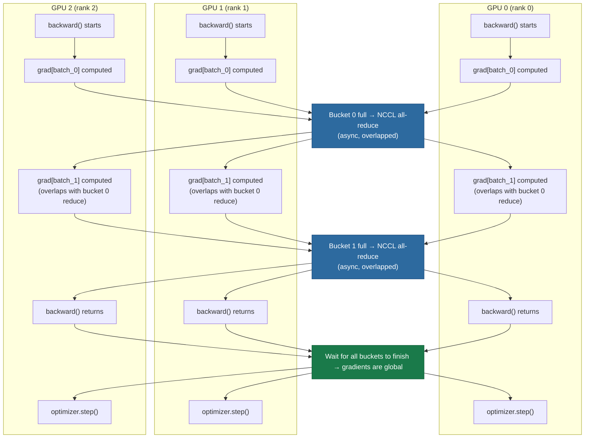

# Lesson 4: Distributed Training, Mixed Precision, and Production Patterns

## 1. First-Principles Intuition & Invariants

The scaling of deep learning confronts a physical boundary that no software abstraction can erase: a single GPU has finite memory bandwidth, finite VRAM capacity, and finite arithmetic throughput. When the collective tensor footprint of model parameters, optimizer state, activation buffers, and gradient tensors exceeds available device memory, training cannot proceed on one accelerator. The central engineering problem of distributed training is not merely sharding data across multiple GPUs. It is preserving the mathematical semantics of stochastic gradient descent while partitioning computation across devices that communicate through interconnects whose latencies and bandwidths are orders of magnitude worse than on-chip SRAM or HBM.

Consider what happens when you train a model on a single GPU. The forward pass computes activations, the loss function produces a scalar, and the backward pass traverses the computational graph in reverse, populating `.grad` tensors on every parameter. The optimizer then reads those gradients and updates weights. This pipeline is self-contained: every tensor lives on one device, and every operation is local. The moment you introduce a second GPU running an identical model replica on a different data shard, the semantics change fundamentally. Each replica computes its own gradients from its own local batch. If each replica independently updates its weights from only its local gradient, the two models diverge, each converging toward a different local optimum shaped by its own data partition. This is asynchronous SGD, and while it has theoretical convergence guarantees under bounded staleness, it is numerically unstable in practice for large models with sharp loss landscapes.

Synchronous SGD—the invariant that `DistributedDataParallel` enforces—demands that before any replica takes an optimizer step, all replicas must agree on the same averaged gradient. Each GPU computes gradients on its local micro-batch, the system aggregates gradients across all GPUs by averaging, and every replica updates its weights using this globally averaged gradient. The result is mathematically equivalent to having computed the forward and backward pass on the concatenated union of all local batches, assuming batch normalization is handled correctly across replicas. This is the synchronization invariant: the gradient that each optimizer step consumes must be the mean of all per-replica gradients, and every replica must take the same step from the same weights. Violating this invariant—through a communication fault, a race condition, or a buggy custom gradient hook—produces silent model divergence that manifests as degraded convergence or NaN losses hours into training.

The communication primitive that makes this aggregation efficient is ring-allreduce, an algorithm originally developed for MPI collectives and adapted by NVIDIA's NCCL (Northbridge Communication Collectives Library) as the default backend for PyTorch distributed operations. In a naïve all-reduce, every GPU sends its full gradient tensor to every other GPU, producing O(N²) traffic that saturates interconnects at scale. Ring-allreduce arranges GPUs in a logical ring. Each GPU sends a chunk of its gradient to its neighbor and receives a different chunk from its other neighbor, performing a partial reduction at each step. After N-1 scatter-reduce steps, every GPU holds a fully reduced chunk, and a second N-1 all-gather phase disseminates the complete result. The total data transferred per GPU is (2 × N - 2) × (gradient_size / N), which is bandwidth-optimal: the per-GPU traffic is independent of the number of GPUs, bounded by 2 × gradient_size regardless of cluster size. This is what makes synchronous distributed training practical at scale, and it is why NCCL is the only production-grade backend for multi-GPU PyTorch workloads.

Mixed precision training addresses a different physical constraint: the arithmetic throughput and memory bandwidth of modern GPUs is dramatically higher at 16-bit precision than at 32-bit. On an NVIDIA H100, FP16 matrix multiplication throughput exceeds FP32 by roughly 2x to 4x depending on tensor core utilization, and FP16 tensors consume half the HBM bandwidth for every load and store. The challenge is that 16-bit floating-point numbers have a narrow dynamic range. FP16 can represent values from approximately 6×10⁻⁵ to 65504, with diminishing precision near the extremes. Many gradient values in deep networks fall below 6×10⁻⁵, and when multiplied by a learning rate, they underflow to zero. If gradients become zero, those parameters stop learning permanently. The solution—Automatic Mixed Precision, or AMP—maintains a master copy of weights in FP32, performs the forward and backward pass in FP16 (or BF16 on Ampere and later), and uses a loss scaler to shift gradients into the representable range before the backward pass produces them. The GradScaler multiplies the loss by a large factor before backpropagation, which scales every gradient up proportionally, preventing underflow. After the optimizer reads the scaled gradients, it divides them back by the same factor before applying the update to the FP32 master weights.

The introduction of BF16—available on NVIDIA Ampere (A100) and later architectures—changes this calculus. BF16 uses 8 exponent bits (same as FP32) and 7 mantissa bits, giving it the same dynamic range as FP32 but lower precision. This means BF16 gradients do not underflow the way FP16 gradients do, and in theory, loss scaling is unnecessary for BF16. In practice, PyTorch's AMP supports both representations, and the choice between FP16 and BF16 has real consequences for convergence and throughput that we will examine in the optimization section.

## 2. Core Architecture & Mechanics

### DataParallel: Thread-Based Replication and Its Bottlenecks

PyTorch's `DataParallel` (DP) is the simpler of the two multi-GPU APIs, and it is the one you should never use in production. DP operates within a single Python process. It replicates the model across GPUs at the start of each forward pass, scatters the input batch across those GPUs, runs the forward pass in parallel using Python threads, gathers the outputs back to the primary GPU, computes the loss, and then distributes the backward pass across the same threads. The architectural problem is that Python's Global Interpreter Lock serializes the thread dispatch overhead, and the scatter-gather operations on every forward pass introduce expensive GPU-to-GPU memory copies. The backward pass is even worse: DP must synchronize gradients across replicas, but because it operates within a single process with threads that contend for the GIL, the gradient synchronization cannot overlap with computation. DP also keeps only the primary GPU's copy of the model and optimizer state, meaning the primary GPU's memory is a bottleneck. For any non-trivial model, DP is slower than single-GPU training because the communication overhead exceeds the compute savings from parallelism.

### DistributedDataParallel: Process-Per-GPU and NCCL Ring-Allreduce

`DistributedDataParallel` (DDP) is the production API for data-parallel training. Instead of threads within one process, DDP spawns one process per GPU, each with its own Python interpreter, its own copy of the model, and its own optimizer. Processes communicate through NCCL, which operates below the Python layer via CUDA kernels and GPU-direct peer access. The key architectural decision is that each process owns its complete model replica and its own data shard. Gradients are synchronized only during the backward pass, and DDP overlaps this synchronization with backward computation using gradient bucketing.

DDP partitions model parameters into buckets—default 25 MB each, configurable via `bucket_cap_mb`. When the autograd engine finishes computing gradients for all parameters in a bucket, DDP immediately launches an asynchronous NCCL all-reduce on that bucket while the autograd engine continues computing gradients for the next bucket. This overlap is what makes DDP efficient: by the time the backward pass completes, most gradient reduction has already finished, and the final all-reduce has only the last bucket's worth of data left to transmit. The bucketing order is reversed relative to the forward pass execution order, because the backward pass executes in reverse, and DDP wants to start reducing the earliest-available gradients first.

The following is a complete, production-grade single-node DDP training script with AMP integrated. It trains a ResNet-50 on CIFAR-10 as a concrete demonstration, but the scaffolding applies to any model and dataset:

```python
import os
import sys
import time
import math
import argparse
from pathlib import Path

import torch
import torch.nn as nn
import torch.distributed as dist
from torch.nn.parallel import DistributedDataParallel as DDP
from torch.utils.data import DataLoader
from torch.utils.data.distributed import DistributedSampler
from torch.cuda.amp import GradScaler, autocast

import torchvision
import torchvision.transforms as T


def setup_distributed(backend: str = "nccl") -> None:
    """Initialize the default process group from environment variables
    set by torchrun. This is the recommended rendezvous mechanism for
    modern PyTorch (>=1.9) and supports elastic training natively."""
    dist.init_process_group(backend=backend)
    torch.cuda.set_device(int(os.environ["LOCAL_RANK"]))


def cleanup_distributed() -> None:
    """Destroy all process groups. Safe to call even if init failed."""
    if dist.is_initialized():
        dist.destroy_process_group()


def build_model(num_classes: int = 10) -> nn.Module:
    """Construct ResNet-50 with a modified classifier head for CIFAR-10."""
    model = torchvision.models.resnet50(weights=None)
    model.fc = nn.Linear(model.fc.in_features, num_classes)
    model = model.to(memory_format=torch.channels_last)
    return model


def build_dataloaders(batch_size: int, num_workers: int):
    """Create train and validation DataLoaders with a DistributedSampler
    that partitions data by rank and ensures each epoch's partitioning
    differs via set_epoch()."""
    mean = (0.4914, 0.4822, 0.4465)
    std = (0.2470, 0.2435, 0.2616)

    train_transform = T.Compose([
        T.RandomCrop(32, padding=4),
        T.RandomHorizontalFlip(),
        T.ToTensor(),
        T.Normalize(mean, std),
    ])
    val_transform = T.Compose([
        T.ToTensor(),
        T.Normalize(mean, std),
    ])

    train_set = torchvision.datasets.CIFAR10(
        root="/tmp/cifar10", train=True, download=True, transform=train_transform
    )
    val_set = torchvision.datasets.CIFAR10(
        root="/tmp/cifar10", train=False, download=True, transform=val_transform
    )

    train_sampler = DistributedSampler(train_set, shuffle=True, drop_last=True)
    val_sampler = DistributedSampler(val_set, shuffle=False, drop_last=False)

    train_loader = DataLoader(
        train_set,
        batch_size=batch_size,
        sampler=train_sampler,
        num_workers=num_workers,
        pin_memory=True,
        persistent_workers=True if num_workers > 0 else False,
    )
    val_loader = DataLoader(
        val_set,
        batch_size=batch_size,
        sampler=val_sampler,
        num_workers=num_workers,
        pin_memory=True,
        persistent_workers=True if num_workers > 0 else False,
    )
    return train_loader, val_loader, train_sampler, val_sampler


def save_checkpoint(
    path: str,
    model: nn.Module,
    optimizer: torch.optim.Optimizer,
    scaler: GradScaler,
    epoch: int,
    step: int,
) -> None:
    """Save a training checkpoint from rank 0 only. The DDP wrapper
    is unwrapped via model.module to access the underlying state_dict."""
    state = {
        "model": model.module.state_dict(),
        "optimizer": optimizer.state_dict(),
        "scaler": scaler.state_dict(),
        "epoch": epoch,
        "step": step,
    }
    Path(path).parent.mkdir(parents=True, exist_ok=True)
    torch.save(state, path + ".tmp")
    os.replace(path + ".tmp", path)


def load_checkpoint(
    path: str,
    model: nn.Module,
    optimizer: torch.optim.Optimizer,
    scaler: GradScaler,
) -> tuple:
    """Load checkpoint state into model, optimizer, and scaler.
    Returns (epoch, step) for resumption."""
    ckpt = torch.load(path, map_location="cpu", weights_only=False)
    model.module.load_state_dict(ckpt["model"])
    optimizer.load_state_dict(ckpt["optimizer"])
    scaler.load_state_dict(ckpt["scaler"])
    return ckpt["epoch"], ckpt["step"]


def train_one_epoch(
    model: DDP,
    train_loader: DataLoader,
    optimizer: torch.optim.Optimizer,
    scaler: GradScaler,
    criterion: nn.Module,
    epoch: int,
    base_step: int,
    log_interval: int,
) -> int:
    model.train()
    train_loader.sampler.set_epoch(epoch)
    total_loss = torch.zeros(1, device=torch.cuda.current_device())
    step = base_step

    for batch_idx, (images, targets) in enumerate(train_loader):
        images = images.cuda(non_blocking=True)
        targets = targets.cuda(non_blocking=True)

        optimizer.zero_grad(set_to_none=True)

        with autocast(dtype=torch.float16):
            outputs = model(images)
            loss = criterion(outputs, targets)

        scaler.scale(loss).backward()
        scaler.step(optimizer)
        scaler.update()

        total_loss += loss.detach()

        if step % log_interval == 0 and dist.get_rank() == 0:
            lr = optimizer.param_groups[0]["lr"]
            print(
                f"[epoch {epoch} step {step}] "
                f"loss={loss.item():.4f} lr={lr:.2e} "
                f"scaler_scale={scaler.get_scale():.1f}",
                flush=True,
            )
        step += 1

    dist.all_reduce(total_loss, op=dist.ReduceOp.SUM)
    avg_loss = (total_loss / dist.get_world_size()).item()
    if dist.get_rank() == 0:
        print(f"[epoch {epoch}] avg_train_loss={avg_loss:.4f}", flush=True)

    return step


def validate(
    model: DDP,
    val_loader: DataLoader,
    criterion: nn.Module,
) -> float:
    model.eval()
    correct = torch.zeros(1, device=torch.cuda.current_device())
    total = torch.zeros(1, device=torch.cuda.current_device())

    with torch.no_grad():
        for images, targets in val_loader:
            images = images.cuda(non_blocking=True)
            targets = targets.cuda(non_blocking=True)
            with autocast(dtype=torch.float16):
                outputs = model(images)
            preds = outputs.argmax(dim=1)
            correct += (preds == targets).sum()
            total += targets.size(0)

    dist.all_reduce(correct, op=dist.ReduceOp.SUM)
    dist.all_reduce(total, op=dist.ReduceOp.SUM)
    acc = (correct / total).item()
    if dist.get_rank() == 0:
        print(f"[validation] accuracy={acc:.4f}", flush=True)
    return acc


def main():
    parser = argparse.ArgumentParser(description="DDP + AMP CIFAR-10 Training")
    parser.add_argument("--batch-size", type=int, default=256)
    parser.add_argument("--epochs", type=int, default=50)
    parser.add_argument("--lr", type=float, default=0.1)
    parser.add_argument("--momentum", type=float, default=0.9)
    parser.add_argument("--weight-decay", type=float, default=5e-4)
    parser.add_argument("--num-workers", type=int, default=4)
    parser.add_argument("--log-interval", type=int, default=50)
    parser.add_argument("--checkpoint", type=str, default="/tmp/checkpoints/ddp_amp.pth")
    parser.add_argument("--resume", action="store_true")
    args = parser.parse_args()

    setup_distributed(backend="nccl")
    rank = dist.get_rank()
    world_size = dist.get_world_size()

    train_loader, val_loader, train_sampler, val_sampler = build_dataloaders(
        batch_size=args.batch_size,
        num_workers=args.num_workers,
    )

    model = build_model(num_classes=10).cuda()
    model = DDP(
        model,
        device_ids=[torch.cuda.current_device()],
        output_device=torch.cuda.current_device(),
        broadcast_buffers=True,
        find_unused_parameters=False,
        gradient_as_bucket_view=True,
        static_graph=False,
    )

    criterion = nn.CrossEntropyLoss(label_smoothing=0.1)
    optimizer = torch.optim.SGD(
        model.parameters(),
        lr=args.lr * world_size,
        momentum=args.momentum,
        weight_decay=args.weight_decay,
        nesterov=True,
    )
    scaler = GradScaler(init_scale=65536.0, growth_factor=2.0, backoff_factor=0.5,
                         growth_interval=2000, enabled=True)

    start_epoch = 0
    step = 0
    if args.resume and os.path.exists(args.checkpoint):
        start_epoch, step = load_checkpoint(args.checkpoint, model, optimizer, scaler)
        if rank == 0:
            print(f"Resumed from epoch {start_epoch}, step {step}", flush=True)
        start_epoch += 1

    for epoch in range(start_epoch, args.epochs):
        step = train_one_epoch(
            model, train_loader, optimizer, scaler,
            criterion, epoch, step, args.log_interval,
        )
        acc = validate(model, val_loader, criterion)

        if rank == 0:
            save_checkpoint(
                args.checkpoint, model, optimizer, scaler, epoch, step,
            )
            print(f"Checkpoint saved: epoch={epoch} acc={acc:.4f}", flush=True)

    cleanup_distributed()


if __name__ == "__main__":
    main()
```

Launch this script on a single 4-GPU node using `torchrun`:

```bash
torchrun --nproc_per_node=4 --nnodes=1 --rdzv_id=cifar10 \
    --rdzv_backend=c10d --rdzv_endpoint=localhost:29500 \
    train_ddp.py --batch-size 256 --epochs 50 --lr 0.1
```

The `torchrun` launcher sets `RANK`, `WORLD_SIZE`, `LOCAL_RANK`, and `MASTER_ADDR`/`MASTER_PORT` environment variables that `dist.init_process_group()` reads automatically. The `--rdzv_backend=c10d` uses PyTorch's built-in rendezvous protocol, which is simpler than the older `env://` method and supports elastic restarts.

### The DDP Gradient Synchronization Pipeline

To understand why DDP is fast, consider the exact sequence of operations during a single training step. When `loss.backward()` is called, PyTorch's autograd engine begins computing gradients in reverse topological order. DDP registers gradient hooks on every parameter via `Reductor` objects that wrap NCCL all-reduce calls. The internal data flow looks like this:



The `gradient_as_bucket_view=True` flag in the DDP constructor tells the framework to reuse the bucket's memory as the gradient storage for the parameter, avoiding an extra copy. The `static_graph=True` option, when applicable, tells DDP that the computational graph structure does not change between iterations, allowing it to skip the graph analysis overhead on every forward pass and schedule reductions more aggressively.

### The GradScaler State Machine

The `GradScaler` is the component that makes FP16 training stable. Its operation follows a state machine with a single dynamic parameter: the scale factor `S`. The mechanism works as follows. Before the backward pass, `scaler.scale(loss)` multiplies the loss by `S`. Because backpropagation distributes this multiplication through the chain rule, every gradient is scaled by `S`. After the backward pass, `scaler.step(optimizer)` checks whether any gradient contains `inf` or `NaN`. If gradients are clean, it divides them by `S` and calls `optimizer.step()`. If any gradient is `inf` or `NaN`, it skips the optimizer step entirely. After the step, `scaler.update()` adjusts `S` according to a growth-backoff strategy: if no overflow occurred for `growth_interval` consecutive steps, `S` is multiplied by `growth_factor` (default 2.0). If overflow occurred, `S` is multiplied by `backoff_factor` (default 0.5), halving the scale.

The critical detail is that `scaler.step(optimizer)` must be used instead of calling `optimizer.step()` directly. The scaler internally calls `optimizer.step()` after unscaling and checking for overflow. If you call `optimizer.step()` yourself, you bypass the overflow check and the unscale operation, which will corrupt your weights with scaled gradients.

### Checkpointing Strategy for Distributed Training

Checkpointing in a DDP context requires care about which rank writes and what state is captured. Only rank 0 should write to disk to avoid file corruption from concurrent writes. The checkpoint must capture the model's `state_dict` from the underlying module, not the DDP wrapper—the wrapper has no parameters of its own, only a reference to the replicated model. The optimizer state must be saved because Adam-family optimizers maintain running moment estimates that are essential for resuming training without convergence disruption. The scaler state must be saved because the scale factor `S` is a learned dynamic parameter—restarting from the default scale wastes hundreds of steps re-converging to the right scale. The sampler's epoch state must be set correctly on resume via `train_sampler.set_epoch(epoch)` to ensure data shuffling differs from the interrupted run.

The checkpoint writing pattern in the code above uses atomic write semantics: it writes to a `.tmp` file and then uses `os.replace()` to atomically swap it into place. This protects against corruption if the process is killed mid-write, which is common in preemptible cloud environments.

## 3. High-Performance Optimization & Failure Modes

### Bucket Sizing and Compute-Communication Overlap

The default bucket size of 25 MB is a reasonable starting point for most models, but it is not optimal for all architectures. Small models with few parameters produce tiny buckets, and the per-bucket NCCL launch overhead dominates the actual data transfer. Large models benefit from larger buckets because fewer NCCL launches means less kernel launch overhead, but too-large buckets delay the first all-reduce, reducing overlap with backward computation. The rule of thumb is to increase `bucket_cap_mb` for models with millions of parameters and decrease it for models where gradient computation per layer is fast relative to communication latency. You can tune this via the DDP constructor:

```python
model = DDP(model, device_ids=[local_rank], bucket_cap_mb=50)
```

For models with a static computational graph where no parameters are unused in any forward pass (common in standard CNNs and transformers without conditional execution), `static_graph=True` provides a measurable speedup by caching the bucketing plan and reduction schedule after the first iteration:

```python
model = DDP(
    model,
    device_ids=[local_rank],
    static_graph=True,
    gradient_as_bucket_view=True,
)
```

When `static_graph=True`, DDP constructs the reduction order during the first backward pass and reuses it for all subsequent iterations. This eliminates the per-iteration overhead of traversing the autograd graph to determine which parameters will receive gradients.

### NCCL Environment Tuning

NCCL exposes a rich set of environment variables that control transport selection, topology detection, and synchronization behavior. The following settings are worth tuning for multi-node and multi-GPU configurations:

```bash
export NCCL_DEBUG=INFO
export NCCL_DEBUG_SUBSYS=ALL
export NCCL_IB_DISABLE=0
export NCCL_IB_HCA=mlx5_0,mlx5_1
export NCCL_SOCKET_IFNAME=eth0
export NCCL_P2P_DISABLE=0
export NCCL_SHM_DISABLE=0
export NCCL_NET_GDR_LEVEL=PHB
export NCCL_IB_TIMEOUT=22
export NCCL_IB_RETRY_CNT=7
export NCCL_IB_QPS_PER_CONNECTION=4
export NCCL_MIN_NCHANNELS=4
export NCCL_NET_GDR_READ=1
```

The most impactful variables are `NCCL_IB_HCA` (specify the InfiniBand HCA names to use, avoiding auto-detection errors on multi-homed hosts), `NCCL_SOCKET_IFNAME` (the network interface for TCP fallback when InfiniBand is unavailable), and `NCCL_NET_GDR_LEVEL` (controls GPUDirect RDMA peer-direct memory access topology). Setting `NCCL_DEBUG=INFO` logs the detected topology and transport choices, which is essential for diagnosing slow training. If you see NCCL falling back to SHM instead of P2P on a single node, check whether peer access is enabled: `nvidia-smi topo -m` shows the GPU interconnect topology, and `NCCL_P2P_DISABLE=1` forces NCCL to use SHM or NVLink depending on availability.

### Multi-Node Deployment

Multi-node DDP adds a network rendezvous layer on top of the per-node process spawning that `torchrun` handles. Each node runs its own `torchrun` instance, and the instances discover each other through a rendezvous endpoint. The following demonstrates a complete two-node launch:

```bash
# Node 0 (rank 0, the master node)
NCCL_DEBUG=INFO NCCL_IB_HCA=mlx5_0 NCCL_SOCKET_IFNAME=ib0 \
torchrun \
    --nproc_per_node=8 \
    --nnodes=2 \
    --node_rank=0 \
    --rdzv_id=multinode_run \
    --rdzv_backend=c10d \
    --rdzv_endpoint=10.0.1.100:29500 \
    train_ddp.py \
    --batch-size 256 \
    --epochs 100 \
    --lr 0.1 \
    --checkpoint /shared/nfs/checkpoints/ddp_amp.pth

# Node 1 (rank 1)
NCCL_DEBUG=INFO NCCL_IB_HCA=mlx5_0 NCCL_SOCKET_IFNAME=ib0 \
torchrun \
    --nproc_per_node=8 \
    --nnodes=2 \
    --node_rank=1 \
    --rdzv_id=multinode_run \
    --rdzv_backend=c10d \
    --rdzv_endpoint=10.0.1.100:29500 \
    train_ddp.py \
    --batch-size 256 \
    --epochs 100 \
    --lr 0.1 \
    --checkpoint /shared/nfs/checkpoints/ddp_amp.pth
```

The `--rdzv_endpoint` must point to the master node's reachable address and a free port. All nodes must use the same `--rdzv_id` to join the same training session. The checkpoint path must be on a shared filesystem (NFS, or a cloud storage mount) so that rank 0 on node 0 writes a checkpoint that any node can read on resume. If you do not have a shared filesystem, you must implement a distributed checkpoint save where every rank writes its own shard to local disk and the resume logic reads all shards—a pattern that `torch.distributed.checkpoint` provides:

```python
import torch.distributed.checkpoint as dcp
from torch.distributed.checkpoint import FileSystemReader, FileSystemWriter
from pathlib import Path

def save_distributed_checkpoint(path: str, model, optimizer, scaler, epoch, step):
    """Save a sharded checkpoint using torch.distributed.checkpoint.
    Each rank writes its own shard independently. No rank-0 bottleneck."""
    state = {
        "model": model,
        "optimizer": optimizer,
        "scaler": scaler,
        "epoch": torch.tensor(epoch),
        "step": torch.tensor(step),
    }
    writer = FileSystemWriter(Path(path))
    dcp.save(state, writer)

def load_distributed_checkpoint(path: str, model, optimizer, scaler):
    """Load a sharded checkpoint. Each rank reads only its own shard."""
    state = {
        "model": model,
        "optimizer": optimizer,
        "scaler": scaler,
        "epoch": torch.tensor(0, dtype=torch.long),
        "step": torch.tensor(0, dtype=torch.long),
    }
    reader = FileSystemReader(Path(path))
    dcp.load(state, reader)
    return int(state["epoch"]), int(state["step"])
```

The `torch.distributed.checkpoint` module writes one file per parameter shard, avoiding the memory spike of gathering the entire model state onto rank 0. This is essential for large models where the state dict exceeds available host RAM.

### Elastic Training with TorchElastic

In cloud environments where nodes can be preempted or added dynamically, `torchrun`'s elastic mode allows training to continue with a changing number of workers. The elastic agent monitors worker health, restarts failed workers, and re-rendezvous the surviving workers. The key parameters are `--max_restarts` (how many times a worker can restart before the job fails) and `--rdzv_backend=c10d` (the rendezvous protocol that handles dynamic membership):

```bash
torchrun \
    --nproc_per_node=auto \
    --nnodes=2:4 \
    --rdzv_id=elastic_run \
    --rdzv_backend=c10d \
    --rdzv_endpoint=10.0.1.100:29500 \
    --max_restarts=3 \
    --rdzv_timeout=120 \
    train_ddp.py \
    --batch-size 256 \
    --epochs 100 \
    --lr 0.1 \
    --resume
```

The `--nnodes=2:4` syntax means the job starts with a minimum of 2 nodes and can scale up to 4. The `--nproc_per_node=auto` detects available GPUs automatically. When a node fails, the elastic agent waits up to `--rdzv_timeout` seconds for it to rejoin, and if it does not, it re-rendezvous with the surviving nodes. The `--resume` flag in the training script loads the most recent checkpoint so the restarted workers begin from the last saved state.

### Failure Modes and Diagnostics

**NCCL hang on initialization.** The most common multi-node failure is NCCL hanging during `init_process_group`. This is almost always a networking issue: the rendezvous endpoint is unreachable, a firewall is blocking the NCCL port range, or the InfiniBand HCA specified in `NCCL_IB_HCA` does not exist on all nodes. Diagnose with `NCCL_DEBUG=INFO` and verify connectivity with `nccl-tests`' `all_reduce_perf` benchmark. If P2P is failing on a single node, check `nvidia-smi topo -m` for NVLink bridges and run `nvidia-smi -q -d P2P` to verify peer access.

**Gradient sync deadlock with `find_unused_parameters=True`.** When some model parameters do not receive gradients in certain forward passes (conditional execution, dynamic model structure), DDP with `find_unused_parameters=False` will hang during the backward pass because it expects every parameter to produce a gradient. Setting `find_unused_parameters=True` makes DDP traverse the autograd graph on every forward pass to detect unused parameters and mark them before the backward pass begins. This adds overhead but prevents the deadlock. If your model has truly static structure, keep this set to `False` for performance.

**NaN from AMP overflow.** When the GradScaler's scale factor `S` is too high, the scaled loss produces gradients that overflow to `inf`. The scaler detects this and skips the optimizer step, then reduces `S` via `backoff_factor`. This is normal during the first few hundred steps as the scale converges. If NaN persists after hundreds of steps, the model itself has a numerical instability—common causes are learning rate too high, batch normalization running statistics diverging across replicas (use `broadcast_buffers=True` in DDP, which is the default), or gradient clipping interacting badly with the scaler. If you use gradient clipping, apply it after `scaler.unscale_(optimizer)` and before `scaler.step(optimizer)`:

```python
scaler.scale(loss).backward()
scaler.unscale_(optimizer)
torch.nn.utils.clip_grad_norm_(model.parameters(), max_norm=5.0)
scaler.step(optimizer)
scaler.update()
```

The `scaler.unscale_()` call divides gradients by the scale factor in-place, making them unscaled before clipping. The subsequent `scaler.step()` will not re-unscale them; it only checks for overflow and calls the optimizer.

**BF16 versus FP16 selection.** On Ampere and later GPUs (A100, H100, L40), prefer BF16 over FP16 for training. BF16's 8-bit exponent matches FP32's dynamic range, eliminating the gradient underflow problem that necessitates loss scaling. In practice, you can disable the GradScaler entirely with BF16:

```python
with autocast(dtype=torch.bfloat16):
    outputs = model(images)
    loss = criterion(outputs, targets)

loss.backward()
optimizer.step()
optimizer.zero_grad()
```

BF16 training with no GradScaler is simpler, faster, and more numerically stable than FP16 with loss scaling, provided your hardware supports it. The throughput is comparable; BF16 tensor core utilization is the same as FP16 on Ampere and later. The only reason to use FP16 is hardware that predates Ampere (V100 and earlier), where BF16 is not available in hardware.

**Memory fragmentation during large-batch training.** PyTorch's CUDA caching allocator can fragment HBM when batch sizes are large relative to available VRAM, causing out-of-memory errors even when free memory technically exists. The allocator's behavior is controlled by `PYTORCH_CUDA_ALLOC_CONF`. For training workloads with large activation tensors, set:

```bash
export PYTORCH_CUDA_ALLOC_CONF=expandable_segments:True,max_split_size_mb:128
```

The `expandable_segments:True` option reduces fragmentation by allowing the allocator to grow memory segments dynamically. The `max_split_size_mb` parameter limits the maximum block size that the allocator will split from a larger allocation, reducing the creation of small unusable fragments. If you still encounter OOM, use `torch.cuda.memory_summary()` to inspect the allocation profile and identify the tensors consuming the most memory.

### Monitoring and Profiling

PyTorch's built-in profiler provides per-operator timing and memory traces that are essential for diagnosing performance bottlenecks. The profiler supports distributed training and can export Chrome trace files for visual inspection:

```python
from torch.profiler import profile, ProfilerActivity, schedule, tensorboard_trace_handler

prof = profile(
    activities=[ProfilerActivity.CPU, ProfilerActivity.CUDA],
    schedule=schedule(wait=1, warmup=1, active=3, repeat=1),
    on_trace_ready=tensorboard_trace_handler("/tmp/prof/ddp_amp"),
    record_shapes=True,
    profile_memory=True,
    with_stack=True,
)

prof.start()
for epoch in range(start_epoch, args.epochs):
    for batch_idx, (images, targets) in enumerate(train_loader):
        prof.step()
        # ... training step ...
        if batch_idx >= 20:
            break
    break
prof.stop()
```

The `wait=1, warmup=1, active=3` schedule means the profiler skips the first step (wait), warms up on the second (warmup), and records steps 3-5 (active). This avoids capturing startup overhead and JIT compilation artifacts. The resulting trace can be viewed in `chrome://tracing` or TensorBoard's PyTorch Profiler plugin, showing the exact overlap between backward computation and NCCL all-reduce kernels, which is the single most important metric for DDP performance tuning.

For real-time monitoring of NCCL communication, the `NCCL_DEBUG=INFO` output includes bandwidth measurements for every all-reduce operation. If you observe actual bandwidth significantly below the theoretical peak of your interconnect (for example, 200 GB/s NVLink showing 50 GB/s), the bottleneck is either bucket size too small (too many small NCCL launches), computation too fast relative to communication (the overlap has no computation to hide behind), or a topology issue where NCCL is using a suboptimal transport.

The path to production distributed training is a path of eliminating waste: wasted GPU cycles waiting for gradients, wasted memory on redundant master-weight copies, wasted time on suboptimal bucket sizes, and wasted debug hours on NCCL hangs caused by a misconfigured InfiniBand HCA. Every knob in the DDP and AMP APIs exists to address a specific physical constraint—interconnect latency, numerical range, memory capacity—and understanding which constraint is binding at any given moment is the skill that separates working distributed training from training that merely runs.
