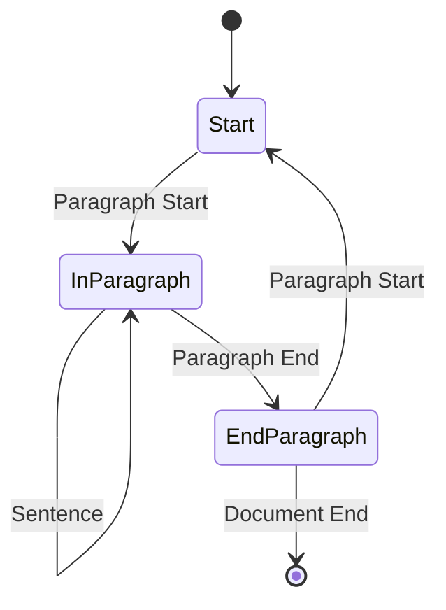
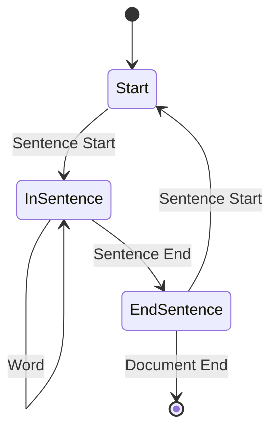
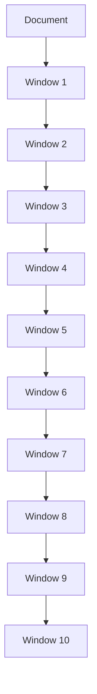

# Lesson 1: Document Chunking Techniques

## 1. First-Principles Intuition & Invariants

In the realm of artificial intelligence and retrieval-augmented generation (RAG) systems, the process of document chunking is foundational. It involves segmenting large documents into smaller, manageable pieces, or "chunks," that can be efficiently processed, indexed, and retrieved. The primary goal of document chunking is to optimize the interaction between the document content and the retrieval mechanism, ensuring that the system can quickly and accurately locate relevant information. This process is not merely a mechanical division of text but a strategic operation that balances the granularity of information with the efficiency of retrieval.

The problem space of document chunking is inherently complex, as it must navigate the trade-offs between semantic coherence and computational efficiency. On one hand, overly large chunks can obscure the nuances of the document, making it difficult to pinpoint specific information. On the other hand, excessively small chunks can lead to an overwhelming number of segments, increasing the computational overhead of indexing and retrieval. Therefore, the choice of chunking technique must be guided by a deep understanding of the document's structure and the retrieval requirements of the system.

From a theoretical standpoint, document chunking can be viewed as a partitioning problem, where the document is divided into subsets that maintain semantic integrity while optimizing for retrieval performance. This partitioning must adhere to certain invariants to ensure consistency and reliability. For instance, the chunks should be non-overlapping to avoid redundancy, and they should collectively cover the entire document without gaps. Additionally, the chunking process should be deterministic, meaning that the same document will always produce the same set of chunks under identical conditions. These invariants are crucial for maintaining the integrity of the retrieval system and ensuring that the chunks can be consistently indexed and retrieved.

## 2. Core Architecture & Mechanics

The architecture of document chunking systems is deeply intertwined with the underlying data structures and algorithms that govern the partitioning process. At its core, document chunking involves the identification of logical boundaries within the document that can serve as delimiters for the chunks. These boundaries can be determined by various criteria, such as sentence structure, paragraph breaks, or thematic content.

One of the most straightforward chunking techniques is paragraph-based chunking, which involves dividing the document into segments based on paragraph breaks. This method leverages the natural structure of the document, as paragraphs often represent distinct ideas or topics. The implementation of paragraph-based chunking can be visualized using a simple state machine that transitions between states representing the start of a paragraph, the body of a paragraph, and the end of a paragraph. The state machine can be represented using a Mermaid diagram as follows:

In this diagram, the system starts in the `Start` state and transitions to `InParagraph` when it encounters the start of a paragraph. It remains in the `InParagraph` state as it processes each sentence within the paragraph. When it reaches the end of the paragraph, it transitions to the `EndParagraph` state, where it can either return to the `Start` state to process the next paragraph or terminate if the document has ended.

Another common chunking technique is sentence-based chunking, which involves dividing the document into individual sentences. This method provides a finer granularity of information, allowing the system to retrieve more precise segments of the document. The implementation of sentence-based chunking can be visualized using a similar state machine, with additional states to handle punctuation and sentence boundaries. The Mermaid diagram for sentence-based chunking is as follows:

In this diagram, the system starts in the `Start` state and transitions to `InSentence` when it encounters the start of a sentence. It remains in the `InSentence` state as it processes each word within the sentence. When it reaches the end of the sentence, it transitions to the `EndSentence` state, where it can either return to the `Start` state to process the next sentence or terminate if the document has ended.

A more advanced chunking technique is sliding window chunking, which involves dividing the document into overlapping segments of a fixed size. This method provides a balance between the granularity of sentence-based chunking and the semantic coherence of paragraph-based chunking. The implementation of sliding window chunking can be visualized using a sliding window diagram, where the window slides over the document, extracting overlapping segments. The Mermaid diagram for sliding window chunking is as follows:

In this diagram, the sliding window moves over the document, extracting overlapping segments of a fixed size. Each window represents a chunk that can be indexed and retrieved independently. The size of the window and the overlap between windows can be adjusted to balance the granularity of information with the computational overhead of indexing and retrieval.

## 3. High-Performance Optimization & Failure Modes

The performance of document chunking systems is critical to the overall efficiency of the retrieval-augmented generation system. High-performance optimization involves several key strategies, including parallel processing, efficient data structures, and adaptive chunking techniques.

Parallel processing can be leveraged to divide the document into chunks concurrently, reducing the overall processing time. This can be achieved using multi-threading or distributed computing frameworks, where the document is partitioned into smaller segments that can be processed in parallel. The use of parallel processing can significantly improve the performance of document chunking, especially for large documents.

Efficient data structures are also crucial for optimizing the performance of document chunking. For instance, using a trie or a suffix tree can improve the efficiency of sentence-based chunking by allowing the system to quickly identify sentence boundaries. Similarly, using a hash table or a balanced tree can improve the efficiency of paragraph-based chunking by allowing the system to quickly identify paragraph boundaries.

Adaptive chunking techniques can be used to optimize the performance of document chunking by adjusting the chunking strategy based on the characteristics of the document. For instance, if the document contains many short paragraphs, paragraph-based chunking may be more efficient than sentence-based chunking. Conversely, if the document contains many long paragraphs, sentence-based chunking may be more efficient than paragraph-based chunking. Adaptive chunking techniques can be implemented using machine learning algorithms that analyze the document's structure and adjust the chunking strategy accordingly.

Failure modes in document chunking systems can arise from several sources, including incorrect chunking boundaries, overlapping chunks, and missing chunks. Incorrect chunking boundaries can lead to the inclusion of irrelevant information in the chunks, reducing the accuracy of the retrieval system. Overlapping chunks can lead to redundancy, increasing the computational overhead of indexing and retrieval. Missing chunks can lead to the exclusion of relevant information from the retrieval system, reducing the completeness of the results.

To mitigate these failure modes, it is essential to implement robust validation and error-checking mechanisms. For instance, the system can be designed to validate the chunking boundaries by checking for paragraph and sentence boundaries. The system can also be designed to detect overlapping chunks by comparing the boundaries of adjacent chunks. The system can also be designed to detect missing chunks by comparing the total number of chunks with the expected number of chunks.

In conclusion, document chunking is a critical component of retrieval-augmented generation systems, and its implementation requires a deep understanding of the document's structure and the retrieval requirements of the system. By leveraging paragraph-based, sentence-based, and sliding window chunking techniques, the system can efficiently partition the document into manageable chunks that can be indexed and retrieved. By optimizing the performance of document chunking through parallel processing, efficient data structures, and adaptive chunking techniques, the system can achieve high levels of efficiency and accuracy. By mitigating failure modes through robust validation and error-checking mechanisms, the system can ensure the integrity and reliability of the retrieval process.
