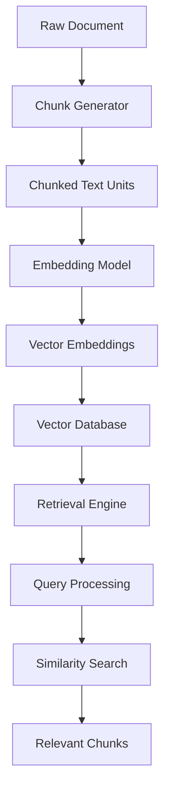

# Lesson 3: Integrating Chunking with Embedding Models

## 1. First-Principles Intuition & Invariants

In the architecture of Retrieval-Augmented Generation (RAG) systems, the seamless integration of document chunking and embedding models is not merely a sequence of operations—it is a foundational design principle that governs how information is abstracted, represented, and retrieved. At its core, this integration is underpinned by the invariants of semantic coherence, information preservation, and retrieval efficiency. The process begins with the recognition that raw text, while rich in meaning, is not directly amenable to vector-space operations without first being decomposed into semantically meaningful units.

Consider the fundamental problem: how does one translate a document into a form that allows for rapid similarity search in a high-dimensional embedding space? The answer lies in the careful balance between granularity and context. If chunks are too small, they risk losing semantic cohesion; if too large, they may dilute the signal-to-noise ratio in retrieval. This tension is resolved through a first-principles understanding of information theory and linguistic structure. Each chunk must carry sufficient contextual information to be meaningful, yet remain small enough to be efficiently embedded and indexed.

The mathematical invariant that governs this process is the preservation of semantic proximity in vector space. That is, semantically similar chunks must be mapped to nearby points in embedding space, while dissimilar ones are separated by greater distances. This is not a trivial constraint—it requires that the chunking algorithm respects the natural boundaries of discourse, such as sentence structures, paragraph transitions, and logical sections. The embedding model, in turn, must be trained or fine-tuned to respect these boundaries, ensuring that the learned representations align with the semantic intent of the chunked units.

From a systems perspective, the integration of chunking and embedding is a state machine with well-defined inputs, outputs, and transitions. The input is a stream of raw text documents, the output is a collection of vector embeddings, and the intermediate state is a set of semantically coherent chunks. The invariant is that the transition from input to output preserves the semantic integrity of the original document while optimizing for retrieval performance. This invariant is enforced through a combination of algorithmic design, model architecture, and operational constraints.

## 2. Core Architecture & Mechanics

The architecture of chunking and embedding integration is best understood through the lens of a data pipeline that operates in two distinct phases: chunk generation and embedding computation. The chunk generation phase is a deterministic process that partitions text into semantically coherent units, while the embedding phase is a probabilistic transformation that maps these units into a vector space.

Let us begin with the chunk generation mechanism. The most common approach is to use a sliding window technique with overlap, where a window of fixed size (e.g., 512 tokens) slides across the document, and overlapping segments are generated to ensure that no semantic boundary is inadvertently broken. This process is governed by a set of heuristics that prioritize sentence boundaries, paragraph breaks, and logical section transitions. The resulting chunks are stored in a data structure that maintains both the text and metadata, such as chunk ID, document ID, and position within the document.

The embedding computation phase is where the magic happens. Here, a pre-trained language model, such as BERT or a more recent variant like Mistral or Llama, is applied to each chunk to produce a dense vector representation. The model's internal state, particularly its attention mechanisms and contextual embeddings, is leveraged to capture the semantic meaning of the chunk. The output is a vector of fixed dimensionality, typically 768 or 1024, which is then stored in a vector database for fast retrieval.

The core data structure that facilitates this integration is a chunk-embedding pair, which can be represented as a tuple `(chunk_id, chunk_text, embedding_vector)`. This structure is stored in a distributed key-value store, where the key is the chunk ID and the value is the embedding vector. The chunk ID serves as a unique identifier that allows for efficient retrieval and indexing.

The mechanics of this integration are best visualized through a Mermaid diagram:

In this architecture, the chunk generator is responsible for producing semantically coherent chunks, while the embedding model transforms these chunks into vector representations. The vector database serves as the persistent storage layer, and the retrieval engine performs similarity searches to find relevant chunks for a given query.

The chunk generator itself is a state machine that transitions through several states: initialization, chunking, validation, and output. During initialization, the system determines the optimal chunk size and overlap based on the document's characteristics. The chunking state applies the sliding window algorithm to partition the text. Validation ensures that no semantic boundaries are violated, and the output state generates the final chunked units.

The embedding model, on the other hand, is a neural network that processes each chunk through a series of layers, including tokenization, attention, and projection. The output is a vector that represents the semantic content of the chunk in a high-dimensional space. This vector is then normalized and stored in the vector database.

## 3. High-Performance Optimization & Failure Modes

The performance of the chunking and embedding pipeline is critically dependent on the efficiency of both the chunk generation and embedding computation phases. Optimizing these phases requires a deep understanding of computational complexity, memory management, and concurrency patterns.

In the chunk generation phase, the primary optimization is to minimize the overhead of text processing. This is achieved through the use of efficient string parsing algorithms and precomputed tokenization tables. For example, the sliding window algorithm can be optimized using a circular buffer to avoid repeated memory allocations. Additionally, parallel processing can be employed to chunk multiple documents simultaneously, leveraging multi-core architectures to reduce latency.

The embedding computation phase is more computationally intensive, as it involves running a neural network on each chunk. To optimize this, the system can employ batch processing, where multiple chunks are embedded simultaneously to maximize GPU utilization. Furthermore, the embedding model can be offloaded to specialized hardware, such as TPUs or dedicated inference accelerators, to reduce latency and improve throughput.

However, the system is not without its failure modes. One of the most common is the occurrence of semantic fragmentation, where a chunk is split at an inappropriate boundary, leading to a loss of contextual meaning. This can be mitigated by implementing a validation step that checks for coherence before storing the chunk. Another failure mode is the degradation of embedding quality due to model drift or outdated training data. This can be addressed through continuous monitoring and periodic retraining of the embedding model.

Concurrency is another critical aspect of the system's performance. The chunking and embedding phases must be designed to handle concurrent requests without introducing race conditions or deadlocks. This is typically achieved through the use of thread-safe data structures and lock-free algorithms. For example, the chunk generator can use a producer-consumer pattern with a bounded queue to manage the flow of chunks between the generation and embedding phases.

Memory management is also crucial, especially when dealing with large documents or high-throughput scenarios. The system must ensure that memory is allocated efficiently and deallocated promptly to prevent memory leaks. This is particularly important in the embedding phase, where large tensors are created and destroyed during inference. Memory pooling and garbage collection strategies must be carefully tuned to maintain performance.

Finally, the system must be resilient to failures in either the chunking or embedding phases. This is achieved through the use of error handling mechanisms, such as retry logic and circuit breakers, that prevent cascading failures and ensure that the system can recover gracefully from transient issues. The integration of these mechanisms into the overall architecture ensures that the system remains robust and reliable under varying loads and conditions.
