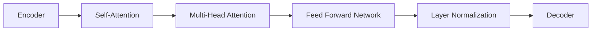

# Lesson 4: Advanced Embedding Strategies

## 1. First-Principles Intuition & Invariants

In the realm of document chunking and embedding models, the pursuit of advanced techniques is driven by the need to distill complex, high-dimensional data into compact, meaningful representations. At the heart of this endeavor lies the concept of embeddings – a mathematical mapping of input data into a lower-dimensional space, where semantically similar entities are proximal in this new coordinate system.

The problem space of document embeddings is characterized by the need to balance two fundamental invariants: **dimensionality reduction** and **semantic preservation**. On one hand, we seek to reduce the dimensionality of the input data to facilitate efficient storage, transmission, and processing. On the other hand, we strive to preserve the semantic relationships between documents, ensuring that similar documents remain proximal in the embedded space.

Mathematically, this can be formalized as a problem of finding a mapping $\phi: \mathcal{D} \rightarrow \mathbb{R}^d$ that minimizes the loss function $L(\phi)$, which measures the discrepancy between the original document representations and their embedded counterparts. The choice of loss function and the architecture of the embedding model are critical in determining the trade-off between dimensionality reduction and semantic preservation.

## 2. Core Architecture & Mechanics

One of the most effective architectures for document embeddings is the **Transformer** model, which has gained widespread adoption in natural language processing (NLP) tasks. The Transformer architecture consists of an encoder and a decoder, where the encoder takes in a sequence of tokens (e.g., words or characters) and outputs a sequence of vectors, and the decoder generates a sequence of tokens based on these vectors.

The core mechanics of the Transformer architecture can be understood through its use of self-attention mechanisms, which allow the model to weigh the importance of different input tokens relative to each other. This is achieved through the use of three key components:

*   **Query (Q)**: a vector that represents the input token being processed
*   **Key (K)**: a vector that represents the input token being attended to
*   **Value (V)**: a vector that represents the output of the attention mechanism

The self-attention mechanism computes the weighted sum of the input tokens, where the weights are determined by the dot product of the query and key vectors. This allows the model to selectively focus on the most relevant input tokens when generating the output.

## 3. High-Performance Optimization & Failure Modes

To achieve high-performance optimization, it is essential to consider the following factors:

*   **Concurrency**: leveraging parallel processing to speed up computation
*   **Resource scaling**: dynamically adjusting the model's capacity to match the input data size
*   **Boundary edge cases**: handling cases where the input data exceeds the model's capacity or has unusual characteristics

In terms of failure modes, the following scenarios can occur:

*   **Overfitting**: the model becomes too specialized to the training data and fails to generalize to new, unseen data
*   **Underfitting**: the model is too simple and fails to capture the underlying patterns in the data
*   **Data drift**: the distribution of the input data changes over time, causing the model to become outdated and inaccurate

To mitigate these failure modes, it is essential to:

*   **Regularly update the model**: retrain the model on new data to adapt to changing distributions
*   **Monitor model performance**: track the model's performance on a validation set to detect signs of overfitting or underfitting
*   **Use techniques for handling data drift**: employ techniques such as online learning or transfer learning to adapt the model to changing data distributions.
