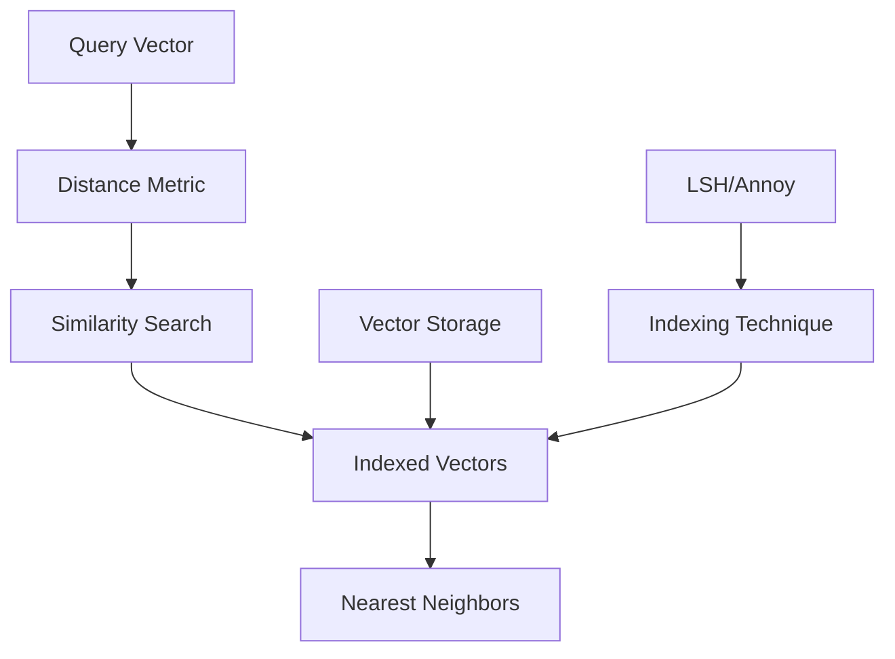

# Lesson 1: Vector Databases Overview

## 1. First-Principles Intuition & Invariants

In the realm of artificial intelligence and machine learning, the representation and retrieval of data have evolved significantly beyond the traditional tabular structures of relational databases. The advent of vector databases marks a pivotal shift towards a more nuanced and powerful paradigm, one that is inherently suited to the demands of modern AI and retrieval systems. At the heart of vector databases lies the concept of representing data as vectors in a high-dimensional space, where each dimension corresponds to a feature or attribute of the data. This transformation is not merely a change in data representation; it is a fundamental shift in how we think about similarity, retrieval, and the underlying mathematical invariants that govern these operations.

The problem space that vector databases address is rooted in the need for efficient and accurate similarity search. Traditional databases are optimized for exact match queries, where the goal is to find records that match a set of criteria with perfect precision. However, in the context of AI and machine learning, the notion of similarity is far more complex. Consider the task of finding images similar to a given query image, or recommending products to a user based on their preferences. In these scenarios, the data is inherently continuous and high-dimensional, and the goal is to find items that are "close" to the query in some meaningful sense. This requires a different set of tools and techniques, and vector databases provide a robust framework for addressing these challenges.

From a mathematical standpoint, the key invariant in vector databases is the notion of distance metrics. In a high-dimensional space, the choice of distance metric (e.g., Euclidean, cosine similarity, Manhattan distance) plays a crucial role in determining the effectiveness of similarity search. The Euclidean distance, for instance, measures the straight-line distance between two points, while cosine similarity measures the cosine of the angle between two vectors, which is particularly useful for capturing the orientation of vectors rather than their magnitude. These distance metrics are the bedrock upon which vector databases are built, providing a rigorous and mathematically sound foundation for similarity search.

## 2. Core Architecture & Mechanics

The architecture of a vector database is designed to efficiently store, index, and retrieve high-dimensional vectors. At a high level, the process can be broken down into three main components: vector storage, indexing, and similarity search.

### Vector Storage

Vector storage is the process of persisting high-dimensional vectors in a way that allows for efficient retrieval. Unlike traditional databases, which store data in a tabular format, vector databases store data as dense or sparse vectors. The choice between dense and sparse storage depends on the sparsity of the data. Dense storage is suitable for data where most dimensions are non-zero, while sparse storage is more efficient for data where most dimensions are zero. In practice, vector databases often use a combination of both dense and sparse storage to optimize for performance and space efficiency.

### Indexing

Indexing is a critical component of vector databases, as it enables efficient similarity search. Traditional databases use B-trees or hash tables to index data, but these structures are not well-suited for high-dimensional vector spaces. Instead, vector databases rely on specialized indexing techniques that are designed to handle the unique properties of high-dimensional data. One such technique is the Locality-Sensitive Hashing (LSH) algorithm, which maps high-dimensional vectors to a lower-dimensional space in a way that preserves the similarity between vectors. Another popular indexing technique is the Annoy (Approximate Nearest Neighbors Oh Yeah) index, which uses a tree-based approach to partition the vector space and efficiently retrieve the nearest neighbors of a query vector.

### Similarity Search

Similarity search is the process of finding the vectors in the database that are closest to a given query vector. This is where the choice of distance metric becomes particularly important, as it determines the definition of "closest." The similarity search process typically involves two main steps: indexing and querying. During the indexing step, the vectors are indexed using one of the specialized indexing techniques mentioned earlier. During the querying step, the query vector is compared to the indexed vectors using the chosen distance metric, and the nearest neighbors are returned.

To illustrate the core architecture and mechanics of a vector database, we can use a simple Mermaid diagram:

In this diagram, the query vector is compared to the indexed vectors using a chosen distance metric, and the nearest neighbors are returned. The vector storage and indexing technique components work together to efficiently store and index the vectors, enabling fast and accurate similarity search.

## 3. High-Performance Optimization & Failure Modes

The performance of a vector database is critical to its effectiveness, and there are several key factors that influence performance. One of the most important factors is the choice of indexing technique. Different indexing techniques have different trade-offs in terms of space efficiency, query performance, and update performance. For example, the LSH algorithm is highly space-efficient but may require multiple hash tables to achieve high accuracy, while the Annoy index is more space-intensive but provides faster query performance.

Another important factor is the choice of distance metric. The choice of distance metric can have a significant impact on the performance of similarity search, as different distance metrics have different computational complexities. For example, the Euclidean distance is computationally expensive to compute, while cosine similarity is more efficient but may require additional preprocessing steps.

Concurrency is another critical factor in the performance of vector databases. As the size of the dataset grows, the number of concurrent queries and updates can become a bottleneck. To address this, vector databases often use techniques such as sharding and replication to distribute the workload across multiple nodes. Sharding involves partitioning the dataset into smaller subsets, each of which is stored on a separate node. Replication involves storing multiple copies of the dataset on different nodes to improve fault tolerance and availability.

Resource scaling is also an important consideration in the design of vector databases. As the size of the dataset grows, the amount of memory and storage required to store the vectors and indexes can become a limiting factor. To address this, vector databases often use techniques such as memory-mapped files and disk-based storage to optimize resource usage. Memory-mapped files allow the database to access data stored on disk as if it were stored in memory, while disk-based storage allows the database to scale to larger datasets by leveraging the storage capacity of disk drives.

Boundary edge cases and failure modes are also important considerations in the design of vector databases. One common edge case is the presence of outliers in the dataset, which can skew the results of similarity search. To address this, vector databases often use techniques such as outlier detection and removal to improve the accuracy of similarity search. Another common failure mode is the presence of data corruption or inconsistencies, which can lead to incorrect results. To address this, vector databases often use techniques such as checksums and consistency checks to ensure data integrity.

In conclusion, vector databases provide a powerful and flexible framework for similarity search in high-dimensional data. By representing data as vectors and using specialized indexing techniques, vector databases enable efficient and accurate similarity search, which is critical for a wide range of AI and machine learning applications. The architecture and mechanics of vector databases are grounded in first-principles intuition and invariants, and the performance of vector databases is influenced by a variety of factors, including the choice of indexing technique, distance metric, concurrency, resource scaling, and failure modes.
