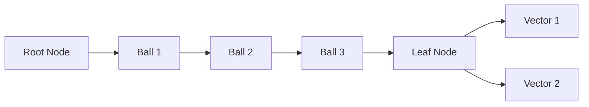

# Lesson 4: Practical Applications and Tools

## 1. First-Principles Intuition & Invariants

Vector databases and similarity search are a crucial component of modern AI/ML systems, particularly in applications where data is high-dimensional and complex. At its core, vector similarity search is a problem of finding the nearest neighbors to a given query vector in a high-dimensional space. This problem is inherently challenging due to the curse of dimensionality, where the number of dimensions grows exponentially with the number of features.

To understand the problem space, let's consider a simple example. Imagine a large collection of images, each represented as a 128-dimensional vector in a feature space. The goal is to find the most similar images to a given query image. This can be achieved by computing the dot product between the query vector and each vector in the database, and then ranking the results based on the similarity score.

However, as the dimensionality of the feature space increases, the number of possible nearest neighbors grows exponentially, making the search problem computationally intractable. This is where vector databases and similarity search algorithms come into play.

One of the key invariants of vector databases is the concept of a similarity metric. The most common similarity metric used in vector databases is the cosine similarity, which measures the cosine of the angle between two vectors. However, other metrics such as Euclidean distance, Manhattan distance, and Jaccard similarity are also commonly used.

Another important invariant is the concept of a distance function. The distance function is used to compute the similarity between two vectors, and it is typically a monotonic function of the similarity metric. In other words, as the similarity between two vectors increases, the distance between them decreases.

## 2. Core Architecture & Mechanics

Vector databases typically use a combination of indexing and caching techniques to achieve high-performance similarity search. One of the most popular indexing techniques used in vector databases is the Ball Tree (also known as the KD-Tree). The Ball Tree is a hierarchical data structure that partitions the feature space into a series of balls, each centered at a representative vector.

The Ball Tree is constructed by recursively partitioning the feature space into smaller balls, until a stopping criterion is reached. The stopping criterion is typically based on the number of vectors in each ball, or the maximum depth of the tree.

Once the Ball Tree is constructed, the similarity search algorithm can be used to find the nearest neighbors to a given query vector. The algorithm works by traversing the Ball Tree, starting from the root node, and recursively searching for the nearest neighbors in each ball.

Here is a simplified Mermaid diagram illustrating the Ball Tree data structure:

## 3. High-Performance Optimization & Failure Modes

To achieve high-performance similarity search, vector databases typically use a combination of concurrency and resource scaling techniques. One of the most common concurrency techniques used in vector databases is the use of multiple threads or processes to search for nearest neighbors in parallel.

However, as the number of threads or processes increases, the overhead of thread synchronization and communication can become significant. To mitigate this overhead, vector databases often use techniques such as lock-free data structures, or distributed locking mechanisms.

Another important consideration is the failure mode of the vector database. In the event of a failure, the database may experience data loss or corruption, or the search algorithm may produce incorrect results. To mitigate these risks, vector databases often use techniques such as replication, or distributed transactional systems.

Some popular tools and frameworks for vector databases and similarity search include:

* Annoy (Approximate Nearest Neighbors Oh Yeah!)
* Faiss (Facebook AI Similarity Search)
* Hnswlib (Hierarchical Navigable Small World Library)
* Milvus (Vector Database for AI/ML)

These tools and frameworks provide a range of features and functionality for building high-performance vector databases and similarity search systems. However, they also require careful tuning and configuration to achieve optimal performance.
