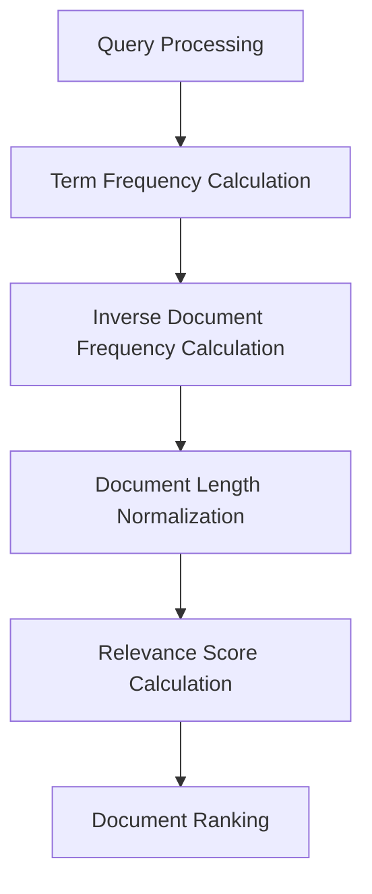

# Lesson 1: BM25 Algorithm

## 1. First-Principles Intuition & Invariants

In the realm of information retrieval, the challenge of ranking documents based on their relevance to a user's query is a fundamental problem. The BM25 algorithm, introduced by Stephen Robertson and Ken Sparck Jones in 1998, stands as a cornerstone in the field, offering a robust and efficient method for ranking documents. At its core, BM25 is a probabilistic model that seeks to estimate the probability that a given document is relevant to a query, based on the frequency of query terms within the document and across the entire corpus.

The theoretical grounding of BM25 is rooted in the principles of term frequency-inverse document frequency (TF-IDF), a widely used statistical measure for evaluating the importance of a word in a document relative to a collection of documents (corpus). However, BM25 introduces several enhancements that address some of the limitations of TF-IDF, particularly in handling term saturation and document length normalization. Term saturation refers to the phenomenon where the relevance of a term to a document does not increase indefinitely with its frequency; beyond a certain point, additional occurrences of the term do not significantly enhance the document's relevance. Document length normalization, on the other hand, ensures that longer documents do not disproportionately influence the ranking, as they naturally contain more terms.

BM25 operates under the assumption that the relevance of a document to a query is a function of the frequency of query terms within the document, adjusted by the document's length and the frequency of these terms across the entire corpus. This assumption is formalized through a series of mathematical invariants that ensure the algorithm's robustness and effectiveness. The key invariants include the use of a saturation function to mitigate term saturation and a document length normalization factor to balance the influence of document length.

The saturation function in BM25 is designed to cap the contribution of term frequency to the relevance score, preventing the score from increasing indefinitely with term frequency. This is achieved through a parameterized function that smoothly transitions from linear to logarithmic growth, ensuring that the relevance score remains proportional to the term's importance without being skewed by excessive term frequency. The document length normalization factor, on the other hand, adjusts the relevance score based on the document's length, ensuring that longer documents do not receive disproportionately high scores simply because they contain more terms.

## 2. Core Architecture & Mechanics

The BM25 algorithm is structured around a series of mathematical operations that transform the raw term frequencies and document lengths into a relevance score for each document. The core formula of BM25 is given by:

\[
\text{BM25}(d, q) = \sum_{i=1}^{n} \text{idf}(q_i) \cdot \frac{f_{q_i,d} \cdot (k_1 + 1)}{f_{q_i,d} + k_1 \cdot \left(1 - b + b \cdot \frac{|d|}{\text{avgdl}}\right)}
\]

where:
- \(d\) is the document,
- \(q\) is the query,
- \(n\) is the number of terms in the query,
- \(f_{q_i,d}\) is the frequency of term \(q_i\) in document \(d\),
- \(\text{idf}(q_i)\) is the inverse document frequency of term \(q_i\),
- \(k_1\) and \(b\) are free parameters that control the term frequency saturation and document length normalization, respectively,
- \(|d|\) is the length of document \(d\),
- \(\text{avgdl}\) is the average length of documents in the corpus.

The inverse document frequency (\(\text{idf}\)) is calculated as:

\[
\text{idf}(q_i) = \log \left( \frac{N - n_{q_i} + 0.5}{n_{q_i} + 0.5} \right)
\]

where:
- \(N\) is the total number of documents in the corpus,
- \(n_{q_i}\) is the number of documents containing term \(q_i\).

The parameters \(k_1\) and \(b\) are crucial to the behavior of the BM25 algorithm. The parameter \(k_1\) controls the degree of term frequency saturation. A higher value of \(k_1\) allows for a greater contribution of term frequency to the relevance score, while a lower value introduces more saturation, reducing the impact of high term frequencies. The parameter \(b\) controls the document length normalization. A value of \(b = 0\) disables document length normalization, while a value of \(b = 1\) fully normalizes the document length, ensuring that longer documents do not disproportionately influence the ranking.

To illustrate the internal data structures and algorithms of BM25, consider the following simplified example. Suppose we have a corpus of three documents and a query consisting of two terms:

**Documents:**
1. "information retrieval is a field of computer science"
2. "computer science is a broad field"
3. "information retrieval systems are used in various applications"

**Query:**
"information retrieval"

The BM25 algorithm would proceed as follows:

1. **Term Frequency Calculation:**
   - Document 1: \(f_{\text{information}, 1} = 1\), \(f_{\text{retrieval}, 1} = 1\)
   - Document 2: \(f_{\text{information}, 2} = 0\), \(f_{\text{retrieval}, 2} = 0\)
   - Document 3: \(f_{\text{information}, 3} = 1\), \(f_{\text{retrieval}, 3} = 1\)

2. **Inverse Document Frequency Calculation:**
   - \(N = 3\)
   - \(n_{\text{information}} = 2\)
   - \(n_{\text{retrieval}} = 2\)
   - \(\text{idf}(\text{information}) = \log \left( \frac{3 - 2 + 0.5}{2 + 0.5} \right) = \log \left( \frac{1.5}{2.5} \right) = \log(0.6)\)
   - \(\text{idf}(\text{retrieval}) = \log \left( \frac{3 - 2 + 0.5}{2 + 0.5} \right) = \log \left( \frac{1.5}{2.5} \right) = \log(0.6)\)

3. **Document Length Normalization:**
   - \(|d_1| = 6\), \(|d_2| = 6\), \(|d_3| = 8\)
   - \(\text{avgdl} = \frac{6 + 6 + 8}{3} = 6.67\)

4. **Relevance Score Calculation:**
   - Assume \(k_1 = 1.2\) and \(b = 0.75\)
   - Document 1:
     \[
     \text{BM25}(d_1, q) = \log(0.6) \cdot \frac{1 \cdot (1.2 + 1)}{1 + 1.2 \cdot \left(1 - 0.75 + 0.75 \cdot \frac{6}{6.67}\right)} + \log(0.6) \cdot \frac{1 \cdot (1.2 + 1)}{1 + 1.2 \cdot \left(1 - 0.75 + 0.75 \cdot \frac{6}{6.67}\right)}
     \]
     \[
     = 2 \cdot \log(0.6) \cdot \frac{2.2}{1 + 1.2 \cdot 0.92} = 2 \cdot \log(0.6) \cdot \frac{2.2}{2.104} \approx -0.41
     \]
   - Document 2:
     \[
     \text{BM25}(d_2, q) = 0
     \]
   - Document 3:
     \[
     \text{BM25}(d_3, q) = \log(0.6) \cdot \frac{1 \cdot (1.2 + 1)}{1 + 1.2 \cdot \left(1 - 0.75 + 0.75 \cdot \frac{8}{6.67}\right)} + \log(0.6) \cdot \frac{1 \cdot (1.2 + 1)}{1 + 1.2 \cdot \left(1 - 0.75 + 0.75 \cdot \frac{8}{6.67}\right)}
     \]
     \[
     = 2 \cdot \log(0.6) \cdot \frac{2.2}{1 + 1.2 \cdot 1.04} = 2 \cdot \log(0.6) \cdot \frac{2.2}{2.248} \approx -0.40
     \]

The relevance scores for the documents are approximately \(-0.41\) for Document 1, \(0\) for Document 2, and \(-0.40\) for Document 3. Based on these scores, Document 1 would be ranked highest, followed by Document 3, and Document 2 would be ranked last.

To visualize the internal data structures and algorithms of BM25, consider the following Mermaid diagram:

This diagram illustrates the sequential steps involved in the BM25 algorithm, from query processing to document ranking. The term frequency calculation step computes the frequency of each query term in each document. The inverse document frequency calculation step computes the inverse document frequency of each query term, which reflects the term's importance across the entire corpus. The document length normalization step adjusts the relevance score based on the document's length, ensuring that longer documents do not disproportionately influence the ranking. The relevance score calculation step combines the term frequency, inverse document frequency, and document length normalization factors to compute the final relevance score for each document. The document ranking step ranks the documents based on their relevance scores, with the highest-scoring documents appearing first in the search results.

## 3. High-Performance Optimization & Failure Modes

The BM25 algorithm is designed to be efficient and scalable, making it suitable for large-scale information retrieval systems. However, like any algorithm, BM25 is subject to certain performance challenges and failure modes that must be addressed to ensure optimal performance and reliability.

One of the key challenges in implementing BM25 is the efficient computation of term frequencies and inverse document frequencies. To address this challenge, modern information retrieval systems often use inverted indexes, which map each term in the corpus to the list of documents containing the term. Inverted indexes enable efficient term frequency and inverse document frequency calculations, as the necessary information can be quickly retrieved from the index without scanning the entire corpus.

Another challenge in implementing BM25 is the efficient computation of document length normalization factors. To address this challenge, modern information retrieval systems often precompute the document length normalization factors for each document and store them in a separate data structure. This allows the document length normalization factors to be quickly retrieved during the relevance score calculation step, without requiring additional computations.

Concurrency is another important consideration in implementing BM25. To ensure high performance and scalability, modern information retrieval systems often use parallel processing techniques to distribute the computation of term frequencies, inverse document frequencies, and document length normalization factors across multiple processors or machines. This allows the BM25 algorithm to be executed efficiently, even for large-scale information retrieval systems.

One of the failure modes of BM25 is the potential for term frequency saturation to be insufficient, leading to overly high relevance scores for documents with high term frequencies. To mitigate this failure mode, the parameter \(k_1\) can be adjusted to introduce more saturation, reducing the impact of high term frequencies. Another failure mode of BM25 is the potential for document length normalization to be insufficient, leading to overly high relevance scores for longer documents. To mitigate this failure mode, the parameter \(b\) can be adjusted to fully normalize the document length, ensuring that longer documents do not disproportionately influence the ranking.

In addition to these failure modes, BM25 is also subject to the limitations of the underlying statistical model. For example, BM25 assumes that the relevance of a document to a query is a function of the frequency of query terms within the document and across the entire corpus. However, this assumption may not hold in all cases, as the relevance of a document to a query may also depend on other factors, such as the context of the query terms within the document or the user's intent. To address these limitations, modern information retrieval systems often use hybrid approaches that combine BM25 with other ranking algorithms, such as learning-to-rank models, to improve the accuracy and effectiveness of the ranking.

In conclusion, the BM25 algorithm is a powerful and efficient method for ranking documents based on their relevance to a user's query. By grounding the algorithm in the principles of term frequency-inverse document frequency and introducing enhancements to address term saturation and document length normalization, BM25 provides a robust and effective solution to the problem of information retrieval. Through efficient computation of term frequencies, inverse document frequencies, and document length normalization factors, and through the use of parallel processing techniques, BM25 can be implemented efficiently and effectively, even for large-scale information retrieval systems. However, like any algorithm, BM25 is subject to certain performance challenges and failure modes that must be addressed to ensure optimal performance and reliability. By understanding the theoretical underpinnings of BM25 and the challenges and failure modes associated with its implementation, senior software engineers, systems programmers, and domain architects can design and implement high-performance information retrieval systems that meet the needs of modern users.
