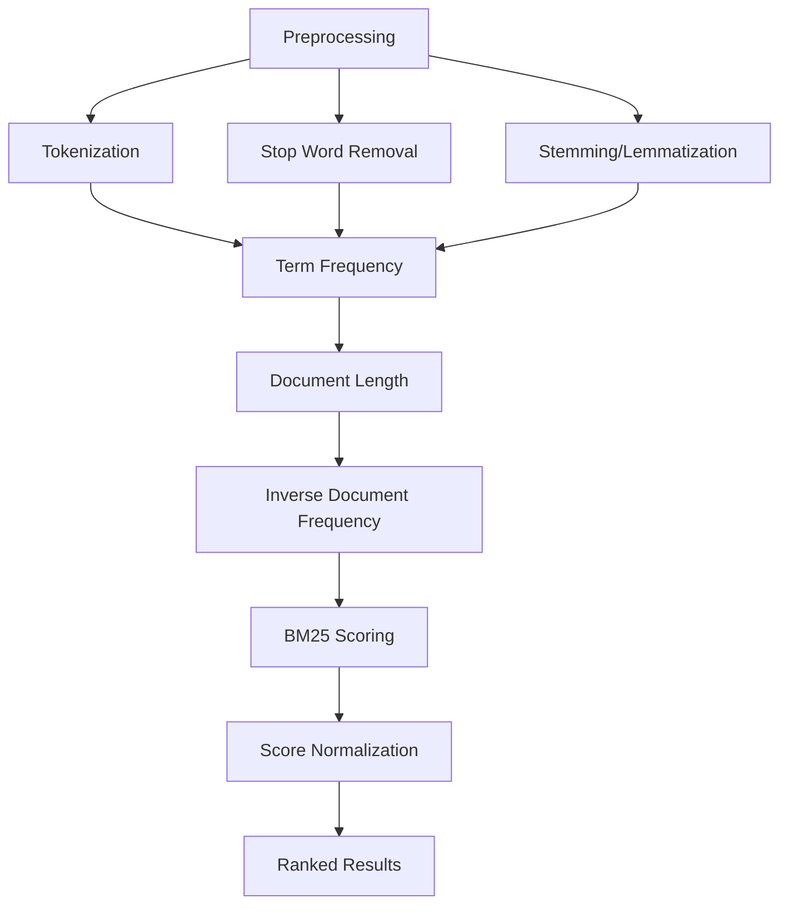

# Lesson 2: Practical BM25 Implementation

## 1. First-Principles Intuition & Invariants

In the realm of information retrieval and search systems, the BM25 ranking function stands as a cornerstone of relevance scoring. Developed by Stephen E. Robertson and Karen Spärck Jones in the early 1990s, BM25 is a probabilistic model that estimates the relevance of a document to a query based on the frequency of terms in the document and the document's length. The model's elegance lies in its ability to balance the importance of term frequency with the document's length, thereby mitigating the bias towards longer documents that might otherwise dominate search results.

At its core, BM25 is grounded in the principles of term frequency-inverse document frequency (TF-IDF), but it introduces several enhancements that make it particularly effective in practical applications. The key invariant of BM25 is its ability to adjust the term frequency component to account for the saturation effect, where the relevance of a term does not increase linearly with its frequency. This is achieved through a non-linear term frequency normalization, which ensures that the impact of a term's frequency on the document score diminishes as the frequency increases.

The BM25 formula is given by:

\[ \text{BM25}(d, q) = \sum_{i=1}^{n} \text{idf}(q_i) \cdot \left( \frac{(k_1 + 1) \cdot f(q_i, d)}{k_1 \left(1 - b + b \cdot \frac{|d|}{\text{avgdl}}\right) + f(q_i, d)} \right) \]

Where:
- \( f(q_i, d) \) is the frequency of term \( q_i \) in document \( d \).
- \( \text{idf}(q_i) \) is the inverse document frequency of term \( q_i \).
- \( k_1 \) and \( b \) are free parameters that can be tuned to optimize performance.
- \( |d| \) is the length of document \( d \).
- \( \text{avgdl} \) is the average length of documents in the collection.

The parameters \( k_1 \) and \( b \) play crucial roles in the model's behavior. The parameter \( k_1 \) controls the non-linearity of the term frequency normalization, while \( b \) controls the impact of document length normalization. By adjusting these parameters, one can fine-tune the BM25 model to better fit the characteristics of the document collection and the specific requirements of the search application.

## 2. Core Architecture & Mechanics

To implement BM25 in a practical setting, we need to dissect the internal data structures and algorithms that underpin the model. The process of applying BM25 involves several key steps: data preprocessing, term frequency and document length computation, inverse document frequency calculation, and score normalization.

### Data Preprocessing

Data preprocessing is a critical step in preparing the document collection for BM25 scoring. This involves tokenizing the text into individual terms, removing stop words, and applying stemming or lemmatization to reduce terms to their base forms. The goal is to create a clean and consistent representation of the document content that can be effectively analyzed by the BM25 algorithm.

For example, consider a document containing the sentence "The quick brown fox jumps over the lazy dog." After preprocessing, this sentence might be transformed into a list of terms: `["quick", "brown", "fox", "jump", "lazy", "dog"]`. This preprocessing step ensures that the BM25 model can focus on the most meaningful terms in the document, ignoring common stop words like "the" and "over."

### Term Frequency and Document Length Computation

Once the documents have been preprocessed, the next step is to compute the term frequency and document length for each document. The term frequency \( f(q_i, d) \) is simply the count of occurrences of term \( q_i \) in document \( d \). The document length \( |d| \) is the total number of terms in the document.

For instance, consider a document with the preprocessed terms `["quick", "brown", "fox", "jump", "lazy", "dog"]`. The term frequency for the term "quick" in this document would be 1, and the document length would be 6.

### Inverse Document Frequency Calculation

The inverse document frequency \( \text{idf}(q_i) \) is a measure of how rare a term is across the entire document collection. It is calculated using the formula:

\[ \text{idf}(q_i) = \log \left( \frac{N - n(q_i) + 0.5}{n(q_i) + 0.5} \right) \]

Where:
- \( N \) is the total number of documents in the collection.
- \( n(q_i) \) is the number of documents containing term \( q_i \).

The addition of 0.5 to the numerator and denominator in the formula is a smoothing technique that prevents division by zero and ensures that the IDF value is always positive.

### Score Normalization

After computing the term frequency, document length, and inverse document frequency, the final step is to calculate the BM25 score for each document with respect to the query. This involves applying the BM25 formula to each document and normalizing the scores to ensure that they are comparable.

To illustrate the process, consider a query "quick fox" and a document with the preprocessed terms `["quick", "brown", "fox", "jump", "lazy", "dog"]`. The BM25 score for this document would be calculated as follows:

1. Compute the term frequency for each term in the query:
   - \( f(\text{"quick"}, d) = 1 \)
   - \( f(\text{"fox"}, d) = 1 \)

2. Compute the inverse document frequency for each term in the query:
   - \( \text{idf}(\text{"quick"}) = \log \left( \frac{N - n(\text{"quick"}) + 0.5}{n(\text{"quick"}) + 0.5} \right) \)
   - \( \text{idf}(\text{"fox"}) = \log \left( \frac{N - n(\text{"fox"}) + 0.5}{n(\text{"fox"}) + 0.5} \right) \)

3. Apply the BM25 formula to compute the score for the document:
   \[ \text{BM25}(d, q) = \text{idf}(\text{"quick"}) \cdot \left( \frac{(k_1 + 1) \cdot 1}{k_1 \left(1 - b + b \cdot \frac{6}{\text{avgdl}}\right) + 1} \right) + \text{idf}(\text{"fox"}) \cdot \left( \frac{(k_1 + 1) \cdot 1}{k_1 \left(1 - b + b \cdot \frac{6}{\text{avgdl}}\right) + 1} \right) \]

### Core Architecture Diagram

To visualize the core architecture of a BM25 implementation, we can use a Mermaid diagram:

This diagram illustrates the flow of data through the BM25 implementation, from preprocessing to the final ranked results.

## 3. High-Performance Optimization & Failure Modes

Implementing BM25 efficiently in a real-world search system requires careful consideration of performance optimization and failure modes. The following sections discuss key strategies for optimizing BM25 and mitigating potential issues.

### Concurrency

To handle large document collections and high query loads, it is essential to parallelize the BM25 scoring process. This can be achieved by dividing the document collection into partitions and processing each partition concurrently. Modern multi-core processors and distributed computing frameworks like Apache Spark can be leveraged to distribute the workload and improve performance.

For example, consider a document collection with 10 million documents. This collection can be divided into 100 partitions, each containing 100,000 documents. Each partition can be processed concurrently by a separate thread or worker, allowing the BM25 scoring to be completed in parallel.

### Resource Scaling

As the size of the document collection and the number of queries increase, it is crucial to scale the resources allocated to the BM25 implementation. This can be achieved by adding more compute nodes, increasing memory capacity, and optimizing data storage and retrieval.

For instance, consider a search system that initially handles 100 queries per second. As the system grows, the query load may increase to 1,000 queries per second. To handle this increased load, additional compute nodes can be added to the system, and the data storage can be optimized to reduce retrieval times.

### Boundary Edge Cases

BM25 is designed to handle a wide range of document collections and query types, but it is not immune to boundary edge cases. Some common edge cases include documents with zero length, queries with no matching terms, and documents with extremely high term frequencies.

To handle these edge cases, the BM25 implementation should include checks and safeguards to ensure that the scoring process remains robust and reliable. For example, if a document has zero length, the BM25 score should be set to zero. If a query has no matching terms, the BM25 score should also be set to zero. If a document has extremely high term frequencies, the non-linear term frequency normalization should be applied to mitigate the impact of the high frequencies.

### Failure Mitigations

To ensure the reliability and robustness of the BM25 implementation, it is essential to implement failure mitigations. This can be achieved by using techniques such as error handling, logging, and monitoring.

For example, if an error occurs during the BM25 scoring process, the implementation should log the error and take appropriate action to recover. This can include retrying the scoring process, skipping the problematic document, or notifying the system administrator. Additionally, monitoring tools can be used to track the performance and health of the BM25 implementation, allowing for proactive detection and resolution of issues.

In conclusion, the BM25 ranking function is a powerful tool for relevance scoring in information retrieval and search systems. By understanding the first-principles intuition and invariants of BM25, dissecting its core architecture and mechanics, and optimizing for performance and reliability, we can implement BM25 in a practical and effective manner. This lesson has provided a comprehensive overview of the BM25 implementation, from data preprocessing to score normalization, and has discussed key strategies for optimizing performance and mitigating failure modes.
