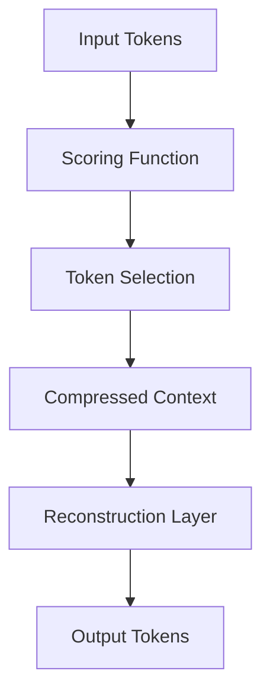

# Lesson 3: Contextual Compression Techniques

## 1. First-Principles Intuition & Invariants

In the architecture of modern Retrieval-Augmented Generation (RAG) systems, the context window serves as both a bottleneck and a critical resource. As language models grow in capacity, so too does the volume of contextual information they must process during inference. This presents a fundamental tension: how to maintain semantic fidelity while minimizing computational overhead. Contextual compression techniques are designed to resolve this tension by reducing the effective dimensionality of input data without sacrificing essential semantic content.

At its core, contextual compression is a form of information theory applied to neural architectures. It operates under the invariant that not all tokens in a context window contribute equally to downstream task performance. The key insight lies in identifying and preserving only those representations that are statistically significant or semantically critical. This is not merely about reducing token count—it is about preserving the *information-theoretic entropy* of the input while mapping it into a more compact, computationally tractable form.

The mathematical foundation rests on the principle of mutual information: given a sequence of tokens $ S = \{s_1, s_2, ..., s_n\} $, we seek a compressed representation $ C(S) $ such that the mutual information between $ C(S) $ and the target output $ Y $ remains maximized. This is expressed as:

$$
I(C(S); Y) \approx I(S; Y)
$$

This invariant implies that compression should be lossy only in ways that do not affect downstream inference quality. The challenge lies in defining what constitutes "lossy" in a way that preserves the semantic structure of the input.

In systems programming terms, this translates to a constraint on memory bandwidth and cache efficiency. A compressed context must fit within the L1/L2 cache of the inference engine, or at least be efficiently streamed from higher-level memory. The compression algorithm must also be deterministic and stateless to avoid introducing latency or non-determinism into the inference pipeline.

The design space for compression techniques is vast, ranging from simple token selection heuristics to complex neural encoders. However, all effective approaches share a common invariant: they must operate in real-time with bounded latency, and their compression ratio must scale linearly with input size to maintain performance guarantees.

## 2. Core Architecture & Mechanics

The architecture of a contextual compression system can be understood as a layered pipeline, each layer serving a distinct functional role in transforming raw token sequences into compressed representations. At the highest level, the system operates as a state machine with three primary states: **Input**, **Compression**, and **Output**. The transition from Input to Compression is governed by a set of heuristics that determine which tokens are retained, while the transition from Compression to Output involves decoding or re-expansion.

The core mechanism of most compression systems is based on a **token selection algorithm** that operates over the token sequence. This algorithm typically employs a sliding window approach, where each window is evaluated for semantic importance using a scoring function. The scoring function itself can be derived from attention weights, gradient-based saliency maps, or even learned embeddings.

Consider a basic token selection mechanism implemented in pseudocode:

```c
typedef struct {
    int* tokens;
    float* scores;
    int length;
} TokenSequence;

typedef struct {
    int* selected_tokens;
    int selected_count;
    int* indices;
} CompressedContext;

CompressedContext compress_context(TokenSequence* input, float threshold) {
    CompressedContext result = {0};
    result.selected_tokens = malloc(input->length * sizeof(int));
    result.indices = malloc(input->length * sizeof(int));
    result.selected_count = 0;

    for (int i = 0; i < input->length; i++) {
        if (input->scores[i] > threshold) {
            result.selected_tokens[result.selected_count] = input->tokens[i];
            result.indices[result.selected_count] = i;
            result.selected_count++;
        }
    }

    return result;
}
```

This simple model illustrates the fundamental trade-off: increasing the threshold reduces the number of tokens retained, but also risks discarding important information. The optimal threshold is determined empirically or through reinforcement learning, depending on the downstream task.

In more sophisticated systems, the compression layer is augmented with a **reconstruction mechanism** that allows for approximate decoding of the compressed representation. This is particularly important in RAG systems where the compressed context must be fed into a downstream model that expects full token sequences. The reconstruction process typically involves a learned decoder or a lookup table that maps compressed indices back to full tokens.

The internal data structures of a compression system are designed around the principle of **cache locality**. The token sequence is stored in a contiguous memory block, and the scoring function is computed using SIMD instructions to maximize throughput. The compressed representation is stored in a separate buffer, with metadata indicating which original tokens were retained.

A Mermaid diagram of this architecture would illustrate the flow:



The scoring function itself can be implemented using attention weights from a pre-trained model. For instance, in a transformer-based system, the attention scores for each token can be aggregated to form a per-token importance score. This score is then normalized and used to determine which tokens to retain.

In Rust, a more idiomatic implementation might look like:

```rust
#[derive(Debug)]
struct TokenSequence {
    tokens: Vec<i32>,
    scores: Vec<f32>,
}

#[derive(Debug)]
struct CompressedContext {
    selected_tokens: Vec<i32>,
    indices: Vec<usize>,
}

impl CompressedContext {
    fn compress_with_threshold(&self, threshold: f32) -> CompressedContext {
        let mut selected_tokens = Vec::new();
        let mut indices = Vec::new();

        for (i, &score) in self.scores.iter().enumerate() {
            if score > threshold {
                selected_tokens.push(self.tokens[i]);
                indices.push(i);
            }
        }

        CompressedContext {
            selected_tokens,
            indices,
        }
    }
}
```

This design ensures that the compression process is both deterministic and efficient, with the ability to scale to large input sizes without introducing significant overhead.

## 3. High-Performance Optimization & Failure Modes

The performance of a contextual compression system is highly dependent on its ability to maintain low latency while achieving high compression ratios. This requires careful consideration of memory access patterns, CPU cache utilization, and parallelization strategies. The most critical optimization involves minimizing memory bandwidth usage during the scoring and selection phases.

In a multi-threaded environment, the scoring function can be parallelized using OpenMP or similar frameworks. Each thread processes a segment of the token sequence, computing scores independently before merging results. This approach leverages the fact that scoring is often a compute-bound operation, making it amenable to parallel execution.

However, parallelization introduces its own set of challenges. The most significant is ensuring that the scoring function is deterministic across threads. This requires careful handling of floating-point operations and ensuring that the same input always produces the same output, regardless of thread scheduling.

A failure mode that often occurs in production systems is **over-compression**, where the compression ratio becomes so aggressive that critical information is lost. This manifests as a degradation in model performance, particularly in tasks that require fine-grained context understanding. To mitigate this, systems often employ a **dynamic threshold adjustment** mechanism that monitors model performance and adjusts the compression ratio accordingly.

Another failure mode is **cache thrashing**. When the compressed representation is too large to fit in the CPU cache, performance degrades significantly due to memory stalls. This is particularly problematic in systems that perform frequent recompression, such as streaming applications where context windows are continuously updated.

To address these issues, modern systems implement **adaptive compression** strategies that adjust the compression algorithm based on input characteristics. For example, if the input contains a high degree of redundancy, a more aggressive compression algorithm may be used. Conversely, if the input is highly variable, a more conservative approach is taken.

The system must also handle **edge cases** such as empty inputs, single-token sequences, or inputs with very high entropy. These cases can cause the compression algorithm to behave unpredictably, leading to either excessive memory usage or incorrect compression decisions.

In terms of resource scaling, the compression system must be designed to handle inputs of varying sizes without significant performance degradation. This is achieved through **bounded memory allocation** and **predictable execution time**. The system should be able to compress a 1000-token sequence in the same time it takes to compress a 100-token sequence, modulo the inherent computational complexity of the scoring function.

Finally, the system must be resilient to **input corruption** or **malformed data**. This is particularly important in production environments where inputs may come from untrusted sources. The compression system should include robust error handling that gracefully degrades to a baseline compression strategy when faced with unexpected input patterns.

The optimization of contextual compression systems is thus a delicate balance between computational efficiency, memory usage, and semantic fidelity. The most successful implementations are those that can maintain high compression ratios while ensuring that the compressed representation remains semantically meaningful to the downstream model. This requires not just algorithmic sophistication, but also a deep understanding of the underlying hardware and software stack that will execute the system in production.
