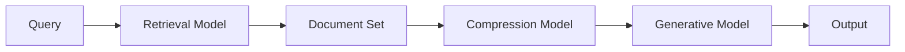

# Lesson 4: Integrating RAG and Compression

## 1. First-Principles Intuition & Invariants

In the realm of AI systems, the synergy between Retrieval-Augmented Generation (RAG) and compression techniques has given rise to a new paradigm for building robust and efficient models. At its core, RAG leverages the strengths of both retrieval-based and generative approaches to produce coherent and contextually relevant outputs. However, the sheer scale and complexity of modern AI systems necessitate the judicious application of compression techniques to mitigate the curse of dimensionality.

To grasp the fundamental principles underlying the integration of RAG and compression, let us first consider the mathematical invariants that govern the behavior of these systems. In the context of RAG, the retrieval process can be viewed as a function that maps a query to a set of relevant documents, which are then used to inform the generative process. This can be formalized as follows:

Given a query `q` and a set of documents `D`, the retrieval function `R` can be defined as:

`R(q, D) = {d ∈ D | sim(q, d) > θ}`

where `sim(q, d)` represents the similarity between the query and a document, and `θ` is a threshold value that determines the relevance of the retrieved documents.

In the context of compression, the primary goal is to reduce the dimensionality of the data while preserving its essential features. This can be achieved through various techniques, such as PCA, t-SNE, or autoencoders. However, the key challenge lies in ensuring that the compressed representation remains faithful to the original data, while also being computationally efficient.

## 2. Core Architecture & Mechanics

To integrate RAG and compression, we need to design a system that can effectively combine the strengths of both approaches. One possible architecture is to use a retrieval-augmented generative model, where the retrieval process is used to inform the generative process. This can be achieved through a combination of attention mechanisms and compression techniques.

Here is a high-level overview of the system architecture:

In this architecture, the retrieval model is used to retrieve a set of relevant documents, which are then compressed using a compression model. The compressed representation is then used to inform the generative model, which produces the final output.

## 3. High-Performance Optimization & Failure Modes

To ensure the robustness and efficiency of the system, we need to optimize its performance and mitigate potential failure modes. One key challenge lies in balancing the trade-off between compression ratio and accuracy. While higher compression ratios can lead to significant reductions in computational overhead, they may also compromise the accuracy of the model.

To address this challenge, we can use techniques such as hierarchical compression, where the data is compressed at multiple levels to achieve a balance between compression ratio and accuracy.

Another key challenge lies in ensuring the scalability of the system, particularly in the context of large-scale datasets. To address this challenge, we can use techniques such as distributed computing, where the computation is distributed across multiple nodes to achieve parallelization.

In terms of failure modes, one key challenge lies in ensuring the robustness of the system to changes in the input data. To address this challenge, we can use techniques such as anomaly detection, where the system is designed to detect and respond to anomalies in the input data.

By carefully integrating RAG and compression techniques, we can build robust and efficient AI systems that can handle large-scale datasets and complex tasks. However, the key challenge lies in ensuring the scalability and robustness of the system, particularly in the context of large-scale datasets.
