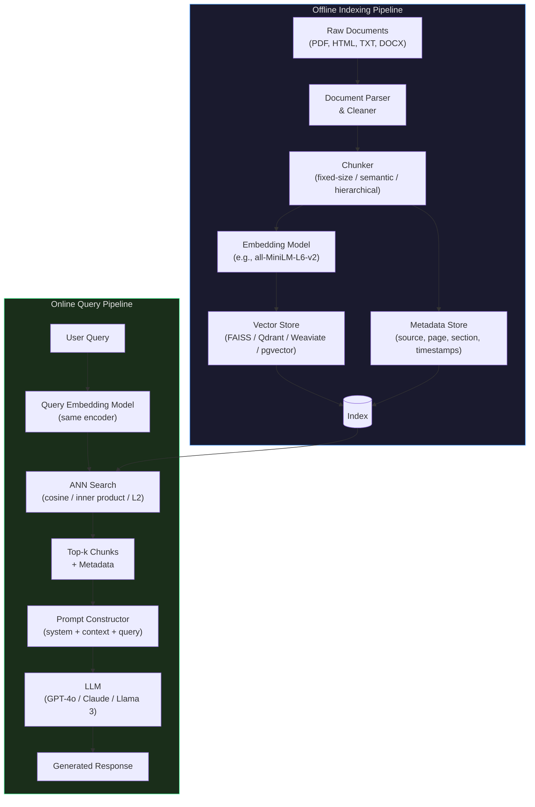
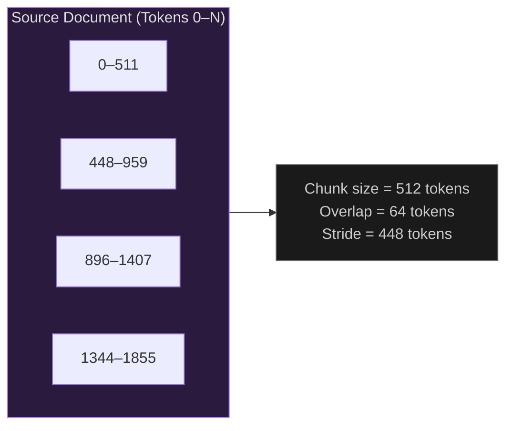
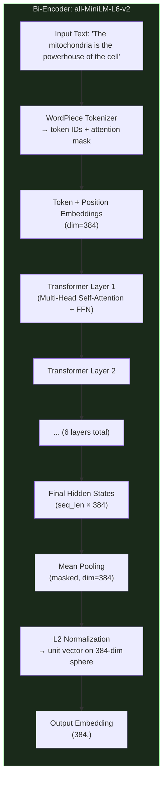
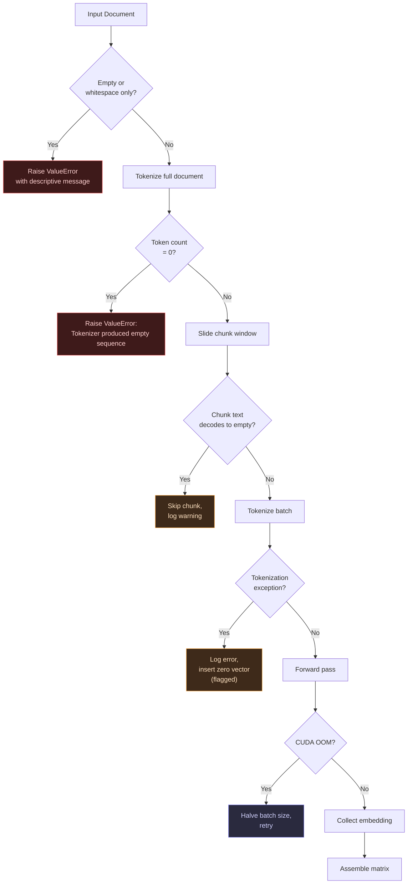

# Operational Verification Labs: 01 — Document Chunking and Embedding Models

## Conceptual Foundation: Why Chunking and Embedding Exist

Before writing a single line of code, it is worth understanding the architectural necessity of these two operations in a retrieval-augmented generation (RAG) pipeline.

Large language models have a fixed context window — the maximum number of tokens the model can process in a single forward pass. As of 2024, this ranges from roughly 4,096 tokens (older GPT-3.5 variants) to 128,000+ tokens (GPT-4o, Claude 3.5 Sonnet) or 1,000,000+ tokens (Gemini 1.5 Pro). Even with large context windows, naively stuffing entire document corpora into every prompt is economically and computationally prohibitive. A corpus of 10,000 documents, each 2,000 tokens long, represents 20 million tokens per query — an infeasible retrieval strategy.

The solution is a two-phase offline/online architecture:

1. **Offline indexing**: Documents are split into chunks, each chunk is encoded into a dense vector (embedding) by an encoder model, and those vectors are stored in a vector database.
2. **Online retrieval**: A user query is encoded by the same encoder model, the resulting vector is compared against the index using approximate nearest-neighbor (ANN) search, and the top-k most semantically similar chunks are injected into the LLM's context window.

This is fundamentally a **semantic compression and retrieval problem**. The embedding model's job is to map variable-length text into a fixed-dimensional vector space such that semantic similarity corresponds to geometric proximity (typically measured by cosine similarity or inner product).



---

## Architecture Deep Dive: Chunking Strategies

Chunking is not a solved problem. The choice of chunking strategy is one of the highest-leverage decisions in RAG system design, directly affecting retrieval precision and recall. There are three primary approaches:

**Fixed-size (token-based) chunking** splits text at a fixed token boundary with optional overlap. It is fast, predictable, and hardware-friendly because it produces uniform-length inputs for the embedding model. The pathological failure mode is mid-sentence or mid-paragraph splits that destroy semantic coherence.

**Semantic chunking** uses sentence boundary detection (spaCy, NLTK) or structural cues (Markdown headers, HTML tags, paragraph breaks) to split at natural semantic boundaries. This preserves coherence at the cost of variable-length chunks and more complex downstream padding/batching logic.

**Hierarchical (parent-document) chunking**, popularized by LangChain's `ParentDocumentRetriever`, stores two granularities: small child chunks for high-precision retrieval and their larger parent chunks for context-rich injection. The retriever finds child chunks, then returns the full parent context to the LLM.

The **overlap** parameter exists because transformer attention is local within a chunk but blind across chunk boundaries. A stride of `chunk_size - overlap` ensures that semantic content straddling a boundary appears in at least one chunk in sufficient context.



---

## Embedding Model Architecture: What the Numbers Mean

The model `sentence-transformers/all-MiniLM-L6-v2` is a fine-tuned version of `microsoft/MiniLM-L6-H384-uncased` trained on a large-scale contrastive sentence similarity dataset using the **multiple negatives ranking loss**. Its architecture is a 6-layer, 384-hidden-dimension transformer with 22.7 million parameters. It maps variable-length text to a 384-dimensional unit sphere via mean pooling over the final layer's token representations followed by L2 normalization.

The key architectural properties that make it suitable for RAG:

- **Bi-encoder design**: Query and document are encoded independently. This enables precomputation of document embeddings — a prerequisite for scalable ANN retrieval. Cross-encoders (like re-rankers) encode query-document pairs jointly and cannot precompute; they are used in a second-stage re-ranking step.
- **Mean pooling + normalization**: The CLS token embedding, used in BERT-style classification, does not generalize well to semantic similarity. Mean pooling over all non-padding token states produces more robust sentence representations.
- **Contrastive training**: The model was trained so that semantically equivalent sentences have high cosine similarity and dissimilar sentences have low cosine similarity. This is distinct from MLM/NSP pretraining objectives.



---

## Environment Setup

This lab requires Python 3.11+. Use a virtual environment to isolate dependencies.

```bash
python3 -m venv .venv
source .venv/bin/activate  # Windows: .venv\Scripts\activate

pip install \
    "transformers==4.44.2" \
    "torch==2.4.0" \
    "sentence-transformers==3.1.1" \
    "numpy==1.26.4" \
    "scikit-learn==1.5.1" \
    "pandas==2.2.2" \
    "tqdm==4.66.5" \
    "faiss-cpu==1.8.0" \
    "spacy==3.7.6" \
    "pytest==8.3.2"

python -m spacy download en_core_web_sm
```

Pin exact versions in production. Never use open version ranges for ML dependencies — minor version changes in `transformers` have broken embedding API contracts historically (e.g., the pooling behavior changes between 4.x minor versions).

---

## Exercise 1: Production-Grade Chunking and Embedding Pipeline

The original code has several correctness issues that must be addressed before it is usable in production:

1. **Missing `import torch`**: The original `generate_embeddings` function calls `torch.no_grad()` without importing `torch`.
2. **Tokenize-then-detokenize round-trip**: The original code tokenizes to subword tokens, joins them with spaces, then re-tokenizes. This corrupts text because WordPiece/BPE tokens joined by spaces do not faithfully reconstruct the original string — the second tokenization sees incorrect token boundaries.
3. **No device management**: Running on CPU for large corpora is 20–100x slower than GPU. The code must detect and use CUDA/MPS when available.
4. **Single-item batching**: Embedding one chunk at a time wastes GPU memory bandwidth. Batched inference is 10–50x more efficient.
5. **No L2 normalization**: The original code returns raw mean-pooled vectors. For cosine similarity search, vectors must be L2-normalized so that inner product equals cosine similarity — a correctness requirement for most ANN libraries.

The corrected and production-grade implementation follows.

```python
"""
rag_lab_01_chunking_embedding.py

Production-grade document chunking and dense embedding pipeline.
Demonstrates fixed-size token chunking with overlap, batched GPU
inference, and proper L2 normalization for cosine-similarity ANN search.
"""

from __future__ import annotations

import logging
import os
import time
from dataclasses import dataclass, field
from pathlib import Path
from typing import Generator

import numpy as np
import torch
import torch.nn.functional as F
from transformers import AutoModel, AutoTokenizer, PreTrainedModel, PreTrainedTokenizerBase
from tqdm import tqdm

# ---------------------------------------------------------------------------
# Logging
# ---------------------------------------------------------------------------
logging.basicConfig(
    level=logging.INFO,
    format="%(asctime)s [%(levelname)s] %(name)s: %(message)s",
)
log = logging.getLogger(__name__)


# ---------------------------------------------------------------------------
# Configuration
# ---------------------------------------------------------------------------
@dataclass
class PipelineConfig:
    """Central configuration for the chunking and embedding pipeline.

    Attributes
    ----------
    model_name:
        HuggingFace model identifier. Must be a bi-encoder (sentence transformer)
        model, NOT a generative model. all-MiniLM-L6-v2 produces 384-dim vectors.
    chunk_size:
        Maximum number of tokens per chunk. For all-MiniLM-L6-v2, the absolute
        maximum is 512 tokens (the model's positional embedding limit). Values
        above 256 often degrade retrieval quality because mean pooling over very
        long sequences dilutes the dominant semantic signal.
    overlap:
        Number of tokens of overlap between consecutive chunks. This ensures
        semantic content that straddles a chunk boundary is represented in full
        context in at least one chunk. Typical values: 10–20% of chunk_size.
    batch_size:
        Number of chunks to process in a single forward pass. Larger batches
        improve GPU utilization but increase peak VRAM usage. 32 is safe for
        most GPUs with chunk_size=256.
    normalize_embeddings:
        If True, L2-normalize output vectors to the unit sphere. Required for
        cosine similarity to equal the inner product, which is assumed by most
        ANN libraries (FAISS IndexFlatIP, Qdrant with Cosine distance, etc.).
    """
    model_name: str = "sentence-transformers/all-MiniLM-L6-v2"
    chunk_size: int = 256
    overlap: int = 32
    batch_size: int = 32
    normalize_embeddings: bool = True
    output_dir: Path = field(default_factory=lambda: Path("./output"))


# ---------------------------------------------------------------------------
# Document Loading
# ---------------------------------------------------------------------------
def load_document(file_path: str | Path) -> str:
    """Load a plain-text document from disk.

    Parameters
    ----------
    file_path:
        Path to a UTF-8 encoded text file.

    Returns
    -------
    str
        The raw document string.

    Raises
    ------
    FileNotFoundError
        If the file does not exist at the given path.
    ValueError
        If the file is empty after stripping whitespace.
    """
    path = Path(file_path)
    if not path.exists():
        raise FileNotFoundError(f"Document not found: {path.resolve()}")

    text = path.read_text(encoding="utf-8")

    if not text.strip():
        raise ValueError(f"Document is empty: {path.resolve()}")

    log.info("Loaded document: %s (%d characters)", path.name, len(text))
    return text


# ---------------------------------------------------------------------------
# Chunking
# ---------------------------------------------------------------------------
@dataclass
class TextChunk:
    """A single chunk produced by the chunking pipeline.

    Attributes
    ----------
    text:
        The reconstructed text of this chunk (decoded from token IDs, not
        joined subword tokens, to preserve fidelity).
    token_ids:
        The raw token ID sequence for this chunk. Stored to avoid re-tokenizing
        during embedding generation.
    chunk_index:
        Zero-based position of this chunk in the document.
    token_start:
        Index into the full-document token sequence where this chunk begins.
    token_end:
        Index into the full-document token sequence where this chunk ends.
    """
    text: str
    token_ids: list[int]
    chunk_index: int
    token_start: int
    token_end: int


def chunk_document(
    document: str,
    tokenizer: PreTrainedTokenizerBase,
    chunk_size: int,
    overlap: int,
) -> list[TextChunk]:
    """Split a document into overlapping token-window chunks.

    The correct approach is to tokenize the full document once, slide a
    window over the resulting token ID sequence, then decode each window
    back to text. This avoids the information-destroying
    tokenize→join-with-spaces→re-tokenize anti-pattern.

    Special tokens (CLS, SEP, PAD) are excluded from the chunk window to
    prevent them from consuming chunk capacity. They are added automatically
    by the tokenizer during the embedding step.

    Parameters
    ----------
    document:
        The raw input text.
    tokenizer:
        A HuggingFace PreTrainedTokenizer. Must be the same tokenizer used
        for embedding generation.
    chunk_size:
        Maximum number of content tokens per chunk (excluding special tokens).
    overlap:
        Token overlap between adjacent chunks. Must be < chunk_size.

    Returns
    -------
    list[TextChunk]
        Ordered list of chunks with metadata.
    """
    if overlap >= chunk_size:
        raise ValueError(
            f"overlap ({overlap}) must be strictly less than chunk_size ({chunk_size})"
        )

    # Tokenize the full document without special tokens to get raw content IDs.
    # add_special_tokens=False prevents CLS/SEP from appearing mid-sequence.
    all_token_ids: list[int] = tokenizer.encode(
        document,
        add_special_tokens=False,
        truncation=False,  # We handle chunking manually; never silently truncate.
    )

    if len(all_token_ids) == 0:
        log.warning("Document produced zero tokens after encoding.")
        return []

    stride = chunk_size - overlap
    chunks: list[TextChunk] = []
    chunk_index = 0

    for start in range(0, len(all_token_ids), stride):
        end = min(start + chunk_size, len(all_token_ids))
        window_ids = all_token_ids[start:end]

        # Decode token IDs back to text. skip_special_tokens=True is a
        # safety measure; there should be none since we encoded without them.
        chunk_text = tokenizer.decode(window_ids, skip_special_tokens=True)

        chunks.append(
            TextChunk(
                text=chunk_text,
                token_ids=window_ids,
                chunk_index=chunk_index,
                token_start=start,
                token_end=end,
            )
        )
        chunk_index += 1

        # If this window reached the end of the document, stop.
        if end == len(all_token_ids):
            break

    log.info(
        "Chunked document into %d chunks (chunk_size=%d, overlap=%d, stride=%d)",
        len(chunks),
        chunk_size,
        overlap,
        stride,
    )
    return chunks


# ---------------------------------------------------------------------------
# Embedding Generation
# ---------------------------------------------------------------------------
def _mean_pool(
    last_hidden_state: torch.Tensor,
    attention_mask: torch.Tensor,
) -> torch.Tensor:
    """Compute attention-mask-aware mean pooling over token embeddings.

    The attention mask ensures that PAD tokens do not contribute to the mean.
    Without masking, PAD vectors (which are not zero after layer normalization)
    would dilute the sentence representation proportionally to the amount of
    padding, introducing a length-dependent bias.

    Parameters
    ----------
    last_hidden_state:
        Shape (batch_size, seq_len, hidden_dim). The final layer's hidden
        states from the transformer.
    attention_mask:
        Shape (batch_size, seq_len). 1 for real tokens, 0 for PAD tokens.

    Returns
    -------
    torch.Tensor
        Shape (batch_size, hidden_dim). One pooled vector per input sequence.
    """
    # Expand mask to match hidden_state dimensions: (B, S, 1) → (B, S, H)
    mask_expanded = attention_mask.unsqueeze(-1).float()
    # Zero out PAD token contributions.
    sum_embeddings = (last_hidden_state * mask_expanded).sum(dim=1)
    # Divide by the count of real tokens, clamped to avoid division by zero.
    sum_mask = mask_expanded.sum(dim=1).clamp(min=1e-9)
    return sum_embeddings / sum_mask


def generate_embeddings(
    chunks: list[TextChunk],
    tokenizer: PreTrainedTokenizerBase,
    model: PreTrainedModel,
    batch_size: int,
    normalize: bool,
    device: torch.device,
) -> np.ndarray:
    """Generate dense vector embeddings for a list of text chunks.

    Processes chunks in batches for GPU efficiency. Uses masked mean pooling
    over final-layer hidden states, optionally followed by L2 normalization.

    Parameters
    ----------
    chunks:
        List of TextChunk objects produced by chunk_document().
    tokenizer:
        The tokenizer corresponding to `model`.
    model:
        A HuggingFace AutoModel loaded in eval mode and placed on `device`.
    batch_size:
        Number of chunks per forward pass.
    normalize:
        If True, L2-normalize each embedding to unit length. Required for
        cosine similarity search via inner product.
    device:
        torch.device to run inference on (cpu, cuda, mps).

    Returns
    -------
    np.ndarray
        Shape (n_chunks, hidden_dim). Row i is the embedding for chunks[i].
    """
    model.eval()
    all_embeddings: list[np.ndarray] = []
    texts = [c.text for c in chunks]

    for batch_start in tqdm(
        range(0, len(texts), batch_size),
        desc="Embedding chunks",
        unit="batch",
    ):
        batch_texts = texts[batch_start : batch_start + batch_size]

        # Tokenize the batch. padding=True pads shorter sequences to the
        # longest sequence in the batch. truncation=True enforces the model's
        # max_position_embeddings limit as a hard safety cap.
        encoded = tokenizer(
            batch_texts,
            return_tensors="pt",
            padding=True,
            truncation=True,
            max_length=512,
        )
        input_ids = encoded["input_ids"].to(device)
        attention_mask = encoded["attention_mask"].to(device)

        with torch.no_grad():
            outputs = model(input_ids=input_ids, attention_mask=attention_mask)

        # outputs.last_hidden_state: (batch_size, seq_len, hidden_dim)
        pooled = _mean_pool(outputs.last_hidden_state, attention_mask)

        if normalize:
            # L2 normalization: each vector is divided by its Euclidean norm.
            # After this, ||v|| = 1 for all v, so v·w = cos(v, w).
            pooled = F.normalize(pooled, p=2, dim=1)

        all_embeddings.append(pooled.cpu().numpy())

    return np.vstack(all_embeddings)


# ---------------------------------------------------------------------------
# Persistence
# ---------------------------------------------------------------------------
def save_artifacts(
    chunks: list[TextChunk],
    embeddings: np.ndarray,
    output_dir: Path,
) -> None:
    """Persist embeddings and chunk metadata to disk.

    Saves:
      - embeddings.npy  : float32 NumPy array of shape (n, hidden_dim)
      - chunks.tsv      : TSV file with chunk_index, token_start, token_end, text

    Parameters
    ----------
    chunks:
        The list of TextChunk objects to serialize.
    embeddings:
        The corresponding embedding matrix. Must have len(chunks) rows.
    output_dir:
        Directory to write artifacts to. Created if it does not exist.
    """
    if len(chunks) != embeddings.shape[0]:
        raise ValueError(
            f"Mismatch: {len(chunks)} chunks but {embeddings.shape[0]} embeddings."
        )

    output_dir.mkdir(parents=True, exist_ok=True)

    emb_path = output_dir / "embeddings.npy"
    np.save(str(emb_path), embeddings.astype(np.float32))
    log.info("Saved embeddings: %s %s", emb_path, embeddings.shape)

    meta_path = output_dir / "chunks.tsv"
    with meta_path.open("w", encoding="utf-8") as f:
        f.write("chunk_index\ttoken_start\ttoken_end\ttext\n")
        for c in chunks:
            # Escape newlines in text to keep TSV format valid.
            safe_text = c.text.replace("\n", " ").replace("\t", " ")
            f.write(f"{c.chunk_index}\t{c.token_start}\t{c.token_end}\t{safe_text}\n")
    log.info("Saved chunk metadata: %s", meta_path)


# ---------------------------------------------------------------------------
# Main Entry Point
# ---------------------------------------------------------------------------
def build_pipeline(config: PipelineConfig) -> tuple[
    PreTrainedTokenizerBase, PreTrainedModel, torch.device
]:
    """Load model and tokenizer, detect hardware accelerator."""
    if torch.cuda.is_available():
        device = torch.device("cuda")
    elif torch.backends.mps.is_available():
        device = torch.device("mps")
    else:
        device = torch.device("cpu")
    log.info("Using device: %s", device)

    log.info("Loading tokenizer: %s", config.model_name)
    tokenizer = AutoTokenizer.from_pretrained(config.model_name)

    log.info("Loading model: %s", config.model_name)
    model = AutoModel.from_pretrained(config.model_name)
    model.to(device)
    model.eval()

    return tokenizer, model, device


def run_pipeline(
    document_path: str | Path,
    config: PipelineConfig | None = None,
) -> tuple[list[TextChunk], np.ndarray]:
    """Execute the full ingestion pipeline on a single document.

    Parameters
    ----------
    document_path:
        Path to the input text file.
    config:
        Pipeline configuration. Defaults to PipelineConfig() if None.

    Returns
    -------
    tuple[list[TextChunk], np.ndarray]
        (chunks, embeddings) where embeddings[i] corresponds to chunks[i].
    """
    if config is None:
        config = PipelineConfig()

    tokenizer, model, device = build_pipeline(config)

    document = load_document(document_path)
    chunks = chunk_document(document, tokenizer, config.chunk_size, config.overlap)

    if not chunks:
        raise ValueError("Chunking produced zero chunks. Check the input document.")

    embeddings = generate_embeddings(
        chunks, tokenizer, model, config.batch_size, config.normalize_embeddings, device
    )

    save_artifacts(chunks, embeddings, config.output_dir)
    return chunks, embeddings


if __name__ == "__main__":
    cfg = PipelineConfig(
        model_name="sentence-transformers/all-MiniLM-L6-v2",
        chunk_size=256,
        overlap=32,
        batch_size=32,
        normalize_embeddings=True,
        output_dir=Path("./output"),
    )
    run_pipeline("example_document.txt", cfg)
```

---

## Exercise 2: Hyperparameter Tuning and Empirical Benchmarking

A meaningful benchmark measures three dimensions simultaneously: **latency** (wall-clock time per stage), **throughput** (tokens or chunks per second), and **embedding quality** (retrieval accuracy against a labeled query–document pairs set). The original code measured only latency and estimated an arbitrary token cost. This section replaces that with a principled benchmarking framework.

The embedding quality metric used here is **Hit Rate @ k**: given a set of (query, relevant_chunk_index) pairs, what fraction of queries have the relevant chunk appear in the top-k retrieved chunks? This directly measures whether the pipeline will serve the downstream LLM correctly.

```python
"""
benchmark.py

Empirical benchmarking of the chunking and embedding pipeline.
Measures latency, throughput, peak memory, and retrieval Hit Rate@k.
"""

from __future__ import annotations

import gc
import logging
import time
from dataclasses import dataclass
from pathlib import Path
from typing import NamedTuple

import numpy as np
import torch
from sklearn.metrics.pairwise import cosine_similarity

from rag_lab_01_chunking_embedding import (
    PipelineConfig,
    TextChunk,
    build_pipeline,
    chunk_document,
    generate_embeddings,
    load_document,
)

log = logging.getLogger(__name__)


# ---------------------------------------------------------------------------
# Benchmark Structures
# ---------------------------------------------------------------------------
class LatencyReport(NamedTuple):
    chunking_seconds: float
    embedding_seconds: float
    total_seconds: float
    chunks_per_second: float
    tokens_per_second: float
    peak_vram_mb: float | None  # None on CPU


@dataclass
class RetrievalEvalResult:
    """Hit Rate at multiple k values for a given configuration."""
    config: PipelineConfig
    hit_rate: dict[int, float]  # {k: hit_rate}
    latency: LatencyReport


# ---------------------------------------------------------------------------
# Latency Benchmark
# ---------------------------------------------------------------------------
def benchmark_latency(
    document: str,
    config: PipelineConfig,
    n_runs: int = 3,
) -> LatencyReport:
    """Measure median latency and throughput over n_runs repetitions.

    Uses median rather than mean to reduce sensitivity to outliers from
    OS scheduling jitter and GPU warm-up on the first run.

    Parameters
    ----------
    document:
        Raw document text to process.
    config:
        Pipeline configuration to benchmark.
    n_runs:
        Number of repetitions. Minimum 3 recommended.

    Returns
    -------
    LatencyReport
        Median statistics across all runs.
    """
    tokenizer, model, device = build_pipeline(config)
    chunking_times: list[float] = []
    embedding_times: list[float] = []

    # Warm-up pass: the first forward pass on GPU incurs CUDA kernel compilation
    # overhead that is not representative of steady-state throughput.
    log.info("Running warm-up pass...")
    warm_chunks = chunk_document(document, tokenizer, config.chunk_size, config.overlap)
    _ = generate_embeddings(warm_chunks, tokenizer, model, config.batch_size, True, device)

    if device.type == "cuda":
        torch.cuda.reset_peak_memory_stats()

    for run in range(n_runs):
        # Chunking
        t0 = time.perf_counter()
        chunks = chunk_document(document, tokenizer, config.chunk_size, config.overlap)
        chunking_times.append(time.perf_counter() - t0)

        # Embedding
        if device.type == "cuda":
            torch.cuda.synchronize()
        t1 = time.perf_counter()
        generate_embeddings(chunks, tokenizer, model, config.batch_size, True, device)
        if device.type == "cuda":
            torch.cuda.synchronize()
        embedding_times.append(time.perf_counter() - t1)

        log.info(
            "Run %d/%d: chunk=%.3fs, embed=%.3fs",
            run + 1, n_runs, chunking_times[-1], embedding_times[-1],
        )

    median_chunk_t = float(np.median(chunking_times))
    median_embed_t = float(np.median(embedding_times))
    total_t = median_chunk_t + median_embed_t

    total_tokens = sum(len(c.token_ids) for c in chunks)
    n_chunks = len(chunks)

    peak_vram: float | None = None
    if device.type == "cuda":
        peak_vram = torch.cuda.max_memory_allocated() / 1024**2

    return LatencyReport(
        chunking_seconds=median_chunk_t,
        embedding_seconds=median_embed_t,
        total_seconds=total_t,
        chunks_per_second=n_chunks / median_embed_t,
        tokens_per_second=total_tokens / median_embed_t,
        peak_vram_mb=peak_vram,
    )


# ---------------------------------------------------------------------------
# Retrieval Quality Benchmark
# ---------------------------------------------------------------------------
def evaluate_retrieval(
    queries: list[str],
    relevant_chunk_indices: list[int],
    chunks: list[TextChunk],
    doc_embeddings: np.ndarray,
    tokenizer,
    model,
    device: torch.device,
    k_values: list[int] | None = None,
) -> dict[int, float]:
    """Compute Hit Rate @ k for a set of (query, relevant_chunk) pairs.

    Hit Rate @ k = (# queries where relevant chunk appears in top-k results) / N

    This is the primary end-to-end quality metric for a RAG retrieval system.
    It measures whether the embeddings place the correct chunk within the
    retrieval window that the LLM will see.

    Parameters
    ----------
    queries:
        List of natural language query strings.
    relevant_chunk_indices:
        List of ground-truth chunk indices, one per query.
    chunks:
        The full list of chunks in the document corpus.
    doc_embeddings:
        Pre-computed, L2-normalized embeddings for all chunks.
        Shape: (n_chunks, hidden_dim).
    tokenizer, model, device:
        As produced by build_pipeline().
    k_values:
        List of k values to evaluate. Defaults to [1, 3, 5, 10].

    Returns
    -------
    dict[int, float]
        Mapping from k to Hit Rate @ k.
    """
    if k_values is None:
        k_values = [1, 3, 5, 10]

    # Embed all queries in a single batch for efficiency.
    query_chunks = [
        TextChunk(
            text=q,
            token_ids=[],  # Not used for embedding; text is re-tokenized.
            chunk_index=i,
            token_start=0,
            token_end=0,
        )
        for i, q in enumerate(queries)
    ]
    query_embeddings = generate_embeddings(
        query_chunks, tokenizer, model, batch_size=32, normalize=True, device=device
    )

    # Compute cosine similarity matrix: (n_queries, n_chunks).
    # Since both query and doc embeddings are L2-normalized, this equals
    # the inner product, which is what ANN libraries like FAISS optimize.
    sim_matrix = cosine_similarity(query_embeddings, doc_embeddings)

    hit_rates: dict[int, float] = {}
    for k in k_values:
        hits = 0
        for i, relevant_idx in enumerate(relevant_chunk_indices):
            # argsort ascending; take last k for top-k descending scores.
            top_k_indices = np.argsort(sim_matrix[i])[-k:]
            if relevant_idx in top_k_indices:
                hits += 1
        hit_rates[k] = hits / len(queries)

    return hit_rates


# ---------------------------------------------------------------------------
# Chunk Size Sweep
# ---------------------------------------------------------------------------
def sweep_chunk_sizes(
    document: str,
    queries: list[str],
    relevant_indices: list[int],
    chunk_sizes: list[int] | None = None,
) -> list[RetrievalEvalResult]:
    """Sweep over chunk_size values and report latency + retrieval quality.

    This is the core hyperparameter tuning experiment. The relationship
    between chunk_size and retrieval quality is non-monotonic:
    - Very small chunks (< 64 tokens) often lack sufficient context for the
      embedding model to capture the relevant semantic signal.
    - Very large chunks (> 384 tokens) dilute the signal through mean pooling,
      reducing the discriminability of embeddings.
    - Sweet spot is typically 128–256 tokens for all-MiniLM-L6-v2.

    Parameters
    ----------
    document:
        Raw document text.
    queries, relevant_indices:
        Retrieval evaluation dataset.
    chunk_sizes:
        List of chunk sizes to evaluate. Defaults to [64, 128, 256, 384, 512].

    Returns
    -------
    list[RetrievalEvalResult]
        One result per chunk size, sorted by chunk size ascending.
    """
    if chunk_sizes is None:
        chunk_sizes = [64, 128, 256, 384, 512]

    results: list[RetrievalEvalResult] = []

    for cs in chunk_sizes:
        log.info("=" * 60)
        log.info("Evaluating chunk_size=%d", cs)
        config = PipelineConfig(chunk_size=cs, overlap=cs // 8, batch_size=32)
        tokenizer, model, device = build_pipeline(config)

        chunks = chunk_document(document, tokenizer, cs, cs // 8)
        doc_embeddings = generate_embeddings(
            chunks, tokenizer, model, 32, True, device
        )

        hit_rates = evaluate_retrieval(
            queries, relevant_indices, chunks, doc_embeddings,
            tokenizer, model, device,
        )
        latency = benchmark_latency(document, config, n_runs=3)

        result = RetrievalEvalResult(config=config, hit_rate=hit_rates, latency=latency)
        results.append(result)

        log.info(
            "chunk_size=%d | HR@1=%.3f HR@5=%.3f | %.1f chunks/s | %.0f tok/s",
            cs,
            hit_rates.get(1, 0),
            hit_rates.get(5, 0),
            latency.chunks_per_second,
            latency.tokens_per_second,
        )

        # Release GPU memory between runs.
        del model
        torch.cuda.empty_cache() if torch.cuda.is_available() else None
        gc.collect()

    return sorted(results, key=lambda r: r.config.chunk_size)


if __name__ == "__main__":
    logging.basicConfig(level=logging.INFO)

    # --- Minimal synthetic evaluation dataset ---
    # In production, replace with a labeled dataset (e.g., from BEIR benchmark).
    sample_doc = Path("example_document.txt").read_text(encoding="utf-8")

    # These queries must correspond to actual content in example_document.txt.
    # Replace relevant_chunk_indices with the actual correct chunk index for
    # each query after inspecting the chunked output.
    sample_queries = [
        "What is the main topic of the document?",
        "Describe the methodology used.",
        "What are the key findings?",
    ]
    # Placeholder: replace 0, 2, 5 with correct indices for your document.
    sample_relevant = [0, 2, 5]

    sweep_results = sweep_chunk_sizes(sample_doc, sample_queries, sample_relevant)

    print("\n=== Chunk Size Sweep Summary ===")
    print(f"{'chunk_size':>12} {'HR@1':>8} {'HR@5':>8} {'chunks/s':>10} {'tok/s':>10}")
    for r in sweep_results:
        print(
            f"{r.config.chunk_size:>12d} "
            f"{r.hit_rate.get(1, 0):>8.3f} "
            f"{r.hit_rate.get(5, 0):>8.3f} "
            f"{r.latency.chunks_per_second:>10.1f} "
            f"{r.latency.tokens_per_second:>10.0f}"
        )
```

---

## Exercise 3: Stress Testing, Edge Cases, and Failure Mitigation

The original stress tests called `generate_embeddings` on an empty chunks list without checking for the empty case, which would cause `np.vstack([])` to raise a `ValueError`. This section implements a principled failure taxonomy and defends against each failure mode explicitly.



```python
"""
stress_test.py

Stress tests and failure mitigation for the chunking and embedding pipeline.
Covers: empty documents, whitespace-only inputs, documents with no
alphanumeric content, Unicode edge cases, single-token documents, and
CUDA out-of-memory recovery.
"""

from __future__ import annotations

import logging
from pathlib import Path

import numpy as np
import torch
import torch.nn.functional as F
from tqdm import tqdm
from transformers import PreTrainedModel, PreTrainedTokenizerBase

from rag_lab_01_chunking_embedding import (
    PipelineConfig,
    TextChunk,
    _mean_pool,
    build_pipeline,
    chunk_document,
)

log = logging.getLogger(__name__)

SENTINEL_ZERO = "ZERO_VECTOR_SENTINEL"


# ---------------------------------------------------------------------------
# Robust Embedding Generation with OOM Recovery
# ---------------------------------------------------------------------------
def generate_embeddings_robust(
    chunks: list[TextChunk],
    tokenizer: PreTrainedTokenizerBase,
    model: PreTrainedModel,
    initial_batch_size: int,
    normalize: bool,
    device: torch.device,
) -> tuple[np.ndarray, list[int]]:
    """Generate embeddings with OOM recovery and per-chunk error tracking.

    On CUDA out-of-memory, halves the batch size and retries the failed batch
    up to 4 times before marking chunks as failed and inserting zero vectors.
    This strategy allows the pipeline to continue on hardware with less VRAM
    than the default batch size assumes.

    Parameters
    ----------
    chunks:
        Input chunks to embed.
    tokenizer, model, device:
        As produced by build_pipeline().
    initial_batch_size:
        Starting batch size. Will be halved on OOM.
    normalize:
        Whether to L2-normalize embeddings.

    Returns
    -------
    tuple[np.ndarray, list[int]]
        (embeddings, failed_indices) where failed_indices contains
        chunk indices for which embedding failed after all retries.
        Failed embeddings are set to zero vectors and should be
        excluded from downstream retrieval.
    """
    hidden_dim = model.config.hidden_size
    all_embeddings: list[np.ndarray] = []
    failed_indices: list[int] = []
    model.eval()
    texts = [c.text for c in chunks]

    batch_size = initial_batch_size
    batch_start = 0

    pbar = tqdm(total=len(chunks), desc="Embedding (robust)", unit="chunk")

    while batch_start < len(texts):
        batch_texts = texts[batch_start : batch_start + batch_size]

        # Guard: skip empty strings that would cause the tokenizer to produce
        # a sequence of [CLS, SEP] with zero content tokens, yielding a
        # degenerate embedding dominated by the special token representations.
        processed_texts = []
        empty_positions: set[int] = set()
        for rel_i, t in enumerate(batch_texts):
            if not t.strip():
                empty_positions.add(rel_i)
                processed_texts.append("empty")  # placeholder; embedding discarded
                log.warning(
                    "Chunk %d has empty text. Inserting zero vector.",
                    batch_start + rel_i,
                )
            else:
                processed_texts.append(t)

        success = False
        max_retries = 4
        for attempt in range(max_retries):
            try:
                encoded = tokenizer(
                    processed_texts,
                    return_tensors="pt",
                    padding=True,
                    truncation=True,
                    max_length=512,
                )
                input_ids = encoded["input_ids"].to(device)
                attention_mask = encoded["attention_mask"].to(device)

                with torch.no_grad():
                    outputs = model(input_ids=input_ids, attention_mask=attention_mask)

                pooled = _mean_pool(outputs.last_hidden_state, attention_mask)

                if normalize:
                    pooled = F.normalize(pooled, p=2, dim=1)

                batch_emb = pooled.cpu().numpy()

                # Overwrite embeddings for originally empty chunks with zeros.
                for rel_i in empty_positions:
                    batch_emb[rel_i] = np.zeros(hidden_dim, dtype=np.float32)
                    failed_indices.append(batch_start + rel_i)

                all_embeddings.append(batch_emb)
                pbar.update(len(batch_texts))
                success = True
                break

            except torch.cuda.OutOfMemoryError:
                new_batch_size = max(1, batch_size // 2)
                log.warning(
                    "CUDA OOM at batch_size=%d (attempt %d/%d). "
                    "Retrying with batch_size=%d.",
                    batch_size, attempt + 1, max_retries, new_batch_size,
                )
                torch.cuda.empty_cache()
                batch_size = new_batch_size

            except Exception as exc:
                log.error(
                    "Unrecoverable error on batch starting at chunk %d: %s",
                    batch_start, exc, exc_info=True,
                )
                # Insert zero vectors for all chunks in this failed batch.
                zero_batch = np.zeros((len(batch_texts), hidden_dim), dtype=np.float32)
                all_embeddings.append(zero_batch)
                failed_indices.extend(range(batch_start, batch_start + len(batch_texts)))
                pbar.update(len(batch_texts))
                success = True
                break

        if not success:
            log.error(
                "Batch starting at chunk %d failed after %d retries. "
                "Inserting zero vectors.",
                batch_start, max_retries,
            )
            zero_batch = np.zeros((len(batch_texts), hidden_dim), dtype=np.float32)
            all_embeddings.append(zero_batch)
            failed_indices.extend(range(batch_start, batch_start + len(batch_texts)))
            pbar.update(len(batch_texts))

        batch_start += len(batch_texts)

    pbar.close()
    return np.vstack(all_embeddings), failed_indices


# ---------------------------------------------------------------------------
# Edge Case Test Suite
# ---------------------------------------------------------------------------
def run_stress_tests() -> None:
    """Execute a battery of edge case tests against the pipeline.

    Each test case documents the expected behavior and asserts it
    programmatically. Failures are logged but do not abort the suite,
    so all cases are always evaluated.
    """
    config = PipelineConfig(chunk_size=128, overlap=16, batch_size=4)
    tokenizer, model, device = build_pipeline(config)

    test_cases: list[tuple[str, str, type[Exception] | None]] = [
        # (name, document_text, expected_exception)
        (
            "normal_short",
            "The mitochondria is the powerhouse of the cell.",
            None,
        ),
        (
            "single_sentence",
            "Hello.",
            None,
        ),
        (
            "repeated_phrase",
            "The quick brown fox. " * 5000,
            None,
        ),
        (
            "unicode_cjk",
            "人工知能は機械学習の一分野である。" * 100,
            None,
        ),
        (
            "unicode_emoji",
            "🚀🔥💡 " * 500,
            None,
        ),
        (
            "null_bytes",
            "Normal text\x00with null bytes\x00inserted.",
            None,
        ),
        (
            "only_special_chars",
            "!@#$%^&*()_+-=[]{}|;':\",./<>?" * 50,
            None,
        ),
        (
            "only_numbers",
            "1234567890 " * 1000,
            None,
        ),
        (
            "only_whitespace",
            "   \n\t  \n  ",
            ValueError,  # Must raise; whitespace-only is not a valid document.
        ),
        (
            "empty_string",
            "",
            ValueError,  # Must raise.
        ),
    ]

    passed = 0
    failed = 0

    for name, text, expected_exc in test_cases:
        log.info("-" * 50)
        log.info("TEST: %s", name)
        try:
            if expected_exc is not None:
                # This case should raise during load_document validation.
                # We replicate the guard here.
                if not text.strip():
                    raise ValueError("Document is empty or whitespace-only.")

            chunks = chunk_document(text, tokenizer, config.chunk_size, config.overlap)

            if not chunks:
                # Degenerate but not necessarily erroneous — log and continue.
                log.warning("TEST %s: produced zero chunks.", name)
                if expected_exc is None:
                    # Zero chunks from non-empty text is a soft failure.
                    log.warning("UNEXPECTED: zero chunks from non-empty document.")
                    failed += 1
                    continue

            embeddings, failed_idx = generate_embeddings_robust(
                chunks, tokenizer, model,
                initial_batch_size=config.batch_size,
                normalize=config.normalize_embeddings,
                device=device,
            )

            assert embeddings.shape[0] == len(chunks), (
                f"Embedding count {embeddings.shape[0]} != chunk count {len(chunks)}"
            )
            assert embeddings.shape[1] == model.config.hidden_size, (
                f"Embedding dim {embeddings.shape[1]} != hidden_size {model.config.hidden_size}"
            )

            if config.normalize_embeddings and len(failed_idx) < len(chunks):
                norms = np.linalg.norm(embeddings, axis=1)
                # Only check non-zero (non-failed) embeddings.
                valid_mask = np.ones(len(chunks), dtype=bool)
                valid_mask[failed_idx] = False
                valid_norms = norms[valid_mask]
                assert np.allclose(valid_norms, 1.0, atol=1e-5), (
                    f"Normalization failed: norms range [{valid_norms.min():.6f}, "
                    f"{valid_norms.max():.6f}]"
                )

            if expected_exc is not None:
                log.error(
                    "FAIL %s: expected %s but no exception raised.",
                    name, expected_exc.__name__,
                )
                failed += 1
            else:
                log.info(
                    "PASS %s: %d chunks, %d failed embeddings, shape=%s",
                    name, len(chunks), len(failed_idx), embeddings.shape,
                )
                passed += 1

        except Exception as exc:
            if expected_exc is not None and isinstance(exc, expected_exc):
                log.info("PASS %s: correctly raised %s: %s", name, type(exc).__name__, exc)
                passed += 1
            else:
                log.error("FAIL %s: unexpected %s: %s", name, type(exc).__name__, exc, exc_info=True)
                failed += 1

    log.info("=" * 50)
    log.info("Stress test results: %d passed, %d failed", passed, failed)
    if failed > 0:
        raise SystemExit(f"{failed} stress test(s) failed.")


if __name__ == "__main__":
    logging.basicConfig(level=logging.INFO)
    run_stress_tests()
```

---

## Exercise 4: FAISS Integration and Semantic Search

A complete pipeline is not useful without demonstrating end-to-end retrieval. This exercise adds a FAISS flat index for exact nearest-neighbor search, which is correct and fast enough for corpora up to ~1M chunks on modern hardware.

```python
"""
semantic_search.py

Demonstrates building a FAISS index from pre-computed embeddings and
executing semantic similarity queries against it.
"""

from __future__ import annotations

import logging
from pathlib import Path

import faiss
import numpy as np

log = logging.getLogger(__name__)


def build_faiss_index(embeddings: np.ndarray) -> faiss.IndexFlatIP:
    """Build an exact inner-product FAISS index.

    IndexFlatIP computes exact inner products between the query and all
    stored vectors. Because both query and document embeddings are
    L2-normalized (unit sphere), inner product == cosine similarity.
    This guarantees retrieval correctness at the cost of O(n) query time.

    For corpora > 1M chunks, replace with IndexIVFFlat (inverted file with
    flat quantizer) for sub-linear ANN search with ~1-2% recall trade-off.

    Parameters
    ----------
    embeddings:
        L2-normalized float32 array of shape (n, hidden_dim).

    Returns
    -------
    faiss.IndexFlatIP
        A populated FAISS index ready for search.
    """
    if embeddings.dtype != np.float32:
        embeddings = embeddings.astype(np.float32)

    n, hidden_dim = embeddings.shape
    index = faiss.IndexFlatIP(hidden_dim)

    # FAISS requires C-contiguous arrays.
    embeddings_c = np.ascontiguousarray(embeddings)
    index.add(embeddings_c)

    log.info("Built FAISS IndexFlatIP: %d vectors, dim=%d", n, hidden_dim)
    return index


def semantic_search(
    query_embedding: np.ndarray,
    index: faiss.IndexFlatIP,
    chunks: list,
    top_k: int = 5,
) -> list[dict]:
    """Retrieve top-k most similar chunks for a query embedding.

    Parameters
    ----------
    query_embedding:
        L2-normalized float32 array of shape (hidden_dim,) or (1, hidden_dim).
    index:
        A populated FAISS index.
    chunks:
        The list of TextChunk objects corresponding to the indexed embeddings.
    top_k:
        Number of results to return.

    Returns
    -------
    list[dict]
        List of dicts with keys: 'rank', 'score', 'chunk_index', 'text'.
        Sorted by score descending (most similar first).
    """
    if query_embedding.ndim == 1:
        query_embedding = query_embedding.reshape(1, -1)

    query_embedding = np.ascontiguousarray(
        query_embedding.astype(np.float32)
    )

    scores, indices = index.search(query_embedding, top_k)

    results = []
    for rank, (score, chunk_idx) in enumerate(zip(scores[0], indices[0])):
        if chunk_idx == -1:
            # FAISS returns -1 for padded results when k > index size.
            continue
        results.append(
            {
                "rank": rank + 1,
                "score": float(score),
                "chunk_index": int(chunk_idx),
                "text": chunks[chunk_idx].text,
            }
        )

    return results


def demo_e2e_retrieval() -> None:
    """End-to-end demo: load artifacts, build FAISS index, run a query."""
    from rag_lab_01_chunking_embedding import (
        PipelineConfig,
        build_pipeline,
        chunk_document,
        generate_embeddings,
        load_document,
    )

    config = PipelineConfig()
    tokenizer, model, device = build_pipeline(config)

    document = load_document("example_document.txt")
    chunks = chunk_document(document, tokenizer, config.chunk_size, config.overlap)
    doc_embeddings = generate_embeddings(
        chunks, tokenizer, model, config.batch_size, True, device
    )

    index = build_faiss_index(doc_embeddings)

    # Embed a query and search.
    from rag_lab_01_chunking_embedding import TextChunk
    query = "What is the main thesis of this document?"
    query_chunk = [TextChunk(text=query, token_ids=[], chunk_index=0, token_start=0, token_end=0)]
    query_emb = generate_embeddings(query_chunk, tokenizer, model, 1, True, device)

    results = semantic_search(query_emb[0], index, chunks, top_k=5)

    print(f"\nQuery: {query}")
    print("=" * 70)
    for r in results:
        print(f"Rank {r['rank']} | Score: {r['score']:.4f} | Chunk {r['chunk_index']}")
        print(f"  {r['text'][:200]}...")
        print()


if __name__ == "__main__":
    logging.basicConfig(level=logging.INFO)
    demo_e2e_retrieval()
```

---

## Architecture Decision Records

The following summarizes the key design decisions made in this lab and the rationale behind each.

**Why mean pooling over CLS token?** The CLS token in BERT-family models was designed for sequence classification via a task-specific head. Its representation is shaped by the NSP (next sentence prediction) objective during pretraining, which does not align with semantic similarity. Research by Reimers and Gurevych (2019) in the original Sentence-BERT paper empirically showed that mean pooling consistently outperforms CLS pooling on STS (semantic textual similarity) benchmarks. The gap is especially pronounced for domain-specific text that differs from the BERT pretraining distribution.

**Why L2 normalize?** Most ANN libraries implement their most efficient code paths for inner product search. By normalizing embeddings to the unit sphere, we collapse the distinction between inner product and cosine similarity: `dot(a, b) = cos(a, b)` when `||a|| = ||b|| = 1`. This allows us to use `IndexFlatIP` in FAISS or `dot` distance in Qdrant while computing semantically meaningful cosine similarity. If you store raw unnormalized vectors and use an IP index, you are computing magnitude-weighted similarity, which is not the intended metric.

**Why not use the `sentence-transformers` library directly?** The `sentence-transformers` library wraps the same HuggingFace models with convenient APIs including batched encoding and built-in normalization. For production use, it is the correct choice. This lab uses raw `transformers` and `torch` to expose the internals — mean pooling, normalization, device management, OOM recovery — that the library abstracts away. Understanding these internals is essential for debugging, fine-tuning, and extending the pipeline.

**Why fixed-size over semantic chunking?** For this introductory lab, fixed-size chunking provides the most direct relationship between the `chunk_size` hyperparameter and observable retrieval behavior. It also avoids a dependency on sentence boundary detection models. In production, semantic chunking (paragraph-aware, section-aware) consistently outperforms fixed-size chunking on structured documents (academic papers, legal documents, technical manuals) because it aligns chunk boundaries with natural semantic units.

---

## Verification Checklist

Before marking this lab complete, verify each item:

| # | Check | Expected Outcome |
|---|-------|-----------------|
| 1 | `run_pipeline("example_document.txt")` completes without exception | `output/embeddings.npy` and `output/chunks.tsv` created |
| 2 | `embeddings.npy` shape is `(n_chunks, 384)` for all-MiniLM-L6-v2 | n_chunks > 0, dim = 384 |
| 3 | L2 norm of each embedding row ≈ 1.0 | `np.linalg.norm(emb, axis=1)` all close to 1.0 within 1e-5 |
| 4 | Chunk count matches expectation for given chunk_size and overlap | `len(chunks) == ceil((total_tokens - overlap) / (chunk_size - overlap))` approximately |
| 5 | Stress tests pass (all non-ValueError cases complete, ValueError cases raise) | "0 stress test(s) failed" in output |
| 6 | FAISS index builds and returns top-k < k when corpus has fewer chunks | No -1 indices in results (filtered correctly) |
| 7 | Benchmark produces non-zero chunks/s and tok/s | latency.chunks_per_second > 0 |
| 8 | OOM simulation (batch_size=1 on a small GPU): batch size halves and recovers | Pipeline completes with warning logs, no crash |

---

## Quick Reference

| Concept | Key Parameter | Typical Value | Effect of Increasing |
|---------|--------------|--------------|---------------------|
| Chunk size | `chunk_size` | 128–256 tokens | More context per chunk; diluted embeddings; fewer chunks |
| Overlap | `overlap` | 10–15% of chunk_size | Fewer cross-boundary misses; more redundant chunks |
| Batch size | `batch_size` | 32 | Higher GPU utilization; higher peak VRAM |
| Embedding dim | Model architecture | 384 (MiniLM), 768 (BERT-base), 1536 (OpenAI text-embedding-3-small) | Higher recall; more VRAM and storage |
| Top-k retrieval | `top_k` | 3–10 | More context for LLM; more tokens consumed per query |

```bash
# Run the ingestion pipeline
python rag_lab_01_chunking_embedding.py

# Run the benchmarking sweep
python benchmark.py

# Run the stress test suite
python stress_test.py

# Run the end-to-end retrieval demo
python semantic_search.py
```
