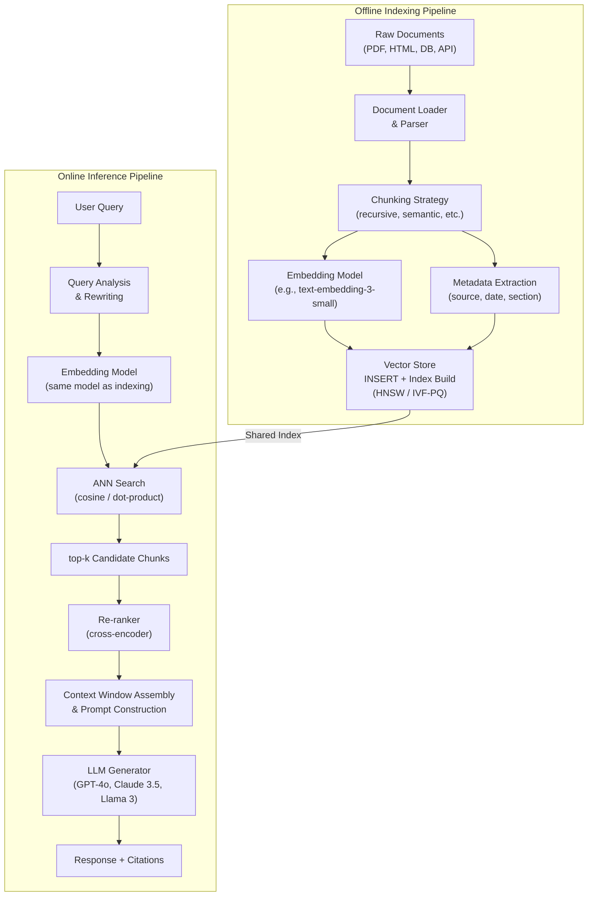
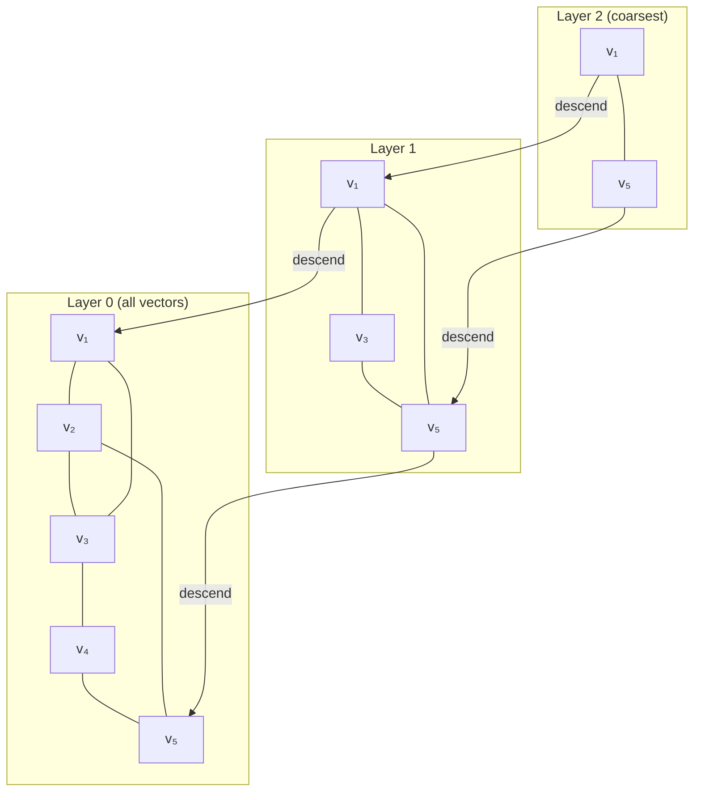
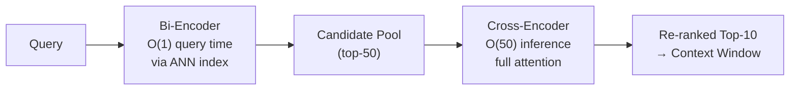
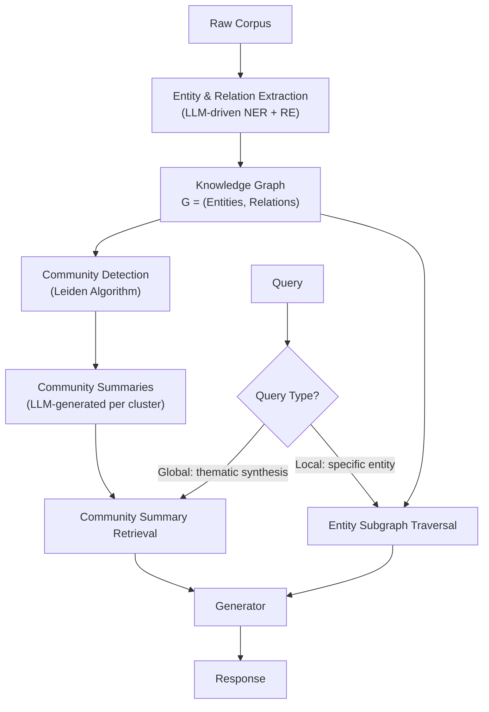
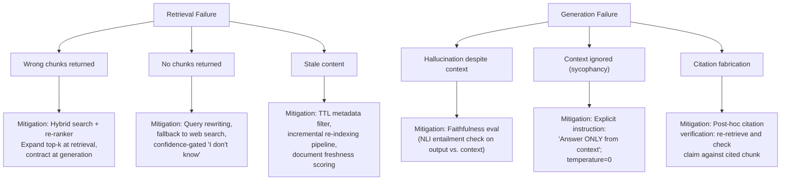

# RAG Systems: Retrieval-Augmented Generation — Architecture, Mechanics, and Production Engineering

## 1. First-Principles Intuition & The Core Problem

Large language models are parametric knowledge stores: everything they "know" is compressed into billions of floating-point weights during training. This architecture has two structural deficiencies that no amount of fine-tuning fully resolves.

**Temporal staleness.** The model's knowledge is frozen at the training cutoff. A model trained through early 2024 cannot answer questions about events, documents, or state changes that occurred afterward without being retrained—a process costing millions of dollars and weeks of compute time.

**Hallucination under retrieval pressure.** When a model is prompted on a topic that is underrepresented or absent from its training corpus, it does not reliably produce "I don't know." Instead, it generates plausible-sounding but factually incorrect text because its objective during training was next-token prediction, not factual grounding. The model has no mechanism to distinguish high-confidence recall from confabulation.

Retrieval-Augmented Generation (RAG), introduced by Lewis et al. (2020) in *Retrieval-Augmented Generation for Knowledge-Intensive NLP Tasks*, addresses both deficiencies by decoupling *knowledge storage* from *language generation*. The model is no longer required to memorize facts; it is given a retrieval mechanism that fetches relevant, up-to-date documents at inference time, then generates a response conditioned on that retrieved context.

The architectural invariant of RAG is: **the generation distribution is conditioned on both the parametric model distribution and a non-parametric document store that can be updated independently of the model weights.**

Formally, given a query $q$ and a document corpus $\mathcal{D}$, RAG computes:

$$P(y \mid q) = \sum_{d \in \text{top-}k(\mathcal{D}, q)} P(d \mid q) \cdot P(y \mid q, d)$$

where $P(d \mid q)$ is the retrieval distribution over documents and $P(y \mid q, d)$ is the generator's conditional distribution. The retrieval and generation components can be trained jointly (as in the original paper using DPR + BART) or kept separate (the dominant production pattern today, using a frozen retriever and a frozen or instruction-tuned generator).

---

## 2. The RAG Pipeline: End-to-End Architecture

A production RAG system consists of two temporally distinct phases: an **offline indexing pipeline** that runs continuously or on a schedule, and an **online inference pipeline** that handles per-query execution.



---

## 3. Offline Indexing: Document Processing & Chunking

### 3.1 Why Chunking Strategy Dominates Retrieval Quality

The single most impactful engineering decision in a RAG system is not model selection—it is the chunking strategy. An embedding model maps a chunk of text to a single dense vector. That vector must carry enough semantic signal to be retrievable by a query embedding, but if the chunk is too large, the signal is diluted; if too small, the chunk lacks the context needed for the generator.

**Fixed-size chunking** splits documents at every $n$ tokens with an optional overlap $o$ tokens between adjacent chunks. This is computationally trivial but semantically naive—it routinely splits sentences, paragraphs, and logical units mid-thought.

**Recursive character splitting** (the default in LangChain's `RecursiveCharacterTextSplitter`) applies a priority-ordered list of separators: `["\n\n", "\n", ". ", " ", ""]`. It recursively attempts to split on the highest-priority separator that produces chunks at or below the target size. This preserves paragraph and sentence boundaries in most cases.

**Semantic chunking** uses the embedding model itself to identify split points. Adjacent sentences are embedded; a split is inserted wherever the cosine similarity between successive sentence embeddings drops below a threshold. This is more expensive but produces semantically coherent chunks.

**Document-structure-aware chunking** parses the document's structure (Markdown headers, HTML DOM, PDF logical blocks) to split along natural boundaries. This is the highest-quality strategy for structured documents.

```python
# production_chunker.py
# Recursive semantic chunker with metadata preservation
from __future__ import annotations

import hashlib
import re
from dataclasses import dataclass, field
from typing import Generator

import numpy as np
from sentence_transformers import SentenceTransformer


@dataclass
class Chunk:
    text: str
    chunk_id: str
    source_doc_id: str
    chunk_index: int
    start_char: int
    end_char: int
    metadata: dict = field(default_factory=dict)

    def __post_init__(self) -> None:
        # Deterministic ID: stable across re-indexing runs
        digest = hashlib.sha256(
            f"{self.source_doc_id}:{self.start_char}:{self.end_char}".encode()
        ).hexdigest()[:16]
        self.chunk_id = f"{self.source_doc_id}#{digest}"


class SemanticChunker:
    """
    Embeds sentences and inserts chunk boundaries where cosine
    similarity between adjacent sentences drops below `threshold`.
    Falls back to max_tokens if a semantic chunk would exceed the limit.
    """

    def __init__(
        self,
        model: SentenceTransformer,
        max_tokens: int = 512,
        threshold: float = 0.75,
        overlap_sentences: int = 1,
    ) -> None:
        self.model = model
        self.max_tokens = max_tokens
        self.threshold = threshold
        self.overlap_sentences = overlap_sentences

    @staticmethod
    def _split_sentences(text: str) -> list[str]:
        # Naive but fast sentence splitter; replace with spaCy for production
        return [s.strip() for s in re.split(r"(?<=[.!?])\s+", text) if s.strip()]

    @staticmethod
    def _cosine(a: np.ndarray, b: np.ndarray) -> float:
        return float(np.dot(a, b) / (np.linalg.norm(a) * np.linalg.norm(b) + 1e-10))

    def chunk(
        self, text: str, doc_id: str, metadata: dict | None = None
    ) -> list[Chunk]:
        sentences = self._split_sentences(text)
        if not sentences:
            return []

        embeddings = self.model.encode(sentences, batch_size=64, show_progress_bar=False)

        boundaries: list[int] = [0]
        for i in range(1, len(sentences)):
            sim = self._cosine(embeddings[i - 1], embeddings[i])
            if sim < self.threshold:
                boundaries.append(i)
        boundaries.append(len(sentences))

        chunks: list[Chunk] = []
        char_offset = 0
        char_map = self._build_char_map(text, sentences)

        for chunk_idx, (start, end) in enumerate(
            zip(boundaries[:-1], boundaries[1:])
        ):
            # Apply sentence overlap at boundaries
            overlap_start = max(0, start - self.overlap_sentences) if chunk_idx > 0 else start
            chunk_sentences = sentences[overlap_start:end]
            chunk_text = " ".join(chunk_sentences)
            start_char = char_map[overlap_start]
            end_char = char_map[end - 1] + len(sentences[end - 1])

            chunks.append(
                Chunk(
                    text=chunk_text,
                    chunk_id="",  # filled by __post_init__
                    source_doc_id=doc_id,
                    chunk_index=chunk_idx,
                    start_char=start_char,
                    end_char=end_char,
                    metadata=metadata or {},
                )
            )
        return chunks

    @staticmethod
    def _build_char_map(text: str, sentences: list[str]) -> dict[int, int]:
        """Maps sentence index to its start character position in the original text."""
        char_map: dict[int, int] = {}
        pos = 0
        for i, sentence in enumerate(sentences):
            idx = text.find(sentence, pos)
            char_map[i] = idx if idx != -1 else pos
            pos = char_map[i] + len(sentence)
        return char_map
```

### 3.2 Embedding Models: Architecture and Selection Criteria

An embedding model maps variable-length text to a fixed-dimension dense vector in a metric space where semantic similarity correlates with geometric proximity. The dominant architecture is a bi-encoder: a transformer encoder (e.g., BERT-class) with mean pooling or CLS-token extraction over the final hidden states, trained with a contrastive objective (e.g., multiple negatives ranking loss on (query, positive_passage, negative_passages) triples).

Key engineering trade-offs:

| Model | Dimensions | Max Tokens | Latency (CPU) | MTEB Score | Notes |
|---|---|---|---|---|---|
| `text-embedding-3-small` (OpenAI) | 1536 | 8191 | ~20ms (API) | 62.3 | Matryoshka; can truncate to 512d |
| `text-embedding-3-large` (OpenAI) | 3072 | 8191 | ~35ms (API) | 64.6 | Best OpenAI quality |
| `e5-large-v2` (Microsoft) | 1024 | 512 | ~15ms (GPU) | 62.2 | Strong open-source baseline |
| `bge-m3` (BAAI) | 1024 | 8192 | ~25ms (GPU) | 64.4 | Multi-lingual, long-context |
| `nomic-embed-text-v1.5` (Nomic) | 768 | 8192 | ~10ms (GPU) | 62.4 | Open weights, long-context |

**Critical invariant:** The same embedding model must be used at both indexing time and query time. Using different models will produce vectors in incompatible metric spaces, destroying retrieval quality silently—the system will appear to function but return semantically unrelated results.

---

## 4. Vector Stores: Indexing Algorithms and Distance Metrics

### 4.1 Approximate Nearest Neighbor (ANN) Search

Exact nearest neighbor (NN) search over a corpus of $N$ vectors in $d$ dimensions has time complexity $O(Nd)$ per query—acceptable for $N < 10^5$ but prohibitive at production scale ($N > 10^7$). Approximate Nearest Neighbor (ANN) algorithms sacrifice a small, controllable fraction of recall for orders-of-magnitude throughput improvements.

The two algorithms dominating production deployments are HNSW and IVF-PQ.

### 4.2 HNSW: Hierarchical Navigable Small World Graphs

HNSW (Malkov & Yashunin, 2018) constructs a multilayer proximity graph. The bottom layer contains all $N$ vectors. Each higher layer contains a geometrically decreasing random subset. During search, the algorithm enters at the top layer, greedily navigates to the nearest neighbor at that layer's coarser resolution, then descends to the next layer using that neighbor as the entry point—analogous to a skip list but in high-dimensional metric space.



Key HNSW parameters:
- `M`: maximum number of bidirectional links per node. Higher M → higher recall, higher memory, slower build. Typical range: 16–64.
- `ef_construction`: size of the dynamic candidate list during index build. Higher value → higher recall at build time. Typical: 100–400.
- `ef_search` (runtime): size of the candidate list during query. This is the primary recall-vs-latency knob at serving time.

HNSW provides $O(\log N)$ query time and $O(N \cdot M)$ memory. For 1M vectors at $d=1536$ with $M=32$, the index occupies roughly 7.5 GB in float32—often requiring quantization in memory-constrained deployments.

### 4.3 IVF-PQ: Inverted File Index with Product Quantization

IVF partitions the vector space into $K$ Voronoi cells using k-means clustering. At query time, only the $n_{\text{probe}}$ nearest centroids are searched, reducing the candidate set from $N$ to approximately $n_{\text{probe}} \cdot N / K$ vectors.

Product Quantization (PQ) compresses each vector by splitting it into $M$ sub-vectors of dimension $d/M$ and quantizing each sub-vector to one of $2^{n_{\text{bits}}}$ learned centroids. A 1536-dim float32 vector (6144 bytes) compressed with PQ $(M=96, n_{\text{bits}}=8)$ occupies 96 bytes—a 64× compression ratio—with moderate recall degradation.

IVF-PQ is the workhorse of billion-scale search (Faiss, pgvector with IVFFLAT, Weaviate's flat quantizer) due to its RAM efficiency, while HNSW dominates at scales of tens of millions of vectors where recall is paramount.

### 4.4 Distance Metrics

The choice of distance metric must match the training objective of the embedding model:

- **Cosine similarity** ($\frac{\mathbf{a} \cdot \mathbf{b}}{\|\mathbf{a}\| \|\mathbf{b}\|}$): Standard for text embeddings trained with cosine objective. Equivalent to dot product on L2-normalized vectors.
- **Dot product** (inner product): Used for models trained with dot product maximization (e.g., DPR). Faster than cosine if vectors are pre-normalized at index time.
- **L2 (Euclidean)**: Appropriate for models with Euclidean metric objectives; less common for NLP.

Using the wrong metric degrades NDCG@10 by 5–15 percentage points on standard benchmarks (BEIR). Always verify the model card.

### 4.5 pgvector: SQL-Native Vector Search

For teams with an existing PostgreSQL deployment, pgvector provides vector similarity search directly in SQL, enabling joins between vector search results and structured relational data—a capability that purpose-built vector databases require complex integration to replicate.

```sql
-- Schema: document chunks with vector embeddings
CREATE EXTENSION IF NOT EXISTS vector;

CREATE TABLE document_chunks (
    chunk_id      TEXT PRIMARY KEY,
    source_doc_id TEXT NOT NULL,
    chunk_index   INTEGER NOT NULL,
    start_char    INTEGER NOT NULL,
    end_char      INTEGER NOT NULL,
    content       TEXT NOT NULL,
    embedding     VECTOR(1536),  -- matches text-embedding-3-small output dim
    metadata      JSONB,
    created_at    TIMESTAMPTZ DEFAULT NOW()
);

-- HNSW index for high-recall ANN search
-- m=16, ef_construction=64 are conservative; tune upward for higher recall
CREATE INDEX ON document_chunks
USING hnsw (embedding vector_cosine_ops)
WITH (m = 16, ef_construction = 64);

-- Optionally: IVF-Flat for memory-constrained deployments
-- CREATE INDEX ON document_chunks
-- USING ivfflat (embedding vector_cosine_ops) WITH (lists = 100);

-- Parameterized ANN query: top-5 semantically similar chunks
-- $1 is the query embedding (passed as a float[] array from application)
SELECT
    chunk_id,
    source_doc_id,
    content,
    metadata,
    1 - (embedding <=> $1::VECTOR) AS cosine_similarity
FROM document_chunks
WHERE metadata->>'domain' = 'engineering'          -- metadata pre-filter
ORDER BY embedding <=> $1::VECTOR                  -- <=> is cosine distance
LIMIT 5;

-- Hybrid search: combine BM25 (full-text) and vector search scores
-- Requires pg_trgm or pg_bm25 (ParadeDB) for BM25 component
WITH vector_results AS (
    SELECT chunk_id, 1 - (embedding <=> $1::VECTOR) AS vec_score
    FROM document_chunks
    ORDER BY embedding <=> $1::VECTOR
    LIMIT 50
),
text_results AS (
    SELECT chunk_id,
           ts_rank_cd(to_tsvector('english', content),
                      plainto_tsquery('english', $2)) AS bm25_score
    FROM document_chunks
    WHERE to_tsvector('english', content) @@ plainto_tsquery('english', $2)
    LIMIT 50
)
SELECT
    COALESCE(v.chunk_id, t.chunk_id) AS chunk_id,
    -- Reciprocal Rank Fusion with k=60
    1.0 / (60 + ROW_NUMBER() OVER (ORDER BY v.vec_score DESC NULLS LAST)) +
    1.0 / (60 + ROW_NUMBER() OVER (ORDER BY t.bm25_score DESC NULLS LAST)) AS rrf_score
FROM vector_results v
FULL OUTER JOIN text_results t USING (chunk_id)
ORDER BY rrf_score DESC
LIMIT 10;
```

---

## 5. Retrieval Strategies

### 5.1 Dense Retrieval (Semantic Search)

Dense retrieval computes the query embedding and finds the $k$ nearest document embeddings by vector distance. It excels at semantic matching—finding documents about "myocardial infarction" when queried with "heart attack"—but struggles with exact keyword matching and rare entities that appear infrequently in training data.

### 5.2 Sparse Retrieval: BM25

BM25 (Best Match 25) is a probabilistic term-weighting ranking function. For a query $Q = \{q_1, \ldots, q_n\}$ and document $D$:

$$\text{BM25}(D, Q) = \sum_{i=1}^{n} \text{IDF}(q_i) \cdot \frac{f(q_i, D) \cdot (k_1 + 1)}{f(q_i, D) + k_1 \cdot \left(1 - b + b \cdot \frac{|D|}{\text{avgdl}}\right)}$$

where $f(q_i, D)$ is the term frequency of $q_i$ in $D$, $|D|$ is the document length, $\text{avgdl}$ is the average document length in the corpus, $k_1 \approx 1.2$–$2.0$ controls term frequency saturation, and $b \approx 0.75$ controls length normalization.

BM25 is exact, interpretable, and computationally cheap (inverted index lookup), but it cannot handle synonymy or paraphrasing. It is the right choice when queries contain precise identifiers (product SKUs, error codes, legal citations).

### 5.3 Hybrid Search with Reciprocal Rank Fusion (RRF)

Hybrid search combines dense and sparse retrieval rankings. Reciprocal Rank Fusion (Cormack et al., 2009) is the standard score-free fusion method:

$$\text{RRF}(d) = \sum_{r \in \{\text{dense}, \text{sparse}\}} \frac{1}{k + \text{rank}_r(d)}$$

where $k = 60$ is a smoothing constant. RRF is robust to score scale differences between retrievers and consistently outperforms linear interpolation of raw scores on BEIR benchmarks.

```python
# hybrid_retriever.py
from __future__ import annotations
from dataclasses import dataclass
from typing import Protocol

import numpy as np


@dataclass(frozen=True)
class RetrievedChunk:
    chunk_id: str
    content: str
    score: float
    source: str  # "dense" | "sparse" | "fused"


class DenseRetriever(Protocol):
    def retrieve(self, query_embedding: np.ndarray, top_k: int) -> list[RetrievedChunk]: ...


class SparseRetriever(Protocol):
    def retrieve(self, query_text: str, top_k: int) -> list[RetrievedChunk]: ...


def reciprocal_rank_fusion(
    dense_results: list[RetrievedChunk],
    sparse_results: list[RetrievedChunk],
    k: int = 60,
    top_n: int = 10,
) -> list[RetrievedChunk]:
    """
    Fuse dense and sparse ranked lists using Reciprocal Rank Fusion.
    Returns the top_n chunks by fused score.
    """
    scores: dict[str, float] = {}
    chunk_map: dict[str, RetrievedChunk] = {}

    for rank, chunk in enumerate(dense_results, start=1):
        scores[chunk.chunk_id] = scores.get(chunk.chunk_id, 0.0) + 1.0 / (k + rank)
        chunk_map[chunk.chunk_id] = chunk

    for rank, chunk in enumerate(sparse_results, start=1):
        scores[chunk.chunk_id] = scores.get(chunk.chunk_id, 0.0) + 1.0 / (k + rank)
        chunk_map[chunk.chunk_id] = chunk

    ranked = sorted(scores.items(), key=lambda x: x[1], reverse=True)[:top_n]

    return [
        RetrievedChunk(
            chunk_id=chunk_id,
            content=chunk_map[chunk_id].content,
            score=score,
            source="fused",
        )
        for chunk_id, score in ranked
    ]
```

### 5.4 Cross-Encoder Re-Ranking

Bi-encoder retrieval is fast because query and document are encoded independently—but this independence is also a limitation. The encoder cannot attend to query-document interactions, only to intra-document context. Cross-encoders (a single transformer that jointly encodes the concatenated `[query, document]` pair) are significantly more accurate because full self-attention can model fine-grained query-document interactions, but they are $O(N)$ per query and cannot be pre-indexed.

The standard pattern is a two-stage pipeline: bi-encoder retrieves top 50–100 candidates fast, then a cross-encoder re-ranks those candidates with high precision, returning the top 5–10 to the generator.



```python
# reranker.py
from __future__ import annotations
from sentence_transformers import CrossEncoder


class CrossEncoderReranker:
    """
    Wraps a cross-encoder model to re-score (query, passage) pairs.
    Recommended models: cross-encoder/ms-marco-MiniLM-L-6-v2 (fast),
                        cross-encoder/ms-marco-electra-base (high quality)
    """

    def __init__(self, model_name: str = "cross-encoder/ms-marco-MiniLM-L-6-v2") -> None:
        self.model = CrossEncoder(model_name, max_length=512)

    def rerank(
        self,
        query: str,
        candidates: list[RetrievedChunk],
        top_n: int = 5,
    ) -> list[RetrievedChunk]:
        if not candidates:
            return []

        pairs = [(query, chunk.content) for chunk in candidates]
        scores: list[float] = self.model.predict(pairs, batch_size=32).tolist()

        scored = sorted(
            zip(candidates, scores),
            key=lambda x: x[1],
            reverse=True,
        )[:top_n]

        return [
            RetrievedChunk(
                chunk_id=chunk.chunk_id,
                content=chunk.content,
                score=float(score),
                source=chunk.source,
            )
            for chunk, score in scored
        ]
```

---

## 6. Query Analysis & Transformation

Raw user queries are often ambiguous, underspecified, or phrased in ways that do not match indexed document language. Query transformation is a pre-retrieval step that improves recall before any vectors are compared.

### 6.1 HyDE: Hypothetical Document Embedding

HyDE (Gao et al., 2022) inverts the retrieval problem: rather than embedding the short, often sparse query, it prompts the LLM to generate a hypothetical document that would answer the query, then embeds that hypothetical document. Because the hypothetical document shares vocabulary, length, and stylistic register with real indexed documents, it often produces a better retrieval signal.

The key insight is that the embedding space is dominated by document-style text; a short query occupies a structurally different region of that space than the passages it should match.

```python
# hyde.py
from __future__ import annotations
import numpy as np
from openai import OpenAI

client = OpenAI()

HYDE_SYSTEM_PROMPT = (
    "You are a technical documentation writer. "
    "Given a question, write a single concise paragraph that directly answers "
    "the question as if it were an excerpt from authoritative documentation. "
    "Do not say 'I don't know'—generate the most plausible answer."
)


def generate_hypothetical_document(query: str, model: str = "gpt-4o-mini") -> str:
    response = client.chat.completions.create(
        model=model,
        messages=[
            {"role": "system", "content": HYDE_SYSTEM_PROMPT},
            {"role": "user", "content": query},
        ],
        temperature=0.0,
        max_tokens=256,
    )
    return response.choices[0].message.content


def hyde_embed(query: str, embed_model: str = "text-embedding-3-small") -> np.ndarray:
    """
    Returns an embedding that is the mean of the query embedding
    and the hypothetical document embedding. The mean pooling strategy
    hedges against poor hypothetical document quality.
    """
    hyp_doc = generate_hypothetical_document(query)

    response = client.embeddings.create(
        input=[query, hyp_doc],
        model=embed_model,
    )
    query_emb = np.array(response.data[0].embedding)
    hyp_emb = np.array(response.data[1].embedding)

    combined = (query_emb + hyp_emb) / 2.0
    # L2-normalize for cosine distance correctness
    return combined / (np.linalg.norm(combined) + 1e-10)
```

### 6.2 Multi-Query Retrieval

A single query may not capture all relevant facets of a user's information need. Multi-query retrieval prompts the LLM to generate $n$ alternative phrasings of the query, retrieves independently for each, and unions the result sets before re-ranking. This directly addresses vocabulary mismatch without requiring specialized training.

### 6.3 Step-Back Prompting

For highly specific queries ("What is the half-life of Ozempic after subcutaneous injection?"), step-back prompting first generates an abstracted version of the query ("pharmacokinetics of GLP-1 receptor agonists") to retrieve high-level background context, then retrieves for the specific query. The generator receives both contexts, grounding the specific answer in a principled conceptual framework.

---

## 7. Context Window Assembly & Prompt Engineering

After re-ranking, the top $k$ chunks must be assembled into a prompt. This is not a trivial concatenation—token budget management, ordering, and instruction framing materially affect generation quality.

```python
# prompt_builder.py
from __future__ import annotations
from dataclasses import dataclass
import tiktoken


@dataclass
class RAGPrompt:
    system: str
    user: str
    total_tokens: int


SYSTEM_TEMPLATE = """\
You are a precise technical assistant. Answer the question using ONLY the \
information provided in the context sections below. For each claim, cite the \
source using [chunk_id]. If the context does not contain sufficient information \
to answer, state that explicitly rather than speculating.
"""

USER_TEMPLATE = """\
## Context

{context_sections}

## Question

{question}

## Instructions

- Base your answer solely on the context above.
- Cite sources inline as [chunk_id].
- If the answer is not in the context, respond: \
  "The provided context does not contain sufficient information to answer this question."
"""


class PromptBuilder:
    def __init__(
        self,
        model: str = "gpt-4o",
        max_context_tokens: int = 8192,
        encoding_name: str = "cl100k_base",
    ) -> None:
        self.model = model
        self.max_context_tokens = max_context_tokens
        self.enc = tiktoken.get_encoding(encoding_name)

    def _count_tokens(self, text: str) -> int:
        return len(self.enc.encode(text))

    def build(self, query: str, chunks: list[RetrievedChunk]) -> RAGPrompt:
        context_parts: list[str] = []
        token_budget = self.max_context_tokens
        token_budget -= self._count_tokens(SYSTEM_TEMPLATE)
        token_budget -= self._count_tokens(query)
        token_budget -= 256  # Reserve tokens for the answer

        # Chunks arrive pre-sorted by re-ranker score (descending).
        # We pack greedily: highest-scored chunks first.
        for chunk in chunks:
            section = f"[{chunk.chunk_id}]\n{chunk.content}"
            cost = self._count_tokens(section)
            if cost > token_budget:
                break
            context_parts.append(section)
            token_budget -= cost

        context_block = "\n\n---\n\n".join(context_parts)
        user_text = USER_TEMPLATE.format(
            context_sections=context_block, question=query
        )

        return RAGPrompt(
            system=SYSTEM_TEMPLATE,
            user=user_text,
            total_tokens=self.max_context_tokens - token_budget,
        )
```

**Lost-in-the-middle problem.** Liu et al. (2023) demonstrated empirically that LLMs exhibit a characteristic U-shaped recall curve over context position: performance is highest for content near the beginning and end of the context window, and significantly worse for content in the middle. For high-importance chunks, place the highest-scored chunk first, the second-highest last, and fill the middle with supporting context.

---

## 8. Advanced RAG Architectures

### 8.1 Self-RAG

Self-RAG (Asai et al., 2023) trains the LLM itself to generate special reflection tokens: `[Retrieve]` to trigger a retrieval call, `[IsRel]` to assess whether a retrieved passage is relevant, `[IsSup]` to assess whether the generated claim is supported by the passage, and `[IsUse]` to assess overall response utility. This transforms RAG from a fixed pipeline into a dynamic, model-driven retrieval loop where the model decides when to retrieve and self-critiques its own outputs.

### 8.2 FLARE: Forward-Looking Active Retrieval

FLARE (Jiang et al., 2023) retrieves proactively: the model generates text token-by-token, and when it produces a token with probability below a confidence threshold $\beta$, it uses the generated text so far as a query to retrieve additional context, then continues generation conditioned on the retrieved documents. This targets retrieval precisely at the moments of maximum model uncertainty.

### 8.3 GraphRAG

GraphRAG (Edge et al., Microsoft, 2024) addresses a fundamental limitation of chunk-based RAG: it cannot answer questions requiring synthesis across many documents (e.g., "What are the major themes across this corpus?"). GraphRAG builds a knowledge graph from the corpus—extracting entities and relationships via LLM—then uses graph community detection (Leiden algorithm) to identify thematic clusters. At query time, it generates summaries of relevant communities, providing a global-to-local retrieval path.



### 8.4 Corrective RAG (CRAG)

CRAG (Shi et al., 2024) adds an explicit relevance evaluation step after retrieval. If the retrieved documents are assessed as irrelevant (below a confidence threshold), CRAG triggers a web search to supplement the retrieval result, then applies a knowledge refinement step (decompose-then-recompose) to strip irrelevant content from the retrieved passages before generation.

---

## 9. Production Engineering: Failure Modes and Mitigations



### 9.1 Embedding Model Version Drift

If the embedding model is updated (e.g., OpenAI releases a new version of `text-embedding-3-small`), all existing vectors in the index are invalidated because they were computed with a different model. A full re-index is required. Mitigation: version-stamp every vector at write time with the model ID and version; build monitoring that alerts when model versions diverge between the indexer and the query path.

### 9.2 Chunking-Retrieval Mismatch

A chunk size optimized for high retrieval precision (small chunks, high semantic focus) may contain insufficient context for the generator to construct a complete answer. The inverse is also true: large chunks improve context completeness but dilute embedding signal, reducing retrieval recall. The solution is **parent-child chunking (small-to-big retrieval)**: index small chunks for precise retrieval, but at context assembly time, expand each retrieved small chunk to its parent (larger) chunk to provide the generator with richer context.

### 9.3 Latency Budget Management

A complete RAG pipeline has multiple latency contributors:

| Stage | Typical Latency | Parallelizable? |
|---|---|---|
| Query embedding | 20–50ms | No (serial dependency) |
| ANN search (HNSW) | 1–5ms | Yes (read-only) |
| BM25 search | 1–10ms | Yes (read-only) |
| Cross-encoder re-rank (top-50) | 50–200ms | Partially (batch) |
| LLM generation (first token) | 200–800ms | No |

Dense and sparse retrieval can be executed in parallel. Re-ranking should be skipped or replaced with a lighter model when p99 latency is a hard constraint.

### 9.4 RAG Evaluation Framework

Evaluation is the most neglected component of RAG system development. The key metrics are:

- **Context Recall:** What fraction of the information needed to answer the question was present in the retrieved context? Measures retrieval completeness.
- **Context Precision:** What fraction of retrieved chunks was actually relevant? Measures retrieval noise.
- **Faithfulness:** Does the generated answer make only claims that are entailed by the retrieved context? Measured via NLI or LLM-as-judge.
- **Answer Relevance:** Does the generated answer address the user's question?

RAGAS (Shahul et al., 2023) is the standard open-source framework for automated RAG evaluation, operationalizing these four metrics with LLM-based evaluation.

```python
# eval_pipeline.py
# Faithfulness check using NLI (Natural Language Inference)
# to verify that generated claims are entailed by retrieved context.
from __future__ import annotations
from transformers import pipeline


class FaithfulnessEvaluator:
    """
    Uses an NLI model to check whether each sentence in the generated
    answer is entailed by the retrieved context (premise).

    Model: cross-encoder/nli-deberta-v3-base (accurate, ~180M params)
    Labels: ENTAILMENT, NEUTRAL, CONTRADICTION
    """

    def __init__(self, model: str = "cross-encoder/nli-deberta-v3-base") -> None:
        self.nli = pipeline("text-classification", model=model, device=-1)

    def score(self, context: str, generated_answer: str) -> dict:
        import re
        sentences = [s.strip() for s in re.split(r"(?<=[.!?])\s+", generated_answer) if s.strip()]
        if not sentences:
            return {"faithfulness": 1.0, "entailed": 0, "total": 0}

        pairs = [{"text": context, "text_pair": s} for s in sentences]
        results = self.nli(pairs, batch_size=16, truncation=True)

        entailed = sum(1 for r in results if r["label"] == "ENTAILMENT")
        return {
            "faithfulness": entailed / len(sentences),
            "entailed": entailed,
            "total": len(sentences),
            "per_sentence": list(zip(sentences, [r["label"] for r in results])),
        }
```

---

## 10. Full System Integration: End-to-End Example

```python
# rag_system.py — Production-grade RAG pipeline integration
from __future__ import annotations

import logging
from dataclasses import dataclass

import numpy as np
from openai import OpenAI

logger = logging.getLogger(__name__)


@dataclass
class RAGResponse:
    answer: str
    sources: list[str]
    faithfulness_score: float | None
    retrieved_chunk_ids: list[str]


class RAGSystem:
    """
    Minimal but complete RAG system wiring together:
      - HyDE query embedding
      - Hybrid retrieval (dense + sparse via RRF)
      - Cross-encoder re-ranking
      - Token-budgeted prompt construction
      - OpenAI generation
      - Optional faithfulness evaluation
    """

    def __init__(
        self,
        dense_retriever: DenseRetriever,
        sparse_retriever: SparseRetriever,
        reranker: CrossEncoderReranker,
        prompt_builder: PromptBuilder,
        faithfulness_evaluator: FaithfulnessEvaluator | None = None,
        retrieval_top_k: int = 50,
        rerank_top_n: int = 5,
        use_hyde: bool = True,
        llm_model: str = "gpt-4o",
    ) -> None:
        self.dense = dense_retriever
        self.sparse = sparse_retriever
        self.reranker = reranker
        self.prompt_builder = prompt_builder
        self.faithfulness_eval = faithfulness_evaluator
        self.retrieval_top_k = retrieval_top_k
        self.rerank_top_n = rerank_top_n
        self.use_hyde = use_hyde
        self.llm_model = llm_model
        self.client = OpenAI()

    def query(self, user_query: str) -> RAGResponse:
        # 1. Query embedding (with optional HyDE)
        if self.use_hyde:
            query_embedding = hyde_embed(user_query)
        else:
            resp = self.client.embeddings.create(
                input=[user_query], model="text-embedding-3-small"
            )
            query_embedding = np.array(resp.data[0].embedding)

        # 2. Parallel dense + sparse retrieval
        dense_results = self.dense.retrieve(query_embedding, top_k=self.retrieval_top_k)
        sparse_results = self.sparse.retrieve(user_query, top_k=self.retrieval_top_k)

        # 3. Reciprocal Rank Fusion
        fused = reciprocal_rank_fusion(
            dense_results, sparse_results, top_n=self.retrieval_top_k
        )

        # 4. Cross-encoder re-ranking
        reranked = self.reranker.rerank(user_query, fused, top_n=self.rerank_top_n)

        # 5. Prompt construction with token budget management
        prompt = self.prompt_builder.build(user_query, reranked)

        # 6. LLM generation
        completion = self.client.chat.completions.create(
            model=self.llm_model,
            messages=[
                {"role": "system", "content": prompt.system},
                {"role": "user", "content": prompt.user},
            ],
            temperature=0.0,  # Deterministic for factual RAG
            max_tokens=1024,
        )
        answer = completion.choices[0].message.content

        # 7. Optional faithfulness evaluation
        faithfulness = None
        if self.faithfulness_eval:
            context_text = "\n\n".join(c.content for c in reranked)
            result = self.faithfulness_eval.score(context_text, answer)
            faithfulness = result["faithfulness"]
            if faithfulness < 0.7:
                logger.warning(
                    "Low faithfulness score %.2f for query: %s", faithfulness, user_query
                )

        return RAGResponse(
            answer=answer,
            sources=[c.chunk_id for c in reranked],
            faithfulness_score=faithfulness,
            retrieved_chunk_ids=[c.chunk_id for c in reranked],
        )
```

---

## Summary

RAG is not a single algorithm—it is a system architecture that spans indexing strategy, vector space geometry, retrieval algorithm selection, query transformation, re-ranking, prompt engineering, generation, and evaluation. Each component has its own failure modes, and degradation in any stage compounds downstream.

The practitioner checklist for a production RAG system:

1. Use the same embedding model at index time and query time. Version-stamp all stored vectors.
2. Choose a chunking strategy that matches your document structure. Default to recursive splitting; use semantic chunking when documents are dense and unstructured.
3. Implement hybrid retrieval (dense + sparse) with RRF fusion. BM25 handles exact-match queries that semantic search misses.
4. Add a cross-encoder re-ranker for quality-critical applications. Skip it only under strict latency budgets.
5. Apply parent-child chunking to decouple retrieval precision from generation context richness.
6. Evaluate continuously: measure context recall, context precision, faithfulness, and answer relevance on a labeled evaluation set.
7. Monitor for embedding model drift, index staleness, and faithfulness degradation in production.
