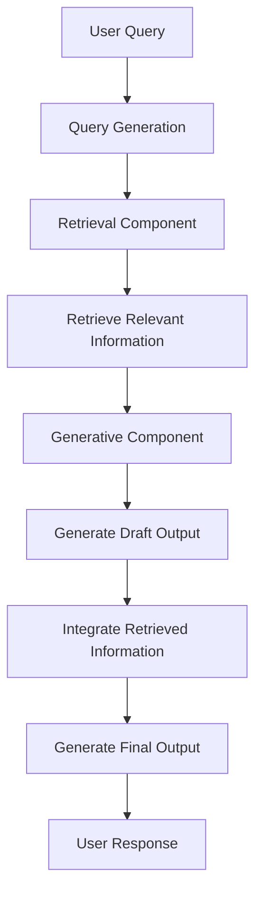

# Lesson 2: Retrieval-Augmented Generation

## 1. First-Principles Intuition & Invariants

In the realm of artificial intelligence, the quest for generating human-like text that is both coherent and contextually relevant has long been a focal point of research and development. Traditional generative models, such as those based on recurrent neural networks (RNNs) and more recently, transformer architectures, have made significant strides in producing text that mimics human writing. However, these models often suffer from a critical limitation: they generate text based solely on the information contained within their training data, which can lead to a lack of factual accuracy and a tendency to produce repetitive or nonsensical content. This is where retrieval-augmented generation (RAG) emerges as a powerful paradigm that integrates the strengths of both retrieval-based and generative models to enhance the quality and relevance of the generated content.

At its core, RAG addresses the inherent limitations of purely generative models by incorporating a retrieval component that fetches relevant information from external sources, such as knowledge bases, document collections, or even the internet. This integration allows the generative model to leverage external knowledge, thereby improving the accuracy and coherence of the generated text. The theoretical grounding of RAG is rooted in the interplay between information retrieval and natural language generation, where the goal is to seamlessly combine the strengths of both paradigms.

To understand the invariants and principles that underpin RAG, it is essential to delve into the problem space it addresses. Traditional generative models, while capable of producing fluent and contextually relevant text, often lack the ability to ground their outputs in factual accuracy. This discrepancy arises because generative models are trained to predict the next token in a sequence based on the preceding tokens, without explicit access to external knowledge sources. As a result, they can generate text that is coherent in terms of language structure but may contain factual errors or be devoid of relevant information.

The integration of retrieval mechanisms into generative models introduces a new set of challenges and opportunities. On one hand, the retrieval component must be efficient and accurate in fetching relevant information from external sources. On the other hand, the generative model must be capable of effectively incorporating this retrieved information into its output, ensuring that the generated text remains coherent and contextually relevant. This interplay between retrieval and generation is governed by several invariants:

1. **Relevance**: The retrieved information must be relevant to the context in which it is used. This relevance is crucial for maintaining the coherence and accuracy of the generated text.
2. **Accuracy**: The retrieved information must be factually accurate. This accuracy is essential for ensuring that the generated text does not contain errors or contradictions.
3. **Efficiency**: The retrieval process must be efficient, both in terms of speed and resource usage. This efficiency is crucial for ensuring that the RAG system can operate in real-time or near-real-time scenarios.
4. **Integration**: The retrieved information must be seamlessly integrated into the generated text. This integration is crucial for maintaining the fluency and coherence of the generated text.

These invariants form the foundation of RAG and guide the design and implementation of retrieval-augmented generative systems. By addressing these invariants, RAG systems can produce high-quality, contextually relevant, and factually accurate text, thereby overcoming the limitations of purely generative models.

## 2. Core Architecture & Mechanics

The architecture of a retrieval-augmented generation system is a sophisticated interplay between a retrieval component and a generative component. The retrieval component is responsible for fetching relevant information from external sources, while the generative component is responsible for producing the final output. This interplay is governed by a series of data structures, algorithms, and execution models that work in concert to produce high-quality text.

### Retrieval Component

The retrieval component of a RAG system is responsible for fetching relevant information from external sources. This component typically consists of a search engine or a knowledge base that is capable of retrieving information based on a query. The query is generated by the generative component and is designed to be as specific as possible to ensure that the retrieved information is relevant to the context in which it is used.

The retrieval component can be implemented using a variety of techniques, including keyword-based search, semantic search, and graph-based search. Keyword-based search involves retrieving documents that contain specific keywords, while semantic search involves retrieving documents that are semantically similar to the query. Graph-based search involves traversing a knowledge graph to retrieve information that is related to the query.

Once the relevant information is retrieved, it is passed to the generative component for integration into the final output. The integration of the retrieved information into the generated text is governed by a series of algorithms and data structures that work in concert to ensure that the final output is coherent and contextually relevant.

### Generative Component

The generative component of a RAG system is responsible for producing the final output. This component is typically a transformer-based model that is capable of generating text based on the input it receives. The input to the generative component consists of the query generated by the retrieval component and the retrieved information.

The generative component uses the query and the retrieved information to generate the final output. This process involves a series of steps, including encoding the input, decoding the output, and integrating the retrieved information into the generated text. The encoding step involves converting the input into a format that can be processed by the transformer model, while the decoding step involves generating the final output based on the encoded input.

The integration of the retrieved information into the generated text is governed by a series of algorithms and data structures that work in concert to ensure that the final output is coherent and contextually relevant. One common approach is to use a two-stage generation process, where the first stage generates a draft output based on the query, and the second stage refines the draft output by incorporating the retrieved information.

### Execution Model

The execution model of a RAG system is a sophisticated interplay between the retrieval and generative components. The execution model is governed by a series of data structures, algorithms, and execution models that work in concert to produce high-quality text.

The execution model of a RAG system can be visualized using a Mermaid diagram:

In this diagram, the user query is processed by the query generation component, which generates a query that is used by the retrieval component to retrieve relevant information. The retrieved information is then passed to the generative component, which generates a draft output based on the query. The draft output is then refined by integrating the retrieved information, resulting in the final output, which is returned to the user.

The execution model of a RAG system is governed by a series of data structures, algorithms, and execution models that work in concert to produce high-quality text. The retrieval component uses a search engine or a knowledge base to retrieve relevant information based on the query, while the generative component uses a transformer-based model to generate the final output. The integration of the retrieved information into the generated text is governed by a series of algorithms and data structures that work in concert to ensure that the final output is coherent and contextually relevant.

## 3. High-Performance Optimization & Failure Modes

The high-performance optimization and failure modes of a retrieval-augmented generation system are critical factors that determine its effectiveness and reliability. The optimization of a RAG system involves a series of techniques that are designed to improve the efficiency and accuracy of the retrieval and generative components. The failure modes of a RAG system involve a series of scenarios that can lead to errors or inefficiencies in the system.

### High-Performance Optimization

The high-performance optimization of a RAG system involves a series of techniques that are designed to improve the efficiency and accuracy of the retrieval and generative components. These techniques include:

1. **Efficient Query Generation**: The query generation component is responsible for generating a query that is used by the retrieval component to retrieve relevant information. Efficient query generation involves using techniques such as keyword extraction and semantic analysis to generate a query that is as specific as possible.
2. **Efficient Retrieval**: The retrieval component is responsible for retrieving relevant information based on the query. Efficient retrieval involves using techniques such as keyword-based search, semantic search, and graph-based search to retrieve information that is relevant to the context in which it is used.
3. **Efficient Integration**: The integration of the retrieved information into the generated text is governed by a series of algorithms and data structures that work in concert to ensure that the final output is coherent and contextually relevant. Efficient integration involves using techniques such as two-stage generation and attention mechanisms to integrate the retrieved information into the generated text.
4. **Efficient Generation**: The generative component is responsible for producing the final output. Efficient generation involves using techniques such as beam search and sampling to generate high-quality text.

### Failure Modes

The failure modes of a RAG system involve a series of scenarios that can lead to errors or inefficiencies in the system. These failure modes include:

1. **Relevance Errors**: Relevance errors occur when the retrieved information is not relevant to the context in which it is used. This can lead to errors in the generated text, as the retrieved information may not be applicable to the context in which it is used.
2. **Accuracy Errors**: Accuracy errors occur when the retrieved information is not factually accurate. This can lead to errors in the generated text, as the retrieved information may contain errors or contradictions.
3. **Efficiency Errors**: Efficiency errors occur when the retrieval or generation process is inefficient. This can lead to delays in the generation of the final output, as the system may take too long to retrieve or generate the text.
4. **Integration Errors**: Integration errors occur when the retrieved information is not seamlessly integrated into the generated text. This can lead to errors in the generated text, as the retrieved information may not be incorporated in a coherent or contextually relevant manner.

To mitigate these failure modes, it is essential to design and implement RAG systems that are robust, efficient, and accurate. This involves using techniques such as keyword extraction, semantic analysis, keyword-based search, semantic search, graph-based search, two-stage generation, attention mechanisms, beam search, and sampling to ensure that the system is capable of producing high-quality, contextually relevant, and factually accurate text.

In conclusion, retrieval-augmented generation is a powerful paradigm that integrates the strengths of both retrieval-based and generative models to enhance the quality and relevance of the generated content. The architecture of a RAG system is a sophisticated interplay between a retrieval component and a generative component, governed by a series of data structures, algorithms, and execution models that work in concert to produce high-quality text. The high-performance optimization and failure modes of a RAG system are critical factors that determine its effectiveness and reliability, and must be carefully designed and implemented to ensure that the system is capable of producing high-quality, contextually relevant, and factually accurate text.
