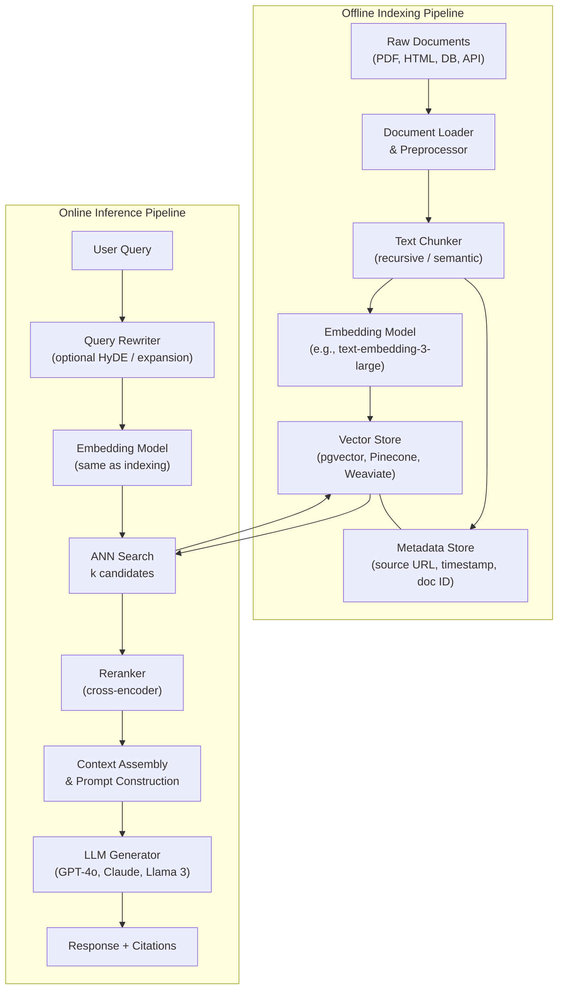
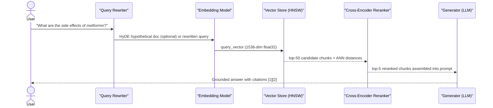
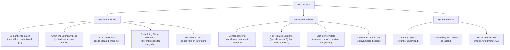
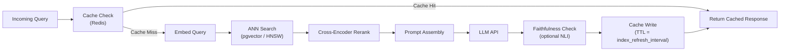
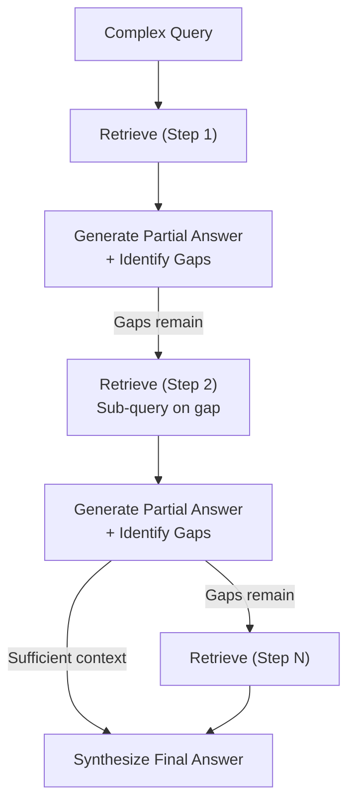
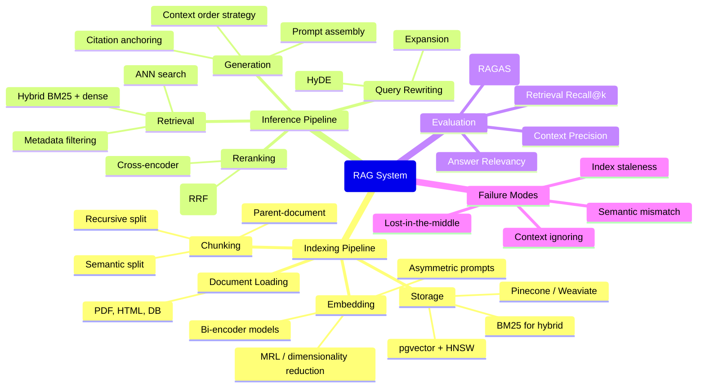

# Lesson 2: Retrieval-Augmented Generation (RAG) Systems

## 1. First-Principles Intuition & Invariants

### The Fundamental Problem: Parametric Knowledge and Its Limits

A large language model (LLM) stores knowledge implicitly in its parameters — the billions of floating-point weights that encode statistical associations learned during training. This is called *parametric memory*. When you ask a model a question, it generates a response by sampling from a learned probability distribution over token sequences conditioned on the prompt. No external lookup occurs. The model is, in essence, a compressed, lossy representation of its training corpus.

This architecture has three structural failure modes that no amount of additional training data fully resolves:

1. **Knowledge cutoff**: The model cannot know facts that postdate its training. A model trained through early 2024 cannot answer questions about events in late 2024 without retraining.
2. **Hallucination under distribution shift**: When a query touches a domain underrepresented in training data — niche legal codes, proprietary internal documentation, rare medical literature — the model fills gaps with statistically plausible but factually wrong tokens. This is not a bug; it is the expected behavior of a maximum-likelihood estimator interpolating beyond its training support.
3. **Unverifiable provenance**: A model cannot cite where its answer came from because the knowledge is entangled across all parameters. Accountability and auditability are structurally impossible.

Retrieval-Augmented Generation (RAG) addresses all three by separating *what the model knows* from *what the model can read*. Rather than relying solely on parametric memory, a RAG system retrieves a small, targeted set of documents at inference time and places them into the model's context window. The model then conditions its generation on both its parametric knowledge and this retrieved *non-parametric* context.

The seminal paper formalizing this approach is Lewis et al. (2020), "Retrieval-Augmented Generation for Knowledge-Intensive NLP Tasks" (NeurIPS 2020). The authors define two variants:
- **RAG-Sequence**: The same retrieved document conditions the generation of the entire output sequence.
- **RAG-Token**: Each output token can be conditioned on a different retrieved document, allowing the model to draw from multiple sources within a single generation pass.

Modern production systems generally implement a simplified but highly optimized version closer to RAG-Sequence, with significant engineering effort around the retrieval pipeline rather than the generation model itself.

### Core Invariants

The following invariants must hold for a RAG system to be both correct and useful. They constrain every design decision from chunking strategy to vector index selection.

**Invariant 1 — Retrieval Precision-Recall Tradeoff**: Retrieving too few documents risks missing the relevant passage (low recall). Retrieving too many floods the context window with noise, degrading generation quality and increasing latency and cost. The optimal retrieval count `k` is task-dependent and must be tuned empirically.

**Invariant 2 — The Context Window is a Hard Resource**: LLM context windows are finite (and while they have grown from 4K to 128K+ tokens, they are not unlimited). Every retrieved chunk consumes tokens that could carry other context. Chunking, ranking, and reranking strategies exist to maximize the information density of what is placed in the window.

**Invariant 3 — Retrieval Quality Dominates Generation Quality**: An LLM cannot fabricate the right answer from a wrong or absent retrieval. If the retriever fails, generation fails. Empirically, improving retrieval quality yields larger gains than upgrading the generator. This makes the retrieval pipeline the critical engineering path.

**Invariant 4 — Semantic Representations Must Be Homogeneous**: Query embeddings and document embeddings must be generated by the same model (or models trained with compatible objectives). Mixing embedding models produces incomparable vectors in different geometric spaces, causing retrieval to fail silently.

**Invariant 5 — Grounding Does Not Eliminate Hallucination**: The model still generates from a probability distribution. If the retrieved context is ambiguous, contradictory, or the model's attention over long contexts is imperfect, it can still generate incorrect text. RAG reduces hallucination; it does not eliminate it.

---

## 2. Core Architecture & Mechanics

### System Overview

A production RAG system consists of two primary pipelines: an **offline indexing pipeline** that runs asynchronously to process and store documents, and an **online inference pipeline** that runs synchronously for each user query.



### 2.1 Document Loading and Preprocessing

The first step is ingesting source material. Documents arrive in heterogeneous formats: PDFs with complex layouts, HTML with boilerplate, database records, API responses, Word documents. The loader must extract clean text while preserving semantic structure — headers, tables, code blocks — that aids chunking and downstream relevance.

A robust loader implementation in Python using LangChain's document abstractions:

```python
from pathlib import Path
from typing import Iterator
from langchain_core.documents import Document
from langchain_community.document_loaders import (
    PyMuPDFLoader,
    BSHTMLLoader,
    TextLoader,
)
import hashlib


def load_document(path: Path) -> Iterator[Document]:
    """
    Load a document from disk, routing by file extension.
    Attaches a stable content hash as metadata for deduplication
    and incremental re-indexing.
    """
    suffix = path.suffix.lower()
    loader_map = {
        ".pdf": PyMuPDFLoader,
        ".html": BSHTMLLoader,
        ".htm": BSHTMLLoader,
        ".txt": TextLoader,
        ".md": TextLoader,
    }

    loader_cls = loader_map.get(suffix)
    if loader_cls is None:
        raise ValueError(f"Unsupported document format: {suffix}")

    loader = loader_cls(str(path))
    docs = loader.load()

    for doc in docs:
        # Stable hash for deduplication — avoids re-embedding unchanged content
        content_hash = hashlib.sha256(doc.page_content.encode()).hexdigest()
        doc.metadata["source_path"] = str(path)
        doc.metadata["content_hash"] = content_hash
        yield doc
```

### 2.2 Chunking Strategy

Chunking is one of the highest-leverage decisions in a RAG system. The goal is to produce chunks that are:
- **Semantically self-contained**: a chunk should make sense without its neighbors.
- **Appropriately sized**: large enough to carry context, small enough to be targeted.
- **Non-lossy at boundaries**: splitting a sentence mid-way degrades both resulting chunks.

The naive fixed-size character split is a baseline, not a production strategy. The recommended default is **recursive character splitting**, which respects document structure by attempting to split on paragraph breaks, then sentence breaks, then word breaks, only falling back to character-level splits as a last resort.

```python
from langchain_text_splitters import RecursiveCharacterTextSplitter
from langchain_core.documents import Document
from typing import List


def chunk_documents(
    docs: List[Document],
    chunk_size: int = 512,
    chunk_overlap: int = 64,
) -> List[Document]:
    """
    Split documents using recursive character splitting.

    chunk_size: target size in characters (not tokens — be aware of the
                ~4 chars/token approximation for English text).
    chunk_overlap: overlap between adjacent chunks to prevent context loss
                   at boundaries. 10-15% of chunk_size is a good heuristic.
    """
    splitter = RecursiveCharacterTextSplitter(
        chunk_size=chunk_size,
        chunk_overlap=chunk_overlap,
        # Ordered list of separators: tries each in order
        separators=["\n\n", "\n", ". ", " ", ""],
        length_function=len,
        is_separator_regex=False,
    )

    chunks = splitter.split_documents(docs)

    # Propagate parent document metadata and add chunk-level metadata
    for i, chunk in enumerate(chunks):
        chunk.metadata["chunk_index"] = i
        chunk.metadata["chunk_char_length"] = len(chunk.page_content)

    return chunks
```

**Advanced chunking strategies** worth knowing:

- **Semantic chunking**: embeds sentences and groups them by cosine similarity, splitting when similarity drops below a threshold. More accurate but slower. Useful for long-form narrative documents.
- **Small-to-big / parent-document retrieval**: index small chunks for precise retrieval, but return the larger parent chunk to the LLM for richer context. This decouples retrieval granularity from generation context size.
- **Sliding window with metadata injection**: for structured documents (legal, medical), prepend section headers to each chunk so the chunk retains its semantic location even when read in isolation.

### 2.3 Embedding Models and Vector Spaces

An embedding model maps a text string to a dense vector in $\mathbb{R}^d$ (where $d$ is typically 768, 1024, or 1536). Semantically similar texts map to geometrically proximate vectors. The similarity function used at retrieval time must match the metric the model was trained with:

| Model | Dimensionality | Recommended Metric |
|---|---|---|
| OpenAI `text-embedding-3-small` | 1536 (reducible) | Cosine |
| OpenAI `text-embedding-3-large` | 3072 (reducible) | Cosine |
| Cohere `embed-english-v3.0` | 1024 | Cosine |
| `BAAI/bge-large-en-v1.5` | 1024 | Cosine |
| `intfloat/e5-large-v2` | 1024 | Cosine (normalized dot product) |
| `nomic-ai/nomic-embed-text-v1` | 768 | Cosine |

The OpenAI `text-embedding-3` series supports **Matryoshka Representation Learning (MRL)**, which allows truncating the embedding vector to a smaller dimension while preserving most of the semantic information. This is a genuine capability, not a marketing claim — the model is explicitly trained with a loss function that makes early dimensions encode the most important information.

```python
import numpy as np
from openai import OpenAI
from typing import List


client = OpenAI()  # reads OPENAI_API_KEY from environment


def embed_texts(
    texts: List[str],
    model: str = "text-embedding-3-small",
    dimensions: int | None = None,
) -> np.ndarray:
    """
    Embed a batch of texts. Returns a 2D numpy array of shape (N, D).

    The `dimensions` parameter uses MRL to produce smaller vectors,
    reducing storage and ANN index memory at a modest accuracy cost.
    """
    kwargs = {"model": model, "input": texts}
    if dimensions is not None:
        kwargs["dimensions"] = dimensions

    response = client.embeddings.create(**kwargs)

    # Preserve ordering — the API guarantees index correspondence
    vectors = [item.embedding for item in sorted(response.data, key=lambda x: x.index)]
    return np.array(vectors, dtype=np.float32)
```

**Critical note on embedding asymmetry**: Some embedding models are trained with *asymmetric* retrieval objectives — the query and the passage are encoded with different prompts or even different encoder weights. The E5 family requires prepending `"query: "` to queries and `"passage: "` to documents. BGE models require `"Represent this sentence for searching relevant passages: "` prepended to queries only. Using the wrong prompt format silently degrades retrieval quality. Always consult the model card.

### 2.4 Vector Stores and Approximate Nearest Neighbor Search

Storing embeddings in a flat array and computing exact cosine similarity against every document is $O(N \cdot d)$ per query. For $N = 10^6$ documents and $d = 1536$, this is approximately $1.5 \times 10^9$ floating-point operations per query — feasible on a GPU but unacceptable latency for a web service with many concurrent users. Production systems use **Approximate Nearest Neighbor (ANN)** algorithms that trade a small accuracy loss for order-of-magnitude latency improvements.

#### HNSW (Hierarchical Navigable Small World)

HNSW is the dominant ANN algorithm in production RAG systems. It builds a layered graph where each node (document vector) is connected to its nearest neighbors. Higher layers are sparser and serve as "express lanes" for navigation; lower layers are denser for local refinement. Query time is $O(\log N)$ on average.

The key parameters:
- `M`: number of bidirectional edges per node. Higher M improves recall at the cost of memory and build time. Typical values: 16–64.
- `ef_construction`: size of the dynamic candidate list during index construction. Higher values improve index quality but slow construction. Typical: 100–400.
- `ef_search` (called `ef` at query time): size of the dynamic candidate list during search. This is the primary recall-vs-latency knob at query time. Can be set per-query.

```python
import hnswlib
import numpy as np
from typing import List, Tuple


class HNSWIndex:
    """
    A thin wrapper around hnswlib for RAG document indexing.
    hnswlib implements HNSW in C++ with Python bindings —
    significantly faster than pure-Python alternatives.
    """

    def __init__(self, dim: int, max_elements: int, M: int = 32, ef_construction: int = 200):
        self.dim = dim
        self.index = hnswlib.Index(space="cosine", dim=dim)
        self.index.init_index(
            max_elements=max_elements,
            M=M,
            ef_construction=ef_construction,
            random_seed=42,
        )
        # Map from HNSW integer label to document chunk ID
        self._label_to_chunk_id: dict[int, str] = {}

    def add_embeddings(self, embeddings: np.ndarray, chunk_ids: List[str]) -> None:
        """Add document embeddings to the index."""
        assert embeddings.shape[0] == len(chunk_ids)
        labels = list(range(len(self._label_to_chunk_id), len(self._label_to_chunk_id) + len(chunk_ids)))
        self.index.add_items(embeddings, labels)
        for label, chunk_id in zip(labels, chunk_ids):
            self._label_to_chunk_id[label] = chunk_id

    def search(self, query_embedding: np.ndarray, k: int = 10, ef: int = 50) -> List[Tuple[str, float]]:
        """
        Return the top-k nearest chunk IDs with their distances.
        ef controls the recall-latency tradeoff at query time.
        """
        self.index.set_ef(ef)
        labels, distances = self.index.knn_query(query_embedding.reshape(1, -1), k=k)
        results = [
            (self._label_to_chunk_id[label], float(dist))
            for label, dist in zip(labels[0], distances[0])
        ]
        return results

    def save(self, path: str) -> None:
        self.index.save_index(path)

    def load(self, path: str) -> None:
        self.index.load_index(path, max_elements=self.index.get_max_elements())
```

#### pgvector for PostgreSQL

For teams already operating PostgreSQL, `pgvector` is a compelling choice: it colocates vector search with relational metadata filtering, enabling hybrid queries like "retrieve the 10 most semantically similar chunks from documents published after 2023-01-01 in the 'legal' category." This avoids a round-trip between a vector store and a metadata store.

```sql
-- Enable the extension (requires pgvector installed)
CREATE EXTENSION IF NOT EXISTS vector;

-- Schema for document chunks
CREATE TABLE document_chunks (
    id          UUID PRIMARY KEY DEFAULT gen_random_uuid(),
    doc_id      UUID NOT NULL,
    chunk_index INTEGER NOT NULL,
    content     TEXT NOT NULL,
    source_url  TEXT,
    created_at  TIMESTAMPTZ DEFAULT NOW(),
    embedding   vector(1536)   -- must match your embedding model's output dim
);

-- HNSW index for approximate nearest neighbor search
-- ivfflat is the alternative; HNSW generally offers better recall at low latency
CREATE INDEX ON document_chunks
USING hnsw (embedding vector_cosine_ops)
WITH (m = 16, ef_construction = 64);

-- Hybrid retrieval query: semantic + metadata filter
-- Use <=> for cosine distance (lower = more similar)
SELECT
    id,
    doc_id,
    content,
    source_url,
    1 - (embedding <=> $1::vector) AS cosine_similarity
FROM document_chunks
WHERE
    created_at > '2023-01-01'::timestamptz
    AND source_url LIKE '%arxiv.org%'
ORDER BY embedding <=> $1::vector
LIMIT 10;
```

### 2.5 Query Rewriting and Hypothetical Document Embeddings (HyDE)

A short, ambiguous user query often produces poor retrieval because the query embedding sits in a different part of the vector space than the document embeddings that answer it. The query "who founded OpenAI?" is a question; the relevant document chunk reads "OpenAI was founded in 2015 by Sam Altman, Greg Brockman..." — a declarative statement. This distributional asymmetry is a genuine problem.

**HyDE** (Gao et al., 2022) addresses this by using the LLM to generate a *hypothetical* answer to the query before retrieval. The hypothetical answer (which may be factually wrong!) is then embedded, and its embedding is used to query the vector store. The intuition is that a fluent, declarative answer will embed closer to the actual answer documents than the question itself.

```python
from openai import OpenAI


client = OpenAI()


def generate_hypothetical_document(query: str, model: str = "gpt-4o-mini") -> str:
    """
    Generate a hypothetical answer to the query using an LLM.
    This is used for HyDE (Hypothetical Document Embeddings) retrieval.
    The factual accuracy of the response is irrelevant — only its
    embedding is used. We instruct the model to be concise.
    """
    response = client.chat.completions.create(
        model=model,
        messages=[
            {
                "role": "system",
                "content": (
                    "Write a short, dense, factual passage that directly answers "
                    "the user's question. Do not hedge or qualify. Write as if from "
                    "an authoritative reference document."
                ),
            },
            {"role": "user", "content": query},
        ],
        max_tokens=256,
        temperature=0.0,
    )
    return response.choices[0].message.content
```

### 2.6 Reranking with Cross-Encoders

Bi-encoder retrieval (embedding model + ANN search) is fast but approximate. The query and document are encoded independently; their interaction is captured only by a simple dot product or cosine similarity. **Cross-encoders** process the query and document *together* as a single input, allowing the transformer's attention mechanism to model fine-grained query-document interactions. This produces significantly better relevance scores but is too slow to run against millions of documents — hence the two-stage pipeline:

1. **Stage 1 — Recall**: ANN retrieval with bi-encoder. Retrieve `k=50–100` candidates in <10ms.
2. **Stage 2 — Precision**: Cross-encoder reranking of the 50–100 candidates. Select top `k'=5–10` for the prompt.

```python
from sentence_transformers import CrossEncoder
from typing import List, Tuple


# A well-regarded open-source cross-encoder for English
RERANKER_MODEL = "cross-encoder/ms-marco-MiniLM-L-6-v2"
_reranker: CrossEncoder | None = None


def get_reranker() -> CrossEncoder:
    global _reranker
    if _reranker is None:
        _reranker = CrossEncoder(RERANKER_MODEL, max_length=512)
    return _reranker


def rerank(
    query: str,
    candidates: List[str],
    top_k: int = 5,
) -> List[Tuple[int, float]]:
    """
    Rerank candidate passages using a cross-encoder.

    Returns a list of (original_index, score) tuples sorted by score descending.
    Scores are logits (not probabilities); only their relative ordering matters.
    """
    reranker = get_reranker()
    pairs = [(query, candidate) for candidate in candidates]
    scores = reranker.predict(pairs, show_progress_bar=False)

    ranked = sorted(enumerate(scores), key=lambda x: x[1], reverse=True)
    return ranked[:top_k]
```

### 2.7 Prompt Construction and Context Assembly

After reranking, the selected chunks are assembled into the LLM prompt. The assembly strategy matters:

- **Context order**: LLMs exhibit a "lost-in-the-middle" effect (Liu et al., 2023) where information in the middle of a long context is attended to less reliably than information at the beginning or end. Place the most relevant chunk first (or last) in the context block.
- **Citation anchoring**: Assign each chunk a reference label `[1]`, `[2]`, etc. Instruct the model to cite by label. This enables post-generation attribution.
- **Instruction isolation**: Place retrieved context in a clearly demarcated section. The model should understand the boundary between the system instruction, retrieved context, and the user query.

```python
from dataclasses import dataclass
from typing import List


@dataclass
class RetrievedChunk:
    content: str
    source_url: str
    score: float


def build_rag_prompt(query: str, chunks: List[RetrievedChunk]) -> List[dict]:
    """
    Construct the message list for the LLM API call.
    Uses a structured system prompt that instructs the model on
    citation behavior and grounding discipline.
    """
    context_block = "\n\n".join(
        f"[{i+1}] (Source: {chunk.source_url})\n{chunk.content}"
        for i, chunk in enumerate(chunks)
    )

    system_prompt = (
        "You are a precise, grounded research assistant. "
        "Answer the user's question using ONLY the information in the provided context. "
        "Cite sources using bracketed numbers, e.g. [1], [2]. "
        "If the context does not contain enough information to answer the question, "
        "say so explicitly. Do not speculate or use outside knowledge."
    )

    user_message = f"""Context:
{context_block}

Question: {query}"""

    return [
        {"role": "system", "content": system_prompt},
        {"role": "user", "content": user_message},
    ]
```

### 2.8 End-to-End Inference Pipeline



---

## 3. High-Performance Optimization & Failure Modes

### 3.1 Indexing Pipeline Optimizations

**Incremental indexing**: Re-embedding the entire corpus on every document update is prohibitive at scale. Use content hashes (SHA-256 of the raw chunk text) as idempotency keys. On each indexing run, compute the hash of incoming chunks and skip any chunk whose hash already exists in the metadata store. Only new or modified chunks are embedded and indexed.

**Batched embedding with rate limiting**: Embedding APIs have rate limits measured in tokens per minute (TPM). A naive sequential loop will hit these limits. Use a batched, rate-limited queue:

```python
import asyncio
import time
from typing import List
from openai import AsyncOpenAI


async def embed_batched(
    texts: List[str],
    model: str = "text-embedding-3-small",
    batch_size: int = 100,
    requests_per_minute: int = 500,
) -> List[List[float]]:
    """
    Embed texts in batches with rate limiting.
    OpenAI's text-embedding-3 models support up to 2048 inputs per request,
    but staying at 100 is conservative and avoids token-limit per-request errors.
    """
    client = AsyncOpenAI()
    all_embeddings: List[List[float]] = []
    min_interval = 60.0 / requests_per_minute

    for i in range(0, len(texts), batch_size):
        batch = texts[i : i + batch_size]
        t0 = time.monotonic()
        response = await client.embeddings.create(model=model, input=batch)
        embeddings = [item.embedding for item in sorted(response.data, key=lambda x: x.index)]
        all_embeddings.extend(embeddings)

        elapsed = time.monotonic() - t0
        sleep_time = min_interval - elapsed
        if sleep_time > 0:
            await asyncio.sleep(sleep_time)

    return all_embeddings
```

**Quantization for vector storage**: 32-bit float vectors consume 4 bytes per dimension. For 1 million documents at 1536 dimensions, that is ~5.8 GB for the vectors alone, before the ANN graph structure. int8 scalar quantization (available in Faiss and pgvector) reduces this to ~1.5 GB with <1% recall loss on most benchmarks. Binary quantization reduces it further to ~0.18 GB but with more significant recall loss (~5–15%), requiring larger `ef_search` to compensate.

### 3.2 Retrieval Quality Optimizations

**Hybrid search (BM25 + dense vector)**: Dense vector search is powerful but misses exact keyword matches. The term "GDPR Article 17" has very specific semantics where keyword match matters. BM25 (Best Match 25) is a probabilistic keyword ranking function that excels at exact and rare-term matching. Combining BM25 scores and dense vector scores via **Reciprocal Rank Fusion (RRF)** or linear interpolation gives robust performance across both vocabulary-sensitive and semantic queries.

RRF formula: for a document $d$, its combined score across $n$ ranked lists is:

$$\text{RRF}(d) = \sum_{i=1}^{n} \frac{1}{k + \text{rank}_i(d)}$$

where $k = 60$ is a smoothing constant (empirically robust across benchmarks).

```python
from typing import List, Dict, Tuple


def reciprocal_rank_fusion(
    ranked_lists: List[List[str]],
    k: int = 60,
) -> List[Tuple[str, float]]:
    """
    Fuse multiple ranked lists (e.g., BM25 and dense) via Reciprocal Rank Fusion.

    ranked_lists: each inner list is a ranked sequence of document IDs,
                  most relevant first.
    Returns a merged ranked list with RRF scores.
    """
    scores: Dict[str, float] = {}
    for ranked_list in ranked_lists:
        for rank, doc_id in enumerate(ranked_list):
            scores[doc_id] = scores.get(doc_id, 0.0) + 1.0 / (k + rank + 1)

    return sorted(scores.items(), key=lambda x: x[1], reverse=True)
```

**Metadata filtering (pre-filter vs. post-filter)**: Applying metadata filters before ANN search (pre-filter) reduces the search space but can violate HNSW's graph connectivity assumptions, degrading recall. Post-filtering is safer but wastes retrieval budget. The correct approach is **filtered HNSW** (supported by Weaviate, Qdrant, and recent pgvector) which uses ACORN or similar algorithms to maintain recall during filtered search.

### 3.3 Failure Mode Taxonomy



**Retrieval failure — Semantic Mismatch**: Dense retrieval fails when the lexical surface of a query diverges from documents. Mitigation: HyDE, query expansion with synonyms, or multi-vector retrieval (ColBERT-style late interaction).

**Retrieval failure — Index Staleness**: A document is updated in the source system but the vector index reflects the old version. Mitigation: implement a **change data capture (CDC)** pipeline. For relational databases, use PostgreSQL logical replication or Debezium. For file systems, use inotify (Linux) or FSEvents (macOS). On change events, recompute and upsert only the affected chunks.

**Generation failure — Context Ignoring**: The LLM generates a response from parametric memory and ignores the retrieved context. This is documented and occurs more frequently with smaller models. Mitigation: (1) instruction prompt engineering that explicitly anchors the model to the context, (2) RLHF fine-tuning for grounding, (3) post-generation faithfulness scoring using an NLI model (e.g., checking whether each sentence in the response is entailed by the retrieved context).

**Generation failure — Lost-in-the-Middle**: For long contexts with many retrieved chunks, models attend most strongly to the beginning and end of the context window. Mitigation: use a cross-encoder to rank chunks by relevance, then place the top-ranked chunk first, the second-ranked last, and fill the middle with lower-ranked chunks (reverse order placement for the top-2).

### 3.4 Evaluation Framework

Evaluating RAG requires measuring both retrieval and generation quality separately. Using only end-to-end answer quality masks whether a failure was in retrieval or generation.

**Retrieval metrics**:
- **Recall@k**: fraction of relevant documents that appear in the top-k retrieved results. The ground truth requires human-annotated query-document relevance pairs.
- **MRR (Mean Reciprocal Rank)**: $\frac{1}{|Q|} \sum_{q} \frac{1}{\text{rank of first relevant doc for } q}$

**Generation metrics**:
- **Faithfulness** (from RAGAS): fraction of claims in the generated answer that are supported by the retrieved context. Computed by an LLM-as-judge decomposing the answer into atomic claims and checking each against the context.
- **Answer Relevance** (from RAGAS): cosine similarity between the embedding of the generated answer and the embedding of the original query.
- **Context Precision / Context Recall** (from RAGAS): measure how much of the retrieved context is actually relevant, and how much relevant context was retrieved.

```python
# Example using the RAGAS evaluation library
# pip install ragas

from datasets import Dataset
from ragas import evaluate
from ragas.metrics import (
    faithfulness,
    answer_relevancy,
    context_recall,
    context_precision,
)

# Each entry: a question, the LLM-generated answer,
# the retrieved context chunks, and the ground-truth answer.
eval_data = {
    "question": ["What is the capital of France?"],
    "answer": ["The capital of France is Paris. [1]"],
    "contexts": [["Paris is the capital and most populous city of France."]],
    "ground_truth": ["Paris"],
}

dataset = Dataset.from_dict(eval_data)

results = evaluate(
    dataset=dataset,
    metrics=[faithfulness, answer_relevancy, context_recall, context_precision],
)
print(results)
```

### 3.5 Production Architecture Considerations

**Caching**: Embedding a repeated query is wasteful. Cache the mapping `hash(query_text) → embedding_vector` in Redis or a local LRU cache. Similarly, cache the top-k retrieval results for high-frequency queries with a short TTL matched to your index update frequency.

**Async pipeline with observability**: Each stage of the RAG pipeline should emit structured traces (OpenTelemetry spans) with the query text, retrieved chunk IDs, reranking scores, prompt token count, and generation latency. This is non-negotiable for diagnosing production regressions.



**Guardrails and faithfulness enforcement**: For high-stakes domains (medical, legal, financial), consider a post-generation faithfulness check. Run an NLI model (e.g., `cross-encoder/nli-deberta-v3-small`) over each sentence of the generated answer against the retrieved context. Flag or suppress responses where the entailment score falls below a threshold.

```python
from sentence_transformers import CrossEncoder
from typing import List


nli_model = CrossEncoder(
    "cross-encoder/nli-deberta-v3-small",
    max_length=512,
)
# Output labels: ["contradiction", "entailment", "neutral"]
LABEL_MAP = {0: "contradiction", 1: "entailment", 2: "neutral"}


def check_faithfulness(
    answer_sentences: List[str],
    context: str,
    entailment_threshold: float = 0.5,
) -> List[dict]:
    """
    For each sentence in the answer, check whether it is entailed by the context.
    Returns per-sentence faithfulness judgments.
    """
    pairs = [(context, sentence) for sentence in answer_sentences]
    scores = nli_model.predict(pairs, apply_softmax=True)

    results = []
    for sentence, score_vec in zip(answer_sentences, scores):
        entailment_score = float(score_vec[1])  # index 1 = entailment
        results.append({
            "sentence": sentence,
            "entailment_score": entailment_score,
            "is_faithful": entailment_score >= entailment_threshold,
            "label": LABEL_MAP[int(score_vec.argmax())],
        })
    return results
```

---

## 4. Advanced Topics and Frontier Techniques

### 4.1 Multi-Vector Retrieval: ColBERT

Standard bi-encoders compress an entire passage into a single vector. This late-interaction architecture called **ColBERT** (Khattab & Zaharia, 2020) instead retains one vector per token for both query and document, computing relevance as the sum of maximum cosine similarities across query tokens (the MaxSim operator). This preserves significantly more lexical precision than single-vector embeddings while remaining faster than cross-encoders.

$$\text{Score}(q, d) = \sum_{i \in q} \max_{j \in d} \mathbf{E}_i \cdot \mathbf{F}_j$$

ColBERT requires specialized indexes (RAGatouille's `PLAID` engine) and higher storage overhead (one vector per token per document), but achieves state-of-the-art retrieval on BEIR and other benchmarks.

### 4.2 Agentic RAG and Iterative Retrieval

Simple one-shot RAG (single retrieval → single generation) fails on complex, multi-hop questions that require chaining facts. For example: "Which company acquired the firm that created the first version of Python?" requires knowing (1) who created Python, (2) what company acquired that entity — two separate retrievals.

**Iterative RAG** loops between retrieval and reasoning steps:
1. Retrieve based on initial query.
2. Generate a partial answer or identify missing information.
3. Form a new sub-query for the missing information.
4. Retrieve again.
5. Synthesize the final answer.

This can be implemented as a tool-calling LLM agent where `retrieve(query: str) -> List[str]` is an available tool.



### 4.3 Knowledge Graph Augmented RAG (GraphRAG)

Dense vector search treats each document chunk as an independent unit. It cannot traverse relationships: "Find all regulations that cite GDPR Article 17 and also apply to healthcare data processors." This requires graph traversal, not vector similarity.

**GraphRAG** (Edge et al., 2024, Microsoft Research) constructs a knowledge graph from the document corpus during indexing by using an LLM to extract entities and relationships. At query time, it performs both vector retrieval and graph traversal, combining the results. The graph provides access to implicit relational structure that dense retrieval cannot surface.

---

## 5. Summary and Conceptual Map



The key architectural insight of RAG is the deliberate separation of **memory** (the parametric LLM) from **knowledge** (the external corpus). This separation makes the knowledge component independently updatable, auditable, and scalable, while keeping the generation component fixed. Every optimization in a RAG system is ultimately about maximizing the probability that the right information is in the context window at generation time — because if it is there and the model is capable, grounded generation follows.
