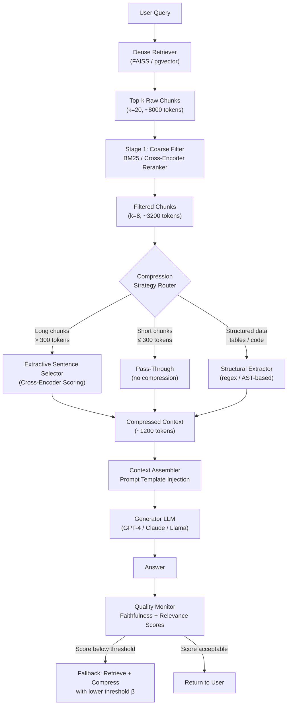

# Lesson 3: Contextual Compression Techniques in RAG Systems

## 1. First-Principles Intuition & Invariants

### The Core Tension

In Retrieval-Augmented Generation (RAG) architectures, the context window is simultaneously the system's most critical resource and its principal bottleneck. When a retriever returns `k` chunks in response to a query, the concatenated context often consumes 60–90% of the model's available token budget before any instruction or query tokens are added. This is not a marginal concern—it directly constrains retrieval breadth, reduces answer quality on multi-hop questions, and drives up per-query inference cost quadratically, since attention complexity scales as O(n²) in the sequence length.

Contextual compression is the discipline of reducing this overhead without destroying the semantic signal the downstream generator needs. The goal is emphatically not to minimize token count as an end in itself; it is to maximize the *useful information density* of the context presented to the generator.

### Information-Theoretic Foundation

The formal grounding comes from information theory. Let the retrieved context be a random variable `X` (the token sequence) and the ground-truth answer be `Y`. The mutual information `I(X; Y)` quantifies how much knowing `X` reduces uncertainty about `Y`. A compression function `C` produces a bottleneck representation `T = C(X)`. The Information Bottleneck principle (Tishby et al., 1999) formalizes the ideal compressor as the solution to:

$$
\min_{C}\ \bigl[-I(T;Y) + \beta \cdot I(T;X)\bigr]
$$

The first term rewards relevance (the compressed representation should predict the answer), while the second term, weighted by the Lagrange multiplier β, penalizes complexity (the compressed representation should be as small as possible). The invariant every practical compression technique must satisfy is:

$$
I(C(X); Y) \approx I(X; Y)
$$

Violations—where `I(C(X); Y) ≪ I(X; Y)`—manifest directly as answer degradation: hallucinated facts, dropped entities, broken reasoning chains. This is precisely the failure mode labeled "over-compression" in production systems.

A secondary invariant is computational: compression must be faster than retrieval latency plus generation latency, or it adds net overhead to end-to-end query time. This binds compression algorithms to sub-100ms wall-clock budgets on typical hardware, ruling out multi-pass neural re-ranking as the sole strategy for most latency-sensitive applications.

### Why Tokens Are Not Equally Informative

The practical justification for compression rests on empirical observation: retrieved documents are rarely maximally informative across their full length. Consider a 400-token Wikipedia paragraph retrieved because it contains the phrase "Battle of Hastings." The two sentences that mention 1066, William the Conqueror, and Harold Godwinson carry almost all the mutual information with any plausible query about that event. The remaining sentences—background history, prose transitions, citation artifacts—are nearly independent of the target answer. Discarding them loses almost no mutual information while reducing context length by 60–70%.

This observation generalizes. Boilerplate headers, repeated disclaimers, navigation text scraped from HTML, table-of-contents fragments, and formulaic prose all exhibit low marginal information density relative to the specific query. A well-designed compression pipeline exploits this structure aggressively.

---

## 2. Taxonomy of Compression Techniques

Contextual compression techniques decompose into four mechanistically distinct families. These are not competing alternatives; production systems typically compose them in a pipeline.

### 2.1 Extractive Sentence/Span Selection

The simplest and most interpretable approach: given a retrieved document and the query, score each sentence (or fixed-length span) for relevance and retain only those above a threshold. No new text is generated; the output is a strict subset of the input.

**Scoring mechanisms:**
- **BM25 / TF-IDF overlap**: Cheap, interpretable, query-dependent. Misses semantic paraphrase.
- **Cross-encoder relevance score**: A bi-encoder or cross-encoder (e.g., `ms-marco-MiniLM-L-6-v2`) scores (query, sentence) pairs. Expensive per sentence but highly accurate.
- **Attention-based saliency**: Aggregate attention weights from the first few decoder layers of the generator toward each context token. Tokens receiving negligible attention are candidates for removal.
- **LLM-as-compressor**: Prompt a small instruction-tuned model to extract only the relevant sentences. This is the approach used in LangChain's `LLMChainExtractor` and is discussed in Section 3.

**Key limitation**: Sentence-level selection is granular but can break intra-document coreference chains. The sentence "He was crowned in 1066" is uninformative without the antecedent "William the Conqueror."

### 2.2 Abstractive Summarization

Rather than selecting spans, a summarization model condenses the retrieved chunk into a shorter paraphrase that preserves the key claims. This can resolve coreference, merge redundant statements across multiple documents, and normalize varied phrasings into a consistent voice.

**Practical constraint**: Summarization introduces latency (a full model forward + decode pass) and hallucination risk. The summarizer may confabulate facts not present in the source. For high-stakes applications (medical, legal, financial), extractive methods are generally safer.

### 2.3 Token-Level Filtering (Soft and Hard)

Operating below the sentence level, token-level filtering assigns an importance score to each token and removes low-scoring tokens. This produces compressed sequences that may not correspond to grammatical sentences but preserve the precise lexical content the model needs.

**Hard filtering** physically removes tokens, reducing sequence length. The resulting sequence is not grammatical English but can be decoded by models trained to handle such input (see selective context approaches, Li et al., 2023).

**Soft filtering** (sometimes called *soft prompting* or *compressed token representations*) replaces the full token sequence with a smaller set of learned continuous vectors (virtual tokens) that encode the same information. This requires a specialized encoder trained to produce these vectors and a generator trained to consume them—a tighter coupling that limits flexibility.

### 2.4 Structural / Hierarchical Compression

For long documents (book chapters, entire codebases, legal contracts), flat compression is insufficient. Hierarchical approaches build a tree: leaf nodes are raw chunks, intermediate nodes are summaries of subtrees, and the root is a document-level summary. At query time, the system navigates the tree top-down, expanding only the branches most relevant to the query. This is the architecture underlying systems like `LlamaIndex`'s tree index and Microsoft's GraphRAG.

---

## 3. System Architecture & Data Flow

A production contextual compression pipeline integrates with the broader RAG retrieval-augmentation loop as follows:



### Component Detail: Stage 1 Coarse Filter

Before sentence-level compression, an initial coarse filter prunes the retrieval set from `k=20` to `k=5–8` using a reranker. This is critical because per-sentence cross-encoder scoring is O(sentences × model_forward_pass), and running it over 20 large chunks is prohibitively expensive. The reranker scores whole chunks against the query and discards the bottom 60%.

**Industry-standard rerankers** include:
- `cross-encoder/ms-marco-MiniLM-L-6-v2` (fast, 22M params)
- `BAAI/bge-reranker-v2-m3` (accurate, multilingual)
- Cohere Rerank API (hosted, state-of-the-art as of 2024)

### Component Detail: Compression Strategy Router

Not all chunks benefit equally from the same compression technique. A router dispatches chunks to the appropriate compressor based on content heuristics:

- Chunks exceeding 300 tokens go through sentence-level extractive selection.
- Chunks already below the target density pass through unchanged.
- Structured content (tables, code, JSON) uses structural extractors rather than neural scoring, since sentence-boundary segmentation degrades on non-prose content.

---

## 4. Implementation: Extractive Sentence Selector

The following Python implementation shows a production-grade extractive compression stage using a cross-encoder for relevance scoring. This corresponds to the `LangChain` `EmbeddingsFilter` and `LLMChainExtractor` family of approaches but is implemented directly against `sentence-transformers` for transparency and control.

```python
"""
extractive_compressor.py

Production-grade extractive contextual compression for RAG pipelines.
Uses a cross-encoder to score (query, sentence) pairs and retains
sentences above a relevance threshold.
"""

from __future__ import annotations

import re
import time
from dataclasses import dataclass, field
from typing import List, Tuple

import numpy as np
from sentence_transformers import CrossEncoder


# ---------------------------------------------------------------------------
# Data structures
# ---------------------------------------------------------------------------

@dataclass
class SentenceSpan:
    """A single sentence with its byte offsets in the source document."""
    text: str
    start: int
    end: int
    score: float = 0.0


@dataclass
class CompressionResult:
    """Output of the extractive compressor for one document chunk."""
    original_tokens: int
    compressed_tokens: int
    compression_ratio: float
    retained_sentences: List[SentenceSpan]
    latency_ms: float
    metadata: dict = field(default_factory=dict)

    @property
    def compressed_text(self) -> str:
        return " ".join(s.text for s in self.retained_sentences)


# ---------------------------------------------------------------------------
# Sentence tokenizer
# ---------------------------------------------------------------------------

_SENT_SPLIT_RE = re.compile(
    r'(?<!\w\.\w.)(?<![A-Z][a-z]\.)(?<=\.|\?|!)\s+'
)


def split_sentences(text: str) -> List[SentenceSpan]:
    """
    Rule-based sentence splitter that preserves byte offsets.
    Avoids NLTK/spaCy dependency for portability; sufficient for
    well-formed English prose. For multilingual or noisy text,
    replace with spaCy's sentencizer.
    """
    spans: List[SentenceSpan] = []
    boundaries = [0] + [
        m.end() for m in _SENT_SPLIT_RE.finditer(text)
    ] + [len(text)]

    for i in range(len(boundaries) - 1):
        start = boundaries[i]
        end = boundaries[i + 1]
        sentence_text = text[start:end].strip()
        if sentence_text:
            spans.append(SentenceSpan(text=sentence_text, start=start, end=end))

    return spans


# ---------------------------------------------------------------------------
# Cross-encoder scorer
# ---------------------------------------------------------------------------

class CrossEncoderScorer:
    """
    Wraps a sentence-transformers CrossEncoder for batch relevance scoring.

    The cross-encoder jointly encodes (query, sentence) pairs and returns
    a scalar logit. This is more accurate than bi-encoder cosine similarity
    because the query and sentence attend to each other during encoding.

    Model choices by latency/accuracy tradeoff:
    - 'cross-encoder/ms-marco-MiniLM-L-6-v2'  : 6-layer MiniLM, ~4ms/pair on CPU
    - 'cross-encoder/ms-marco-MiniLM-L-12-v2' : 12-layer, ~8ms/pair, more accurate
    - 'BAAI/bge-reranker-v2-m3'               : state-of-the-art, multilingual
    """

    def __init__(self, model_name: str = "cross-encoder/ms-marco-MiniLM-L-6-v2"):
        self.model = CrossEncoder(model_name, max_length=512)
        self._model_name = model_name

    def score_sentences(
        self,
        query: str,
        sentences: List[SentenceSpan],
        batch_size: int = 64,
    ) -> List[SentenceSpan]:
        """
        Score each sentence against the query in batched inference.
        Returns the same list with `.score` populated.

        Scores are raw logits from the cross-encoder; they are NOT
        probabilities (no sigmoid applied). Comparison is ordinal only.
        """
        if not sentences:
            return sentences

        pairs = [(query, s.text) for s in sentences]
        # CrossEncoder.predict returns a numpy array of shape (n,)
        raw_scores: np.ndarray = self.model.predict(
            pairs,
            batch_size=batch_size,
            show_progress_bar=False,
            convert_to_numpy=True,
        )

        for span, score in zip(sentences, raw_scores):
            span.score = float(score)

        return sentences


# ---------------------------------------------------------------------------
# Compressor
# ---------------------------------------------------------------------------

class ExtractiveCompressor:
    """
    Sentence-level extractive compressor for RAG context windows.

    Parameters
    ----------
    scorer : CrossEncoderScorer
        The relevance scorer to use.
    threshold : float
        Minimum score for a sentence to be retained. Sentences scoring
        below this value are discarded. Tune empirically against your
        held-out QA dataset; typical range: 0.0–3.0 for ms-marco models.
    min_sentences : int
        Always retain at least this many top-scoring sentences, even if
        all scores fall below the threshold. Prevents empty outputs.
    max_tokens_approx : int
        Approximate token budget (1 token ≈ 4 chars used as heuristic).
        Compression halts once the budget is consumed, even if more
        sentences exceed the threshold.
    preserve_order : bool
        If True, retain sentences in their original document order.
        If False, return in descending score order (useful for reranking
        pipelines that handle ordering downstream).
    """

    def __init__(
        self,
        scorer: CrossEncoderScorer,
        threshold: float = 0.5,
        min_sentences: int = 1,
        max_tokens_approx: int = 512,
        preserve_order: bool = True,
    ):
        self.scorer = scorer
        self.threshold = threshold
        self.min_sentences = min_sentences
        self.max_tokens_approx = max_tokens_approx
        self.preserve_order = preserve_order

    def compress(self, query: str, document: str) -> CompressionResult:
        """
        Compress `document` by retaining only sentences relevant to `query`.

        The original document is never modified; compression is purely
        additive selection over sentence spans.
        """
        t0 = time.perf_counter()

        sentences = split_sentences(document)
        if not sentences:
            return CompressionResult(
                original_tokens=0,
                compressed_tokens=0,
                compression_ratio=1.0,
                retained_sentences=[],
                latency_ms=0.0,
            )

        scored = self.scorer.score_sentences(query, sentences)

        # Sort by score descending for threshold + budget application
        scored_sorted = sorted(scored, key=lambda s: s.score, reverse=True)

        retained: List[SentenceSpan] = []
        token_budget = self.max_tokens_approx * 4  # chars approximation
        chars_used = 0

        for span in scored_sorted:
            if len(retained) < self.min_sentences or span.score >= self.threshold:
                if chars_used + len(span.text) <= token_budget:
                    retained.append(span)
                    chars_used += len(span.text)
            # Once we've satisfied min_sentences and gone below threshold, stop.
            elif len(retained) >= self.min_sentences:
                break

        if self.preserve_order:
            retained.sort(key=lambda s: s.start)

        original_chars = len(document)
        compressed_chars = sum(len(s.text) for s in retained)
        ratio = compressed_chars / original_chars if original_chars > 0 else 1.0

        t1 = time.perf_counter()

        return CompressionResult(
            original_tokens=original_chars // 4,
            compressed_tokens=compressed_chars // 4,
            compression_ratio=ratio,
            retained_sentences=retained,
            latency_ms=(t1 - t0) * 1000,
            metadata={
                "model": self.scorer._model_name,
                "threshold": self.threshold,
                "total_sentences": len(sentences),
                "retained_sentences": len(retained),
            },
        )

    def compress_batch(
        self,
        query: str,
        documents: List[str],
    ) -> List[CompressionResult]:
        """
        Compress multiple documents against the same query.
        Sentences from all documents are scored in a single batched
        cross-encoder call to maximize GPU/CPU utilization.
        """
        t0 = time.perf_counter()

        all_sentences: List[Tuple[int, SentenceSpan]] = []
        doc_sentence_map: List[List[SentenceSpan]] = []

        for doc_idx, doc in enumerate(documents):
            spans = split_sentences(doc)
            doc_sentence_map.append(spans)
            for span in spans:
                all_sentences.append((doc_idx, span))

        if not all_sentences:
            return [
                CompressionResult(0, 0, 1.0, [], 0.0) for _ in documents
            ]

        # Single cross-encoder batch call across all documents
        flat_spans = [s for _, s in all_sentences]
        self.scorer.score_sentences(query, flat_spans)

        # Reconstruct per-document results
        results: List[CompressionResult] = []
        for doc_idx, doc in enumerate(documents):
            spans = doc_sentence_map[doc_idx]
            scored_sorted = sorted(spans, key=lambda s: s.score, reverse=True)
            retained: List[SentenceSpan] = []
            chars_used = 0
            token_budget = self.max_tokens_approx * 4

            for span in scored_sorted:
                if (
                    len(retained) < self.min_sentences
                    or span.score >= self.threshold
                ):
                    if chars_used + len(span.text) <= token_budget:
                        retained.append(span)
                        chars_used += len(span.text)
                elif len(retained) >= self.min_sentences:
                    break

            if self.preserve_order:
                retained.sort(key=lambda s: s.start)

            orig_chars = len(doc)
            comp_chars = sum(len(s.text) for s in retained)
            ratio = comp_chars / orig_chars if orig_chars > 0 else 1.0

            results.append(CompressionResult(
                original_tokens=orig_chars // 4,
                compressed_tokens=comp_chars // 4,
                compression_ratio=ratio,
                retained_sentences=retained,
                latency_ms=0.0,  # Attributed to batch total below
                metadata={"doc_idx": doc_idx, "retained": len(retained)},
            ))

        t1 = time.perf_counter()
        total_ms = (t1 - t0) * 1000
        for r in results:
            r.latency_ms = total_ms / len(results)

        return results


# ---------------------------------------------------------------------------
# Example usage
# ---------------------------------------------------------------------------

if __name__ == "__main__":
    scorer = CrossEncoderScorer("cross-encoder/ms-marco-MiniLM-L-6-v2")
    compressor = ExtractiveCompressor(
        scorer=scorer,
        threshold=1.0,       # Tune on your QA benchmark
        min_sentences=2,
        max_tokens_approx=256,
        preserve_order=True,
    )

    query = "When did William the Conqueror invade England?"
    document = (
        "England in the 11th century was a feudal society with strong Norse influences. "
        "William the Conqueror invaded England in 1066, defeating King Harold II at the "
        "Battle of Hastings on October 14th of that year. Harold was killed during the "
        "battle, reportedly by an arrow. The Norman conquest fundamentally transformed "
        "English culture, language, and governance. William was subsequently crowned King "
        "of England at Westminster Abbey on Christmas Day, 1066. The Domesday Book was "
        "commissioned by William in 1086 to survey his new kingdom's assets."
    )

    result = compressor.compress(query, document)
    print(f"Compression ratio: {result.compression_ratio:.2%}")
    print(f"Latency: {result.latency_ms:.1f}ms")
    print(f"Compressed text:\n{result.compressed_text}")
```

---

## 5. Implementation: Low-Level Token Scorer in C

For latency-critical hot paths—such as a streaming RAG system that must compress context incrementally as new tokens arrive—a C implementation of the token-level scoring kernel is appropriate. This runs as a native extension callable from Python via ctypes or cffi, or embedded directly in a C/C++ inference server.

The design below scores tokens using precomputed attention weights (aggregated from the retriever's encoder layers) and applies a hard threshold filter. The key performance characteristics are contiguous memory layout for cache efficiency, SIMD-amenable loops, and zero heap allocation in the hot path.

```c
/*
 * token_scorer.c
 *
 * Token-level importance scoring and hard-threshold selection kernel.
 * Intended as a native extension for latency-critical RAG pipelines.
 *
 * Compile:
 *   gcc -O3 -march=native -ffast-math -o token_scorer.so \
 *       -shared -fPIC token_scorer.c
 *
 * Design invariants:
 *   - No heap allocation inside score_and_select() hot path.
 *   - All buffers are caller-owned and must be pre-allocated.
 *   - Thread-safe: no global mutable state.
 *   - Scores are float32; tokens are int32 (vocabulary IDs).
 */

#include <stddef.h>
#include <stdint.h>
#include <string.h>
#include <assert.h>
#include <float.h>

/* -------------------------------------------------------------------------
 * Data structures (ABI-stable layout, packed for predictable field offsets)
 * ---------------------------------------------------------------------- */

typedef struct __attribute__((packed)) {
    const int32_t *tokens;     /* Input token IDs, length = n_tokens        */
    const float   *scores;     /* Per-token importance, same length         */
    size_t         n_tokens;   /* Number of input tokens                    */
} TokenSequence;

typedef struct __attribute__((packed)) {
    int32_t *out_tokens;       /* Caller-allocated output buffer, cap ≥ n   */
    size_t  *out_indices;      /* Original positions of retained tokens     */
    size_t   n_selected;       /* Filled by score_and_select()              */
    float    min_score_seen;   /* Diagnostic: lowest score in retained set  */
    float    max_score_seen;   /* Diagnostic: highest score in retained set */
} SelectionResult;

/* -------------------------------------------------------------------------
 * score_and_select
 *
 * Retains tokens whose importance score exceeds `threshold`.
 * If fewer than `min_retain` tokens would be retained, the top-`min_retain`
 * tokens by score are retained unconditionally (prevents empty output).
 *
 * Parameters
 *   seq        : input token sequence with precomputed scores
 *   threshold  : minimum score for retention
 *   min_retain : minimum number of tokens to retain regardless of threshold
 *   result     : output struct; out_tokens and out_indices must be
 *                pre-allocated to at least seq->n_tokens elements
 *
 * Returns 0 on success, -1 on invalid input.
 * ---------------------------------------------------------------------- */
int score_and_select(
    const TokenSequence *seq,
    float                threshold,
    size_t               min_retain,
    SelectionResult     *result
) {
    if (!seq || !result || !seq->tokens || !seq->scores) return -1;
    if (!result->out_tokens || !result->out_indices)      return -1;

    result->n_selected    = 0;
    result->min_score_seen = FLT_MAX;
    result->max_score_seen = -FLT_MAX;

    /* --- Pass 1: threshold filter ----------------------------------------
     * Linear scan; branch predictor favors the common case (most tokens
     * are below threshold in a well-tuned system, so the branch is biased).
     * The inner loop body is branchless-friendly for SIMD auto-vectorization.
     */
    for (size_t i = 0; i < seq->n_tokens; i++) {
        float s = seq->scores[i];
        if (s < result->min_score_seen) result->min_score_seen = s;
        if (s > result->max_score_seen) result->max_score_seen = s;

        if (s > threshold) {
            result->out_tokens[result->n_selected]  = seq->tokens[i];
            result->out_indices[result->n_selected] = i;
            result->n_selected++;
        }
    }

    /* --- Pass 2: enforce min_retain via partial sort ---------------------
     * Only executed when Pass 1 retains too few tokens. Uses an O(n)
     * partial maximum selection rather than a full sort to bound cost.
     */
    if (result->n_selected < min_retain && seq->n_tokens >= min_retain) {
        /* Reset output and select top-min_retain by score. */
        result->n_selected = 0;

        /* Temporary score-index pairs on the stack (bounded by min_retain). */
        assert(min_retain <= 1024 && "min_retain too large for stack allocation");
        size_t top_indices[1024];
        float  top_scores[1024];
        size_t n_top = 0;

        for (size_t i = 0; i < seq->n_tokens; i++) {
            float s = seq->scores[i];
            if (n_top < min_retain) {
                top_indices[n_top] = i;
                top_scores[n_top]  = s;
                n_top++;
            } else {
                /* Find the slot with the minimum score and replace if s > min */
                size_t min_slot = 0;
                for (size_t j = 1; j < n_top; j++) {
                    if (top_scores[j] < top_scores[min_slot]) min_slot = j;
                }
                if (s > top_scores[min_slot]) {
                    top_indices[min_slot] = i;
                    top_scores[min_slot]  = s;
                }
            }
        }

        /*
         * Sort top_indices ascending (preserves document order).
         * Insertion sort is O(min_retain²) but min_retain is small (≤ 1024).
         */
        for (size_t i = 1; i < n_top; i++) {
            size_t key_idx = top_indices[i];
            float  key_scr = top_scores[i];
            size_t j = i;
            while (j > 0 && top_indices[j - 1] > key_idx) {
                top_indices[j] = top_indices[j - 1];
                top_scores[j]  = top_scores[j - 1];
                j--;
            }
            top_indices[j] = key_idx;
            top_scores[j]  = key_scr;
        }

        for (size_t i = 0; i < n_top; i++) {
            result->out_tokens[i]  = seq->tokens[top_indices[i]];
            result->out_indices[i] = top_indices[i];
        }
        result->n_selected = n_top;
    }

    return 0;
}

/* -------------------------------------------------------------------------
 * normalize_scores_inplace
 *
 * Min-max normalizes an array of float scores to [0, 1].
 * Called before score_and_select to make threshold values interpretable
 * regardless of the score magnitude from different encoder models.
 * ---------------------------------------------------------------------- */
void normalize_scores_inplace(float *scores, size_t n) {
    if (!scores || n == 0) return;

    float min_val = scores[0], max_val = scores[0];
    for (size_t i = 1; i < n; i++) {
        if (scores[i] < min_val) min_val = scores[i];
        if (scores[i] > max_val) max_val = scores[i];
    }

    float range = max_val - min_val;
    if (range < 1e-9f) {
        /* All scores identical: set everything to 1.0 (retain all). */
        for (size_t i = 0; i < n; i++) scores[i] = 1.0f;
        return;
    }

    float inv_range = 1.0f / range;
    for (size_t i = 0; i < n; i++) {
        scores[i] = (scores[i] - min_val) * inv_range;
    }
}
```

---

## 6. Implementation: Compression Pipeline in Rust

The Rust implementation models the full compression pipeline as a type-safe, zero-copy processing graph. The design prioritizes correctness-by-construction (no silent data corruption), explicit error handling, and allocation-minimizing idioms. This is appropriate for embedding in a Rust-native inference server (e.g., one using `candle` or `tch-rs` for model inference).

```rust
//! contextual_compressor.rs
//!
//! Type-safe, allocation-minimizing contextual compression pipeline for RAG.
//!
//! Architecture:
//!   TokenSequence → ScoredSequence → CompressedContext
//!
//! All transformations are zero-copy where possible (slices over the
//! original token buffer). Heap allocation occurs only at construction
//! and at final output materialization.

use std::cmp::Ordering;

// ---------------------------------------------------------------------------
// Error types
// ---------------------------------------------------------------------------

#[derive(Debug, thiserror::Error)]
pub enum CompressionError {
    #[error("Token and score slices have different lengths: {tokens} vs {scores}")]
    LengthMismatch { tokens: usize, scores: usize },

    #[error("Empty input sequence")]
    EmptyInput,

    #[error("Threshold {threshold} is outside valid range [0.0, 1.0]")]
    InvalidThreshold { threshold: f32 },

    #[error("min_retain ({min_retain}) exceeds sequence length ({seq_len})")]
    MinRetainExceedsLength { min_retain: usize, seq_len: usize },
}

// ---------------------------------------------------------------------------
// Core types
// ---------------------------------------------------------------------------

/// A token sequence with precomputed importance scores.
/// Scores must be in [0.0, 1.0] (apply normalize_scores before construction).
#[derive(Debug, Clone)]
pub struct ScoredSequence {
    tokens: Vec<i32>,
    scores: Vec<f32>,
}

impl ScoredSequence {
    /// Construct from parallel token ID and score vectors.
    /// Validates that lengths match and scores are finite.
    pub fn new(tokens: Vec<i32>, scores: Vec<f32>) -> Result<Self, CompressionError> {
        if tokens.len() != scores.len() {
            return Err(CompressionError::LengthMismatch {
                tokens: tokens.len(),
                scores: scores.len(),
            });
        }
        if tokens.is_empty() {
            return Err(CompressionError::EmptyInput);
        }
        // Validate all scores are finite (NaN/Inf from model outputs are
        // a real failure mode; better to reject early than silently corrupt).
        for (i, &s) in scores.iter().enumerate() {
            assert!(s.is_finite(), "Score at index {} is not finite: {}", i, s);
        }
        Ok(Self { tokens, scores })
    }

    pub fn len(&self) -> usize {
        self.tokens.len()
    }

    /// Normalize scores in-place to [0.0, 1.0] via min-max scaling.
    /// Idempotent if all scores are equal (maps to 1.0).
    pub fn normalize(&mut self) {
        let min = self
            .scores
            .iter()
            .copied()
            .fold(f32::INFINITY, f32::min);
        let max = self
            .scores
            .iter()
            .copied()
            .fold(f32::NEG_INFINITY, f32::max);

        let range = max - min;
        if range < 1e-9 {
            self.scores.fill(1.0);
            return;
        }
        let inv_range = 1.0 / range;
        for s in &mut self.scores {
            *s = (*s - min) * inv_range;
        }
    }
}

// ---------------------------------------------------------------------------
// Compression result
// ---------------------------------------------------------------------------

/// The output of a compression pass: a strict subsequence of the input,
/// preserving original document order.
#[derive(Debug, Clone)]
pub struct CompressedContext {
    /// Retained token IDs in original document order.
    pub tokens: Vec<i32>,
    /// Original indices of retained tokens (for provenance / reconstruction).
    pub original_indices: Vec<usize>,
    /// Scores of retained tokens.
    pub scores: Vec<f32>,
    /// Compression ratio: retained_tokens / total_tokens.
    pub compression_ratio: f32,
}

impl CompressedContext {
    pub fn retained_count(&self) -> usize {
        self.tokens.len()
    }

    /// True if any tokens were removed.
    pub fn was_compressed(&self) -> bool {
        self.compression_ratio < 1.0
    }
}

// ---------------------------------------------------------------------------
// Compressor
// ---------------------------------------------------------------------------

/// Configuration for the threshold-based extractive compressor.
#[derive(Debug, Clone)]
pub struct CompressorConfig {
    /// Minimum normalized score [0, 1] for a token to be retained.
    pub threshold: f32,
    /// Minimum number of tokens to retain regardless of threshold.
    /// Prevents the pathological case of an empty compressed context.
    pub min_retain: usize,
    /// Maximum number of tokens to retain (enforces token budget).
    /// `None` means no upper bound.
    pub max_retain: Option<usize>,
}

impl Default for CompressorConfig {
    fn default() -> Self {
        Self {
            threshold: 0.5,
            min_retain: 10,
            max_retain: Some(512),
        }
    }
}

pub struct Compressor {
    config: CompressorConfig,
}

impl Compressor {
    pub fn new(config: CompressorConfig) -> Result<Self, CompressionError> {
        if !(0.0..=1.0).contains(&config.threshold) {
            return Err(CompressionError::InvalidThreshold {
                threshold: config.threshold,
            });
        }
        Ok(Self { config })
    }

    /// Compress `seq` by retaining only tokens above the configured threshold.
    ///
    /// Algorithm:
    /// 1. Collect indices of tokens with score > threshold.
    /// 2. If fewer than `min_retain` collected, top-up from remaining tokens
    ///    in score-descending order.
    /// 3. If more than `max_retain` collected, truncate from the bottom of the
    ///    score ranking (keeping highest-scoring tokens).
    /// 4. Sort retained indices ascending to restore document order.
    pub fn compress(&self, seq: &ScoredSequence) -> Result<CompressedContext, CompressionError> {
        let n = seq.len();

        if self.config.min_retain > n {
            return Err(CompressionError::MinRetainExceedsLength {
                min_retain: self.config.min_retain,
                seq_len: n,
            });
        }

        // --- Step 1: collect above-threshold candidates ---
        let mut above_threshold: Vec<usize> = seq
            .scores
            .iter()
            .enumerate()
            .filter_map(|(i, &s)| if s > self.config.threshold { Some(i) } else { None })
            .collect();

        // --- Step 2: enforce min_retain ---
        if above_threshold.len() < self.config.min_retain {
            // Build a score-sorted index of ALL tokens not already selected,
            // then take the top (min_retain - current_count) of them.
            let above_set: std::collections::HashSet<usize> =
                above_threshold.iter().copied().collect();

            let mut remaining: Vec<(usize, f32)> = seq
                .scores
                .iter()
                .enumerate()
                .filter(|(i, _)| !above_set.contains(i))
                .map(|(i, &s)| (i, s))
                .collect();

            // Sort descending by score; partial_cmp with NaN guard.
            remaining.sort_unstable_by(|a, b| {
                b.1.partial_cmp(&a.1).unwrap_or(Ordering::Equal)
            });

            let needed = self.config.min_retain - above_threshold.len();
            above_threshold.extend(remaining.iter().take(needed).map(|(i, _)| i));
        }

        // --- Step 3: enforce max_retain ---
        if let Some(max) = self.config.max_retain {
            if above_threshold.len() > max {
                // Keep the highest-scoring `max` tokens.
                above_threshold.sort_unstable_by(|&a, &b| {
                    seq.scores[b]
                        .partial_cmp(&seq.scores[a])
                        .unwrap_or(Ordering::Equal)
                });
                above_threshold.truncate(max);
            }
        }

        // --- Step 4: restore document order ---
        above_threshold.sort_unstable();

        // --- Materialize output ---
        let tokens: Vec<i32> = above_threshold.iter().map(|&i| seq.tokens[i]).collect();
        let scores: Vec<f32> = above_threshold.iter().map(|&i| seq.scores[i]).collect();
        let compression_ratio = above_threshold.len() as f32 / n as f32;

        Ok(CompressedContext {
            tokens,
            original_indices: above_threshold,
            scores,
            compression_ratio,
        })
    }
}

// ---------------------------------------------------------------------------
// Tests
// ---------------------------------------------------------------------------

#[cfg(test)]
mod tests {
    use super::*;

    fn make_seq(scores: Vec<f32>) -> ScoredSequence {
        let n = scores.len();
        ScoredSequence::new((0..n as i32).collect(), scores).unwrap()
    }

    #[test]
    fn retains_above_threshold() {
        let seq = make_seq(vec![0.1, 0.9, 0.3, 0.8, 0.2]);
        let cfg = CompressorConfig {
            threshold: 0.5,
            min_retain: 1,
            max_retain: None,
        };
        let result = Compressor::new(cfg).unwrap().compress(&seq).unwrap();
        assert_eq!(result.tokens, vec![1, 3]); // indices 1 and 3 exceed 0.5
        assert_eq!(result.original_indices, vec![1, 3]);
    }

    #[test]
    fn min_retain_kicks_in_when_nothing_above_threshold() {
        let seq = make_seq(vec![0.1, 0.2, 0.15, 0.05]);
        let cfg = CompressorConfig {
            threshold: 0.9,  // Nothing will pass
            min_retain: 2,
            max_retain: None,
        };
        let result = Compressor::new(cfg).unwrap().compress(&seq).unwrap();
        assert_eq!(result.retained_count(), 2);
        // Should retain the two highest-scoring: indices 1 (0.2) and 2 (0.15)
        assert!(result.original_indices.contains(&1));
        assert!(result.original_indices.contains(&2));
    }

    #[test]
    fn max_retain_caps_output() {
        let seq = make_seq(vec![0.9, 0.8, 0.7, 0.6, 0.5]);
        let cfg = CompressorConfig {
            threshold: 0.0, // All pass
            min_retain: 1,
            max_retain: Some(3),
        };
        let result = Compressor::new(cfg).unwrap().compress(&seq).unwrap();
        assert_eq!(result.retained_count(), 3);
    }

    #[test]
    fn preserves_document_order() {
        // Even with high min_retain pulling in low-score tokens,
        // output must be sorted by original position.
        let seq = make_seq(vec![0.1, 0.9, 0.2, 0.8, 0.3]);
        let cfg = CompressorConfig {
            threshold: 0.7,
            min_retain: 4,
            max_retain: None,
        };
        let result = Compressor::new(cfg).unwrap().compress(&seq).unwrap();
        let indices = &result.original_indices;
        for w in indices.windows(2) {
            assert!(w[0] < w[1], "Document order violated: {:?}", indices);
        }
    }

    #[test]
    fn normalization_produces_unit_range() {
        let mut seq = make_seq(vec![2.0, 5.0, 3.0, 1.0, 4.0]);
        seq.normalize();
        let min = seq.scores.iter().copied().fold(f32::INFINITY, f32::min);
        let max = seq.scores.iter().copied().fold(f32::NEG_INFINITY, f32::max);
        assert!((min - 0.0).abs() < 1e-6);
        assert!((max - 1.0).abs() < 1e-6);
    }
}
```

---

## 7. Failure Mode Analysis

### 7.1 Over-Compression

**Mechanism**: The threshold β is set too aggressively. Sentences containing the answer are removed because their relevance score falls below the cutoff—often because the answer is phrased differently from the query (lexical gap), or because the cross-encoder's training distribution does not cover the domain.

**Detection**: Monitor `compression_ratio` per query. Ratios below 0.15 on factoid QA tasks (where 15% of a typical passage contains the answer) are a strong signal. More robust: instrument a faithfulness scorer (e.g., NLI entailment between compressed context and uncompressed context) and alert when entailment scores drop.

**Mitigation**: Implement dynamic threshold annealing—if the generator's confidence (measured by token log-probabilities) on the compressed context is significantly lower than on the full context, increase the threshold β and retry with looser compression before serving the response.

### 7.2 Coreference Fracturing

**Mechanism**: Sentence-level extractive selection removes the antecedent sentence, retaining only the sentence containing the coreferential pronoun. "He was crowned in Westminster Abbey" is useless without the sentence establishing who "he" is.

**Detection**: Run a lightweight coreference resolution pass on retained sentences and check for unresolved chains. The `fastcoref` library (Otmazgin et al., 2022) can process 500 sentences per second on CPU.

**Mitigation**: Sentence-level selection should use a *dependency-aware* selection rule: when retaining a sentence, also retain the sentence containing the antecedent of any unresolved pronoun in it. This is a form of **transitivity closure** over the coreference graph.

### 7.3 Threshold Instability Across Domains

**Mechanism**: A threshold calibrated on Wikipedia-style factoid QA performs poorly on legal documents (dense, every sentence is load-bearing), code documentation (non-prose syntax confuses the sentence splitter), or scientific papers (high information density means the optimal threshold is much lower).

**Mitigation**: Domain-specific threshold calibration on a held-out labeled set per domain. At minimum, distinguish three tiers: (1) narrative prose, (2) structured/technical content, (3) tabular/code content, and use different thresholds for each. The compression router (Section 3) is the natural place to apply this.

### 7.4 Latency Regression Under Tail Load

**Mechanism**: The cross-encoder's inference time is linear in the number of (query, sentence) pairs. Under high throughput, sentence scoring becomes the pipeline bottleneck. A single 2000-token document with 40 sentences adds 40 × 4ms = 160ms of latency per query on CPU—unacceptable for interactive applications.

**Mitigation**:
1. **Batch sentences across concurrent requests**: aggregate sentence-scoring requests across multiple in-flight queries and process them as a single large batch on GPU. This converts 40 serial forward passes into one batched pass with ~1ms overhead.
2. **Cache query-document scores**: if the same document appears frequently across queries (high document hit rate from retrieval), cache its sentence scores keyed by document hash. Cross-encoder scores are query-dependent, but for a fixed query pattern (e.g., "what is the capital of X"), scores can be reused.
3. **Latency-accuracy tradeoff via model size**: replace the 6-layer cross-encoder with a 2-layer distilled version for the 95th-percentile traffic, reserving the 12-layer model for queries flagged as high-stakes.

### 7.5 Adversarial Input Exploitation

In open-domain RAG systems where retrieved documents come from the web, compression creates an attack surface: an adversary can craft a document where genuinely informative-looking sentences (high cross-encoder scores against common queries) contain injected false claims, while the actual accurate content is compressed away. This is a **retrieval poisoning** attack amplified by the compression filter.

**Mitigation**: Apply the compressor *after* a retrieval-time source-credibility filter, not before. Additionally, retain provenance metadata (source URL, retrieval timestamp, credibility tier) in the `CompressedContext.metadata` field, and surface it to the generator via the prompt to allow source-conditioned reasoning.

---

## 8. Integration with LangChain / LlamaIndex

Both major RAG orchestration frameworks expose first-class compression hooks. Understanding what they implement under the hood—versus what must be supplied externally—is necessary for production use.

### LangChain `ContextualCompressionRetriever`

LangChain wraps a base retriever with a `BaseDocumentCompressor`. The two built-in compressors are:

- **`LLMChainExtractor`**: Prompts the configured LLM to extract relevant sentences. Abstractive, can paraphrase. Expensive (one LLM call per document). Hallucination risk. Use only for offline or low-latency-tolerance pipelines.
- **`EmbeddingsFilter`**: Filters by cosine similarity between document chunk embedding and query embedding. Fast (single matrix multiply). Operates at the whole-chunk level, not sentence level—cannot compress *within* a chunk.

The `EmbeddingsFilter` does not perform intra-document sentence selection. For sentence-level compression inside a chunk, the custom `CrossEncoderCompressor` from Section 4 must be wrapped as a `BaseDocumentCompressor` subclass:

```python
from langchain.retrievers.document_compressors.base import BaseDocumentCompressor
from langchain_core.documents import Document
from typing import List, Optional, Sequence

class CrossEncoderDocumentCompressor(BaseDocumentCompressor):
    """
    LangChain-compatible wrapper around ExtractiveCompressor.
    Implements BaseDocumentCompressor.compress_documents().
    """

    compressor: ExtractiveCompressor  # Pydantic field

    class Config:
        arbitrary_types_allowed = True

    def compress_documents(
        self,
        documents: Sequence[Document],
        query: str,
        callbacks: Optional[object] = None,
    ) -> List[Document]:
        results = self.compressor.compress_batch(
            query=query,
            documents=[doc.page_content for doc in documents],
        )
        compressed_docs = []
        for doc, result in zip(documents, results):
            if result.compressed_text.strip():
                compressed_docs.append(
                    Document(
                        page_content=result.compressed_text,
                        metadata={
                            **doc.metadata,
                            "compression_ratio": result.compression_ratio,
                            "original_tokens": result.original_tokens,
                            "compressed_tokens": result.compressed_tokens,
                        },
                    )
                )
        return compressed_docs
```

This integrates directly into the `ContextualCompressionRetriever` pipeline with no other changes required.

---

## 9. Evaluation Methodology

Compression techniques cannot be evaluated in isolation. The correct evaluation target is *end-to-end RAG quality* with and without compression, measured on a task-specific held-out set.

**Primary metrics:**

| Metric | Tool | What it measures |
|---|---|---|
| Exact Match (EM) | Standard QA eval | Lexical correctness of final answer |
| F1 token overlap | Standard QA eval | Partial answer correctness |
| Faithfulness | RAGAS, TruLens | Is the answer supported by the context? |
| Context Precision | RAGAS | What fraction of the context is relevant? |
| Context Recall | RAGAS | What fraction of the needed information is in the context? |
| Compression Ratio | Direct measurement | Tokens in / tokens out |
| End-to-end latency (p50/p99) | Tracing (OpenTelemetry) | Real-world latency including scoring |

**Key invariant to monitor in production**: Context Recall should not decrease after compression is applied. If it does, the compressor is discarding information the generator needs. Context Precision *should* increase—compression's primary value is raising signal density, not raw correctness.

**Calibration procedure:**
1. Run your RAG pipeline without compression as a baseline, recording all metrics.
2. Apply compression at three threshold levels (conservative, moderate, aggressive).
3. For each level, measure the full metric suite on your labeled QA set.
4. Select the most aggressive threshold level where Context Recall degradation stays within your acceptable tolerance (e.g., < 2 percentage points below uncompressed baseline).

This threshold becomes your production β. Re-run calibration whenever you change your retriever, embedding model, or document corpus.

---

## 10. Summary of Design Invariants

The following invariants collectively define a correct contextual compression implementation. Any implementation violating these is incorrect by construction.

1. **Information preservation**: `I(C(X); Y) ≈ I(X; Y)`. Compression must not destroy mutual information with the target answer. Monitored via Context Recall.

2. **Document order preservation**: Retained tokens/sentences appear in the compressed output in the same order they appear in the source document. Breaking this order corrupts temporal and causal reasoning.

3. **Bounded latency**: Compression latency must be a small fraction of total query latency (< 20% as a rule of thumb). If the compressor is slower than retrieval + generation, reconsider whether compression is net-positive.

4. **Determinism**: Identical inputs must produce identical compressed outputs. Non-determinism (from random sampling, thread-schedule-dependent floating point, etc.) makes debugging impossible and A/B testing invalid.

5. **Graceful degradation**: If compression fails (scorer error, empty output, latency timeout), the pipeline must fall back to returning the uncompressed context. Compression is an optimization, not a correctness requirement.

6. **Provenance tracking**: The compressed output must carry metadata identifying which original spans were retained and from which source documents. This is non-negotiable for attribution, debugging, and adversarial input detection.
