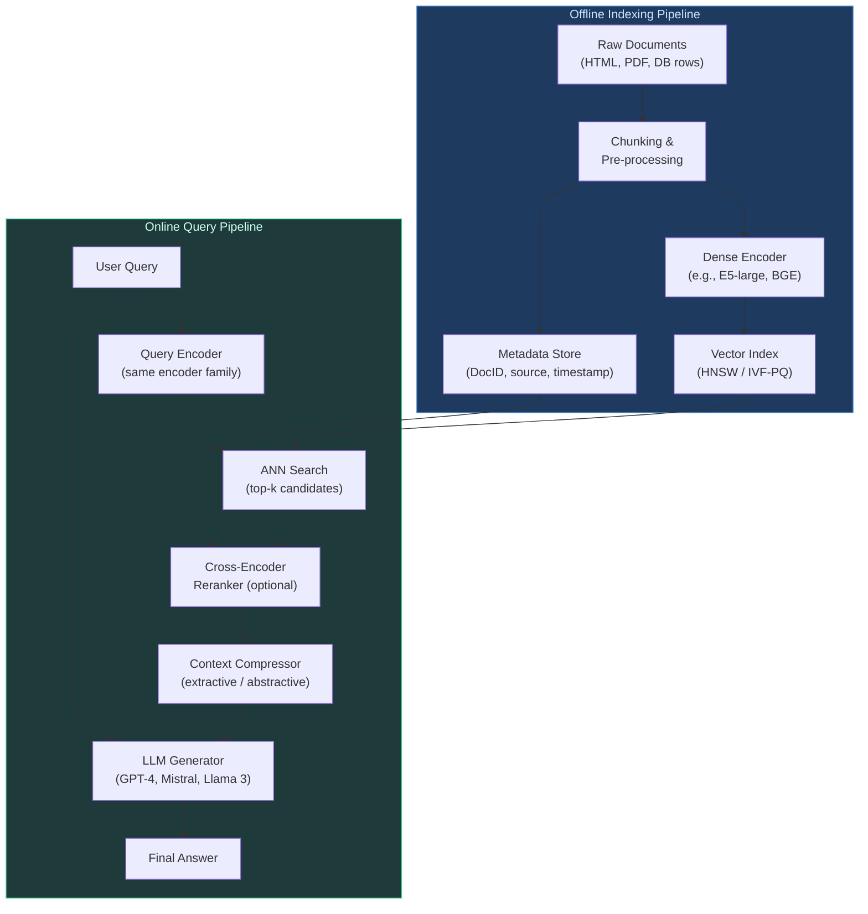
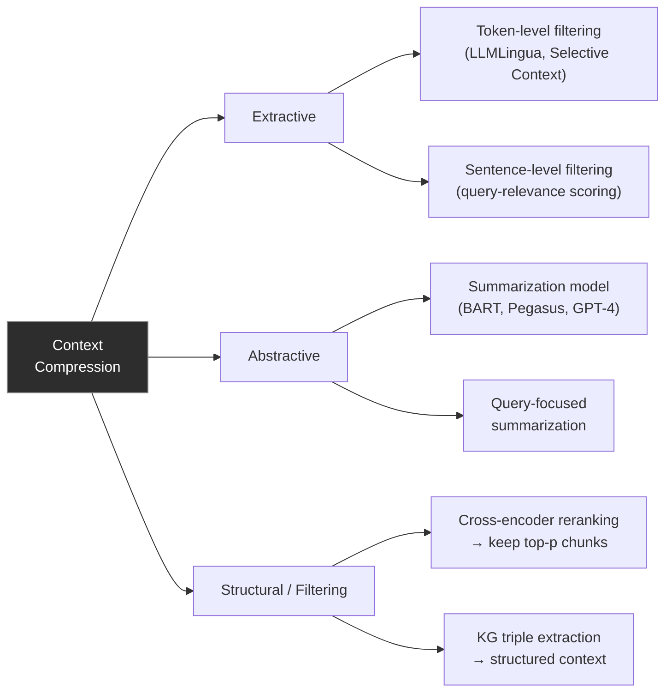
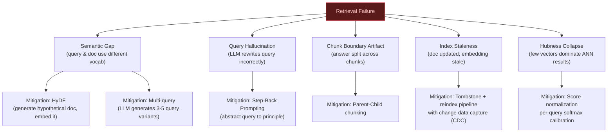
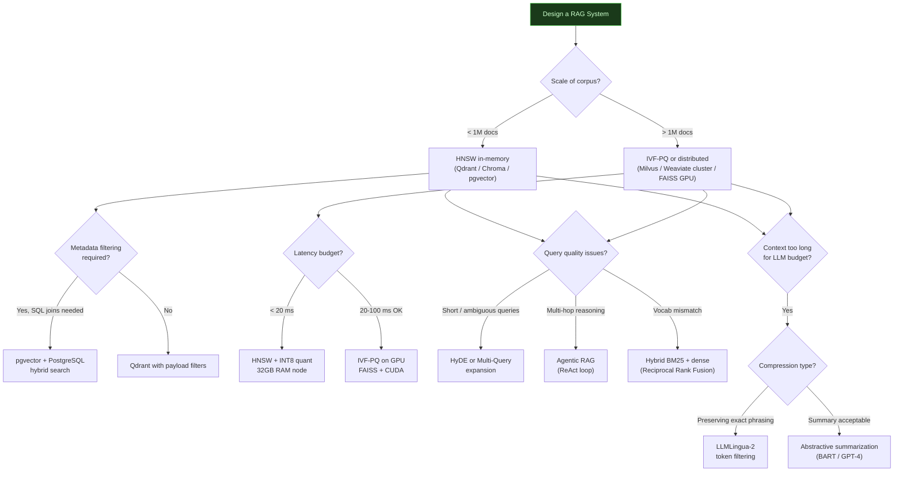

# Lesson 4: Retrieval-Augmented Generation — Architecture, Compression, and Production Engineering

---

## 1. First-Principles Foundations

### 1.1 Why RAG Exists: The Parametric Memory Problem

A large language model (LLM) encodes world knowledge into its weights during training. This parametric memory has three fundamental failure modes:

1. **Staleness**: weights are frozen at training cutoff; real-world facts change.
2. **Hallucination under pressure**: when a query falls outside the training distribution, the model interpolates plausibly but incorrectly.
3. **Capacity dilution**: as the model is trained on more domains, any single domain receives proportionally fewer gradient updates, degrading recall precision.

RAG resolves these by externalizing factual memory into a mutable, queryable corpus. The LLM retains its role as a reasoning and language engine; ground truth lives in the retrieval index. This separation of concerns is the architectural invariant that makes RAG both correct and maintainable.

### 1.2 The Formal Retrieval-Generation Pipeline

Let $\mathcal{D} = \{d_1, d_2, \ldots, d_N\}$ be a corpus of $N$ documents. Each document is embedded as a dense vector $\mathbf{v}_i \in \mathbb{R}^m$ via an encoder $\phi: \mathcal{D} \to \mathbb{R}^m$.

Given a query $q$, the retrieval function selects the top-$k$ documents by similarity:

$$R(q, \mathcal{D}, k) = \underset{d_i \in \mathcal{D}}{\operatorname{top-}k} \; \text{sim}\!\left(\phi(q),\, \phi(d_i)\right)$$

where the similarity metric is most commonly the cosine similarity:

$$\text{sim}(\mathbf{u}, \mathbf{v}) = \frac{\mathbf{u} \cdot \mathbf{v}}{\|\mathbf{u}\|\,\|\mathbf{v}\|}$$

or the negative L2 distance for metrics spaces where Euclidean geometry is well-calibrated (e.g., after whitening).

The generator $G$ then conditions on both the query and the retrieved context:

$$\hat{y} = G\!\left(q,\; R(q, \mathcal{D}, k)\right)$$

In the original Fusion-in-Decoder (FiD) architecture (Izacard & Grave, 2020), each retrieved passage is independently encoded and the decoder attends over the concatenated encoder states. This is distinct from naive prompt stuffing, which concatenates all passages in the prompt directly and pays $O(k \cdot l)$ attention cost where $l$ is passage length.

### 1.3 Vector Space Geometry and Embedding Invariants

The embedding space must satisfy several properties for retrieval to be meaningful:

**Alignment**: query embeddings and document embeddings must live in the same metric space. Bi-encoder models (e.g., DPR, Contriever, E5) are trained with in-batch negatives to enforce this. Cross-encoders rerank pairs but cannot pre-index — they are $O(N)$ at query time and unsuitable as first-stage retrievers.

**Isotropy**: raw transformer embeddings are anisotropic — they cluster in a narrow cone of the embedding space (Ethayarajh, 2019). This compresses the effective capacity of the index. Post-hoc whitening or contrastive fine-tuning corrects this.

**Hubness**: in high dimensions, certain vectors become universal nearest neighbors (hubs) due to the curse of dimensionality. Hubness corrupts retrieval recall. Mitigation strategies include cross-modal score normalization and query-side temperature calibration.

---

## 2. Full System Architecture

### 2.1 End-to-End Pipeline



### 2.2 Chunking Strategy: The Most Under-Engineered Step

Chunking is not trivial. The granularity of chunks directly determines retrieval precision and generation coherence. The key tradeoffs:

| Strategy | Mechanism | Best For | Risk |
|---|---|---|---|
| Fixed-size (token window) | Split at N tokens with overlap | Homogeneous text corpora | Breaks semantic units |
| Sentence-boundary | Split on `.`, `?`, `!` with NLTK/spaCy | General prose | Loses multi-sentence context |
| Semantic chunking | Embed sentences, split on cosine drop | Heterogeneous documents | Compute overhead |
| Hierarchical (parent-child) | Store sentence-level and paragraph-level | Complex reasoning tasks | Index size doubles |
| Late chunking | Embed full document, then pool sub-spans | Long document models | Requires model support |

The **parent-child (hierarchical) strategy** is the most robust in production: child chunks (small, ~128 tokens) are retrieved for precision; parent chunks (~512 tokens) are passed to the generator for coherent context. This is the approach used in LlamaIndex's `HierarchicalNodeParser`.

### 2.3 Vector Index Internals: HNSW vs. IVF-PQ

#### HNSW (Hierarchical Navigable Small World)

HNSW (Malkov & Yashunin, 2018) constructs a multi-layer proximity graph. The top layer is sparse with long-range links; each descending layer is denser with shorter links. Query traversal starts at the top layer and greedily descends, achieving approximate nearest neighbor (ANN) search in $O(\log N)$ expected time.

Key parameters:
- `M`: number of bidirectional links per node. Higher M → better recall, higher memory and build time.
- `ef_construction`: size of the dynamic candidate list during build. Higher → better graph quality, slower build.
- `ef_search`: size of the candidate set during search. The primary recall/latency knob at query time.

Memory footprint: $O(N \cdot M \cdot d)$ bytes where $d$ is the vector dimension. A 10M-vector HNSW index with `M=16`, `d=768` (float32) consumes roughly **~5 GB**.

#### IVF-PQ (Inverted File Index + Product Quantization)

IVF partitions the vector space into `nlist` Voronoi cells via k-means. At query time, only `nprobe` cells are searched. Product Quantization (PQ) sub-divides each vector into $m$ sub-vectors, each quantized to one of $k^*=256$ centroids (1 byte). This achieves ~32x compression for `d=768`.

The asymmetric distance computation (ADC) reconstructs the full distance from the quantized code without decompressing: $\hat{d}(\mathbf{q}, \mathbf{v}) = \sum_{j=1}^{m} d\!\left(\mathbf{q}_j,\, c_{j, \text{code}[j]}\right)^2$ using precomputed lookup tables.

**Production guidance**: HNSW for latency-sensitive workloads with memory budget; IVF-PQ for billion-scale indexes where RAM is the constraint. FAISS supports both. Qdrant, Weaviate, and Milvus expose HNSW as the default with optional quantization.

---

## 3. Context Compression: Why and How

### 3.1 The Context Window is a Bottleneck

LLM inference cost scales quadratically with context length under full self-attention: $O(n^2 d)$ for sequence length $n$ and model dimension $d$. Beyond compute, empirical work (Liu et al., 2023, "Lost in the Middle") demonstrates that LLMs systematically under-attend to information placed in the middle of long contexts, with strong primacy and recency biases. Stuffing 20 retrieved passages verbatim into the prompt is not only expensive — it actively degrades answer quality.

Context compression reduces the tokens passed to the generator while preserving the information the generator actually needs. This is distinct from embedding-space compression.

### 3.2 Compression Taxonomy



### 3.3 LLMLingua: Token-Level Compression

LLMLingua (Jiang et al., 2023) uses a small proxy LLM (e.g., LLaMA-7B) to score the perplexity of each token in the retrieved context conditioned on the query. Tokens with low conditional perplexity (highly predictable from surrounding context) are dropped. The budget constraint is:

$$\max_{\hat{C} \subseteq C,\, |\hat{C}| \leq \tau} \log P_{\text{small}}\!\left(\hat{C} \mid q\right)$$

where $C$ is the original context, $\hat{C}$ is the compressed context, and $\tau$ is the token budget. LLMLingua-2 (2024) reframes this as a token classification task with a smaller encoder model, removing the need for autoregressive scoring.

Empirically, LLMLingua achieves 2–5x compression with less than 2% degradation on downstream QA benchmarks (NaturalQuestions, TriviaQA) at 50% compression rate.

### 3.4 Embedding-Space Compression: Matryoshka Representation Learning

Matryoshka Representation Learning (MRL, Kusupati et al., 2022) trains a single embedding model to produce representations that are useful at any prefix dimension $d' \leq d$. The loss is a weighted sum across nested dimensionalities:

$$\mathcal{L}_\text{MRL} = \sum_{j \in \mathcal{M}} c_j \cdot \mathcal{L}^{(j)}\!\left(\mathbf{v}_{[1:j]}\right)$$

where $\mathcal{M} = \{8, 16, 32, 64, 128, 256, 512, 1024\}$ and $c_j$ are importance weights. The first $j$ dimensions of the embedding are therefore a valid embedding at dimension $j$. This enables a two-stage retrieval: use $d'=64$ for fast ANN candidate generation, then rerank with the full $d=1024$ representation. OpenAI's `text-embedding-3-small` and `text-embedding-3-large` both implement MRL natively via their `dimensions` parameter.

### 3.5 Product Quantization as a Compression Primitive

For billion-scale indexes, uncompressed float32 vectors are infeasible in RAM. PQ compresses a $d$-dimensional float32 vector (e.g., 4 bytes × 768 = 3072 bytes) to $m$ bytes (e.g., 16 bytes at $m=16, k^*=256$) — a 192x reduction.

The quantization error $\epsilon$ for PQ with $m$ sub-vectors is bounded by:

$$\mathbb{E}\!\left[\|\mathbf{v} - \hat{\mathbf{v}}\|^2\right] \leq \frac{d}{m} \cdot \sigma^2_\text{residual}$$

where $\sigma^2_\text{residual}$ is the within-cluster variance of the sub-vector quantizer. Increasing $m$ reduces error at the cost of more bytes per vector and more memory for lookup tables.

**Scalar quantization (SQ8, INT8)** is a simpler alternative: quantize each dimension independently to 8-bit integers. This yields 4x compression with near-lossless recall for most embedding distributions and is supported by FAISS, Qdrant, and pgvector (via `halfvec`).

---

## 4. Production-Grade Implementation

### 4.1 Offline Indexing Pipeline (Python)

```python
"""
Production RAG indexing pipeline.
Dependencies: langchain-text-splitters, sentence-transformers, qdrant-client, tqdm
"""

from __future__ import annotations

import hashlib
import json
import logging
from dataclasses import dataclass, field
from pathlib import Path
from typing import Generator, Iterable

import numpy as np
from qdrant_client import QdrantClient
from qdrant_client.models import (
    Distance,
    PointStruct,
    VectorParams,
    HnswConfigDiff,
    OptimizersConfigDiff,
    ScalarQuantizationConfig,
    ScalarType,
    QuantizationConfig,
    ScalarQuantization,
)
from sentence_transformers import SentenceTransformer
from langchain_text_splitters import RecursiveCharacterTextSplitter

logger = logging.getLogger(__name__)

COLLECTION_NAME = "rag_corpus"
EMBEDDING_MODEL = "intfloat/e5-large-v2"  # 1024-dim, MRL-compatible
EMBED_DIM = 1024
CHILD_CHUNK_SIZE = 256   # tokens (approximate via chars * 0.75)
PARENT_CHUNK_SIZE = 1024
CHILD_OVERLAP = 32
BATCH_SIZE = 128


@dataclass
class Document:
    doc_id: str
    text: str
    source: str
    metadata: dict = field(default_factory=dict)


def content_hash(text: str) -> str:
    return hashlib.sha256(text.encode()).hexdigest()[:16]


def chunk_document(doc: Document) -> list[dict]:
    """
    Hierarchical chunking: generate child chunks with parent context stored
    in metadata. The generator receives the parent; retrieval targets the child.
    """
    parent_splitter = RecursiveCharacterTextSplitter(
        chunk_size=PARENT_CHUNK_SIZE * 4,  # chars ≈ tokens * 4
        chunk_overlap=128,
    )
    child_splitter = RecursiveCharacterTextSplitter(
        chunk_size=CHILD_CHUNK_SIZE * 4,
        chunk_overlap=CHILD_OVERLAP * 4,
    )

    parent_chunks = parent_splitter.split_text(doc.text)
    records: list[dict] = []

    for p_idx, parent_text in enumerate(parent_chunks):
        parent_id = f"{doc.doc_id}::p{p_idx}"
        child_chunks = child_splitter.split_text(parent_text)

        for c_idx, child_text in enumerate(child_chunks):
            chunk_id = f"{parent_id}::c{c_idx}"
            records.append({
                "chunk_id": chunk_id,
                "parent_id": parent_id,
                "doc_id": doc.doc_id,
                "source": doc.source,
                "child_text": child_text,       # embedded & retrieved
                "parent_text": parent_text,     # passed to generator
                "metadata": doc.metadata,
                "content_hash": content_hash(child_text),
            })

    return records


def batched(iterable: Iterable, n: int) -> Generator:
    batch = []
    for item in iterable:
        batch.append(item)
        if len(batch) == n:
            yield batch
            batch = []
    if batch:
        yield batch


def build_index(documents: list[Document], qdrant_url: str = "http://localhost:6333") -> None:
    client = QdrantClient(url=qdrant_url, timeout=60)
    model = SentenceTransformer(EMBEDDING_MODEL)

    # Create collection with HNSW and INT8 scalar quantization
    if client.collection_exists(COLLECTION_NAME):
        logger.warning("Collection %s already exists — skipping creation.", COLLECTION_NAME)
    else:
        client.create_collection(
            collection_name=COLLECTION_NAME,
            vectors_config=VectorParams(
                size=EMBED_DIM,
                distance=Distance.COSINE,
            ),
            hnsw_config=HnswConfigDiff(
                m=16,
                ef_construct=200,
                full_scan_threshold=10_000,
            ),
            quantization_config=QuantizationConfig(
                scalar=ScalarQuantization(
                    scalar=ScalarQuantizationConfig(
                        type=ScalarType.INT8,
                        quantile=0.99,   # clip outlier dimensions
                        always_ram=True, # keep quantized vectors in RAM
                    )
                )
            ),
            optimizers_config=OptimizersConfigDiff(
                indexing_threshold=20_000,  # defer HNSW build until warm
            ),
        )
        logger.info("Created collection %s", COLLECTION_NAME)

    # Chunk and embed
    all_records = []
    for doc in documents:
        all_records.extend(chunk_document(doc))

    logger.info("Total chunks: %d", len(all_records))

    for batch in batched(all_records, BATCH_SIZE):
        # E5 models require "passage: " prefix for document embeddings
        texts = [f"passage: {r['child_text']}" for r in batch]
        embeddings: np.ndarray = model.encode(
            texts,
            batch_size=BATCH_SIZE,
            normalize_embeddings=True,
            show_progress_bar=False,
        )

        points = [
            PointStruct(
                id=content_hash(r["chunk_id"]),  # deterministic UUID-safe ID
                vector=embeddings[i].tolist(),
                payload={
                    "chunk_id": r["chunk_id"],
                    "parent_text": r["parent_text"],  # context for generation
                    "source": r["source"],
                    "doc_id": r["doc_id"],
                    "metadata": r["metadata"],
                },
            )
            for i, r in enumerate(batch)
        ]

        client.upsert(collection_name=COLLECTION_NAME, points=points)

    logger.info("Indexing complete.")
```

### 4.2 Online Query Pipeline with Compression (Python)

```python
"""
Online RAG query pipeline with LLMLingua-style token budget enforcement
and cross-encoder reranking.

Dependencies: sentence-transformers, qdrant-client, openai, llmlingua
"""

from __future__ import annotations

import os
from typing import NamedTuple

from openai import OpenAI
from qdrant_client import QdrantClient
from qdrant_client.models import SearchParams
from sentence_transformers import SentenceTransformer, CrossEncoder

# LLMLingua: https://github.com/microsoft/LLMLingua
from llmlingua import PromptCompressor


COLLECTION_NAME = "rag_corpus"
EMBEDDING_MODEL = "intfloat/e5-large-v2"
RERANK_MODEL = "cross-encoder/ms-marco-MiniLM-L-6-v2"
COMPRESSOR_MODEL = "microsoft/llmlingua-2-xlm-roberta-large-meeting"

TOP_K_RETRIEVAL = 20       # ANN candidate pool
TOP_K_RERANK = 5           # passages after cross-encoder reranking
TOKEN_BUDGET_RATIO = 0.5   # compress context to 50% of original tokens


class RetrievedPassage(NamedTuple):
    text: str
    source: str
    score: float


def retrieve(
    query: str,
    client: QdrantClient,
    model: SentenceTransformer,
    top_k: int = TOP_K_RETRIEVAL,
) -> list[RetrievedPassage]:
    # E5 models require "query: " prefix for query embeddings
    query_vec = model.encode(f"query: {query}", normalize_embeddings=True).tolist()

    results = client.search(
        collection_name=COLLECTION_NAME,
        query_vector=query_vec,
        limit=top_k,
        search_params=SearchParams(
            hnsw_ef=128,         # higher ef → better recall at cost of latency
            exact=False,         # use ANN; set True only for correctness auditing
        ),
        with_payload=True,
    )

    return [
        RetrievedPassage(
            text=hit.payload["parent_text"],
            source=hit.payload["source"],
            score=hit.score,
        )
        for hit in results
    ]


def rerank(
    query: str,
    passages: list[RetrievedPassage],
    reranker: CrossEncoder,
    top_k: int = TOP_K_RERANK,
) -> list[RetrievedPassage]:
    pairs = [(query, p.text) for p in passages]
    scores = reranker.predict(pairs, show_progress_bar=False)

    ranked = sorted(zip(scores, passages), key=lambda x: x[0], reverse=True)
    return [p for _, p in ranked[:top_k]]


def compress_context(
    query: str,
    passages: list[RetrievedPassage],
    compressor: PromptCompressor,
    token_budget_ratio: float = TOKEN_BUDGET_RATIO,
) -> str:
    """
    Apply LLMLingua-2 token-level compression to the concatenated context.
    Returns the compressed context string.
    """
    context_texts = [p.text for p in passages]
    result = compressor.compress_prompt(
        context_texts,
        question=query,
        rate=token_budget_ratio,
        force_tokens=["\n", ".", "?", "!"],  # never drop sentence boundaries
    )
    return result["compressed_prompt"]


def generate_answer(
    query: str,
    compressed_context: str,
    llm_client: OpenAI,
    model: str = "gpt-4o",
) -> str:
    system_prompt = (
        "You are a precise question-answering assistant. "
        "Answer the question using ONLY the provided context. "
        "If the context does not contain the answer, say 'I don't know.' "
        "Do not fabricate information."
    )
    user_prompt = f"""Context:
{compressed_context}

Question: {query}

Answer:"""

    response = llm_client.chat.completions.create(
        model=model,
        messages=[
            {"role": "system", "content": system_prompt},
            {"role": "user", "content": user_prompt},
        ],
        temperature=0.0,   # deterministic for factual QA
        max_tokens=512,
    )
    return response.choices[0].message.content


def rag_query(query: str) -> str:
    qdrant = QdrantClient(url="http://localhost:6333")
    embed_model = SentenceTransformer(EMBEDDING_MODEL)
    rerank_model = CrossEncoder(RERANK_MODEL)
    compressor = PromptCompressor(
        model_name=COMPRESSOR_MODEL,
        use_llmlingua2=True,
        device_map="auto",
    )
    llm = OpenAI(api_key=os.environ["OPENAI_API_KEY"])

    # Stage 1: ANN retrieval
    candidates = retrieve(query, qdrant, embed_model)

    # Stage 2: Cross-encoder reranking
    top_passages = rerank(query, candidates, rerank_model)

    # Stage 3: Token-level context compression
    compressed = compress_context(query, top_passages, compressor)

    # Stage 4: Grounded generation
    return generate_answer(query, compressed, llm)
```

### 4.3 High-Performance ANN Search in Rust (via `usearch`)

For latency-critical serving paths where Python GIL overhead is unacceptable, `usearch` provides a Rust-native HNSW implementation callable from C/Python FFI.

```rust
// Cargo.toml: usearch = "2"
use usearch::{Index, IndexOptions, MetricKind, ScalarKind};

fn build_hnsw_index(
    embeddings: &[Vec<f32>],
    dimensions: usize,
) -> Result<Index, Box<dyn std::error::Error>> {
    let options = IndexOptions {
        dimensions,
        metric: MetricKind::Cos,     // cosine distance
        quantization: ScalarKind::F16, // half-precision storage: 2x memory reduction
        connectivity: 16,             // M parameter
        expansion_add: 200,           // ef_construction
        expansion_search: 128,        // ef_search default
        ..Default::default()
    };

    let index = Index::new(&options)?;
    index.reserve(embeddings.len())?;

    for (id, vec) in embeddings.iter().enumerate() {
        index.add(id as u64, vec)?;
    }

    Ok(index)
}

fn search_index(
    index: &Index,
    query: &[f32],
    top_k: usize,
) -> Result<Vec<(u64, f32)>, Box<dyn std::error::Error>> {
    let results = index.search(query, top_k)?;
    // results.keys: document IDs, results.distances: similarity scores
    Ok(results
        .keys
        .iter()
        .zip(results.distances.iter())
        .map(|(&k, &d)| (k, d))
        .collect())
}
```

### 4.4 Approximate Nearest Neighbor with IVF-PQ via FAISS (C API)

```c
/*
 * Minimal FAISS IVF-PQ index in C using the FAISS C bindings.
 * Compile: gcc -O3 -o faiss_ivfpq faiss_ivfpq.c -lfaiss_c
 *
 * Index string "IVF4096,PQ64" means:
 *   - 4096 Voronoi cells (nlist)
 *   - 64 PQ sub-vectors → 64 bytes per vector (vs 3072 for float32 d=768)
 */

#include <faiss/c_api/faiss_c.h>
#include <faiss/c_api/Index_c.h>
#include <faiss/c_api/index_factory_c.h>
#include <stdio.h>
#include <stdlib.h>

#define D       768     /* embedding dimension */
#define N_TRAIN 500000  /* training vectors (must be >> nlist * 39) */
#define N_INDEX 1000000
#define NPROBE  64      /* cells to search at query time */
#define TOP_K   10

int main(void) {
    FaissIndex *index = NULL;
    int ret;

    /* Build IVF-PQ index */
    ret = faiss_index_factory(&index, D, "IVF4096,PQ64", METRIC_INNER_PRODUCT);
    if (ret != 0) { fprintf(stderr, "Factory failed\n"); return 1; }

    /* Allocate and populate training vectors (gaussian random for demo) */
    float *train_vecs = malloc(N_TRAIN * D * sizeof(float));
    if (!train_vecs) { return 1; }
    for (int i = 0; i < N_TRAIN * D; i++) {
        train_vecs[i] = (float)rand() / RAND_MAX;
    }

    /* Train the quantizer (k-means on training set) */
    ret = faiss_Index_train(index, N_TRAIN, train_vecs);
    if (ret != 0) { fprintf(stderr, "Training failed\n"); return 1; }
    free(train_vecs);

    /* Set nprobe before searching (can be changed per-query) */
    FaissIndexIVF *ivf_index = (FaissIndexIVF *)index;
    faiss_IndexIVF_set_nprobe(ivf_index, NPROBE);

    /* Index and search omitted for brevity — same pattern as above */

    faiss_Index_free(index);
    return 0;
}
```

### 4.5 pgvector for Relational + Vector Hybrid Search

For workloads where filtering by metadata (e.g., `source_date > '2024-01-01'` AND nearest neighbor) is required, a hybrid SQL + vector approach avoids a separate vector database:

```sql
-- Enable pgvector extension
CREATE EXTENSION IF NOT EXISTS vector;

-- Schema: documents with vector column
CREATE TABLE rag_chunks (
    id          BIGSERIAL PRIMARY KEY,
    doc_id      TEXT NOT NULL,
    source      TEXT NOT NULL,
    chunk_text  TEXT NOT NULL,
    parent_text TEXT NOT NULL,
    source_date DATE,
    embedding   vector(1024)   -- matches E5-large-v2 output dim
);

-- HNSW index on the embedding column (pgvector >= 0.5.0)
CREATE INDEX ON rag_chunks USING hnsw (embedding vector_cosine_ops)
    WITH (m = 16, ef_construction = 200);

-- Partial index for recent documents only (reduces index size)
CREATE INDEX ON rag_chunks USING hnsw (embedding vector_cosine_ops)
    WITH (m = 16, ef_construction = 200)
    WHERE source_date >= '2024-01-01';

-- Hybrid query: ANN search filtered by metadata
-- Note: pre-filter runs first, then ANN on the filtered subset
SET hnsw.ef_search = 128;

SELECT
    id,
    source,
    parent_text,
    1 - (embedding <=> $1::vector) AS cosine_similarity
FROM rag_chunks
WHERE source_date >= '2024-01-01'
  AND source = 'internal_docs'
ORDER BY embedding <=> $1::vector  -- <=> is cosine distance operator
LIMIT 10;
```

> **Warning on pgvector pre-filtering**: When a `WHERE` clause dramatically reduces the candidate set (e.g., below `hnsw.ef_search`), the HNSW graph cannot navigate correctly and pgvector falls back to a sequential scan. For high-selectivity filters, use IVFFlat with `ivfflat.probes` tuning, or partition the table and use partition-level indexes.

---

## 5. Failure Modes and Mitigations

### 5.1 Retrieval Failure Taxonomy



### 5.2 HyDE: Hypothetical Document Embeddings

Standard bi-encoder retrieval embeds the query directly. Queries are typically short (5–15 tokens) and reside in a different region of the embedding space than the dense passages they should retrieve. HyDE (Gao et al., 2022) bridges this gap by using the LLM to generate a hypothetical document that would answer the query:

```python
def hyde_retrieve(
    query: str,
    llm_client: OpenAI,
    embed_model: SentenceTransformer,
    qdrant: QdrantClient,
    top_k: int = 10,
) -> list[RetrievedPassage]:
    """
    Generate a hypothetical answer, embed it, retrieve using that embedding.
    The hypothetical document need not be factually correct — it only needs to
    occupy the same embedding region as the real answer.
    """
    hyp_response = llm_client.chat.completions.create(
        model="gpt-4o-mini",
        messages=[
            {
                "role": "user",
                "content": (
                    f"Write a concise factual passage that directly answers "
                    f"the following question. Do not add disclaimers.\n\nQuestion: {query}"
                ),
            }
        ],
        max_tokens=256,
        temperature=0.0,
    )
    hypothetical_doc = hyp_response.choices[0].message.content

    # Embed the hypothetical document with the passage prefix
    hyp_vec = embed_model.encode(
        f"passage: {hypothetical_doc}", normalize_embeddings=True
    ).tolist()

    results = qdrant.search(
        collection_name=COLLECTION_NAME,
        query_vector=hyp_vec,
        limit=top_k,
        with_payload=True,
    )
    return [
        RetrievedPassage(
            text=hit.payload["parent_text"],
            source=hit.payload["source"],
            score=hit.score,
        )
        for hit in results
    ]
```

### 5.3 Retrieval Evaluation: RAGAS Metrics

Retrieval quality cannot be assessed by answer quality alone — the pipeline has two independently-failing components. The RAGAS framework (Es et al., 2023) defines four metrics computed without human labels:

| Metric | Measures | Computation |
|---|---|---|
| **Context Precision** | Are retrieved chunks relevant? | LLM-scored relevance of each chunk to the query |
| **Context Recall** | Are all necessary facts retrieved? | LLM checks whether ground-truth answer is supportable from retrieved context |
| **Faithfulness** | Does the answer stay grounded in context? | Decompose answer into claims; verify each claim against context |
| **Answer Relevancy** | Does the answer address the question? | Reverse-generate questions from the answer; embed similarity to original query |

```python
from ragas import evaluate
from ragas.metrics import faithfulness, answer_relevancy, context_precision, context_recall
from datasets import Dataset

eval_data = {
    "question": ["What is the capital of France?"],
    "answer": ["Paris is the capital of France."],
    "contexts": [["Paris is the capital and most populous city of France."]],
    "ground_truth": ["Paris"],
}

result = evaluate(
    Dataset.from_dict(eval_data),
    metrics=[faithfulness, answer_relevancy, context_precision, context_recall],
)
print(result)
```

### 5.4 Scalability: Approximate vs. Exact Tradeoffs

| Scale | Index Type | Hardware | p99 Latency | Recall@10 |
|---|---|---|---|---|
| < 1M vectors | HNSW (in-memory) | 8 GB RAM | < 2 ms | 0.98 |
| 1M–100M vectors | HNSW + INT8 quant | 32 GB RAM | < 10 ms | 0.96 |
| 100M–1B vectors | IVF-PQ (FAISS) | 128 GB RAM or GPU | 20–80 ms | 0.90–0.94 |
| > 1B vectors | Distributed (ScaNN, Milvus cluster) | Multi-node | 50–200 ms | 0.88–0.93 |

Recall figures assume tuned `ef_search`/`nprobe` for HNSW/IVF respectively and are consistent with published FAISS and Qdrant benchmarks on ANN-benchmarks.com.

---

## 6. Advanced Architectures

### 6.1 Self-RAG: Adaptive Retrieval with Reflection Tokens

Standard RAG always retrieves, even when the LLM's parametric knowledge suffices. Self-RAG (Asai et al., 2023) trains the generator to emit special **reflection tokens** that control retrieval and assess its own outputs:

- `[Retrieve]` / `[No Retrieve]`: should a retrieval call be issued?
- `[IsRel]` / `[IsNotRel]`: is the retrieved passage relevant?
- `[IsSup]` / `[IsPartSup]` / `[IsNotSup]`: is the generated sentence supported by the passage?
- `[IsUse]` / `[IsNotUse]`: is the overall response useful?

The model is fine-tuned with these tokens in the training data. At inference, it performs beam search over multiple retrieval/no-retrieval branches and selects the highest-scoring generation. This yields a 5–10% improvement on knowledge-intensive tasks over standard RAG with a 15–30% reduction in unnecessary retrieval calls.

### 6.2 CRAG: Corrective RAG

CRAG (Yan et al., 2024) adds an evaluator module that scores the retrieved documents' relevance. If the top document scores below a confidence threshold, CRAG triggers a **web search** (via a search API) as a fallback, then applies a decompose-then-recompose knowledge refinement step before generation. The key contribution is the **knowledge refinement** step: retrieved documents are decomposed into fine-grained knowledge strips (sentence-level), irrelevant strips are filtered, and remaining strips are recomposed.

### 6.3 Agentic RAG: Tool-Using Retrieval

For multi-hop questions where a single retrieval pass is insufficient, the LLM acts as a ReAct agent (Yao et al., 2022), iteratively calling retrieval tools based on intermediate reasoning:

```
Query: "Who directed the film starring the actor born in the same city as Marie Curie?"
Step 1 → [retrieve("Marie Curie birthplace")] → Warsaw
Step 2 → [retrieve("famous actors born in Warsaw")] → ...
Step 3 → [retrieve("films directed by X starring Y")] → answer
```

This requires a tool-use capable LLM (GPT-4o, Claude 3.5, Llama 3.1 with function calling) and careful loop termination logic to prevent infinite retrieval chains. Maximum step budgets (typically 5–8) and intermediate answer caching are standard mitigations.

---

## 7. Summary of Design Decisions



The core invariant throughout all these architectural choices remains unchanged: **retrieval provides factual grounding; compression preserves the information density of that grounding within the generator's attention budget; and the generator's role is strictly reasoning and language, not fact storage.**

---

## References

- Lewis, P. et al. (2020). Retrieval-Augmented Generation for Knowledge-Intensive NLP Tasks. *NeurIPS 2020*.
- Izacard, G. & Grave, E. (2020). Leveraging Passage Retrieval with Generative Models for Open Domain Question Answering. *EACL 2021*.
- Malkov, Y. A. & Yashunin, D. A. (2018). Efficient and Robust Approximate Nearest Neighbor Search Using Hierarchical Navigable Small World Graphs. *IEEE TPAMI*.
- Kusupati, A. et al. (2022). Matryoshka Representation Learning. *NeurIPS 2022*.
- Jiang, H. et al. (2023). LLMLingua: Compressing Prompts for Accelerated Inference of Large Language Models. *EMNLP 2023*.
- Gao, L. et al. (2022). Precise Zero-Shot Dense Retrieval without Relevance Labels. *ACL 2023* (HyDE).
- Asai, A. et al. (2023). Self-RAG: Learning to Retrieve, Generate, and Critique through Self-Reflection. *ICLR 2024*.
- Yan, S. et al. (2024). Corrective Retrieval Augmented Generation (CRAG). *arXiv:2401.15884*.
- Es, S. et al. (2023). RAGAS: Automated Evaluation of Retrieval Augmented Generation. *arXiv:2309.15217*.
- Ethayarajh, K. (2019). How Contextual are Contextualized Word Representations? *EMNLP 2019*.
- Liu, N. F. et al. (2023). Lost in the Middle: How Language Models Use Long Contexts. *TACL 2024*.
