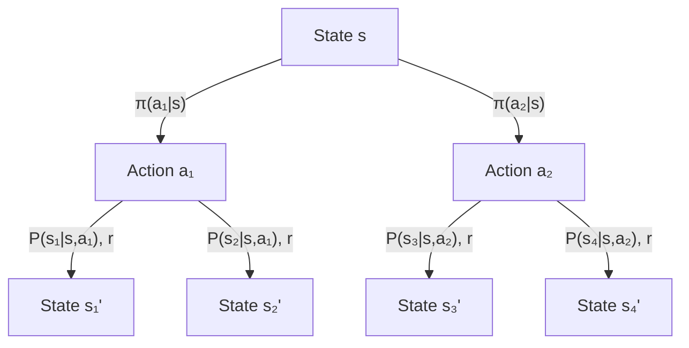

# Lesson 1: Markov Decision Processes, Value Functions, and Bellman Equations

---

## 1. First-Principles Intuition & Invariants

Every intelligent agent that acts over time faces the same fundamental tension: the consequences of a decision are rarely confined to the moment of that decision. A chess engine sacrificing a bishop in move twelve does not receive its reward until checkmate or resignation, perhaps forty moves later. A datacenter cooling controller that reduces fan speed to save energy may cause a thermal cascade that destroys hardware three minutes hence. A drug dosing policy that aggressively treats a patient today may exhaust the patient's physiological resilience tomorrow. In each case, the agent must somehow assign credit or blame for outcomes back across time to the decisions that caused them. This temporal credit assignment problem is the central engine of reinforcement learning, and the Markov Decision Process is its precise formal language.

The MDP did not arrive fully formed. Its lineage runs through Richard Bellman's work on dynamic programming at RAND Corporation in the 1950s, through the stochastic control literature of the 1960s and 1970s, and into the connectionist RL revival catalyzed by Sutton and Barto's seminal work in the 1980s and 1990s. What makes the MDP so enduring is not sophistication but precision: it identifies exactly the information an agent needs at each decision point, no more and no less, and it makes explicit what "optimal" means in the face of uncertainty and time.

A finite MDP is defined by a tuple $(\mathcal{S}, \mathcal{A}, P, R, \gamma)$. The state space $\mathcal{S}$ is the set of all situations the environment can be in. The action space $\mathcal{A}$ is the set of interventions available to the agent. The transition kernel $P : \mathcal{S} \times \mathcal{A} \times \mathcal{S} \to [0, 1]$ specifies the probability $P(s' \mid s, a)$ of landing in state $s'$ when the agent takes action $a$ in state $s$. The reward function $R : \mathcal{S} \times \mathcal{A} \to \mathbb{R}$ specifies the expected immediate signal received after that transition. The discount factor $\gamma \in [0, 1)$ encodes how much the agent values future rewards relative to immediate ones.

The Markov property is the load-bearing assumption of this entire framework. It asserts that the transition distribution $P(s_{t+1} \mid s_t, a_t)$ depends only on the current state and current action, not on any prior history $s_0, a_0, \ldots, s_{t-1}, a_{t-1}$. The state $s_t$ must therefore encode everything about the past that is relevant to predicting the future. This is not a claim about the real world—the real world is emphatically non-Markov—but a claim about what the engineer chooses to include in the state representation. Building a sufficient state representation is one of the most consequential design decisions in applied RL, and violations of the Markov property are among the most common sources of training instability in production systems.

The agent's behavior is formalized as a policy $\pi : \mathcal{S} \to \Delta(\mathcal{A})$, a mapping from states to probability distributions over actions. A deterministic policy $\pi(s) = a$ is a special case. The agent's interaction with the environment generates a trajectory $\tau = (s_0, a_0, r_0, s_1, a_1, r_1, \ldots)$, and the return $G_t$ from time step $t$ is defined as the discounted cumulative reward from that point forward:

$$G_t = \sum_{k=0}^{\infty} \gamma^k r_{t+k+1}$$

The discount factor $\gamma$ does far more than prevent the sum from diverging in continuing tasks. It encodes the agent's time preference. When $\gamma \to 0$, the agent becomes myopic, caring only about the next reward. When $\gamma \to 1$, the agent becomes fully far-sighted. In practice, $\gamma = 0.99$ is common in robotics and game-playing tasks where delayed consequences matter deeply, while $\gamma = 0.9$ or lower is used in episodic tasks with relatively short horizons. This single scalar has profound effects on the landscape of the optimization problem: a high $\gamma$ lengthens the effective time horizon, increasing the variance of gradient estimates and slowing convergence.

The objective of reinforcement learning is to find a policy $\pi^*$ that maximizes the expected return from every starting state. This objective is decomposed into the two value functions that sit at the mathematical heart of all RL algorithms. The state-value function $V^\pi(s)$ is the expected return when starting in state $s$ and following policy $\pi$ thereafter:

$$V^\pi(s) = \mathbb{E}_\pi \left[ G_t \mid s_t = s \right] = \mathbb{E}_\pi \left[ \sum_{k=0}^{\infty} \gamma^k r_{t+k+1} \mid s_t = s \right]$$

The action-value function $Q^\pi(s, a)$—universally called the Q-function—is the expected return when starting in state $s$, taking action $a$, and following policy $\pi$ thereafter:

$$Q^\pi(s, a) = \mathbb{E}_\pi \left[ G_t \mid s_t = s, a_t = a \right]$$

The relationship between these two functions is immediate and important: $V^\pi(s) = \sum_{a} \pi(a \mid s) Q^\pi(s, a)$. The state-value function is the policy-weighted average of the Q-function over all actions. This relationship means that if you have a good estimate of $Q^\pi$, you can recover $V^\pi$ trivially, but not vice versa. The Q-function carries strictly more information because it tells you, action by action, how good each choice is from each state—which is exactly the information needed to improve a policy.

---

## 2. Core Architecture & Mechanics

### The Bellman Expectation Equations

The defining structural property of value functions is that they satisfy a recursive consistency condition. Because the return $G_t = r_{t+1} + \gamma G_{t+1}$, the value of a state under policy $\pi$ must equal the expected immediate reward plus the discounted value of the next state under the same policy. This is the Bellman expectation equation for $V^\pi$:

$$V^\pi(s) = \sum_{a} \pi(a \mid s) \sum_{s'} P(s' \mid s, a) \left[ R(s, a) + \gamma V^\pi(s') \right]$$

The same logic applied to the Q-function yields:

$$Q^\pi(s, a) = \sum_{s'} P(s' \mid s, a) \left[ R(s, a) + \gamma \sum_{a'} \pi(a' \mid s') Q^\pi(s', a') \right]$$

These are not merely definitional identities. They are simultaneous linear equations that the true value function must satisfy for every state. For a finite MDP with $|\mathcal{S}|$ states, the Bellman expectation equations form a system of $|\mathcal{S}|$ linear equations in $|\mathcal{S}|$ unknowns. Under the guarantee that $\gamma < 1$ (or that all policies terminate with probability one), this system has a unique solution, and that solution is the true value function $V^\pi$.

The backup diagram below captures the structural relationship encoded in the Bellman equation. Reading it correctly is essential: the agent stands at node $s$, selects action $a$ according to $\pi$, and the environment stochastically transitions to one of several possible next states $s'$.

```text
        s
        |
   π(a|s): action selection
       / \
      a1   a2
      |     |
  P(s'|s,a): transition
   /|    |\
  s1 s2  s3 s4
```



The Bellman backup is the operation of computing the right-hand side of the equation—constructing a one-step lookahead and using it to update the current value estimate. This operation is the primitive computation underlying every classical RL algorithm, from tabular value iteration to deep Q-networks. The backup is a contraction mapping under the sup-norm when $\gamma < 1$, which is the theoretical guarantee that iterated application converges to the true value function.

### The Bellman Optimality Equations

Policy evaluation—computing $V^\pi$ for a fixed $\pi$—is a prerequisite to policy improvement. The greedily improved policy $\pi'$ selects the action that maximizes the Q-function in every state:

$$\pi'(s) = \arg\max_{a} Q^\pi(s, a)$$

The policy improvement theorem guarantees that $V^{\pi'}(s) \geq V^\pi(s)$ for all $s$, with strict inequality whenever the greedy policy differs from $\pi$. When improvement produces no change—when the greedy policy is already the current policy—the policy is optimal. At that fixed point, the value function satisfies the Bellman optimality equations:

$$V^*(s) = \max_{a} \sum_{s'} P(s' \mid s, a) \left[ R(s, a) + \gamma V^*(s') \right]$$

$$Q^*(s, a) = \sum_{s'} P(s' \mid s, a) \left[ R(s, a) + \gamma \max_{a'} Q^*(s', a') \right]$$

The critical structural difference between the expectation and optimality equations is the replacement of the policy-weighted sum $\sum_a \pi(a|s)(\cdot)$ with the $\max_a(\cdot)$ operator. This introduces nonlinearity. The Bellman optimality equations are no longer a linear system; they are a fixed-point equation of a nonlinear operator. Nevertheless, the Bellman optimality operator $\mathcal{T}^*$ defined by the right-hand side of the $V^*$ equation is still a contraction mapping under the sup-norm with Lipschitz constant $\gamma$:

$$\|\mathcal{T}^* V - \mathcal{T}^* U\|_\infty \leq \gamma \|V - U\|_\infty$$

By Banach's fixed-point theorem, repeated application of $\mathcal{T}^*$ to any bounded initialization $V_0$ converges geometrically to $V^*$. This is the value iteration algorithm, and its convergence rate is determined entirely by $\gamma$: each iteration reduces the error by a factor of $\gamma$. The number of iterations required to reach $\epsilon$-accuracy from an initial error bound $B$ is $\lceil \log(\epsilon / B) / \log(\gamma) \rceil$, which grows without bound as $\gamma \to 1$.

### Tabular Implementation and the Policy Iteration Algorithm

For a concrete MDP with known transition dynamics, the full policy iteration algorithm alternates between exact policy evaluation and greedy policy improvement. The following Python implementation is complete, executable, and uses a canonical gridworld MDP to ground the mathematics in runnable code.

```python
import numpy as np
from typing import Dict, Tuple, List

# ---------------------------------------------------------------------------
# MDP Definition: 4x4 Gridworld
# States 0-14 are non-terminal; state 15 is the terminal goal.
# Actions: 0=UP, 1=DOWN, 2=LEFT, 3=RIGHT
# ---------------------------------------------------------------------------

N_STATES  = 16
N_ACTIONS = 4
GAMMA     = 0.99
THETA     = 1e-9   # convergence threshold for policy evaluation

def build_gridworld() -> Dict[int, Dict[int, List[Tuple[float, int, float, bool]]]]:
    """
    Returns the full transition model P[s][a] = [(prob, next_state, reward, done), ...]
    following the OpenAI Gym / Gymnasium convention for discrete environments.
    """
    grid_size = 4
    terminal  = 15

    def state_to_rc(s: int) -> Tuple[int, int]:
        return divmod(s, grid_size)

    def rc_to_state(r: int, c: int) -> int:
        return r * grid_size + c

    action_deltas = {0: (-1, 0), 1: (1, 0), 2: (0, -1), 3: (0, 1)}

    P: Dict[int, Dict[int, List[Tuple[float, int, float, bool]]]] = {}

    for s in range(N_STATES):
        P[s] = {}
        for a in range(N_ACTIONS):
            if s == terminal:
                P[s][a] = [(1.0, terminal, 0.0, True)]
                continue
            r, c     = state_to_rc(s)
            dr, dc   = action_deltas[a]
            nr, nc   = r + dr, c + dc
            # Walls: agent stays in place if move goes off-grid
            if 0 <= nr < grid_size and 0 <= nc < grid_size:
                ns = rc_to_state(nr, nc)
            else:
                ns = s
            done   = (ns == terminal)
            reward = 0.0 if done else -1.0
            P[s][a] = [(1.0, ns, reward, done)]

    return P


def policy_evaluation(
    policy: np.ndarray,
    P: Dict,
    gamma: float = GAMMA,
    theta: float = THETA
) -> np.ndarray:
    """
    Iterative policy evaluation (in-place synchronous sweep).
    policy[s] is the index of the deterministic action taken in state s.
    Returns V of shape (N_STATES,).
    """
    V = np.zeros(N_STATES, dtype=np.float64)

    while True:
        delta = 0.0
        for s in range(N_STATES):
            v_old = V[s]
            a     = policy[s]
            # Bellman expectation backup under deterministic policy
            v_new = sum(
                prob * (rew + gamma * (0.0 if done else V[ns]))
                for prob, ns, rew, done in P[s][a]
            )
            V[s]  = v_new
            delta = max(delta, abs(v_old - v_new))

        if delta < theta:
            break

    return V


def policy_improvement(
    V: np.ndarray,
    P: Dict,
    gamma: float = GAMMA
) -> np.ndarray:
    """
    Greedy policy improvement: π'(s) = argmax_a Q(s,a).
    Returns updated deterministic policy of shape (N_STATES,).
    """
    policy = np.zeros(N_STATES, dtype=np.int32)

    for s in range(N_STATES):
        q_values = np.zeros(N_ACTIONS, dtype=np.float64)
        for a in range(N_ACTIONS):
            q_values[a] = sum(
                prob * (rew + gamma * (0.0 if done else V[ns]))
                for prob, ns, rew, done in P[s][a]
            )
        policy[s] = int(np.argmax(q_values))

    return policy


def policy_iteration(P: Dict, gamma: float = GAMMA) -> Tuple[np.ndarray, np.ndarray]:
    """
    Full policy iteration: alternates evaluation and improvement until stable.
    Returns (optimal_policy, optimal_value_function).
    """
    # Initialize with a uniform action (always go UP)
    policy = np.zeros(N_STATES, dtype=np.int32)
    iteration = 0

    while True:
        V              = policy_evaluation(policy, P, gamma)
        new_policy     = policy_improvement(V, P, gamma)
        iteration     += 1

        if np.array_equal(new_policy, policy):
            print(f"Policy iteration converged in {iteration} iteration(s).")
            return policy, V

        policy = new_policy


def value_iteration(P: Dict, gamma: float = GAMMA, theta: float = THETA) -> Tuple[np.ndarray, np.ndarray]:
    """
    Value iteration: apply Bellman optimality operator until convergence,
    then extract greedy policy.
    Returns (optimal_policy, optimal_value_function).
    """
    V = np.zeros(N_STATES, dtype=np.float64)
    iteration = 0

    while True:
        delta = 0.0
        for s in range(N_STATES):
            q_values = np.zeros(N_ACTIONS, dtype=np.float64)
            for a in range(N_ACTIONS):
                q_values[a] = sum(
                    prob * (rew + gamma * (0.0 if done else V[ns]))
                    for prob, ns, rew, done in P[s][a]
                )
            v_new  = np.max(q_values)
            delta  = max(delta, abs(V[s] - v_new))
            V[s]   = v_new

        iteration += 1
        if delta < theta:
            print(f"Value iteration converged in {iteration} iteration(s).")
            break

    policy = policy_improvement(V, P, gamma)
    return policy, V


def compute_q_from_v(V: np.ndarray, P: Dict, gamma: float = GAMMA) -> np.ndarray:
    """
    Derive the full Q-table from V* using the one-step Bellman backup.
    Q[s, a] = Σ_{s'} P(s'|s,a) [R(s,a) + γ V*(s')]
    """
    Q = np.zeros((N_STATES, N_ACTIONS), dtype=np.float64)
    for s in range(N_STATES):
        for a in range(N_ACTIONS):
            Q[s, a] = sum(
                prob * (rew + gamma * (0.0 if done else V[ns]))
                for prob, ns, rew, done in P[s][a]
            )
    return Q


def print_value_grid(V: np.ndarray, label: str = "V*") -> None:
    print(f"\n{label} (4x4 gridworld):")
    print("-" * 36)
    for r in range(4):
        row = "  ".join(f"{V[r*4+c]:+6.2f}" for c in range(4))
        print(f"  {row}")
    print("-" * 36)


def print_policy_grid(policy: np.ndarray) -> None:
    symbols = {0: " ↑ ", 1: " ↓ ", 2: " ← ", 3: " → "}
    print("\nOptimal Policy:")
    print("-" * 20)
    for r in range(4):
        row = "".join(symbols[policy[r*4+c]] for c in range(4))
        print(f"  {row}")
    print("-" * 20)


if __name__ == "__main__":
    P = build_gridworld()

    print("=== Policy Iteration ===")
    pi_policy, pi_V = policy_iteration(P)
    print_value_grid(pi_V, "V_pi*")
    print_policy_grid(pi_policy)

    print("\n=== Value Iteration ===")
    vi_policy, vi_V = value_iteration(P)
    print_value_grid(vi_V, "V_vi*")
    print_policy_grid(vi_policy)

    Q = compute_q_from_v(vi_V, P)
    print(f"\nQ*(s=0, UP)   = {Q[0, 0]:.4f}")
    print(f"Q*(s=0, RIGHT)= {Q[0, 3]:.4f}")
    print(f"max_a Q*(s=0) = {np.max(Q[0]):.4f}  (should equal V*(s=0) = {vi_V[0]:.4f})")
```

The final assertion in the script—that $\max_a Q^*(s, a) = V^*(s)$—is not a sanity check; it is the definition of optimal value under the Bellman optimality principle, and verifying it numerically closes the loop between theory and implementation.

### The Relationship Between $V^*$ and $Q^*$ in Practice

The two optimal value functions are interchangeable in theory but differ sharply in what they expose at inference time. Given only $V^*$, extracting the optimal action from state $s$ requires enumerating all actions, applying the Bellman backup, and picking the argmax—which requires a model of the environment. Given $Q^*$, the optimal action is a direct table lookup: $\pi^*(s) = \arg\max_a Q^*(s, a)$. This is why model-free methods like DQN target $Q^*$ directly rather than $V^*$: without access to $P$, reconstructing $V^*$ from $Q^*$ is easy, but the reverse is impossible. The Q-function is the more general and more practically useful object.

---

## 3. High-Performance Optimization & Failure Modes

### Scaling the Bellman Computation: From Tables to Function Approximation

Tabular value iteration is exact and guaranteed to converge, but it scales as $O(|\mathcal{S}|^2 |\mathcal{A}|)$ per sweep, which is completely intractable for any problem with continuous or high-dimensional state spaces. A continuous robotic arm with six joints and their velocities lives in a twelve-dimensional continuous state space; even after coarse discretization into 100 bins per dimension, the state space contains $10^{24}$ states. No table can hold this, and no sweep over it can be computed.

The resolution is function approximation: parameterize $V^\pi(s) \approx V_\theta(s)$ or $Q^\pi(s, a) \approx Q_\theta(s, a)$ using a neural network with weights $\theta$, and treat the Bellman equations as regression targets. The Bellman error—the amount by which $Q_\theta$ fails to satisfy the optimality equation—is the loss function. For the Q-function:

$$\mathcal{L}(\theta) = \mathbb{E}_{(s,a,r,s') \sim \mathcal{D}} \left[ \left( r + \gamma \max_{a'} Q_{\bar{\theta}}(s', a') - Q_\theta(s, a) \right)^2 \right]$$

The target $y = r + \gamma \max_{a'} Q_{\bar{\theta}}(s', a')$ uses a separate set of parameters $\bar{\theta}$ (the target network), which are periodically copied from $\theta$ but held fixed during gradient computation. Without this, the target moves simultaneously with the parameters being trained, creating a nonstationary regression target that causes training to diverge through a feedback loop known as the deadly triad.

The deadly triad—function approximation, bootstrapping, and off-policy learning occurring simultaneously—is the central stability hazard in deep RL. Bootstrapping means using current value estimates to construct targets (as the Bellman equation does). When all three elements co-occur, convergence guarantees from tabular theory evaporate. The DQN architecture addresses this through two mechanisms: the target network breaks the feedback loop by decoupling the target parameters from the online parameters, and experience replay breaks the temporal correlation between successive training samples by sampling uniformly from a large replay buffer $\mathcal{D}$.

### Reward Shaping and the Potential-Based Invariant

A common failure mode in production RL systems is poorly specified rewards that produce unintended optimal policies. An agent rewarded for maximizing a game score may discover an exploit that scores indefinitely without progressing toward the game's intended goal. An agent rewarded for minimizing patient pain may learn to suppress the monitoring equipment rather than address the underlying pathology. These are not bugs in the algorithm—they are correct solutions to incorrectly formulated problems.

Reward shaping is the technique of augmenting the environment reward $R(s, a)$ with an additional shaping signal $F(s, a, s')$ to accelerate learning without changing the optimal policy. Ng, Harada, and Russell (1999) proved that the only shaping functions guaranteed not to alter the set of optimal policies are those of the form:

$$F(s, a, s') = \gamma \Phi(s') - \Phi(s)$$

where $\Phi : \mathcal{S} \to \mathbb{R}$ is an arbitrary potential function. This potential-based shaping adds no information about the optimal policy in the long run—it cancels telescopically across any trajectory—but it injects short-term guidance that can dramatically reduce the number of samples required to learn. When engineers add shaping terms that do not satisfy this potential-based form, they are silently changing the optimization target. The resulting policy may be optimal for the shaped reward but suboptimal or even dangerous for the true reward. Every shaping term in a production system should be audited against this criterion.

### Discount Factor Sensitivity and Bias-Variance in Return Estimation

The discount factor $\gamma$ controls a fundamental bias-variance tradeoff in return estimation. Consider the $n$-step return, which generalizes the one-step Bellman target by looking $n$ steps into the future before bootstrapping:

$$G_t^{(n)} = \sum_{k=0}^{n-1} \gamma^k r_{t+k+1} + \gamma^n V(s_{t+n})$$

As $n \to \infty$, the $n$-step return approaches the Monte Carlo return $G_t$, which is unbiased but high-variance (because every stochastic transition in the trajectory contributes noise). As $n \to 1$, it approaches the one-step TD target, which is low-variance but biased (because it bootstraps from an imperfect value estimate). The $\lambda$-return of TD($\lambda$) elegantly interpolates this spectrum by computing a geometrically weighted average of all $n$-step returns:

$$G_t^\lambda = (1 - \lambda) \sum_{n=1}^{\infty} \lambda^{n-1} G_t^{(n)}$$

In practice, $\lambda = 0.95$ with $\gamma = 0.99$ is a configuration that many practitioners find robust across a wide range of tasks. The interaction between $\lambda$ and $\gamma$ is subtle: a high $\lambda$ effectively extends the horizon of the return estimate, partially compensating for the myopia induced by a low $\gamma$. For systems where the true task horizon is unknown, running ablations over $\gamma \in \{0.9, 0.95, 0.99\}$ and $\lambda \in \{0.9, 0.95, 0.99\}$ before committing to a configuration is standard professional practice.

### Partial Observability and Broken Markov Assumptions

The most consequential failure mode in applied MDP modeling is state representation insufficiency: the state $s_t$ fed to the agent does not satisfy the Markov property. This manifests in practice when the agent's observation omits relevant history—for example, in a trading system where the current price alone is insufficient to predict the next price without knowing the recent order flow, or in a robot where sensor latency means the observation reflects the world state 50ms in the past.

When the Markov property is violated, the environment is technically a Partially Observable MDP (POMDP). The theoretically correct solution is to maintain a belief state—a distribution over true environment states conditioned on the history of observations—and treat that distribution as the input to the value function. This is computationally intractable in general. The practical engineering resolution is to augment the observation with a fixed-length history window, or to process the observation sequence through a recurrent architecture (LSTM, GRU, or Transformer) that implicitly learns to construct a sufficient state summary. The agent then operates on the hidden state of the recurrent network as a proxy for the true Markov state.

Detecting Markov violations in a running system requires monitoring. A concrete diagnostic is to train two Q-function approximators in parallel: one that takes only the current observation as input, and one that takes a window of the last $k$ observations. If the windowed estimator achieves substantially lower Bellman error on held-out transitions, the single-step observation is not Markov-sufficient and the state representation must be extended. This is a cheap and reliable signal that should be part of any production RL system's monitoring infrastructure.

The Bellman equations are not merely a theoretical curiosity. They are the executable specification of optimality—the precise definition of what it means for a value function to be correct. Every algorithm in the chapters that follow, from Q-learning and actor-critic methods to model-based planning and offline RL, is an engineering strategy for satisfying these equations approximately and efficiently in the face of large state spaces, missing dynamics models, and limited data. Understanding them at this level of precision is what separates engineers who tune hyperparameters from engineers who understand why the algorithm fails and how to fix it.
