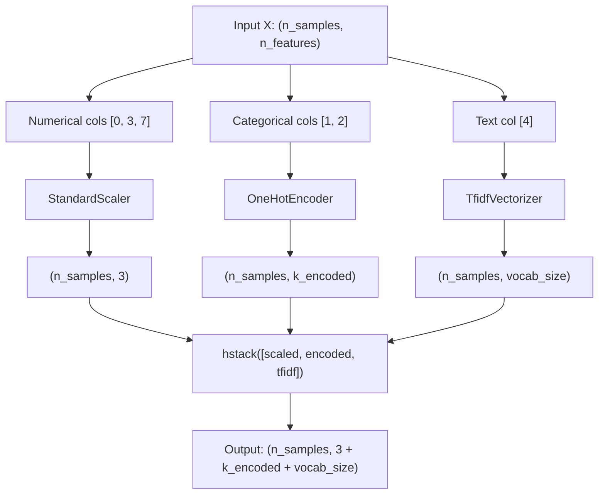

# Lesson 1: Data Preprocessing, Feature Engineering, Transformers

## 1. First-Principles Intuition & Invariants

Machine learning models operate on a mathematical substrate where inputs must conform to strict geometric and statistical constraints. A gradient descent optimizer expects continuous differentiable manifolds; a decision tree requires ordinal or categorical splits; a support vector machine demands scaled feature vectors residing in a coherent metric space. Raw data from production systems—sensor streams, transactional databases, user logs—arrives with missing entries, heterogeneous scales, non-numeric encodings, and distributional skew. The preprocessing pipeline transforms this chaotic input into a canonical representation suitable for optimization algorithms, and this transformation must be both learned from training data and applied consistently to inference inputs without data leakage.

The fundamental invariant governing all preprocessing operations is the **fit-transform contract**: transformations are parameterized by statistics computed on training data during the fit phase, then applied identically to validation, test, and production data during the transform phase. A standard scaler computes mean μ and standard deviation σ on the training set, then applies the transformation z = (x - μ) / σ to all subsequent data. If we recompute μ and σ on test data, we introduce test-set information into our model evaluation, violating the independence assumption underlying generalization theory. This principle extends to every transformation: imputation strategies, encoding dictionaries, vocabulary sets, and dimensionality reduction projections must all be frozen after training.

Scikit-learn codifies this contract through the **BaseEstimator** and **TransformerMixin** interfaces, which define a universal API for all preprocessing components. Every transformer implements `fit(X, y=None)` to learn parameters from training data and `transform(X)` to apply those learned parameters. The `fit_transform(X, y=None)` convenience method optimizes the combined operation when computing transformations for the training set itself. This interface contract enables pipelines to compose arbitrary sequences of transformations, each maintaining its own learned state while presenting a uniform abstraction boundary.

The choice of preprocessing strategy is not arbitrary but must respect the geometric assumptions embedded in downstream algorithms. Linear models like logistic regression and support vector machines embed feature vectors in Euclidean space and compute weighted dot products; features with vastly different scales (income in tens of thousands versus age in tens) will cause the optimizer to treat high-variance dimensions as inherently more important, distorting the learned decision boundary. Tree-based models like random forests and gradient boosting machines perform recursive binary partitioning on single features and remain invariant to monotonic transformations; scaling features provides no benefit, but encoding categorical variables and handling missing values remain critical.

Neural networks introduce additional constraints: gradient-based optimization requires smooth, bounded activation functions, and vanishing or exploding gradients arise when input distributions shift dramatically across layers. Batch normalization partially addresses this by normalizing activations internally, but input preprocessing remains essential to ensure rapid convergence. The combination of these algorithm-specific requirements with production engineering constraints—inference latency, memory footprint, deployment consistency—drives the design of preprocessing architectures.

Feature engineering extends beyond normalization and encoding to encompass the creation of derived representations that expose latent structure to learning algorithms. A timestamp contains implicit periodicity (hour of day, day of week) and trend components that a linear model cannot discover from the raw Unix epoch integer. Text documents embed semantic relationships in high-dimensional sparse bag-of-word vectors or dense embeddings. Polynomial feature expansion enables linear models to approximate nonlinear decision boundaries by explicitly constructing interaction terms. The transformer abstraction unifies these operations: whether normalizing continuous variables, one-hot encoding categories, or extracting n-grams from text, each transformation implements the same fit-transform interface and can be composed into complex preprocessing graphs.

The mathematics of missing data imputation reveals deep connections to statistical estimation theory. Missing values arise through three distinct mechanisms: Missing Completely At Random (MCAR), where missingness is independent of observed and unobserved data; Missing At Random (MAR), where missingness depends on observed variables but not the missing value itself; and Missing Not At Random (MNAR), where missingness depends on the unobserved value. Mean imputation—replacing missing entries with the training set mean—provides an unbiased estimator under MCAR but introduces bias under MAR and MNAR. Multivariate imputation by chained equations (MICE) models each feature with missing values as a function of other features, iteratively refining estimates through a sequence of regression problems. K-nearest neighbors imputation leverages local similarity structure, computing weighted averages from neighboring observations in feature space.

Scikit-learn's `SimpleImputer` and `KNNImputer` classes expose these strategies through the transformer interface, but the practitioner must reason about missingness mechanisms and downstream impact. Imputation alters the empirical distribution of features, typically reducing variance and potentially introducing artifacts. When missingness itself carries signal—a missing medical test might indicate the physician judged it unnecessary—creating an explicit missing-value indicator feature preserves this information. The choice between simple strategies (mean, median, most frequent) and complex model-based approaches (KNN, iterative) trades computational cost against imputation quality and must be validated through holdout performance metrics.

## 2. Core Architecture & Mechanics

The transformer pipeline architecture in scikit-learn decomposes preprocessing into a directed acyclic graph of stateful transformations, each maintaining learned parameters and exposing a uniform interface. At the root of this hierarchy sits the `BaseEstimator` class, which provides automatic parameter tracking and cloning mechanisms. Any class inheriting from `BaseEstimator` receives automatic `get_params()` and `set_params()` methods that introspect constructor arguments and enable hyperparameter search. The `TransformerMixin` adds the `fit_transform()` method by composing `fit()` and `transform()`, providing an optimization opportunity for transformations that can compute parameters and apply them in a single pass.

The execution model for a standard preprocessing workflow begins with raw data in a NumPy array or Pandas DataFrame `X` of shape (n_samples, n_features). For supervised learning tasks, a label array `y` of shape (n_samples,) accompanies the feature matrix. During training, the pipeline executes:

```text
StandardScaler.fit(X_train, y_train):
    self.mean_ = np.mean(X_train, axis=0)
    self.scale_ = np.std(X_train, axis=0)
    return self

StandardScaler.transform(X_test):
    return (X_test - self.mean_) / self.scale_
```

The learned parameters `mean_` and `scale_` persist in the transformer instance, forming part of the serialized model artifact. During inference, only `transform()` executes, applying the frozen training-time statistics to new data. This separation ensures that no test-time information leaks into the model, maintaining the integrity of generalization estimates.

The `Pipeline` class orchestrates sequences of transformers terminated by a final estimator. Internally, a pipeline stores an ordered list of (name, transformer) tuples and implements the estimator interface itself. When `Pipeline.fit(X, y)` executes, it iterates through transformers, calling `fit_transform()` on each and passing the output to the next stage, until reaching the final estimator which receives `fit()`. The transformation chain computes:

```text
X1 = transformer1.fit_transform(X, y)
X2 = transformer2.fit_transform(X1, y)
X3 = transformer3.fit_transform(X2, y)
estimator.fit(X3, y)
```

During prediction, only `transform()` methods execute, propagating test data through the learned transformation sequence before invoking the final estimator's `predict()` or `predict_proba()` method. This architecture guarantees that all preprocessing steps use training-time parameters exclusively.

The `ColumnTransformer` extends this linear chain to heterogeneous feature sets, applying different transformations to distinct column subsets. A dataset might contain continuous numerical features requiring standardization, categorical variables needing one-hot encoding, and text fields demanding vectorization. The `ColumnTransformer` accepts a list of (name, transformer, columns) tuples, where columns can be specified as indices, names, or boolean masks. During transformation, it slices the input matrix, applies each transformer to its designated columns independently, then horizontally concatenates results:



This composition pattern enables modular, maintainable preprocessing graphs where each transformer encapsulates domain-specific logic. The column specification remains frozen after construction, ensuring that column orderings and types remain consistent between training and inference.

Scaling transformations address the problem of heterogeneous feature magnitudes through normalization and standardization. The `StandardScaler` applies z-score normalization, transforming each feature to zero mean and unit variance:

```text
X_scaled = (X - μ) / σ
```

where μ and σ are computed per-feature across training samples. This transformation assumes features follow approximately Gaussian distributions; heavy-tailed or skewed distributions may yield outliers with extreme z-scores that dominate distance-based algorithms. The `RobustScaler` addresses this by using median and interquartile range instead of mean and standard deviation:

```text
X_robust = (X - median(X)) / IQR(X)
```

This statistic-based approach reduces sensitivity to outliers but sacrifices exact zero mean and unit variance properties.

The `MinMaxScaler` applies affine transformations to bound features within a specified range, typically [0, 1]:

```text
X_minmax = (X - X_min) / (X_max - X_min)
```

This preserves the original distribution shape while ensuring bounded outputs suitable for algorithms sensitive to feature ranges, such as neural networks with sigmoid activations. However, a single outlier in the training set can compress the majority of values into a narrow interval, reducing effective resolution.

The `MaxAbsScaler` divides each feature by its maximum absolute value, producing values in [-1, 1] without shifting the center:

```text
X_maxabs = X / max(|X|)
```

This transformation preserves sparsity—zero entries remain zero—making it suitable for sparse matrices from text vectorization or one-hot encoding where memory and computation costs scale with the number of non-zero elements.

Categorical encoding strategies transform discrete labels into numerical representations consumable by learning algorithms. The `OrdinalEncoder` maps each category to an integer, preserving a single column per feature but introducing an artificial ordering:

```json
["red", "blue", "green"] → [0, 1, 2]
```

This encoding is appropriate for ordinal variables (education level, rating scale) where the integer ordering reflects semantic relationships, but it misleads algorithms when applied to nominal categories—a linear model would learn that "green" is twice "blue," an arbitrary and incorrect relationship.

The `OneHotEncoder` creates binary indicator columns for each category, expanding a single feature with k unique values into k or k-1 binary columns:

```json
["red", "blue", "green", "red"] →
[[1, 0, 0],
 [0, 1, 0],
 [0, 0, 1],
 [1, 0, 0]]
```

This representation eliminates artificial ordering and enables linear models to learn independent coefficients per category. The `drop='first'` or `drop='if_binary'` parameters remove one column to avoid perfect multicollinearity, which causes linear algebra singularities in least-squares regression. The resulting encoding expands feature dimensionality significantly for high-cardinality variables, increasing memory footprint and computation time while introducing sparsity.

The encoder maintains an internal `categories_` attribute mapping each feature's training-set vocabulary to column indices. During transform, unseen categories either raise an error (default behavior) or map to an all-zero vector (`handle_unknown='ignore'`), effectively treating them as a novel "other" category. This design choice trades training-time strictness against inference-time robustness; production systems with evolving categorical distributions must balance these concerns.

Missing value imputation algorithms replace absent entries with plausible substitutes based on training-set statistics or model predictions. The `SimpleImputer` implements univariate strategies that compute per-feature statistics:

```text
SimpleImputer(strategy='mean')
    → X[:, j] where X[i, j] is NaN ← mean(X[~isnan(X[:, j]), j])

SimpleImputer(strategy='median')
    → uses np.median() for robustness to outliers

SimpleImputer(strategy='most_frequent')
    → uses mode for categorical variables

SimpleImputer(strategy='constant', fill_value=0)
    → deterministic fill with specified value
```

These strategies compute independent statistics per column, ignoring correlations between features. During `fit()`, the imputer stores the computed statistic in `statistics_` attribute, then applies it during `transform()`.

The `KNNImputer` leverages multivariate structure by finding k-nearest neighbors for each sample with missing values, measuring distance using available features. For each missing entry, it computes a weighted average of neighbor values:

```text
X[i, j] is missing
neighbors = k_nearest(X[i, :], metric='euclidean', exclude_missing=True)
X[i, j] ← weighted_mean(neighbors[:, j], weights=distances)
```

This approach captures local dependencies and produces more accurate imputations when features exhibit correlation, but requires computing pairwise distances across the training set, scaling quadratically in sample count. The distance metric must handle partially missing feature vectors, typically using only the subset of features present in both samples.

The `IterativeImputer` implements MICE by modeling each feature with missing values as a function of others, iteratively refining predictions:

```text
Initialize: fill missing with mean/median
Repeat for max_iter epochs:
    For each feature j with missing values:
        Use observed features as X, feature j as y
        Train regressor (BayesianRidge, etc.)
        Predict missing values in feature j
        Update imputed values
```

This iterative refinement converges to a fixed point where each feature's imputation is consistent with models trained on other features. The choice of regressor—Bayesian Ridge provides uncertainty estimates, Random Forest captures nonlinear relationships—determines imputation quality and computational cost. The algorithm requires specifying an imputation order (ascending missingness, descending, random) and a convergence tolerance.

Feature extraction transformers construct derived representations from raw inputs, exposing latent structure to learning algorithms. The `PolynomialFeatures` transformer generates interaction terms and polynomial expansions:

```text
X = [[a, b]]
PolynomialFeatures(degree=2, include_bias=True)
  → [[1, a, b, a², ab, b²]]
```

This transformation enables linear models to fit nonlinear decision boundaries by explicitly constructing basis functions. The number of output features grows combinatorially with degree and input dimensionality:

```text
n_output = (n_input + degree)! / (n_input! × degree!)
```

requiring careful regularization to prevent overfitting. The `interaction_only=True` parameter excludes pure powers, generating only cross-products to reduce dimensionality.

The `FunctionTransformer` wraps arbitrary functions into the transformer interface, enabling custom preprocessing logic:

```python
import numpy as np

log_transformer = FunctionTransformer(np.log1p, inverse_func=np.expm1, validate=True)
```

This provides an escape hatch for domain-specific transformations—log scaling for skewed distributions, Box-Cox power transforms, cyclical encoding of temporal features—while maintaining pipeline compatibility. The `inverse_transform()` method enables reversing transformations for model interpretation or output post-processing.

## 3. High-Performance Optimization & Failure Modes

Production preprocessing pipelines must balance statistical accuracy against computational efficiency, memory footprint, and inference latency constraints. The dominant performance bottleneck in scikit-learn transformers is NumPy array allocation and copying: each transformation stage allocates a new output array, and naive pipeline construction triggers multiple full-dataset copies. The `Pipeline.fit_transform()` method mitigates this by allowing intermediate transformers to return views or in-place modifications when safe, but practitioners must understand when copies occur.

Sparse matrix representations provide dramatic memory and computation savings for high-dimensional, sparse feature spaces emerging from one-hot encoding and text vectorization. A one-hot encoded categorical variable with 10,000 categories expands to a matrix with 99.99% zeros; storing this densely requires 8 bytes per entry for float64, while a compressed sparse row (CSR) format stores only non-zero entries and their indices. Scikit-learn transformers preserve sparsity when possible: `OneHotEncoder` produces sparse output by default, `StandardScaler(with_mean=False)` maintains sparsity by avoiding centering (which densifies), and `Pipeline` propagates sparse matrices through compatible stages.

The critical failure mode is inadvertently densifying sparse data through transformations that require centering or computing per-sample statistics. StandardScaler with default `with_mean=True` converts sparse input to dense because subtracting the mean creates non-zero entries everywhere. A dataset with 100,000 samples and 50,000 sparse features explodes from megabytes to 40 gigabytes in dense format, exceeding memory and triggering thrashing. The solution is to use `StandardScaler(with_mean=False)` for sparse data or to scale only dense feature subsets through `ColumnTransformer`.

Categorical encoding for high-cardinality variables introduces another scaling challenge: a feature with millions of unique values (user IDs, IP addresses, product SKUs) produces an intractably high-dimensional one-hot encoding. Target encoding addresses this by replacing categories with aggregate statistics of the target variable:

```text
category_map[c] = mean(y | X[:, j] == c)
```

This compression maintains a single numerical column while incorporating supervised information. However, target encoding risks severe overfitting and requires careful cross-validated computation: encoding training samples using statistics computed on the same samples introduces direct label leakage, artificially inflating validation performance. The correct procedure computes target statistics on out-of-fold samples during cross-validation, or uses additive smoothing with global priors:

```text
encoded[c] = (n[c] × mean[c] + α × global_mean) / (n[c] + α)
```

where α controls the regularization strength, blending category-specific means toward the global mean for rare categories.

Scikit-learn does not provide a built-in target encoder due to these leakage concerns, but practitioners can implement it through custom transformers or use third-party libraries with proper cross-validation integration. Alternatively, hashing encoders map categories to fixed-size integer ranges via hash functions:

```python
from sklearn.feature_extraction import FeatureHasher
hasher = FeatureHasher(n_features=1024, input_type='string')
X_hashed = hasher.transform(categorical_strings)
```

This bounds dimensionality deterministically while accepting hash collisions, where distinct categories map to the same feature index. The collision rate depends on the ratio of unique categories to hash space size; choosing `n_features` large enough to keep collision probability low while small enough to remain tractable requires empirical tuning.

Missing value imputation introduces statistical bias and variance that propagates through downstream models. Mean imputation shrinks the empirical variance of imputed features toward zero because it replaces diverse missing values with a constant, artificially strengthening correlations with other features. When missingness is informative (MAR or MNAR), the imputed values reflect neither the true underlying distribution nor random noise, potentially misleading the model. Creating explicit missing-value indicators preserves this signal:

```python
from sklearn.impute import MissingIndicator
indicator = MissingIndicator(features='all', sparse=False)
X_indicator = indicator.fit_transform(X)
X_augmented = np.hstack([X_imputed, X_indicator])
```

The indicator matrix contains binary flags for each originally missing entry, allowing the model to learn separate behaviors for imputed versus observed values. This doubles the feature count for fully sparse data but often improves predictive performance when missingness patterns correlate with outcomes.

KNN imputation scales poorly to large datasets due to quadratic distance computations. The `n_neighbors` parameter trades imputation quality (higher k averages more samples, reducing variance) against computational cost. For datasets exceeding hundreds of thousands of samples, approximate nearest neighbor algorithms (LSH, Annoy, HNSW) provide sublinear query time but lack native scikit-learn integration. Practitioners must either subsample data for imputer training, use faster univariate strategies, or implement custom transformers wrapping approximate ANN libraries.

Iterative imputation converges slowly for datasets with many features containing missing values, as each iteration requires training and predicting with a regressor per incomplete feature. The `max_iter` parameter bounds iterations, but premature termination leaves imputations inconsistent. The `tol` parameter specifies convergence tolerance, halting when imputed values change by less than this threshold between iterations. Computational cost scales linearly with `max_iter` and the number of incomplete features, making this approach suitable for datasets with moderate missingness and feature counts (thousands, not millions).

Pipeline serialization through `joblib.dump()` or `pickle` persists all learned parameters, enabling deployment without retraining. However, transformers storing large artifacts—KNN imputer's training data, vocabulary dictionaries for text vectorizers—produce multi-gigabyte model files. The `IterativeImputer` does not store training data but retains fitted regressors for each feature, and deep tree ensembles consume significant memory. Practitioners must monitor serialized model size and optimize by reducing vocabulary sizes, limiting tree depth, or using simpler imputation strategies when deployment size constraints bind.

Version compatibility between scikit-learn releases occasionally breaks serialized pipelines due to changes in internal data structures or default parameters. Production systems must pin scikit-learn versions in deployment environments matching training environments, or explicitly version model artifacts with metadata tagging the library version. The `Pipeline.get_params(deep=True)` method extracts all hyperparameters recursively, enabling reconstruction from parameter dictionaries as an alternative to binary serialization.

Transformer state leakage through mutable default arguments or shared references creates insidious bugs. If a transformer's `__init__` assigns a mutable default (list, dict) to an instance variable without copying, multiple instances share state:

```python
# INCORRECT
class BadTransformer(BaseEstimator):
    def __init__(self, categories=[]):
        self.categories = categories  # shared reference

# CORRECT
class GoodTransformer(BaseEstimator):
    def __init__(self, categories=None):
        self.categories = categories if categories is not None else []
```

Scikit-learn's `clone()` function creates deep copies of estimators by introspecting constructor parameters, but it cannot detect shared mutable state assigned after construction. The defensive pattern is to treat all parameters as immutable and copy mutable structures on assignment.

Pipeline debugging requires isolating which stage introduces errors or unexpected transformations. The `set_output(transform='pandas')` method (scikit-learn ≥1.2) configures transformers to output Pandas DataFrames with column names, enabling inspection of intermediate pipeline stages:

```python
from sklearn import set_config
set_config(transform_output='pandas')
X_transformed = pipeline[:-1].transform(X)  # exclude final estimator
print(X_transformed.columns)
```

This introspection reveals issues like accidental column reordering, unexpected one-hot expansion, or numerical instability in scaling.

Numerical stability issues arise when scaling features with near-zero variance: dividing by σ ≈ 0 produces infinite or NaN values. The `StandardScaler` includes a `with_std` parameter to disable scaling by standard deviation, and internally adds a small epsilon to prevent division by zero, but features with truly constant values should be dropped during feature selection. The `VarianceThreshold` transformer removes features with variance below a specified threshold, pruning uninformative columns:

```python
from sklearn.feature_selection import VarianceThreshold
selector = VarianceThreshold(threshold=0.01)
X_filtered = selector.fit_transform(X)
```

This preprocessing step reduces dimensionality and prevents downstream numerical issues while improving interpretability.

Hyperparameter tuning for preprocessing pipelines requires careful cross-validation to prevent test-set leakage. When using `GridSearchCV` or `RandomizedSearchCV` with a pipeline, the entire pipeline—including preprocessing steps—refits on each training fold with the candidate hyperparameters, ensuring that scaling statistics and imputation values are computed only on training data:

```python
from sklearn.model_selection import GridSearchCV
from sklearn.pipeline import Pipeline

pipeline = Pipeline([
    ('imputer', SimpleImputer()),
    ('scaler', StandardScaler()),
    ('model', LogisticRegression())
])

param_grid = {
    'imputer__strategy': ['mean', 'median'],
    'scaler__with_mean': [True, False],
    'model__C': [0.1, 1.0, 10.0]
}

grid = GridSearchCV(pipeline, param_grid, cv=5)
grid.fit(X_train, y_train)
```

The double-underscore syntax `imputer__strategy` addresses parameters in nested pipeline stages, enabling joint optimization of preprocessing and model hyperparameters. The cross-validation loop ensures that each fold computes independent preprocessing parameters, yielding unbiased generalization estimates.

Custom transformers extend scikit-learn's preprocessing vocabulary for domain-specific operations. A transformer class must inherit from `BaseEstimator` and `TransformerMixin`, implementing `fit()` and `transform()`:

```python
from sklearn.base import BaseEstimator, TransformerMixin

class CyclicalEncoder(BaseEstimator, TransformerMixin):
    def __init__(self, period=24):
        self.period = period
    
    def fit(self, X, y=None):
        return self
    
    def transform(self, X):
        angle = 2 * np.pi * X / self.period
        return np.hstack([np.sin(angle), np.cos(angle)])
```

This encoder maps cyclical features (hour of day, month of year) to two-dimensional sine-cosine coordinates, preserving periodicity that linear encodings break (hour 23 and hour 0 are adjacent, but their integer encodings are maximally distant). The transformer integrates seamlessly into pipelines and supports hyperparameter tuning through the `period` parameter.

Memory-mapped arrays provide an alternative to in-memory NumPy arrays for datasets exceeding RAM capacity. Scikit-learn transformers accept NumPy arrays backed by memory-mapped files, loading data lazily from disk:

```python
X_mmap = np.load('large_dataset.npy', mmap_mode='r')
scaler = StandardScaler()
scaler.fit(X_mmap)  # computes statistics in streaming passes
```

This technique enables preprocessing datasets larger than available memory but incurs disk I/O latency. The `fit()` method must iterate through data without materializing the full array, which scikit-learn's transformers support through NumPy's reduction functions (mean, std) that operate on memory-mapped arrays efficiently.

Production preprocessing systems must handle schema evolution as data distributions shift over time. A categorical variable might acquire new categories absent in the training set, or numerical feature ranges might expand beyond training bounds. The `OneHotEncoder(handle_unknown='ignore')` parameter maps unseen categories to all-zero vectors, effectively treating them as missing. Alternatively, maintaining an "other" category during training by grouping rare categories provides a learned representation for novel values:

```python
from sklearn.preprocessing import OneHotEncoder

# During training, group rare categories
rare_threshold = 0.01
category_counts = X_train[:, col].value_counts()
rare_categories = category_counts[category_counts / len(X_train) < rare_threshold].index
X_train.loc[X_train[col].isin(rare_categories), col] = 'OTHER'

encoder = OneHotEncoder(handle_unknown='ignore')
encoder.fit(X_train)
```

This preprocessing step trades granular category representation for robustness to distribution shift, a fundamental accuracy-stability tradeoff in deployed systems.

Monitoring preprocessing statistics in production detects data drift and model degradation. Logging the fraction of missing values, the appearance of novel categories, and the distribution of scaled features provides early warning when inference data deviates from training distributions. Comparing training-time scaling parameters (mean, standard deviation) against inference-time empirical statistics quantifies drift magnitude:

```python
inference_mean = X_inference.mean(axis=0)
drift_score = np.linalg.norm(inference_mean - scaler.mean_) / np.linalg.norm(scaler.mean_)
if drift_score > threshold:
    trigger_retraining_pipeline()
```

This ratio measures relative shift in feature centroids, providing a scalar drift indicator suitable for alerting and automated retraining triggers.

The transformer abstraction unifies preprocessing operations under a common interface contract, enabling modular composition, hyperparameter tuning, and deployment consistency. Mastering this architecture—understanding when transformations preserve sparsity, how imputation strategies introduce bias, and where computational costs scale prohibitively—separates robust production machine learning systems from brittle prototype notebooks. The interplay between statistical correctness, algorithmic efficiency, and operational constraints defines the engineering discipline of feature preprocessing, and scikit-learn's transformer ecosystem provides the canonical vocabulary for reasoning about these tradeoffs in Python-based machine learning workflows.
