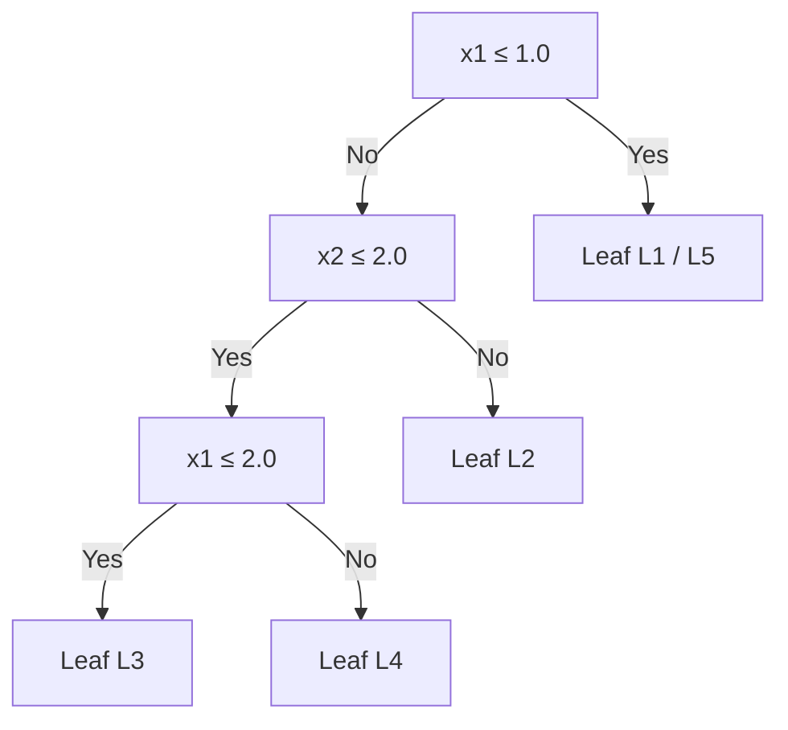

# Lesson 2: Supervised Learning Algorithms, Loss Functions, Optimization

## 1. First-Principles Intuition & Invariants

Supervised learning is, at its core, a search problem. You are searching through a space of possible functions to find the one that best explains the relationship between inputs and outputs as evidenced by labeled training data. That framing — search through function space, guided by evidence — immediately raises three invariant questions that every practitioner must answer before writing a single line of scikit-learn code: What family of functions am I searching over? What does "best" mean, formally? And how do I execute the search efficiently?

These three questions correspond precisely to the three pillars of supervised learning: the hypothesis class (model architecture), the loss function (objective), and the optimization algorithm. Every algorithm in scikit-learn — from `LogisticRegression` to `GradientBoostingClassifier` — is a specific, deliberate answer to all three simultaneously. Understanding why particular answers were chosen, and what invariants they impose on your data, is what separates a practitioner who wields these tools from one who is merely operated by them.

### The Statistical Contract

Before dissecting mechanics, establish the statistical contract that makes supervised learning coherent. You assume that your training data consists of i.i.d. samples drawn from some unknown joint distribution $P(X, Y)$. Your goal is to learn a function $f: \mathcal{X} \rightarrow \mathcal{Y}$ that minimizes the **expected risk**:

$$R(f) = \mathbb{E}_{(x,y) \sim P(X,Y)}[\mathcal{L}(f(x), y)]$$

You cannot compute this directly because $P(X, Y)$ is unknown. Instead, you minimize the **empirical risk** over your finite training set of $n$ samples:

$$\hat{R}(f) = \frac{1}{n} \sum_{i=1}^{n} \mathcal{L}(f(x_i), y_i)$$

This substitution is justified by the Law of Large Numbers, but it introduces the central tension of machine learning: empirical risk minimization can overfit, learning the noise in your training set rather than the signal. Every regularization technique, every early-stopping heuristic, every cross-validation strategy exists to manage the gap between $R(f)$ and $\hat{R}(f)$, formally called the **generalization gap**.

The bias-variance decomposition makes this tension mathematically precise. For a squared-error loss, the expected prediction error at any point $x$ decomposes as:

$$\mathbb{E}[(y - \hat{f}(x))^2] = \underbrace{(\mathbb{E}[\hat{f}(x)] - f(x))^2}_{\text{Bias}^2} + \underbrace{\mathbb{E}[(\hat{f}(x) - \mathbb{E}[\hat{f}(x)])^2]}_{\text{Variance}} + \underbrace{\sigma^2_\epsilon}_{\text{Irreducible Noise}}$$

Bias measures systematic error from model underfitting. Variance measures sensitivity to training data fluctuations, characteristic of overfitting. The irreducible noise floor $\sigma^2_\epsilon$ is a property of the data-generating process itself — no algorithm can beat it. All model selection decisions are navigations of the bias-variance tradeoff. High-capacity models like deep decision trees drive bias toward zero while inflating variance. Regularized linear models accept higher bias in exchange for dramatically lower variance on small datasets.

### Classification vs. Regression: Paradigm Distinctions

The distinction between classification and regression is not merely one of output type. It fundamentally determines which loss functions are mathematically appropriate, which model families are natural, and how prediction uncertainty should be interpreted.

In **regression**, the target $y \in \mathbb{R}$ (or $\mathbb{R}^k$ for multi-output). The canonical loss is **mean squared error (MSE)**:

$$\mathcal{L}_{\text{MSE}}(\hat{y}, y) = (\hat{y} - y)^2$$

MSE is convex, differentiable everywhere, and penalizes large deviations quadratically, making it sensitive to outliers. When your target distribution has heavy tails or significant outliers, **mean absolute error (MAE)**, $\mathcal{L}_{\text{MAE}} = |\hat{y} - y|$, is more robust because it penalizes linearly. The **Huber loss** interpolates between the two: it behaves like MSE for small residuals and like MAE for large ones, with a threshold hyperparameter $\delta$ controlling the transition. Scikit-learn's `HuberRegressor` implements this directly, making it the production default when you suspect but cannot fully characterize outlier contamination.

In **classification**, the target $y \in \{0, 1\}$ (binary) or $y \in \{1, \ldots, K\}$ (multiclass). The natural loss is **cross-entropy** (also called log loss), derived from maximum likelihood estimation under a Bernoulli or categorical distribution. For binary classification:

$$\mathcal{L}_{\text{CE}}(\hat{p}, y) = -[y \log \hat{p} + (1-y)\log(1 - \hat{p})]$$

Cross-entropy penalizes confident wrong predictions catastrophically — if the model assigns probability 0.001 to the true class, the loss is $-\log(0.001) \approx 6.9$, a severe gradient signal. This is precisely the behavior you want: confident errors should dominate the learning signal. The **hinge loss** used by SVMs takes a different philosophy: it only penalizes predictions that fall within a margin of the decision boundary, producing sparse support vectors and a geometrically interpretable solution. The loss is $\mathcal{L}_{\text{hinge}}(\hat{y}, y) = \max(0, 1 - y \cdot \hat{y})$, where $y \in \{-1, +1\}$ and $\hat{y}$ is the raw decision score, not a probability.

Understanding these loss functions is not academic. When you call `LogisticRegression` and set `solver='lbfgs'`, scikit-learn is minimizing cross-entropy with an L2 penalty via a quasi-Newton optimizer. When you instantiate `LinearSVC`, it minimizes hinge loss with L2 penalty via coordinate descent or a dual formulation. The same input data, the same feature space — but entirely different geometric solutions because the loss function defines what "fit" means.

---

## 2. Core Architecture & Mechanics

### Linear Models: The Foundational Architecture

Linear models are not a beginner's approximation. They are the foundational architecture from which the entire field extrapolates. A linear model asserts that the target is a linear function of the input features, possibly passed through a link function. For regression:

$$\hat{y} = w^T x + b = \sum_{j=1}^{d} w_j x_j + b$$

For logistic regression (binary classification), the linear score is passed through the sigmoid function $\sigma(z) = 1/(1 + e^{-z})$ to produce a probability:

$$\hat{p}(y=1 | x) = \sigma(w^T x + b)$$

The genius of this construction is that despite its simplicity, logistic regression is a maximum likelihood estimator under a Bernoulli distribution with a log-odds-linear structure. It is not a heuristic; it is the statistically principled solution to a precisely stated probabilistic problem.

In scikit-learn, `LogisticRegression` accepts a `C` parameter rather than the conventional regularization strength `λ`. The relationship is `C = 1/λ`, meaning small `C` imposes strong regularization (high bias, low variance) and large `C` approaches unregularized maximum likelihood (low bias, high variance). This sign inversion trips up practitioners accustomed to frameworks that parameterize regularization directly. The `penalty` parameter selects L1 (`lasso`), L2 (`ridge`), or `elasticnet` regularization, with the choice of `solver` constrained accordingly: L1 requires `liblinear` or `saga`, while `lbfgs` and `newton-cg` only support L2.

The multiclass extension uses either a one-vs-rest (OvR) strategy, fitting $K$ independent binary classifiers, or a multinomial softmax formulation that jointly optimizes over all $K$ classes. The multinomial formulation is strictly superior when classes are not well-separated because it leverages cross-class information during parameter estimation. Set `multi_class='multinomial'` explicitly when using `lbfgs` or `saga` on problems with more than two classes.

```python
import numpy as np
from sklearn.datasets import load_wine
from sklearn.linear_model import LogisticRegression
from sklearn.preprocessing import StandardScaler
from sklearn.model_selection import StratifiedKFold, cross_validate
from sklearn.pipeline import Pipeline

X, y = load_wine(return_X_y=True)

pipeline = Pipeline([
    ("scaler", StandardScaler()),
    ("clf", LogisticRegression(
        penalty="l2",
        C=0.1,
        solver="lbfgs",
        multi_class="multinomial",
        max_iter=1000,
        random_state=42
    ))
])

cv = StratifiedKFold(n_splits=5, shuffle=True, random_state=42)
results = cross_validate(
    pipeline, X, y,
    cv=cv,
    scoring=["accuracy", "f1_macro"],
    return_train_score=True
)

print(f"CV Accuracy: {results['test_accuracy'].mean():.4f} ± {results['test_accuracy'].std():.4f}")
print(f"Train Accuracy: {results['train_accuracy'].mean():.4f} ± {results['train_accuracy'].std():.4f}")
print(f"CV F1 Macro: {results['test_f1_macro'].mean():.4f} ± {results['test_f1_macro'].std():.4f}")
```

Notice the `StandardScaler` is non-negotiable in the pipeline. Gradient-based solvers for linear models are geometrically optimizing a loss surface in weight space. If feature $x_1$ ranges over $[0, 10000]$ and feature $x_2$ ranges over $[0, 1]$, the loss surface is an elongated ellipsoid. Gradient descent steps along the steepest direction, which is dominated by the high-magnitude feature, causing slow oscillating convergence. Standardization transforms the loss surface into a more spherical shape, dramatically improving convergence rate. This is not a preprocessing nicety — it is a first-principles requirement for gradient-based optimization on unnormalized features.

### Regularization Mechanics: L1, L2, and ElasticNet

Ridge regression (L2 regularization) adds the squared L2 norm of the weight vector to the empirical risk:

$$\hat{R}_{\text{ridge}}(w) = \frac{1}{n}\sum_{i=1}^n \mathcal{L}(f(x_i), y_i) + \frac{\lambda}{2} \|w\|_2^2$$

The L2 penalty is differentiable everywhere and has a unique closed-form solution for linear regression: $\hat{w} = (X^T X + \lambda I)^{-1} X^T y$. The $\lambda I$ term makes the matrix invertible even when $X^T X$ is singular — a critical property when features are collinear or when $d > n$. Geometrically, L2 regularization constrains the weight vector to lie within a hypersphere. The optimal solution is pulled toward the origin in all directions simultaneously, shrinking all weights but never zeroing any of them exactly.

Lasso regression (L1 regularization) replaces the squared norm with the L1 norm:

$$\hat{R}_{\text{lasso}}(w) = \frac{1}{n}\sum_{i=1}^n \mathcal{L}(f(x_i), y_i) + \lambda \|w\|_1$$

The L1 penalty is not differentiable at zero. Its subdifferential at the origin, $[-1, 1]$, creates a kink in the objective landscape that permits exact zeros in the solution. Geometrically, the L1 constraint region is a hyperdiamond (cross-polytope) whose corners lie on the coordinate axes. The unconstrained loss minimum is likely to contact this region at a corner, setting some coefficients exactly to zero. This is **automatic feature selection** — not post-hoc filtering, but a direct consequence of the geometry. When you have hundreds of candidate features and expect only a sparse subset to be relevant, Lasso is the principled choice.

ElasticNet interpolates:

$$\hat{R}_{\text{en}}(w) = \frac{1}{n}\sum_{i=1}^n \mathcal{L}(f(x_i), y_i) + \lambda \left[ \frac{1-\alpha}{2} \|w\|_2^2 + \alpha \|w\|_1 \right]$$

The mixing parameter $\alpha \in [0, 1]$ controls the blend — $\alpha=0$ is pure Ridge, $\alpha=1$ is pure Lasso. ElasticNet is particularly valuable when features are correlated. Pure Lasso tends to arbitrarily select one feature from a correlated group and zero the others, an unstable solution. ElasticNet's L2 component encourages grouped selection, keeping correlated features together while still producing sparsity.

```python
import numpy as np
import matplotlib.pyplot as plt
from sklearn.datasets import make_regression
from sklearn.linear_model import Ridge, Lasso, ElasticNet
from sklearn.preprocessing import StandardScaler
from sklearn.model_selection import train_test_split
from sklearn.metrics import mean_squared_error, r2_score

rng = np.random.default_rng(42)
X, y, true_coef = make_regression(
    n_samples=300,
    n_features=50,
    n_informative=10,
    noise=25.0,
    coef=True,
    random_state=42
)

X_train, X_test, y_train, y_test = train_test_split(
    X, y, test_size=0.25, random_state=42
)

scaler = StandardScaler()
X_train_s = scaler.fit_transform(X_train)
X_test_s = scaler.transform(X_test)

models = {
    "Ridge(α=1.0)":    Ridge(alpha=1.0),
    "Lasso(α=0.1)":    Lasso(alpha=0.1, max_iter=5000),
    "ElasticNet":      ElasticNet(alpha=0.1, l1_ratio=0.5, max_iter=5000),
}

for name, model in models.items():
    model.fit(X_train_s, y_train)
    y_pred = model.predict(X_test_s)
    mse = mean_squared_error(y_test, y_pred)
    r2 = r2_score(y_test, y_pred)
    n_zero = np.sum(np.abs(model.coef_) < 1e-6)
    print(f"{name:22s} | MSE={mse:8.2f} | R²={r2:.4f} | ZeroCoefs={n_zero:2d}/50")
```

### Decision Trees: Recursive Partitioning

Decision trees learn axis-aligned partitions of the feature space, recursively splitting data to minimize impurity within each resulting region. For classification, the standard impurity measure is **Gini impurity**:

$$G(S) = 1 - \sum_{k=1}^{K} p_k^2$$

where $p_k$ is the proportion of class $k$ samples in region $S$. At each node, the algorithm searches all features and all split thresholds, selecting the split that maximally reduces weighted impurity across the two child nodes. This is a greedy, locally optimal search — there is no backtracking, and the globally optimal tree is NP-hard to find, so the greedy approximation is universally used.

**Information gain** (entropy-based splitting) is the alternative: $H(S) = -\sum_k p_k \log_2 p_k$. Entropy and Gini impurity produce nearly identical trees in practice; Gini is computationally cheaper because it avoids logarithms. For regression trees, the impurity measure is simply the variance of target values within a node: $\text{Var}(S) = \frac{1}{|S|} \sum_{i \in S} (y_i - \bar{y}_S)^2$.

The critical architectural insight about decision trees is that their hypothesis class is piecewise-constant functions over hyper-rectangular regions. A tree of depth $d$ can represent at most $2^d$ distinct output values. Deep trees can approximate any measurable function given enough data, but each additional split doubles the number of parameters and halves the number of samples available to estimate each leaf value. This is why unconstrained trees overfit catastrophically and why `max_depth`, `min_samples_leaf`, and `min_samples_split` are not optional hyperparameters — they define the entire generalization behavior.



```python
from sklearn.tree import DecisionTreeClassifier, export_text
from sklearn.datasets import load_breast_cancer
from sklearn.model_selection import train_test_split
from sklearn.metrics import classification_report

X, y = load_breast_cancer(return_X_y=True)
X_train, X_test, y_train, y_test = train_test_split(
    X, y, test_size=0.2, stratify=y, random_state=42
)

tree = DecisionTreeClassifier(
    criterion="gini",
    max_depth=5,
    min_samples_leaf=10,
    min_samples_split=20,
    class_weight="balanced",
    random_state=42
)
tree.fit(X_train, y_train)

print(export_text(tree, feature_names=load_breast_cancer().feature_names.tolist()))
print(classification_report(y_test, tree.predict(X_test),
      target_names=load_breast_cancer().target_names.tolist()))
```

### Ensemble Methods: Variance Reduction Through Aggregation

A single decision tree is a high-variance model. Its structure changes substantially with small perturbations to the training set because the greedy splitting procedure amplifies local noise into global structural differences. Ensemble methods exploit a fundamental statistical property: the variance of an average of $M$ independent, identically distributed random variables with variance $\sigma^2$ is $\sigma^2 / M$. If you could train $M$ statistically independent trees and average their predictions, you would divide variance by $M$ at no cost to bias. The practical challenge is that you only have one training set, so trees trained on it are correlated, reducing but not eliminating the variance benefit.

**Bagging** (Bootstrap Aggregating) addresses correlation by training each tree on a bootstrap sample — a sample of $n$ points drawn with replacement from the training set. Because each bootstrap sample omits roughly $1/e \approx 36.8\%$ of training points (the **out-of-bag** samples), the trees differ structurally, reducing their correlation. Random Forests extend bagging by additionally randomizing the feature subset considered at each split, further decorrelating trees. The `max_features` parameter controls this: `sqrt(d)` for classification and `d/3` for regression are the empirically validated defaults. The out-of-bag samples provide an almost free unbiased estimate of generalization error — set `oob_score=True` in `RandomForestClassifier` to exploit this during development without consuming a separate validation fold.

```python
from sklearn.ensemble import RandomForestClassifier
from sklearn.datasets import load_breast_cancer
from sklearn.model_selection import train_test_split, RandomizedSearchCV
from sklearn.metrics import roc_auc_score
from scipy.stats import randint

X, y = load_breast_cancer(return_X_y=True)
X_train, X_test, y_train, y_test = train_test_split(
    X, y, test_size=0.2, stratify=y, random_state=42
)

rf = RandomForestClassifier(
    n_estimators=300,
    oob_score=True,
    n_jobs=-1,
    random_state=42
)

param_dist = {
    "max_depth":        randint(3, 20),
    "min_samples_leaf": randint(1, 20),
    "max_features":     ["sqrt", "log2", 0.3, 0.5],
}

search = RandomizedSearchCV(
    rf, param_dist,
    n_iter=40,
    scoring="roc_auc",
    cv=5,
    n_jobs=-1,
    random_state=42,
    verbose=1
)
search.fit(X_train, y_train)

best_rf = search.best_estimator_
print(f"Best params: {search.best_params_}")
print(f"OOB Score: {best_rf.oob_score_:.4f}")
print(f"Test ROC-AUC: {roc_auc_score(y_test, best_rf.predict_proba(X_test)[:, 1]):.4f}")
```

**Gradient Boosting** takes the opposite architectural philosophy. Rather than training trees in parallel to reduce variance, it trains them sequentially to reduce bias. At each stage $m$, a new tree $h_m$ is fitted to the negative gradient of the loss function with respect to the current ensemble's predictions:

$$r_i^{(m)} = -\left[\frac{\partial \mathcal{L}(y_i, F(x_i))}{\partial F(x_i)}\right]_{F=F_{m-1}}$$

For MSE loss, these pseudo-residuals $r_i^{(m)}$ are exactly the ordinary residuals $y_i - F_{m-1}(x_i)$, so gradient boosting is literally fitting sequential trees to the remaining prediction errors. For other losses — Huber, log loss, exponential — the pseudo-residuals are the loss-specific gradients, making gradient boosting a universal framework for minimizing arbitrary differentiable loss functions. The ensemble update is:

$$F_m(x) = F_{m-1}(x) + \nu \cdot h_m(x)$$

where $\nu$ is the learning rate (shrinkage factor). Small $\nu$ requires more trees but produces better generalization — the learning rate and number of estimators are strongly coupled hyperparameters that must be tuned together.

Scikit-learn provides two gradient boosting implementations. `GradientBoostingClassifier` is the original implementation: fully correct, interpretable, but single-threaded and slow on large datasets because it processes the entire training set at each stage. `HistGradientBoostingClassifier` is a modern reimplementation based on the LightGBM algorithm, which bins continuous features into 256 discrete histogram buckets before searching for splits. This reduces split-search complexity from $O(nd)$ to $O(256d)$ per tree, enabling parallel construction and native handling of missing values. For any dataset with more than roughly 10,000 samples, `HistGradientBoostingClassifier` is the correct default.

```python
from sklearn.ensemble import HistGradientBoostingClassifier
from sklearn.model_selection import train_test_split
from sklearn.datasets import make_classification
from sklearn.metrics import classification_report, roc_auc_score
import numpy as np

X, y = make_classification(
    n_samples=50000,
    n_features=30,
    n_informative=15,
    n_redundant=5,
    n_clusters_per_class=3,
    class_sep=0.8,
    random_state=42
)

# Inject 5% missing values to demonstrate native NaN handling
rng = np.random.default_rng(42)
mask = rng.random(X.shape) < 0.05
X[mask] = np.nan

X_train, X_test, y_train, y_test = train_test_split(
    X, y, test_size=0.2, stratify=y, random_state=42
)

hgb = HistGradientBoostingClassifier(
    loss="log_loss",
    learning_rate=0.05,
    max_iter=500,
    max_depth=5,
    min_samples_leaf=20,
    l2_regularization=0.1,
    max_bins=255,
    early_stopping=True,
    validation_fraction=0.1,
    n_iter_no_change=20,
    random_state=42,
    verbose=1
)
hgb.fit(X_train, y_train)

y_prob = hgb.predict_proba(X_test)[:, 1]
y_pred = hgb.predict(X_test)
print(f"Iterations used: {hgb.n_iter_}")
print(f"Test ROC-AUC: {roc_auc_score(y_test, y_prob):.4f}")
print(classification_report(y_test, y_pred))
```

### Optimization Algorithms: Gradient Descent Variants

The choice of optimizer is inseparable from the loss landscape geometry and dataset size. Scikit-learn surfaces optimizer selection through solver parameters in linear models, so understanding their mechanics directly informs production decisions.

**Batch gradient descent** computes the exact gradient over the entire training set at each step: $w \leftarrow w - \eta \nabla_w \hat{R}(w)$. It follows the true gradient of the empirical risk, converging smoothly toward the minimum. However, computing the gradient over $n$ samples is $O(nd)$ per step, making it computationally prohibitive for large datasets. It is never used in practice for large-scale machine learning.

**Stochastic gradient descent (SGD)** computes the gradient from a single sample at each step: $w \leftarrow w - \eta \nabla_w \mathcal{L}(f(x_i), y_i)$. Each update is a noisy estimate of the true gradient, introducing variance that causes oscillating, non-monotone convergence. Counterintuitively, this noise is often beneficial — it acts as an implicit regularizer and allows SGD to escape sharp local minima in non-convex landscapes. For convex problems like logistic regression, SGD converges to the global minimum but requires a learning rate schedule (typically $\eta_t = \eta_0 / (1 + \alpha t)$) to eventually settle. `SGDClassifier` with `loss='log_loss'` is logistic regression trained by SGD — identical solution, different optimization path, crucial for datasets too large to fit in memory.

**Mini-batch SGD** computes gradients over batches of $b$ samples, balancing the noise of pure SGD against the computational cost of batch gradient descent. Batch size $b$ is a hardware-aware hyperparameter: on modern CPUs and GPUs, batches of 32–256 samples exploit SIMD vectorization and cache locality, making mini-batch SGD faster per update than pure SGD while maintaining useful gradient noise.

**L-BFGS** (Limited-memory Broyden–Fletcher–Goldfarb–Shanno) is a quasi-Newton method that approximates the inverse Hessian of the loss using the last $k$ gradient vectors, typically $k=10$. Rather than stepping along the negative gradient, it steps along a direction that accounts for the curvature of the loss surface, dramatically accelerating convergence in ill-conditioned problems. L-BFGS converges in $O(d)$ iterations compared to $O(d^2)$ for gradient descent on well-conditioned problems, but requires storing $k$ gradient vectors of dimension $d$ — practical for moderate-dimensional problems but expensive when $d > 10^6$. This is why `lbfgs` is the recommended solver for logistic regression on dense, well-conditioned problems with up to tens of thousands of features, while `saga` (a variance-reduced SGD variant) is preferred for sparse, high-dimensional feature spaces.

The solver-penalty compatibility matrix in scikit-learn's `LogisticRegression` is a direct consequence of these optimization mechanics:

| Solver        | L1 | L2 | ElasticNet | Best For                                         |
|---------------|----|----|------------|--------------------------------------------------|
| `lbfgs`       | No | Yes| No         | Dense, medium-$d$, multinomial, good conditioning |
| `liblinear`   | Yes| Yes| No         | Small datasets, one-vs-rest                       |
| `saga`        | Yes| Yes| Yes        | Large $n$, sparse features, all penalties         |
| `newton-cg`   | No | Yes| No         | Dense, L2, full Hessian computation feasible      |
| `sag`         | No | Yes| No         | Large $n$, L2, faster than saga for L2-only      |

---

## 3. High-Performance Optimization & Failure Modes

### Pipeline Architecture for Production Reliability

The single most common source of model failures in production is **data leakage** — the inadvertent contamination of training with information from validation or test data. The mechanism is subtle but deterministic: if you fit a `StandardScaler` on the full dataset before cross-validation, the scaler's mean and variance statistics encode information about the validation fold. The model never sees those exact samples during training, but its feature representation was shaped by them. The result is an optimistically biased validation score that does not generalize to true held-out data.

Scikit-learn's `Pipeline` and `ColumnTransformer` solve this architecturally rather than procedurally. When a pipeline is passed to `cross_validate`, scikit-learn calls `.fit_transform()` on the training fold and `.transform()` on the validation fold at each split, ensuring the transformer's statistics are always computed only from training data. This is not a convenience — it is a correctness invariant.

```python
import numpy as np
import pandas as pd
from sklearn.pipeline import Pipeline
from sklearn.compose import ColumnTransformer
from sklearn.preprocessing import StandardScaler, OneHotEncoder
from sklearn.impute import SimpleImputer
from sklearn.ensemble import HistGradientBoostingClassifier
from sklearn.model_selection import StratifiedKFold, cross_validate
from sklearn.metrics import make_scorer, roc_auc_score

# Simulate a mixed-type tabular dataset
rng = np.random.default_rng(42)
n = 5000
df = pd.DataFrame({
    "age":        rng.integers(18, 80, n).astype(float),
    "income":     rng.exponential(50000, n),
    "credit_score": rng.integers(300, 850, n).astype(float),
    "region":     rng.choice(["north", "south", "east", "west"], n),
    "loan_type":  rng.choice(["mortgage", "auto", "personal"], n),
    "default":    (rng.random(n) < 0.15).astype(int)
})

# Inject missing values
for col in ["age", "income", "credit_score"]:
    df.loc[rng.choice(n, size=int(0.07 * n), replace=False), col] = np.nan

X = df.drop("default", axis=1)
y = df["default"].values

numeric_features  = ["age", "income", "credit_score"]
categorical_features = ["region", "loan_type"]

numeric_transformer = Pipeline([
    ("imputer", SimpleImputer(strategy="median")),
    ("scaler",  StandardScaler()),
])

categorical_transformer = Pipeline([
    ("imputer", SimpleImputer(strategy="most_frequent")),
    ("ohe",     OneHotEncoder(handle_unknown="ignore", sparse_output=False)),
])

preprocessor = ColumnTransformer([
    ("num", numeric_transformer, numeric_features),
    ("cat", categorical_transformer, categorical_features),
])

full_pipeline = Pipeline([
    ("preprocessor", preprocessor),
    ("classifier", HistGradientBoostingClassifier(
        learning_rate=0.05,
        max_iter=400,
        max_depth=4,
        min_samples_leaf=25,
        l2_regularization=0.5,
        early_stopping=True,
        validation_fraction=0.1,
        n_iter_no_change=15,
        random_state=42
    ))
])

cv = StratifiedKFold(n_splits=5, shuffle=True, random_state=42)
auc_scorer = make_scorer(roc_auc_score, needs_proba=True)

cv_results = cross_validate(
    full_pipeline, X, y,
    cv=cv,
    scoring={"auc": auc_scorer, "accuracy": "accuracy"},
    return_train_score=True,
    n_jobs=-1
)

print(f"Train AUC: {cv_results['train_auc'].mean():.4f} ± {cv_results['train_auc'].std():.4f}")
print(f"Val AUC:   {cv_results['test_auc'].mean():.4f} ± {cv_results['test_auc'].std():.4f}")
overfitting_gap = cv_results['train_auc'].mean() - cv_results['test_auc'].mean()
print(f"Overfitting gap: {overfitting_gap:.4f}")
```

If `overfitting_gap` exceeds roughly 0.03–0.05 AUC on this scale of data, the model is overfitting. The diagnostic is unambiguous: increase `l2_regularization`, reduce `max_depth`, increase `min_samples_leaf`, or reduce `learning_rate` while increasing `max_iter` with `early_stopping=True` to compensate. These levers map directly onto the bias-variance tradeoff — there is no trial-and-error here, only deliberate navigation of a known space.

### Hyperparameter Search: Random vs. Bayesian

Grid search is an exhaustive combinatorial strategy that evaluates all parameter combinations. For $k$ parameters each with $v$ values, it requires $v^k$ evaluations — exponential in the number of parameters. For gradient boosting with five hyperparameters each at four values, that is $4^5 = 1024$ full cross-validated model fits. At 60 seconds per fit on a moderate dataset, that is 17 hours. Grid search is only appropriate for two-dimensional problems or when you have embarrassingly parallel compute and no time pressure.

Random search samples uniformly from the parameter space for a fixed budget of trials. Bergstra and Bengio (2012) proved that random search is more efficient than grid search when the effective dimensionality of the parameter space is low — meaning only a subset of hyperparameters actually influence performance. Each random trial still covers the full range of important parameters, while grid search wastes evaluations on regular lattice points that may not span the relevant response surface. `RandomizedSearchCV` with continuous distributions from `scipy.stats` (rather than discrete lists) gives the optimizer a genuinely infinite search space, which is strictly more powerful than a grid.

```python
from sklearn.model_selection import RandomizedSearchCV
from sklearn.ensemble import HistGradientBoostingClassifier
from scipy.stats import loguniform, randint, uniform

param_distributions = {
    "classifier__learning_rate":     loguniform(0.01, 0.3),
    "classifier__max_iter":          randint(100, 800),
    "classifier__max_depth":         randint(2, 10),
    "classifier__min_samples_leaf":  randint(10, 100),
    "classifier__l2_regularization": loguniform(1e-4, 10.0),
    "classifier__max_bins":          [63, 127, 255],
}

rnd_search = RandomizedSearchCV(
    full_pipeline,
    param_distributions=param_distributions,
    n_iter=60,
    scoring="roc_auc",
    cv=StratifiedKFold(n_splits=5, shuffle=True, random_state=42),
    n_jobs=-1,
    random_state=42,
    verbose=2,
    refit=True
)
rnd_search.fit(X, y)

print(f"Best ROC-AUC: {rnd_search.best_score_:.4f}")
print(f"Best params:  {rnd_search.best_params_}")
```

The `loguniform` distribution from `scipy.stats` is essential for learning rate and regularization strength. These parameters span multiple orders of magnitude ($10^{-4}$ to $10^0$), and uniform sampling would waste the overwhelming majority of trials near the upper bound. Log-uniform sampling allocates equal probability mass to each decade, matching the actual sensitivity structure of these hyperparameters.

### Diagnosing Learning Curves

A learning curve plots train and validation score against training set size. It is the most information-dense diagnostic available to a practitioner because it simultaneously reveals the bias and variance of a model at a given complexity level, and projects whether collecting more data will help.

A model with high bias (underfitting) will show both train and validation scores plateauing at a low value as $n$ increases — adding more data cannot help a model that lacks the capacity to represent the underlying function. The fix is to increase model complexity or engineer more expressive features. A model with high variance (overfitting) will show a large gap between high train scores and lower validation scores that slowly converges as $n$ grows — the model has sufficient capacity but is not being regularized enough relative to the available data. The fix is to increase regularization, reduce model complexity, or collect more training data.

```python
import numpy as np
import matplotlib.pyplot as plt
from sklearn.model_selection import learning_curve
from sklearn.ensemble import HistGradientBoostingClassifier
from sklearn.datasets import make_classification

X, y = make_classification(
    n_samples=5000, n_features=20,
    n_informative=10, random_state=42
)

model = HistGradientBoostingClassifier(
    learning_rate=0.05, max_iter=200,
    max_depth=4, min_samples_leaf=20,
    random_state=42
)

train_sizes, train_scores, val_scores = learning_curve(
    model, X, y,
    train_sizes=np.linspace(0.05, 1.0, 20),
    cv=5,
    scoring="roc_auc",
    n_jobs=-1,
    shuffle=True,
    random_state=42
)

train_mean = train_scores.mean(axis=1)
train_std  = train_scores.std(axis=1)
val_mean   = val_scores.mean(axis=1)
val_std    = val_scores.std(axis=1)

fig, ax = plt.subplots(figsize=(9, 5))
ax.plot(train_sizes, train_mean, label="Train AUC",      color="steelblue", linewidth=2)
ax.fill_between(train_sizes, train_mean - train_std, train_mean + train_std,
                alpha=0.2, color="steelblue")
ax.plot(train_sizes, val_mean,   label="Validation AUC", color="coral",     linewidth=2)
ax.fill_between(train_sizes, val_mean - val_std, val_mean + val_std,
                alpha=0.2, color="coral")
ax.set_xlabel("Training Set Size", fontsize=12)
ax.set_ylabel("ROC-AUC",           fontsize=12)
ax.set_title("Learning Curve: HistGradientBoosting", fontsize=14)
ax.legend(fontsize=11)
ax.grid(True, alpha=0.3)
plt.tight_layout()
plt.savefig("learning_curve.png", dpi=150)
```

### Critical Failure Modes

**Class imbalance** is the most common undetected failure mode in production classification systems. When the negative class is 95% of the data, a model that predicts the majority class for every sample achieves 95% accuracy while having zero predictive value. Accuracy is the wrong metric entirely for imbalanced problems — use ROC-AUC, average precision (PR-AUC), or F1 at a calibrated threshold. Scikit-learn surfaces class weighting through `class_weight='balanced'` in tree and linear models, which sets $w_k = n / (K \cdot n_k)$, inversely proportional to class frequency. Alternatively, `imblearn.over_sampling.SMOTE` generates synthetic minority-class samples in feature space. Both approaches have the same goal — rebalance the effective loss function so the minority class contributes proportionally to gradient updates.

**Feature leakage** kills models silently. Leakage occurs when a feature encodes information that would only be available after the prediction event in a production deployment. A model trained to predict customer churn that includes "support_tickets_last_30_days" after the churn event will appear to perform miraculously in retrospective validation and fail completely in live deployment. Leakage is a data engineering problem, not a modeling problem — it requires domain-specific audit of every feature's temporal provenance.

**Distribution shift** between train and production data is the fundamental long-term reliability challenge. A model is a compressed summary of patterns in historical data. When the data-generating process changes — new customer demographics, new product features, macroeconomic shifts — the model's learned patterns become stale. Monitor production predictions with statistical tests (Kolmogorov-Smirnov on feature distributions, Population Stability Index on model scores) and schedule retraining pipelines on a cadence aligned with the domain's known shift rate. Scikit-learn's models have no built-in monitoring — this requires wrapping them in a production inference layer that logs predictions and periodically compares live feature distributions against the training reference distribution.

The relationship between all these concerns — loss functions, optimization, regularization, evaluation, and failure modes — is not a checklist. It is a coherent mechanical system. The loss function defines what the optimizer is driving toward. Regularization constrains the search to generalize. Evaluation metrics measure whether the loss you optimized maps to the business objective you care about. Failure modes are the gaps between these definitions and reality. Mastering supervised learning means holding all of these simultaneously, understanding how they interact, and making deliberate choices at every layer of the stack.
