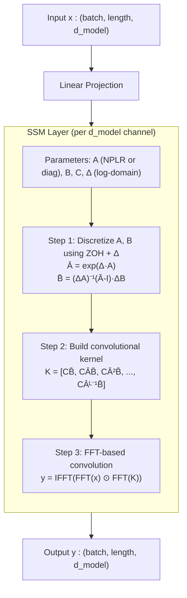
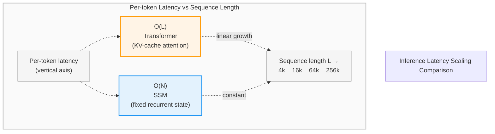

# Lesson 2: Computational Structures in SSMs

## 1. First-Principles Intuition & Invariants

The central tension in every state space model is the conflict between two fundamentally different computational regimes. During training, you have the entire sequence available simultaneously, and the mathematician's natural instinct is to exploit that global visibility with parallel computation. During inference, tokens arrive one at a time and you must maintain a compressed summary of everything that came before, which forces a sequential recurrence. These two modes are not merely different implementations of the same algorithm — they are structurally distinct computational graphs with different memory access patterns, different parallelism properties, and different numerical behaviors. Understanding how SSMs navigate this duality is the central challenge of this lesson.

The continuous-time linear SSM is defined by a pair of ordinary differential equations. The hidden state $h(t) \in \mathbb{R}^N$ evolves according to $\dot{h}(t) = Ah(t) + Bx(t)$, and the output is $y(t) = Ch(t) + Dx(t)$, where $A \in \mathbb{R}^{N \times N}$ is the state transition matrix, $B \in \mathbb{R}^{N \times 1}$ projects the scalar input into the state space, $C \in \mathbb{R}^{1 \times N}$ projects the state back to the scalar output, and $D$ is a skip connection. For a practitioner, the most important thing to internalize about this system is that $A$ encodes the memory structure of the model. Its eigenvalues determine which frequency components of the input are preserved, amplified, or attenuated over time. A poorly conditioned $A$ either forgets everything immediately (eigenvalues near zero) or explodes exponentially (eigenvalues with positive real parts). The entire theory of structured state parameterizations, from LSSL through S4 through S5, is fundamentally an answer to the question of how to initialize and constrain $A$ such that it stably represents long-range dependencies across thousands of time steps.

To run on discrete sequence data, the continuous system must be discretized. Using the zero-order hold (ZOH) assumption, where the input $x(t)$ is held constant between samples, and a step size $\Delta$ representing the sampling interval, the continuous matrices transform as follows:

$$\bar{A} = e^{\Delta A}, \quad \bar{B} = (\Delta A)^{-1}(e^{\Delta A} - I) \cdot \Delta B$$

The resulting discrete recurrence is $h_k = \bar{A}h_{k-1} + \bar{B}x_k$ and $y_k = Ch_k + Dx_k$. This is the form that actually executes on hardware, and $\bar{A}$ is the matrix that must be multiplied at every time step. If $\bar{A}$ is a dense $N \times N$ matrix and your state dimension $N$ is 64 or 256, the per-step cost is $O(N^2)$. For a sequence of length $L$, the total cost of sequential recurrence is $O(LN^2)$. This is completely tractable during autoregressive inference because you process one step at a time and the state $h_k$ is just a fixed-size vector. Training on sequences of length 8192 or 65536 is a different story: you would need $L$ sequential matrix-vector multiplications with no opportunity for parallelism, which on modern GPU hardware is devastatingly slow. GPUs are designed for massive data parallelism across independent operations, not for sequential dependency chains where each step depends on the previous. A linear recurrence over a sequence of length 65536 with state size 64 would serialize 65536 operations and waste the overwhelming majority of GPU compute capacity sitting idle waiting for the previous step to complete.

The resolution to this problem comes from the observation that the linear recurrence, despite its apparent sequential character, satisfies an algebraic property that admits parallelization: associativity. This is the invariant that everything else in this lesson depends on. The recurrence $h_k = \bar{A}_k h_{k-1} + \bar{B}_k x_k$ can be rewritten as a composition of affine maps. If you define the pair $(\bar{A}_k, \bar{B}_k x_k)$ as an element of a monoid where the composition operation is $(A_1, b_1) \otimes (A_2, b_2) = (A_1 A_2, A_1 b_2 + b_1)$, then the entire recurrence over a sequence of length $L$ is simply the left-to-right fold of this monoid over the sequence of pairs. The critical insight is that this binary combination operator is associative, meaning you can parenthesize the fold in any order and get the same result. That associativity is what the parallel scan algorithm exploits.

---

## 2. Core Architecture & Mechanics

### The Parallel Scan Algorithm

The parallel prefix scan, also called the parallel prefix sum or Blelloch scan in its exclusive form, computes all prefix reductions of an associative operator over a sequence of $L$ elements in $O(\log L)$ parallel steps using $O(L)$ work. For SSMs, the operator is the monoid composition defined above, and the elements are the per-step transition pairs $\{(\bar{A}_k, \bar{B}_k x_k)\}_{k=1}^{L}$. The output of the scan at position $k$ is the composed pair representing the total state transition from the start of the sequence to position $k$, which you apply to the initial state $h_0$ to get $h_k$.

The algorithm proceeds in two phases. The upsweep phase builds a binary reduction tree over the sequence, computing partial reductions at each level. The downsweep phase distributes prefix information back down the tree. For a sequence of length $L = 8$, this proceeds as follows:

```text
Input pairs: (A1,b1) (A2,b2) (A3,b3) (A4,b4) (A5,b5) (A6,b6) (A7,b7) (A8,b8)

Upsweep (reduce):
Level 1: [1⊗2]       [3⊗4]       [5⊗6]       [7⊗8]
Level 2:   [1⊗2⊗3⊗4]               [5⊗6⊗7⊗8]
Level 3:         [1⊗2⊗3⊗4⊗5⊗6⊗7⊗8]

Downsweep (prefix broadcast):
Level 2:   [1..4]       [1..4]⊗[5⊗6]  =>  [1..4]  [1..6]
Level 1: [1..2] [1..4]  [1..4]⊗[5..5] [1..6]  ...
Output:  [1] [1..2] [1..3] [1..4] [1..5] [1..6] [1..7] [1..8]
```

Each level of this tree can execute all its operations in parallel. With $L$ elements you have $\log_2 L$ levels, so the depth of the computation graph — which determines the minimum wall-clock time assuming infinite parallelism — scales logarithmically rather than linearly. In practice on GPU hardware with tens of thousands of CUDA cores, this translates directly into the ability to train on sequences of length 65536 at a fraction of the latency of sequential recurrence.

The practical implementation in PyTorch or JAX looks like the following. This is a minimal but complete implementation of an associative scan for the linear recurrence monoid, written to run on GPU with full support for batched sequences and multiple SSM channels.

```python
import torch
import torch.nn.functional as F
from torch import Tensor
from typing import Tuple

def associative_scan(
    A: Tensor,  # (batch, length, d_state) — diagonal A elements
    B: Tensor,  # (batch, length, d_state) — Bu terms already multiplied
) -> Tensor:
    """
    Parallel prefix scan for linear recurrence h_k = A_k * h_{k-1} + B_k.
    Assumes A is a diagonal matrix represented as its diagonal vector.
    Returns all hidden states h_1 ... h_L of shape (batch, length, d_state).
    """
    batch, length, d_state = A.shape

    # Pad to next power of two for the binary tree structure
    next_pow2 = 1
    while next_pow2 < length:
        next_pow2 <<= 1

    pad_len = next_pow2 - length
    if pad_len > 0:
        # Pad A with ones (identity for multiplication) and B with zeros
        A = F.pad(A, (0, 0, 0, pad_len), value=1.0)
        B = F.pad(B, (0, 0, 0, pad_len), value=0.0)

    # Represent each element as (a, b) pair in the monoid
    # (a1, b1) ⊗ (a2, b2) = (a1*a2, a1*b2 + b1)
    # We store the running (A_prefix, B_prefix) tree
    a = A.clone()   # (batch, next_pow2, d_state)
    b = B.clone()   # (batch, next_pow2, d_state)

    # --- Upsweep (reduce) phase ---
    stride = 1
    while stride < next_pow2:
        left_idx  = torch.arange(0, next_pow2 - stride, step=stride * 2, device=A.device)
        right_idx = left_idx + stride

        # Parent gets the composed pair of left and right children
        a_left  = a[:, left_idx,  :]   # (batch, nodes, d_state)
        b_left  = b[:, left_idx,  :]
        a_right = a[:, right_idx, :]
        b_right = b[:, right_idx, :]

        a[:, right_idx, :] = a_left * a_right
        b[:, right_idx, :] = a_left * b_right + b_left

        stride <<= 1

    # Initialize the root accumulator to identity
    a[:, -1, :] = 1.0
    b[:, -1, :] = 0.0

    # --- Downsweep (prefix broadcast) phase ---
    stride = next_pow2 >> 1
    while stride >= 1:
        left_idx  = torch.arange(0, next_pow2 - stride, step=stride * 2, device=A.device)
        right_idx = left_idx + stride

        a_left  = a[:, left_idx,  :].clone()
        b_left  = b[:, left_idx,  :].clone()
        a_right = a[:, right_idx, :].clone()
        b_right = b[:, right_idx, :].clone()

        # Left child receives parent directly
        a[:, left_idx,  :] = a_right
        b[:, left_idx,  :] = b_right

        # Right child receives parent composed with original left child
        a[:, right_idx, :] = a_right * a_left
        b[:, right_idx, :] = a_right * b_left + b_right

        stride >>= 1

    # Strip padding and return hidden states: h_k = prefix_B_k (since h_0 = 0)
    return b[:, :length, :]
```

This implementation makes the key simplifying assumption that $\bar{A}$ is diagonal, which is exactly the choice made by S4D and Mamba. With a diagonal $A$, the matrix-vector products become element-wise multiplications over the state vector, reducing the per-step cost from $O(N^2)$ to $O(N)$, and enabling the scan to operate on a simple tensor of shape `(batch, length, d_state)` without any batched matrix multiplications.

### Structured State Parameterizations: S4 and S4D

The choice of how to parameterize $A$ is not merely an engineering convenience — it determines what long-range dependencies the model can represent. The S4 paper (Gu et al., 2021) introduced the HiPPO framework as the theoretical foundation for $A$ initialization. HiPPO (High-order Polynomial Projection Operators) derives $A$ matrices analytically such that the resulting state $h(t)$ optimally represents the history $x(\tau)$ for $\tau \leq t$ as the coefficients of a polynomial basis expansion. The specific construction called HiPPO-LegS uses a shifted Legendre polynomial basis and produces the matrix:

$$A_{nk} = -\begin{cases}(2n+1)^{1/2}(2k+1)^{1/2} & \text{if } n > k \\ n+1 & \text{if } n = k \\ 0 & \text{if } n < k\end{cases}$$

This matrix is lower-triangular with a specific structure that guarantees the state captures increasingly coarse-grained approximations of the input history. The original S4 model exploits a property of this matrix: it belongs to the class of Normal Plus Low-Rank (NPLR) matrices, meaning it can be written as $A = \Lambda - PQ^*$ where $\Lambda$ is a diagonal complex matrix and $P$, $Q$ are low-rank correction terms. The significance of the NPLR structure is that the characteristic polynomial of $A$ can be computed efficiently using the Cauchy kernel, which allows S4 to compute its convolutional representation in $O(L \log L)$ time via fast Fourier transforms rather than $O(L^2)$ dense convolution.

The computational pipeline for S4 during training, illustrated as a data flow, proceeds as follows:



The kernel $K$ has a closed-form frequency-domain representation that depends on the eigenvalues of $A$. For the NPLR case, this reduces to evaluating a sum of Cauchy-type terms at points on the unit circle, which is $O(N \log N)$ per kernel computation. The total training complexity for S4 on a sequence of length $L$ is $O(L \log L + N L)$, where the $L \log L$ term comes from the FFT convolution and the $NL$ term comes from the kernel construction.

S4D (Gu et al., 2022) simplifies the architecture by abandoning the full NPLR structure and simply using a diagonal complex $A$ matrix initialized to the eigenvalues of the HiPPO-LegS matrix. The loss of the low-rank correction is empirically minor on most benchmarks and dramatically simplifies the implementation. With diagonal $A = \text{diag}(\lambda_1, \ldots, \lambda_N)$ where each $\lambda_i \in \mathbb{C}$, the discretization becomes a simple element-wise operation $\bar{A}_i = e^{\Delta \lambda_i}$, and the convolutional kernel at lag $k$ is just $K_k = \sum_{i=1}^N C_i \bar{A}_i^k B_i$, a sum of geometric sequences. This is a Vandermonde-structured computation that can still be evaluated efficiently but no longer requires the Cauchy kernel machinery. Here is a complete S4D layer implementation:

```python
import torch
import torch.nn as nn
import math
from torch import Tensor

class S4DLayer(nn.Module):
    """
    S4D (Diagonal State Space) layer.
    Uses a diagonal complex A matrix initialized from HiPPO-LegS eigenvalues.
    Operates in convolutional mode (training) with optional recurrent fallback.
    """

    def __init__(self, d_model: int, d_state: int = 64, dt_min: float = 1e-3,
                 dt_max: float = 1e-1, bidirectional: bool = False):
        super().__init__()
        self.d_model  = d_model
        self.d_state  = d_state
        self.bidirectional = bidirectional

        # Initialize A as the diagonal of a HiPPO-LegS-inspired diagonal approximation.
        # The real part is fixed at -0.5 (stable decay), imaginary part spans [0, N/2).
        A_real = -0.5 * torch.ones(d_state)
        A_imag = torch.arange(d_state, dtype=torch.float32) * math.pi

        # Store log(-real) and imag separately for numerical stability during exp
        self.log_A_real = nn.Parameter(torch.log(-A_real))   # will be negated in forward
        self.A_imag     = nn.Parameter(A_imag)

        # B and C are complex, stored as (d_model, d_state, 2) real tensors
        self.B = nn.Parameter(torch.randn(d_model, d_state, 2) * 0.01)
        self.C = nn.Parameter(torch.randn(d_model, d_state, 2) * 0.01)

        # Δ (log timescale) initialized uniformly in [dt_min, dt_max]
        log_dt = torch.rand(d_model) * (math.log(dt_max) - math.log(dt_min)) \
                 + math.log(dt_min)
        self.log_dt = nn.Parameter(log_dt)

        # Skip connection
        self.D = nn.Parameter(torch.ones(d_model))

    def _build_kernel(self, length: int) -> Tensor:
        """
        Compute the SSM convolutional kernel K of shape (d_model, length).
        K[i, k] = 2 * Re[ sum_j  C[i,j] * Abar[i,j]^k * B[i,j] ]
        """
        dt = self.log_dt.exp()                             # (d_model,)
        A_real = -self.log_A_real.exp()                    # (d_state,)
        A_imag = self.A_imag                               # (d_state,)

        # Discretize A: Abar = exp(dt * A_complex)
        # (d_model, d_state) complex
        dt_A_real = dt.unsqueeze(-1) * A_real.unsqueeze(0)   # (d_model, d_state)
        dt_A_imag = dt.unsqueeze(-1) * A_imag.unsqueeze(0)
        Abar_real = dt_A_real.exp() * dt_A_imag.cos()
        Abar_imag = dt_A_real.exp() * dt_A_imag.sin()

        # C and B as complex: (d_model, d_state) complex
        C = torch.view_as_complex(self.C.contiguous())     # (d_model, d_state)
        B = torch.view_as_complex(self.B.contiguous())     # (d_model, d_state)
        Abar = torch.complex(Abar_real, Abar_imag)         # (d_model, d_state)

        # Vandermonde: Abar^k for k = 0 ... L-1
        # (d_model, d_state, 1) ^ (1, 1, length) => (d_model, d_state, length)
        k = torch.arange(length, device=self.log_dt.device).float()
        # log|Abar| * k + i * angle(Abar) * k
        Abar_log_abs = Abar.abs().log().unsqueeze(-1)      # (d_model, d_state, 1)
        Abar_angle   = Abar.angle().unsqueeze(-1)
        log_powers = Abar_log_abs * k + 1j * (Abar_angle * k)  # requires complex arithmetic
        powers = log_powers.exp()                               # Abar^k: (d_model, d_state, L)

        # K[i, k] = 2 * Re[ sum_j C[i,j] * B[i,j] * Abar[i,j]^k ]
        CB = (C * B).unsqueeze(-1)                         # (d_model, d_state, 1)
        K = (CB * powers).sum(dim=1).real * 2.0            # (d_model, length)

        return K

    def forward(self, x: Tensor) -> Tensor:
        """
        x: (batch, length, d_model)
        returns y: (batch, length, d_model)
        """
        batch, length, d_model = x.shape
        K = self._build_kernel(length)                     # (d_model, length)

        # FFT convolution along the sequence dimension
        # Treat each d_model channel independently
        x_t = x.transpose(1, 2)                           # (batch, d_model, length)
        K_f = torch.fft.rfft(K,     n=2 * length, dim=-1) # (d_model, length+1) complex
        x_f = torch.fft.rfft(x_t,   n=2 * length, dim=-1) # (batch, d_model, length+1) complex

        y_f = x_f * K_f.unsqueeze(0)                      # broadcast over batch
        y   = torch.fft.irfft(y_f, n=2 * length, dim=-1)[..., :length]  # (batch, d_model, L)

        y = y.transpose(1, 2)                              # (batch, length, d_model)
        y = y + x * self.D.unsqueeze(0).unsqueeze(0)      # skip connection
        return y

    @torch.no_grad()
    def recurrent_step(self, x: Tensor, h: Tensor) -> Tuple[Tensor, Tensor]:
        """
        Single-step recurrence for autoregressive inference.
        x: (batch, d_model)
        h: (batch, d_model, d_state) complex
        returns (y, h_new): (batch, d_model), (batch, d_model, d_state) complex
        """
        dt   = self.log_dt.exp()                           # (d_model,)
        A_real = -self.log_A_real.exp()
        A_imag = self.A_imag

        dt_A_real = dt.unsqueeze(-1) * A_real.unsqueeze(0)
        dt_A_imag = dt.unsqueeze(-1) * A_imag.unsqueeze(0)
        Abar_real = dt_A_real.exp() * dt_A_imag.cos()
        Abar_imag = dt_A_real.exp() * dt_A_imag.sin()
        Abar = torch.complex(Abar_real, Abar_imag)         # (d_model, d_state)

        B = torch.view_as_complex(self.B.contiguous())     # (d_model, d_state)
        C = torch.view_as_complex(self.C.contiguous())     # (d_model, d_state)

        # h_new = Abar * h + Bbar * x
        Bbar = B * dt.unsqueeze(-1)                        # simplified ZOH for diagonal
        x_proj = x.unsqueeze(-1)                           # (batch, d_model, 1)
        h_new = Abar.unsqueeze(0) * h + Bbar.unsqueeze(0) * x_proj

        # y = 2 * Re[C * h_new] + D * x
        y = (C.unsqueeze(0) * h_new).sum(dim=-1).real * 2.0
        y = y + x * self.D.unsqueeze(0)

        return y, h_new
```

### Selective State Spaces: The Mamba Architecture

S4 and S4D represent a first generation of structured SSMs where the state transition matrices $A$, $B$, $C$ are fixed for the entire input sequence. The model learns to capture long-range dependencies through the structure of its fixed dynamics, not by adapting its memory based on what it reads. This is a fundamental expressivity limitation. A fixed-$A$ SSM treats every input token identically in terms of how it updates the state: the gating of information into and out of memory is decoupled from the semantic content of the tokens being processed.

Mamba (Gu and Dao, 2023) introduces selective state spaces, where $B$, $C$, and $\Delta$ are all computed as functions of the current input $x_t$. Concretely, given input $x_t \in \mathbb{R}^{d}$, the model applies linear projections to produce $B_t = \text{Linear}_B(x_t) \in \mathbb{R}^{N}$, $C_t = \text{Linear}_C(x_t) \in \mathbb{R}^{N}$, and $\Delta_t = \text{softplus}(\text{Linear}_\Delta(x_t)) \in \mathbb{R}^{d}$. The parameter $A$ is kept fixed but each input step now has its own discretized $\bar{A}_t = \exp(\Delta_t A)$ and $\bar{B}_t = (\Delta_t A)^{-1}(\bar{A}_t - I)\Delta_t B_t$. This input-dependence means the model can dynamically decide how much to retain the previous state versus reset it toward the new input, which is precisely the same inductive bias that LSTM gates and Transformer attention weights provide.

The cost of selectivity is that the convolutional training mode is no longer available. Because $\bar{A}_t$ varies at every time step, the kernel $K$ is no longer a time-invariant convolution, and you cannot precompute it and apply FFT. This means Mamba must use the associative scan during training. The computational graph is fundamentally the scan over the monoid of input-varying affine maps, and the hardware challenge becomes running that scan efficiently.

---

## 3. High-Performance Optimization & Failure Modes

### Hardware-Efficient Scan: The Memory Bandwidth Problem

The parallel scan algorithm is theoretically $O(L \log L)$ work, but its practical performance on GPU hardware is dominated by a problem that has nothing to do with floating-point operation counts: memory bandwidth. Each level of the scan tree reads and writes the entire state tensor. With a sequence length of $L = 65536$, a batch size of $B = 8$, a model dimension of $d = 1024$, and a state size of $N = 16$, the state tensor has $65536 \times 8 \times 1024 \times 16 \times 4$ bytes in float32, which is approximately 34 GB. Even traversing this tensor once at the peak memory bandwidth of an H100 (3.35 TB/s) takes about 10 milliseconds. The scan has $\log_2(65536) = 16$ levels, so a naive implementation that writes the full tensor to HBM at each level would transfer over 500 GB of data and take 150+ milliseconds, far longer than the actual compute warrants.

The solution is to tile the scan along the sequence dimension such that each tile fits entirely within SRAM (the GPU's L2 cache or on-chip shared memory). Within a tile, the scan runs entirely in registers and shared memory without touching HBM. Only the boundary values — the prefix accumulated at the end of each tile, needed as the starting accumulator for the next tile — are written to global memory. This is the core idea behind the FlashAttention-style kernel fusion approach applied to scans, and it is what the `mamba-ssm` library's CUDA kernels implement.

The tiled scan algorithm for a sequence of length $L$ with tile size $T$ (chosen to fit in shared memory, typically 1024 to 4096 elements) proceeds in three passes. In the first pass, each tile processes its $T$ elements locally using a sequential scan entirely in registers, producing a local output tensor and writing only the last accumulated pair to a small inter-tile buffer of size $L/T$. In the second pass, a single-block scan runs the associative combination over the $L/T$ boundary values to compute the global prefix at the start of each tile. In the third pass, each tile reads its global prefix from the boundary buffer and applies it to shift all locally-computed outputs, writing the final correct results to HBM. Total HBM traffic is proportional to $L$ rather than $L \log L$.

The following PyTorch-level code illustrates the tiling logic (the actual production implementation would be a CUDA kernel, but this captures the algorithmic structure):

```python
import torch
from torch import Tensor

def tiled_associative_scan(
    a: Tensor,   # (batch, length, d_state)  diagonal Ā elements
    b: Tensor,   # (batch, length, d_state)  B̄x elements
    tile_size: int = 1024,
) -> Tensor:
    """
    Memory-efficient tiled associative scan.
    Processes each tile sequentially in a local pass, then combines boundary
    values globally, then corrects each tile. Reduces HBM read/write cycles
    relative to a naive tree-structured parallel scan.
    """
    batch, length, d_state = a.shape
    n_tiles = (length + tile_size - 1) // tile_size

    # --- Pass 1: Local scan within each tile ---
    # local_out[t] stores the per-step (a, b) after local prefix within tile t
    # boundary[t] stores the accumulated (a, b) at the end of tile t (shape: n_tiles)
    local_a = torch.zeros_like(a)
    local_b = torch.zeros_like(b)
    boundary_a = torch.ones (batch, n_tiles, d_state, device=a.device)
    boundary_b = torch.zeros(batch, n_tiles, d_state, device=a.device)

    for t in range(n_tiles):
        start = t * tile_size
        end   = min(start + tile_size, length)
        tile_a = a[:, start:end, :]
        tile_b = b[:, start:end, :]

        # Sequential scan within the tile (simulates register-level in a real kernel)
        acc_a = torch.ones (batch, d_state, device=a.device)
        acc_b = torch.zeros(batch, d_state, device=a.device)
        tile_out_a = torch.zeros_like(tile_a)
        tile_out_b = torch.zeros_like(tile_b)

        for i in range(end - start):
            acc_b = acc_a * tile_b[:, i, :] + acc_b
            acc_a = acc_a * tile_a[:, i, :]
            tile_out_a[:, i, :] = acc_a
            tile_out_b[:, i, :] = acc_b

        local_a[:, start:end, :] = tile_out_a
        local_b[:, start:end, :] = tile_out_b
        boundary_a[:, t, :] = acc_a
        boundary_b[:, t, :] = acc_b

    # --- Pass 2: Global scan over tile boundaries ---
    global_a = torch.ones (batch, n_tiles + 1, d_state, device=a.device)
    global_b = torch.zeros(batch, n_tiles + 1, d_state, device=a.device)

    for t in range(n_tiles):
        global_b[:, t + 1, :] = global_a[:, t, :] * boundary_b[:, t, :] + global_b[:, t, :]
        global_a[:, t + 1, :] = global_a[:, t, :] * boundary_a[:, t, :]

    # --- Pass 3: Correct each tile's local outputs with global prefix ---
    output = torch.zeros_like(b)
    for t in range(n_tiles):
        start = t * tile_size
        end   = min(start + tile_size, length)
        prefix_a = global_a[:, t, :].unsqueeze(1)   # (batch, 1, d_state)
        prefix_b = global_b[:, t, :].unsqueeze(1)

        # h_k = prefix_a * local_a_k_accumulated + prefix_b_offset
        # For hidden state output: h_k = prefix_b + prefix_a * local_b
        output[:, start:end, :] = prefix_a * local_b[:, start:end, :] + prefix_b

    return output
```

### Sequential vs. Parallel Mode: The Inference Tradeoff

The choice between convolutional training mode, parallel scan training mode, and sequential recurrence inference mode is not arbitrary — it is determined by the computational context and has significant implications for latency, memory, and throughput.

During training with fixed-coefficient SSMs (S4, S4D), the FFT-based convolutional mode is strictly superior. It computes all $L$ output positions simultaneously with $O(L \log L)$ complexity and can be fused into a single CUDA kernel. The parallel scan is unnecessary here because the kernel is time-invariant and FFT is faster.

During training with selective SSMs (Mamba), the parallel scan is mandatory because the kernel varies per timestep. The practical implementation in `mamba-ssm` uses a custom CUDA kernel that implements the tiled scan with hardware-level optimizations: the input matrix multiplication (computing $B_t$, $C_t$, $\Delta_t$ from $x_t$) is fused with the scan itself so that the intermediate activations never leave SRAM, minimizing HBM traffic. The total throughput of the Mamba selective scan kernel on an A100 is approximately 2-3x faster than a naive PyTorch implementation of the same algorithm, entirely due to this fusion.

During autoregressive inference, neither the FFT mode nor the scan is appropriate. You have exactly one new token and a cached state vector $h \in \mathbb{R}^{N}$. The correct mode is the single-step recurrence: $h_{\text{new}} = \bar{A}_t h + \bar{B}_t x_t$, $y = Ch_{\text{new}}$. This is a constant-time operation — $O(N)$ per token regardless of sequence length — which is the core advantage of SSMs over Transformers for long-context inference. A Transformer must recompute attention over all $L$ past key-value pairs at every new token, giving $O(L)$ per-token inference cost and $O(L)$ KV-cache memory that grows with sequence length. The SSM's recurrent state is a fixed-size vector of dimension $N$, so both compute and memory per token are $O(N)$ regardless of how many tokens have been processed. For very long sequences (beyond 32k tokens), this is a substantial practical advantage.



### Failure Modes and Numerical Stability

Several failure modes surface in production SSM training that do not appear in small-scale experiments. The first is the vanishing-eigenvalue problem: if the real parts of $A$'s diagonal entries become too negative during training (which happens when $\log(-\text{Re}(A))$ drifts toward large values), $\bar{A} = e^{\Delta A}$ approaches zero, and the model loses its ability to retain long-term state. The model degenerates into a pure feedforward network with no memory. The correct mitigation is to parameterize $\log(-\text{Re}(A))$ rather than $\text{Re}(A)$ directly, as done in the `S4DLayer` implementation above, and to apply gradient clipping to this parameter.

The second failure mode is $\Delta$ collapse. The timescale parameter $\Delta$ can shrink toward zero during training if the model learns to treat inputs as pure noise. When $\Delta \to 0$, $\bar{A} \to I$ and $\bar{B} \to 0$, so the state never updates. Parameterizing $\Delta$ in log-space and initializing it uniformly over $[\Delta_{\min}, \Delta_{\max}]$ (typically $[10^{-3}, 10^{-1}]$) prevents collapse and encourages diversity of learned timescales across different SSM channels. In practice, after training, different channels specialize to different $\Delta$ ranges: some channels respond to high-frequency local patterns, others integrate slowly over hundreds of tokens.

The third failure mode is specific to the parallel scan: numerical precision loss during the composition of many associative pairs. Each composition step multiplies the accumulated $A$-product by another element close to but less than 1.0, and accumulates a bias term. Over 65536 steps, even small floating-point rounding errors in the accumulation can compound. The solution is to run the scan in float32 (or bfloat16 for the input projections but float32 for the accumulator), and to normalize the state periodically in very long-sequence settings. The Mamba-2 architecture addresses this more cleanly by constraining the state transition to a scalar multiple of the identity, making the scan entirely scalar and eliminating the matrix accumulation entirely at the cost of some representational capacity.

The fourth failure mode relates specifically to the bidirectional SSM configuration used in some encoder architectures. When running a forward and a backward scan and summing their hidden states, it is critical to mask the backward scan correctly so that the backward pass at position $k$ only sees tokens at positions $k+1$ through $L$, not position $k$ itself. A subtle off-by-one error in the index slicing during the backward scan results in information leakage from the future into the present, which produces a model that performs perfectly on teacher-forced training but collapses during inference. This is the SSM equivalent of the attention mask bug in bidirectional Transformer training.

### Benchmarking and Profiling SSM Kernels

Production validation of an SSM training loop requires profiling at the kernel level to identify whether compute or memory bandwidth is the bottleneck. The standard workflow uses PyTorch's built-in profiler with CUDA activity tracing:

```python
import torch
from torch.profiler import profile, record_function, ProfilerActivity

model = S4DLayer(d_model=256, d_state=64).cuda()
x     = torch.randn(8, 4096, 256, device='cuda')

# Warm-up to avoid CUDA context initialization in profile
for _ in range(3):
    _ = model(x)

with profile(
    activities=[ProfilerActivity.CPU, ProfilerActivity.CUDA],
    record_shapes=True,
    with_flops=True,
    profile_memory=True,
) as prof:
    with record_function("s4d_forward"):
        y = model(x)
        y.mean().backward()

# Sort by CUDA time to identify dominant kernels
print(prof.key_averages().table(
    sort_by="cuda_time_total",
    row_limit=15,
))

# Export Chrome trace for visual inspection
prof.export_chrome_trace("s4d_trace.json")
```

The trace will typically show that the dominant CUDA kernel is the FFT pair (`cufft_...`) for S4D, or the custom selective scan kernel for Mamba. If the FFT kernel dominates, the sequence length is large enough that the $O(L \log L)$ convolution is the bottleneck and you should consider chunking sequences or using a hierarchical SSM structure. If CUDA memory copy operations (`cudaMemcpyAsync`) dominate, your scan implementation is not fused and is writing intermediate results to HBM at every level — the tiled implementation above is the correct remedy. The goal is a trace where the forward pass is a small number of large, fused CUDA kernel launches with no host-device synchronization points between them.

The correct mental model for evaluating SSM computational efficiency is arithmetic intensity: the ratio of floating-point operations to bytes of memory traffic. A compute-bound kernel has high intensity and is limited by FLOP throughput; a memory-bound kernel has low intensity and is limited by HBM bandwidth. The H100's arithmetic intensity ridge point (the boundary between memory-bound and compute-bound) is approximately 230 FLOP/byte. The parallel scan, even with tiling, is fundamentally memory-bound at small state sizes because the monoid composition per element is only a few multiply-adds. The key leverage point is therefore always to increase the amount of work done per byte of memory traffic, either by increasing the state size $N$ (more computation per scan element), fusing adjacent operations (the input projection and the scan in a single kernel), or using block-sparse state structures that increase the effective $N$ without increasing memory traffic proportionally.
