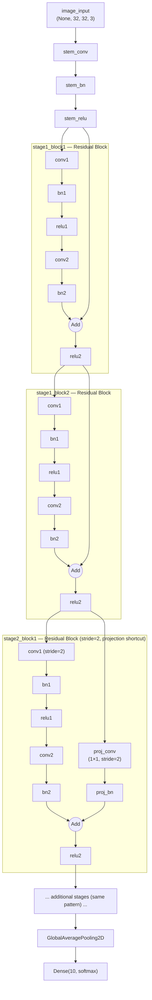

# Lesson 3: Layers, Models, and Compositional Architecture

## 1. First-Principles Intuition & Invariants

Every neural network, regardless of its depth, purpose, or topology, reduces to a single mechanical principle: a parameterized function that transforms an input tensor into an output tensor, where the parameters themselves are learned by minimizing a differentiable objective. TensorFlow's entire architecture is built around making this principle composable. A layer is a function. A model is a function composed from layers. Training is the process of discovering the parameter assignment that minimizes loss, and the entire computational graph exists to make that discovery tractable via automatic differentiation.

This sounds abstract until you internalize what it means at the memory level. When you instantiate a `tf.keras.layers.Dense(128, activation='relu')` layer, TensorFlow allocates a weight matrix `W` of shape `[input_dim, 128]` and a bias vector `b` of shape `[128]`, both as `tf.Variable` objects backed by device memory, whether CPU RAM or GPU VRAM. The forward pass computes `output = activation(input @ W + b)`, where `@` is a batched matrix multiplication dispatched to cuBLAS or oneDNN depending on the available hardware. The activation function, the matrix multiply, and the bias addition are each registered as operations in the computation graph, and TensorFlow's automatic differentiation engine, GradientTape, records these operations so their Jacobians can be composed during the backward pass via the chain rule.

The invariant that holds throughout every abstraction layer in TensorFlow is this: a layer is both a callable and a stateful container. It owns variables, exposes them via `layer.trainable_variables` and `layer.non_trainable_variables`, and declares a `call(inputs, training=False)` method that defines its forward computation. This dual identity as a callable and a variable container is what enables the entire ecosystem of composability, serialization, and distributed training. Every complex architecture, from a ResNet to a Transformer, is ultimately a tree of objects that all satisfy this contract.

Understanding weight initialization is non-negotiable for practitioners who want to train deep networks reliably. The pathologies of poor initialization were studied empirically long before they were understood theoretically. If weights are initialized too small, activations contract as they propagate forward through each layer, and gradients vanish during backpropagation. If weights are initialized too large, activations explode and the gradient signal similarly becomes numerically unstable. The fundamental insight of Glorot (Xavier) initialization is that for a linear layer connecting `n_in` inputs to `n_out` outputs, the variance of the weight distribution should be set to `2 / (n_in + n_out)`, which preserves the variance of activations in the forward pass and the variance of gradients in the backward pass simultaneously, under the assumption of a linear or nearly-linear activation function.

He initialization modifies this for the asymmetry introduced by ReLU, which zeroes out half its input distribution, thereby halving the effective variance. He initialization sets the weight variance to `2 / n_in`, compensating for that truncation. In TensorFlow, `tf.initializers.GlorotUniform()` is the default for most layers, while `tf.initializers.HeNormal()` is the correct choice for layers followed by ReLU or its variants. These are not interchangeable. Using Glorot initialization with deep ReLU networks is a subtle bug that manifests as slow convergence or training stagnation, particularly in networks deeper than roughly fifteen layers, because the variance mismatch accumulates multiplicatively across the depth of the network.

Batch Normalization complicates the initialization story in an important way. When BatchNorm is inserted between a linear layer and its activation, the activation's input distribution is normalized before it reaches the nonlinearity. This makes the network more robust to weight scale but does not eliminate the need for thoughtful initialization. The BatchNorm layer itself has four parameters per feature: a learned scale `gamma` initialized to ones, a learned shift `beta` initialized to zeros, and two running statistics, `moving_mean` and `moving_variance`, which are non-trainable variables updated during training via an exponential moving average. The distinction between trainable and non-trainable variables is architecturally significant because only trainable variables are exposed to the optimizer, while non-trainable variables must be updated explicitly through side effects in the layer's `call` method when `training=True`.

## 2. Core Architecture & Mechanics

TensorFlow exposes two primary paradigms for constructing models: the Sequential API and the Functional API. A third paradigm, model subclassing, provides maximum flexibility at the cost of reduced static analysis. Each paradigm encodes a different set of assumptions about the graph topology, and choosing the wrong one for a given architecture creates friction that compounds over time.

The Sequential API is the most constrained. It assumes a linear chain of layers where each layer has exactly one input tensor and one output tensor, and each layer's output is the next layer's input. This constraint is not a limitation for simple feedforward classifiers or basic convolutional networks, but it becomes a hard boundary the moment you need residual connections, multi-input layers, or branching topologies. The Sequential model builds its computation graph lazily; it defers shape inference until the first call to `model.build(input_shape)` or the first forward pass. This means that until the model has seen input shapes, `model.summary()` will show unknown output dimensions and `model.trainable_variables` will return an empty list.

```python
import tensorflow as tf

model = tf.keras.Sequential([
    tf.keras.layers.Input(shape=(784,)),
    tf.keras.layers.Dense(512, activation='relu',
                          kernel_initializer='he_normal',
                          bias_initializer='zeros'),
    tf.keras.layers.BatchNormalization(),
    tf.keras.layers.Dropout(0.3),
    tf.keras.layers.Dense(256, activation='relu',
                          kernel_initializer='he_normal',
                          bias_initializer='zeros'),
    tf.keras.layers.BatchNormalization(),
    tf.keras.layers.Dropout(0.3),
    tf.keras.layers.Dense(10, activation='softmax',
                          kernel_initializer='glorot_uniform',
                          bias_initializer='zeros'),
])

model.compile(
    optimizer=tf.keras.optimizers.Adam(learning_rate=1e-3),
    loss=tf.keras.losses.SparseCategoricalCrossentropy(),
    metrics=[tf.keras.metrics.SparseCategoricalAccuracy()],
)

model.summary()
```

The explicit `Input` layer is the correct production practice even for Sequential models because it forces eager shape inference at construction time, so `model.summary()` immediately reflects concrete output shapes. The `he_normal` initializer on the ReLU layers and `glorot_uniform` on the final softmax layer follow directly from the initialization theory established in Section 1.

The Functional API abandons the linear-chain assumption entirely by treating tensor construction as explicit data flow. You create a symbolic input tensor, pass it through layers as if executing eagerly, and then declare a model by specifying which symbolic tensors are inputs and which are outputs. TensorFlow records the entire data flow graph between those endpoints and uses it to construct the model. Because the graph is fully specified at construction time, Functional models support static analysis, enable `model.get_layer(name)` navigation, and serialize cleanly to SavedModel format without ambiguity.

The following example implements a residual block architecture using the Functional API, demonstrating the kind of topology that the Sequential API cannot express.

```python
import tensorflow as tf

def residual_block(x, filters, stride=1, name_prefix="res"):
    shortcut = x

    x = tf.keras.layers.Conv2D(
        filters, kernel_size=3, strides=stride, padding='same',
        use_bias=False,
        kernel_initializer='he_normal',
        name=f"{name_prefix}_conv1"
    )(x)
    x = tf.keras.layers.BatchNormalization(name=f"{name_prefix}_bn1")(x)
    x = tf.keras.layers.Activation('relu', name=f"{name_prefix}_relu1")(x)

    x = tf.keras.layers.Conv2D(
        filters, kernel_size=3, strides=1, padding='same',
        use_bias=False,
        kernel_initializer='he_normal',
        name=f"{name_prefix}_conv2"
    )(x)
    x = tf.keras.layers.BatchNormalization(name=f"{name_prefix}_bn2")(x)

    if shortcut.shape[-1] != filters or stride != 1:
        shortcut = tf.keras.layers.Conv2D(
            filters, kernel_size=1, strides=stride, padding='same',
            use_bias=False,
            kernel_initializer='he_normal',
            name=f"{name_prefix}_proj"
        )(shortcut)
        shortcut = tf.keras.layers.BatchNormalization(
            name=f"{name_prefix}_proj_bn"
        )(shortcut)

    x = tf.keras.layers.Add(name=f"{name_prefix}_add")([x, shortcut])
    x = tf.keras.layers.Activation('relu', name=f"{name_prefix}_relu2")(x)
    return x


def build_resnet_small(input_shape=(32, 32, 3), num_classes=10):
    inputs = tf.keras.Input(shape=input_shape, name="image_input")

    x = tf.keras.layers.Conv2D(
        64, kernel_size=3, strides=1, padding='same',
        use_bias=False, kernel_initializer='he_normal', name="stem_conv"
    )(inputs)
    x = tf.keras.layers.BatchNormalization(name="stem_bn")(x)
    x = tf.keras.layers.Activation('relu', name="stem_relu")(x)

    x = residual_block(x, 64,  stride=1, name_prefix="stage1_block1")
    x = residual_block(x, 64,  stride=1, name_prefix="stage1_block2")
    x = residual_block(x, 128, stride=2, name_prefix="stage2_block1")
    x = residual_block(x, 128, stride=1, name_prefix="stage2_block2")
    x = residual_block(x, 256, stride=2, name_prefix="stage3_block1")
    x = residual_block(x, 256, stride=1, name_prefix="stage3_block2")

    x = tf.keras.layers.GlobalAveragePooling2D(name="gap")(x)
    x = tf.keras.layers.Dense(
        num_classes, activation='softmax',
        kernel_initializer='glorot_uniform', name="classifier"
    )(x)

    return tf.keras.Model(inputs=inputs, outputs=x, name="ResNetSmall")


model = build_resnet_small()
model.summary(line_length=100)
```

The projection shortcut in `residual_block` is a critical correctness detail that many implementations get wrong. When the residual branch changes either the spatial resolution (via `stride > 1`) or the channel depth, the skip connection tensor and the residual tensor have incompatible shapes, and the `Add` layer cannot broadcast them. The projection convolution with `kernel_size=1` and matching strides resolves the shape mismatch without introducing spatial mixing, while BatchNormalization after the projection ensures the shortcut's distribution is normalized on the same scale as the residual branch before the element-wise addition.

The data flow through this model's construction can be visualized as a directed acyclic graph where each node is a layer invocation and each edge is a tensor:



The model subclassing API provides the greatest expressive power by letting you define forward logic as an arbitrary Python function inside `call()`. This is appropriate for architectures whose computation graph cannot be statically determined from tensor shapes alone, such as recurrent networks with dynamic sequence lengths, models with conditional branching based on input values, or research architectures in rapid flux. The cost is that subclassed models are harder to serialize, their internal layer graph is not fully visible to `model.summary()` without calling `model.build()`, and they cannot be visualized with `tf.keras.utils.plot_model` without an explicit `Input` layer.

```python
import tensorflow as tf

class MultiHeadAttentionBlock(tf.keras.layers.Layer):
    def __init__(self, d_model, num_heads, dropout_rate=0.1, **kwargs):
        super().__init__(**kwargs)
        assert d_model % num_heads == 0, \
            f"d_model ({d_model}) must be divisible by num_heads ({num_heads})"
        self.d_model = d_model
        self.num_heads = num_heads
        self.depth = d_model // num_heads

        self.wq = tf.keras.layers.Dense(d_model, use_bias=False,
                                        kernel_initializer='glorot_uniform')
        self.wk = tf.keras.layers.Dense(d_model, use_bias=False,
                                        kernel_initializer='glorot_uniform')
        self.wv = tf.keras.layers.Dense(d_model, use_bias=False,
                                        kernel_initializer='glorot_uniform')
        self.dense = tf.keras.layers.Dense(d_model, use_bias=False,
                                           kernel_initializer='glorot_uniform')
        self.dropout = tf.keras.layers.Dropout(dropout_rate)
        self.layernorm = tf.keras.layers.LayerNormalization(epsilon=1e-6)

    def split_heads(self, x, batch_size):
        seq_len = tf.shape(x)[1]
        x = tf.reshape(x, (batch_size, seq_len, self.num_heads, self.depth))
        return tf.transpose(x, perm=[0, 2, 1, 3])

    def call(self, x, mask=None, training=False):
        batch_size = tf.shape(x)[0]

        q = self.split_heads(self.wq(x), batch_size)
        k = self.split_heads(self.wk(x), batch_size)
        v = self.split_heads(self.wv(x), batch_size)

        scale = tf.math.sqrt(tf.cast(self.depth, tf.float32))
        scores = tf.matmul(q, k, transpose_b=True) / scale

        if mask is not None:
            scores += (mask * -1e9)

        weights = tf.nn.softmax(scores, axis=-1)
        weights = self.dropout(weights, training=training)

        context = tf.matmul(weights, v)
        context = tf.transpose(context, perm=[0, 2, 1, 3])
        seq_len = tf.shape(context)[2]
        context = tf.reshape(context, (batch_size, seq_len, self.d_model))

        output = self.dense(context)
        output = self.layernorm(x + output)
        return output

    def get_config(self):
        config = super().get_config()
        config.update({
            "d_model": self.d_model,
            "num_heads": self.num_heads,
            "dropout_rate": self.dropout.rate,
        })
        return config


class TransformerEncoder(tf.keras.Model):
    def __init__(self, num_layers, d_model, num_heads,
                 vocab_size, max_seq_len, num_classes,
                 dropout_rate=0.1, **kwargs):
        super().__init__(**kwargs)
        self.embedding = tf.keras.layers.Embedding(vocab_size, d_model)
        self.pos_encoding = self.positional_encoding(max_seq_len, d_model)
        self.dropout = tf.keras.layers.Dropout(dropout_rate)
        self.attn_blocks = [
            MultiHeadAttentionBlock(d_model, num_heads, dropout_rate,
                                    name=f"attn_block_{i}")
            for i in range(num_layers)
        ]
        self.ffn_layers = [
            tf.keras.layers.Dense(d_model * 4, activation='relu',
                                  kernel_initializer='he_normal',
                                  name=f"ffn_dense1_{i}")
            for i in range(num_layers)
        ]
        self.ffn_proj = [
            tf.keras.layers.Dense(d_model,
                                  kernel_initializer='glorot_uniform',
                                  name=f"ffn_dense2_{i}")
            for i in range(num_layers)
        ]
        self.ffn_norms = [
            tf.keras.layers.LayerNormalization(epsilon=1e-6, name=f"ffn_norm_{i}")
            for i in range(num_layers)
        ]
        self.pool = tf.keras.layers.GlobalAveragePooling1D()
        self.classifier = tf.keras.layers.Dense(num_classes)
        self.d_model = d_model

    @staticmethod
    def positional_encoding(max_seq_len, d_model):
        """Sinusoidal encodings (Vaswani et al., 2017), shape (1, max_seq_len, d_model)."""
        positions = tf.range(max_seq_len, dtype=tf.float32)[:, tf.newaxis]
        dims = tf.range(d_model, dtype=tf.float32)[tf.newaxis, :]
        angle_rates = 1.0 / tf.pow(10000.0, (2.0 * tf.floor(dims / 2.0)) / tf.cast(d_model, tf.float32))
        angles = positions * angle_rates
        # Even dimensions use sin, odd dimensions use cos
        encoding = tf.where(tf.cast(dims % 2, tf.bool), tf.cos(angles), tf.sin(angles))
        return encoding[tf.newaxis, ...]

    def call(self, token_ids, mask=None, training=False):
        seq_len = tf.shape(token_ids)[1]
        x = self.embedding(token_ids)
        x *= tf.math.sqrt(tf.cast(self.d_model, tf.float32))
        x += self.pos_encoding[:, :seq_len, :]
        x = self.dropout(x, training=training)

        for attn, ffn1, ffn2, norm in zip(self.attn_blocks, self.ffn_layers,
                                          self.ffn_proj, self.ffn_norms):
            x = attn(x, mask=mask, training=training)        # residual + norm inside
            x = norm(x + ffn2(self.dropout(ffn1(x), training=training)))

        return self.classifier(self.pool(x))                # logits
```
