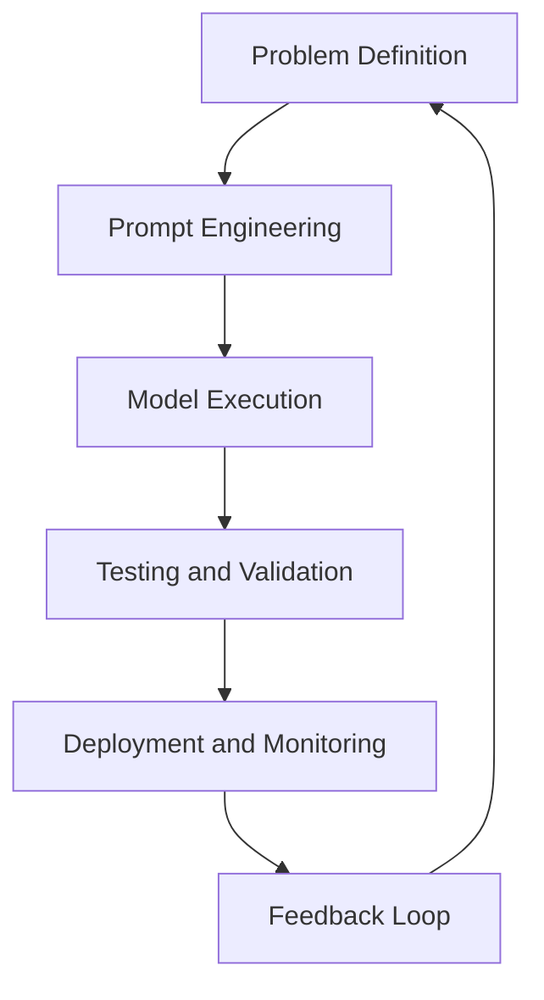

# Lesson 1: Foundations & System Invariants

## Curriculum Roadmap
This masterclass curriculum is designed to provide a deep, unshakeable theoretical grounding in the principles of prompt engineering and specification writing within the domain of computing. The course is structured to build a comprehensive understanding of the underlying systems and invariants that govern effective AI/Vibe coding. The curriculum modules are as follows:

1. **Foundations & System Invariants**: Establishing the first-principles mental model, understanding the problem space, and defining fundamental system guarantees.
2. **Prompt Engineering Techniques**: Advanced strategies for crafting effective prompts, leveraging natural language processing, and optimizing for AI model performance.
3. **Specification Writing**: Best practices for writing clear, precise, and unambiguous specifications, ensuring alignment between human intent and AI execution.
4. **System Integration & Testing**: Techniques for integrating AI models into existing systems, rigorous testing methodologies, and ensuring robustness and reliability.
5. **Security & Ethical Considerations**: Addressing security vulnerabilities, ethical implications, and responsible AI deployment practices.
6. **Case Studies & Real-World Applications**: Analyzing real-world examples, case studies, and best practices from industry leaders.

## 1. First-Principles Mental Model & Problem Space

The advent of AI and machine learning has revolutionized the landscape of software engineering and systems programming. At the heart of this transformation lies the ability to automate and optimize complex tasks through intelligent algorithms. However, the effectiveness of these algorithms hinges critically on the quality and specificity of the prompts and specifications provided to them. This lesson delves into the foundational principles that underpin prompt engineering and specification writing, providing a deep narrative exposition on why these technologies exist and the physics or systems trade-offs they solve.

### The Role of Prompts and Specifications

Prompts and specifications serve as the interface between human intent and machine execution. They are the means by which developers communicate their requirements to AI models, guiding the models in generating the desired outputs. The quality of these prompts and specifications directly impacts the accuracy, efficiency, and reliability of the AI-generated results. A well-crafted prompt or specification ensures that the AI model understands the task at hand, the constraints involved, and the desired outcomes, thereby minimizing errors and maximizing performance.

### The Problem Space

The problem space in AI/Vibe coding is multifaceted, encompassing various challenges related to natural language understanding, context management, and task execution. At a fundamental level, the problem space involves the following key aspects:

- **Natural Language Understanding (NLU)**: The ability of AI models to interpret and comprehend human language accurately. This requires a deep understanding of syntax, semantics, and context, as well as the ability to handle nuances and variations in language use.
- **Context Management**: Maintaining and leveraging context across multiple interactions to ensure coherence and consistency in AI-generated responses. This involves tracking the state of the conversation, understanding the user's intent, and adapting the responses accordingly.
- **Task Execution**: Translating the interpreted prompts and specifications into actionable tasks that the AI model can execute. This requires a clear mapping between the input and the desired output, as well as the ability to handle complex, multi-step processes.

### Systems Trade-offs

The development of effective prompts and specifications involves a series of trade-offs between various system attributes. These trade-offs are rooted in the underlying principles of information theory, computational complexity, and human-computer interaction. Some of the key trade-offs include:

- **Precision vs. Flexibility**: Achieving high precision in the prompts and specifications ensures that the AI model generates accurate and relevant outputs. However, excessive precision can limit the flexibility of the AI model, making it less adaptable to new or unexpected situations. Balancing precision with flexibility is crucial for creating robust and versatile AI systems.
- **Complexity vs. Simplicity**: Writing complex prompts and specifications can provide detailed and nuanced instructions to the AI model, leading to more accurate results. However, overly complex prompts can be difficult to understand and execute, increasing the likelihood of errors. Simplifying the prompts while maintaining clarity and precision is essential for ensuring effective AI performance.
- **Human Effort vs. AI Efficiency**: Crafting high-quality prompts and specifications requires significant human effort, including time, expertise, and domain knowledge. While this effort can improve the performance of the AI model, it also increases the overall cost and time required for development. Balancing human effort with AI efficiency is critical for optimizing the development process and achieving the desired outcomes.

## 2. Fundamental System Guarantees & Non-Negotiable Invariants

To ensure the effectiveness and reliability of AI/Vibe coding, it is essential to establish a set of fundamental system guarantees and non-negotiable invariants. These guarantees and invariants provide a solid foundation for developing and deploying AI models, ensuring that they meet the desired performance and quality standards.

### System Guarantees

The following system guarantees are critical for effective prompt engineering and specification writing:

- **Clarity and Precision**: The prompts and specifications must be clear and precise, leaving no room for ambiguity. This ensures that the AI model understands the task at hand and generates accurate and relevant outputs.
- **Consistency**: The prompts and specifications must be consistent across multiple interactions, ensuring coherence and consistency in AI-generated responses. This involves maintaining a consistent context and adapting the responses accordingly.
- **Comprehensiveness**: The prompts and specifications must be comprehensive, covering all relevant aspects of the task and providing detailed instructions to the AI model. This ensures that the AI model has all the necessary information to generate the desired outputs.
- **Scalability**: The prompts and specifications must be scalable, capable of handling a wide range of tasks and scenarios. This involves designing the prompts and specifications in a modular and flexible manner, allowing for easy adaptation to new situations.

### Non-Negotiable Invariants

The following non-negotiable invariants are essential for ensuring the reliability and robustness of AI/Vibe coding:

- **Correctness**: The AI model must generate correct and accurate outputs, meeting the desired performance and quality standards. This requires a rigorous testing and validation process to ensure that the prompts and specifications are effective.
- **Security**: The prompts and specifications must be secure, protecting against potential vulnerabilities and attacks. This involves implementing security best practices and ensuring that the AI model is resistant to malicious inputs.
- **Ethical Responsibility**: The prompts and specifications must be ethical, ensuring that the AI model operates in a responsible and transparent manner. This involves considering the ethical implications of the AI model and ensuring that it aligns with societal values and norms.

## 3. High-Level Process & Component Architecture

To provide a clear understanding of the core data and control flow in AI/Vibe coding, we will examine the high-level process and component architecture. This architecture encompasses the various components and processes involved in prompt engineering and specification writing, providing a comprehensive overview of the system.

### High-Level Process

The high-level process in AI/Vibe coding involves the following key steps:

1. **Problem Definition**: Identifying the problem to be solved and defining the desired outcomes. This involves understanding the requirements and constraints of the task, as well as the desired performance and quality standards.
2. **Prompt Engineering**: Crafting effective prompts and specifications that guide the AI model in generating the desired outputs. This involves designing the prompts and specifications in a clear, precise, and comprehensive manner, ensuring that the AI model understands the task at hand.
3. **Model Execution**: Executing the AI model with the crafted prompts and specifications, generating the desired outputs. This involves running the AI model on the specified inputs and monitoring its performance.
4. **Testing and Validation**: Testing and validating the AI model to ensure that it meets the desired performance and quality standards. This involves evaluating the AI model's outputs, identifying any errors or issues, and refining the prompts and specifications accordingly.
5. **Deployment and Monitoring**: Deploying the AI model in the production environment and monitoring its performance. This involves integrating the AI model into existing systems, ensuring that it operates smoothly, and monitoring its performance to identify any issues or areas for improvement.

### Component Architecture

The component architecture in AI/Vibe coding encompasses the various components and processes involved in prompt engineering and specification writing. The following Mermaid diagram represents the core data and control flow in the system:

In this architecture, the problem definition step involves identifying the problem to be solved and defining the desired outcomes. The prompt engineering step involves crafting effective prompts and specifications that guide the AI model in generating the desired outputs. The model execution step involves executing the AI model with the crafted prompts and specifications, generating the desired outputs. The testing and validation step involves testing and validating the AI model to ensure that it meets the desired performance and quality standards. The deployment and monitoring step involves deploying the AI model in the production environment and monitoring its performance. The feedback loop step involves using the feedback from the deployment and monitoring step to refine the prompts and specifications, ensuring that the AI model continues to meet the desired performance and quality standards.

By establishing a deep, unshakeable theoretical grounding in the principles of prompt engineering and specification writing, this lesson provides a solid foundation for the rest of the curriculum. The fundamental system guarantees and non-negotiable invariants ensure that the AI models meet the desired performance and quality standards, while the high-level process and component architecture provide a clear understanding of the core data and control flow in the system.
