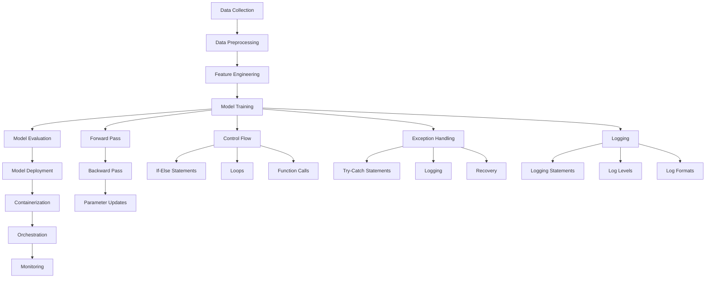

# Lesson 1: Foundations & Mathematical Formulation

## Curriculum Roadmap
This masterclass curriculum on AI/Vibe Coding is designed to provide a deep, unshakeable theoretical grounding in the principles and practices of advanced AI and machine learning techniques. The course is structured to build a comprehensive understanding of the problem spaces these techniques address, their mathematical formulations, and their architectural implementations. The curriculum roadmap is as follows:

1. **Foundations & Mathematical Formulation**
   - First-Principles Intuition & The Problem Space
   - Mathematical Formalization & Core Invariants
   - High-Level Pipeline & Architecture Dataflow

2. **Advanced AI Techniques & Optimizations**
   - Neural Architecture Search (NAS)
   - Transfer Learning & Fine-Tuning
   - Model Compression & Quantization

3. **System Integration & Deployment**
   - Containerization & Orchestration with Kubernetes
   - eBPF for AI Model Monitoring & Security
   - Cloud-Native AI Pipelines

4. **Security & Ethical Considerations**
   - Adversarial Robustness & Defense
   - Privacy-Preserving Machine Learning
   - Ethical AI & Bias Mitigation

5. **Case Studies & Real-World Applications**
   - Autonomous Systems & Robotics
   - Natural Language Processing & Generative Models
   - Reinforcement Learning & Decision Making

## 1. First-Principles Intuition & The Problem Space

The advent of AI and machine learning (ML) techniques has revolutionized numerous domains, from healthcare and finance to autonomous systems and natural language processing. At the heart of this revolution lies the ability of AI models to learn patterns and make predictions from data. However, the success of these models hinges on a deep understanding of the problem spaces they address and the computational trade-offs they entail.

One of the fundamental challenges in AI and ML is the formulation of the problem space itself. This involves defining the objectives, constraints, and data requirements of the problem at hand. For instance, in a recommendation system, the objective might be to predict user preferences based on historical interactions, while constraints could include real-time performance and data privacy. The problem space formulation is crucial because it guides the selection of appropriate algorithms, models, and evaluation metrics.

Another critical aspect of the problem space is the nature of the data. Data can be structured, semi-structured, or unstructured, and it can come from various sources, such as databases, logs, or sensor streams. The quality, quantity, and distribution of the data significantly impact the performance and generalization capabilities of AI models. Therefore, data preprocessing, feature engineering, and data augmentation are essential steps in preparing the data for training.

Moreover, the computational resources required to train and deploy AI models are often substantial. This includes not only the hardware resources, such as GPUs and TPUs, but also the software infrastructure, such as distributed computing frameworks and containerization platforms. The choice of computational resources and infrastructure can affect the training time, memory usage, and scalability of the models.

In summary, the first-principles intuition and problem space formulation are essential for developing effective AI and ML solutions. They provide the foundation for understanding the objectives, constraints, and data requirements of the problem, as well as the computational resources and infrastructure needed to address it.

## 2. Mathematical Formalization & Core Invariants

The mathematical formalization of AI and ML techniques is crucial for understanding their underlying principles and deriving rigorous guarantees. This section will delve into the mathematical formulation of a generic supervised learning problem, including the loss/objective equations, optimization bounds, and non-negotiable guarantees.

### Supervised Learning Problem Formulation

In supervised learning, the goal is to learn a mapping from input features to output labels based on a labeled training dataset. Let \( \mathcal{D} = \{(x_1, y_1), (x_2, y_2), \ldots, (x_n, y_n)\} \) be the training dataset, where \( x_i \in \mathbb{R}^d \) represents the input features and \( y_i \in \mathbb{R} \) represents the output label for the \( i \)-th training example. The objective is to find a function \( f: \mathbb{R}^d \to \mathbb{R} \) that minimizes a loss function \( L \) over the training dataset.

The loss function \( L \) measures the discrepancy between the predicted output \( f(x_i) \) and the true output \( y_i \). Common loss functions for regression problems include the mean squared error (MSE) and the mean absolute error (MAE), while common loss functions for classification problems include the cross-entropy loss and the hinge loss. For instance, the MSE loss function is defined as:

\[
L_{\text{MSE}}(f, \mathcal{D}) = \frac{1}{n} \sum_{i=1}^{n} (f(x_i) - y_i)^2
\]

The optimization problem can be formulated as:

\[
\min_{f \in \mathcal{F}} L(f, \mathcal{D})
\]

where \( \mathcal{F} \) is the set of candidate functions. In practice, the set of candidate functions is often parameterized by a finite number of parameters \( \theta \), such as the weights and biases of a neural network. Therefore, the optimization problem can be rewritten as:

\[
\min_{\theta \in \Theta} L(f_\theta, \mathcal{D})
\]

where \( f_\theta \) is the parameterized function and \( \Theta \) is the parameter space.

### Optimization Bounds & Non-Negotiable Guarantees

The optimization problem in supervised learning is often non-convex, meaning that it may have multiple local minima and saddle points. Therefore, finding the global minimum is challenging, and the optimization algorithm may converge to a suboptimal solution. To address this challenge, various optimization algorithms, such as stochastic gradient descent (SGD) and its variants, are commonly used.

The convergence properties of the optimization algorithm depend on several factors, including the choice of the loss function, the parameter space, and the optimization algorithm. For instance, the MSE loss function is convex, meaning that it has a unique global minimum. However, the parameter space of a neural network is often non-convex, making the optimization problem challenging.

Despite the non-convexity of the optimization problem, several non-negotiable guarantees can be derived. One such guarantee is the generalization bound, which provides a theoretical upper bound on the expected error of the learned model on unseen data. The generalization bound depends on the complexity of the hypothesis class \( \mathcal{F} \) and the size of the training dataset \( n \). For instance, the VC (Vapnik–Chervonenkis) dimension is a measure of the complexity of the hypothesis class, and it can be used to derive the generalization bound.

Another non-negotiable guarantee is the convergence bound, which provides a theoretical upper bound on the convergence rate of the optimization algorithm. The convergence bound depends on the choice of the optimization algorithm, the learning rate, and the step size. For instance, the convergence rate of SGD is typically linear, meaning that the expected error decreases linearly with the number of iterations.

In summary, the mathematical formalization of AI and ML techniques provides a rigorous framework for understanding the underlying principles and deriving non-negotiable guarantees. It includes the formulation of the supervised learning problem, the choice of the loss function, the optimization problem, and the convergence and generalization bounds.

## 3. High-Level Pipeline & Architecture Dataflow

The high-level pipeline and architecture dataflow of an AI/ML model are essential for understanding its implementation and deployment. This section will provide a clean Mermaid diagram representing the model pipeline, tensor transformations, and agentic control flow.

### Model Pipeline

The model pipeline of an AI/ML model typically consists of several stages, including data preprocessing, feature engineering, model training, model evaluation, and model deployment. Each stage plays a crucial role in the overall performance and generalization capabilities of the model.

1. **Data Preprocessing**: This stage involves cleaning and transforming the raw data into a suitable format for training. This includes handling missing values, normalizing the features, and augmenting the data to improve the robustness of the model.

2. **Feature Engineering**: This stage involves selecting and transforming the features to improve the performance of the model. This includes selecting relevant features, creating new features, and encoding categorical variables.

3. **Model Training**: This stage involves training the model on the preprocessed and engineered features. This includes selecting the model architecture, choosing the loss function, and optimizing the model parameters.

4. **Model Evaluation**: This stage involves evaluating the performance of the model on a validation dataset. This includes selecting the evaluation metrics, tuning the hyperparameters, and selecting the best model.

5. **Model Deployment**: This stage involves deploying the model to a production environment. This includes containerizing the model, orchestrating the deployment, and monitoring the performance.

### Tensor Transformations

The tensor transformations in an AI/ML model are essential for processing the input data and generating the output predictions. This includes the forward pass, backward pass, and parameter updates.

1. **Forward Pass**: This stage involves processing the input data through the model layers to generate the output predictions. This includes applying the activation functions, performing the matrix multiplications, and aggregating the outputs.

2. **Backward Pass**: This stage involves computing the gradients of the loss function with respect to the model parameters. This includes applying the chain rule, performing the matrix multiplications, and aggregating the gradients.

3. **Parameter Updates**: This stage involves updating the model parameters based on the computed gradients. This includes applying the optimization algorithm, performing the matrix multiplications, and aggregating the updates.

### Agentic Control Flow

The agentic control flow in an AI/ML model is essential for managing the execution of the model pipeline and handling the exceptions. This includes the control flow statements, exception handling, and logging.

1. **Control Flow Statements**: This stage involves managing the execution of the model pipeline based on the conditions. This includes the if-else statements, loops, and function calls.

2. **Exception Handling**: This stage involves handling the exceptions that may occur during the execution of the model pipeline. This includes the try-catch statements, logging, and recovery.

3. **Logging**: This stage involves logging the execution of the model pipeline for debugging and monitoring. This includes the logging statements, log levels, and log formats.

### Mermaid Diagram

In summary, the high-level pipeline and architecture dataflow of an AI/ML model are essential for understanding its implementation and deployment. They include the model pipeline, tensor transformations, and agentic control flow, which are represented in a clean Mermaid diagram.
