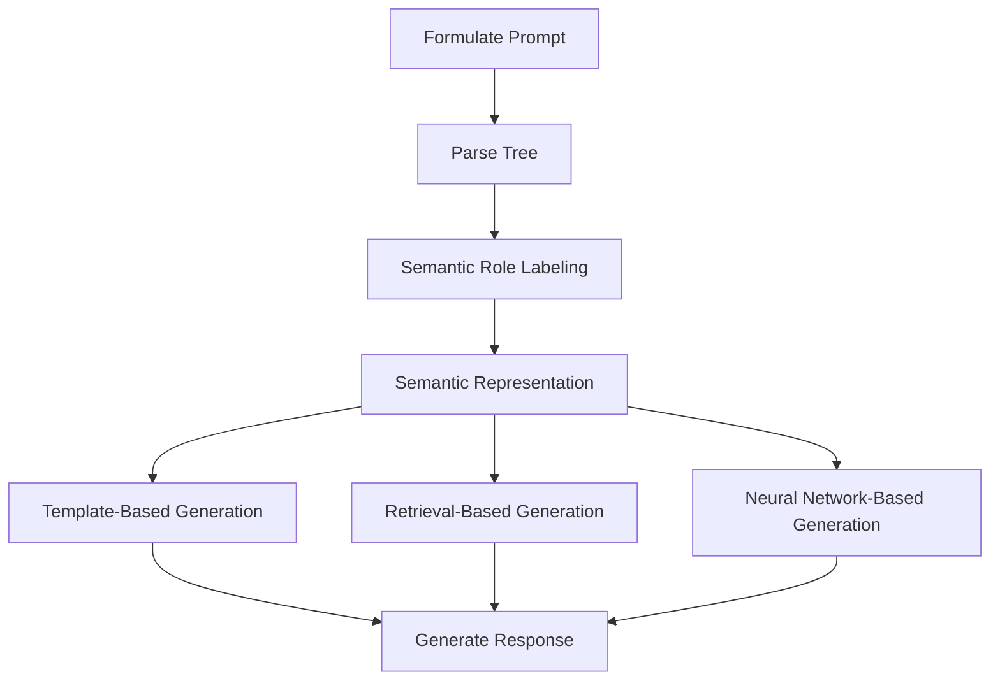

# Lesson 1: Introduction to Prompt Engineering

## 1. First-Principles Intuition & Invariants

Prompt engineering stands as a cornerstone in the fields of artificial intelligence and natural language processing, where the art of crafting precise and effective prompts is essential. At its core, prompt engineering involves the strategic formulation of queries or instructions to elicit desired responses from AI models. This process is not merely about typing a few words into a text box; it is a sophisticated interplay between human intent and machine understanding, grounded in principles of context, specificity, and structure.

The problem space of prompt engineering is vast and multifaceted, encompassing a wide array of applications from software development to systems architecture. The effectiveness of a prompt can significantly influence the quality, relevance, and utility of the AI-generated output. To understand the invariants that govern this domain, we must delve into the underlying mechanisms that shape the interaction between human prompts and AI models.

At the heart of prompt engineering lies the concept of context. Contextual information provides the necessary background and environment for the AI model to interpret the prompt accurately. Without adequate context, the model may generate responses that are tangential or entirely irrelevant to the intended query. For instance, a prompt asking for a "report" could yield vastly different results depending on whether the context specifies a financial report, a technical report, or a literary critique. Therefore, the inclusion of relevant context is crucial for guiding the AI model towards producing the desired output.

Specificity is another critical invariant in prompt engineering. The more specific a prompt, the more likely it is to elicit a precise and targeted response. Ambiguity in a prompt can lead to a wide range of possible interpretations, resulting in outputs that may not meet the user's expectations. For example, a vague prompt such as "describe a system" could be interpreted in numerous ways, whereas a more specific prompt like "describe a distributed system architecture for a cloud-native application" provides clear direction and constraints for the AI model.

Structure also plays a pivotal role in prompt engineering. A well-structured prompt is organized and coherent, making it easier for the AI model to parse and understand the intended request. Structure can be achieved through the use of clear headings, subheadings, bullet points, and numbered lists, which help to delineate different aspects of the prompt. Additionally, structuring a prompt in a logical and sequential manner can enhance the clarity and precision of the output.

From a theoretical standpoint, the principles of prompt engineering can be formalized through a set of invariants that govern the interaction between human prompts and AI models. These invariants include the necessity of context, the importance of specificity, and the value of structure. By adhering to these invariants, prompt engineers can craft prompts that are more likely to yield high-quality and relevant outputs.

## 2. Core Architecture & Mechanics

To gain a deeper understanding of the core architecture and mechanics of prompt engineering, it is essential to examine the internal data structures, algorithms, and execution models that underpin the process. At a high level, the architecture of prompt engineering can be visualized as a pipeline that transforms human prompts into AI-generated outputs.

The pipeline begins with the formulation of a prompt, which is then processed by the AI model's natural language understanding (NLU) component. The NLU component is responsible for parsing the prompt and extracting the relevant information, such as the context, specificity, and structure. This information is then used to generate a response that is tailored to the prompt.

The NLU component relies on a variety of data structures and algorithms to perform its task. One such data structure is the parse tree, which represents the grammatical structure of the prompt. The parse tree is constructed using a parsing algorithm, such as a context-free grammar (CFG) parser, which analyzes the prompt and identifies its syntactic components. The parse tree is then used to extract the semantic information from the prompt, such as the context, specificity, and structure.

Another critical component of the NLU component is the semantic role labeling (SRL) algorithm, which identifies the roles of different words and phrases in the prompt. The SRL algorithm uses a set of predefined roles, such as agent, action, and theme, to label the words and phrases in the prompt. The labeled roles are then used to generate a semantic representation of the prompt, which is used to guide the generation of the response.

The generation of the response is performed by the AI model's natural language generation (NLG) component. The NLG component uses the semantic representation of the prompt to generate a response that is tailored to the prompt. The NLG component relies on a variety of algorithms and data structures to perform its task, including template-based generation, retrieval-based generation, and neural network-based generation.

Template-based generation involves the use of predefined templates to generate the response. The templates are filled in with the relevant information extracted from the prompt, such as the context, specificity, and structure. Template-based generation is useful for generating responses that follow a specific format or structure, such as technical reports or legal documents.

Retrieval-based generation involves the use of a large corpus of pre-existing text to generate the response. The NLG component searches the corpus for text that is relevant to the prompt and uses it to generate the response. Retrieval-based generation is useful for generating responses that require a high degree of specificity and accuracy, such as technical specifications or legal opinions.

Neural network-based generation involves the use of a neural network to generate the response. The neural network is trained on a large corpus of text and is capable of generating responses that are both coherent and contextually relevant. Neural network-based generation is useful for generating responses that require a high degree of creativity and originality, such as creative writing or poetry.

The pipeline of prompt engineering can be visualized using a Mermaid diagram as follows:

In this diagram, the pipeline begins with the formulation of a prompt, which is then processed by the NLU component to generate a parse tree. The parse tree is used to perform semantic role labeling, which in turn generates a semantic representation of the prompt. This semantic representation is then used by the NLG component to generate a response through one of several methods: template-based, retrieval-based, or neural network-based generation.
