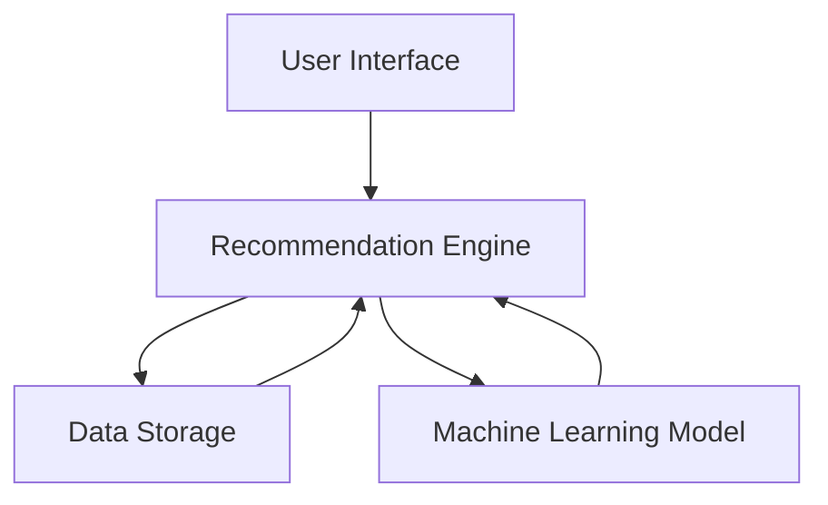

# Lesson 2: Writing Clear and Comprehensive Specifications

## 1. First-Principles Intuition & Invariants

In the realm of software engineering, particularly within the domain of AI and Vibe Coding, the ability to articulate clear and comprehensive specifications is paramount. Specifications serve as the blueprint for any software project, guiding developers, stakeholders, and systems architects through the intricate process of design, implementation, and deployment. They encapsulate the functional and non-functional requirements, use cases, and acceptance criteria that define the scope, behavior, and performance of the system. The precision and clarity of these specifications directly impact the quality, reliability, and maintainability of the final product.

At the heart of writing effective specifications lies the principle of unambiguity. Ambiguity introduces uncertainty, which can lead to misinterpretation and errors. In the context of AI projects, where the system's behavior is often probabilistic and data-driven, clarity is even more critical. Specifications must be detailed enough to leave no room for ambiguity, ensuring that all stakeholders have a shared understanding of the project's goals and constraints.

Functional requirements define what the system must do, specifying the system's capabilities and behaviors. These requirements are typically expressed in terms of use cases, which describe the interactions between the system and its users or other systems. Non-functional requirements, on the other hand, define how the system must perform, encompassing aspects such as performance, reliability, security, and usability. Both types of requirements are essential for a comprehensive specification, as they address both the what and the how of the system.

The problem space of AI projects is inherently complex, involving intricate algorithms, large datasets, and sophisticated models. Specifications must capture the nuances of these components, providing a clear roadmap for their integration and deployment. Mathematical and system invariants play a crucial role in this process, serving as the foundational truths that underpin the system's behavior. For instance, in a recommendation system, an invariant might be that the system always returns a list of relevant items based on the user's preferences and past interactions. These invariants must be clearly articulated in the specifications, ensuring that they are consistently enforced throughout the development process.

## 2. Core Architecture & Mechanics

To illustrate the importance of clear and comprehensive specifications, consider the architecture of a hypothetical AI-driven recommendation system. This system leverages machine learning models to provide personalized recommendations to users based on their browsing history and preferences. The core architecture of the system can be decomposed into several key components, each with its own set of requirements and interactions.

At the heart of the system lies the recommendation engine, responsible for generating personalized recommendations. The recommendation engine is built on top of a machine learning model trained on user data. The model's architecture is critical to the system's performance, as it determines the accuracy and efficiency of the recommendations. The specifications must detail the model's architecture, including the choice of algorithms, the training data, and the evaluation metrics. For instance, the specifications might specify that the model uses a collaborative filtering approach, trained on a dataset of user interactions, and evaluated using precision and recall metrics.

The recommendation engine interacts with a data storage layer, which stores the user data and the trained model. The data storage layer must be designed to handle large volumes of data efficiently, ensuring that the system can scale as the number of users and interactions grows. The specifications must detail the data storage layer's architecture, including the choice of database, the data schema, and the indexing strategies. For example, the specifications might specify that the system uses a NoSQL database, with a schema that includes user profiles, interaction history, and model parameters, and indexing strategies that optimize query performance.

The recommendation engine also interacts with a user interface layer, which presents the recommendations to the user. The user interface layer must be designed to provide a seamless and intuitive experience, ensuring that users can easily find and interact with the recommendations. The specifications must detail the user interface layer's architecture, including the choice of technologies, the user interface design, and the interaction protocols. For instance, the specifications might specify that the system uses a web-based interface, with a design that emphasizes simplicity and ease of use, and interaction protocols that support real-time updates.

The architecture of the recommendation system can be visualized using a Mermaid diagram:

In this diagram, the user interface layer interacts with the recommendation engine, which in turn interacts with the data storage layer and the machine learning model. The data storage layer and the machine learning model provide the necessary data and models to the recommendation engine, which generates personalized recommendations for the user.

## 3. High-Performance Optimization & Failure Modes

To ensure that the recommendation system performs efficiently and reliably, the specifications must address several high-performance optimizations and failure modes. These optimizations and failure modes are critical to the system's success, as they determine its ability to handle large volumes of data and interactions, and to recover from unexpected failures.

One of the key optimizations is the use of caching. The recommendation engine can cache frequently accessed data and models, reducing the number of database queries and model evaluations. The specifications must detail the caching strategy, including the choice of cache, the cache invalidation policy, and the cache hit/miss metrics. For instance, the specifications might specify that the system uses an in-memory cache, with a cache invalidation policy that invalidates cached data when it is updated, and cache hit/miss metrics that monitor the cache's performance.

Another key optimization is the use of parallel processing. The recommendation engine can leverage parallel processing to evaluate multiple models and generate recommendations concurrently. The specifications must detail the parallel processing strategy, including the choice of parallel processing framework, the workload distribution policy, and the performance metrics. For example, the specifications might specify that the system uses a distributed computing framework, with a workload distribution policy that balances the load across multiple nodes, and performance metrics that track the system's throughput and latency.
