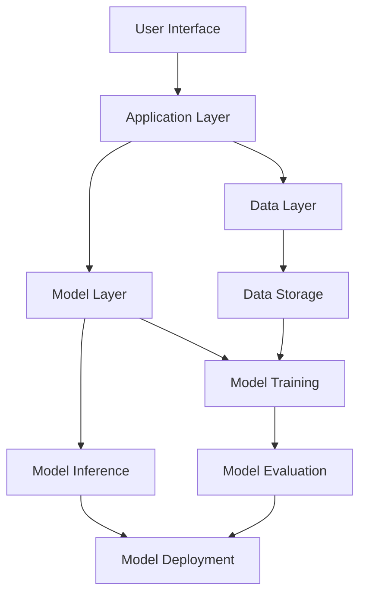

# Lesson 2: Writing Clear and Effective Specifications

## 1. First-Principles Intuition & Invariants

In the realm of software engineering, particularly within the domain of AI and machine learning, the clarity and precision of specifications are paramount. Specifications serve as the blueprint for the development process, guiding architects, engineers, and stakeholders through the intricate design and implementation phases. A well-crafted specification ensures that all parties have a shared understanding of the project's objectives, constraints, and deliverables, which is crucial for the successful execution of AI projects. These projects often involve complex algorithms, vast datasets, and sophisticated computational models, requiring a comprehensive and unambiguous specification.

The problem space of AI projects is inherently multidisciplinary, encompassing computer science, mathematics, domain expertise, and user experience design. Each of these dimensions introduces its own set of challenges and requirements, necessitating a specification that is robust and free of ambiguity. The invariants that underpin effective specifications include precision, completeness, consistency, and traceability. Precision ensures that every requirement is clearly articulated, leaving no room for ambiguity. Completeness guarantees that all necessary aspects of the project are covered, from functional requirements to non-functional constraints. Consistency ensures that the specification does not contain conflicting or contradictory statements, which can lead to misunderstandings and errors. Traceability allows for the mapping of requirements to design decisions, implementation details, and test cases, facilitating a systematic and rigorous development process.

To establish a first-principles intuition for writing effective specifications, it is essential to understand the role of specifications in the software development lifecycle. Specifications act as a contract between stakeholders, defining the scope, objectives, and deliverables of the project. They serve as a reference point throughout the development process, ensuring that the project remains aligned with its original goals. In the context of AI projects, specifications must also address the unique challenges posed by machine learning models, such as data quality, model interpretability, and ethical considerations. By grounding specifications in these principles, we can ensure that they are robust, reliable, and effective.

## 2. Core Architecture & Mechanics

The architecture of a specification for an AI project is a critical component that dictates the overall structure and organization of the document. A well-architected specification should be modular, allowing for easy navigation and understanding. It should be divided into logical sections, each addressing a specific aspect of the project. The core architecture of a specification typically includes an introduction, a detailed description of the system architecture, functional and non-functional requirements, data requirements, and a conclusion.

The introduction sets the stage for the specification, providing an overview of the project, its objectives, and its scope. It should also outline the stakeholders involved and their roles, as well as the assumptions and constraints that guide the project. The system architecture section delves into the high-level design of the system, including the components, their interactions, and the data flow between them. This section should be accompanied by diagrams, such as the one below, to provide a visual representation of the architecture.

Functional requirements describe the specific behaviors and capabilities that the system must exhibit. They should be detailed and unambiguous, specifying the inputs, expected outputs, and any preconditions or postconditions. Non-functional requirements, on the other hand, address the system's performance, reliability, security, and usability. These requirements are equally important, as they ensure that the system meets the necessary quality standards.

Data requirements are a critical component of AI project specifications, as they define the data sources, data formats, and data processing pipelines. They should specify the data quality standards, data privacy considerations, and data governance policies. The data requirements section should also include a data dictionary, which provides a detailed description of each data element, its data type, and its purpose.

## 3. High-Performance Optimization & Failure Modes

High-performance optimization is a critical aspect of AI project specifications, as it ensures that the system can handle large-scale data and complex models efficiently. Optimization strategies should be outlined in the specification, including techniques for parallel processing, distributed computing, and resource management. These strategies should be grounded in the system architecture and the specific requirements of the project.

Concurrency is a key consideration in high-performance optimization, as it allows the system to perform multiple tasks simultaneously. The specification should address the concurrency model, including the use of threads, processes, or asynchronous programming. It should also specify the mechanisms for synchronization and communication between concurrent components, such as locks, semaphores, or message passing.

Resource scaling is another critical aspect of high-performance optimization, as it ensures that the system can handle increasing loads and data volumes. The specification should outline the scaling strategies, including horizontal scaling (adding more nodes) and vertical scaling (increasing the resources of existing nodes). It should also specify the load balancing mechanisms and the monitoring and alerting systems for resource utilization.

Boundary edge cases and failure modes are critical considerations in AI project specifications, as they ensure that the system can handle unexpected inputs and failures gracefully. The specification should identify the boundary conditions and edge cases, including the limits of the input data, the limits of the model's predictions, and the limits of the system's performance. It should also specify the failure modes, including the potential causes of failure, the impact of failure, and the recovery strategies.

Writing clear and effective specifications is a critical skill for senior software engineers, systems programmers, and domain architects. A well-crafted specification ensures that all parties have a shared understanding of the project's objectives, constraints, and deliverables. It provides a blueprint for the development process, guiding architects, engineers, and stakeholders through the intricate design and implementation phases.
