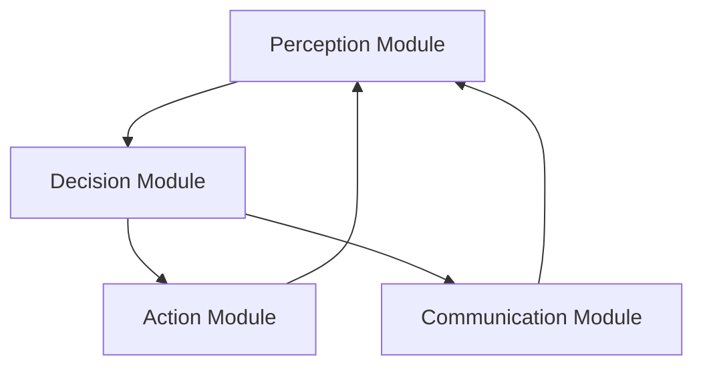

# Lesson 1: Overview of Agentic Workflows

## First-Principles Intuition & Invariants

In the realm of computing, particularly within the domain of AI and VIBE (Voice, Interaction, Behavior, Emotion) coding, the concept of agentic workflows emerges as a pivotal paradigm that redefines how software systems interact with their environments. At its core, an agentic workflow is a model where software entities, or agents, operate with a degree of autonomy, making decisions and taking actions based on their environment and objectives. This paradigm is not merely a shift in software design but a fundamental reorientation towards more dynamic, responsive, and intelligent systems.

To understand the importance of agentic workflows, we must first delve into the problem space they address. Traditional software systems are often static and deterministic, designed to perform specific tasks under well-defined conditions. However, the real world is inherently dynamic and uncertain, requiring systems to adapt and respond to changing environments. Agentic workflows provide a framework for building systems that can navigate this complexity, making them indispensable in the era of AI and VIBE coding.

The theoretical grounding of agentic workflows is deeply rooted in the principles of agency and autonomy. An agent, in this context, is an entity capable of perceiving its environment, making decisions, and acting upon those decisions. This capability is underpinned by several invariants:

Autonomy: Agents operate independently, making decisions without constant external intervention. This autonomy is crucial for systems that need to respond to real-time changes and uncertainties.

Reactivity: Agents can perceive changes in their environment and react accordingly. This reactivity is essential for systems that need to adapt to dynamic conditions.

Proactiveness: Agents can anticipate future changes and take preemptive actions. This proactiveness is vital for systems that need to stay ahead of potential issues.

Social Ability: Agents can interact with other agents and entities in their environment. This social ability is necessary for systems that need to collaborate and coordinate with other entities.

These invariants form the bedrock of agentic workflows, enabling systems to exhibit behaviors that are both intelligent and adaptive. By grounding agentic workflows in these first-principles, we can build systems that are not only robust but also capable of evolving and improving over time.

## Core Architecture & Mechanics

The architecture of agentic workflows is designed to support the invariants of autonomy, reactivity, proactiveness, and social ability. At the heart of this architecture lies the agent model, which consists of several key components:

The perception module is responsible for gathering information about the environment. It can include sensors, data feeds, and other mechanisms for collecting data.

The decision module processes the data collected by the perception module and makes decisions based on predefined objectives and rules. It can employ various decision-making algorithms, including rule-based systems, machine learning models, and optimization techniques.

The action module executes the decisions made by the decision module. It can include actuators, APIs, and other mechanisms for interacting with the environment.

The communication module enables agents to interact with other agents and entities in their environment. It can include communication protocols, APIs, and other mechanisms for exchanging information.

To illustrate the mechanics of agentic workflows, we can use a simple Mermaid diagram to depict the interaction between these components:

In this diagram, the perception module collects data from the environment and passes it to the decision module. The decision module processes the data and makes decisions, which are then executed by the action module. The decision module also communicates with the communication module, which can exchange information with other agents and entities. This feedback loop allows the agent to continuously adapt and improve its behavior.

## High-Performance Optimization & Failure Modes

Building high-performance agentic workflows requires careful consideration of concurrency, resource scaling, boundary edge cases, and failure mitigations. These factors are critical for ensuring that agents can operate efficiently and reliably in dynamic environments.

Concurrency is a key aspect of agentic workflows, as agents often need to perform multiple tasks simultaneously. To achieve concurrency, agentic workflows can employ various techniques, including multithreading, asynchronous programming, and distributed computing. These techniques enable agents to perform multiple operations in parallel, improving their efficiency and responsiveness.

Resource scaling is another critical factor in agentic workflows, as agents need to adapt to changing resource availability. To achieve resource scaling, agentic workflows can employ techniques such as load balancing, resource pooling, and dynamic resource allocation. These techniques enable agents to efficiently manage their resources, ensuring that they can operate effectively even in resource-constrained environments.

Boundary edge cases are situations where agents operate at the limits of their capabilities. These cases can include extreme environmental conditions, resource constraints, and other challenges. To handle boundary edge cases, agentic workflows can employ techniques such as fault tolerance, redundancy, and adaptive behavior. These techniques enable agents to continue operating effectively even in challenging conditions.

Failure mitigations are critical for ensuring that agents can recover from failures and continue operating effectively. To achieve failure mitigations, agentic workflows can employ techniques such as error detection, error correction, and recovery protocols. These techniques enable agents to detect and recover from errors, ensuring that they can continue operating effectively even in the presence of failures.

Agentic workflows provide a powerful framework for building intelligent and adaptive systems. By grounding agentic workflows in the principles of agency and autonomy, we can build systems that are capable of navigating the complexities of the real world. Through careful consideration of concurrency, resource scaling, boundary edge cases, and failure mitigations, we can build high-performance agentic workflows that are robust, efficient, and reliable.
