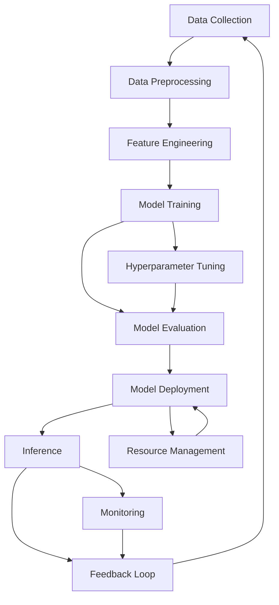

# Lesson 1: Foundations & Mathematical Formulation

## Curriculum Roadmap
This masterclass curriculum on "02 Agentic Workflows And Tools" is designed to provide a deep, unshakeable theoretical grounding in the principles of agentic workflows and tools, particularly within the context of AI/ML. The curriculum is structured to build from foundational concepts to advanced applications, ensuring that senior machine learning engineers, AI researchers, and systems architects gain a comprehensive understanding of the problem space, mathematical formalization, and architectural design. The modules are as follows:

1. **Foundations & Mathematical Formulation**: Establishing the theoretical underpinnings, problem space formulation, and mathematical invariants.
2. **Agentic Control Flows**: Exploring the control structures and decision-making processes in agentic workflows.
3. **Tensor Transformations & Data Pipelines**: Delving into the data transformations and pipeline architectures that enable efficient model training and inference.
4. **Advanced Optimization Techniques**: Investigating advanced optimization strategies for improving model performance and resource utilization.
5. **Security & Robustness**: Ensuring the security and robustness of agentic workflows and AI/ML systems.
6. **Case Studies & Practical Applications**: Applying the learned concepts to real-world scenarios and case studies.

## 1. First-Principles Intuition & The Problem Space

The advent of agentic workflows and tools in the realm of AI/ML is driven by the need to automate and optimize complex decision-making processes. Traditional machine learning models are often static and require manual intervention for tasks such as data preprocessing, model training, and deployment. In contrast, agentic workflows introduce a level of autonomy and adaptability, enabling systems to learn, reason, and act in dynamic environments without continuous human oversight.

At the heart of this transformation lies the problem of computational efficiency and adaptability. Traditional ML pipelines are typically linear and sequential, with each step requiring manual tuning and optimization. This approach is not only time-consuming but also prone to errors and suboptimal performance. Agentic workflows, on the other hand, leverage advanced algorithms and tools to automate these processes, allowing for real-time adjustments and optimizations based on changing data and environmental conditions.

The need for agentic workflows is further exacerbated by the increasing complexity of modern AI/ML systems. As models grow in size and complexity, the computational resources required for training and inference also increase. Agentic workflows enable efficient resource management and optimization, ensuring that models can be trained and deployed with minimal overhead and maximum performance.

Moreover, agentic workflows address the challenge of scalability. In distributed and cloud-native environments, the ability to scale AI/ML systems is critical for handling large-scale data and workloads. Agentic workflows provide the necessary mechanisms for scaling models across multiple nodes and resources, ensuring that systems can handle increasing demands without degradation in performance.

In summary, agentic workflows and tools are essential for addressing the fundamental limitations and computational trade-offs associated with traditional machine learning pipelines. They provide a framework for automating and optimizing complex decision-making processes, enabling systems to learn, reason, and act in dynamic environments with minimal human intervention.

## 2. Mathematical Formalization & Core Invariants

To establish a rigorous mathematical foundation for agentic workflows, we must delve into the core principles and invariants that govern these systems. At the heart of agentic workflows is the concept of reinforcement learning (RL), a subfield of machine learning that focuses on training agents to make decisions in dynamic environments. RL algorithms are designed to learn optimal policies that maximize cumulative rewards over time.

### Reinforcement Learning Framework

The reinforcement learning framework can be formalized using the Markov Decision Process (MDP) model. An MDP is defined by a tuple \((S, A, P, R, \gamma)\), where:

- \(S\) is the set of states.
- \(A\) is the set of actions.
- \(P\) is the transition probability function, \(P(s' | s, a)\), representing the probability of transitioning to state \(s'\) from state \(s\) when action \(a\) is taken.
- \(R\) is the reward function, \(R(s, a, s')\), representing the immediate reward received when transitioning from state \(s\) to state \(s'\) after taking action \(a\).
- \(\gamma\) is the discount factor, a value between 0 and 1 that determines the importance of future rewards.

The goal of an RL agent is to learn a policy \(\pi: S \rightarrow A\) that maximizes the expected cumulative reward. This can be formalized using the value function \(V^\pi(s)\), which represents the expected cumulative reward starting from state \(s\) and following policy \(\pi\):

\[ V^\pi(s) = \mathbb{E}\left[\sum_{t=0}^{\infty} \gamma^t R(s_t, a_t, s_{t+1}) \mid s_0 = s, \pi\right] \]

The optimal policy \(\pi^*\) is the policy that maximizes the value function for all states:

\[ \pi^* = \arg\max_\pi V^\pi(s) \]

### Loss/Objective Equations

The objective of an RL agent is to learn the optimal policy \(\pi^*\) that maximizes the expected cumulative reward. This can be achieved through various RL algorithms, each with its own loss/objective equations. One popular algorithm is Q-learning, which aims to learn the action-value function \(Q^\pi(s, a)\), representing the expected cumulative reward starting from state \(s\), taking action \(a\), and following policy \(\pi\):

\[ Q^\pi(s, a) = \mathbb{E}\left[\sum_{t=0}^{\infty} \gamma^t R(s_t, a_t, s_{t+1}) \mid s_0 = s, a_0 = a, \pi\right] \]

The Q-learning update rule is given by:

\[ Q(s, a) \leftarrow Q(s, a) + \alpha \left[R(s, a, s') + \gamma \max_{a'} Q(s', a') - Q(s, a)\right] \]

where \(\alpha\) is the learning rate, a hyperparameter that determines the step size of the update.

Another popular RL algorithm is Deep Q-Networks (DQN), which extends Q-learning by using a neural network to approximate the action-value function. The loss function for DQN is given by:

\[ \mathcal{L}(\theta) = \mathbb{E}\left[\left(y - Q(s, a; \theta)\right)^2\right] \]

where \(y\) is the target value, given by:

\[ y = R(s, a, s') + \gamma \max_{a'} Q(s', a'; \theta^-) \]

and \(\theta^-\) are the parameters of the target network, which are periodically updated to stabilize training.

### Optimization Bounds & Non-Negotiable Guarantees

The optimization of RL algorithms is subject to various bounds and guarantees that ensure convergence and stability. One key guarantee is the Bellman optimality equation, which states that the optimal action-value function \(Q^*(s, a)\) satisfies:

\[ Q^*(s, a) = \mathbb{E}\left[R(s, a, s') + \gamma \max_{a'} Q^*(s', a') \mid s, a\right] \]

This equation provides a fixed point for the optimal action-value function, ensuring that the RL algorithm converges to the optimal policy.

Another important guarantee is the exploration-exploitation trade-off, which balances the need to explore new actions and exploit known actions to maximize cumulative rewards. This trade-off is often managed using exploration strategies such as \(\epsilon\)-greedy, where the agent selects a random action with probability \(\epsilon\) and the optimal action with probability \(1 - \epsilon\).

In summary, the mathematical formalization of agentic workflows is grounded in the principles of reinforcement learning, with core invariants such as the Bellman optimality equation and the exploration-exploitation trade-off ensuring convergence and stability.

## 3. High-Level Pipeline & Architecture Dataflow

To provide a clear understanding of the high-level pipeline and architecture dataflow in agentic workflows, we can represent the model pipeline using a Mermaid diagram. This diagram will illustrate the key components and data transformations involved in the agentic control flow.

### Data Collection

The data collection phase involves gathering raw data from various sources, such as sensors, logs, and user interactions. This data is essential for training and evaluating the agentic workflow.

### Data Preprocessing

Data preprocessing involves cleaning and transforming raw data into a format suitable for training. This includes tasks such as handling missing values, normalizing features, and encoding categorical variables.

### Feature Engineering

Feature engineering involves creating new features from the preprocessed data to improve model performance. This includes tasks such as polynomial features, interaction terms, and domain-specific transformations.

### Model Training

Model training involves training the agentic workflow using the preprocessed and engineered features. This phase includes selecting an appropriate model architecture, defining the loss/objective function, and optimizing the model parameters using RL algorithms.

### Model Evaluation

Model evaluation involves assessing the performance of the trained model using various metrics, such as accuracy, precision, recall, and F1-score. This phase includes cross-validation and hyperparameter tuning to ensure optimal model performance.

### Model Deployment

Model deployment involves deploying the trained model to a production environment, where it can be used for inference. This phase includes tasks such as containerization, scaling, and monitoring.

### Inference

Inference involves using the deployed model to make predictions on new data. This phase includes tasks such as data preprocessing, feature engineering, and model inference.

### Feedback Loop

The feedback loop involves collecting feedback from the inference phase and using it to improve the agentic workflow. This includes tasks such as data collection, data preprocessing, feature engineering, and model retraining.

### Hyperparameter Tuning

Hyperparameter tuning involves optimizing the hyperparameters of the agentic workflow to improve model performance. This includes tasks such as grid search, random search, and Bayesian optimization.

### Resource Management

Resource management involves optimizing the computational resources required for training and inference. This includes tasks such as scaling, load balancing, and resource allocation.

### Monitoring

Monitoring involves tracking the performance and health of the agentic workflow in real-time. This includes tasks such as logging, alerting, and visualization.

In summary, the high-level pipeline and architecture dataflow in agentic workflows involve a series of interconnected components and data transformations. The Mermaid diagram provides a clear visual representation of the key components and their interactions, enabling a deeper understanding of the agentic control flow.
